<!--# Rapporten leser kun filer i img/. Figurene lages av code/5_Analyser.R. Tekstgrunnlaget er «Vedlegg årsrapport 2026_mal_GRUK.docx» (P:/02 Apen grunnlendt kalkmark/2026). -->

```{r setup}
#| include: false
#| cache: false
library(knitr)
library(tidyverse)
library(kableExtra)
library(here)
library(anybadger)
library(yaml)
library(tibble)
library(conflicted)
library(readxl)
conflicts_prefer(dplyr::filter)
conflicts_prefer(dplyr::lag)
conflicts_prefer(dplyr::select)
pull <- dplyr::pull
```

<!--# The following parts are autogenerated. Do not edit. -->

```{r source}
#| echo: false
#| cache: false
source(here::here("_common.R"))

# Badges som markdown (for README.md på GitHub), med relativ sti til versjonsbadgen
md_badge <- function(tag) {
  src <- sub(paste0(here::here(), "/"), "", tag$children[[1]]$attribs$src, fixed = TRUE)
  sprintf("[](%s)", src, tag$attribs$href)
}
```

:::: {.content-visible when-format="gfm"}
::: callout-note
Denne siden er generert fra [`Apen-grunnlendt-kalkmark.qmd`](Apen-grunnlendt-kalkmark.qmd). Ikke rediger `README.md` direkte. For å oppdatere: kjør skriptene i [`code/`](code/) og kjør `pixi run render`. Figurene lages av [`code/5_Analyser.R`](code/5_Analyser.R) og ligger i [`img/`](img/).
:::

`r paste(md_badge(status_badge(as.character(st))), md_badge(version_badge(as.character(version[[1]]))), md_badge(data_badge(as.character(badges[[1]]))), md_badge(code_badge(as.character(badges[[2]]))), md_badge(open_science_badge(as.character(badges[[3]]))), md_badge(license_badge()))`
::::

:::: {.content-visible when-format="html"}
```{r reviewers}
#| echo: false
#| results: asis

if (!is.null(yaml_data$codeReviewers)) {
  reviewers <- purrr::map_chr(yaml_data$codeReviewers, "name")

  htmltools::HTML(paste0(
    '<div id="title-block-header" class="quarto-title-block default">
       <div class="quarto-title-meta">
         <div>
           <div class="quarto-title-meta-heading">Reviewed by</div>
           <div class="quarto-title-meta-contents">',
    paste(reviewers, collapse = "; "),
    '</div>
         </div>
       </div>
     </div>',
    sep = ""
  ))
}
```

::: {layout-ncol="6"}
```{r statusBadge}
#| echo: false
status_badge(as.character(st))
```

```{r versionBadge}
#| echo: false
version_badge(my_version_number = as.character(version[[1]]))
```

```{r dataBadge}
#| echo: false
data_badge(as.character(badges[[1]]))
```

```{r codeBadge}
#| echo: false
code_badge(as.character(badges[[2]]))
```

```{r openScienceBadge}
#| echo: false
open_science_badge(as.character(badges[[3]]))
```

```{r licenseBadge}
#| echo: false
license_badge()
```
:::
::::

> **Recommended citation**: `r paste(auth, " ", year, ". ", name, " (ID: ", folder_name, ") ", "v. ", version, ". ecRxiv: ", url, sep="")`

::: {.callout-tip collapse="true"}
## Metadata

```{r tbl-meta2}
#| tbl-cap: 'Indicator metadata'
#| echo: false
#| warning: false
meta |>
  dplyr::filter(Variable %in% c(
    "Indicator ID",
    "Indicator Name",
    "verbatimName",
    "Continent",
    "Country",
    "Realm",
    "Biome",
    "Ecosystem",
    "verbatimEcosystem",
    "Year added",
    "Last update",
    "Version",
    "Version comment",
    "Precision")) |>
  kable()
```
:::

::: {.callout-tip collapse="true"}
## Log

<!--# Legg til en kort linje for hver oppdatering -->

12. nov. 2026 – Første versjon
:::

<hr />


## Oppsummering

<!--# Utkast, skrevet ut fra teksten i rapporten. Skal kontrolleres av forfatterne. -->

Åpen grunnlendt kalkmark i boreonemoral sone er en utvalgt naturtype og er vurdert som sterkt truet (EN) på Rødlista for naturtyper 2025. Naturtypen er truet av fremmede arter, særlig gravbergknapp (*Phedimus spurius*), og av gjengroing. Siden 2022 har vi overvåket effekter av restaureringstiltak på lokaliteter i indre Oslofjord, og per 2026 inngår sju lokaliteter. På Bleikøya, Loffen på Nakholmen og Torvøya bekjempes gravbergknapp med duk, sprøyting og luking. På Padda, Malmøya og Husbergøya fjernes busker og kratt ved rydding, og på Husbergøya også ved geitebeite. På Fyrsteila testes ulike metoder for bekjempelse av gravbergknapp i kombinasjon med revegetering i et eksperiment, som ble tatt inn i overvåkingen i 2026.

I 2026 ble dekning av vedplanter, fremmede arter og problemarter registrert i sirkler rundt vegetasjonsrutene på seks lokaliteter, og det ble gjort vegetasjonsanalyser på Fyrsteila. Både duk og sprøyting har redusert dekningen av gravbergknapp, men der duken er fjernet eller gravbergknapp er sprøytet, etablerer det seg andre fremmede arter og ugrasarter, særlig vinterkarse. Krattrydding har redusert dekningen av vedplanter på Padda og Malmøya, men nye oppslag må ryddes jevnlig, og ugrasarter etablerer seg på forstyrret mark. På Fyrsteila hadde alle bekjempelsesmetodene rask effekt, men manuell fjerning uten etterbehandling ga nye oppskudd av gravbergknapp. Revegetering ga noe høyere dekning av habitatspesialister og lavere dekning av fremmede arter. Resultatene viser at oppfølgende luking og rydding over flere år er nødvendig for å opprettholde effekten av tiltakene.

## English summary

<!--# Utkast, oversatt fra oppsummeringen. Skal kontrolleres av prosjektledergruppa. -->

Open shallow-soil calcareous grassland in the boreonemoral zone is a selected habitat type in Norway and is assessed as endangered (EN) on the 2025 Norwegian Red List of Ecosystems and Habitat Types. The habitat type is threatened by alien species, especially two-row stonecrop (*Phedimus spurius*), and by encroachment of shrubs and trees. Since 2022, we have monitored the effects of restoration measures at sites in the inner Oslofjord, and seven sites are included as of 2026. On Bleikøya, Loffen on Nakholmen and Torvøya, two-row stonecrop is controlled by covering with tarpaulins, herbicide spraying and weeding. On Padda, Malmøya and Husbergøya, shrubs and scrub are removed by clearing, and on Husbergøya also by goat grazing. On Fyrsteila, an experiment tests different methods for controlling two-row stonecrop in combination with revegetation; it was included in the monitoring in 2026.

In 2026, cover of woody plants, alien species and problem species was recorded in circles around the vegetation plots at six sites, and vegetation analyses were carried out on Fyrsteila. Both tarpaulins and spraying have reduced the cover of two-row stonecrop, but where tarpaulins have been removed or the stonecrop has been sprayed, other alien species and weeds establish, especially land cress (*Barbarea verna*). Clearing of scrub has reduced the cover of woody plants on Padda and Malmøya, but new shoots must be removed regularly, and weeds establish on disturbed ground. On Fyrsteila, all control methods had a rapid effect, but manual removal without follow-up treatment led to regrowth of two-row stonecrop. Revegetation gave somewhat higher cover of habitat specialists and lower cover of alien species. The results show that follow-up weeding and clearing over several years are needed to maintain the effects of the measures.

## 1. Innledning

Naturtypen «åpen grunnlendt kalkmark i boreonemoral sone» finnes i åpne områder med kalkrik berggrunn og er i hovedsak knyttet til kystnære områder i Oslofeltet. Det er en artsrik naturtype med mange sjeldne og truede arter fra mange artsgrupper. Forekomstene av naturtypen er små og naturlig fragmenterte, men naturtypen er truet av arealbruksendringer og tilstandsendringer. I Rødlista for naturtyper 2025 er naturtypen «Sørlig rik åpen grunnlendt kalkmark», som inkluderer mark i boreonemoral og sørboreal vegetasjonssone, vurdert som sterkt truet (EN; @hoitomt_2025), det samme som i 2018. Åpen grunnlendt kalkmark i boreonemoral sone ble utvalgt naturtype i 2020 ([Forskrift om utvalgte naturtyper etter naturmangfoldloven – Lovdata](https://lovdata.no/dokument/SF/forskrift/2011-05-13-512?q=utvalgte%20naturtyper)).

Åpen grunnlendt kalkmark ble prioritert for restaureringstiltak i 2022 [@miljodirektoratet_2021], og Statsforvalteren i Oslo og Viken koordinerte oppstart av restaurering på flere lokaliteter i verneområder i 2022 og 2023. Overvåking av effekter av restaureringstiltakene ble startet opp i 2022 på fire lokaliteter, utvidet i 2023 med to nye lokaliteter og med enda en i 2026.

Statsforvalteren i Østfold, Buskerud, Oslo og Akershus har det overordnede ansvaret for gjennomføring av restaureringstiltakene, og Bymiljøetaten i Oslo kommune samt ulike entreprenører har det praktiske ansvaret. Det ble gjennomført befaringer med Statsforvalter, Oslo kommune, SNO og NINA i måned 2026, der videre oppfølging av igangsatte restaureringsprosjekter ble diskutert. Det har også vært kontakt underveis og i etterkant av feltsesongen.

<!--# Fyll inn måned for befaringene i 2026. -->

Per 2026 inngår restaurerings- og oppfølgende skjøtselstiltak gjennomført på sju lokaliteter i overvåkingen.

<!--# Utkastet foreslår et bilde her: dronebilde av Fyrsteila. -->

## 2. Formål med delprosjektet

### 2.1 Målsetning med tiltakene

Tiltakene som gjennomføres, varierer noe mellom de sju overvåkingslokalitetene, men kan deles i to typer: (1) bekjempelse av den fremmede arten gravbergknapp (*Phedimus spurius*) (svært høy risiko, SE; @solstad_2023) og (2) fjerning av gjengroende busker og kratt, se @tbl-tiltak.

Målsetningen med tiltakene er å redusere de negative påvirkningene (fremmede arter, gjengroende busker og kratt), og derved forbedre tilstanden til naturtypeforekomstene samt øke habitatkvalitet for og mengde/populasjonsstørrelse av habitatspesifikke og rødlistede karplanter.

### 2.2 Formål med overvåking

Formålet med overvåkingen er å dokumentere effekten av restaureringstiltak. Overvåkingen fokuserer på to sett av indikatorer: indikatorer for påvirkningsvariabler (i hovedsak mengde fremmede arter, gjengroing) og indikatorer for artsmangfold, i hovedsak mengde og sammensetning av stedegne (habitatspesifikke) karplantearter.

Et viktig delmål er å dokumentere behovet for oppfølgende tiltak (restaurering, skjøtsel og revegetering) over tid for å opprettholde og øke økologisk tilstand på forekomstene.

### 2.3 Forventninger

Forventningen er at tiltakene som gjennomføres, bidrar til å redusere de negative påvirkningene, og at denne effekten kan observeres på relativt kort sikt. Effekter på stedegent naturmangfold (artsantall, mengde/populasjonsstørrelser) kan forventes på lengre sikt, og kan være avhengig av aktive revegeteringstiltak.

## 3. Overvåkingslokalitetene

### 3.1 Beskrivelse av lokalitetene og tiltak der

Til sammen inngår sju lokaliteter i indre Oslofjord i overvåkingen: Bleikøya, Loffen på Nakholmen, Padda, Torvøya, Malmøya, Husbergøya og Fyrsteila (@tbl-tiltak).

<!--# Figur mangler: oversiktskart. Figurtekst fra utkastet: «Lokaliteter for overvåking av restaureringstiltak på åpen grunnlendt kalkmark i indre Oslofjord.» -->

#### Bleikøya

Overvåkingslokaliteten omfatter en del av Bleikøya naturreservat, som Statsforvalteren og Oslo kommune prioriterte for tiltak i april 2022. Den største utfordringen i tiltaksområdet er gravbergknapp (*Phedimus spurius*), som er vurdert å ha svært høy risiko (SE) på Artsdatabankens fremmedartsliste [@solstad_2023]. Området er i tillegg preget av gjengroing med busker og trær, hvorav en god del hagemispelarter (*Cotoneaster* spp.), som er fremmedarter med i hovedsak svært høy risiko [@artsdatabanken_2023]. De to stedegne mispelartene dvergmispel (*C. scandinavicus*) og svartmispel (*C. niger*; NT) forekommer også.

Data på artsmangfold og tilstand før tiltak ble samlet inn i juni 2022, se beskrivelse i @evju_2022b. Det antatte tiltaksområdet ble avgrenset basert på tegninger fra Statsforvalteren over prioritert tiltaksareal, men tok også hensyn til topografi på lokaliteten. Området utgjorde ca. 2000 m^2^. De ytterste bratte områdene nær kysten ble unngått, både av hensyn til vår sikkerhet og av hensyn til hekkende fugl. Det ble etablert til sammen 10 vegetasjonsruter på 0,5 × 0,5 m, merket med høypresisjons-GPS.

De første restaureringstiltakene på Bleikøya ble gjennomført av Bymiljøetaten og Vaktmesterkompaniet i perioden 2. til 26. august. Det ble lagt duk (grønn 650 g/m^2^ PWC-presenning) som dekket gravbergknapp. Duken dekket omtrent 1000 m^2^ og ble sikret med steiner hentet opp fra steinbruddet i området. I tillegg ble det ryddet kratt og busker, også utenfor området der duken ble lagt. I løpet av høsten 2022 og sommeren 2023 ble det ryddet noe mer hagemispler i området. Duken ble utbedret, og noen deler av duken ble fjernet i september 2023. Det ble plantet inn små tuer av stedegen vegetasjon i ett av de avdekkede områdene. I 2024 ble det luket både oppslag av gravbergknapp og andre uønskede arter. Våren 2025 ble deler av duken fjernet i det østligste området, som ikke ble luket før etter overvåkingen, for å se på graden av oppslag av uønskede arter. Etter feltarbeidet ble det fjernet rundt 9 m^3^ med jord fra området som lå uten duk og luking gjennom sommeren. Det ble lagt på høy fra slåtteenga vest for området, og sådd ut frø av ønskede plantearter samlet fra øyene. Våren 2026 ble de siste dukene fjernet, og det ble luket fortløpende gjennom sommeren.

<!--# «2. til 26. august» mangler år (2022?). -->

Første gjenbesøk ble gjennomført 30. september 2022. Vi registrerte tiltakene som var gjort, samt variablene knyttet til sirklene rundt hver vegetasjonsrute [@evju_2022b]. Andre gjenbesøk ble gjennomført 3. oktober 2023. Vi registrerte de samme variablene for hver vegetasjonsrute som ved første gjenbesøk, og noterte om det var gjennomført nye tiltak, inkludert aktive revegeteringstiltak. Tredje gjenbesøk ble gjennomført 3. september 2024. Fjerde gjenbesøk ble gjennomført 6. august 2025. Femte gjenbesøk ble gjennomført 18. august 2026, og kun variabler i sirklene ble registrert.

Det er ikke mulig å teste effekten av varighet av tildekking med duk, lukeinnsats eller revegeteringsforsøk med overvåkingen, men overvåkingen gir et generelt bilde på effekten av de samlede tiltakene innenfor området.

<!--# Figur mangler: kart over Bleikøya. Figurtekst fra utkastet: «Overvåkingslokaliteten på Bleikøya. Den stiplede linjen viser en omtrentlig avgrensning av arealet der restaureringstiltak er gjennomført. Området med duk er vist med skravering, og tidspunkt for fjerning av duk er vist med ulike symboler. De lilla prikkene viser vegetasjonsruter (to prikker per rute) der overvåkingsdata samles inn.» -->

```{r fig-bleikoya-b6}
#| fig-cap: 'Rute B6 på Bleikøya før og etter tiltak. Duken over ruten ble fjernet våren 2024. Oppslag av gravbergknapp ble luket gjennom sommeren. Foto: Marianne Evju/NINA.'
#| fig-subcap:
#|   - 'Juni 2022, før tiltak.'
#|   - 'September 2024, etter tiltak.'
#| code-summary: 'Kode for figur.'
#| layout-ncol: 2
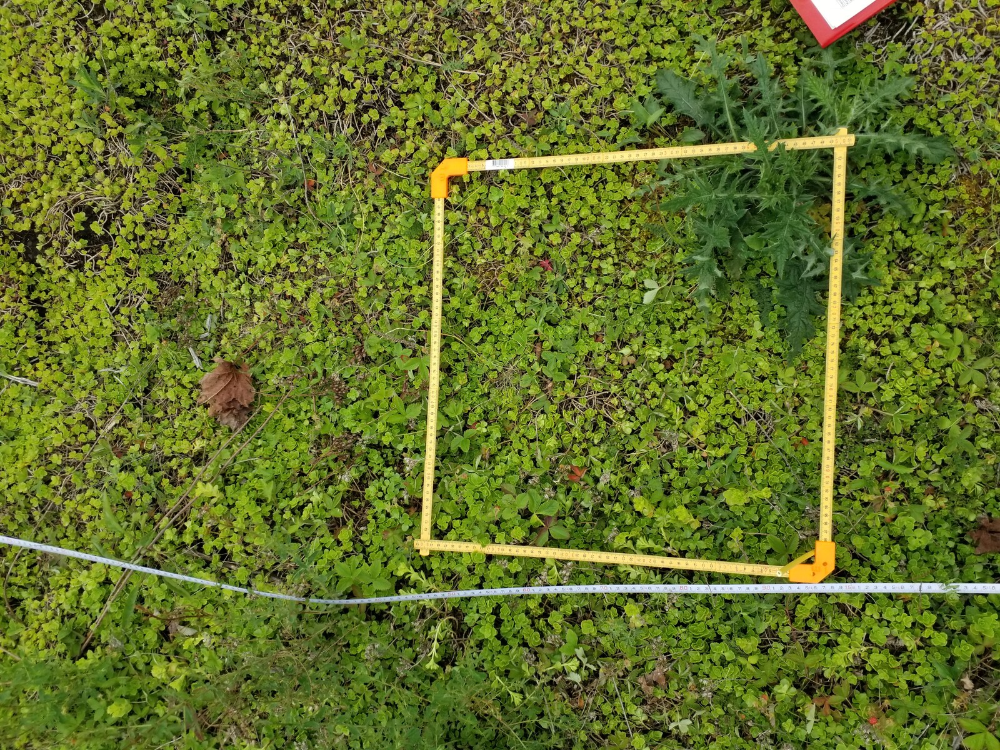
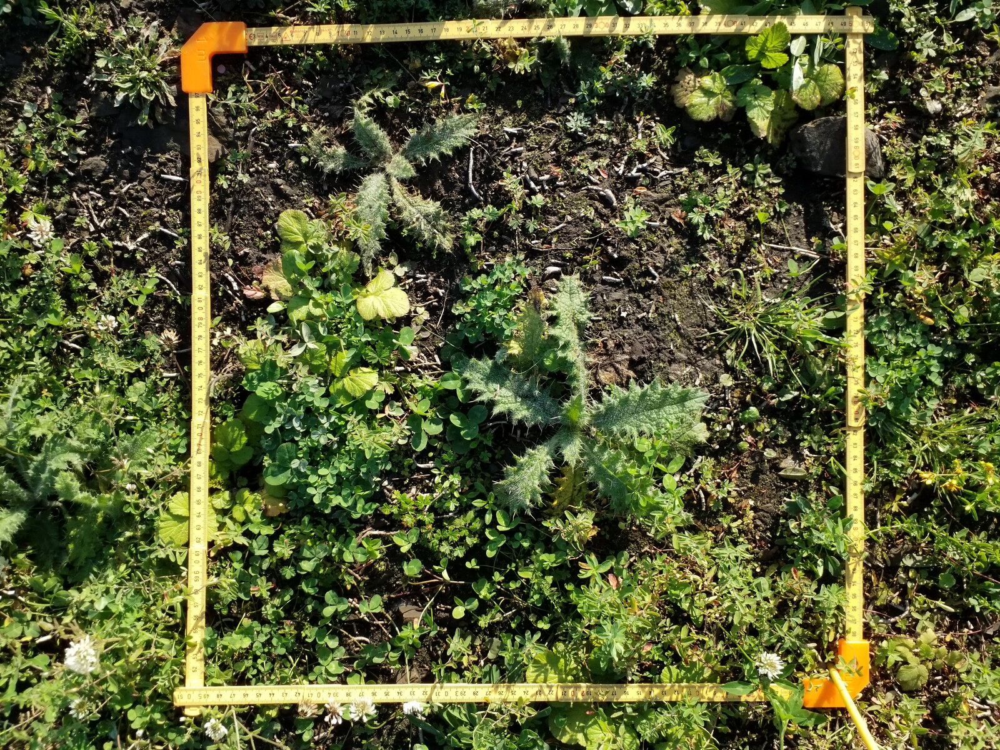
```

#### Loffen på Nakholmen

Loffen på nordsiden av Nakholmen er del av Nakholmen naturreservat. Området har svært høy dekning av gravbergknapp, og det forekommer i tillegg en rekke andre fremmede arter. Loffen er et viktig hekkeområde for fugl, og det er i tillegg vindutsatt. Loffen er leveområde for flere truede mosearter [@brynjulvsrud_2023], og tiltakene som er gjennomført, er målrettet for å ivareta disse forekomstene.

Datainnsamling på artsmangfold og tilstand før tiltak ble gjennomført i august 2022, se beskrivelse i @evju_2022b. Det antatte tiltaksområdet ble avgrenset basert på tegninger fra Statsforvalteren over prioritert tiltaksareal og utgjorde ca. 900 m^2^. 10 vegetasjonsruter på 0,5 × 0,5 m ble etablert og merket med høypresisjons-GPS.

Sommeren 2022 ble det bare lagt ut en liten duk, for å høste erfaring med hvilken type bardunering som var nødvendig for at duken skulle bli liggende (B. Bredesen, pers. medd.). Duken ble sikret med bruk av snor, paller og stein. Det ble i tillegg ryddet fremmede arter (utenom gravbergknapp) utenfor det tildekkede området. Basert på funn av sjeldne moser ble det i september 2023 lagt en ekstra duk kant i kant med den opprinnelige duken på sørvestsiden (på et område uten forekomster av trua arter), mens det på området nordøst for duken ble luket gravbergknapp manuelt. I 2025 ble to av dukene flyttet 50 meter nordøstover på odden, til et sted der det er krevende å luke gravbergknapp og der det samtidig ikke er viktige forekomster av moser, lav og karplanter. I august ble høy fra slåtteengene på Hovedøya lagt ut over arealer der det var fjernet duk. I 2025 ble det luket betydelige mengder gravbergknapp, i tillegg til en del andre fremmede arter. I 2026 er det også gjennomført luking av andre fremmede arter.

Det ble foretatt et gjenbesøk i september 2022, men fordi områdene med aktive tiltak var så små, ble datainnsamling ikke gjennomført i 2023 eller 2024. Den 25. august 2025 ble andre gjenbesøk gjennomført, dagen etter tiltakene. Det ble lagt ut fem supplerende ruter i nordre delen av lokaliteten for å fange opp flere effekter av tiltak. Tredje gjenbesøk ble gjennomført 18. august 2026, med registrering av variabler i vegetasjonssirklene.

<!--# Figur mangler: kart over Loffen på Nakholmen. Figurtekst fra utkastet: «Overvåkingslokaliteten på Loffen på Nakholmen. Det stripete området ble tildekket med duk i 2022, denne ble flyttet i 2025, de skraverte områdene viser duker lagt ut i 2023 og 2025. I det prikkete området ble det gjennomført avskaving av jord og manuell luking i 2023. Det er i tillegg luket gravbergknapp og andre arter innenfor og utenfor overvåkingsområdet. De lilla prikkene viser vegetasjonsruter (to prikker per rute) der overvåkingsdata samles inn.» -->

#### Padda

Tiltaksområdet ligger i Padda plantefredningsområde og omfatter både kalkfuruskog og åpen grunnlendt kalkmark. Store områder var mer eller mindre dominert av kratt og busker, hvorav mange stedegne arter, som liguster (*Ligustrum vulgare*), men også fremmede mispelarter. Det er tidligere gjennomført en del skjøtsel på Padda, inkludert rydding av furuforyngelse, hagemispler og berberis (*Berberis vulgaris*), og Padda er også lokalitet for utsetting av dvergtistel (*Cirsium acaule*, CR; @bjureke_2005). Områdene med åpen grunnlendt kalkmark varierer i tilstand – noen partier er åpne, andre er veldig gjengrodd med busk og kratt. Statsforvalteren og Oslo kommune gjennomførte en felles befaring i april 2022, der de ble enige om det viktigste tiltaksområdet i verneområdet (K. Bredland, pers. medd.).

Data på artsmangfold og tilstand før tiltak ble samlet inn i juni 2022, se beskrivelse i @evju_2022b, fra i alt 15 permanent merkede overvåkingsruter. Ni av overvåkingsrutene lå i åpen grunnlendt kalkmark og er fulgt opp videre. Det antatte tiltaksområdet ble avgrenset basert på tegninger fra Statsforvalteren av prioritert tiltaksareal på ca. 6000 m^2^. Tiltakene på Padda ble gjennomført i perioden 15. august til 1. september av NCC på oppdrag fra Oslo kommune, Bymiljøetaten. Det ble ryddet busker og trær, og både vinsj, gravemaskin med klype og skogsmaskin ble benyttet. Noen små områder med gravbergknapp ble dekket med duk, men dette var utenfor området dekket av overvåkingen. Det er de påfølgende årene gjennomført tiltak over større områder på Padda enn det som fanges opp av overvåkingen, men beskrivelsene her begrenser seg til de overvåkede områdene med åpen grunnlendt kalkmark. I 2023 ble det gjort oppfølgende rydding, særlig av mispler og liguster, i områdene som ble ryddet i 2022, men i 2023 ble alt arbeid gjennomført manuelt (vinsj, jekk mv.), uten bruk av kjøretøy. Alt plantematerialet ble fraktet ut med lekter. I tillegg ble det luket, særlig hvitsteinkløver, legesteinkløver og sneglebelg, i september 2023. I 2024 ble det luket hver tredje uke fra juni til oktober. Oppslag av busker, samt yngre løvtrær, ble fjernet med spett, trejekk og vinsj. Lukearbeidet ble videreført i 2025 og 2026.

Første gjenbesøk ble gjennomført i september 2022. Da registrerte vi variabler i sirklene rundt vegetasjonsrutene (se kap. 4 og @evju_2022b). Den 25. mai 2023 gjennomførte vi andre gjenbesøk, med både registreringer av vegetasjonssammensetning i overvåkingsrutene samt variabler i sirklene, for å ha et grunnlag for å vurdere behov for og effekt av oppfølgingstiltak. Vi avgrenset to områder, som dekket seks av de ni overvåkingsrutene, der Bymiljøetaten ble bedt om ikke å gjennomføre oppfølgende tiltak (@fig-padda-p6), slik at vi kunne vurdere effekten av oppfølging og behovet for etter-rydding. Et tredje gjenbesøk ble gjennomført 4. oktober 2023. Vi noterte nye tiltak samt variabler i sirklene rundt hver vegetasjonsrute [se @roos_2023a]. Fjerde gjenbesøk ble gjennomført 27. juni 2024, med registrering av vegetasjonssammensetning i overvåkingsrutene samt variabler i sirklene. Etter feltarbeidet ble gjerdene som sperret to områder for luking, fjernet, og disse områdene ble senere luket. Femte gjenbesøk ble gjennomført 25. august 2025, og sjette den 27. august 2026, begge gangene ble kun variabler i sirklene registrert.

<!--# Figur mangler: kart over Padda. Figurtekst fra utkastet: «Overvåkingslokaliteten på Padda. Den stiplede linjen viser en omtrentlig avgrensning av arealet der restaureringstiltak ble gjennomført i 2022 og som ble avgrenset som overvåkingslokalitet. Delområde skog er ikke fulgt opp systematisk. De skraverte områdene viser arealene som ble gjerdet inn i mai 2023, der det ikke ble gjennomført oppfølgende tiltak i 2023. De lilla prikkene viser vegetasjonsruter (to prikker per rute) der overvåkingsdata samles inn.» -->

```{r fig-padda-p6}
#| fig-cap: 'Noen områder på Padda ble gjerdet inne i mai 2023, og her ble det ikke ryddet/luket resten av vekstsesongen, slik at vi kunne undersøke hvor stort behovet for etter-rydding er. Bildene viser rute P6. Området rundt ruten ble ikke luket i 2023, men gjerdet ble tatt ned og området luket etter datainnsamling i juni 2024. Foto: NINA.'
#| fig-subcap:
#|   - 'Juni 2022.'
#|   - 'Juni 2023.'
#|   - 'Oktober 2023.'
#|   - 'Juni 2024.'
#| code-summary: 'Kode for figur.'
#| layout-ncol: 2
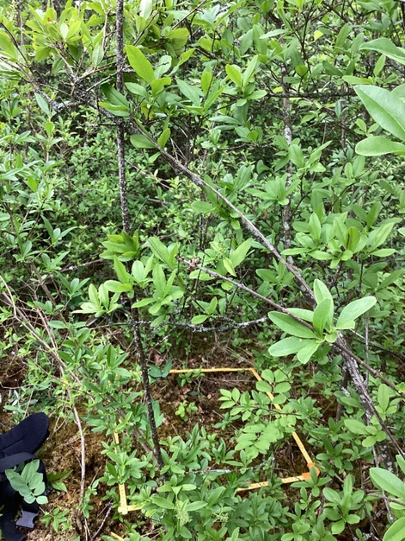
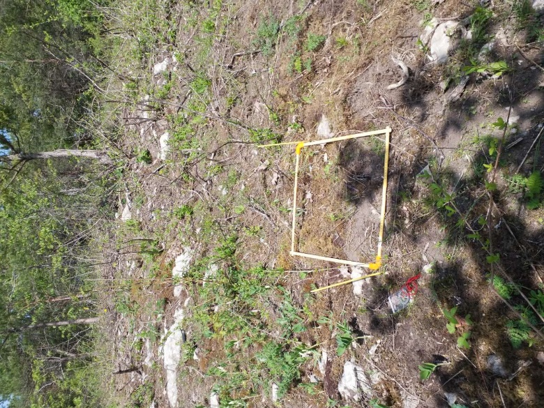
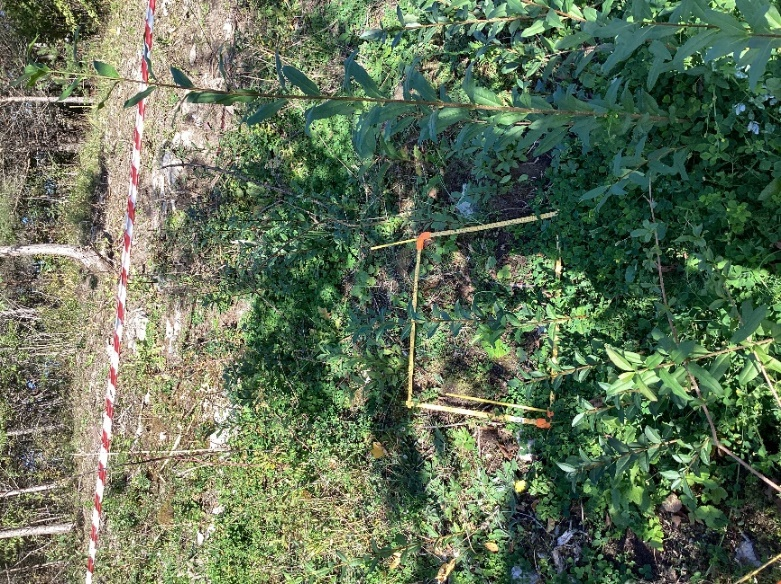
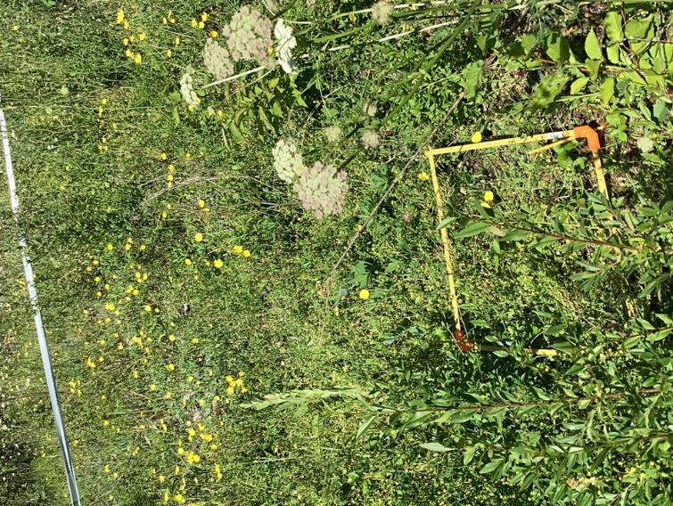
```

<!--# Fotograf for bildene av rute P6 er ukjent («Foto: NINA.» i utkastet). -->

#### Torvøya

Overvåkingslokaliteten omfatter en del av Torvøya og Bjerkholmen naturreservat. Hovedfokuset for restaureringsarbeidet på Torvøya er å fjerne de store feltene med gravbergknapp på den sørvestre delen av øya. I 2022 ble det gjennomført en felles befaring [se @evju_2022b], og det viktigste overvåkingsområdet, som omfattet omtrent 1000 m^2^, ble avgrenset (@fig-torvoya).

```{r fig-torvoya}
#| fig-cap: 'Overvåkingslokaliteten på Torvøya. Den stiplede linjen viser en omtrentlig avgrensning av arealet der restaureringstiltak er gjennomført. Det nordlige området ble tildekket med duk i 2022, og duken ble liggende hele 2023. Det sørlige området ble delvis sprøytet i oktober 2022 og ble sprøytet to ganger i løpet av 2023. De rosa prikkene viser vegetasjonsruter (to prikker per rute) der overvåkingsdata samles inn. Tiltak gjennomført etter datainnsamling i 2024, er ikke vist.'
#| code-summary: 'Kode for figur.'
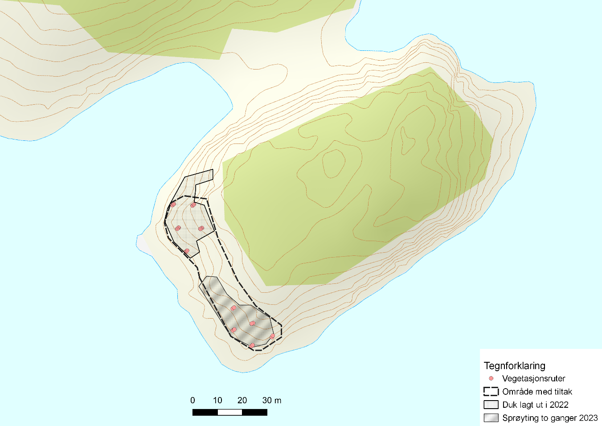
```

Data på artsmangfold og tilstand før tiltak ble samlet inn i august 2022. Til sammen 10 vegetasjonsruter på 0,5 × 0,5 m ble etablert og merket med høypresisjons-GPS (@fig-torvoya). Fem ruter ble etablert i den nordlige delen av overvåkingslokaliteten (Torvøya N), og disse ble dekket med duk i oktober 2022. Fem ruter ble etablert i den sørlige delen av overvåkingslokaliteten (Torvøya S), der sprøyting er gjennomført. Første runde med sprøyting ble gjennomført i deler av Torvøya S 18. oktober 2022. Det ble sprøytet direkte på matter av gravbergknapp, med en 50-50-blanding av Express Gold SX og Roundup, som var tilført klebemiddel (Biowet), for å sikre at sprøytemiddelet skulle holde seg på plantene. Blandingsforholdet for en 5 liters ryggsprøyte med sprøytemiddel var ¼ Roundup og ¾ vann, ca. 1 g Express Gold og noen milliliter klebemiddel [@lokken_2022]. I 2023 ble det lagt ut en ekstra duk oppå eksisterende duk i Torvøya N, da man observerte at gravbergknapp spirte under duken. I Torvøya S ble det sprøytet to ganger direkte på gravbergknapp (18. juli og 17. august), og fra 2023 er det sprøytet kun med glyfosat tilsatt klebemiddel. I september 2024 ble halve duken på Torvøya N fjernet. Området ble revegetert med 56 tuer på 0,25 × 0,25 m, som ble plantet med ca. 1,5 m avstand [@lokken_2024]. Tuene ble gravd ned i flukt med eksisterende jordsmonn og trykket godt til berggrunn og tilliggende jord. Tuene var hentet fra andre steder på Torvøya med intakt vegetasjon typisk for åpen grunnlendt kalkmark. Torvøya S ble sprøytet i to runder med ca. 5 ukers mellomrom (slutten av august, begynnelsen av oktober). I april 2025 ble resten av duken i Torvøya N fjernet, og arealet ble revegetert med 24 tuer, plassert subjektivt innenfor område der forholdene ble vurdert best for overlevelse [@bae_2025]. Torvøya S ble sprøytet i tre runder. Det ble luket uønskede arter i begge delområdene. I 2026 ble det luket gravbergknapp i Torvøya S, men før feltarbeidet var det ikke luket i Torvøya N.

<!--# Utkastet viser til en figur 2.8 (utplanting av tuer) som ikke finnes i utkastet. -->

Første gjenbesøk ble gjennomført 18. oktober 2022. Det nordlige området var da tildekket, og vi registrerte dekningsgrad av duk, fremmede arter og vedplanter i sirklene rundt vegetasjonsrutene. Andre gjenbesøk ble gjennomført 29. juni 2023. Vi registrerte både vegetasjonssammensetning i overvåkingsrutene og variabler i sirklene, men bare i Torvøya S, for å kunne vurdere effekten av en gangs sprøyting på dekningen av gravbergknapp. Tredje gjenbesøk ble gjennomført 3. oktober 2023, med kun sirkelregistreringer. Fjerde gjenbesøk ble gjennomført 7. juni 2024. Vi registrerte både vegetasjonssammensetning i overvåkingsrutene og variabler i sirklene i Torvøya S. Ingen nye behandlinger var gjennomført mellom tredje og fjerde gjenbesøk. Duken i Torvøya N lå hele vekstsesongen 2024. Femte gjenbesøk ble gjennomført 18. august. I Torvøya N registrerte vi både vegetasjonssammensetning i overvåkingsrutene og variabler i sirklene, mens i Torvøya S registrerte vi kun variabler i sirklene. Sjette gjenbesøk ble gjennomført 14. august 2026, med registreringer i sirklene.

<!--# Femte gjenbesøk «18. august» mangler år (2025?). -->

#### Malmøya

Restaureringsområdet på Malmøya ligger i Malmøya og Malmøykalven naturreservat, som er et stort naturreservat på ca. 509 daa, hvorav 274 daa er landareal. Området går sørover langs Malmøyas vestkyst fra Malmøytoppen, omfatter Malmøykalven og strekker seg videre langs kysten, til nordøst for Ormsund roklubb[^1]. Verneformål er knyttet til verdifulle geologiske forekomster med fossilførende bergarter, samt å bevare et særpreget område med stor variasjon i vegetasjonstyper knyttet til kambrosilurske kalkområder[^2]. Odden i Skinnarbukta er åpen grunnlendt kalkmark i mosaikk med nakent tørkeutsatt kalkberg, men deler av området er sterkt gjengrodde med syrin, hagemispler og en del furu. Området er mye brukt til friluftsliv, og det er et nettverk av stier og en god del slitasje på lokaliteten.

[^1]: <https://faktaark.naturbase.no/?id=VV00000370>

[^2]: <https://lovdata.no/dokument/LF/forskrift/2008-06-27-687>

Statsforvalteren, Oslo kommune, SNO og NINA gjennomførte en felles befaring i mai 2023. Det ble diskutert ulike løsninger for restaurering, og det viktigste tiltaksområdet ble avgrenset. Området utgjorde ca. 2000 m^2^.

Innsamling av data på artsmangfold og tilstand før tiltak ble gjennomført 3. august 2023. Vi la forsøksvis ut ett langt transekt fra den innerste delen av tiltaksområdet ut til spissen av odden, men pga. tett buskas var det vanskelig å legge transektet rett. Langs transektet etablerte vi vegetasjonsruter med 10 m avstand, totalt sju ruter, mens tre supplerende ruter ble lagt øst og vest for transektet, innenfor tiltaksområdet. Rutene ble merket med bruk av høypresisjons-GPS og analysert som beskrevet i kap. 4.

Tiltakene på Malmøya ble i hovedsak gjennomført i september–oktober 2023 av Vaktmesterkompaniet. Syrin, anslagsvis 100 m^2^, ble kappet ned, og stubbene og eventuelle gjenværende blader ble penslet med glyfosat i begynnelsen av oktober. Busker, i hovedsak mispler, men også noe liguster og unge løvtrær, ble dratt opp med rota. Det ble i hovedsak brukt vinsj, men også jekk, rothakke og spett. I tillegg ble det kappet en del ungfuru. Planteavfallet ble fraktet til parkeringsplassen og kjørt vekk. Det ble også gjennomført bekjempelse av russesvalerot innenfor området (luking). I løpet av vekstsesongen 2024 ble vinterkarse, løkurt, engryllik, steinkløver og andre uønskede urter luket omtrent hver tredje uke. I tillegg ble gjenstående små syrinbusker forsøkt fjernet med spett, trejekk og/eller vinsj. Større gjenstående busker og oppslag av syrin ble bekjempet med glyfosat. Oppslag av løvtrær ble kuttet lavt over bakkenivå, mens mindre trær ble dratt opp med vinsj/trejekk. Unge furutrær ble fjernet. I 2025 ble lukingen videreført, og oppslag av trær og busker ble fjernet. De få gjenværende fremmede buskene ble fjernet med røtter. I tillegg ble det sørligste feltet med syrin dekket med lystett PVC-presenninger, mens det midterste feltet med syrin ble behandlet med glyfosat tre ganger. Før feltarbeid i 2026 var det gjennomført en del luking, samt en gangs sprøyting av syrinfeltet.

Første gjenbesøk ble gjennomført den 4. oktober 2023, der vi noterte tiltak samt variabler i sirklene rundt hver vegetasjonsrute. Andre gjenbesøk ble gjennomført 27. juni 2024, med registrering av vegetasjonssammensetning i overvåkingsrutene samt variabler i sirklene. Tredje gjenbesøk ble gjennomført 14. august 2025 og fjerde 27. august 2026, begge med registrering av variabler i sirklene.

<!--# Figur mangler: kart over Malmøya. Figurtekst fra utkastet: «Overvåkingslokaliteten på Malmøya. Den stiplede linjen viser en omtrentlig avgrensning av arealet der restaureringstiltak skal gjennomføres. Deler av området der det tidligere var syrinkratt er sprøytet (prikket område) i 2025 og 2026, og en duk ble lagt ut i 2025 (stripete område). De lilla prikkene viser vegetasjonsruter (to prikker per rute) der overvåkingsdata samles inn.» -->

#### Husbergøya

Restaureringsområdet på Husbergøya ligger i Husbergøya naturreservat. Øya er «*en typelokalitet for en geologisk formasjon som kalles Husbergøyformasjonen og består av kambrosilurbergarter*»[^3]. Verneformål er å bevare geologisk og biologisk mangfold i form av naturtyper, arter og naturlig økologiske prosesser. En del av øya er skogbevokst, mens østskråningen og Husbergkalven er åpen grunnlendt kalkmark. Det er en god del gjengroing av den åpne grunnlendte kalkmarka på Husbergøya, i hovedsak av stedegne arter som roser, berberis og andre løvtrær, men dels også med hagemispler. I noen mindre områder forekommer også gravbergknapp.

[^3]: <https://faktaark.naturbase.no/?id=VV00002670>

Statsforvalteren, Oslo kommune og NINA gjennomførte en felles befaring i april 2023. Det ble diskutert ulike løsninger for restaurering, og det viktigste tiltaksområdet ble avgrenset (@fig-husbergoya). Området utgjorde i overkant av 30 000 m^2^.

Innsamling av data på artsmangfold og tilstand før tiltak ble gjennomført 31. juli og 1. august 2023. Lokaliteten inngår også i basisovervåkingen av åpen grunnlendt kalkmark, og datainnsamling ble samkjørt mellom de to prosjektene. Først ble polygoner av åpen grunnlendt kalkmark avgrenset (@fig-husbergoya). Deretter etablerte vi vegetasjonsruter i de områdene som var omfattet av tiltak. Vi benyttet metoden som brukes i basisovervåkingen av åpen grunnlendt kalkmark [@evju_2020b]: For å finne posisjonen for vegetasjonsrutene ble et rutenett på 10 × 10 m konstruert og lagt over polygonene. Alle skjæringspunkter i rutenettet ble definert som potensielle vegetasjonsruter, og deretter ble rutene trukket tilfeldig. Dette sikret en minsteavstand på 10 m mellom vegetasjonsrutene. Fordi tiltaksområdet var så stort, etablerte vi totalt 18 vegetasjonsruter i det største delområdet for å fange opp variasjonen i tilstand innenfor tiltaksområdet. Noen av rutene lå også utenfor tiltaksområdet, og kan da brukes til å sammenligne endringer i områder med og uten tiltak. Vi etablerte også fem ruter i det minste delområdet. Rutene ble merket med bruk av høypresisjons-GPS (@fig-husbergoya) og analysert som beskrevet i kap. 4.

```{r fig-husbergoya}
#| fig-cap: 'Overvåkingslokaliteten på Husbergøya. De røde linjene viser avgrensede polygoner med åpen grunnlendt kalkmark. Den stiplede linjen viser en omtrentlig avgrensning av arealet der restaureringstiltak er gjennomført. De rosa prikkene viser vegetasjonsruter (to prikker per rute) der overvåkingsdata samles inn, fordelt på fem ruter i delområde 1 (3-3a) og atten ruter i delområde 2 (3-3b).'
#| code-summary: 'Kode for figur.'
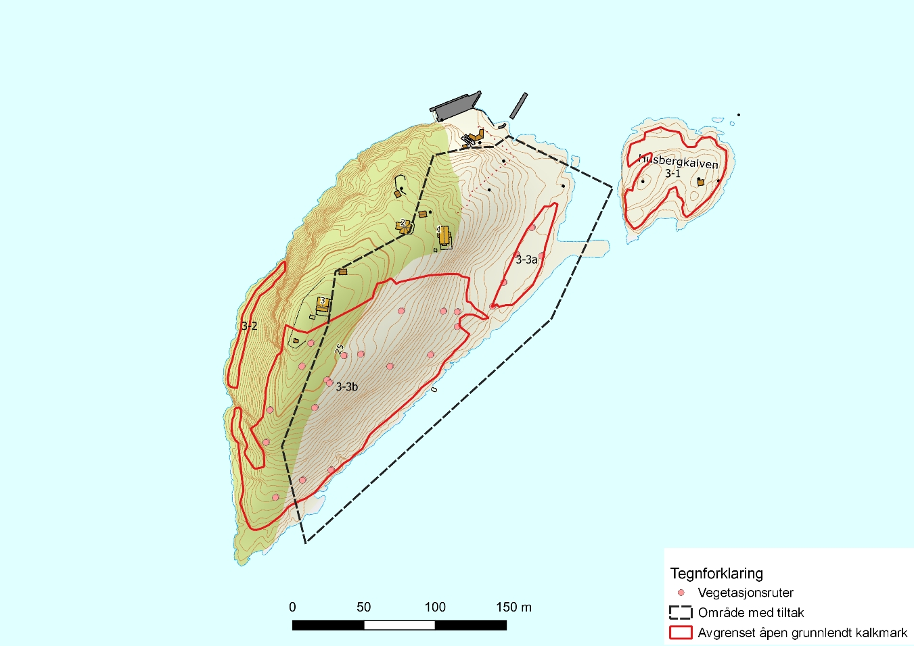
```

Den siste uka i juli 2023 ble det satt ut fem geiter på Husbergøya. Geitene er av rasen «kystgeit» og eies av Oslo kommune/Bogstad gård. Området som geitene kunne bevege seg på, ble avgrenset med tanke på å være stort nok til at de kunne bevege seg fritt uten å «stange» i ytterkantene for ofte, samtidig som de kunne beite i de områdene med mest busker og trær. Geitene hadde GPS-halsbånd som varslet med lyd og deretter støt når de nærmet seg/gikk over grensene (Nofence[^4]). Ideelt sett skulle etableringen av overvåkingen blitt gjort før geitene kom utpå øya, men dette lot seg ikke gjøre av logistiske årsaker. Beitetrykket den første uka var imidlertid lavt – vi så få eller ingen beitespor i vegetasjonsrutene som ble etablert, men noen stier/tråkk var dannet. Geitene var ute til slutten av oktober. I oktober ble det manuelt ryddet en del ungfuru, mispler og andre busker i de områdene hvor buskdekningen var høyest, totalt 2–3 containere, som ble fjernet og skal brennes. I tillegg ble det luket engryllik (*Achillea nobilis*, HI). Ryddingen ble gjort av to deltakere fra Bymiljøetaten og åtte fra Natur og Ungdoms lokallag i Nesodden samt Nesodden kommune.

[^4]: <https://www.nofence.no/en/>

I 2024 ble ti geiter satt ut på Husbergøya (@fig-geiter). Geitene var på øya fra og med 6. september til 19. november, og beiteområdet ble utvidet noe utover sesongen. I 2025 var ti geiter på beite fra tidlig august til midten av november. Det ble gjennomført en dugnad 9. september med ti fra Bymiljøetaten, tre fra Nesodden kommune og en fra Statsforvalteren. Det ble i hovedsak fjernet furu, mispler og berberis, samt noe luking av russesvalerot og andre fremmedarter. Det ble også skavet av mindre områder med gravbergknapp. I 2026 var geitene ikke kommet på beite før feltarbeidet 25. august. Det var gjennomført én økt med luking av engryllik og russesvalerot tidligere i august.

<!--# Teksten sier at geitene var på beite fra tidlig august i 2025, mens @tbl-tiltak sier september–november. -->

Første gjenbesøk ble gjennomført 11. september 2024, med registrering av variabler i sirklene, og avdekket først og fremst effektene av ryddejobben (geiter og manuelt) som ble gjennomført høsten 2023. Andre gjenbesøk ble gjennomført 25. august 2025 og inkluderte både vegetasjonsanalyser i rutene og sirkelanalyser. Tredje gjenbesøk ble gjennomført 25. august 2026 og omfattet kun sirkelanalyser.

```{r fig-geiter}
#| fig-cap: 'Kystgeitene på Husbergøya i 2024. Foto: Ruben E. Roos/NINA.'
#| code-summary: 'Kode for figur.'
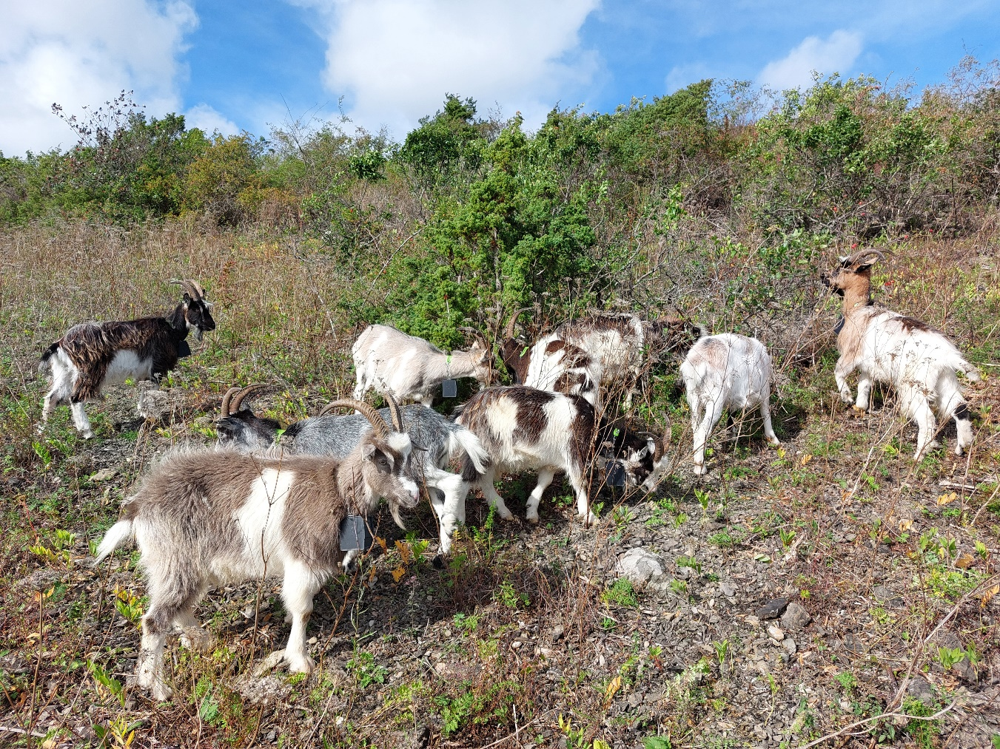
```

#### Fyrsteila

Fyrsteila er vernet som plantefredningsområde. Her finnes kalkrike svaberg, tørrberg og kantkratt, og verneformålet er å bevare sjeldne plantearter og deres livsmiljø i form av bl.a. kalktørrenger og bergknappsamfunn. Plantesamfunnene er imidlertid dominert av store matter med gravbergknapp, i tillegg til syrinkratt rundt bebyggelsen og en god del andre fremmede plantearter.

Lokaliteten er derfor prioritert for restaureringstiltak, som ble startet opp i 2023 av Naturrestaurering AS [@lokken_lohre_2024]. For å teste tidsbruk og effekt av ulike metoder for bekjempelse av gravbergknapp, og hvordan de samspiller med ulike revegeteringsmetoder, ble deler av Fyrsteila satt av til et lite eksperiment [@lokken_2025]. Oppsettet består av fem hele og en halv blokk der følgende bekjempelsesmetoder testes:

-   Luking (fjerning av hele matter med gravbergknapp)
-   Luking med påfølgende sprøyting
-   Sprøyting
-   Sprøyting og fjerning av organisk materiale
-   Tildekking (2 sesonger)
-   Tildekking (1 sesong, ½ blokk).

Bekjempningstiltakene ble satt i gang i september 2023. Sprøyting ble gjort i 2 runder med ca. 4 ukers mellomrom i perioden midten av september og begynnelsen av oktober. Fjerning av matter med vegetasjon ble gjort løpende gjennom høsten, mens duk ble lagt på i begynnelsen av oktober. Ingen ytterligere bekjempningstiltak er gjennomført før registreringene i 2026.

I 2024 ble det gjennomført revegeteringstiltak i alle blokkene, med unntak av blokken med tildekking i to år. I blokken med tildekking i 2 år ble det gjennomført revegetering i 2025. Følgende metoder ble testet, med to gjentak per blokk:

-   Tue (T)
-   Frø (F)
-   Tue + frø (TF)
-   Kontroll (ingen revegetering; K)

Tuene ble hentet fra intakt åpen grunnlendt kalkmark fra naboøya Knerten og var 0,25 × 0,25 m. Det ble samlet frø lokalt, blant annet av smalkjempe (*Plantago lanceolata*), blodstorkenebb (*Geranium sanguineum*) og harekløver (*Trifolium arvense*), som ble supplert med systematisk utsåing av tidligere innsamlede frø fra utvalgte lokaliteter i indre Oslofjord [@lokken_2022]. Disse frøene ble samlet som del av prosjektet i 2022, og var ikke sortert på arter. Arter inkluderte et utvalg vanlige arter på grunnlendt mark. Artssammensetning ble ikke notert ned i 2022.

<!--# Tuestørrelse: utkastet har «0,25 × 0,25 cm», endret til m som for Torvøya. Kontroller. -->

I 2025 ble det gjennomført vegetasjonsanalyser i 44 ruter på 0,5 × 0,5 m i eksperimentet (Rennemo 2026), som del av en masteroppgave. I 2026 ble eksperimentet implementert som del av dette prosjektet. Størrelsen på vegetasjonsanalysen ble endret til 1 × 1 m for bedre å fange opp effekter av vegetasjonstuer som revegeteringsmetode. Feltarbeidet ble gjennomført 18. og 19. august 2026.

<!--# Full referanse til Rennemo (2026) mangler. -->

### 3.2 Tiltak

@tbl-tiltak gir en kortfattet oppsummering av utfordringer og tiltak på de sju overvåkingslokalitetene. Tiltakene i tabellen fokuserer på det som er gjort innenfor overvåkingsområdene, fram til august 2026. Flere tiltak er gjennomført på lokalitetene, men utenfor de områdene som overvåkes.

```{r tbl-tiltak}
#| tbl-cap: 'Utfordringer, tiltak og datainnsamling på de sju overvåkingslokalitetene.'
#| code-summary: 'Kode for tabell.'
tribble(
  ~Lokalitet, ~Utfordring, ~Tiltak, ~Datainnsamling,
  "Bleikøya NR, nord for kløften",
  "Matter med gravbergknapp, samt gjengroing med busker og trær, inkl. hagemispler",
  "2022: Duk som dekker gravbergknapp lagt ut. Fjerning av hagemispler og en del andre trær og busker.<br>2023: Fjerning av liten del av duk (september). Revegetering med små tuer.<br>2024: Fjerning av ny liten del av duk (mai), luking av gravbergknapp i det området der duken ble fjernet.<br>2025: Luking der duk ble fjernet i 2024. Fjerning av duk i øst, samt fjerning av totalt 9 m³ jord. Spredning av høy fra slåtteenga på Bleikøya, samt av frø sanket på øyene.<br>2026: Fjerning av siste duk. Luking.",
  "2022: Før-data (juni). Etter-data (forenklet; september)<br>2023: Etter-data (forenklet; oktober)<br>2024: Etter-data (forenklet; september)<br>2025: Etter-data (detaljert; august)<br>2026: Etter-data (forenklet; august)",
  "Loffen på Nakholmen",
  "Matter med gravbergknapp samt andre fremmede arter",
  "2022: Duk som dekker liten del av gravbergknapp lagt ut.<br>2023: Supplerende liten duk lagt ut, totalt ca. 200 m².<br>2025: Fjerning av nordre halvparten av duken, hvoretter høy fra engslått på Hovedøya ble lagt ut, i august. Luking av gravbergknapp og avskaving av jord med gravbergknapp rundt presenningene.<br>2026: Luking.",
  "2022: Før-data (august). Etter-data (forenklet; september)<br>2025: Etter-data (detaljert; august), men dagen etter tiltakene. Fem supplerende ruter ble lagt ut i nordre delen av lokaliteten for å kunne fange opp effekten av framtidig luking av gravbergknappen.<br>2026: Etter-data (forenklet; august)",
  "Padda",
  "Gjengroing med hagemispler, samt liguster og andre trær og busker",
  "2022: Fjerning av busker og trær.<br>2023: Supplerende fjerning av busker og trær. Luking av vinterkarse og andre ugrasarter.<br>2024: Luking og fjerning av oppslag av kratt.<br>2025: Luking.<br>2026: Luking.",
  "2022: Før-data (juni). Etter-data (forenklet; september)<br>2023: Etter-data (detaljert; juni, forenklet; oktober)<br>2024: Etter-data (detaljert; juni)<br>2025: Etter-data (forenklet; august)<br>2026: Etter-data (forenklet; august)",
  "Torvøya",
  "Matter med gravbergknapp",
  "2022: Nord: Duk som dekker gravbergknapp lagt ut. Sør: Delvis sprøyting.<br>2023: Sør: Sprøytet i to omganger.<br>2024: Ingen nye tiltak før datainnsamling. Senere i sesongen: Nord: Fjerning av halve duken + revegetering (september). Sør: Sprøyting av gravbergknapp.<br>2025: Nord: Fjerning av resten av duken i april. Sør: Sprøyting av gravbergknapp.<br>2026: Nord: Ingen tiltak før overvåking. Sør: Selektiv luking av gravbergknapp.",
  "2022: Før-data (august). Etter-data (forenklet; oktober)<br>2023: Etter-data (sør detaljert; juni. Sør, forenklet; oktober)<br>2024: Etter-data (sør, detaljert; juni)<br>2025: Etter-data (nord detaljert; august. Sør forenklet; august)<br>2026: Etter-data (forenklet; august)",
  "Malmøya",
  "Gjengroing med trær og busker, særlig syrin, men også hagemispler",
  "2023: Ryddet busker og trær.<br>2024: Videreføring av rydding, luking av oppslag av ugrasarter.<br>2025: Fjerning av oppslag av trær og busker, luking av ugrasarter, sprøyting av oppslag av syrin, samt tildekking med lystett duk av et område med kuttet syrin.<br>2026: Luking. Sprøyting av oppslag av syrin nord for duk.",
  "2023: Før-data (detaljert; juni). Etter-data (forenklet; oktober)<br>2024: Etter-data (detaljert; juni)<br>2025: Etter-data (forenklet; august)<br>2026: Etter-data (forenklet; august)",
  "Husbergøya",
  "Gjengroing med trær og busker",
  "2023: Fem geiter fra slutten av juli til slutten av oktober. Rydding av busker/trær i oktober.<br>2024: Ti geiter fra 6. september til 19. november. Rydding av busker/trær, dels innen beiteområdet.<br>2025: Ti geiter september–november. Krattrydding og luking.<br>2026: Luking av russesvalerot og engryllik. Geiter ikke satt ut før overvåking.",
  "2023: Før-data (detaljert; august)<br>2024: Etter-data (forenklet; september)<br>2025: Etter-data (detaljert; august)<br>2026: Etter-data (forenklet; august)",
  "Fyrsteila",
  "Matter med gravbergknapp",
  "2024: Uttesting av ulike bekjempningsmetoder for gravbergknapp i kombinasjon med ulike revegeteringsmetoder.",
  "2025: Etter-data (detaljert; juli)<br>2026: Etter-data (detaljert; august)"
) |>
  kable(escape = FALSE)
```

<!--# Kontroller tabellen mot teksten: Malmøya før-data står som juni 2023 i tabellen, men 3. august 2023 i teksten. Fyrsteila: bekjempelsen startet i september 2023 ifølge teksten, tabellen sier 2024. -->

## 4. Datainnsamling

Metodikken for datainnsamling er hentet fra forslaget til optimalovervåking av åpen grunnlendt kalkmark [@evju_2021b] og innebærer:

-   etablering av faste overvåkingsruter på 0,5 × 0,5 m (5–15, avhengig av tiltaksareal)
-   registrering av alle forekommende karplanter i rutene, med dekningsgrad
-   registrering av dekning av ulike vegetasjonssjikt (inkl. fremmedarter og problemarter), slitasje, kjørespor og menneskelige objekter i sirkler med 5 m radius rundt hver overvåkingsrute

Metodikk for utlegging og gjenbesøk, samt datainnsamling i felt, er beskrevet i detalj i @evju_2022b og @roos_2023a. Metodikken tilsvarer den som er brukt i basisovervåking av åpen grunnlendt kalkmark [@evju_2020b]. Indikatorer for overvåkingen er beskrevet i @tbl-indikatorer.

På Fyrsteila er det plassert åtte ruter per blokk (fire i halv blokk), totalt 44 ruter, i en systematisk utlegging [@lokken_2025]. Rutene er 1 × 1 m store, og det inngår ikke sirkelanalyser her.

```{r tbl-indikatorer}
#| tbl-cap: 'Indikatorer og datainnsamling for åpen grunnlendt kalkmark. Frekvens «varierer» viser til @tbl-tiltak.'
#| code-summary: 'Kode for tabell.'
rute <- "0,5 × 0,5 m"
sirkel <- "78,5 m² sirkel"
tribble(
  ~Indikator, ~`Variabel registrert i felt`, ~Utvalgsenhet, ~`Utlegging av utvalgsenhet`, ~`Antall utvalgsenheter`, ~`Frekvens for datainnsamling`,
  "Artssammensetning", "Forekomst og mengde (% dekning) av alle karplanter", rute, "Tilfeldig", "5–15", "Varierer",
  "Artsrikdom: alle karplanter, rødlistearter, habitatspesialister", "Forekomst og mengde (% dekning) av alle karplanter", rute, "Tilfeldig", "5–15", "Varierer",
  "Dekning av habitatspesialister", "Forekomst og mengde (% dekning) av alle karplanter", rute, "Tilfeldig", "5–15", "Varierer",
  "Dekning av vedplanter: feltsjikt, busksjikt, tresjikt", "% dekning av vedplanter i hvert sjikt", sirkel, "Tilfeldig", "5–15", "Årlig",
  "Dekning av fremmede arter", "% dekning av fremmede karplanter\\*", sirkel, "Tilfeldig", "5–15", "Årlig",
  "Dekning av problemarter", "% dekning av problematiske karplanter\\*\\*", sirkel, "Tilfeldig", "5–15", "Årlig",
  "Dekning av slitasje", "% dekning av slitasje, kjørespor og andre jordforstyrrelser (f.eks. ved oppgraving av busker)", sirkel, "Tilfeldig", "5–15", "Årlig",
  "Tiltak i vegetasjonsrute", "Type tiltak i vegetasjonsruten: duk, sprøyting, krattrydding, luking, annet", rute, "Tilfeldig", "5–15", "Varierer",
  "Omfang av tiltak i vegetasjonsrute", "Andelen (%) av vegetasjonsruten omfattet av tiltak", rute, "Tilfeldig", "5–15", "Varierer",
  "Tiltak i vegetasjonssirkel\\*\\*\\*", "Type tiltak: duk, sprøyting, krattrydding, luking, annet", sirkel, "Tilfeldig", "5–15", "Årlig",
  "Areal med tiltak", "Areal med tiltak", "Polygon", "Heldekkende", "–", "Årlig"
) |>
  kable()
```

\* Planter i kategoriene SE, HI og PH i gjeldende fremmedartsliste.

\*\* For problemarter, se diskusjon i teksten.

\*\*\* Erfaring fra felt viser at det er vanskelig å anslå andelen av sirkelen som er omfattet av et gitt tiltak. I stedet registreres tiltak gjennomført siden forrige overvåkingstidspunkt.

Data er samlet inn med appen Survey123.

<!--# Feltprotokollen (vedlegg 1 i utkastet) er ikke med. -->

## 5. Dataanalyser

Metoder i dette delprosjektet er tidligere dokumentert i @evju_2022b, @roos_2023a og @roos_2024a. Resultatene er vist som gjennomsnitt per sirkel eller rute for hver lokalitet og hvert registreringstidspunkt, med ± 1 standardfeil.

<!--# Setningen om gjennomsnitt ± 1 standardfeil er lagt til ut fra figurtekstene og skriptet. Kontroller. -->

Datasettet er tilgjengelig på NINAs IPT-side: <https://ipt.nina.no/resource?r=calcareous_grassland_monitoring&v=1.4> og direkte i GBIF-databasen via <https://doi.org/10.15468/pn7j2k>.

Skriptene er tilgjengelige på GitHub: <https://github.com/NINAnor/effektovervaaking-2026-2030/tree/main/Apen-grunnlendt-kalkmark/code>

<!--# Utkastet lenket til det gamle repoet (NINAnor/effektovervaaking). Lenken er oppdatert til det nye repoet. Kontroller om datasettversjonen på IPT (v=1.4) skal oppdateres med 2026-data. -->

## 6. Resultater

### 6.1 Bekjempelse av gravbergknapp

Bekjempelse av gravbergknapp er gjort med duk på Bleikøya, Nakholmen og Torvøya N og med sprøyting på Torvøya S.

Av de ti overvåkingsrutene på Bleikøya ble åtte helt eller delvis tildekket, mens sirkelen ble tildekket for alle ti ruter (fra 2–100 %). Varighet på tildekking var tre vekstsesonger for en rute, fire vekstsesonger for tre ruter og fem vekstsesonger for de øvrige fire rutene. Det har blitt luket jevnlig, men det er vanskelig å fastslå omfanget av luking for hver enkelt sirkel. Det er gjort noen ulike revegeteringstiltak i området.

På Torvøya N ble alle de fem overvåkingsrutene tildekket høsten 2022, etter før-undersøkelser. På to ruter/sirkler ble duken fjernet høsten 2024 (varighet to vekstsesonger), og det ble plantet inn tuer av stedegen vegetasjon. På de tre øvrige ble duken fjernet våren 2025 (også varighet to vekstsesonger). Arealet ble luket høsten 2025.

På Torvøya S har man målrettet sprøytet gravbergknapp hvert år. Første sprøyting i oktober 2022 var ufullstendig (tre av fem ruter sprøytet), men i 2023 ble det sprøytet to ganger, og det ble også sprøytet i 2024 og 2025, se @lokken_2024 for detaljer. I 2026 var det luket noe gravbergknapp.

På Nakholmen er det i tillegg til små duker gjort manuell fjerning av matter av gravbergknapp, og det er lagt ut noe høy fra Hovedøya.

Det er ikke mulig å regne på effekten av varighet av tildekking, betydningen av luking eller forskjellen mellom tildekking og sprøyting fordi utvalgsstørrelsen for hver kombinasjon av forklaringsvariabel er for liten.

Figurene under viser oppdaterte resultater for viktige variabler i sirklene rundt vegetasjonsrutene siden 2025. Vi henviser til 2025-rapporten for resultater fra vegetasjonsanalyser (som ikke er gjennomført i 2026).

I sirklene har tiltakene i stor grad redusert dekningen av fremmede arter, men der duken nylig er fjernet, forekommer oppslag, særlig av vinterkarse (@fig-gbk-sirkler). Også i de sprøytede områdene på Torvøya S utgjør vinterkarse en stor del av fremmedartsdekningen, særlig fra 2024. En del andre ugrasarter, dvs. ruderale arter som ikke hører hjemme på åpen grunnlendt kalkmark, forekommer også, men i relativt lav mengde.

```{r fig-gbk-sirkler}
#| fig-cap: 'Dekning av fremmedarter og dekning av problemarter (ugrasarter) på Bleikøya (tildekking med duk), Nakholmen (tildekking av mindre områder, luking i andre), Torvøya N (tildekking med duk) og Torvøya S (sprøyting). Stolpene viser gjennomsnitt per sirkel, og vertikale linjer viser ± 1 standardfeil. Merk ulik skala på y-aksen på de to figurene. Tid 0 er før tiltak for alle lokaliteter, mens tid ≥ 1 er etter tiltak. Bleikøya: 0 = 06-22, 1 = 09-22 (tildekket), 2 = 10-23 (tildekket, litt duk fjernet), 3 = 09-24 (tildekket, litt mer duk fjernet), 4 = 08-25 (det meste av duken fjernet), 5 = 08-26 (all duk fjernet). Nakholmen: 0 = 08-22, 1 = 09-22 (en liten duk), 2 = 08-25 (to små duker, noe luking), 3 = 08-26 (to små duker, noe luking). Torvøya N: 0 = 08-22, 1 = 10-22 (tildekket), 2 = 08-25 (duken fjernet), 3 = 08-26. Torvøya S: 0 = 08-22, 1 = 10-22 (sprøytet samme dag), 2 = 06-23 (delvis sprøytet 1 gang), 3 = 10-23 (sprøytet), 4 = 06-24 (sprøytet), 5 = 08-25 (sprøytet), 6 = 08-26 (luket).'
#| code-summary: 'Kode for figur.'
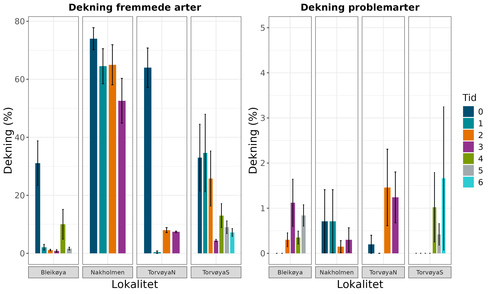
```

#### Konklusjon

Både tildekking med duk og sprøyting har den ønskede effekten, som er å redusere mengden av gravbergknapp. Mens tildekking med duk har stor og umiddelbar effekt på dekningen av fremmede arter, viste erfaringen på Torvøya at sprøyting gir en mer gradvis tilbakegang. Hvor mange vekstsesonger sprøytingen bør pågå for å gi varige effekter, er usikkert, og er trolig avhengig av lokale faktorer, inkludert dekning av gravbergknapp fra start, men det siste året har Naturrestaurering AS valgt å ikke sprøyte, men heller luke gravbergknapp målrettet [@bae_2025]. Når gjennomsnittlig dekning av gravbergknapp blir lavere enn ca. 10 %, fremstår det stort sett mindre ressurskrevende og med bedre effekt å gå over til luking fremfor sprøyting (Løkken og Bae, pers. obs.). Imidlertid viser resultatene fra Fyrsteila at sprøyting, enten alene eller i kombinasjon med andre tiltak, ga rask tilbakegang av gravbergknapp på kort sikt. Når resultatene på Nakholmen viser liten nedgang i dekning av fremmede arter, skyldes det at tiltak bare er gjennomført på deler av området som overvåkingen dekker.

Overvåkingen synliggjør dessuten at det er viktig med oppfølgende tiltak, i hovedsak luking. Når duken fjernes, og på områdene der gravbergknapp er sprøytet, etablerer det seg andre fremmede arter, særlig vinterkarse, men også andre ruderale arter. En del av dem er nitrogenfikserende og vil således bidra til å anrike jordsmonnet (f.eks. sneglebelg, hvitsteinkløver, hvitkløver), mens nedbryting av biomassen av andre, særlig store arter (filtkongslys, veitistel) også vil bidra til jordsmonndannelse, som kan være problematisk på sikt. En del gravbergknapp overlever også tiltakene og må bekjempes, slik at en unngår at det etableres større bestander over tid.

Effektene av revegeteringstiltak er per nå ikke mulig å undersøke pga. for små utvalgsstørrelser.

#### Fyrsteila

Selv om det ikke er før-data fra de eksperimentelle rutene på Fyrsteila, anser vi kontrollrutene som ble lagt ut i 2025, som representative for tilstanden før tiltak. Dekningen av gravbergknapp var der i gjennomsnitt i overkant av 30 %. Resultatene viser at alle tiltakene hadde rask effekt, men at manuell fjerning uten etterbehandling ga oppskudd av gravbergknapp i 2026 (@fig-fyr-veg). Dekningen av fremmede arter (gravbergknapp inkludert) var betydelig høyere i rutene som var tildekket enn der gravbergknapp var fjernet manuelt, enn i de andre behandlingene (@fig-fyr-fa). Vi observerte med andre ord oppslag av andre uønskede arter, i hovedsak vinterkarse, etter bekjempelse med duk. Av andre ugrasarter var sneglebelg vanlig, etter tildekking. Det var ingen tydelige effekter av de ulike bekjempelsesmetodene på artsrikdom per rute (@fig-fyr-veg), eller på antall habitatspesialister (@fig-fyr-hs). Resultatene kan tyde på at dekningen av habitatspesialister var noe høyere i ruter som ble sprøytet. Dette skyldes i hovedsak en voldsom oppblomstring av prikkperikum. Også aksveronika utgjorde stor dekning i en del ruter.

<!--# Setningen «betydelig høyere i rutene som var tildekket enn der gravbergknapp var fjernet manuelt, enn i de andre behandlingene» er uklar. I figuren er dekningen omtrent like høy for duk og fjerning, og lavere for de andre behandlingene. -->

```{r fig-fyr-veg}
#| fig-cap: 'Dekning av gravbergknapp og antall karplantearter i overvåkingsrutene på Fyrsteila, for ulike bekjempelsesmetoder. Det er ikke data fra før bekjempelse, men kontrollruter uten tiltak ble analysert i 2025. Rutestørrelsen i 2025 (tid 1) var 0,25 m² og i 2026 (tid 2) 1 m², så antall arter per rute er ikke direkte sammenlignbart.'
#| code-summary: 'Kode for figur.'
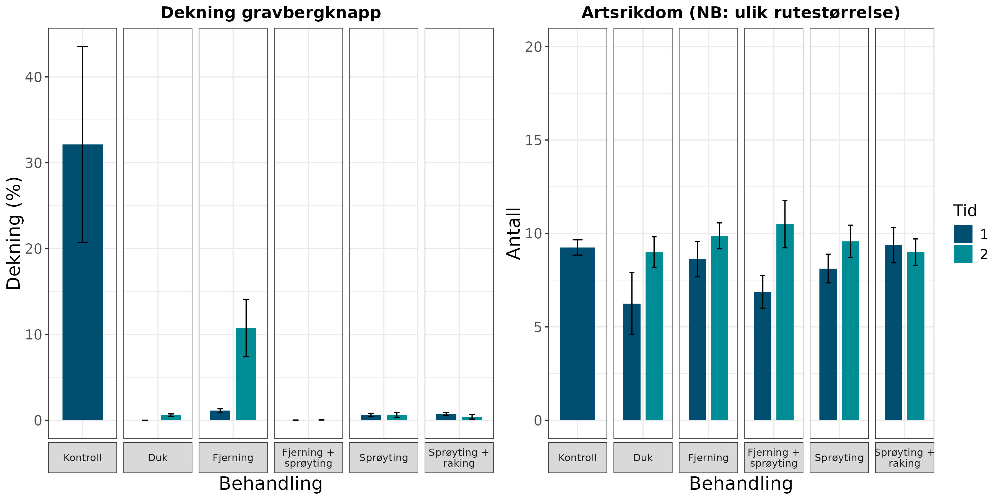
```

```{r fig-fyr-fa}
#| fig-cap: 'Antall fremmede karplantearter og dekning av de fremmede artene i overvåkingsrutene på Fyrsteila, for ulike bekjempelsesmetoder. Det er ikke data fra før bekjempelse, men kontrollruter uten tiltak ble analysert i 2025. Rutestørrelsen i 2025 (tid 1) var 0,25 m² og i 2026 (tid 2) 1 m², så antall arter per rute er ikke direkte sammenlignbart.'
#| code-summary: 'Kode for figur.'
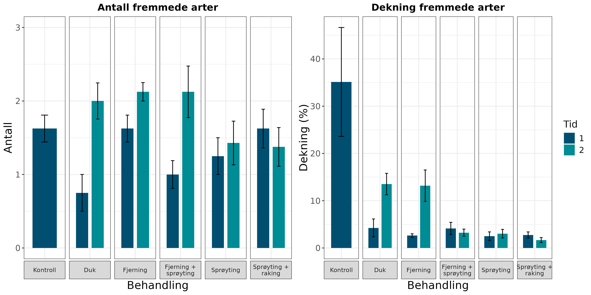
```

```{r fig-fyr-hs}
#| fig-cap: 'Antall habitatspesialister og dekning av habitatspesialistene i overvåkingsrutene på Fyrsteila, for ulike bekjempelsesmetoder. Det er ikke data fra før bekjempelse, men kontrollruter uten tiltak ble analysert i 2025. Rutestørrelsen i 2025 (tid 1) var 0,25 m² og i 2026 (tid 2) 1 m², så antall arter per rute er ikke direkte sammenlignbart.'
#| code-summary: 'Kode for figur.'
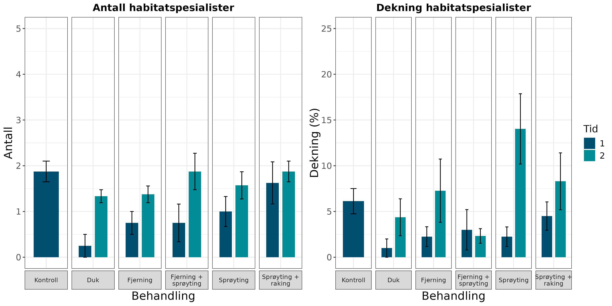
```

Revegetering ga høyere dekning av habitatspesialister enn ingen revegetering (@fig-fyr-reveg-hs). Det kan se ut som om utplanting av tuer begrenset framveksten av gravbergknapp etter tiltak (@fig-fyr-reveg-veg), og rutene uten aktiv revegetering hadde høyere dekning av fremmede arter totalt (@fig-fyr-reveg-fa). Effekten av revegetering på antall arter, både totalt, på habitatspesialister og fremmede arter, var liten (merk få arter på y-aksene på figurene).

```{r fig-fyr-reveg-hs}
#| fig-cap: 'Antall og dekning av habitatspesialister i overvåkingsrutene på Fyrsteila i 2026, for ulike revegeteringsmetoder.'
#| code-summary: 'Kode for figur.'
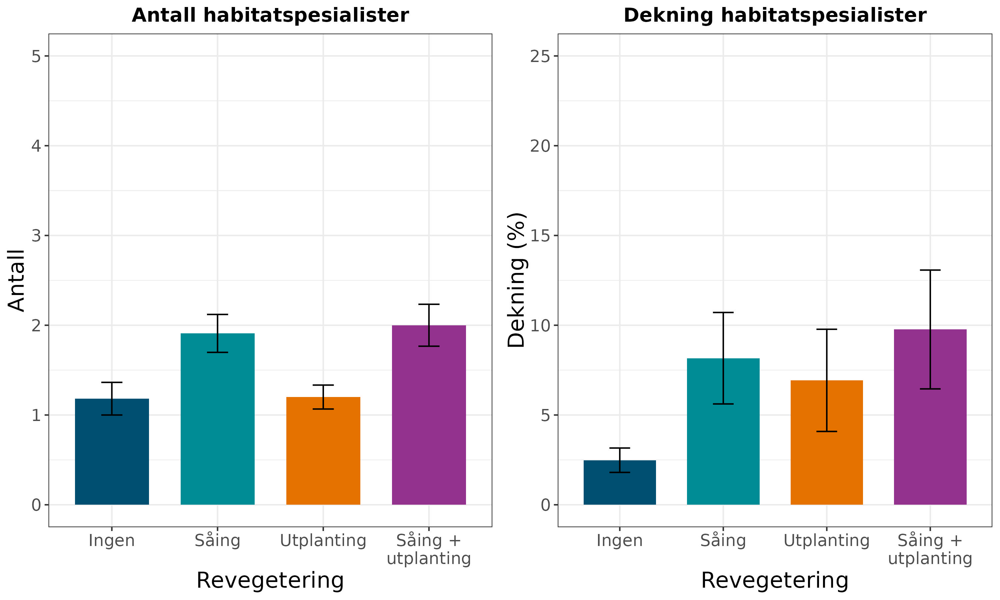
```

```{r fig-fyr-reveg-veg}
#| fig-cap: 'Dekning av gravbergknapp og totalt antall karplantearter i overvåkingsrutene på Fyrsteila i 2026, for ulike revegeteringsmetoder.'
#| code-summary: 'Kode for figur.'
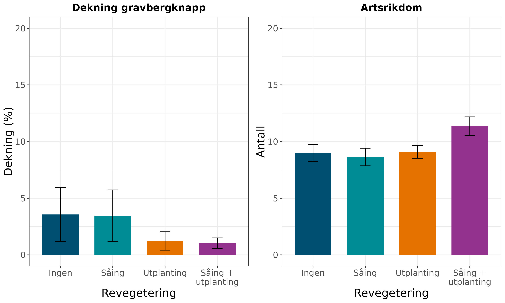
```

```{r fig-fyr-reveg-fa}
#| fig-cap: 'Antall og dekning av fremmede arter i overvåkingsrutene på Fyrsteila i 2026, for ulike revegeteringsmetoder.'
#| code-summary: 'Kode for figur.'
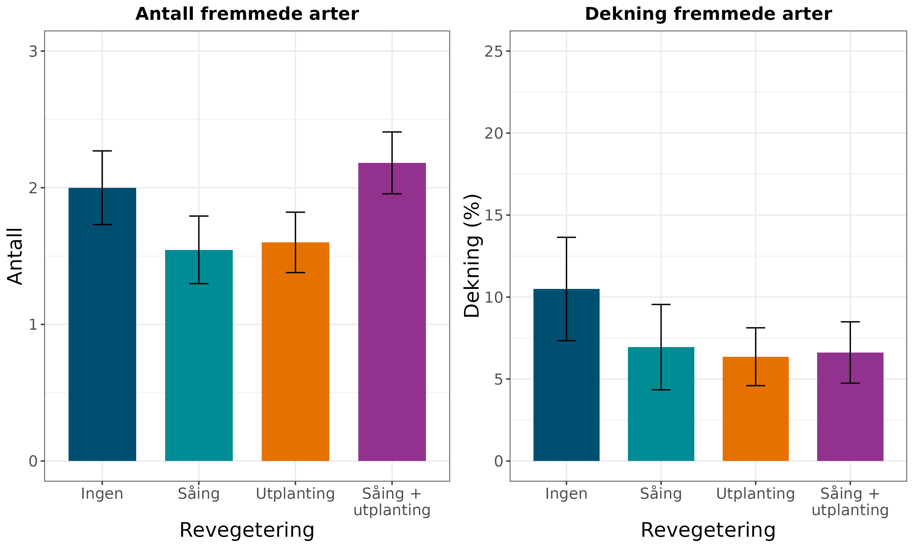
```

Det er bare to gjentak av hver kombinasjon av revegetering og bekjempelsesmetodikk, så det er vanskelig per nå å vurdere den kombinerte effekten. Såing og utplanting, alene og i kombinasjon, så ut til å gi størst effekt på dekningen av habitatspesialister i ruter som var sprøytet, eller der vegetasjonsmatter ble fjernet, men det skyldtes i stor grad oppslag av prikkperikum; antallet arter var ikke høyere. Revegeteringstiltak så ut til å ha størst effekt for å redusere oppslag av fremmede arter der gravbergknapp var bekjempet med duk eller fjerning av vegetasjonsmatter (uten påfølgende sprøyting).

### 6.2 Bekjempelse av gjengroing

Rydding av kratt og trær, både stedegne og fremmede, ble først satt i gang på Padda, med omfattende rydding med maskiner i 2022. I etterkant har det blitt luket oppslag av ugrasarter, men også gjort oppfølgende rydding av kratt, men det var ikke gjort krattrydding før feltarbeidet i 2026. På Malmøya har det i hovedsak vært bekjempet syrin, med nedkapping i 2023 og påfølgende luking, sprøyting og tildekking. På Husbergøya har det i tillegg til geitebeite blitt ryddet busker og kratt, dels innenfor og dels utenfor det beitede området, og 2026-overvåkingen fanger opp effektene av tiltak i 2023–25.

Figurene under viser oppdaterte resultater for viktige variabler i sirklene rundt vegetasjonsrutene siden 2025. Vi henviser til 2025-rapporten for resultater fra vegetasjonsanalyser (som ikke er gjennomført i 2026).

#### Dekning av vedplanter og oppslag av problemarter

Dekningen av vedplanter i busk- og feltsjikt var høyest på Padda før tiltakene ble iverksatt (@fig-busk-sirkler). Fremmede arter, dvs. ulike hagemispler, utgjorde en viss andel av dekningen av vedplanter, særlig på Padda, men også på Malmøya og dels på Husbergøya. Syrin er i @fig-busk-sirkler ikke regnet som fremmedart (fordi den ikke var risikovurdert på gjeldende fremmedartsliste da første overvåking ble gjennomført), men utgjorde en stor andel av vedplantene på Malmøya. Som @fig-busk-sirkler viser, har krattrydding på Padda og Malmøya hatt effekt på gjengroingen, men nye oppslag må ryddes jevnlig (se svingningene i dekning mellom registreringstidspunktene). Beiting og krattrydding på Husbergøya har foreløpig ikke vært intensiv nok til å påvirke dekningen av vedplanter, eller dekning av fremmede arter.

```{r fig-busk-sirkler}
#| fig-cap: 'Dekning av vedplanter (summert over busk- og feltsjikt) og dekning av fremmede arter i sirklene på Husbergøya (beite med geiter, krattrydding), Malmøya (krattrydding) og Padda (krattrydding). Stolpene viser gjennomsnitt per sirkel, og vertikale linjer viser ± 1 standardfeil. Skalaen på y-aksen er forskjellig for de to figurene. Tid 0 er før tiltak for alle lokaliteter, mens tid ≥ 1 er etter tiltak. Husbergøya: 0 = 07-23, 1 = 09-24 (en sesong med beite og krattrydding), 2 = 09-25 (to sesonger med beite og krattrydding), 3 = 08-26 (tre sesonger med beite og krattrydding). Malmøya: 0 = 08-23, 1 = 10-23 (krattrydding), 2 = 06-24 (ingen nye tiltak), 3 = 08-25 (luking, sprøyting), 4 = 08-26 (luking, sprøyting, tildekking). Padda: 0 = 06-22, 1 = 09-22 (krattrydding), 2 = 05-23 (ingen nye tiltak), 3 = 10-23 (luking, krattrydding), 4 = 06-24 (luking, krattrydding), 5 = 08-25 (luking, krattrydding), 6 = 08-26 (luking).'
#| code-summary: 'Kode for figur.'
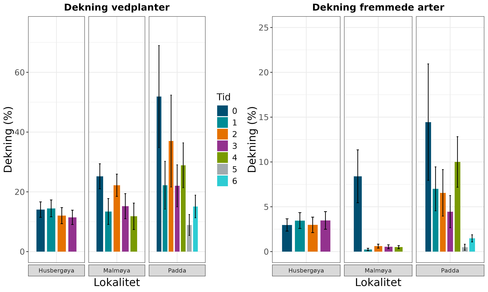
```

Både på Padda og Malmøya har det i tillegg til krattoppslag vært oppslag av ugrasarter etter krattryddingen. Ugrasartene etablerer seg særlig på forstyrret mark, der det er dratt opp busker eller kjørt med tunge kjøretøy. Som vist i 2025-rapporten, er luking viktig for å holde utfordrende arter nede etter at restaureringstiltakene var gjennomført. I de lukede områdene ble utfordrende arter holdt nede gjennom vekstsesongen 2023 (mellom tid 2 og 3), mens dekningen mer enn doblet seg i de ikke-lukede områdene. Fram mot juni 2024 økte dekningen enda mer i de ikke-lukede områdene (@fig-padda-utfordrende). I 2026 var oppslaget av ugrasarter noe høyere igjen, som viser at luking er en langsiktig oppgave. Området som ikke var luket, hadde, paradoksalt nok, lavere dekning av utfordrende arter enn området som var luket. Dette skyldes at bare tiltaksområdene, der slitasjen opprinnelig var størst, ble skåret som luket i 2026-data.

```{r fig-padda-utfordrende}
#| fig-cap: 'Dekning av utfordrende arter (fremmede arter og stedegne ugrasarter som sneglebelg) på Padda. Ved tid 3 og 4 var deler av området gjerdet inn og ble ikke luket, men gjerdet ble fjernet og hele området luket mellom tid 4 og 5. Padda: 0 = 06-22 (før tiltak), 1 = 09-22 (krattrydding), 2 = 05-23 (ingen nye tiltak), 3 = 10-23 (luking, krattrydding), 4 = 06-24 (luking, krattrydding), 5 = 08-25 (luking, krattrydding), 6 = 08-26 (luking). Stolpene viser gjennomsnitt per sirkel, og vertikale linjer viser ± 1 standardfeil.'
#| code-summary: 'Kode for figur.'
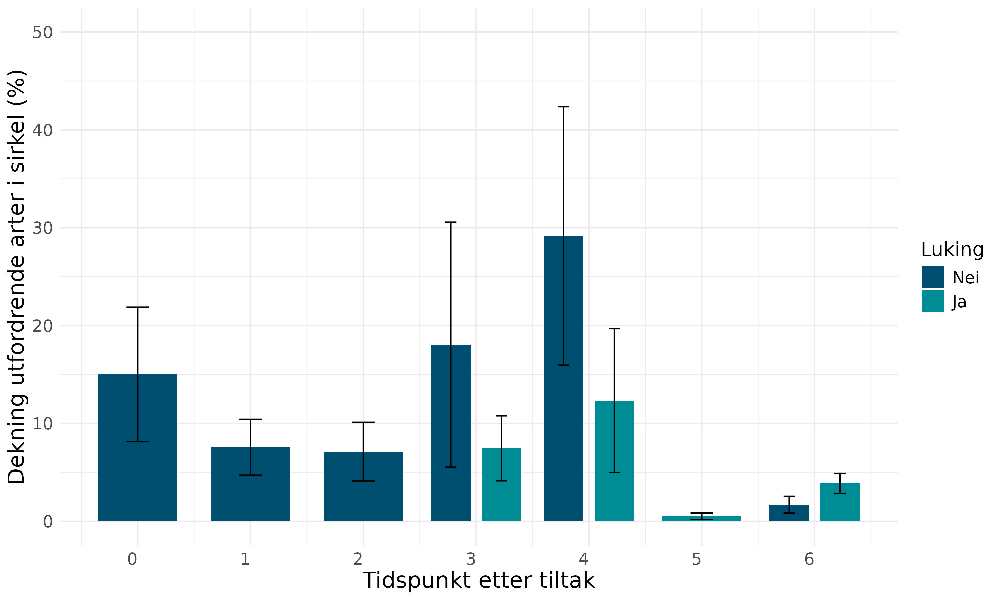
```

#### Konklusjon

Krattrydding gir lavere dekning av vedplanter i felt- og busksjikt, men det er nødvendig med oppfølgende tiltak for å sikre at effekten varer. Oppfølgende tiltak inkluderer både rydding av oppslag av kratt, og luking av ugrasarter som etablerer seg der jorda er forstyrret. Resultatene fra Padda viser at ugrasarter kan etablere svært høy dekning dersom det ikke lukes, og mye jordforstyrrelser legger til rette for etablering av ugrasarter. Dette gjelder særlig ved bruk av kjøretøy under tiltakene, men er også noe en bør være oppmerksom på når man rykker opp busker med rota. Ett år uten rydding av oppslag av kratt gir utslag på dekningen av vedplanter (se Padda, tid 6 i @fig-busk-sirkler).

Det kan synes som om beitet og krattryddingen på Husbergøya begynner å gi små effekter på dekningen av vedplanter.

<!--# Denne setningen og avsnittet over figuren («Beiting og krattrydding på Husbergøya har foreløpig ikke vært intensiv nok til å påvirke dekningen av vedplanter») sier ulike ting. -->

## 7. Oppsummering

### 7.1 Hva viser årets resultater

<!--# Tiltakenes effekt per nå, endringer siden i fjor, usikkerhet. Mangler i utkastet. -->

### 7.2 Anbefaling for videreføring

Overvåking av effekter av tiltak på åpen grunnlendt kalkmark har nå pågått i fire sesonger og omfatter seks lokaliteter. Fordi tiltakene som gjennomføres er såpass varierte, og ofte foregår i kombinasjon, har vi ikke nok statistisk styrke til å konkludere klart og generelt om hvordan krattrydding eller bekjempelse av gravbergknapp bør gjennomføres. Dataene fra Fyrsteila vil bidra til å øke kunnskapsgrunnlaget, særlig ved å dokumentere behovet for etterarbeid, om metodenes kostnadseffektivitet.

<!--# «fire sesonger og seks lokaliteter»: i 2026 er det fem sesonger (2022–2026) og sju lokaliteter. Siste setning ser uferdig ut. -->

#### Bekjempelse av gravbergknapp

Både duk og sprøyting reduserer dekningen av gravbergknapp effektivt. Hvor mange vekstsesonger duken bør ligge, er uklart. På våre lokaliteter har noe gravbergknapp dukket fram når duken er fjernet, uavhengig av varighet av tildekking, så påfølgende luking er nødvendig. Resultatene fra Fyrsteila tyder på at oppslaget av gravbergknapp er størst der det kun er luket/fjernet vegetasjonsmatter manuelt.

Etter tiltakene blottstilles store mengder organisk materiale, som tilrettelegger for etablering av ugrasarter (både fremmede og stedegne). Dette gjør at tid og ressurser må være satt av til oppfølgende luking, sannsynligvis over flere år. Resultatene fra Fyrsteila viser at sprøyting reduserer oppslag av både gravbergknapp og andre fremmede arter, sammenlignet med tildekking med duk eller fjerning av vegetasjonsmatter.

Kortsiktige resultater fra Fyrsteila kan tyde på at utplanting av tuer kan begrense oppslaget av gravbergknapp spesielt og fremmede arter generelt etter tiltak, men effektene er ikke veldig store.

#### Bekjempelse av gjengroing

I hovedsak viser overvåkingen at aktive tiltak for å bekjempe busker og kratt, med jekk, spett og nedkapping (med påfølgende sprøyting), gir raskere effekt enn beitedyr. Det er viktig å sette av tid og ressurser til oppfølgende tiltak i flere år. Oppfølgende tiltak inkluderer både rydding av krattoppslag, enten med kapping, oppgraving eller sprøyting, og luking av ugrasarter (både fremmede og stedegne). Mengden ugrasarter som etablerer seg, samvarierer med graden av slitasje som oppstår ved de første restaureringstiltakene, og svært gjengrodde lokaliteter vil dermed trenge mer omfattende oppfølging etter restaurering enn lokaliteter der enkeltbusker fjernes.

Som for bekjempelse av gravbergknapp, kan vi ikke konkludere om hvor stort behovet er for aktive revegeteringstiltak etter krattrydding, og hvordan de bør utformes.

#### Veien videre

Effekten av tiltakene på påvirkningsfaktorene (gravbergknapp, gjengroing) er i hovedsak tydelige etter fire–fem år. I årets undersøkelser er effektene på naturmangfold ikke inkludert, men fjorårets resultater viste små effekter på både karplanter (rødlistearter, habitatspesifikke arter) og andre artsgrupper. Resultatene fra Fyrsteila tyder på XXX.

<!--# Fullfør setningen om Fyrsteila. -->

For videre tiltak anbefaler vi:

-   Videreføring av luking og rydding av krattoppslag på alle lokaliteter.
-   På Fyrsteila, dokumentasjon av innsats knyttet til etterarbeid for hver av bekjempelsesmetodene, for mer kunnskap om kostnadseffektive metoder over tid.
-   Utvidet systematisk oppfølging av revegeteringstiltak. Det er ulike typer tiltak som er aktuelle, inkl. tilsåing, utplanting av tuer i ulik størrelse, utlegging av høy. Det er en mulighet nå til å gjøre dette systematisk for å få mer kunnskap om hvilke metoder som er mest effektive for å øke mangfoldet og populasjonsstørrelsene av habitatspesialister på åpen grunnlendt kalkmark.
    -   Forsøket på Fyrsteila, som dokumenteres her, er et viktig første skritt, men det er lite og med få gjentak og vil ikke gi robuste svar for skikkelig kunnskapsoppbygging.

For videre overvåking anbefaler vi:

-   Overvåking iht. prosjektplanen, med detaljerte undersøkelser av vegetasjonens sammensetning (og dermed indikatorer for naturmangfold) i 2027 og 2030, og forenklede undersøkelser i 2028 og 2029.
-   Gjentak av vegetasjonsanalyser på Fyrsteila i 2029.

Videreføring av overvåkingen kan gi generell kunnskap om tiden det tar før tiltakene har effekt på stedegent naturmangfold (artsrikdom og populasjonsstørrelser), og om varigheten på behovet for ettertiltak.

## 8. Referanser

::: {#refs}
:::

## 9. Author contributions

<!--# CRediT- og MeRIT-erklæring mangler i utkastet. -->

:::: {.content-visible when-format="html"}
::: {.callout-tip collapse="true"}
## Session Info

This information is mainly aimed at developers that need to recreate the R environment that produced the html.

```{r sessionInfo}
#| echo: false
sessionInfo()
```
:::
::::
