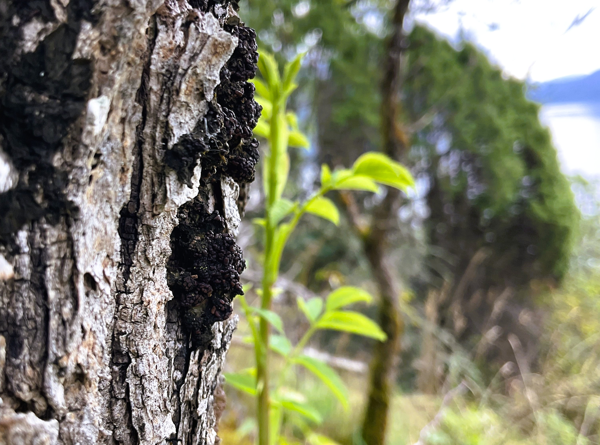
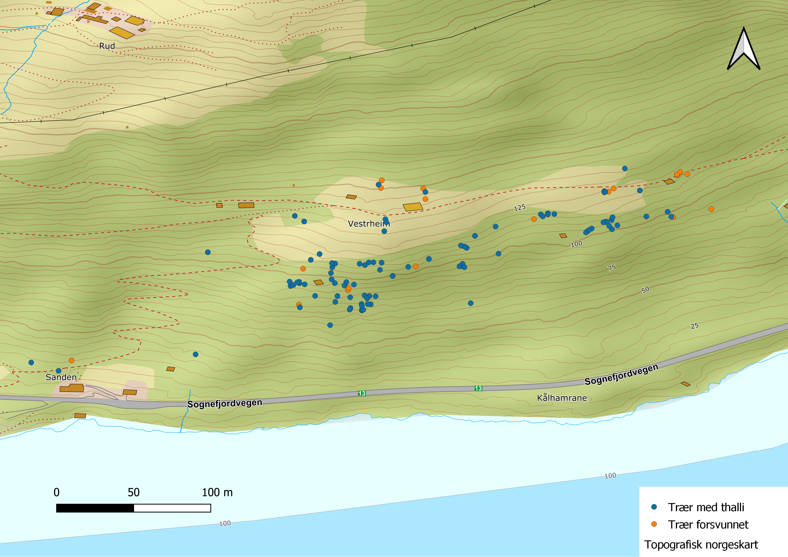

<!--# Rapporten leser kun filer i data/ og img/. Tekstgrunnlaget er Mathias Andreasens utkast «Vedlegg årsrapport 2026_mal_askeglye.docx» (P:/Askeglye). Alle referansene i utkastet er tatt med i referanselista (nocite), også de som ikke er sitert i teksten. -->

```{r setup}
#| include: false
#| cache: false
library(knitr)
library(tidyverse)
library(kableExtra)
library(here)
library(anybadger)
library(yaml)
library(tibble)
library(conflicted)
library(readxl)
conflicts_prefer(dplyr::filter)
conflicts_prefer(dplyr::lag)
conflicts_prefer(dplyr::select)
pull <- dplyr::pull
```

<!--# The following parts are autogenerated. Do not edit. -->

```{r source}
#| echo: false
#| cache: false
source(here::here("_common.R"))

# Badges som markdown (for README.md på GitHub), med relativ sti til versjonsbadgen
md_badge <- function(tag) {
  src <- sub(paste0(here::here(), "/"), "", tag$children[[1]]$attribs$src, fixed = TRUE)
  sprintf("[](%s)", src, tag$attribs$href)
}
```

:::: {.content-visible when-format="gfm"}
::: callout-note
Denne siden er generert fra [`Askeglye.qmd`](Askeglye.qmd). Ikke rediger `README.md` direkte. For å oppdatere: kjør skriptene i [`code/`](code/) og kjør `pixi run render`. Rapporten har ingen egne analyser; tabellene og figurene ligger i [`data/`](data/) og [`img/`](img/).
:::

`r paste(md_badge(status_badge(as.character(st))), md_badge(version_badge(as.character(version[[1]]))), md_badge(data_badge(as.character(badges[[1]]))), md_badge(code_badge(as.character(badges[[2]]))), md_badge(open_science_badge(as.character(badges[[3]]))), md_badge(license_badge()))`
::::

:::: {.content-visible when-format="html"}
```{r reviewers}
#| echo: false
#| results: asis

if (!is.null(yaml_data$codeReviewers)) {
  reviewers <- purrr::map_chr(yaml_data$codeReviewers, "name")

  htmltools::HTML(paste0(
    '<div id="title-block-header" class="quarto-title-block default">
       <div class="quarto-title-meta">
         <div>
           <div class="quarto-title-meta-heading">Reviewed by</div>
           <div class="quarto-title-meta-contents">',
    paste(reviewers, collapse = "; "),
    '</div>
         </div>
       </div>
     </div>',
    sep = ""
  ))
}
```

::: {layout-ncol="6"}
```{r statusBadge}
#| echo: false
status_badge(as.character(st))
```

```{r versionBadge}
#| echo: false
version_badge(my_version_number = as.character(version[[1]]))
```

```{r dataBadge}
#| echo: false
data_badge(as.character(badges[[1]]))
```

```{r codeBadge}
#| echo: false
code_badge(as.character(badges[[2]]))
```

```{r openScienceBadge}
#| echo: false
open_science_badge(as.character(badges[[3]]))
```

```{r licenseBadge}
#| echo: false
license_badge()
```
:::
::::

> **Recommended citation**: `r paste(auth, " ", year, ". ", name, " (ID: ", folder_name, ") ", "v. ", version, ". ecRxiv: ", url, sep="")`

::: {.callout-tip collapse="true"}
## Metadata

```{r tbl-meta2}
#| tbl-cap: 'Indicator metadata'
#| echo: false
#| warning: false
meta |>
  dplyr::filter(Variable %in% c(
    "Indicator ID",
    "Indicator Name",
    "verbatimName",
    "Continent",
    "Country",
    "Realm",
    "Biome",
    "Ecosystem",
    "verbatimEcosystem",
    "Year added",
    "Last update",
    "Version",
    "Version comment",
    "Precision")) |>
  kable()
```
:::

::: {.callout-tip collapse="true"}
## Log

<!--# Legg til en kort linje for hver oppdatering -->

11. nov. 2026 – Første versjon, basert på Mathias Andreasens tekst for 2026 (overtatt fra Ruben Erik Roos' oppsett)
:::

<hr />

## Oppsummering

Askeglye (*Collema leptaleum*) er kritisk truet (CR) i Norge og er i Europa bare kjent fra Vestrheim og Sanden i Leikanger, Sogndal kommune. Rapporteringen for 2026 sammenstiller gjennomførte tiltak, kartfestede forsøk og opplysninger fra Statsforvalteren i Vestland. Det foreligger ikke en ny systematisk bestandstelling eller kontroll av de limfestede thalliene i årets dokumentasjon. Siste fullstendige status er derfor fra 2025, da arten ble rapportert på 103 trær og bestanden anslått til 7 726 thalli [@roos_2025].

Dokumenterte bevaringstiltak omfatter ringbarking av gran og translokasjonsforsøk fra 2022, samt fornyede forsøk med limfesting i 2025. I 2026 har Statsforvalteren ført oppsyn og dokumentert veltede vertstrær. Innkjøpt metallnetting er ikke montert. Det er meldt om beiting på unge askeskudd, men ikke om nye barkgnag på stående ask ved vinterbesøkene. Det er opplyst om 20 000 kroner til fjerning av smågran; gjennomføringen er ikke bekreftet. Prioriterte oppgaver i 2027 er kontroll av de seks translokasjonstrærne, sikring av vertstrær og askeforyngelse, og kartfestet oppfølging av eventuell skjøtsel. Litteraturen gir grunnlag for videre metodeutvikling og DNA-undersøkelser, men dokumenterer ikke at selvopprettholdende nye bestander er etablert.

## English summary

<!--# Utkast. Skal kontrolleres av prosjektledergruppa mot den endelige norske oppsummeringen. -->

*Collema leptaleum* is critically endangered (CR) in Norway, and in Europe it is known only from Vestrheim and Sanden in Leikanger, Sogndal municipality. The 2026 reporting brings together completed measures, mapped experiments and information from the County Governor of Vestland. No new systematic population count or check of the glued thalli was carried out this year. The latest complete status is therefore from 2025, when the species was reported on 103 trees and the population was estimated at 7,726 thalli.

Documented conservation measures include ring-barking of Norway spruce and translocation experiments from 2022, and renewed experiments with gluing in 2025. In 2026, the County Governor has inspected the site and documented fallen host trees. Metal netting has been bought but not installed. Browsing on young ash shoots has been reported, but no new bark stripping on standing ash during the winter visits. NOK 20,000 has reportedly been allocated to removing young spruce, but this has not been confirmed as carried out. Priorities for 2027 are checking the six translocation trees, protecting host trees and ash regeneration, and mapped follow-up of any management. The literature provides a basis for further method development and DNA studies, but does not show that new self-sustaining populations have been established.

## 1. Innledning

Askeglye er en barklevende cyanolav i *Collemataceae*. Arten er vurdert som kritisk truet (CR) etter kriterium D1 i Norsk rødliste for arter 2021. Den norske forekomsten vokser på ask *Fraxinus excelsior* i sørvendt edellauvskog og tidligere hagemark. Tap av vertstrær, hjortebeiting og gjengroing er sentrale trusler. Askeskuddsyke er en viktig belastning, men døde og svekkede trær kan ha flere årsaker [@haugan_2021; @roos_2025; @larsen_2026].

Utenfor Europa er arten kjent fra tempererte og tropiske strøk i Afrika, Asia, Australia og Nord- og Sør-Amerika [@haugan_2021].

Delprosjektet skal dokumentere tiltak og legge grunnlag for å undersøke virkningen på laven, vertstrærne og habitatet. Årets leveranse er en sammenstilling av tiltaksstatus og kunnskapsgrunnlag.

```{r fig-askeglye}
#| fig-cap: 'Askeglye *Collema leptaleum* på en askestamme ved Vestrheim. Foto: Mathias Andreasen/NINA.'
#| code-summary: 'Kode for figur.'
#| out-width: 70%

```

## 2. Formål med delprosjektet

### 2.1 Målsetning med tiltakene

Tiltakene skal bevare den eksisterende bestanden, sikre rekruttering av egnede vertstrær og utvikle metoder for bevaringsutsetting. Relevante indikatorer er antall trær med naturlig forekomst, thallienes mengde og vitalitet, overlevelse og feste hos flyttede thalli, nyetablering, vertstrærnes tilstand, beiteskader og habitatets lysforhold.

### 2.2 Formål med overvåking

Overvåkingen skal følge utviklingen på de samme trærne og dokumentere hvor, når og hvordan tiltak er utført. Den skal skille tap av vertstrær og lav fra nyoppdagede forekomster og fra endringer i leteinnsats. NINAs rolle er faglig rådgivning og effektovervåking; praktisk skjøtsel må avklares og samordnes med forvaltningen og grunneierne.

### 2.3 Forventninger

Beitebeskyttelse forventes å redusere nye skader og bedre askeforyngelsen. Gradvis fristilling forventes å motvirke utskygging, men sterk åpning kan endre mikroklimaet ugunstig. Ved translokasjon må mekanisk tap skilles fra biologisk dødelighet. Feste og overlevelse er delmål; først dokumentert nyetablering og videre bestandsutvikling kan vise at forsøket bidrar til en selvopprettholdende forekomst.

## 3. Overvåkingslokalitetene

### 3.1 Beskrivelse av lokalitetene

Vestrheim og Sanden ligger i den sørvendte lia ved Sognefjorden i Leikanger, Sogndal kommune, Vestland (@fig-kart). De omtales her som to delområder innen det kjente norske forekomstområdet. I 2025 ble tilstanden vurdert for 91 trær: 47,3 % var registrert som døende, døde eller falt, 59,4 % sto under gjengroing eller i skygge, og 56 % hadde hjortegnag. Alle 91 var feltvurdert som angrepet av askeskuddsyke. Dette er visuelle registreringer og gir ikke en sikker årsaksdiagnose for hvert tre [@roos_2025].

```{r fig-kart}
#| fig-cap: 'Forekomstområdet ved Vestrheim og Sanden i 2025. Blå punkter viser trær med askeglye, og oransje punkter tidligere forekomster som var forsvunnet. Gjenbrukt fra Roos mfl. (2025), figur 11.3. Kartet viser bestandsstatus i 2025, ikke tiltaksarealer eller en oppdatert status for 2026.'
#| code-summary: 'Kode for figur.'

```

### 3.2 Tiltak

Ved Vestrheim er det gjennomført ringbarking av gran og translokasjon med netting i 2022, etterfulgt av nye forsøk med limfesting i 2025. @tbl-tiltak skiller utførte tiltak fra beredskap og planlagte aktiviteter. Oppfølgingen i 2026 har omfattet oppsyn og registrering av veltede vertstrær. Metallnetting til beitebeskyttelse er innkjøpt, men ikke montert. Gjennomføring av smågranrydding er ikke bekreftet, og nye translokasjoner er ikke utført [@larsen_2026].

Seks mottakertrær er kartfestet (@tbl-mottakertraer). Ifølge korrespondansen ble totalt 32 enheter limfestet i 2025: 17 på barkbiter og 15 direkte på bark. Antallene avviker fra rapporten fra 2025 og må avstemmes mot originaldokumentasjonen før resultatene kan vurderes.

```{r tbl-tiltak}
#| tbl-cap: 'Tiltak og oppfølging ved Vestrheim og Sanden. Kilder: Roos mfl. (2025) og korrespondansen med Statsforvalteren (Larsen 2026).'
#| code-summary: 'Kode for tabell.'
read_excel(here("data", "Tabell1_tiltak.xlsx")) |>
  # henvisningene i regnearket peker til figur- og tabellnummer i Word-utkastet
  mutate(across(everything(), ~ .x |>
    str_replace("Seks trær; figur 3 og tabell 2\\.", "Seks trær; se @tbl-mottakertraer.") |>
    str_remove("; se vedlegg 2"))) |>
  kable()
```

<!--# PLASSHOLDER Figur 3: kart over de seks mottakertrærne (koordinatene står i tabellen under). Når kartet er lagt inn, legg også til en henvisning til figuren i raden «Translokasjon med nett 2022» i tabellen over. -->

```{r tbl-mottakertraer}
#| tbl-cap: 'Kartfestede mottakertrær. Koordinater (WGS84) og antall er gjengitt fra e-post 3. februar 2026 [@larsen_2026]. Høyde er oppgitt i meter over havet. Tallene for 2025 avviker fra tabell 11.4 i Roos mfl. (2025) og må avstemmes.'
#| code-summary: 'Kode for tabell.'
tribble(
  ~`Tre-ID`, ~`Lengdegrad Ø`, ~`Breddegrad N`, ~`Høyde`, ~`Nye enheter 2025 og festemåte`,
  "0821", "6,618423", "61,209410", "120", "5 på barkbiter",
  "0822", "6,618504", "61,209402", "119", "5 direkte på bark",
  "0823", "6,617893", "61,209307", "120", "5 direkte på bark",
  "0824", "6,617873", "61,209242", "118", "7 på barkbiter",
  "1786 → 1098", "6,619613", "61,209677", "121", "5 direkte på bark",
  "1789 → 1099", "6,619185", "61,209655", "124", "5 på barkbiter"
) |>
  kable(align = "lrrrl")
```

## 4. Datainnsamling

Grunnlaget er NINA Rapport 2695 [@roos_2025], korrespondansen med seniorrådgiver Tore Larsen ved Statsforvalteren i Vestland i 2026 [@larsen_2026] og et litteratursøk som sammenfatter utførte overvåkinger, tiltak og anbefalinger, samt genetikk og metodikk. Med NINAs datasett som utgangspunkt oppsummerer @tbl-indikatorer aktuelle indikatorer, registreringsvariabler, utvalgsenheter og anbefalt registreringsfrekvens for den videre overvåkingen av askeglye.

```{r tbl-indikatorer}
#| tbl-cap: 'Indikatorer og datainnsamling for askeglye. Antall viser dokumenterte enheter fra 2025 der dette er oppgitt; tabellen er ikke en oversikt over feltinnsats i 2026. Frekvens og nye målinger er anbefalinger fra 2027. Antall for nye utvalg fastsettes før etablering.'
#| code-summary: 'Kode for tabell.'
tribble(
  ~Indikator, ~`Variabel registrert i felt`, ~Utvalgsenhet, ~`Utlegging av utvalgsenhet`, ~`Antall utvalgsenheter`, ~`Frekvens for datainnsamling`,
  "Bestandsstørrelse", "Forekomst og anslått antall naturlige thalli per tre", "Vertstre", "Heldekkende gjenbesøk av kjente og tidligere besatte trær", "103 trær med forekomst i 2025; tidligere besatte trær i tillegg", "Full registrering annethvert år fra 2027",
  "Thallienes tilstand", "Vitalitet: god, middels eller dårlig; foto fra fast punkt", "Vertstre, eventuelt fast avgrenset stammefelt", "Samme merkede trær; registrer samme del av stammen", "103 forekomsttrær som referanse; vitalitet mangler for enkelte i 2025", "Annethvert år sammen med bestandstelling",
  "Flytting og nyetablering", "Feste, vitalitet, areal, mekanisk tap og nye thalli utenfor flyttet materiale", "Thallus eller gruppe av fragmenter innen samme tre", "Målrettet utvalgte mottakertrær; enhetene følges med ID og foto", "Seks trær; opprinnelig antall thalli må avstemmes", "Kontroll i 2027; nye forsøk første vekstsesong og deretter årlig i etableringsfasen",
  "Vertstrærnes tilstand", "Levende, døende, dødt eller falt; krone, barkskader og hjortegnag", "Vertstre", "Samme merkede trær som i bestandsovervåkingen", "103 forekomsttrær som referanse; tilstand vurdert på 91 trær i 2025", "Årlig oppsyn; full registrering annethvert år",
  "Rekruttering av ask", "Antall unge ask, tilvekst og beitede toppskudd", "Ung ask i fast avgrenset felt", "Faste felt innenfor og utenfor beitesikring; nytt foreslått utvalg", "Ikke fastsatt", "Årlig etter etablering",
  "Habitat og gjengroing", "Lysklasse og gjengroing; foreslått prosentdekning innen fast radius", "Område rundt vertstre", "Samme trær; definer radius og registreringsmåte før ny måleserie", "Forekomsttrær og trær berørt av skjøtsel", "Før og etter skjøtsel, deretter annethvert år",
  "Mikroklima og bark", "Temperatur, relativ luftfuktighet og lys; bark-pH registreres separat", "Loggerstasjon og barkprøvepunkt", "Sammenlignbar plassering i kjerneområde og nye forsøkslokaliteter; foreslått", "Ikke fastsatt", "Kontinuerlig logging; bark-pH ved etablering og sammenlignbare gjenbesøk",
  "Tiltak på enkelttrær", "Beitesikring, ringbarking eller fristilling; dato, metode og omfang", "Behandlet tre som punkt", "Heldekkende registrering av alle behandlede trær", "Alle gjennomførte tiltak; antall avklares", "Ved gjennomføring; årlig kontroll av beitesikring",
  "Areal med tiltak", "Areal og type rydding eller inngjerding; dato og før–etter-foto", "Tiltaksareal som polygon", "Heldekkende kartfesting; sammenligningsareal der mulig", "Alle tiltaksarealer; antall og areal avklares", "Ved gjennomføring og endring; status annethvert år"
) |>
  kable()
```

Forekomst- og overvåkingsdata fra 2025 er publisert i NINAs IPT og tilgjengeliggjort for Artskart via GBIF i datasettet *Overvåking Askeglye Collema leptaleum* [@andreasen_2025]. Datasettet omfatter både tilstedeværelse og dokumentert fravær av askeglye på undersøkte vertstrær, samt opplysninger om thalli, vertstrærnes tilstand og habitatforhold.

Den sist oppdaterte versjonen av NINAs datasett bør danne grunnlaget for framtidig overvåking og oppdateres heretter. Artskart inneholder fortsatt historiske funn fra trær der senere fravær er dokumentert i NINAs datasett, og gir derfor ikke alene et oppdatert bilde av forekomsten. Videre overvåking bør omfatte gjenbesøk av både trær med registrert forekomst og trær med dokumentert fravær, slik at tap, gjenfunn og eventuell reetablering kan dokumenteres.

## 5. Dataanalyser

Sammenstillingen i denne rapporten er deskriptiv. Det er ikke beregnet bestandsendring, overlevelsesprosent eller tiltakseffekt for 2026. Ved senere statistiske analyser blir skript og versjonsreferanse oppgitt.

## 6. Resultater

### 6.1 Siste systematiske bestandsstatus

I 2025 ble 103 trær med askeglye rapportert, inkludert 12 nyregistrerte trær, og 14 forekomsttrær var tapt siden 2024. Det samlede publiserte bestandsanslaget var 7 726 thalli. Anslaget er ekstrapolert fra registreringer på et utvalg trær og er ikke et eksakt individtall. Nettranslokasjonen hadde gitt levende fragmenter med feste på bark eller nett, men også omfattende fragmentering og tap. Ringbarkede grantrær var døde, mens gjengroingen fortsatt ble vurdert som betydelig [@roos_2025]. Dette er historiske resultater og videreføres ikke som nye målinger for 2026.

### 6.2 Opplysninger fra Statsforvalteren i 2026

Ved besøk vinteren 2026 ble det ikke funnet ferske barkgnag på stående ask. I mars ble det derimot meldt om barkgnag på greiner av det veltede treet 00814 og beiting på toppskudd av bortimot alle unge askerenninger i området. Fravær av nye barkgnag innebærer derfor ikke fravær av beitepress. Nettingen ble holdt i beredskap fordi behovet for montering var usikkert, og fordi metallnetting kunne skade lavfloraen [@larsen_2026].

Tre 1039 ble i februar beskrevet som løsnet i rotfestet og lent mot 00805, mens 00814 hadde veltet nordvestover, men fortsatt hadde deler av rotsystemet intakt. I juni ble oppsyn og dokumentasjon av trefall bekreftet. Siste svar opplyser at det ikke var gjort mer enn tidligere meldt, og at området ikke var besøkt om sommeren. Det foreligger derfor ingen systematisk vurdering av bestand eller limtranslokasjoner for andre halvdel av 2026.

Larsen beskriver en uvanlig høy andel døde og svekkede asketrær ved Vestrheim sammenlignet med resten av Leikanger, og påpeker at enkelte store trær var døde før askeskuddsyke først ble registrert i Norge. Observasjonen viser behovet for å registrere flere mulige skadeårsaker. Antydningen om en sammenheng mellom mye død ved og askeglyeforekomsten er en hypotese, ikke et dokumentert habitatkrav.

### 6.3 Litteraturens betydning for videre arbeid

Bevaring av eksisterende forekomsttrær, askeforyngelse, gradvis kontroll med gjengroing og beitesikring bør prioriteres. Hard beskjæring og gjenopptatt styving av eldre forekomsttrær bør unngås [@klepsland_2019]. @bengtsson_2021 fant høyest dødelighet blant gamle asketrær som var styvet i nyere tid, i et område rammet av askeskuddsyke. Foreløpige, upubliserte data fra Mokeliv i Suldal indikerer også redusert overlevelse etter styving av gamle asketrær. Som alternativ til inngrep i selve forekomsttrærne kan forsiktig tynning av omkringstående bestand, for eksempel ved fjerning av gran, bjørk og andre hurtigvoksende lignoser, bidra til et luftigere og tørrere mikroklima som kan begrense askeskuddsyken [@bengtsson_2021]. Slike tiltak bør gjennomføres gradvis og tilpasses askeglyas behov for fuktighet, slik at økt eksponering ikke medfører skadelig uttørking.

@norden_2018 understreker betydningen av mikrohabitater på gamle trær og indikerer at ikke-styvede trær over tid kan utvikle verdifulle habitater for lav, moser og sopp. Dette støtter en forvaltning som sikrer lang levetid og kontinuitet i vertstrærne. Eventuell etablering av nye styvingstrær bør vurderes på unge, friske asketrær som del av langsiktig restaurering, kombinert med beitesikring og regelmessig oppfølging [@nilsson_2024].

Arbeidet med å sikre eksisterende og framtidige vertstrær bør suppleres med undersøkelser av askeglyas forutsetninger for etablering på nye trær. Internasjonal litteratur gir et metodisk grunnlag for dette: publiserte mtSSU-, β-tubulin- og MCM7-sekvenser fra utenlandsk materiale kan brukes som referanser ved undersøkelser av den norske mykobiontens identitet og genetiske variasjon [@kosuthova_2019; @kosuthova_2025]. Cyanobiontens identitet og eventuell avhengighet av en bestemt *Nostoc*-linje må undersøkes separat. Artens toleranse for lim og egnede dyrkingsbetingelser er også uavklart.

Disse kunnskapshullene ligger til grunn for anbefalingene om systematisk oppfølging av translokasjoner, avgrensede forsøk med festemetoder og DNA-undersøkelser av mykobiont og cyanobiont. Undersøkelsene bør supplere det prioriterte arbeidet med habitat, beitesikring og rekruttering av vertstrær gjennom naturlig foryngelse og eventuell planting av ask.

## 7. Oppsummering

### 7.1 Hva viser årets resultater

Årets rapportering dokumenterer oppsyn, fortsatt beitepress på askeforyngelse og behov for oppfølging av veltede vertstrær. Ingen ny kvantitativ tiltakseffekt kan fastslås. Tiltakshistorikken er delvis kartfestet gjennom mottakertrærne, men nøyaktige avgrensninger av tidligere ringbarking og eventuell granrydding mangler. De viktigste kunnskapshullene gjelder gjennomføringsstatus, sammenlignbare før–etter-data og kvalitetssikret identitet og antall for forsøksenhetene.

### 7.2 Anbefaling for videreføring

Anbefalingene fra 2025 videreføres, men oppfølgingen må knyttes til tydelige prioriteringer, ansvar og dokumentasjon. Sikring av vertstrær og habitat bør prioriteres først, sammen med kontroll av eksisterende translokasjoner. Nye utsettinger og genetiske undersøkelser er supplerende arbeid. Ansvarsdelingen i @tbl-ansvar er et forslag og må avklares med forvaltningen og grunneierne.

**Sikre vertstrær og rekruttering av ask.** Beskytt de viktigste forekomsttrærne og utvalgte felt med askeforyngelse mot hjort. Fravær av ferske barkgnag vinteren 2026 opphever ikke behovet, siden unge askeskudd fortsatt ble beitet. Vurder inngjerding av området, delområder eller skjerming av enkelttrær; løsningen må gi avstand til lavbærende bark og kunne kontrolleres og vedlikeholdes.

Bevar relativt friske asketrær og levende lav på døde og veltede stammer. Unngå gjenopptatt hard styving av eldre forekomsttrær. Supplerende planting kan vurderes, helst med egnet materiale med dokumentert økt toleranse for askeskuddsyke dersom dette er tilgjengelig. Spisslønn som framtidig vert forutsetter vellykkede forsøk. Forventet resultat er færre nye beiteskader og bedre overlevelse og tilvekst hos unge ask.

Forvaltningen bør sikre både lang levetid hos eksisterende forekomsttrær og rekruttering av nye vertstrær gjennom naturlig foryngelse og eventuell supplerende planting av ask. Beitesikring og oppfølging av trehelsen er sentrale tiltak. Eventuell etablering av nye styvingstrær bør begrenses til et utvalg unge, friske trær som formes tidlig og skjøttes regelmessig, samtidig som andre asketrær får utvikle seg til gamle, ustyvede vertstrær.

**Restaurere habitat og dokumentere skjøtsel.** Utarbeid en samlet forvaltningsplan for Vestrheim og Sanden, med utgangspunkt i @klepsland_2019, @bengtsson_2021, @norden_2022, @nilsson_2024 og @roos_2025. Prioriter gradvis fjerning av smågran, deretter større gran og konkurrerende ungskog, inkludert bjørk der dette er hensiktsmessig, for å fristille vertstrær og gi plass til askeforyngelse. Forsiktig tynning kan gi et luftigere og tørrere mikroklima som kan begrense askeskuddsyken [@bengtsson_2021], men omfanget må tilpasses askeglyas behov for fuktighet. Gjennomfør ryddingen trinnvis, og vurder responsen før ytterligere inngrep. Unngå brå endringer i lys, vind og uttørking nær forekomsttrærne, samt hard beskjæring og gjenopptatt styving av eldre forekomsttrær. Sikre askeforyngelsen mot beiting.

Kartfest hvert behandlet tre og hvert ryddet eller inngjerdet areal, med dato, utfører, metode, omfang og før–etter-bilder. Registrer lysforhold, gjengroing, vertstrærnes vitalitet og askeglyas tilstand på berørte trær og sammenligningstrær før og etter tiltak. Bruk oppfølgingen til å justere videre skjøtsel. Målet er et gradvis restaurert hagemarksmiljø som ivaretar eksisterende lavforekomster og sikrer kontinuitet i egnede vertstrær.

**Følge opp og forbedre translokasjonene.** Gjennomfør kontroll av alle seks mottakertrær i 2027. Den anbefalte kontrollen i 2026 er ikke dokumentert. Avstem først tre-ID, opprinnelig antall og festemetode mot feltskjema og bilder. Registrer feste, vitalitet, areal, mekanisk tap og nye thalli separat, med faste fotoutsnitt og målestokk.

Viderefør sammenligningen av liming direkte på bark og liming av barkbiter. Netting kan inngå i nye, avgrensede metodeforsøk, med tett kontakt mot underlaget og oppsamling av løse fragmenter. Fragmentering med naturlig festemiddel bør eventuelt prøves i en liten pilot med egnet redningsmateriale. Forsøk på spisslønn *Acer platanoides* bør sammenlignes med ask. Feste og overlevelse er delmål; nyetablering må dokumenteres før selvopprettholdende bestander kan vurderes.

**Standardisere bestandsovervåking og datakvalitet.** Gjenbesøk samtlige 103 rapporterte forekomsttrær fra 2025, samt tidligere besatte trær. Registrer forekomst, anslått antall thalli, vitalitet, vertstreets helsetilstand, beiteskader og lysforhold. Standardiser gjengroingsmålet som prosentdekning innen en fast definert radius rundt vertstreet.

Behold én varig tre-ID og bruk unike metalltagger som knyttes til tidligere merking. Gjenta full registrering minst annethvert år fra 2027, supplert med årlig oppsyn med beitesikring og utsatte vertstrær. Nye translokasjoner bør kontrolleres i første vekstsesong og deretter årlig i etableringsfasen. Korriger feil koordinater og dubletter i Artskart og GBIF, men bevar historisk riktige funn og registrer senere fravær som nye, daterte observasjoner.

**Finne nye lokaliteter og etablere miljømålinger.** Statsforvalteren bør koordinere målrettede søk langs Sognefjorden og vurdering av arealene undersøkt av Biofokus i 2024. Prioriter åpen edellauvskog og tidligere hagemark med egnede vertstrær, tilsvarende høydebelte og lavflora, begrenset sykdomsbelastning og mulighet for beitesikring.

Etabler sammenlignbar logging av temperatur, luftfuktighet og lys med klimaloggere ved Vestrheim/Sanden og på alle nye translokasjonslokaliteter, helst før utsetting. Registrer også barkegenskaper og pH. Nye forsøk bør ha flere vertstrær per lokalitet og kontroller ved Vestrheim; antallet må begrunnes ut fra donorbestand, forventet tap og ønsket sammenligning. Følg Miljødirektoratets anbefalinger [@miljodirektoratet_2023].

**Avklare genetikk og cyanobiont.** Undersøk mykobiontens identitet og variasjon, og identifiser cyanobionten ved DNA-sekvensering av et begrenset, sporbarhetsmerket prøveutvalg. Sammenlign med publiserte utenlandske sekvenser. Undersøk deretter om samme *Nostoc*-linje finnes på mulige mottakertrær. Dette kan belyse begrensninger for nyetablering via sporer, men spesifisitet må testes og kan ikke forutsettes. Arbeidet bør utvikles parallelt med habitattiltakene.

```{r tbl-ansvar}
#| tbl-cap: 'Forslag til ansvar og tidspunkt for oppfølging. Tiltak og finansiering må avtales; tabellen beskriver anbefalt videre arbeid.'
#| code-summary: 'Kode for tabell.'
tribble(
  ~Oppgave, ~`Foreslått ansvar`, ~`Anbefalt tidspunkt`,
  "Beitesikring, askeforyngelse og skjøtsel", "Statsforvalteren i samarbeid med grunneier og utfører", "Plan og kartfestet prioritering før feltsesongen 2027; deretter trinnvis gjennomføring",
  "Bestandskontroll og eksisterende translokasjoner", "NINA eller annen fagkyndig på oppdrag fra Miljødirektoratet eller forvaltningen", "Feltsesongen 2027; deretter fast oppfølging",
  "Nye lokaliteter og miljømålinger", "NINA koordinerer; Statsforvalteren eller NINA/fagkyndig utfører", "Fra 2027, miljømålinger før nye utsettinger",
  "Genetikk og cyanobiont", "NINA og aktuelle forskningspartnere", "Ved særskilt finansiering og egnet prøvemateriale"
) |>
  kable()
```

## 8. Referanser

::: {#refs}
:::

## 9. Author contributions

**CRediT statement**

-   Mathias Andreasen: Writing – original draft; Writing – review & editing

**MeRIT attribution.** MA (Mathias Andreasen) sammenstilte litteratur, tidligere overvåkingsdata og opplysninger fra Statsforvalteren og utarbeidet rapportteksten og anbefalingene.

:::: {.content-visible when-format="html"}
::: {.callout-tip collapse="true"}
## Session Info

This information is mainly aimed at developers that need to recreate the R environment that produced the html.

```{r sessionInfo}
#| echo: false
sessionInfo()
```
:::
::::
