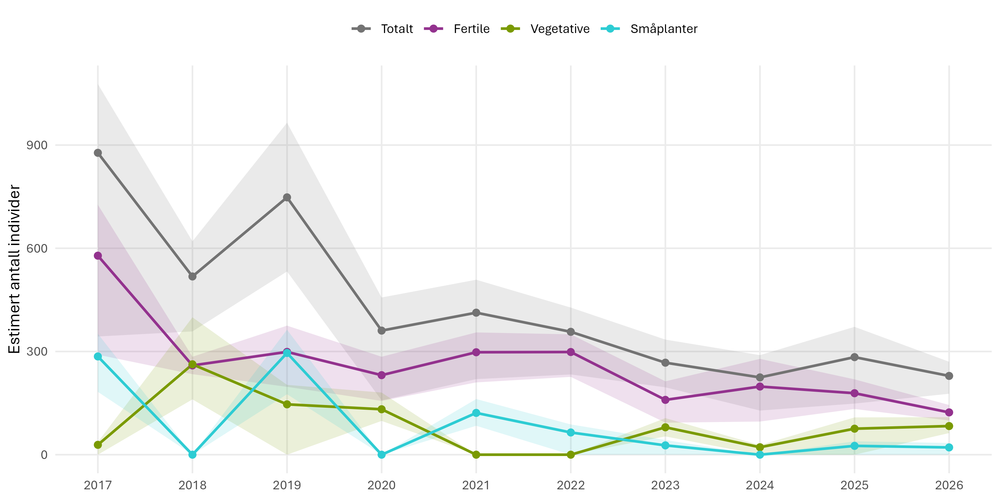
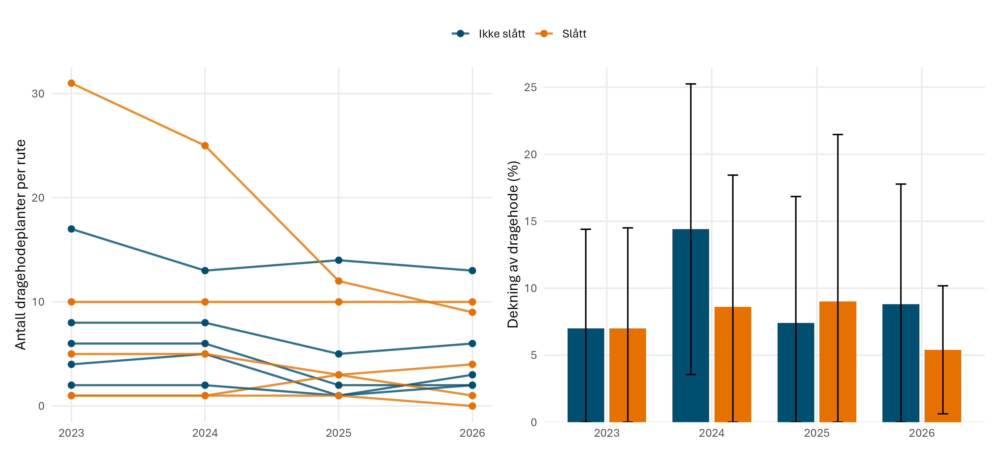
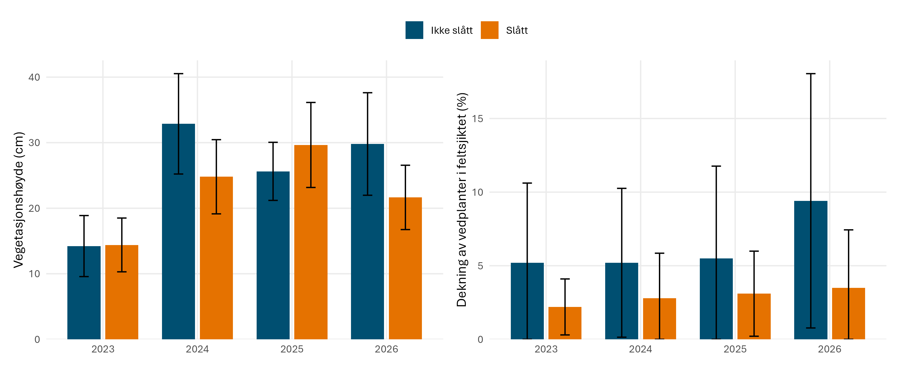
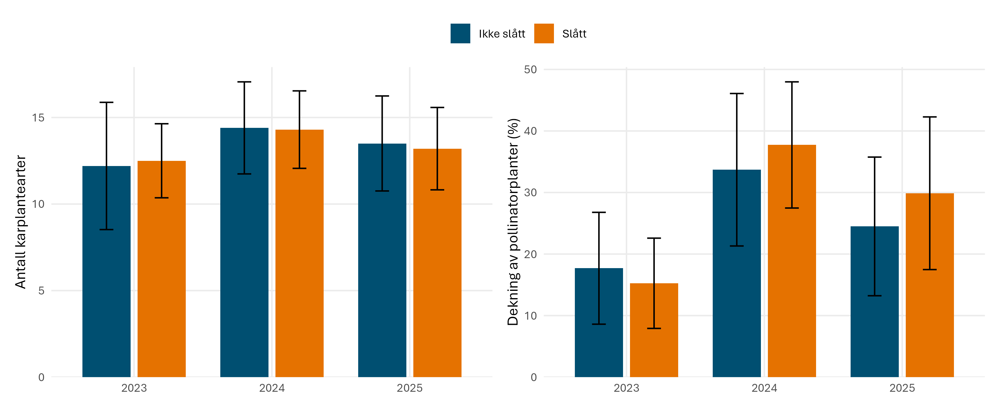
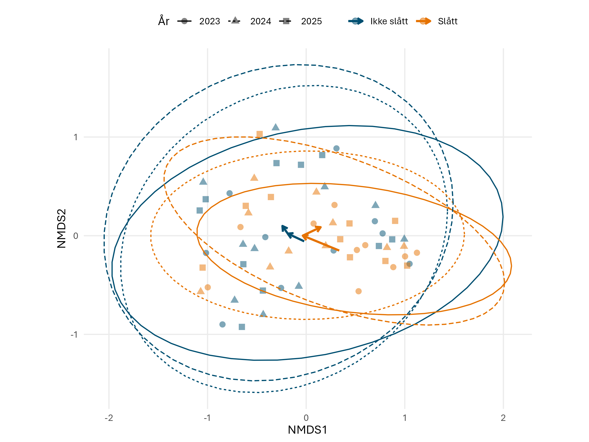

# Dragehode (*Dracocephalum ruyschiana*)
Ruben Erik Roos
2026-10-30

- [Oppsummering](#oppsummering)
- [English summary](#english-summary)
- [1. Innledning](#1-innledning)
- [2. Formål med delprosjektet](#2-formål-med-delprosjektet)
- [3. Overvåkingslokalitetene](#3-overvåkingslokalitetene)
- [4. Datainnsamling](#4-datainnsamling)
- [5. Dataanalyser](#5-dataanalyser)
- [6. Resultater](#6-resultater)
- [7. Oppsummering](#7-oppsummering)
- [8. Referanser](#8-referanser)
- [9. Author contributions](#9-author-contributions)

<!--# Rapporten leser kun filer i data/ og img/. Rådata ligger på P:, og koden som lager analysefilene ligger i code/. -->

<!--# The following parts are autogenerated. Do not edit. -->

> [!NOTE]
>
> Denne siden er generert fra [`Dragehode.qmd`](Dragehode.qmd). Ikke
> rediger `README.md` direkte. For å oppdatere: kjør skriptene i
> [`code/`](code/) slik at analysefilene i [`data/`](data/) blir
> oppdatert, og kjør `pixi run render`. Se
> [`code/README.md`](code/README.md) for rekkefølgen.

> **Recommended citation**: Roos, R.E. 2026. Dragehode (ID: XX_YYYY_ZZZ)
> v. 0.1.0. ecRxiv:
> https://github.com/NINAnor/ecRxiv/tree/main/indicators/XX_YYYY_ZZZ

> [!TIP]
>
> ### Metadata
>
> 

>
> Table 1: Indicator metadata
>
> 

>
> | Variable | Value |
> |:---|:---|
> | Indicator ID | INDICATORID |
> | Indicator Name | Dragehode |
> | verbatimName | Dragehode |
> | Country | Norway |
> | Continent | Europe |
> | Realm | write realm here |
> | Biome | write biome here |
> | Ecosystem | write ecosystem here |
> | verbatimEcosystem | Svakt kalkrik eng og tørreng på åkerholme, Horgen i Frogn |
> | Year added | 2026 |
> | Last update | 2026 |
> | Version | 0.1.0 |
> | Version comment | Første versjon, med data fra skjøtselsforsøket 2023–2026 og basisovervåkingen på Horgen 2017–2026 |
> | Precision |  |
>
> 

>
> 

> [!TIP]
>
> ### Log
>
> <!--# Legg til en kort linje for hver oppdatering -->
>
> - 30. okt. 2026 – Første versjon, skjøtselsforsøket 2023–2026 og
>       basisovervåkingen 2017–2026

## Oppsummering

Dragehode er vurdert som sårbar (VU) i Norge. På Horgen i Frogn kommune
overvåker vi et skjøtselsforsøk der halvparten av 20 overvåkingsruter
slås sent annethvert år, første gang i 2023 og andre gang i 2025.
Bestanden på hele lokaliteten har gått kraftig ned siden 2017, fra 877
til 229 individer i 2026, og det er få småplanter. Slåtten har så langt
ikke gitt noen effekt på dragehode i overvåkingsrutene, noe som er som
forventet for en langlivet art. Sommeren etter hver slått var
vegetasjonen om lag 8 cm lavere i de slåtte rutene, men effekten varte
bare ett år. Artsrikdommen og dekningen av pollinatorplanter varierte
mellom år, men ikke mellom behandlingene. Slått annethvert år og
overvåking hvert år bør videreføres, og registreringene bør gjøres i
juni hvert år.

## English summary

Northern dragonhead *Dracocephalum ruyschiana* is assessed as vulnerable
(VU) in Norway. At Horgen in Frogn municipality we monitor a management
experiment in which half of 20 monitoring plots are mown late in the
season every second year, first in 2023 and again in 2025. The
population at the whole site has declined strongly since 2017, from 877
to 229 individuals in 2026, and there are few small plants. So far,
mowing has had no effect on dragonhead in the monitoring plots, which is
expected for a long-lived species. In the summer after each mowing, the
vegetation was about 8 cm lower in the mown plots, but the effect lasted
only one year. Species richness and the cover of pollinator plants
varied between years, but not between treatments. Mowing every second
year and annual monitoring should continue, and the surveys should be
done in June every year.

## 1. Innledning

Dragehode *Dracocephalum ruyschiana* er en urt i leppeblomstfamilien som
vokser på tørre, lysåpne og gjerne noe kalkrike skråninger, skogkanter
og enger. Arten har en vid utbredelse fra Vest-Europa til Sentral-Asia,
men bestandene i Europa er spredte og fragmenterte, og en stor del av
den europeiske bestanden finnes i Norge (Kyrkjeeide et al. 2020; Evju et
al. 2023). I Norge er arten begrenset til Østlandet. Dragehode er
vurdert som sårbar (VU) på Norsk rødliste for arter 2021 (Solstad et al.
2021), og er utpekt som prioritert art etter naturmangfoldloven med egen
forskrift. De viktigste truslene er oppdyrking, gjødsling og sprøyting
fra åkerkanter, gjengroing med kratt fra skogkanten og på noen
voksesteder nedbygging.

<!--# Bilde av dragehode legges inn her senere -->

Mange skjøtselstiltak for dragehode gjennomføres av ulike aktører.
Aktuelle metoder er blant annet høstbeite, slått, brenning og rydding av
gjengroingsarter, og målet er å åpne opp lokalitetene og redusere
konkurransen fra andre arter (Larsen and Høitomt 2022). NINA har vurdert
ulike skjøtselsmetoder (Evju et al. 2022; Roos, Evju, Nowell, et al.
2023) og foreslått å teste effekten av slått. Slått er enkelt å
standardisere mellom lokaliteter, det er mulig å ha både behandlings- og
kontrollruter på samme lokalitet, det er noe uenighet om effekten av
slått for dragehode, og det er behov for skjøtselsmetoder som også tar
vare på andre naturverdier på dragehodelokalitetene (Roos, Evju,
Endrestøl, et al. 2023).

Dette delprosjektet overvåker effekten av sen slått annethvert år på
dragehode på Horgen i Frogn kommune, der dragehodebestanden er i
tilbakegang (Evju et al. 2024). Forsøket ble etablert i 2023 (Roos,
Evju, Endrestøl, et al. 2023).

## 2. Formål med delprosjektet

### 2.1 Målsetning med tiltakene

Tiltaket er sen slått etter frøsetting, annethvert år. Målet er å fjerne
biomasse og åpne vegetasjonsdekket, og dermed bedre habitatkvaliteten,
overlevelsen og rekrutteringen av dragehode og øke bestanden lokalt
(Roos et al. 2024, 2025).

### 2.2 Formål med overvåking

Formålet med overvåkingen er å fange opp effekten av slått på
populasjonsstørrelsen og -strukturen til dragehode, ved å telle antall
individer i tre størrelsesklasser. Overvåkingen skal også vise hvordan
tiltaket påvirker vegetasjonens struktur og sammensetning, og om
tiltaket tar vare på andre naturverdier, målt som artsrikdom av
karplanter og dekning av viktige planter for pollinatorer (Roos et al.
2024).

### 2.3 Forventninger

Fjerning av biomasse og åpning av vegetasjonsdekket forventes å gi økt
rekruttering fra frø og dermed en større dragehodebestand på sikt.
Dragehode er en langlivet art, og vi antar at slått må gjennomføres
flere ganger før vi ser effekter på bestanden og på vegetasjonens
struktur og sammensetning (Roos et al. 2024, 2025). Den første effekten
vi forventer, er lavere vegetasjon og mindre strø i rutene som slås,
året etter slåtten.

## 3. Overvåkingslokalitetene

### 3.1 Beskrivelse av lokalitetene

Overvåkingen foregår på Horgen i Frogn kommune (gnr/bnr 36/1).
Lokaliteten er den nordøstre delen av en åkerholme omgitt av kornåker.
Dragehode vokser i nordenden av åkerholmen, i en østvendt skråning som
er vurdert som svakt kalkrik eng med klart hevdpreg (T32-C-20), men
deler av lokaliteten er nok tørreng (T32-C-16). Lokaliteten er preget av
gjengroing, særlig med roser, eik og andre løvtrær, og var ikke slått på
flere år før forsøket startet (Roos, Evju, Endrestøl, et al. 2023).

Mot toppen av skråningen er jordsmonnet grunt og tørt, med skrinn og
kortvokst vegetasjon, mens vegetasjonen er frodigere nederst mot
åkerkanten og traktorveien. Dragehode finnes i begge delene. Skråningen
ble derfor delt i seks striper, som hver har ruter både med og uten
dragehode, og tre av stripene slås (Roos, Evju, Endrestøl, et al. 2023).

Horgen har vært med i basisovervåkingen av dragehode siden 2017, og
bestanden har gått kraftig ned (Evju et al. 2023, 2024;
Roos et al. 2025).

<!--# Bilde av lokaliteten og kart over rutene legges inn her senere -->

### 3.2 Tiltak

Den første slåtten ble gjort 1. september 2023, etter frøsetting, med
ryddesag med tretanns sagblad. Ryddesag ble valgt fordi bakken er ujevn
med tuer av sandholdig jord og gras, hovedsakelig sauesvingel. Slåtten
kappet og forstyrret noen av grastuene, og den åpne jorda kan gi plass
til frøplanter av dragehode. Rosekratt og oppslag av eik, ask og rogn
ble fjernet med beskjæringssaks der de var for tykke for ryddesagen.
Høyet ble raket opp og fjernet to dager etter (Roos, Evju, Endrestøl, et
al. 2023). Det ble ikke slått i 2024. Den andre slåtten ble gjort i
september 2025 på samme måte, og høyet ble raket bort
(Roos et al. 2025). Neste slått er planlagt
i 2027 (<a href="#tbl-tiltak" class="quarto-xref">Table 2</a>).

<!--# Bilde av slåtten legges inn her senere -->

Table 2: Gjennomførte tiltak og datainnsamling i skjøtselsforsøket på
Horgen. Registreringene gjøres før slåtten de årene det slås.

| År | Registrering | Slått | Datainnsamling |
|---:|:---|:---|:---|
| 2023 | 26.06. | 1\. september, høyet raket bort | Dragehode, vegetasjonsstruktur og alle karplanter |
| 2024 | 14.06. og 21.06. | – | Dragehode, vegetasjonsstruktur og alle karplanter |
| 2025 | 01.08. og 07.08. | September, høyet raket bort | Dragehode, vegetasjonsstruktur og alle karplanter |
| 2026 | 25.06. | – | Dragehode og vegetasjonsstruktur |

## 4. Datainnsamling

Forsøket består av 20 faste overvåkingsruter på 1 × 1 m: fem ruter med
dragehode som slås, fem ruter med dragehode som ikke slås (kontroll),
fem ruter uten dragehode som slås og fem ruter uten dragehode som ikke
slås (Roos, Evju, Endrestøl, et al. 2023). Rutene er kartfestet med
høypresisjons-GPS. Datainnsamlingen følger protokollen i Roos, Evju,
Endrestøl, et al. (2023) og registreres i ArcGIS Survey123. I hver rute
registreres:

- antall småplanter, vegetative og fertile individer av dragehode, som i
  basisovervåkingen av dragehode (Evju et al. 2023), og forekomst av
  dragehode i 16 småruter på 25 × 25 cm
- dekning av dragehode
- vegetasjonshøyde i rutens fire hjørner
- dekning av feltsjikt, bunnsjikt, strø, bar jord, berg og vedplanter i
  feltsjiktet
- dekning av alle karplanter, de første to årene og deretter annethvert
  år (2023, 2024 og 2025)

Registreringene gjøres før slåtten de årene det slås. I 2023, 2024 og
2026 ble rutene registrert i juni, mens de i 2025 ble registrert i
begynnelsen av august
(<a href="#tbl-tiltak" class="quarto-xref">Table 2</a>). Indikatorene er
oppsummert i <a href="#tbl-indikatorer" class="quarto-xref">Table 3</a>.

Table 3: Indikatorer for overvåking av effekter av sen slått annethvert
år for dragehode på Horgen.

| Indikator | Variabel registrert i felt | Utvalgsenhet | Utlegging av utvalgsenheter | Antall utvalgsenheter | Frekvens for datainnsamling |
|:---|:---|:---|:---|:---|:---|
| Populasjonsstørrelse dragehode | Antall individer av dragehode | 1 × 1 m | Stratifisert tilfeldig | 20 | Årlig |
| Populasjonsstruktur dragehode | Antall individer i tre størrelsesklasser: småplanter, vegetative, fertile | 1 × 1 m | Stratifisert tilfeldig | 20 | Årlig |
| Dekning av dragehode | Dekning (%) av dragehode | 1 × 1 m | Stratifisert tilfeldig | 20 | Årlig |
| Vegetasjonshøyde | Vegetasjonshøyde (cm) i fire hjørner av ruta | 1 × 1 m | Stratifisert tilfeldig | 20 | Årlig |
| Vegetasjonsstruktur | Dekning (%) av feltsjikt, bunnsjikt, strø, bar jord og vedplanter i feltsjiktet | 1 × 1 m | Stratifisert tilfeldig | 20 | Årlig |
| Artsrikdom, alle karplanter | Forekomst og dekning (%) av alle karplanter | 1 × 1 m | Stratifisert tilfeldig | 20 | Årlig de to første årene, deretter annethvert år |
| Artssammensetning | Forekomst og dekning (%) av alle karplanter | 1 × 1 m | Stratifisert tilfeldig | 20 | Årlig de to første årene, deretter annethvert år |
| Dekning av pollinatorplanter | Dekning (%) av urter som er viktige for pollinatorer | 1 × 1 m | Stratifisert tilfeldig | 20 | Årlig de to første årene, deretter annethvert år |
| Tiltak i ruta | Slått (ja/nei) | 1 × 1 m | Stratifisert tilfeldig | 20 | Årlig |
| Areal med tiltak | Areal som er slått | Polygon | Heldekkende | – | Annethvert år |

Basisovervåkingen av dragehode på Horgen gjøres etter en egen metodikk,
med transekter og ruter langs dragehodeforekomsten, og gir et estimat
for hele bestanden på lokaliteten hvert år siden 2017 (Evju et al. 2021,
2023). Disse dataene brukes her til å vise utviklingen i bestanden på
lokaliteten.

## 5. Dataanalyser

<!-- Kort beskrivelse: hvilke analyser er gjennomført, for å undersøke endringer i indikatorer ift. påvirkningsfaktorer og tiltak, jf. forventninger (under formål). -->

Forsøket er et før–etter-forsøk med kontroll. Registreringene i 2023 ble
gjort før den første slåtten og viser utgangspunktet. En effekt av slått
vises derfor ikke som en forskjell mellom slåtte og ikke-slåtte ruter i
ett enkelt år, men som en forskjell i *utviklingen* fra 2023, altså en
samspillseffekt mellom behandling og år.

**Dragehode i overvåkingsrutene.** Antall dragehodeplanter og dekningen
av dragehode analyseres for de ti rutene som ble lagt ut på dragehode.
Antall planter er analysert med en generalisert lineær blandet modell
(`glmmTMB`, Poisson) med behandling, år og samspillet mellom dem som
faste effekter og rute som tilfeldig effekt, fordi de samme rutene
registreres hvert år. Effektene er testet med likelihood ratio-tester.
Dekningen av dragehode er analysert med en lineær blandet modell
(`lmerTest`) med samme struktur, og effektene er testet med F-tester
(Satterthwaite).

**Vegetasjon.** Vegetasjonshøyde (gjennomsnitt av de fire hjørnene),
dekning av vedplanter i feltsjiktet, artsrikdom av karplanter og summert
dekning av pollinatorplanter er analysert med lineære blandede modeller
for alle 20 rutene, med behandling, år og samspillet som faste effekter
og rute som tilfeldig effekt. Artsrikdom og pollinatorplanter er bare
analysert for årene med full vegetasjonsanalyse (2023–2025).
Pollinatorplantene er urter (ikke-vedaktige blomstrende planter) som er
viktige for pollinerende insekter, og omfatter også dragehode. For hvert
år er forskjellen mellom slåtte og ikke-slåtte ruter beregnet med
`emmeans`.

**Artssammensetning.** Endringer i artssammensetningen er vist med en
ordinasjonsanalyse (NMDS, to dimensjoner) av den relative dekningen av
karplantene i rutene (dekningen summert til 1 i hver rute) og
Bray-Curtis-ulikhet, med R-pakken vegan (Oksanen et
al. 2024). Forskjeller mellom år og behandlinger, og samspillet
mellom dem, er testet med PERMANOVA (`adonis2`, 999 permutasjoner).

**Basisovervåkingen.** Bestanden på hele lokaliteten er estimert med
bootstrapping fra transekt- og rutedataene i basisovervåkingen, og
retningen på utviklingen er beregnet med en bayesiansk lineær regresjon
av de årlige estimatene mot år (`rstanarm`) (Evju et al. 2023).
Analysene gjøres i `code/5_Horgen_population_monitoring.qmd`.

**Slik leses resultatene.** p-verdien er sannsynligheten for å få en så
stor forskjell hvis det egentlig ikke er noen effekt, og p \< 0,05
regnes som statistisk signifikant. Med bare fem ruter i hver gruppe med
dragehode er det vanskelig å påvise annet enn store effekter.

Datasettet er tilgjengelig på NINAs IPT og i GBIF (Norsk institutt for
naturforskning, n.d.).

## 6. Resultater

Testene av behandling, år og samspillet mellom dem er oppsummert i
<a href="#tbl-modeller" class="quarto-xref">Table 4</a>. Bare
vegetasjonshøyden viste en effekt av slått (signifikant samspill mellom
behandling og år). Alle indikatorene unntatt dekningen av dragehode
varierte mellom år.

Table 4: Test av behandling (slått eller ikke slått), år og samspillet
mellom dem for indikatorene i skjøtselsforsøket. Antall
dragehodeplanter: Poisson GLMM med likelihood ratio-tester; de andre:
lineære blandede modeller med F-tester. Alle modellene har rute som
tilfeldig effekt. En effekt av slått vises som et signifikant samspill.
n = antall rute-år. Signifikansnivå: \* p \< 0,05; \*\* p \< 0,01;
\*\*\* p \< 0,001.

| Indikator | n | Behandling | År | År × behandling |
|:---|---:|:---|:---|:---|
| Antall dragehodeplanter | 40 | 0.87 | 0.0031\*\* | 0.79 |
| Dekning av dragehode | 40 | 0.64 | 0.13 | 0.3 |
| Vegetasjonshøyde | 80 | 0.26 | \<0.001\*\*\* | 0.012\* |
| Dekning av vedplanter i feltsjiktet | 80 | 0.27 | 0.0089\*\* | 0.14 |
| Artsrikdom karplanter | 60 | 0.98 | 0.0083\*\* | 0.88 |
| Dekning av pollinatorplanter | 60 | 0.67 | \<0.001\*\*\* | 0.45 |

### 6.1 Bestanden på Horgen

Bestanden av dragehode på hele lokaliteten har gått kraftig ned siden
basisovervåkingen startet i 2017
(<a href="#fig-populasjon" class="quarto-xref">Figure 1</a>). I 2017 ble
bestanden estimert til 877 individer, og i 2020–2022 til mellom 357 og
413. I 2026 var estimatet 229 individer (50 % intervall 177–270),
omtrent som i 2024 (225). Nedgangen gjelder særlig de fertile plantene,
som gikk fra 578 i 2017 til 123 i 2026, det laveste i serien. Det har
vært få småplanter siden 2022 (0–65 per år), noe som tyder på svak
rekruttering. Trendmodellen gir 99,98 % sannsynlighet for at bestanden
har gått ned i perioden, med en nedgang på 63 individer per år (95 % KI
33–93). Mye av nedgangen skjedde før 2020, og siden 2020 har nedgangen
vært mindre bratt.

Figure 1: Estimert antall dragehodeplanter på hele lokaliteten på Horgen
i basisovervåkingen 2017–2026, totalt og fordelt på fertile, vegetative
og småplanter. Båndene viser 50 % bootstrap-intervall. Estimatene for
2019 og 2020 er korrigert fra antall skudd til antall individer.

### 6.2 Dragehode i overvåkingsrutene

I de ti rutene som ble lagt ut på dragehode, ble det registrert 85
dragehodeplanter i 2023, 76 i 2024, 52 i 2025 og 50 i 2026
(<a href="#tbl-klasser" class="quarto-xref">Table 5</a>). Antallet gikk
ned både i rutene som slås (fra 48 til 24) og i rutene som ikke slås
(fra 37 til 26). Antallet varierte signifikant mellom år (p = 0,003),
men utviklingen var ikke forskjellig mellom behandlingene (samspill p =
0,79; <a href="#tbl-modeller" class="quarto-xref">Table 4</a>). Mye av
nedgangen i de slåtte rutene skyldes én rute, som gikk fra 31 planter i
2023 til 9 i 2026
(<a href="#fig-dragehode" class="quarto-xref">Figure 2</a>). De fleste
rutene har hatt omtrent like mange planter alle årene.

De fleste plantene er fertile (45 i 2023 og 34 i 2026). Antallet
vegetative planter var stabilt i 2023–2025 (27–29), men halvert i 2026
(14), særlig i de slåtte rutene (fra 17 til 6). Det er svært få
småplanter: 11 i 2023, 9 i 2024, 3 i 2025 og 2 i 2026. Slåtten har altså
ikke gitt flere nye planter så langt. I én rute som ble lagt ut uten
dragehode og ikke slås, har det kommet inn dragehode: én plante i 2024
og 2025 og to i 2026. I én slått rute med én plante i 2023–2025 ble det
ikke funnet dragehode i 2026.

Dekningen av dragehode i rutene var i gjennomsnitt 5–14 %, og varierte
ikke signifikant mellom år eller behandlinger
(<a href="#fig-dragehode" class="quarto-xref">Figure 2</a>,
<a href="#tbl-modeller" class="quarto-xref">Table 4</a>).

Table 5: Antall dragehodeplanter i de ti rutene med dragehode, fordelt
på størrelsesklasser, per år og behandling. Registreringene i 2023 ble
gjort før den første slåtten.

| Behandling | Klasse     | 2023 | 2024 | 2025 | 2026 |
|:-----------|:-----------|-----:|-----:|-----:|-----:|
| Ikke slått | Småplanter |    5 |    1 |    2 |    1 |
| Ikke slått | Vegetative |   14 |   10 |   10 |    8 |
| Ikke slått | Fertile    |   18 |   23 |   11 |   17 |
| Ikke slått | Totalt     |   37 |   34 |   23 |   26 |
| Slått      | Småplanter |    6 |    8 |    1 |    1 |
| Slått      | Vegetative |   15 |   18 |   17 |    6 |
| Slått      | Fertile    |   27 |   16 |   11 |   17 |
| Slått      | Totalt     |   48 |   42 |   29 |   24 |

Figure 2: Venstre: antall dragehodeplanter i hver av de ti rutene med
dragehode (linjer) per år. Høyre: gjennomsnittlig dekning av dragehode i
de samme rutene (søyler, med 95 % konfidensintervall). Den første
slåtten ble gjort etter registreringene i 2023 og den andre etter
registreringene i 2025.

### 6.3 Vegetasjonsstruktur

Vegetasjonshøyden er den eneste indikatoren som viser en effekt av slått
(samspill p = 0,012;
<a href="#tbl-modeller" class="quarto-xref">Table 4</a>). I 2023, før
den første slåtten og i en tørr sommer, var vegetasjonen lav i alle
rutene (14 cm i gjennomsnitt). Sommeren etter hver slått var
vegetasjonen lavere i rutene som ble slått: 24,8 mot 32,9 cm i 2024 (8,1
cm lavere, p = 0,032) og 21,7 mot 29,8 cm i 2026 (8,2 cm lavere, p =
0,031) (<a href="#fig-struktur" class="quarto-xref">Figure 3</a>). I
2025, to år etter den første slåtten, var det ingen forskjell (29,7 mot
25,6 cm, p = 0,28). Effekten av slåtten på vegetasjonshøyden ser altså
ut til å vare ett år. I 2025 ble rutene registrert i august, da
vegetasjonen er høyere enn i juni, så høyden det året kan ikke
sammenlignes direkte med de andre årene.

Det var også mindre strø og mer bar jord i de slåtte rutene året etter
den første slåtten (8 mot 28 % strø og 8 mot 2 % bar jord i 2024), men
forskjellen var liten i 2026
(<a href="#tbl-struktur" class="quarto-xref">Table 6</a>). Dekningen av
feltsjiktet har økt mye siden tørkesommeren 2023, fra 36–44 % til 82–88
% i 2026, i begge behandlingene.

Dekningen av vedplanter i feltsjiktet var lavere i rutene som slås, også
i 2023 før den første slåtten (2,2 mot 5,2 %). I rutene som ikke slås,
økte dekningen til 9,4 % i 2026, mens den holdt seg på 2–4 % i rutene
som slås. Forskjellen i 2026 var ikke signifikant (p = 0,075), og heller
ikke samspillet mellom behandling og år (p = 0,14), men utviklingen
tyder på at vedplantene øker der det ikke slås.

Figure 3: Gjennomsnittlig vegetasjonshøyde (venstre) og dekning av
vedplanter i feltsjiktet (høyre) i rutene som slås og ikke slås, med 95
% konfidensintervall (alle 20 ruter). Den første slåtten ble gjort etter
registreringene i 2023 og den andre etter registreringene i 2025. I 2025
ble rutene registrert i august, de andre årene i juni.

Table 6: Gjennomsnittlig dekning (%) av feltsjikt, strø, bunnsjikt og
bar jord i rutene som slås og ikke slås (alle 20 ruter).

| År   | Behandling | Feltsjikt | Strø | Bunnsjikt | Bar jord |
|:-----|:-----------|----------:|-----:|----------:|---------:|
| 2023 | Ikke slått |      35,5 | 59,7 |      23,8 |      1,1 |
| 2023 | Slått      |      43,7 | 52,7 |      16,6 |      2,7 |
| 2024 | Ikke slått |      69,8 | 28,3 |      17,3 |      1,6 |
| 2024 | Slått      |      74,5 |  8,0 |      11,1 |      8,3 |
| 2025 | Ikke slått |      75,0 | 19,5 |      11,8 |      4,1 |
| 2025 | Slått      |      86,6 | 11,0 |       9,0 |      1,9 |
| 2026 | Ikke slått |      81,8 |  9,1 |       9,8 |      3,3 |
| 2026 | Slått      |      87,7 |  6,2 |       6,1 |      2,0 |

### 6.4 Artsrikdom og pollinatorplanter

Det var i gjennomsnitt 12–14 karplantearter per rute. Artsrikdommen
varierte mellom år (p = 0,008) og var høyest i 2024, men det var ingen
forskjell mellom rutene som slås og ikke slås (p = 0,98) og ingen
forskjell i utviklingen (samspill p = 0,88;
<a href="#fig-artsrikdom" class="quarto-xref">Figure 4</a>,
<a href="#tbl-modeller" class="quarto-xref">Table 4</a>).

Dekningen av pollinatorplanter var lav i tørkesommeren 2023 (15–18 %),
mye høyere i 2024 (34–38 %) og noe lavere i 2025 (24–30 %). Forskjellen
mellom årene var signifikant (p \< 0,001), men det var ingen forskjell
mellom behandlingene (p = 0,67) og ingen forskjell i utviklingen
(samspill p = 0,45). Dekningen var litt høyere i de slåtte rutene i 2024
og 2025, men forskjellen var ikke signifikant. Variasjonen mellom år
skyldes trolig været, og at rutene ble registrert i august i 2025. Det
ble ikke gjort full vegetasjonsanalyse i 2026.

Figure 4: Gjennomsnittlig antall karplantearter (venstre) og summert
dekning av pollinatorplanter (høyre) i rutene som slås og ikke slås, med
95 % konfidensintervall (alle 20 ruter). Full vegetasjonsanalyse ble
gjort i 2023–2025. Registreringene i 2023 ble gjort før den første
slåtten, og registreringene i 2025 ble gjort i august, før den andre
slåtten.

### 6.5 Artssammensetning

Artssammensetningen varierte mellom år (PERMANOVA p = 0,002) og var noe
forskjellig mellom rutene som slås og ikke slås (p = 0,021), men
forskjellen mellom behandlingene endret seg ikke over tid (samspill p =
1,0; <a href="#fig-nmds" class="quarto-xref">Figure 5</a>,
<a href="#tbl-permanova" class="quarto-xref">Table 7</a>). Forskjellen
mellom behandlingene fantes altså allerede før den første slåtten, og
skyldes ikke slåtten. År og behandling forklarer til sammen bare 11 % av
variasjonen i artssammensetningen, og ordinasjonen har relativt høyt
stress (0,20), så den gir bare et grovt bilde av variasjonen.

Figure 5: NMDS-ordinasjon av artssammensetningen i rutene som slås
(oransje) og ikke slås (blå) i 2023–2025. Hvert punkt er en rute ett år.
Ellipsene viser 95 % konfidensintervall rundt gjennomsnittet for hver
behandling og hvert år, og pilene viser hvordan gjennomsnittet for hver
behandling har flyttet seg fra år til år.

Table 7: PERMANOVA av artssammensetningen (Bray-Curtis) i 2023–2025. R²
er andelen av variasjonen som forklares. Signifikansnivå: \* p \< 0,05;
\*\* p \< 0,01; \*\*\* p \< 0,001.

| Effekt          |  Df | R²    | F    | p         |
|:----------------|----:|:------|:-----|:----------|
| År              |   2 | 0,077 | 2,39 | 0.002\*\* |
| Behandling      |   1 | 0,037 | 2,29 | 0.021\*   |
| År × behandling |   2 | 0,011 | 0,32 | 1         |

## 7. Oppsummering

### 7.1 Hva viser årets resultater

**Ingen effekt av slått på dragehode ennå.** Tre år etter den første
slåtten og ett år etter den andre er det ingen effekt av slått på
antallet eller dekningen av dragehode i overvåkingsrutene. Antallet gikk
ned i både slåtte og ikke-slåtte ruter, og nedgangen følger utviklingen
for hele lokaliteten, der bestanden fortsatt går ned. Det er svært få
småplanter, både i rutene og på lokaliteten, og rekrutteringen er
fortsatt svak. Dette er som forventet: dragehode er en langlivet art, og
slått må trolig gjennomføres flere ganger før en eventuell effekt på
bestanden blir synlig (Roos et al. 2025).

**Slåtten gir lavere vegetasjon, men effekten varer ett år.** Sommeren
etter hver slått var vegetasjonen om lag 8 cm lavere i de slåtte rutene,
og etter den første slåtten var det også mindre strø og mer bar jord. To
år etter slåtten var forskjellen borte. Lavere vegetasjon og mer åpen
jord er nettopp det tiltaket skal gi, for at dragehode skal få mer lys
og plass til å spire. Vedplantene ser ut til å øke i rutene som ikke
slås.

**Vegetasjonen varierer mye mellom år.** Artsrikdom, dekning av
pollinatorplanter, feltsjikt og artssammensetning varierte mye mellom
år, men ikke mellom behandlingene. Dette skyldes trolig været, særlig
tørkesommeren 2023, og at rutene ble registrert i august i 2025 og i
juni de andre årene. Slåtten har så langt ikke hatt noen negativ effekt
på artsrikdommen eller pollinatorplantene.

**Usikkerhet.** Forsøket har bare fem ruter med dragehode i hver
behandling, og én rute kan påvirke resultatene mye. Det er derfor bare
mulig å påvise store effekter.

### 7.2 Anbefaling for videreføring

**Tiltak.** Vi anbefaler å fortsette med sen slått annethvert år, med
neste slått i september 2027. Effekten på vegetasjonshøyden varer bare
ett år, og det kan derfor være aktuelt å vurdere om hyppigere slått gir
et mer åpent vegetasjonsdekke over tid. Det bør også vurderes om området
som slås, kan utvides til delen av åkerholmen sør for kraftlinjen, der
både engvegetasjonen, med blant annet nyresildre *Saxifraga granulata*
(NT) og bakkemaure *Galium sterneri* (VU), og flere eiketrær vil ha
fordel av at nitrofile arter og gjengroingsarter holdes nede
(Roos et al. 2025).

**Overvåking.** Overvåkingen av dragehode (antall i størrelsesklasser og
dekning) og vegetasjonsstrukturen bør fortsette hvert år, og full
vegetasjonsanalyse bør gjøres annethvert år, neste gang i 2027.
Registreringene bør gjøres i juni hvert år, slik at årene kan
sammenlignes. Fordi forsøket har få ruter og bare én lokalitet, bør det
vurderes å utvide forsøket til flere lokaliteter med dragehode (Roos,
Evju, Endrestøl, et al. 2023). Det vil også være nyttig å registrere
frøsetting, siden rekrutteringen avhenger av at plantene produserer frø.

## 8. Referanser

Evju, Marianne, Matthew Grainger, Ulrika Jansson, et al. 2024.
*Overvåking Av Dragehode *Dracocephalum Ruyschiana*. Årsrapport 2023*.
NINA Rapport No. 2440. Norsk institutt for naturforskning.
<https://hdl.handle.net/11250/3118678>.

Evju, Marianne, Matthew Grainger, Siri Lie Olsen, Ruben Erik Roos, Olav
Skarpaas, and Odd Egil Stabbetorp. 2023. *Overvåking Av Dragehode
*Dracocephalum Ruyschiana* i 2022. Resultater Og Forslag Til Veien
Videre*. NINA Rapport No. 2257. Norsk institutt for naturforskning.
<https://hdl.handle.net/11250/3052108>.

Evju, Marianne, Siri Lie Olsen, Olav Skarpaas, and Odd Egil Stabbetorp.
2021. *Overvåking Av Dragehode *Dracocephalum Ruyschiana*. Beskrivelse
Av Metodikk Og Resultater 2017–2020*. NINA Rapport No. 1976. Norsk
institutt for naturforskning.

Evju, Marianne, Ruben Erik Roos, Anders Endrestøl, Megan Nowell, Oddvar
Hanssen, and E. E. Ombler. 2022. *Effektovervåking Av Trua Arter Og
Naturtyper 2022*. NINA Rapport No. 2196. Norsk institutt for
naturforskning. <https://hdl.handle.net/11250/3035335>.

Kyrkjeeide, Magni Olsen, Kristine Bakke Westergaard, Oddmund Kleven, et
al. 2020. “Conserving on the Edge: Genetic Variation and Structure in
Northern Populations of the Endangered Plant *Dracocephalum Ruyschiana*
L. (Lamiaceae).” *Conservation Genetics* 21: 707–18.
<https://doi.org/10.1007/s10592-020-01281-7>.

Larsen, B. H., and G. Høitomt. 2022. *Skjøtsel Og Overvåkning Av
Dragehode i Vestoppland Og Valdres i 2021*. Miljøfaglig Utredning
Rapport Nos. 2022-24. Miljøfaglig Utredning.

Norsk institutt for naturforskning. n.d. *Dracocephalum Ruyschiana
Monitoring*. GBIF. <https://doi.org/10.15468/ub34jj>.

Oksanen, Jari, Gavin L. Simpson, F. Guillaume
Blanchet, et al. 2024. *Vegan: Community Ecology Package*.
<https://CRAN.R-project.org/package=vegan>.

Roos, Ruben Erik, Marianne Evju, Anders Endrestøl, et al. 2024.
*Overvåking Av Effekter Av Tiltak for Åtte Trua Arter Og En Naturtype i
2024*. NINA Rapport No. 2538. Norsk institutt for naturforskning.
<https://hdl.handle.net/11250/3169493>.

Roos, Ruben Erik, Marianne Evju, Anders Endrestøl, Oddvar Hanssen, and
Megan Nowell. 2023. *Overvåking Av Effekter Av Tiltak for Seks Trua
Arter Og En Naturtype i 2023*. NINA Rapport No. 2377. Norsk institutt
for naturforskning. <https://hdl.handle.net/11250/3106536>.

Roos, Ruben Erik, Marianne Evju, Megan Nowell, et al. 2023.
*Effektovervåking Av Trua Arter Og Naturtyper. Forslag Til
Videreutvikling for Dragehode, Honningblom, Elvesandjeger Og
Klippeblåvinge*. NINA Rapport No. 2263. Norsk institutt for
naturforskning. <https://hdl.handle.net/11250/3056939>.

Roos, Ruben Erik, Marianne Evju, Megan Nowell, et
al. 2025. *Overvåking Av Effekter Av Tiltak Trua Natur i 2025.
Resultater for Ti Arter Og Én Naturtype*. NINA Rapport No. 2695. Norsk
institutt for naturforskning.
<https://nva.sikt.no/registration/019ad9d2e908-b8b219d4-fb21-40f8-a34a-e1c577293c9a>.

Solstad, Heidi, Reidar Elven, Gunnar Arnesen, et al. 2021. *Karplanter:
Vurdering Av Dragehode *Dracocephalum Ruyschiana* for Norge. Rødlista
for Arter 2021*. Artsdatabanken.
<https://lister.artsdatabanken.no/rodlisteforarter/2021/13312>.

## 9. Author contributions

<!-- Fill in CRediT and MeRIT statements. See https://credit.niso.org/ and https://www.nature.com/articles/s41467-023-37039-1. Delete rows you don't use. -->

**CRediT statement**

- Data curation: RER, IMM
- Formal analysis: RER
- Software: RER, IMM (Ida M. Mienna), OS (Olav Skarpaas), MG (Matthew
  Grainger)
- Visualization: RER
- Writing – original draft: RER
