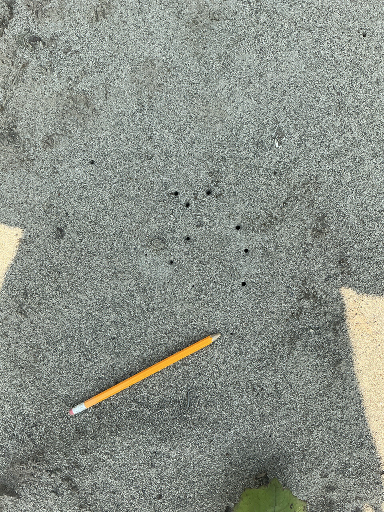
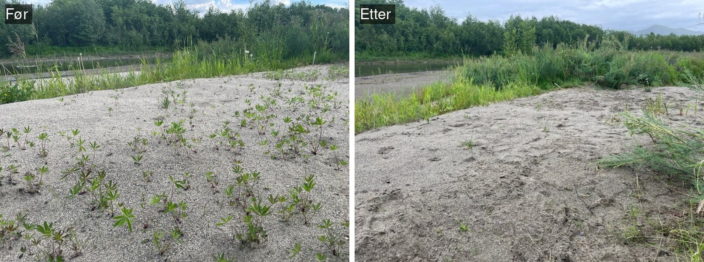
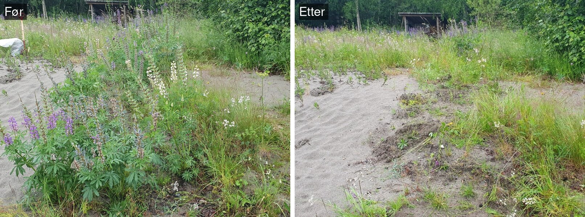
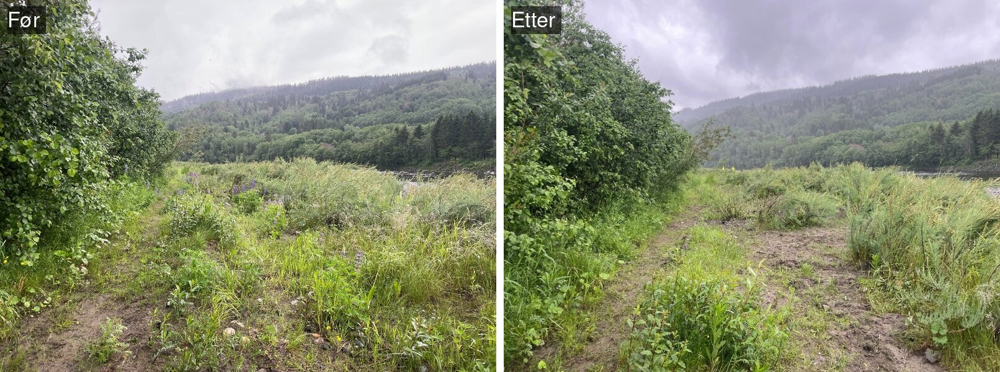

<!--# Rapporten leser kun filer i data/ og img/. Rådata ligger på P:, og koden som lager masterfila ligger i code/. -->

```{r setup}
#| include: false
#| cache: false
library(knitr)
library(tidyverse)
library(kableExtra)
library(here)
library(anybadger)
library(yaml)
library(tibble)
library(conflicted)
library(glmmTMB)
library(emmeans)
library(patchwork)
library(sf)
library(ggspatial)
conflicts_prefer(dplyr::filter)
conflicts_prefer(dplyr::lag)
conflicts_prefer(dplyr::select)
pull <- dplyr::pull

# Skrift: Aptos hvis den er installert (følger med Microsoft 365), ellers standard sans-serif
fonts <- systemfonts::system_fonts()
aptos <- fonts$path[match(c("Aptos.ttf", "Aptos-Bold.ttf", "Aptos-Italic.ttf", "Aptos-Bold-Italic.ttf"), basename(fonts$path))]
fig_font <- "sans"
if (!anyNA(aptos)) {
  systemfonts::register_font("Aptos Rapport", aptos[1], aptos[2], aptos[3], aptos[4])
  fig_font <- "Aptos Rapport"
}
update_geom_defaults("text", list(family = fig_font))
update_geom_defaults("label", list(family = fig_font))

# JPEG via ragg (for figurer med flyfoto og bilder), slik at skriften også brukes der
ragg_jpeg <- function(filename, width, height, ...) ragg::agg_jpeg(filename, width = width, height = height, ...)

# Figurer lagres i img/ slik at de vises både i README.md (GitHub) og i ecRxiv
# (echo styres per format i YAML: koden vises i html, men ikke i README.md)
knitr::opts_chunk$set(fig.path = "img/", dev = "ragg_png", dpi = 150)
```

<!--# The following parts are autogenerated. Do not edit. -->

```{r source}
#| echo: false
#| cache: false
source(here::here("_common.R"))

# Badges som markdown (for README.md på GitHub), med relativ sti til versjonsbadgen
md_badge <- function(tag) {
  src <- sub(paste0(here::here(), "/"), "", tag$children[[1]]$attribs$src, fixed = TRUE)
  sprintf("[](%s)", src, tag$attribs$href)
}
```

::: {.content-visible when-format="gfm"}
::: {.callout-note}
Denne siden er generert fra [`Elvesandjeger.qmd`](Elvesandjeger.qmd). Ikke rediger `README.md` direkte.
For å oppdatere: legg ny masterfil (`*_master.csv`) i [`data/`](data/), fjern den gamle, og kjør `quarto render Elvesandjeger.qmd`.
Se [`code/README.md`](code/README.md) for hvordan masterfila lages.
:::

`r paste(md_badge(status_badge(as.character(st))), md_badge(version_badge(as.character(version[[1]]))), md_badge(data_badge(as.character(badges[[1]]))), md_badge(code_badge(as.character(badges[[2]]))), md_badge(open_science_badge(as.character(badges[[3]]))), md_badge(license_badge()))`
:::

::: {.content-visible when-format="html"}
```{r reviewers}
#| echo: false
#| results: asis

if (!is.null(yaml_data$codeReviewers)) {
  reviewers <- purrr::map_chr(yaml_data$codeReviewers, "name")

  htmltools::HTML(paste0(
    '<div id="title-block-header" class="quarto-title-block default">
       <div class="quarto-title-meta">
         <div>
           <div class="quarto-title-meta-heading">Reviewed by</div>
           <div class="quarto-title-meta-contents">',
    paste(reviewers, collapse = "; "),
    '</div>
         </div>
       </div>
     </div>',
    sep = ""
  ))
}
```

::: {layout-ncol="6"}

```{r statusBadge}
#| echo: false
status_badge(as.character(st))
```

```{r versionBadge}
#| echo: false
version_badge(my_version_number = as.character(version[[1]]))
```

```{r dataBadge}
#| echo: false
data_badge(as.character(badges[[1]]))
```

```{r codeBadge}
#| echo: false
code_badge(as.character(badges[[2]]))
```

```{r openScienceBadge}
#| echo: false
open_science_badge(as.character(badges[[3]]))
```

```{r licenseBadge}
#| echo: false
license_badge()
```

:::
:::

> **Recommended citation**: `r paste(auth, " ", year, ". ", name, " (ID: ", folder_name, ") ", "v. ", version, ". ecRxiv: ", url, sep="")`

::: {.callout-tip collapse="true"}
## Metadata
```{r tbl-meta2}
#| tbl-cap: 'Indicator metadata'
#| echo: false
#| warning: false
meta |>
  dplyr::filter(Variable %in% c(
    "Indicator ID",
    "Indicator Name",
    "verbatimName",
    "Continent",
    "Country",
    "Realm",
    "Biome",
    "Ecosystem",
    "verbatimEcosystem",
    "Year added",
    "Last update",
    "Version",
    "Version comment",
    "Precision")) |>
  kable()
```
:::

::: {.callout-tip collapse="true"}
## Log

<!--# Legg til en kort linje for hver oppdatering -->
- 16. okt. 2026 – Første versjon, data 2015–2026
:::

<hr />

```{r data}
#| code-summary: 'Kode for å lese data.'
# Hver fil i data/ finnes ved et mønster, slik at årstallene i filnavnet kan endre seg fra år til år
read_one <- function(pattern, reader = read.csv) {
  f <- list.files(here("data"), pattern = pattern, full.names = TRUE)
  if (length(f) != 1) stop("Forventet nøyaktig én fil som passer '", pattern, "' i data/, fant ", length(f))
  structure(reader(f), file = basename(f))
}

stage_lab <- c(stad1 = "Stadium 1", stad2 = "Stadium 2", stad3 = "Stadium 3", voksne = "Voksne")
site_lab <- c(Storr = "Storrønningen", Kreg = "Kregnesteigen", Forn = "Fornes", Grav = "Gravråk")
month_lev <- c("juni", "juli", "august")
# stadier og måneder i svart/grått (linjetype/symbol), lokaliteter i farger, lukestatus i magenta
month_cols <- c(juni = "#b3b3b3", juli = "#6e6e6e", august = "#000000")
month_shp <- c(juni = 21, juli = 17, august = 16)
stage_grey <- c("Stadium 1" = "#c6c6c6", "Stadium 2" = "#8a8a8a", "Stadium 3" = "#4a4a4a", "Voksne" = "#000000")
stage_lty <- c("Stadium 1" = "solid", "Stadium 2" = "dashed", "Stadium 3" = "dotted", "Voksne" = "dotdash")
stage_shp <- c("Stadium 1" = 16, "Stadium 2" = 21, "Stadium 3" = 17, "Voksne" = 15)
site_cols <- c("Storrønningen" = "#0f4c5c", "Kregnesteigen" = "#2a9d8f", "Fornes" = "#5fc4c0", "Gravråk" = "#a8d08d") # lokaliteter: teal-skala og lys grønn
site_shapes <- c("Storrønningen" = 16, "Kregnesteigen" = 17, "Fornes" = 15, "Gravråk" = 18)
luket_cols <- c(Kontroll = "#4d4d4d", Nei = "#5b8c2a", Delvis = "#d6619b", Ja = "#8e1b5c") # lukestatus: ikke luket grønn, luket magenta (delvis lys, ja mørk), kontroll grå

# ---- Observasjoner (masterfil, langt format: én rad per punkt/polygon og stadium) ----
master <- read_one("_master\\.csv$", read.csv2)
master_file <- attr(master, "file")
obs <- master |>
  filter(stage %in% names(stage_lab), month %in% month_lev, site %in% names(site_lab)) |> # "larva"-radene er summer og utelates
  group_by(year, month, site, stage) |>
  summarise(obs = sum(obs, na.rm = TRUE), n_obs = n(), .groups = "drop") |>
  mutate(
    month = factor(month, levels = month_lev),
    stage = factor(stage, levels = names(stage_lab), labels = stage_lab),
    site = factor(site, levels = names(site_lab), labels = site_lab)
  )
aar <- max(obs$year)
first_year <- min(obs$year)

# Innsats: antall punkter (til og med 2025) eller polygoner (fra 2026), telt via stadium 3-radene
effort <- obs |>
  filter(stage == "Stadium 3") |>
  group_by(year, month) |>
  summarise(n_obs = sum(n_obs), .groups = "drop")

# ---- Lupinluking per lokalitet og år ----
clear_site <- read_one("^lupin_clearing_by_site_.*\\.csv$") |>
  filter(site_name %in% names(site_cols)) |>
  mutate(
    site_name = factor(site_name, levels = names(site_cols)),
    # Fornes har lukepolygoner først fra 2026; Gravråk 2021 har areal, men ikke antall lupiner
    antall = if_else((site_name == "Fornes" & year < 2026) | (site_name == "Gravråk" & year == 2021), NA_integer_, antall),
    lupins_per_m2 = if_else(antall > 0, lupins_per_m2, NA_real_)
  )
clear_years <- range(clear_site$year)

# ---- Lupinluking per lukepolygon og år (panel) ----
panel <- read_one("^lupin_clearing_polygon_panel_.*\\.csv$") |>
  mutate(Luket_prev = factor(Luket_prev, levels = c("Nei", "Delvis", "Ja")),
         site = factor(site_name), yearf = factor(year),
         # Gravråk 2021 har areal, men ikke antall lupiner (står som 0 i fila)
         Antall = if_else(site_name == "Gravrak" & year == 2021, NA_integer_, as.integer(Antall)),
         lupins_per_m2 = if_else(is.na(Antall), NA_real_, lupins_per_m2))

# Lupintetthet per lokalitet og år i fullt lukede polygoner (ved delvis luking telles bare plantene som fjernes)
clear_site <- panel |>
  filter(Luket == "Ja", !is.na(Antall)) |>
  group_by(site_name = recode(site_name, Gravrak = "Gravråk", Storronningen = "Storrønningen"), year) |>
  summarise(dens_ja = sum(Antall) / sum(area), .groups = "drop") |>
  mutate(site_name = factor(site_name, levels = names(site_cols))) |>
  right_join(clear_site, by = c("site_name", "year")) |>
  arrange(site_name, year)

# ---- Analysedata: hvert undersøkelsespolygon koblet til lukepolygonet det overlapper mest ----
dat <- read_one("_analysis_data\\.csv$") |>
  mutate(year = as.integer(substr(dato, 1, 4)))
aar_eff <- max(dat$year)
# Lukestatus året før undersøkelsen (Luket_yy), antall år luket før og lupiner per m2 året før
# hentes fra kolonnenavnene, slik at koden fungerer for nye år uten endringer
col_prev <- sprintf("Luket_%02d", (aar_eff - 1) %% 100)
dat <- dat |>
  mutate(
    Luket_prev = factor(.data[[col_prev]], levels = c("Nei", "Delvis", "Ja")),
    years_cleared_before = .data[[grep("^years_cleared_", names(dat), value = TRUE)]],
    lupins_prev_per_m2 = .data[[grep("^lupins[0-9]+_per_m2$", names(dat), value = TRUE)]],
    maaned = factor(maaned, levels = month_lev),
    substrat = factor(substrat, levels = c("sand", "blanding", "silt")),
    group = factor(recode(group, Control = "Kontroll"), levels = c("Kontroll", "Nei", "Delvis", "Ja")),
    site = factor(site)
  )
dm <- dat |> filter(site %in% c("Kregnesteigen", "Storrønningen"), !is.na(slitasje)) |> droplevels() # effektlokaliteter
dc <- dat |> filter(!is.na(group), !is.na(slitasje)) |> droplevels() # med Fornes som kontroll

num <- function(x, d = 2) formatC(x, format = "f", digits = d, decimal.mark = ",", big.mark = " ")
# p-verdier i tabeller, med signifikansstjerner: * p < 0,05; ** p < 0,01; *** p < 0,001
p_sig <- function(p) {
  stars <- ifelse(is.na(p), "", ifelse(p < 0.001, "***", ifelse(p < 0.01, "**", ifelse(p < 0.05, "*", ""))))
  # tre siffer når avrundingen ellers ville gitt 0.05 (p like under eller over grensen)
  sifre <- ifelse(!is.na(p) & signif(p, 2) == 0.05, 3, 2)
  verdi <- ifelse(is.na(p), "", ifelse(p < 0.001, "<0.001", mapply(function(x, d) formatC(signif(x, d), format = "fg", digits = d), p, sifre)))
  paste0(verdi, stars)
}

theme_set(theme_minimal(base_size = 12, base_family = fig_font) +
  theme(panel.grid.minor = element_blank(), legend.position = "top",
        strip.text = element_text(face = "bold")))
```

## Oppsummering

Elvesandjeger overvåkes på fire lokaliteter langs Gaula, der hagelupin lukes hvert år. Etter et svært dårlig år i 2025 økte bestanden igjen i 2026, med mange nye larver og flere voksne enn noen gang tidligere i serien. Lukingen reduserer lupinbestanden, men lupinen kom raskt tilbake i 2026 etter mindre luking i 2025. Polygoner som ble luket, hadde dobbelt så mange larver som polygoner som ikke ble luket, men forskjellen var ikke statistisk signifikant, blant annet fordi det er få ikke-lukede polygoner å sammenligne med. Luking hvert år og overvåking bør videreføres, og tråkk i kjerneområdene bør reduseres.

## English summary

The tiger beetle *Cicindela maritima* is monitored at four sites along the river Gaula, where garden lupin (*Lupinus polyphyllus*) is removed every year. After a very poor year in 2025, the population increased again in 2026, with many new larvae and more adults than ever recorded in the series. Lupin removal reduces the lupin population, but lupins returned quickly in 2026 after less removal in 2025. Patches where lupins were removed had twice as many larvae as patches that were not, but the difference was not statistically significant, partly because there are few uncleared patches to compare with. Lupin removal every year and monitoring should be continued, and trampling in the core areas should be reduced.

## 1. Innledning

Elvesandjeger *Cicindela maritima* er en løpebille (Carabidae) som i Norge er knyttet til sand- og siltflater langs større elver. Arten finnes i Tanavassdraget, Altaelva, Gaula i Trøndelag, Gudbrandsdalslågen med Ottavassdraget og Glomma med Folla [@dn_2009; @odegaard_2014; @hanssen_2023]. Fordi den lever i sterkt fragmenterte leveområder med få forekomster, er den vurdert som sterkt truet (EN) på Norsk rødliste for arter 2021, og den har vært prioritert art etter naturmangfoldloven siden 2011 [@odegaard_2021]. Utenfor Norge finnes arten i Nord- og Vest-Europa og østover i Russland, der den mange steder lever på sandstrender og sanddyner ved havet. I Norge lever den bare langs elver, og arten har lenge vært i tilbakegang både i Europa og i det meste av Skandinavia [@hanssen_2023]. Arten er sjelden også i nabolandene, og i Finland er den vurdert som sårbar (VU) [@laji_2019]. Over 80 % av alle funn av arten i GBIF er fra Norge, de fleste fra NINAs kartlegging og overvåking [@gbif_2026]. Det betyr ikke at det finnes flere elvesandjegere i Norge enn i andre land, men at arten er godt kartlagt og overvåket her, og det viser hvor viktig overvåkingsprogrammet er for kunnskapen om arten.

::: {#fig-art layout-ncol="2"}
![Voksen elvesandjeger. Foto: Oddvar Hanssen/NINA [@roos_2024]](img/foto_elvesandjeger_voksen.jpg){#fig-art-voksen}

{#fig-art-hull}

Elvesandjeger: en voksen bille og hull etter larver i sanden (blyanten viser størrelsen).
:::

Hunnen legger eggene ett og ett i silt eller finsand om våren og forsommeren. Larvene går gjennom tre stadier, og larveutviklingen antas å ta to år: larvene overvintrer i stadium 2, forpupper seg i stadium 3 sensommeren året etter, og de nyklekte voksne overvintrer og legger egg våren etter (@fig-livssyklus) [@hanssen_2023]. Arten er likevel lite studert, og kunnskapen om livssyklusen bygger på spredte observasjoner i felt. Det er derfor usikkert hvor lenge hvert stadium varer, og hvor mye dette varierer mellom år [@hanssen_2023; @roos_2025]. Larvene lever i ganger i sanden, og larvestadiet kan bestemmes ut fra størrelsen på hullet [@roos_2024]. Larven jakter på insekter fra åpningen, og larvene ser ut til å bli i den samme gangen gjennom hele larvetiden [@hanssen_2023]. Arten er avhengig av finere substrat som silt og finsand, som avsettes på roligere og høyereliggende flater under flom [@odegaard_2010; @roos_2024]. De voksne billene er aktive i solskinn.

```{r fig-livssyklus}
#| fig-cap: 'Antatt livssyklus for elvesandjeger ved Gaula, basert på @hanssen_2023 og tellingene 2015–2026. Livssyklusen er ikke undersøkt direkte, så virkeligheten kan avvike noe fra figuren, og den kan være annerledes i deler av Europa med mildere vintre. Mørke felt viser når stadiet vanligvis finnes, lyse felt viser variasjon som er observert, men som er usikker. Tidspunktene varierer mellom år. Trekantene viser når tellingene gjøres (juni, juli og august).'
#| fig-height: 4.2
#| fig-width: 10
#| code-summary: 'Kode for figur.'
# Livssyklus for elvesandjeger ved Gaula, skjematisk etter Hanssen (2023) og tellingene 2015–2026.
# x = måneder fra 1. januar år 1 (0 = 1. jan år 1, 12 = 1. jan år 2, osv.)
ls_rader <- c("Voksne", "Egg", "Stadium 1", "Stadium 2", "Stadium 3", "Puppe")
ls_fase <- tribble(
  ~rad,        ~fra,  ~til,  ~usikker, ~tekst,
  "Voksne",     4.0,   6.5,  FALSE,    "",
  "Egg",        4.5,   6.8,  FALSE,    "",
  "Stadium 1",  5.5,   7.8,  FALSE,    "",
  "Stadium 1",  7.8,   8.7,  TRUE,     "",
  "Stadium 2",  6.5,  17.8,  FALSE,    "Overvintrer i stadium 2",
  "Stadium 3",  8.0,  16.5,  TRUE,     "Noen overvintrer i stadium 3",
  "Stadium 3", 16.5,  19.8,  FALSE,    "",
  "Puppe",     19.3,  20.5,  FALSE,    "",
  "Voksne",    19.6,  30.5,  FALSE,    "Nyklekte voksne overvintrer"
) |>
  mutate(y = match(rad, rev(ls_rader)))
ls_vinter <- tibble(fra = c(9.5, 21.5), til = c(16, 28)) # oktober–april
ls_telling <- tibble(x = c(5.5, 6.5, 7.5, 17.5, 18.5, 19.5, 29.5)) # besøk juni, juli, august

ggplot() +
  geom_rect(data = ls_vinter, aes(xmin = fra, xmax = til, ymin = 0.4, ymax = 6.6), fill = "#e8eef5") +
  geom_vline(xintercept = c(12, 24), colour = "grey60") +
  annotate("text", x = (ls_vinter$fra + ls_vinter$til) / 2, y = 0.55, label = "Vinter", vjust = 0, size = 3.3, colour = "#5a6b80") +
  geom_rect(data = ls_fase, aes(xmin = fra, xmax = til, ymin = y - 0.32, ymax = y + 0.32, alpha = usikker),
            fill = "#4a4a4a", colour = NA) +
  geom_text(data = filter(ls_fase, tekst != ""), aes(x = (fra + til) / 2, y = y, label = tekst),
            colour = "white", size = 3.1) +
  annotate("text", x = c(5.25, 30.9), y = 6.5, label = "Paring og egglegging", size = 3.1, vjust = 0, hjust = c(0.5, 1)) +
  annotate("text", x = 20.7, y = 1, label = "Forpupping", size = 3.1, hjust = 0) +
  geom_point(data = ls_telling, aes(x = x, y = 0.15), shape = 17, size = 2.4) +
  annotate("text", x = 0.2, y = 0.15, label = "Tellinger", hjust = 0, size = 3.1) +
  annotate("text", x = c(6, 18, 27.5), y = 7.3, label = c("År 1", "År 2", "År 3"), fontface = "bold", size = 3.8) +
  scale_alpha_manual(values = c(`FALSE` = 1, `TRUE` = 0.4), guide = "none") +
  scale_x_continuous(breaks = seq(0.5, 30.5, 1), labels = rep(c("J", "F", "M", "A", "M", "J", "J", "A", "S", "O", "N", "D"), 3)[1:31],
                     limits = c(0, 31), expand = c(0, 0)) +
  scale_y_continuous(breaks = seq_along(ls_rader), labels = rev(ls_rader), limits = c(0, 7.5), expand = c(0, 0)) +
  labs(x = NULL, y = NULL) +
  theme(panel.grid = element_blank(), axis.text.y = element_text(face = "bold"))
```


I en naturlig elv er det balanse mellom gjengroing og nydanning: flom eroderer og legger opp nye sand- og siltflater, mens de gamle gror igjen [@odegaard_2010]. I Gaula er denne dynamikken langt på vei stoppet. Elveforbygninger har låst elveløpet, og omfattende grusuttak har senket elvebunnen slik at moderate flommer ikke lenger når opp på breddene. Fra 1956 til 2014 forsvant omtrent 37 % av de åpne elveørene mellom Støren og Gaulosen, og forbindelsen mellom dem ble redusert med omtrent 62 % [@astrom_2017]. Det dannes få nye sandflater, og de som finnes i dag, er derfor svært verdifulle for arten. Ved Gaula har arten forsvunnet fra seks lokaliteter siden 1980-tallet og finnes nå bare på fire [@roos_2023]. Overvåkingen over tid har vist at arten er svært avhengig av egnet substrat, og at noen kjerneområder er viktige år etter år som kildebestander, mens elvedynamikken endrer hvilke leveområder som er tilgjengelige [@roos_2025]. Det finnes ikke store arealer med egnet habitat, og når disse blir invadert av lupiner, settes bestandene under stort press fordi det er få nye steder å kolonisere. Arten forsøker å etablere seg på nye steder, men etter flom endres den romlige fordelingen av larvehull utenfor kjerneområdene mye.

I tillegg til endringene i elva trues arten av gjengroing, blant annet med den fremmede arten hagelupin *Lupinus polyphyllus*, og larvehullene kan ødelegges direkte av tråkk fra mennesker og hunder [@evju_2022b; @roos_2025].

Dette delprosjektet overvåker effekten av luking av hagelupin på elvesandjeger på fire lokaliteter langs Gaula. Stor elvebreddedderkopp *Arctosa cinerea* overvåkes på de samme lokalitetene og rapporteres i et eget delprosjekt.

## 2. Formål med delprosjektet

### 2.1 Målsetning med tiltakene

Formålet med tiltaket, luking av hagelupin, er å åpne opp gjengrodde arealer slik at elveavsetningene igjen blir tilgjengelige som leveområde for elvesandjeger [@roos_2024; @roos_2025]. Tiltaket skal redusere lupinbestanden og vegetasjonsdekket på sand- og siltflatene og dermed øke antallet larver og voksne, som er indikatorene i overvåkingen (@tbl-indikatorer).

### 2.2 Formål med overvåking

Formålet med overvåkingen er å følge bestanden av elvesandjeger på fire lokaliteter langs Gaula og fastslå effekten av lupinlukingen på bestanden [@roos_2024; @roos_2025].

### 2.3 Forventninger

Det forventes at arealer der lupinene er luket, blir tatt i bruk til egglegging av elvesandjeger, og at lukingen på sikt vil øke utbredelsen og bestanden på lokalitetene [@roos_2025]. Effekten kommer trolig med en forsinkelse: arten ser ikke ut til å trives på sterkt forstyrrede sandflater, så de lukede flatene tas trolig i bruk året etter lukingen, etter at en vinter og en vårflom har jevnet dem ut [@roos_2024]. Fordi larveutviklingen trolig tar to år, vil en effekt på antallet voksne komme enda senere. Antallet vil fortsatt variere mye fra år til år på grunn av flom og vær.

## 3. Overvåkingslokalitetene

### 3.1 Beskrivelse av lokalitetene

```{r intro-klima}
#| include: false
# Flom og vær i rapporteringsåret, sammenlignet med de andre årene i den daglige klimatabellen
daily_intro <- read_one("^daily_climate_hydrology_.*\\.csv$") |>
  mutate(date = as.Date(date), mon = as.integer(format(date, "%m")))
klima_aar <- daily_intro |>
  group_by(year) |>
  summarise(
    spring_peak = max(q[mon %in% 4:6], na.rm = TRUE),
    spring_date = date[mon %in% 4:6][which.max(q[mon %in% 4:6])],
    summer_peak = max(q[mon %in% 7:9], na.rm = TRUE),
    d300 = sum(q[mon %in% 5:8] > 300, na.rm = TRUE),
    precip = sum(precip[mon %in% 5:8], na.rm = TRUE),
    .groups = "drop"
  )
k <- filter(klima_aar, year == aar)
k_andre <- filter(klima_aar, year != aar)
kl_years <- range(klima_aar$year)
# "den minste"/"den største" osv. regnes ut fra dataene
rang <- function(x, alle, liten, stor) {
  if (x <= min(alle)) paste("den", liten) else if (x >= max(alle)) paste("den", stor) else NA_character_
}
vaarflom_rang <- rang(k$spring_peak, klima_aar$spring_peak, "minste", "største")
nedbor_rang <- rang(k$precip, klima_aar$precip, "laveste", "høyeste")
dato_nb <- function(d) paste0(as.integer(format(d, "%d")), ". ",
                              c("januar", "februar", "mars", "april", "mai", "juni", "juli", "august",
                                "september", "oktober", "november", "desember")[as.integer(format(d, "%m"))])
```

Overvåkingen foregår på fire lokaliteter langs nedre del av Gaula i Melhus kommune i Trøndelag: Gravråk, Kregnesteigen, Storrønningen og Fornes (@fig-kart). Lokalitetene består av sand- og grusflater (elveører) langs elva.

Elveørene ligger stort sett på samme sted fra år til år, men systemet er likevel svært dynamisk. De årlige flommene endrer den finskala topografien, ved at sand og silt avsettes og eroderes lokalt, og de påvirker vegetasjonsdekket på flatene. Stedegne arter, som gråor og klåved, vokser inn på elvebreddene, fanger opp sediment og endrer topografien og kornstørrelsen i substratet.

Hagelupin er en svært invasiv fremmedart. Frø føres med elva fra forekomster lenger opp i vassdraget, og frø fra lupinene på selve lokalitetene spirer, slik at lupinen raskt etablerer seg på nytt. Tette lupinbestander gror igjen de åpne sand- og siltflatene som elvesandjeger er avhengig av.

Flom og vær varierer mye fra år til år (avsnitt 6.4). I `r aar` toppet vårflommen ved Gaulfoss, den nærmeste vannføringsstasjonen (NVE), seg på `r num(k$spring_peak, 0)` m³/s `r dato_nb(k$spring_date)``r if (!is.na(vaarflom_rang)) paste0(", ", vaarflom_rang, " vårflommen i perioden ", kl_years[1], "–", kl_years[2])`, og vannføringen var over 300 m³/s i `r k$d300` `r ifelse(k$d300 == 1, "dag", "dager")` i mai–august, mot `r min(k_andre$d300)`–`r max(k_andre$d300)` dager i de andre årene. `r if (k$summer_peak < 300) paste0("Det kom ingen sommerflom; høyeste vannføring i juli–september var ", num(k$summer_peak, 0), " m³/s.") else paste0("Høyeste vannføring i juli–september var ", num(k$summer_peak, 0), " m³/s.")` Nedbøren ved Leinstrand, den nærmeste værstasjonen med nedbørsmålinger (Meteorologisk institutt), var `r num(k$precip, 0)` mm i mai–august`r if (!is.na(nedbor_rang)) paste0(", ", nedbor_rang, " i perioden")`.

**Gravråk** ligger på østsiden av Gaula, vest for Gravråk-gårdene. Lokaliteten er en 600 m lang grusør med litt sand og silt inn mot vegetasjonen. Den har hatt noen små siltflater og en liten, ustabil bestand av elvesandjeger i mange år [@hanssen_2023; @roos_2024]. Sommeren 2023 ble det ikke funnet elvesandjeger her [@roos_2023], men i 2024 og 2025 ble det igjen registrert larver [@roos_2025].

**Kregnesteigen** ligger på vestsiden av Gaula, sør for Gravråk og vest for Skjerdingstad. Lokaliteten er en langsmal elveør i en innersving, om lag 1 km lang og 20–50 m bred ved normal vannstand. Fram til 2023 lå de største sand- og siltflatene med elvesandjeger nedstrøms svingen, som en smal sone inn mot kantvegetasjonen. Gjengroing med gråor og flommene i august 2023 forringet leveområdet der, og arten finnes nå i stor grad på en flate om lag 100 m oppstrøms som ble restaurert med gravemaskin i 2022 [@roos_2024; @roos_2025]. Området er populært for laksefiske, og enkelte steder, særlig nær elvekanten ved fiskerhytta og gapahuken, er det mye slitasje fra ferdsel [@roos_2025].

**Storrønningen** ligger på vestsiden av Gaula ved Kvål. Elveøra er 1,3 km lang, og de nederste 500 m er et om lag 50 m bredt overløp der det jevnlig avsettes sand og silt, og der det har vært en bestand av elvesandjeger i mange år. Gjengroing og styrtregnflommer har forringet leveområdene de senere årene. I 2021 etablerte arten seg på en nylig avsatt siltflate i den øvre delen, og en stadig større del av bestanden har holdt til der [@hanssen_2023; @roos_2024]. Det ligger en hundeskole like ved lokaliteten, og dronebilder viser omfattende spor etter hunder i kjerneområdene for elvesandjeger [@roos_2025].

**Fornes** ligger én kilometer oppstrøms Kvålsbrua, ved utløpet av Gammelelva naturreservat på østsiden av Gaula. Lokaliteten er en elveør på 28 daa med store sandflater med silt i og rundt et frodig klåvedkratt på østsiden mot Gammelelva, og store flater med grus og stein og lite vegetasjon på vestsiden [@hanssen_2023; @roos_2024]. Flybilder viser at det ble tatt ut grus på østsiden av elva på 1980-tallet, og i 1998 var det nesten ingen åpen elveør her. Dagens elveør bygde seg opp mellom 2005 og 2009 og ble raskt kolonisert av klåved, som fanget opp silt og gjorde flatene egnet for elvesandjeger [@hanssen_2023]. Flybilder fra 2014–2026 viser at vegetasjonen siden har spredt seg over store deler av elveøra. Larvene lever her mest på små, forhøyede siltputer og flater nedstrøms klåvedbuskene, mens de voksne bruker de store sandflatene. Elvesandjeger ble funnet på Fornes første gang i august 2017, da det ble registrert seks larvehull fra egg lagt våren 2016. Arten koloniserte trolig lokaliteten på egen hånd fra Storrønningen, om lag 2 km nedstrøms. For å styrke den nye bestanden ble det satt ut voksne biller fra Storrønningen og Kregnesteigen i 2018 (12 individer) og fra Storrønningen i 2020 (20 individer) [@hanssen_2023]. De fleste registreringene av elvesandjeger på Fornes ligger utenfor lukeområdet (@fig-kart), og Fornes brukes derfor som kontroll i effektanalysen.

```{r fig-kart}
#| fig-cap: 'Lokalitetene for overvåking av elvesandjeger langs nedre Gaula i Trøndelag. Til venstre: oversikt over lukeområdene (grå) og utsnittene for hver lokalitet (rød stiplet ramme); det innfelte kartet viser plasseringen i Norge (Trøndelag i mørk grå). Til høyre, fra nord til sør: lukeområdet (hvitt) og elvesandjegerområdet (oransje) på hver lokalitet, og et bilde fra lokaliteten. Lukeområdet er minste konvekse polygon rundt lukepolygonene 2025–2026, og elvesandjegerområdet minste konvekse polygon rundt registreringene av larver og voksne de tre siste årene. Ortofoto: © Norge i bilder (Kartverket, Geovekst). Elvelinje: NVE. Foto: Arne Endre Laugsand/NINA (Fornes og Kregnesteigen juni 2026, Gravråk og Storrønningen juli 2026).'
#| fig-height: 9.5
#| fig-width: 11
#| dev: 'ragg_jpeg'
#| fig-ext: 'jpeg'
#| dpi: 130
#| dev.args: !expr list(quality = 88, units = 'in', res = 130)
#| code-summary: 'Kode for kart. Kartdata, ortofoto og bilder lages av code/make_map_data.R.'
# ---- Kart over lokalitetene (leser kun data/ og img/; kartdataene lages av code/make_map_data.R) ----
kart <- here("data", "kart_elvedyr.gpkg")
norge <- st_read(kart, "norge", quiet = TRUE)
trondelag <- st_read(kart, "trondelag", quiet = TRUE)
gaula <- st_read(kart, "gaula", quiet = TRUE)
luke <- st_read(kart, "lukeomrade", quiet = TRUE) |> mutate(site = factor(site, levels = names(site_cols)))
sandjeger <- st_read(kart, "sandjegeromrade", quiet = TRUE) |> mutate(site = factor(site, levels = names(site_cols)))
utsnitt <- st_read(kart, "utsnitt", quiet = TRUE) |> mutate(site = factor(site, levels = names(site_cols)))
site_file <- c("Storrønningen" = "Storronningen", "Kregnesteigen" = "Kregnesteigen", "Fornes" = "Fornes", "Gravråk" = "Gravrak")
land32 <- st_transform(norge, 25832)

col_land <- "grey92"; col_sea <- "#dcebf5"; col_river <- "#2a78d6"; col_edd <- "#eb6834"
map_theme <- theme_void(base_size = 11, base_family = fig_font) +
  theme(plot.title = element_text(face = "bold", size = 11, hjust = 0, margin = margin(b = 3)),
        plot.margin = margin(4, 4, 4, 4))

# Oversikt over nedre Gaula med lukeområdene og utsnittene, uten flyfoto
bb_ov <- st_bbox(st_buffer(st_as_sfc(st_bbox(utsnitt)), 400))
bb_ov["xmax"] <- bb_ov["xmax"] + 2000 # plass til navnene og det innfelte kartet
ut_lab <- utsnitt |>
  mutate(x = sapply(seq_len(n()), function(i) st_bbox(utsnitt[i, ])["xmax"]) + 60,
         y = sapply(seq_len(n()), function(i) mean(st_bbox(utsnitt[i, ])[c("ymin", "ymax")])))
p_overview <- ggplot() +
  geom_sf(data = land32, fill = col_land, colour = NA) +
  geom_sf(data = gaula, colour = col_river, linewidth = 0.9) +
  geom_sf(data = luke, fill = "grey60", colour = "grey30", linewidth = 0.3) +
  geom_sf(data = utsnitt, fill = NA, colour = "red3", linewidth = 0.5, linetype = "dashed") +
  geom_label(data = ut_lab, aes(x, y, label = site), hjust = 0, size = 3.4, fontface = "bold",
             linewidth = 0, fill = alpha("white", 0.85)) +
  annotate("text", x = 564100, y = 7013000, label = "Gaula", colour = col_river, fontface = "italic", size = 3.6) +
  annotation_scale(location = "bl", width_hint = 0.3, height = unit(0.15, "cm"), text_cex = 0.7, text_family = fig_font) +
  annotation_north_arrow(location = "bl", height = unit(0.8, "cm"), width = unit(0.6, "cm"),
                         pad_y = unit(0.9, "cm"), style = north_arrow_minimal(text_size = 8, text_family = fig_font)) +
  coord_sf(xlim = bb_ov[c("xmin", "xmax")], ylim = bb_ov[c("ymin", "ymax")], datum = NA, expand = FALSE) +
  labs(title = "Nedre Gaula") +
  map_theme + theme(panel.border = element_rect(fill = NA, colour = "grey50", linewidth = 0.4))

# Innfelt kart: Norge med Trøndelag og plasseringen av lokalitetene
pos33 <- st_transform(st_centroid(st_as_sfc(st_bbox(utsnitt))), 25833)
p_norge <- ggplot() +
  geom_sf(data = norge, fill = "grey85", colour = "grey60", linewidth = 0.1) +
  geom_sf(data = trondelag, fill = "grey55", colour = "grey40", linewidth = 0.2) +
  geom_sf(data = pos33, colour = "red3", size = 2.2) +
  coord_sf(datum = NA, expand = FALSE) +
  theme_void(base_family = fig_font) +
  theme(panel.background = element_rect(fill = col_sea, colour = "grey40", linewidth = 0.4))
overview <- p_overview + inset_element(p_norge, left = 0.74, bottom = 0.60, right = 0.99, top = 0.99, align_to = "panel")

# Utsnitt per lokalitet: lukeområde og elvesandjegerområde på ortofoto (Norge i bilder)
site_panel <- function(s) {
  bb <- st_bbox(filter(utsnitt, site == s))
  foto <- as.raster(magick::image_read(here("data", paste0("ortofoto_", site_file[s], ".jpg"))))
  ggplot() +
    annotation_raster(foto, xmin = bb["xmin"], xmax = bb["xmax"], ymin = bb["ymin"], ymax = bb["ymax"]) +
    geom_sf(data = filter(luke, site == s), aes(fill = "Lukeområde", colour = "Lukeområde"), linewidth = 0.8) +
    geom_sf(data = filter(sandjeger, site == s), aes(fill = "Elvesandjegerområde", colour = "Elvesandjegerområde"), linewidth = 0.8) +
    scale_fill_manual(values = c("Lukeområde" = alpha("white", 0.25), "Elvesandjegerområde" = alpha(col_edd, 0.4)),
                      breaks = c("Lukeområde", "Elvesandjegerområde"), name = NULL) +
    scale_colour_manual(values = c("Lukeområde" = "white", "Elvesandjegerområde" = col_edd),
                        breaks = c("Lukeområde", "Elvesandjegerområde"), name = NULL) +
    annotation_scale(location = "bl", width_hint = 0.35, height = unit(0.12, "cm"), text_cex = 0.65, text_family = fig_font,
                     text_col = "white", line_col = "white", bar_cols = c("black", "white")) +
    coord_sf(xlim = bb[c("xmin", "xmax")], ylim = bb[c("ymin", "ymax")], datum = NA, expand = FALSE) +
    labs(title = s) +
    map_theme + theme(panel.border = element_rect(fill = NA, colour = "red3", linetype = "dashed", linewidth = 0.6),
                      legend.key = element_rect(fill = "grey45", colour = NA))
}
photo_panel <- function(s) {
  img <- magick::image_read(here("img", paste0("foto_", site_file[s], ".jpg")))
  info <- magick::image_info(img)
  h <- min(info$height, round(info$width * 3 / 4)) # samme format (4:3) på alle bildene
  img <- magick::image_crop(img, paste0(round(h * 4 / 3), "x", h), gravity = "center")
  # Bildet tegnes som et panel med fast format (4:3), slik at alle bildene får samme størrelse
  ggplot() +
    annotation_raster(as.raster(img), xmin = 0, xmax = 4, ymin = 0, ymax = 3, interpolate = TRUE) +
    coord_fixed(xlim = c(0, 4), ylim = c(0, 3), expand = FALSE) +
    labs(title = " ") +
    map_theme
}
# Lokalitetene fra nord til sør, som i oversiktskartet
s_ns <- as.character(utsnitt$site[order(-sapply(seq_len(nrow(utsnitt)), function(i) st_bbox(utsnitt[i, ])["ymax"]))])
rows <- lapply(s_ns, function(x) site_panel(x) + photo_panel(x) + plot_layout(widths = c(1, 1.33)))
right <- wrap_plots(rows, ncol = 1)
(wrap_elements(full = overview) | right) +
  plot_layout(widths = c(1.45, 1), guides = "collect") &
  theme(legend.position = "bottom", legend.text = element_text(size = 11))
```

### 3.2 Tiltak

Tiltaket er luking av hagelupin på lokalitetene. Lukingen utføres av Midtnorsk Naturundersøkelse AS (MidNat), som har kartlagt og luket lupiner langs Gaula hvert år siden 2020 [@solberg_2020; @solberg_2022a; @solberg_2022b; @solberg_2023; @solberg_2024; @solberg_2025]. Gaula er ett av fem vassdrag som Statsforvalteren i Trøndelag har prioritert i sin satsing på å redusere utbredelsen av fremmede planter, og MidNat har hatt rammeavtale med Statsforvalteren i Trøndelag om kartlegging og bekjempelse i Gaulavassdraget i 2023–2025, i tillegg til tilskuddsmidler til tiltak for natur. NINA har gitt MidNat i oppdrag å kartlegge lupinene på overvåkingslokalitetene [@solberg_2025].

Lupinene lukes i hovedsak manuelt med håndredskap, som hagegreip, potetgrev, sigd og løvetannstikker, slik at sandflatene forstyrres minst mulig, og noen steder slås de med ryddesag. Plantene tas opp med roten, og alt plantemateriale samles i tette sekker og leveres til godkjent mottak for fremmede arter [@roos_2024; @solberg_2025]. Ved delvis luking fjernes bare de større lupinene som kan sette frø i løpet av sesongen, og flere steder fjernes blomsterstander og frøbelger for å hindre frøspredning [@solberg_2025]. Hensikten med delvis luking var å gi polygonene et år med mindre forstyrrelse for elvesandjeger, samtidig som lupinene ikke fikk spre frø.Hver lokalitet er delt inn i kartfestede lukepolygoner, og MidNat registrerer for hvert polygon og år om det er luket (Ja), delvis luket (Delvis) eller ikke luket (Nei), hvor mange lupiner som ble fjernet, og når og hvordan det ble luket [@roos_2024]. Follstadøya blir også luket, men har ikke overvåking av elvesandjeger og er ikke med her.

@fig-foto-luking viser eksempler på lukepolygoner før og etter luking i 2026.

::: {#fig-foto-luking layout-nrow="3"}
{#fig-foto-luking-forn}

{#fig-foto-luking-kreg}

{#fig-foto-luking-grav}

Lupinluking i 2026, før og etter luking. Foto: Midtnorsk Naturundersøkelse AS (MidNat).
:::

To steder er det i tillegg fjernet vegetasjon med gravemaskin for å restaurere åpne sandflater. På Kregnesteigen ble en eng med gras, urter og lupiner restaurert i november 2022 [@roos_2023]. På Gravråk, som over tid har grodd igjen med både stedegne arter og lupiner, ble nesten all vegetasjon fjernet fra et større område med anleggsmaskiner i oktober 2025, etter at det var luket og fjernet frøbelger i og rundt området gjennom sommeren [@solberg_2025]. På Fornes fjernet MidNat blomsterstander og frøbelger fra 29. juni til 15. juli 2025, og Øya videregående skole luket lupiner der 2. oktober 2025 med midler fra Melhus kommune [@solberg_2025].

Lukeinnsatsen har variert mye mellom år og lokaliteter (@fig-luking-areal, @tbl-luking). På Storrønningen ble det luket 21 465 m² i 2024, men bare 5 101 m² i 2025, og i 2026 ble det igjen luket 12 507 m². På Kregnesteigen ble det luket om lag 17 700 m² hvert år i 2023–2025, i 2025 mest som delvis luking, mens det bare ble luket 604 m² i 2026. Lukingen på Fornes i 2025 og restaureringen på Gravråk i oktober 2025 er ikke med i lukedataene, så lukedataene for Fornes starter i 2026 (2 827 m²).

```{r fig-luking-areal}
#| fig-cap: 'Areal luket per lokalitet og år (Ja = luket, Delvis = delvis luket). Ulik skala på y-aksen.'
#| fig-height: 6
#| fig-width: 10
#| code-summary: 'Kode for figur.'
clear_site |>
  select(site_name, year, Ja = area_ja, Delvis = area_delvis) |>
  pivot_longer(c(Ja, Delvis), names_to = "Luket", values_to = "area") |>
  mutate(Luket = factor(Luket, levels = c("Delvis", "Ja"))) |>
  ggplot(aes(year, area, fill = Luket)) +
  geom_col(width = 0.75, colour = "white") +
  facet_wrap(~site_name, scales = "free_y") +
  scale_fill_manual(values = luket_cols[c("Delvis", "Ja")], name = "Luket") +
  scale_x_continuous(breaks = clear_years[1]:clear_years[2]) +
  scale_y_continuous(labels = scales::label_number(big.mark = " ")) +
  labs(x = NULL, y = "Areal luket (m²)")
```

```{r fig-luking-lupiner}
#| fig-cap: 'Antall lupiner fjernet (venstre) og lupintetthet i polygonene som ble fullt luket (høyre), per lokalitet og år. Ved delvis luking telles bare de større plantene som fjernes, så disse polygonene er ikke med i tettheten. Fornes har lukepolygoner først fra 2026; Gravråk 2021 mangler antall.'
#| fig-height: 5
#| fig-width: 11
#| code-summary: 'Kode for figur.'
p1 <- ggplot(filter(clear_site, !is.na(antall)), aes(year, antall, colour = site_name, shape = site_name)) +
  geom_line(linewidth = 0.9) + geom_point(size = 2.5) +
  scale_colour_manual(values = site_cols, name = NULL) +
  scale_shape_manual(values = site_shapes, name = NULL) +
  scale_x_continuous(breaks = clear_years[1]:clear_years[2]) +
  scale_y_continuous(labels = scales::label_number(big.mark = " ")) +
  labs(x = NULL, y = "Lupiner fjernet")
p2 <- ggplot(filter(clear_site, !is.na(dens_ja)), aes(year, dens_ja, colour = site_name, shape = site_name)) +
  geom_line(linewidth = 0.9) + geom_point(size = 2.5) +
  scale_colour_manual(values = site_cols, name = NULL) +
  scale_shape_manual(values = site_shapes, name = NULL) +
  scale_x_continuous(breaks = clear_years[1]:clear_years[2]) +
  scale_y_log10() +
  labs(x = NULL, y = "Lupiner per m², fullt luket (log-skala)")
p1 + p2 + plot_layout(guides = "collect") & theme(legend.position = "top")
```

```{r tbl-luking}
#| tbl-cap: 'Lupinluking per lokalitet og år: areal luket (m², Ja + Delvis), antall lupiner fjernet og lupintetthet (lupiner per m²) i polygonene som ble fullt luket. – = ikke registrert eller ingen polygoner fullt luket. Kilde: lukedata fra Midtnorsk Naturundersøkelse AS.'
#| code-summary: 'Kode for tabell.'
clear_site |>
  transmute(Lokalitet = site_name, year,
            `Areal luket (m²)` = num(area_cleared, 0),
            `Lupiner fjernet` = ifelse(is.na(antall), "–", num(antall, 0)),
            `Lupiner per m², fullt luket` = ifelse(is.na(dens_ja), "–", num(dens_ja, 2))) |>
  pivot_longer(-c(Lokalitet, year), names_to = "Mål") |>
  pivot_wider(names_from = year, values_from = value) |>
  arrange(Lokalitet) |>
  kable(align = c("l", "l", rep("r", length(unique(clear_site$year)))))
```

## 4. Datainnsamling

Overvåkingen av elvesandjeger langs Gaula ble etablert i 2015, etter at arten ble kartlagt fra 2009 [@odegaard_2014; @hanssen_2023]. Det gjøres en totalkartlegging av lokalitetene: alle egnede arealer med silt og finsand gjennomsøkes, og larvehull (stadium 1–3) og voksne telles. Larvestadiet bestemmes ut fra størrelsen på hullet, og det tas hensyn til ikke å tråkke på hullene [@roos_2024]. Hver lokalitet besøkes opptil tre ganger hver sommer, i juni, juli og august, slik at de ulike generasjonene fanges opp [@roos_2024]. Besøkene legges så langt som mulig til dager uten regn. Larvehullene kan telles i de fleste værforhold, men de voksne billene er bare aktive i solskinn, så antallet voksne avhenger mye av været på besøksdagen.

Fra `r first_year` til 2025 ble antall hull per stadium registrert per GPS-punkt med håndholdt GPS, med en ny posisjon for hver 2–5 m [@roos_2024]. Fra 2026 registreres elvesandjeger med polygoner i ArcGIS Field Maps. Metoden ble endret for å redusere de geometriske feilene fra den håndholdte GPS-en, gi bedre kontroll over hvilke områder som har larvehull, og samtidig registrere habitatvariabler. Feltteknikeren tegner polygoner rundt områder med larvehull der substratet og vegetasjonsdekket er mest mulig likt. Larvehullene ligger ofte i samlinger, og et polygon omfatter gjerne én samling. Et dronebilde tatt i juni samme år brukes som høyoppløselig bakgrunnskart, slik at feltteknikeren kan avgrense polygonene presist. For hvert polygon registreres antall larver per stadium og voksne, substrattype, vegetasjonsdekke (%) og slitasje (klasse 1–5). Antallene brukes som registrert, uavhengig av metode. Indikatorene er oppsummert i @tbl-indikatorer.

```{r tbl-indikatorer}
#| tbl-cap: 'Indikatorer for overvåking av elvesandjeger og effekten av lupinluking.'
#| code-summary: 'Kode for tabell.'
tibble::tribble(
  ~Indikator, ~`Variabel registrert i felt`, ~Utvalgsenhet, ~`Utlegging av utvalgsenhet`, ~`Antall utvalgsenheter`, ~`Frekvens for datainnsamling`,
  "Populasjonsstørrelse larver", "Antall larvehull i stadium 1, 2 og 3", "GPS-punkt (til og med 2025), polygon (fra 2026)", "Totalkartlegging av sand- og siltflatene", "4 lokaliteter", "2015–2026: årlig, opptil tre ganger hver sommer (juni, juli og august)",
  "Populasjonsstørrelse voksne", "Antall voksne", "Som over", "Som over", "4 lokaliteter", "Som over",
  "Habitat i polygonene", "Vegetasjonsdekke (%), substrattype og slitasje (klasse 1–5)", "Polygon", "Som over", "4 lokaliteter", "2026: ved hvert besøk",
  "Habitat på lokalitetene", "Dronebilder (ortofoto og høydemodell), brukt som bakgrunnskart ved registreringen", "Hele lokaliteten", "Dronefotografering", "4 lokaliteter", "2024–2026: årlig, i juni",
  "Luking", "Lukestatus i tre klasser (Nei, Delvis, Ja) og antall lupiner fjernet", "Lukepolygon", "Kartfestede polygoner innenfor lokalitetene", "4 lokaliteter", "2020–2026: årlig (data fra MidNat)"
) |>
  kable()
```

Alle observasjoner ligger i masterfila `r paste0("[", master_file, "](data/", master_file, ")")`, som lages av skript 6 i [`code/`](code/). I masterfila er larvestadiene for 2024 rettet (stadium 1 og 3 var byttet om i 2024-shapefilene). For effektanalysen er hvert undersøkelsespolygon i `r aar_eff` koblet til lukepolygonet det overlapper mest (skript 7, `r attr(dat, "file")`).

## 5. Dataanalyser

<!-- Kort beskrivelse: hvilke analyser er gjennomført, for å undersøke endringer i indikatorer ift. påvirkningsfaktorer og tiltak, jf. forventninger (under formål). -->

Hovedmålet med analysene er å finne ut om lupinlukingen gir flere elvesandjegere. Antallet larver påvirkes også av andre forhold: habitatet i hvert polygon (substrattype, vegetasjonsdekke og slitasje) og vannføring og nedbør, som varierer fra år til år og mellom besøk. Disse variablene tas med i analysene for å skille effekten av lupinlukingen fra andre faktorer som påvirker bestanden.

**Utvikling over tid.** Tidsseriene viser summen av registrerte individer per år, stadium og besøksmåned. Registreringene gjøres av en erfaren feltarbeider med god kjennskap til artene og lokalitetene, med samme innsats ved hvert besøk og på alle lokaliteter. Ikke alle individer blir oppdaget. Larvene lukker hullet i perioder, når de skifter hud, før forpuppingen og når de forbereder seg til overvintring, og under og etter regn er mange hull midlertidig lukket [@hanssen_2023]. Hullene etter stadium 1 er dessuten små og lette å overse. En telling viser derfor bare larvene som har åpent hull på besøksdagen, og antallet avhenger av hvor langt larvene har kommet i utviklingen. Summene er derfor en indeks for relativ forekomst som kan sammenlignes mellom år og lokaliteter, og ikke et bestandsestimat. Hvilke måneder som er undersøkt, er ikke helt likt alle år (@fig-trend-stadium-maaned), og tidsseriene vises derfor per besøksmåned.

**Effekt av luking på lupin.** Dataene fra Midtnorsk Naturundersøkelse inneholder for hvert lukepolygon og år om polygonet ble fullt luket, delvis luket eller ikke luket, og antallet lupiner som ble fjernet. Ved full luking fjernes alle lupinene, så antallet viser hvor mange lupiner som sto i polygonet. Ved delvis luking telles bare de større plantene som ble fjernet, og antallet sier derfor ikke hvor mange lupiner som sto der. Analysen bruker derfor bare polygoner som ble fullt luket i det aktuelle året. Antallet regnes om til lupintetthet (lupiner per m² av polygonarealet), slik at polygoner av ulik størrelse kan sammenlignes, og polygonene deles inn etter hvordan de ble luket årene før: fullt luket året før, delvis luket året før, ett år uten luking, to år eller mer uten luking, eller luket for første gang. Forskjellene i lupintetthet mellom disse gruppene testes med en negativ binomial GLMM (`glmmTMB`, nbinom2) på antall lupiner, med polygonarealet som offset, lukehistorikk, år og lokalitet som faste effekter og et tilfeldig konstantledd per polygon (`r min(panel$year) + 1`–`r max(panel$year)`).

**Effekt av luking på elvesandjeger.** Effektanalysen bruker **Kregnesteigen og Storrønningen**. Elvesandjeger finnes også på Gravråk og Fornes, men på Gravråk ble det bare registrert noen få larver i `r aar_eff` (`r sum(dat$larvae[dat$site == "Gravråk"])` larvehull i `r sum(dat$site == "Gravråk")` polygoner), for få til å inngå, og Fornes brukes som kontroll. Hvert undersøkelsespolygon i `r aar_eff` får lukestatusen (Nei / Delvis / Ja) til lukepolygonet det overlapper mest, **året før undersøkelsen** (`r aar_eff - 1`). På **Fornes** brukes undersøkelsespolygonene som ligger utenfor lukepolygonene (`r sum(dat$site == "Fornes" & dat$group %in% "Kontroll")`), som **kontroll** uten lupinluking, mens polygonene som overlapper et lukepolygon (`r sum(dat$site == "Fornes" & is.na(dat$group))`), er holdt utenfor analysen. Luking i undersøkelsesåret brukes ikke.

Responsen er antall larver (stadium 1–3) i et undersøkelsespolygon. Polygonene er tegnet rundt samlinger av larvehull, så bare `r sum(dat$larvae == 0)` av `r nrow(dat)` har null larver (to av dem ble tegnet rundt voksne biller, og ett har verken larver eller voksne); dataene er sterkt overspredte (varians/gjennomsnitt = `r num(var(dat$larvae) / mean(dat$larvae), 0)`), men ikke nullinflaterte. Modellen er derfor en **negativ binomial GLMM** med søkt areal som offset, måned, substrat, vegetasjonsdekke og slitasje som kovariater, lokalitet som fast effekt og et tilfeldig konstantledd per lukepolygon (de samme områdene besøkes i juni, juli og august). Habitatvariablene substrat, vegetasjonsdekke og slitasje er med slik at effekten av lukingen sammenlignes mellom polygoner med likt habitat, og måned fanger opp forskjeller mellom besøkene, blant annet i vannføring og vær:

`larver ~ luket året før + måned + substrat + vegetasjonsdekke + slitasje + lokalitet + offset(log areal) + (1 | lukepolygon)`

Modellen er i tillegg tilpasset hvert larvestadium for seg.

**Slik leses resultatene.** Effektene er gitt som rateratio (RR): hvor mange ganger høyere eller lavere larvetettheten er enn i referansegruppen, når de andre variablene i modellen holdes like. RR = 1 betyr ingen forskjell, RR = 2 dobbelt så mange larver og RR = 0,5 halvparten så mange. KI95 er 95 % konfidensintervall: intervallet som med 95 % sikkerhet inneholder den sanne effekten. Hvis intervallet omfatter 1, kan vi ikke si sikkert at det er en forskjell. p-verdien er sannsynligheten for å få en så stor forskjell hvis det egentlig ikke er noen effekt, og p < 0,05 regnes som statistisk signifikant.

**Fornes og Gravråk.** Utviklingen på de to lokalitetene som ikke er med i effektanalysen, beskrives ut fra augusttellingene, sammen med tidspunktene for utsetting av biller og larver, luking og restaurering. Hver lokalitet har bare én tidsserie og ingen kontroll, så sammenhengene kan ikke testes statistisk.

**Vannføring og nedbør.** Vannføringen er målt ved Gaulfoss (NVE, stasjon 122.9.0; middelflom 1 008 m³/s, 5-årsflom 1 304 m³/s) og nedbøren ved Leinstrand (MET SN67150, nedstrøms lokalitetene), og de er satt sammen til én daglig tabell av skript 8 i [`code/`](code/). Vannføringen fanger opp både snøsmelting og regnflom, og snø er derfor ikke tatt med. Vannføring og nedbør er målt på én stasjon og er derfor like for alle lokaliteter ved samme besøk. De er derfor analysert for seg, for alle år. Vannføringen der de overvåkede sandbankene oversvømmes er ikke kjent, så vannføringen brukes direkte som eksponeringsindeks: høyeste vannføring og antall dager over 300 m³/s siden forrige besøk (for junibesøket: siden 1. september året før), og høyeste vannføring og nedbør de 14 dagene før besøket. Larver per lokalitet og besøk (Storrønningen, Kregnesteigen og Fornes) er modellert med én eksponeringsvariabel om gangen i en utforskende NB GLMM med måned som fast effekt og lokalitet og år som tilfeldige effekter. Med én målestasjon får alle lokaliteter samme eksponering, så testen hviler på antall besøk. Analysen viser om endringer i antall kan skyldes flom og vær snarere enn lukingen.

```{r models}
#| code-summary: 'Kode for modellene.'
# ---- Lupintetthet og luking året før ----
# Lupinene telles samtidig med lukingen, så antallet et år viser effekten av lukingen årene før.
# Bare fullt lukede polygoner brukes: ved delvis luking telles bare plantene som ble fjernet (MidNat)
hist_lev <- c("Fullt luket året før", "Delvis luket året før", "1 år uten luking", "2 år eller mer uten luking", "Første gang luket")
lup_hist <- panel |>
  arrange(unit, year) |>
  group_by(unit) |>
  mutate(prev = lag(as.character(Luket)),
         last_cleared = sapply(seq_along(year), function(i) {
           k <- which(Luket[seq_len(i - 1)] %in% c("Ja", "Delvis"))
           if (length(k)) year[max(k)] else NA_integer_
         })) |>
  ungroup() |>
  filter(Luket == "Ja", !is.na(Antall), year > min(panel$year)) |>
  mutate(gap = year - last_cleared,
         hist = case_when(is.na(gap) ~ hist_lev[5], gap == 1 & prev == "Ja" ~ hist_lev[1], gap == 1 ~ hist_lev[2],
                          gap == 2 ~ hist_lev[3], TRUE ~ hist_lev[4]),
         hist = factor(hist, levels = hist_lev))
lup_h <- glmmTMB(Antall ~ hist + yearf + site + offset(log(area)) + (1 | unit), family = nbinom2, data = lup_hist)
em_hist <- as.data.frame(emmeans(lup_h, ~hist, type = "response", offset = 0))

# ---- Larver og luking året før ----
f <- larvae ~ Luket_prev + maaned + substrat + veg_frac + slitasje + site + offset(log_area) + (1 | patch_id)
m <- glmmTMB(f, family = nbinom2, data = dm)
m_int <- update(m, . ~ . + Luket_prev:maaned)
m_hist <- update(m, . ~ . - Luket_prev + years_cleared_before)
m_dens <- update(m, . ~ . - Luket_prev + lupins_prev_per_m2)
m_ctrl <- glmmTMB(larvae ~ group + maaned + substrat + veg_frac + slitasje + offset(log_area) + (1 | patch_id),
                  family = nbinom2, data = dc)
lrt <- function(m0, m1) { a <- anova(m0, m1); c(chisq = a$Chisq[2], df = a[["Chi Df"]][2], p = a[["Pr(>Chisq)"]][2]) }
lrts <- rbind(
  "Luket året før" = lrt(update(m, . ~ . - Luket_prev), m),
  "Luket × måned" = lrt(m, m_int),
  "Substrat" = lrt(update(m, . ~ . - substrat), m),
  "Vegetasjonsdekke" = lrt(update(m, . ~ . - veg_frac), m),
  "Slitasje" = lrt(update(m, . ~ . - slitasje), m),
  "Lokalitet" = lrt(update(m, . ~ . - site), m)
)
s <- summary(m)$coefficients$cond

# ---- Per larvestadium ----
stage_models <- lapply(c(stad1 = "stad1", stad2 = "stad2", stad3 = "stad3"), function(st) {
  glmmTMB(update(f, as.formula(paste(st, "~ ."))), family = nbinom2, data = dm)
})
stage_lrt <- sapply(stage_models, function(mm) anova(update(mm, . ~ . - Luket_prev), mm)[["Pr(>Chisq)"]][2])
stage_coefs <- bind_rows(lapply(names(stage_models), function(st) {
  ss <- summary(stage_models[[st]])$coefficients$cond
  data.frame(stage = st, term = rownames(ss), estimate = ss[, 1], se = ss[, 2], p = ss[, 4], row.names = NULL)
}))

# Tabell med rateratioer (RR) og 95 % KI
rr_tab <- function(model) {
  ss <- summary(model)$coefficients$cond
  k <- ifelse(rownames(ss) == "log_area", log(2), 1) # areal: effekt per dobling av polygonarealet
  data.frame(term = rownames(ss), RR = round(exp(k * ss[, 1]), 2),
             KI95 = sprintf("%.2f–%.2f", exp(k * (ss[, 1] - 1.96 * ss[, 2])), exp(k * (ss[, 1] + 1.96 * ss[, 2]))),
             p = p_sig(ss[, 4]), row.names = NULL) |>
    filter(term != "(Intercept)")
}
term_lab <- c(Luket_prevDelvis = "Delvis luket året før (mot ikke)", Luket_prevJa = "Luket året før (mot ikke)",
              maanedjuli = "Juli (mot juni)", maanedaugust = "August (mot juni)",
              substratblanding = "Substrat: blanding (mot sand)", substratsilt = "Substrat: silt (mot sand)",
              veg_frac = "Vegetasjonsdekke (0 → 100 %)", slitasje = "Slitasje (per klasse)",
              siteStorrønningen = "Storrønningen (mot Kregnesteigen)", log_area = "Polygonareal, per dobling (2 = proporsjonalt)")
```

## 6. Resultater

```{r totals}
#| include: false
tot_aar <- obs |> filter(year == aar) |> group_by(stage) |> summarise(obs = sum(obs))
larver_aar <- sum(tot_aar$obs[tot_aar$stage != "Voksne"])
voksne_aar <- sum(tot_aar$obs[tot_aar$stage == "Voksne"])
```

I 2026 ble det registrert 2 304 larvehull (stadium 1–3) og 67 voksne totalt for alle besøk og lokaliteter.

### 6.1 Utvikling over tid

**Utvikling i bestanden.** Fra 2017, da alle lokalitetene ble undersøkt i august, og fram til 2023 ble det registrert mellom 1 100 og 3 100 larvehull per besøk, med flest i august 2022 (3 133) (@fig-trend-stadium-maaned). Deretter gikk antallet ned, og 2025 var det dårligste året siden overvåkingen ble etablert, med under 1 000 larvehull per besøk og bare 308 i august. I 2026 økte antallet igjen, til 1 081 larvehull i juli og 930 i august, men junibesøket ga bare 293 larvehull, det laveste i juni siden 2016.

**Larvestadiene.** I juni 2026 ble det bare funnet 6 larver i stadium 1, men i juli ble det registrert 717, det nest høyeste av årene med julibesøk, etter juli 2023 (856). Disse larvene kom fra egg som ble lagt våren og forsommeren 2026 av voksne som klekte sensommeren 2025 og overvintret [@hanssen_2023]. Fra juli til august gikk antallet i stadium 1 ned til 178, mens stadium 2 økte fra 41 til 614, så mange av larvene hadde skiftet hud til stadium 2. Antallet larver i stadium 3 var derimot lavt i 2026, og i august (138) var det det laveste i hele serien. Stadium 3 er de eldste larvene, så det lave antallet gjenspeiler trolig den svake årsklassen fra 2025. Tellingene kan likevel ikke brukes til å følge en årsklasse fra ett stadium til det neste. I flere år ble det registrert flere stadium 3-larver enn det ble registrert larver i stadium 1 og 2 i august året før. På Storrønningen og Kregnesteigen ble det for eksempel registrert 298 stadium 3-larver i juli 2026, mot 121 larver i stadium 1 og 2 i august 2025. Mange larver må altså ha hatt lukket hull ved augusttellingen. Mønsteret gjennom sesongen er som forventet: de overvintrede stadium 3-larvene dominerer i juni, nye stadium 1-larver klekker og dukker opp i juli, og disse går over til stadium 2 innen august (@fig-sesong).

**Voksne.** Det ble registrert 67 voksne i 2026, de fleste i juni (49), og det er det høyeste antallet i serien. I 2025 ble det ikke funnet voksne. De voksne er bare aktive i solskinn, så antallet varierer mye med været på besøksdagen og sier mindre om bestanden enn larvene.

**Lokalitetene.** August er den måneden som er undersøkt mest konsekvent, og den brukes for å sammenligne lokalitetene (@fig-august-lokalitet). Storrønningen har hatt den største bestanden i hele perioden. Etter et svært dårlig år i 2025 økte antallet larver i stadium 2 der til 380 i august 2026, på nivå med årene før 2024. På Kregnesteigen har antallet vært lavt siden 2024, og det var fortsatt lavt i 2026. På Fornes var antallet larver i stadium 1 og 2 i august 2026 det høyeste siden 2021. På Gravråk ble det bare funnet noen få larver.

```{r fig-trend-stadium-maaned}
#| fig-cap: 'Totalt antall larvehull (stadium 1–3) og voksne per år, fordelt på besøksmåned (alle lokaliteter). Manglende punkter = måneden ble ikke undersøkt det året.'
#| fig-height: 7
#| fig-width: 10
#| code-summary: 'Kode for figur.'
tot <- obs |>
  group_by(year, month, stage) |>
  summarise(obs = sum(obs), .groups = "drop") |>
  arrange(month, stage, year) |>
  group_by(month, stage) |>
  mutate(run = cumsum(c(1, diff(year) > 1))) |> # bryt linjene der det mangler år
  ungroup()

ggplot(tot, aes(year, obs, colour = month, shape = month, group = interaction(month, run))) +
  geom_line(linewidth = 0.8) +
  geom_point(size = 2.2, fill = "white") +
  facet_wrap(~stage, scales = "free_y", ncol = 2) +
  scale_colour_manual(values = month_cols, name = "Besøksmåned") +
  scale_shape_manual(values = month_shp, name = "Besøksmåned") +
  scale_x_continuous(breaks = first_year:aar) +
  labs(x = NULL, y = "Totalt antall (alle lokaliteter)") +
  theme(axis.text.x = element_text(angle = 45, hjust = 1))
```

```{r fig-august-lokalitet}
#| fig-cap: 'Antall i august per lokalitet og stadium (august er måneden som er undersøkt mest konsekvent). Ulik skala på y-aksen.'
#| fig-height: 7
#| fig-width: 10
#| code-summary: 'Kode for figur.'
aug <- obs |>
  filter(month == "august") |>
  group_by(year, site, stage) |>
  summarise(obs = sum(obs), .groups = "drop") |>
  arrange(site, stage, year) |>
  group_by(site, stage) |>
  mutate(run = cumsum(c(1, diff(year) > 1))) |>
  ungroup()

ggplot(aug, aes(year, obs, linetype = stage, shape = stage, group = interaction(stage, run))) +
  geom_line(linewidth = 0.7) +
  geom_point(size = 2, fill = "white") +
  facet_wrap(~site, scales = "free_y", ncol = 2) +
  scale_linetype_manual(values = stage_lty, name = NULL) +
  scale_shape_manual(values = stage_shp, name = NULL) +
  scale_x_continuous(breaks = first_year:aar) +
  labs(x = NULL, y = "Antall i august") +
  theme(axis.text.x = element_text(angle = 45, hjust = 1))
```

```{r fig-sesong}
#| fig-cap: 'Andel av larvene (stadium 1–3) per besøksmåned i år med besøk i juni, juli og august. Tallene over søylene er totalt antall larver.'
#| fig-height: 5
#| fig-width: 12
#| code-summary: 'Kode for figur.'
full_years <- effort |> count(year) |> filter(n == 3) |> pull(year)

seas <- obs |>
  filter(year %in% full_years, stage != "Voksne") |>
  group_by(year, month, stage) |>
  summarise(obs = sum(obs), .groups = "drop") |>
  group_by(year, month) |>
  mutate(share = obs / sum(obs), total = sum(obs)) |>
  ungroup()

ggplot(seas, aes(month, share, fill = stage)) +
  geom_col(width = 0.7, colour = "white") +
  geom_text(data = distinct(seas, year, month, total),
            aes(x = month, y = 1.05, label = total), inherit.aes = FALSE, size = 3) +
  facet_wrap(~year, nrow = 1) +
  scale_fill_manual(values = stage_grey, name = NULL) +
  scale_y_continuous(labels = scales::label_percent(), breaks = c(0, 0.5, 1)) +
  labs(x = NULL, y = "Andel av larvene") +
  theme(axis.text.x = element_text(angle = 45, hjust = 1))
```

### 6.2 Effekt av luking på lupin

**Lukehistorikk.** Lupintettheten i polygonene som ble fullt luket, avhenger av hvordan de var luket årene før (@tbl-lupin-luking, @fig-lupin-luking). I polygoner som også ble fullt luket året før, var det 1,0 lupin per m². Etter to år eller mer uten luking hadde tettheten økt kraftig, til 5,9 lupiner per m² (RR 5,81, p < 0,001), og polygoner som ble luket for første gang, hadde 2,5 lupiner per m² (RR 2,43, p < 0,001). Polygoner som sto ett år uten luking, hadde 0,7 lupin per m², og var ikke statistisk signifikant forskjellige fra polygoner som ble fullt luket året før (RR 0,68, p = 0,29). Nesten alle disse (30 av 33) var fullt luket året før pausen. Ett år uten luking etter full luking ga altså ikke flere lupiner. Den kraftige økningen etter to år eller mer uten luking tyder likevel på at lupinene i et år uten luking bidrar til frøbanken og gir nye frøplanter, og at virkningen først blir synlig året etter. Et år uten luking bør derfor unngås der det er mulig.

**Delvis luking.** Polygoner som ble delvis luket året før, hadde 1,3 lupiner per m² da de ble fullt luket, og var ikke statistisk signifikant forskjellige fra polygoner som ble fullt luket året før (RR 1,27, p = 0,52). Sammenligningen bygger på 35 polygon-år, nesten alle fra Storrønningen (33) og de fleste fra polygoner som ble delvis luket i 2022 og fullt luket i 2023 (23). Den store delvise lukingen på Kregnesteigen i 2025 er ikke med, fordi nesten ingen av disse polygonene ble fullt luket i 2026. Når de større plantene ble fjernet før de satte frø, var det altså ingen tegn til at delvis luking ga flere lupiner enn full luking fram til neste luking.

**Utvikling over år.** Lupintettheten i polygonene som ble fullt luket, gikk ned fra 4,8 per m² i 2020 til 0,88 i 2024 og 0,35 i 2025, men økte igjen til 1,7 per m² i 2026 (@tbl-luking). Den lave tettheten i 2025 kom etter flere år med mye luking: i 2024 ble 44 700 m² luket, det meste fullt. I 2025 ble bare 11 900 m² fullt luket og 16 000 m² delvis luket. Økningen i 2026 kom særlig fra tolv polygoner på Storrønningen som ikke var luket i 2024 og 2025. De hadde 3,5 lupiner per m², og nesten halvparten av lupinene som ble fjernet i 2026.

```{r tbl-lupin-luking}
#| tbl-cap: 'Lupintetthet (lupiner per m²) i fullt lukede polygoner etter lukehistorikk. NB GLMM, n = polygon-år. RR = rateratio; KI95 = 95 % konfidensintervall. Signifikansnivå: \\* p < 0,05; \\*\\* p < 0,01; \\*\\*\\* p < 0,001.'
#| code-summary: 'Kode for tabell.'
sh <- summary(lup_h)$coefficients$cond
rows <- sh[paste0("hist", hist_lev[-1]), ]
data.frame(
  Effekt = paste(hist_lev[-1], "(mot fullt luket året før)"),
  n = as.integer(table(lup_hist$hist)[-1]),
  RR = round(exp(rows[, 1]), 2),
  KI95 = sprintf("%.2f–%.2f", exp(rows[, 1] - 1.96 * rows[, 2]), exp(rows[, 1] + 1.96 * rows[, 2])),
  p = p_sig(rows[, 4]), row.names = NULL
) |> kable()
```

@fig-lupin-luking viser lupintettheten i hvert fullt lukede polygon og år (punkter), gruppert etter hvordan polygonet var luket årene før, og det modellerte gjennomsnittet med 95 % konfidensintervall (svart). Y-aksen er logaritmisk, slik at hver linje betyr ti ganger så mange lupiner. Spredningen innen hver gruppe er stor, fordi polygonene er ulike og har ulik lukehistorikk lenger tilbake. Etter full luking, delvis luking og ett år uten luking er gjennomsnittet rundt én lupin per m² eller lavere. Polygoner som ble luket for første gang, og særlig polygoner som ikke var luket på to år eller mer, skiller seg ut med høyere tetthet. Intervallet er bredt for polygonene som ikke var luket på to år eller mer, fordi det bare er 15 polygon-år.

```{r fig-lupin-luking}
#| fig-cap: 'Lupintetthet i fullt lukede polygoner etter lukehistorikk (punkter = polygon-år, +0,01 for å vise nuller; svart = modellert gjennomsnitt ± 95 % KI).'
#| fig-height: 5
#| fig-width: 8
#| code-summary: 'Kode for figur.'
hist_cols <- setNames(c("#8e1b5c", "#d6619b", "#9cbf6b", "#5b8c2a", "#4d4d4d"), hist_lev)
pa <- ggplot(lup_hist, aes(hist, lupins_per_m2 + 0.01, colour = hist)) +
  geom_jitter(width = 0.2, alpha = 0.4, size = 1.5) +
  geom_pointrange(data = em_hist, aes(y = response, ymin = asymp.LCL, ymax = asymp.UCL),
                  colour = "black", linewidth = 0.9, size = 0.9) +
  scale_colour_manual(values = hist_cols, guide = "none") +
  scale_x_discrete(labels = function(x) stringr::str_wrap(x, 12)) +
  scale_y_log10(labels = scales::label_number(big.mark = " ")) +
  labs(x = NULL, y = "Lupiner per m² (log-skala)")
pa
```

**Substrat.** Vi undersøkte også om lupintettheten henger sammen med substratet i lukepolygonene, ved å bruke substratet som er registrert i undersøkelsespolygonene for elvesandjeger og stor elvebreddedderkopp i 2025–2026. Det var ingen sammenheng mellom andelen sand, blanding eller silt og lupintettheten (Spearman, p > 0,3). Substratet er bare registrert i polygonene der artene ble funnet, og bare 16 lukepolygoner har slike data, så analysen sier lite om hvor lupinen vokser best.

### 6.3 Effekt av luking på elvesandjeger

@tbl-effekt-n viser hvor mange undersøkelsespolygoner som inngår i hver gruppe ved hvert besøk. De fleste lå i polygoner som ble luket i 2025, og det er få i polygoner som ikke ble luket (11 til sammen). Alle de ikke-lukede polygonene ligger på Storrønningen og alle de delvis lukede på Kregnesteigen, så sammenligningen mellom disse gruppene er også en sammenligning mellom lokalitetene. @tbl-effekt-koeff viser resultatene fra modellen, og @tbl-effekt-lrt viser om hver variabel samlet bidrar til å forklare antallet larver. RR og KI95 leses som forklart i avsnitt 5: RR over 1 betyr flere larver enn i referansegruppen og RR under 1 færre, og hvis KI95 omfatter 1, kan vi ikke si sikkert at det er en forskjell.

**Luking.** Lukingen i 2025 hadde ingen statistisk signifikant effekt på antallet larver i 2026 (likelihood-ratio-test p = 0,25). Polygoner som ble luket, hadde i gjennomsnitt 2,0 ganger så høy larvetetthet som polygoner som ikke ble luket (KI95 0,90–4,52, p = 0,086), og delvis lukede polygoner 2,2 ganger (KI95 0,67–6,89, p = 0,20). Retningen er positiv, men usikkerheten er stor fordi det er så få ikke-lukede polygoner. For lukede polygoner betyr KI95 0,90–4,52 at dataene passer med alt fra 10 % lavere til 4,5 ganger så høy larvetetthet som i ikke-lukede polygoner. Intervallet omfatter 1, så effekten er ikke statistisk signifikant, men det meste av intervallet ligger over 1. Effekten var ikke forskjellig mellom besøkene (p = 0,21). Også i 2025 fant vi ingen statistisk signifikant effekt av luking, men en tendens til flere larver der det var fullstendig luket [@roos_2025].

**Andre faktorer.** Larvetettheten var 2,9 ganger høyere på Storrønningen enn på Kregnesteigen (p = 0,0011). Tettheten per m² var lavere i juli og august enn i juni, men det betyr ikke at det ble færre larver. På Storrønningen økte antallet fra 37 i juni til 625 i juli, da de nye stadium 1-larvene kom til. Polygonene ble tegnet svært små i juni (median 1–2 m²), og det gir høy tetthet per m². Måned er med i modellen for å justere for slike forskjeller mellom besøkene, ikke fordi effekten er av interesse i seg selv. Vegetasjonsdekke og slitasje trakk begge ned: omtrent 13 % færre larver per 10 prosentpoeng mer vegetasjonsdekke (p = 0,062) og 23 % færre per slitasjeklasse (p = 0,066), men ingen av effektene var statistisk signifikante. Substrattype hadde ingen effekt (p = 0,67). Vegetasjonsdekke og slitasje er bare registrert i 2026, så dette er første år de kan testes.

**Tolkning av modellene.** At effektene ikke er statistisk signifikante, betyr ikke at de ikke finnes. Modellen bygger på ett år med polygondata, få ikke-lukede polygoner og en lukestatus som henger sammen med lokaliteten, og den kan derfor bare påvise store og tydelige effekter. Bestanden av elvesandjeger er svært dynamisk og påvirkes samtidig av mange forhold, som flom, vær, habitat og tråkk, i tillegg til lukingen. Modellresultatene må derfor tolkes sammen med de andre dataene: tidsseriene, lukedataene og erfaringene fra lokalitetene. Lukedataene viser at lupinen kommer raskt tilbake når lukingen stopper opp (avsnitt 6.2). På Storrønningen og Kregnesteigen var de beste siltflatene tett begrodd av hagelupin i 2016, og etter omfattende luking økte antallet registrerte larvehull kraftig i 2017 og 2018 [@hanssen_2023].

```{r tbl-effekt-n}
#| tbl-cap: 'Antall undersøkelsespolygoner per gruppe og måned. Kontroll = undersøkelsespolygoner på Fornes utenfor lukepolygonene; Nei/Delvis/Ja = lukestatus året før på Kregnesteigen og Storrønningen.'
#| code-summary: 'Kode for tabell.'
dc |>
  count(group, maaned) |>
  pivot_wider(names_from = maaned, values_from = n, values_fill = 0) |>
  rename(Gruppe = group) |>
  kable()
```

```{r tbl-effekt-koeff}
#| tbl-cap: 'NB GLMM for larver per undersøkelsespolygon på Kregnesteigen og Storrønningen. RR = rateratio (hvor mange ganger høyere eller lavere larvetettheten er enn i referansegruppen); KI95 = 95 % konfidensintervall. Referansenivåer: ikke luket året før, juni, sand, Kregnesteigen. Måned og lokalitet er med for å justere for forskjeller mellom besøkene og lokalitetene. Signifikansnivå: \\* p < 0,05; \\*\\* p < 0,01; \\*\\*\\* p < 0,001.'
#| code-summary: 'Kode for tabell.'
rr_tab(m) |>
  mutate(term = recode(term, !!!term_lab)) |>
  rename(Effekt = term) |>
  kable()
```

```{r tbl-effekt-lrt}
#| tbl-cap: 'Likelihood-ratio-tester for hvert ledd i modellen. Signifikansnivå: \\* p < 0,05; \\*\\* p < 0,01; \\*\\*\\* p < 0,001.'
#| code-summary: 'Kode for tabell.'
as.data.frame(lrts) |>
  rownames_to_column("Ledd") |>
  mutate(chisq = round(chisq, 2), p = p_sig(p)) |>
  kable()
```

**Sammenligning med kontrollen på Fornes.** Fornes ligger i samme område og undersøkes på samme måte og i de samme besøksrundene som effektlokalitetene. Fordi kontrollen bare finnes på én lokalitet, kan modellen ikke samtidig ta hensyn til forskjeller mellom lokalitetene. Lukede polygoner hadde 2,0 ganger så høy larvetetthet som kontrollen (p = 0,23), ikke-lukede polygoner 1,3 ganger (p = 0,91) og delvis lukede polygoner 0,9 ganger (p = 0,98) (@fig-effekt). Ingen av gruppene skilte seg altså sikkert fra kontrollen.

```{r fig-effekt}
#| fig-cap: 'Predikert larvetetthet (larver per m² søkt, gjennomsnitt ± 95 % KI, midlet over måned, substrat og lokalitet, ved median vegetasjonsdekke og slitasje). Venstre: Kregnesteigen + Storrønningen etter lukestatus året før. Høyre: de samme gruppene sammenlignet med kontrollen på Fornes (uten luking).'
#| fig-height: 4.5
#| fig-width: 10
#| code-summary: 'Kode for figur.'
em <- as.data.frame(emmeans(m, ~Luket_prev, type = "response", offset = 0)) |>
  mutate(group = as.character(Luket_prev), panel = "Kregnesteigen + Storrønningen")
emc <- as.data.frame(emmeans(m_ctrl, ~group, type = "response", offset = 0)) |>
  mutate(group = as.character(group), panel = "Med kontroll (Fornes)")
bind_rows(em, emc) |>
  mutate(group = factor(group, levels = names(luket_cols)),
         panel = factor(panel, levels = c("Kregnesteigen + Storrønningen", "Med kontroll (Fornes)"))) |>
  ggplot(aes(group, response, colour = group)) +
  geom_pointrange(aes(ymin = asymp.LCL, ymax = asymp.UCL), linewidth = 0.8, size = 0.8) +
  facet_wrap(~panel, scales = "free_x") +
  scale_colour_manual(values = luket_cols, guide = "none") +
  scale_y_log10() +
  labs(x = paste("Lupinluking", aar_eff - 1), y = "Larver per m² søkt (log-skala)")
```

```{r fig-kovariater}
#| fig-cap: 'Kovariateffekter fra modellen: predikert larvetetthet mot vegetasjonsdekke og slitasje (linje ± 95 % KI, for et luket polygon på Storrønningen i august; punkter = undersøkelsespolygoner) og etter substrat (gjennomsnitt ± 95 % KI).'
#| fig-height: 4
#| fig-width: 12
#| code-summary: 'Kode for figur.'
pred_cov <- function(var, values) {
  nd <- data.frame(Luket_prev = "Ja", maaned = "august", substrat = "sand", veg_frac = median(dm$veg_frac),
                   slitasje = median(dm$slitasje), site = "Storrønningen", log_area = 0, patch_id = NA)
  nd <- nd[rep(1, length(values)), ]
  nd[[var]] <- values
  pr <- predict(m, newdata = nd, type = "link", se.fit = TRUE, re.form = NA)
  mutate(nd, fit = exp(pr$fit), lo = exp(pr$fit - 1.96 * pr$se.fit), hi = exp(pr$fit + 1.96 * pr$se.fit))
}
pv <- pred_cov("veg_frac", seq(0, 0.75, 0.05))
ps <- pred_cov("slitasje", 1:5)
p_veg <- ggplot(pv, aes(veg_frac * 100, fit)) +
  geom_ribbon(aes(ymin = lo, ymax = hi), fill = "#cde2fb") +
  geom_line(colour = "#2a78d6", linewidth = 1) +
  geom_jitter(data = dm, aes(vegetasjon, larvae / area_m2), width = 2, alpha = 0.4, size = 1.5, colour = "grey40") +
  scale_y_log10(labels = scales::label_number(big.mark = " ")) +
  labs(title = "Vegetasjonsdekke", x = "Dekning (%)", y = "Larver per m² (log)")
p_sli <- ggplot(ps, aes(slitasje, fit)) +
  geom_ribbon(aes(ymin = lo, ymax = hi), fill = "#cde2fb") +
  geom_line(colour = "#2a78d6", linewidth = 1) +
  geom_jitter(data = dm, aes(slitasje, larvae / area_m2), width = 0.15, alpha = 0.4, size = 1.5, colour = "grey40") +
  scale_y_log10(labels = scales::label_number(big.mark = " ")) +
  labs(title = "Slitasje", x = "Slitasje (1 ingen – 5 kraftig)", y = NULL)
p_sub <- as.data.frame(emmeans(m, ~substrat, type = "response", offset = 0)) |>
  ggplot(aes(substrat, response)) +
  geom_pointrange(aes(ymin = asymp.LCL, ymax = asymp.UCL), colour = "#2a78d6", linewidth = 0.8, size = 0.8) +
  scale_y_log10() +
  labs(title = "Substrat", x = NULL, y = NULL)
p_veg + p_sli + p_sub
```

**Per larvestadium.** Den samme modellen er tilpasset stadium 1, 2 og 3 hver for seg (@fig-stadium, @tbl-stadium). Voksne modelleres ikke, fordi antallet avhenger mye av været på besøksdagen. Ingen av stadiene viste en statistisk signifikant effekt av luking. Stadium 1, de yngste larvene, som klekte i 2026, hadde den største rateratioen for lukede polygoner (RR 2,43, p = 0,19). Det er dette stadiet vi først venter at skal respondere, fordi de voksne legger eggene i åpne flater.

```{r fig-stadium}
#| fig-cap: 'Effekter på tettheten av larver i stadium 1, 2 og 3 (NB GLMM, rateratio ± 95 % KI, Kregnesteigen + Storrønningen). Verdier > 1 = høyere tetthet.'
#| fig-height: 5
#| fig-width: 9
#| code-summary: 'Kode for figur.'
stage_coefs |>
  filter(term %in% c("Luket_prevJa", "Luket_prevDelvis", "veg_frac", "slitasje", "substratblanding", "substratsilt")) |>
  mutate(stage = recode(stage, stad1 = "Stadium 1", stad2 = "Stadium 2", stad3 = "Stadium 3"),
         per10 = term == "veg_frac",
         estimate = if_else(per10, estimate / 10, estimate),
         se = if_else(per10, se / 10, se),
         term = recode(term, !!!term_lab, veg_frac = "Vegetasjonsdekke (per +10 %)"),
         rr = exp(estimate), lo = exp(estimate - 1.96 * se), hi = exp(estimate + 1.96 * se)) |>
  ggplot(aes(rr, term, shape = stage)) +
  geom_vline(xintercept = 1, colour = "grey40", linetype = "dashed") +
  geom_pointrange(aes(xmin = lo, xmax = hi), position = position_dodge(width = 0.6), linewidth = 0.7, fill = "white") +
  scale_shape_manual(values = stage_shp, name = NULL) +
  scale_x_log10() +
  labs(x = "Rateratio (log-skala)", y = NULL)
```

```{r tbl-stadium}
#| tbl-cap: 'Likelihood-ratio-test for lukestatus året før i modellene per stadium, og rateratio for luket mot ikke luket. Nuller = undersøkelsespolygoner uten larver i stadiet. Signifikansnivå: \\* p < 0,05; \\*\\* p < 0,01; \\*\\*\\* p < 0,001.'
#| code-summary: 'Kode for tabell.'
data.frame(
  Stadium = c("Stadium 1", "Stadium 2", "Stadium 3"),
  Nuller = sapply(c("stad1", "stad2", "stad3"), function(st) sprintf("%d av %d", sum(dm[[st]] == 0), nrow(dm))),
  RR_luket = round(exp(stage_coefs$estimate[stage_coefs$term == "Luket_prevJa"]), 2),
  p_LRT = p_sig(stage_lrt), row.names = NULL
) |> kable()
```

### 6.4 Vannføring og nedbør

Elvesandjeger er tilpasset dynamiske elvesystemer der flom stadig legger opp nye sand- og siltflater. Flommen skaper nye leveområder, men kan også oversvømme larvehullene eller flytte sanden de ligger i. Vannføring og nedbør er derfor tatt med fordi de også påvirker bestandsutviklingen, og fordi de må tas hensyn til når effekten av lupinlukingen skal vurderes.

Høyeste døgnmiddelvannføring ved Gaulfoss var 388–829 m³/s i 2020–2026, og ingen år nådde middelflom (1 008 m³/s) som døgnmiddel (@fig-hydrologi). Vårflommen kom i april–juni, og i 2026 var den den minste i perioden (388 m³/s). Den eneste store sommerflommen i serien kom 8. august 2023 (755 m³/s), ni dager før augustbesøket, og antallet larver i stadium 1 falt fra 856 i juli til 99 i august det året. Stadium 1-larvene har de grunneste gangene og er trolig mest utsatt for oversvømmelse og sandflytting.

I de utforskende modellene hadde verken høyeste vannføring de 14 dagene før besøket, antall dager over 300 m³/s siden forrige besøk eller nedbøren de 14 dagene før besøket noen påviselig effekt på antallet larver (p = 0,21–0,92; @tbl-klima-modeller). Serien inneholder ennå ikke et år med en flom over middelflom, så testen har lav styrke.

```{r climate-data}
#| code-summary: 'Kode for klimadata og eksponering før hvert besøk.'
daily <- read_one("^daily_climate_hydrology_.*\\.csv$") |> mutate(date = as.Date(date))
yearly <- read_one("^climate_hydrology_yearly_.*\\.csv$") |>
  mutate(across(c(q_max_date, spring_peak_date, last_snow_date), as.Date))

# Eksponering i vinduet før hvert besøk: siden forrige besøk (juni: siden 1. september året før) og 14 dager før
exposure <- function(d, prev) {
  w <- daily[daily$date > prev & daily$date <= d, ]
  w14 <- daily[daily$date > d - 14 & daily$date <= d, ]
  c(q_max_since_prev = max(w$q, na.rm = TRUE), d_over300_since_prev = sum(w$q > 300, na.rm = TRUE),
    q_max_14d = max(w14$q, na.rm = TRUE), precip_14d = sum(w14$precip, na.rm = TRUE))
}
add_exposure <- function(v) {
  v <- arrange(v, date)
  v$prev <- dplyr::lag(v$date)
  first_or_june <- is.na(v$prev) | v$month == "juni"
  v$prev[first_or_june] <- as.Date(paste0(v$year[first_or_june] - 1, "-09-01"))
  cbind(v, t(mapply(exposure, v$date, v$prev)))
}

# Besøk fra og med første år med vannføringsdata
obs_cl <- master |>
  filter(year >= min(daily$year), month %in% month_lev, stage %in% c("stad1", "stad2", "stad3"), site %in% names(site_lab)) |>
  mutate(date = as.Date(date), point_id = paste(N, E, date))
visits <- obs_cl |>
  group_by(year, month) |>
  summarise(date = median(date), n_points = n_distinct(point_id), larvae = sum(obs, na.rm = TRUE),
            stad1 = sum(obs[stage == "stad1"], na.rm = TRUE), stad2 = sum(obs[stage == "stad2"], na.rm = TRUE),
            stad3 = sum(obs[stage == "stad3"], na.rm = TRUE), .groups = "drop") |>
  add_exposure() |>
  mutate(month = factor(month, levels = month_lev))
site_visits <- obs_cl |>
  filter(site != "Grav") |>
  group_by(year, month, site) |>
  summarise(date = median(date), larvae = sum(obs, na.rm = TRUE),
            stad1 = sum(obs[stage == "stad1"], na.rm = TRUE), .groups = "drop") |>
  group_split(site) |>
  lapply(add_exposure) |>
  bind_rows() |>
  mutate(month = factor(month, levels = month_lev), yearf = factor(year), site = factor(site), log_qmax14 = log(q_max_14d))

# Utforskende modeller: larver per lokalitet og besøk mot én eksponeringsvariabel om gangen
climate_res <- bind_rows(lapply(c("larvae", "stad1"), function(resp) {
  f0 <- as.formula(paste(resp, "~ month + (1 | site) + (1 | yearf)"))
  m0 <- glmmTMB(f0, family = nbinom2, data = site_visits)
  bind_rows(lapply(c("log_qmax14", "d_over300_since_prev", "precip_14d"), function(v) {
    m1 <- glmmTMB(update(f0, as.formula(paste(". ~ . +", v))), family = nbinom2, data = site_visits)
    ss <- summary(m1)$coefficients$cond[v, ]
    data.frame(response = resp, predictor = v, estimate = ss[1], se = ss[2], p_LRT = anova(m0, m1)[["Pr(>Chisq)"]][2], row.names = NULL)
  }))
}))
cl_years <- range(daily$year)
```

```{r fig-hydrologi}
#| fig-cap: 'Daglig vannføring ved Gaulfoss og nedbør ved Leinstrand, med besøkene for elvesandjeger (oransje). Referanselinjer for vannføring: 300 (prikket) og 500 m³/s (stiplet) og middelflom, 1 008 m³/s (heltrukket).'
#| fig-height: 6
#| fig-width: 10
#| code-summary: 'Kode for figur.'
vis_dates <- distinct(visits, year, month, date)
var_lab <- c(q = "Vannføring Gaulfoss (m³/s)", precip = "Nedbør Leinstrand (mm/døgn)")
dl <- daily |>
  select(date, q, precip) |>
  pivot_longer(-date, names_to = "var") |>
  mutate(var = factor(var_lab[var], levels = var_lab))
ggplot(dl, aes(date, value)) +
  geom_line(data = filter(dl, var != var_lab["precip"]), colour = "#2a78d6", linewidth = 0.4) +
  geom_col(data = filter(dl, var == var_lab["precip"]), fill = "#2a78d6", width = 1) +
  geom_hline(data = data.frame(var = factor(var_lab["q"], levels = var_lab), y = c(300, 500, 1008), lt = c("dotted", "dashed", "solid")),
             aes(yintercept = y, linetype = lt), colour = "grey40", linewidth = 0.4, show.legend = FALSE) +
  scale_linetype_identity() +
  geom_vline(data = vis_dates, aes(xintercept = date), colour = "#eb6834", linewidth = 0.4, alpha = 0.8) +
  facet_wrap(~var, ncol = 1, scales = "free_y") +
  scale_x_date(date_breaks = "1 year", date_labels = "%Y") +
  labs(x = NULL, y = NULL)
```

```{r tbl-klima-modeller}
#| tbl-cap: 'Utforskende NB GLMM for larver per lokalitet og besøk (Storrønningen, Kregnesteigen, Fornes; måned som fast effekt, lokalitet og år som tilfeldige effekter) med én eksponeringsvariabel om gangen. Estimat på log-skala; p fra likelihood-ratio-test. Signifikansnivå: \\* p < 0,05; \\*\\* p < 0,01; \\*\\*\\* p < 0,001.'
#| code-summary: 'Kode for tabell.'
climate_res |>
  mutate(Respons = recode(response, larvae = "Alle larver", stad1 = "Stadium 1"),
         Variabel = recode(predictor, log_qmax14 = "log(høyeste vannføring 14 d før besøk)",
                           d_over300_since_prev = "Dager > 300 m³/s siden forrige besøk",
                           precip_14d = "Nedbør 14 d før besøk (mm)"),
         Estimat = round(estimate, 3), SE = round(se, 3), p = p_sig(p_LRT)) |>
  select(Respons, Variabel, Estimat, SE, p) |>
  kable()
```


### 6.5 Fornes og Gravråk: utsetting, luking og restaurering

**Fornes.** Elvesandjeger koloniserte Fornes fra Storrønningen i 2015–2016, og i august 2017 ble det bare funnet fem larvehull (@fig-fornes-gravrak). I mai 2018 ble det satt ut 12 voksne biller fra Storrønningen og Kregnesteigen, og i august samme år ble det registrert 127 larvehull, hvorav 90 i stadium 1 og 2 fra eggene som ble lagt det året og trolig var avkom etter de utsatte billene [@hanssen_2023]. I 2019 og 2020 ble det lagt få nye egg, og i august 2020 ble det satt ut 20 nyklekte voksne fra Storrønningen. I august 2021 ble det registrert 564 larvehull, hvorav 497 i stadium 1 og 2. Siden har Fornes hatt en stabil bestand med 100–500 larvehull per besøk, bortsett fra det dårlige året 2025, som gjaldt alle lokalitetene. Begge utsettingene ble altså fulgt av en tydelig økning i antallet unge larver neste sesong. Vi kan ikke utelukke at økningen hadde kommet uansett, fordi arten samtidig vandret inn naturlig, men mønsteret tyder på at utsettingen av voksne bidro til at bestanden ble etablert. Fornes ble luket første gang i 2025, og det er for tidlig å se en effekt av lukingen der.

**Gravråk.** Gravråk har hatt en liten og ustabil bestand i mange år, med 6–16 larvehull i august. I juli 2019 ble det satt ut 11 larver i stadium 3 og én puppe fra Storrønningen i kunstige hull. Bare fire av hullene var igjen i slutten av august, de andre ble trolig vasket bort av en regnflom, og det ble ikke sett noen effekt i 2020 [@hanssen_2023]. Augusttellingen i 2019 (15 larver i stadium 3) omfatter trolig også noen av de utsatte larvene. Det ble luket 4 200–5 200 m² hvert år i 2024–2026, men antallet larver økte ikke året etter (8–15 larvehull per besøk i 2025 og 1–6 i 2026). Gravråk er i hovedsak en grusør med lite sand og silt, så mangel på egnet substrat begrenser trolig bestanden mer enn lupinene. Restaureringen med gravemaskin i oktober 2025 er det første tiltaket som også endrer substratet. Flatene ventes å bli tatt i bruk etter at en vinter og en vårflom har jevnet dem ut, så effekten kan først vurderes i 2027.

**Erfaringer fra Follstadøya.** På Follstadøya, som lukes, men ikke overvåkes, ble det satt ut både voksne og larver i 2019–2020. Det eneste resultatet var én voksen bille i 2021. Hovedårsakene var trolig at lupinene hadde tatt over de beste siltflatene, og at de åpne flatene hadde for mye sand og for lite silt [@hanssen_2023].

```{r fig-fornes-gravrak}
#| fig-cap: 'Antall larvehull i august per stadium på Fornes og Gravråk. Piler: utsetting av voksne biller (Fornes, mai 2018 og august 2020) og larver (Gravråk, juli 2019), og restaurering med gravemaskin (Gravråk, oktober 2025). Grønn strek under aksen: år med luking i lukedataene (Fornes ble også luket i 2025, men det er ikke med i lukedataene). Manglende søyle = ikke undersøkt i august. Ulik skala på y-aksen.'
#| fig-height: 6
#| fig-width: 10
#| code-summary: 'Kode for figur.'
fg <- obs |>
  filter(site %in% c("Fornes", "Gravråk"), month == "august", stage != "Voksne") |>
  group_by(site, year, stage) |>
  summarise(obs = sum(obs), .groups = "drop")
fg_max <- fg |> group_by(site) |> summarise(ymax = max(tapply(obs, year, sum)))
hendelser <- tribble(
  ~site, ~x, ~tekst,
  "Fornes", 2017.6, "12 voksne satt ut",
  "Fornes", 2020.5, "20 voksne satt ut",
  "Gravråk", 2018.7, "12 larver satt ut",
  "Gravråk", 2025.5, "Gravemaskin"
) |> left_join(fg_max, by = "site")
luket <- clear_site |>
  filter(site_name %in% c("Fornes", "Gravråk"), area_cleared > 0) |>
  transmute(site = as.character(site_name), year) |>
  left_join(fg_max, by = "site")
ggplot(fg, aes(year, obs, fill = stage)) +
  geom_col(width = 0.75, colour = "white") +
  geom_segment(data = hendelser, aes(x = x, xend = x, y = ymax * 1.18, yend = ymax * 1.03), inherit.aes = FALSE,
               arrow = arrow(length = unit(0.15, "cm")), colour = "#8e1b5c") +
  geom_text(data = hendelser, aes(x = x, y = ymax * 1.24, label = tekst), inherit.aes = FALSE,
            size = 3, colour = "#8e1b5c") +
  geom_segment(data = luket, aes(x = year - 0.4, xend = year + 0.4, y = -ymax * 0.04, yend = -ymax * 0.04),
               inherit.aes = FALSE, linewidth = 2, colour = "#5b8c2a") +
  facet_wrap(~site, ncol = 1, scales = "free_y") +
  scale_fill_manual(values = stage_grey, name = NULL) +
  scale_x_continuous(breaks = first_year:aar) +
  scale_y_continuous(expand = expansion(mult = c(0.02, 0.1))) +
  labs(x = NULL, y = "Larvehull i august")
```

## 7. Oppsummering

### 7.1 Hva viser årets resultater

<!-- Teksten er skrevet for dataene til og med 2026. Oppdater tallene og tolkningen manuelt hvert år. -->

**Lukingen holder lupinbestanden nede, men bare så lenge den gjentas.** I polygoner som ble luket hvert år, holdt lupintettheten seg lav. Ett år uten luking etter full luking ga ikke flere lupiner, men etter to år eller mer uten luking var tettheten nesten seks ganger så høy som i polygoner som ble fullt luket året før. Der de større plantene ble fjernet før de satte frø, var det ingen tegn til at delvis luking ga flere lupiner enn full luking, men sammenligningen bygger nesten bare på Storrønningen. Lupinene som står igjen ved delvis luking, kan likevel bidra til frøbanken, for eksempel hvis noen av dem rekker å sette frø, og vegetasjonsdekket øker når de får vokse videre. I 2025 ble det fullt luket mye mindre enn året før, og i 2026 var lupintettheten i de fullt lukede polygonene fem ganger så høy som i 2025, særlig i polygoner på Storrønningen som ikke var luket på to år. Lupinen kommer altså raskt tilbake når lukingen stopper opp.

**Frøbanken.** Tellingene viser bare lupinene som står i polygonene hvert år, ikke frøbanken. Hagelupin danner en langvarig frøbank, og frøene kan ligge i jorda i mer enn 50 år uten å miste spireevnen [@fremstad_2012]. Når blomsterstander og frøbelger fjernes, både ved full og delvis luking, kommer det færre nye frø i jorda, og over tid bør frøbanken bli mindre, selv om det fortsatt kommer opp lupiner i polygonene de nærmeste årene. Frøbanken fylles likevel på av lupiner som står igjen i og rundt lukeområdene, og trolig også av frø som føres med elva fra bestander lenger opp [@hanssen_2023]. Effekten av lukingen kan derfor ikke vurderes bare ut fra antallet lupiner fra ett år til det neste. Luking år etter år er nødvendig, og arbeidet som Midtnorsk Naturundersøkelse, Melhus kommune, Øya videregående skole og andre gjør langs Gaula, er viktig for å holde lupininvasjonen under kontroll.

**Bestanden tok seg opp i 2026 etter et svært dårlig 2025.** 2025 var det dårligste året siden overvåkingen ble etablert, men i 2026 økte antallet larver igjen. De voksne klekker sensommeren, overvintrer og legger egg våren og forsommeren året etter, og larveutviklingen antas å ta to år [@hanssen_2023]. Det ble registrert flere voksne enn noen gang tidligere i serien, og i juli 2026 ble det registrert mange nyklekte stadium 1-larver fra eggene de la. Antallet stadium 3-larver var derimot det laveste i serien. Stadium 3-larvene i 2026 kommer fra egg som ble lagt i 2025, så det lave antallet gjenspeiler trolig den svake årsklassen fra 2025. Storrønningen og Fornes hadde flere larver enn året før, mens Kregnesteigen fortsatt hadde lave antall.

**Ingen sikker effekt av lukingen på larvene.** Polygoner som ble luket i 2025, hadde i gjennomsnitt dobbelt så høy larvetetthet i 2026 som polygoner som ikke ble luket, men forskjellen var ikke statistisk signifikant. At en effekt ikke er statistisk signifikant, betyr ikke at den er uten betydning, bare at dataene ikke er sikre nok til å påvise den. Også i 2025 var det en tendens til flere larver der det var fullstendig luket, uten at effekten var statistisk signifikant [@roos_2025]. Det er flere grunner til at effekten er vanskelig å påvise. Nesten alle polygonene der arten finnes, ligger i lukede områder, så det er få ikke-lukede polygoner å sammenligne med, og de ligger alle på Storrønningen. De delvis lukede polygonene ligger alle på Kregnesteigen, så effekten av delvis luking kan ikke skilles fra lokaliteten. I tillegg ventes effekten å komme med en forsinkelse: de voksne legger eggene i åpne flater etter lukingen, og larveutviklingen tar trolig to år. Det passer med at stadium 1, de yngste larvene, hadde den største effekten av lukingen, selv om heller ikke den var statistisk signifikant.

**Vegetasjon og tråkk.** Vegetasjonsdekke og slitasje ble registrert for første gang i 2026. Begge trakk antallet larver ned, men effektene var ikke statistisk signifikante. Retningen stemmer med at arten trenger åpne sand- og siltflater, og med at larvehullene kan ødelegges av tråkk [@evju_2022b]. I 2025 viste dronebilder omfattende spor etter hunder i kjerneområdene på Storrønningen [@roos_2025]. Slitasje registreres bare som et øyeblikksbilde på besøksdagen, og regn kan vaske bort fotspor, så flere år med data trengs før vi kan si noe sikkert om effekten av tråkk.

**Flom.** Ingen av flom- og nedbørsvariablene hadde en påviselig effekt på antallet larver. Sommerflommen i august 2023 falt likevel sammen med et kraftig fall i antallet stadium 1-larver, som har de grunneste gangene. Serien inneholder ennå ikke et år med flom over middelflom, så vi vet ikke hvordan en stor flom påvirker bestanden.

**Fornes og Gravråk.** På Fornes ble begge utsettingene av voksne biller fulgt av en tydelig økning i antallet unge larver, og lokaliteten har nå en stabil bestand. På Gravråk har verken utsettingen av larver i 2019 eller lukingen i 2024–2026 gitt flere larver. Der begrenser trolig mangelen på sand og silt bestanden mer enn lupinene. Erfaringene tyder på at utsetting av voksne virker der det finnes nok egnet siltflate, mens utsetting av larver ikke har virket.

**Voksne og vær.** De voksne er bare aktive i solskinn, og antallet varierer derfor mye med været på besøksdagen. Antallet voksne sier derfor mindre om bestanden enn antallet larver.

### 7.2 Anbefaling for videreføring

**Modellresultater og forvaltning.** Analysene kombinerer ulike typer data: tellinger over mange år, lukedata fra MidNat og habitatregistreringer fra ett år. Elvesandjeger har en svært dynamisk bestand som avhenger av mange forhold, ikke bare lupinlukingen, og forvaltningen bør ikke styres av om enkelte modellresultater er statistisk signifikante. At effekten av lukingen på larvene ikke var statistisk signifikant, er derfor ikke et argument for å luke mindre. Uten luking kommer lupinen raskt tilbake, og sandflatene som arten er avhengig av, gror igjen.

**Tiltak.** Vi anbefaler luking av hagelupin i alle lukepolygonene hvert år. Ett år uten luking etter full luking ga ikke flere lupiner, men etter to år uten luking var tettheten nesten seks ganger så høy. Et lengre opphold i lukingen kan derfor sette arbeidet flere år tilbake. Polygonene som ikke er luket på to år eller mer, bør prioriteres, og på Kregnesteigen, der det bare ble luket 604 m² i 2026, bør hele lokaliteten lukes i 2027. Delvis luking er ikke det samme som å la polygonene stå uten luking. Den brukes som en skånsom forvaltning: de større plantene fjernes før de setter frø, mens sanden og larvehullene forstyrres mindre enn ved full luking. Det var ingen tegn til at delvis luking ga flere lupiner enn full luking fram til neste luking, og delvis luking kan derfor være et godt alternativ i polygoner med mange larvehull. Delvis luking hindrer likevel ikke at vegetasjonsdekket øker, og den stopper ikke helt at det kommer nye frø i frøbanken. Om delvis luking er god nok over tid, må følges opp de kommende årene. Frøstandene bør fjernes før de modner. Kjerneområdene med stabile bestander av elvesandjeger fungerer som kildebestander og bør prioriteres, og områdene rundt bør holdes åpne som buffersoner som arten kan flytte til etter flom og styrtregn [@roos_2025]. Den restaurerte flaten på Kregnesteigen, der store deler av bestanden har holdt til siden 2023, var i ferd med å gro igjen i 2025 og bør lukes på nytt [@roos_2025]. Utviklingen på Gravråk etter restaureringen med gravemaskin i 2025 bør følges.

Lukingen holder eksisterende leveområder åpne, men nye sand- og siltflater skapes bare av elva selv. Forvaltningen bør derfor også ta hensyn til inngrep som reduserer den naturlige dynamikken i elva, som masseuttak og flomforbygninger.

På Gravråk bør det vurderes å sette ut voksne biller fra Storrønningen eller Kregnesteigen når den restaurerte flaten har stabilisert seg, slik det ble gjort med godt resultat på Fornes. Antallet stadium 1-larver der bør følges opp i 2027, året etter restaureringen.

Larvehullene er sårbare for tråkk fra mennesker og hunder. Skilt som informerer om at sandflatene er leveområder for en truet art, er et enkelt tiltak, og i de mest sårbare kjerneområdene kan det vurderes å kanalisere ferdselen eller innføre båndtvang [@roos_2025].

**Overvåking.** Registreringen i ArcGIS Field Maps, som ble tatt i bruk i 2026, gir nyttig informasjon om vegetasjonsdekke, substrattype og slitasje i hvert polygon, i tillegg til antall larver per stadium og voksne. Vi anbefaler å følge denne protokollen med besøk i juni, juli og august hvert år. Polygonene bør holdes små og avgrenses slik at hvert polygon gjenspeiler én kombinasjon av vegetasjonsdekke og substrattype. Overvåkingen bør fortsette, slik at en eventuell forsinket effekt av lukingen kan påvises.

## 8. Referanser

::: {#refs}
:::

## 9. Author contributions

<!-- Fill in CRediT and MeRIT statements. See https://credit.niso.org/ and https://www.nature.com/articles/s41467-023-37039-1. Delete rows you don't use. -->

**CRediT statement**

* Formal analysis: MN
* Software: MN
* Visualization: MN

::: {.content-visible when-format="html"}
::: {.callout-tip collapse="true"}
## Session Info

This information is mainly aimed at developers that need to recreate the R environment that produced the html.

```{r sessionInfo}
#| echo: false
sessionInfo()
```
:::
:::
