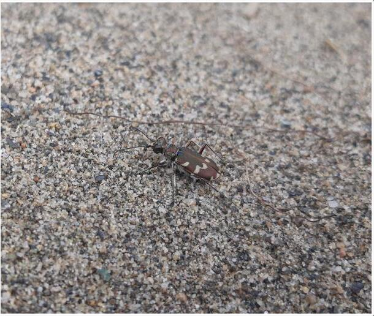
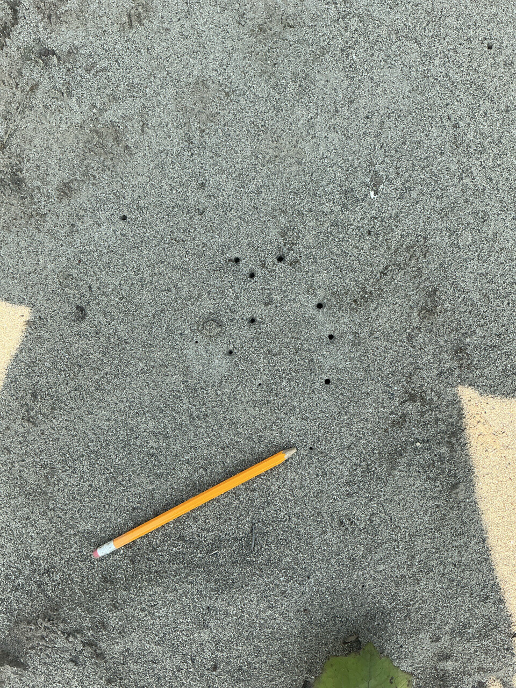
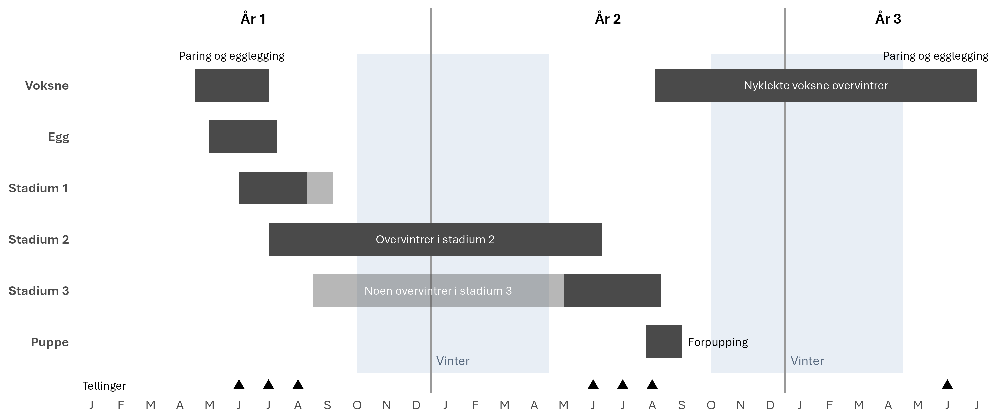
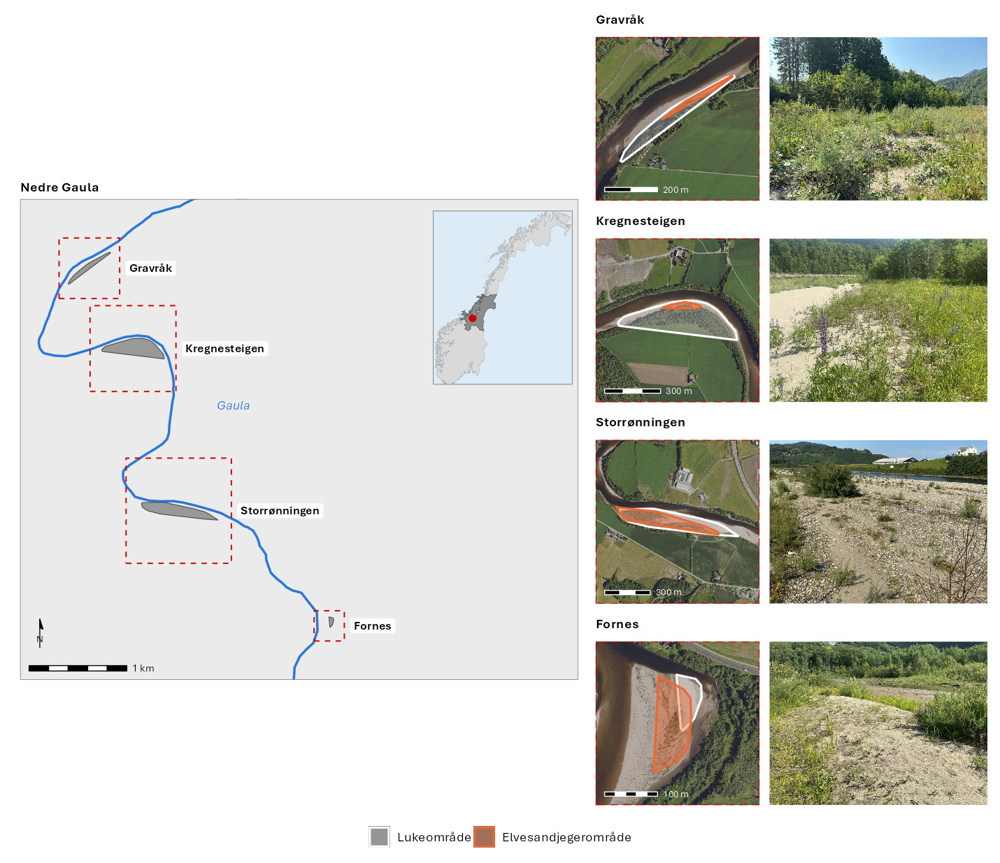
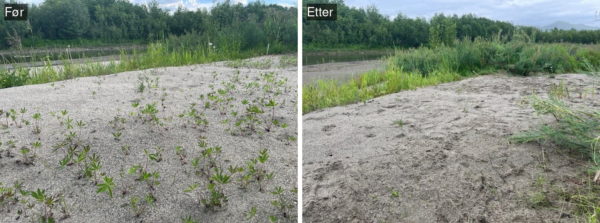
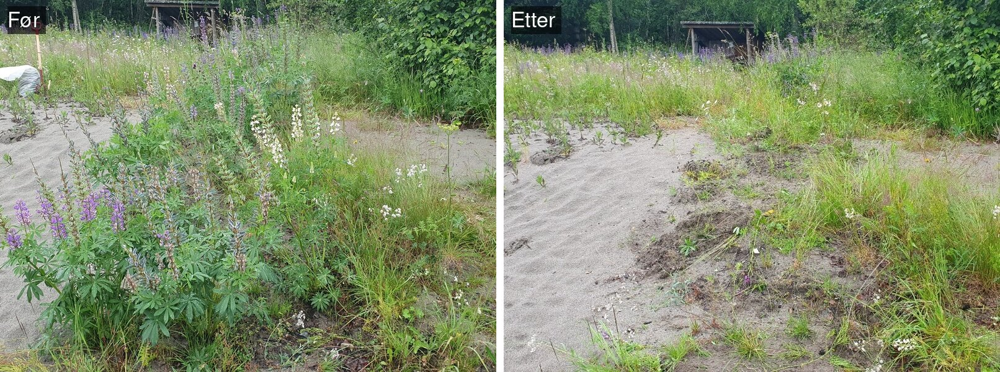
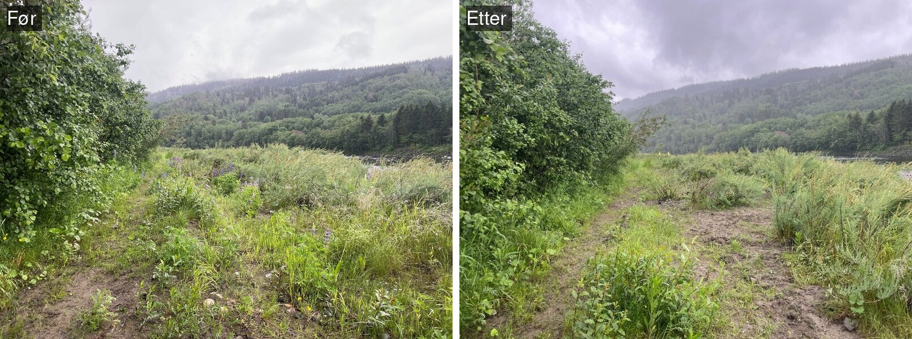
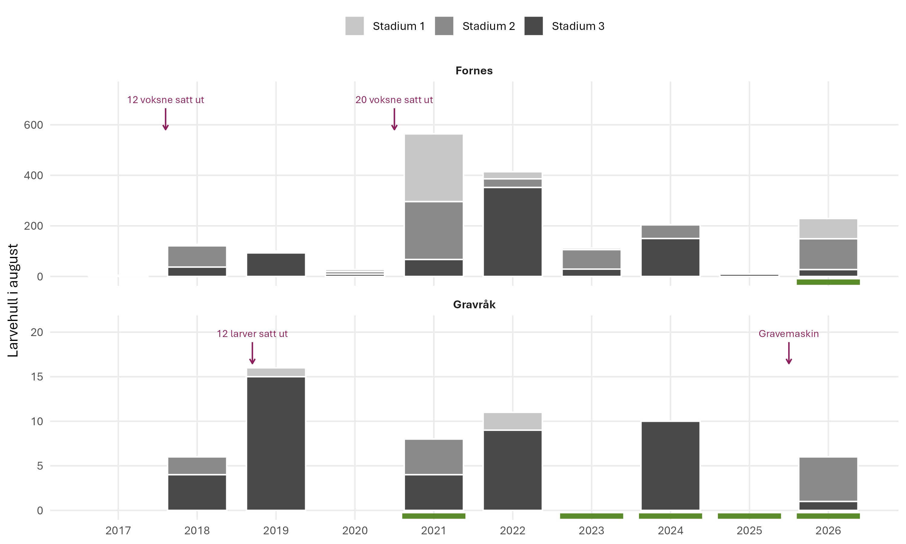

# Elvesandjeger (*Cicindela maritima*)
Megan Nowell
2026-11-10

- [Oppsummering](#oppsummering)
- [English summary](#english-summary)
- [1. Innledning](#1-innledning)
- [2. Formål med delprosjektet](#2-formål-med-delprosjektet)
- [3. Overvåkingslokalitetene](#3-overvåkingslokalitetene)
- [4. Datainnsamling](#4-datainnsamling)
- [5. Dataanalyser](#5-dataanalyser)
- [6. Resultater](#6-resultater)
- [7. Oppsummering](#7-oppsummering)
- [8. Referanser](#8-referanser)
- [9. Author contributions](#9-author-contributions)

<!--# Rapporten leser kun filer i data/ og img/. Rådata ligger på P:, og koden som lager masterfila ligger i code/. -->

<!--# The following parts are autogenerated. Do not edit. -->

> [!NOTE]
>
> Denne siden er generert fra [`Elvesandjeger.qmd`](Elvesandjeger.qmd).
> Ikke rediger `README.md` direkte. For å oppdatere: legg ny masterfil
> (`*_master.csv`) i [`data/`](data/), fjern den gamle, og kjør
> `quarto render Elvesandjeger.qmd`. Se
> [`code/README.md`](code/README.md) for hvordan masterfila lages.

> **Recommended citation**: Nowell, M. 2026. Elvesandjeger (ID:
> XX_YYYY_ZZZ) v. 0.1.0. ecRxiv:
> https://github.com/NINAnor/ecRxiv/tree/main/indicators/XX_YYYY_ZZZ

> [!TIP]
>
> ### Metadata
>
> 

>
> Tabell 1: Indicator metadata
>
> 

>
> | Variable | Value |
> |:---|:---|
> | Indicator ID | INDICATORID |
> | Indicator Name | Elvesandjeger |
> | verbatimName | Elvesandjeger |
> | Country | Norway |
> | Continent | Europe |
> | Realm | write realm here |
> | Biome | write biome here |
> | Ecosystem | write ecosystem here |
> | verbatimEcosystem | Elvebredder med sand og grus langs Gaula |
> | Year added | 2026 |
> | Last update | 2026 |
> | Version | 0.1.0 |
> | Version comment | Første versjon, med data 2015–2026, effekt av lupinluking og klima/vannføring |
> | Precision |  |
>
> 

>
> 

> [!TIP]
>
> ### Log
>
> <!--# Legg til en kort linje for hver oppdatering -->
>
> - 16. okt. 2026 – Første versjon, data 2015–2026

## Oppsummering

Elvesandjeger overvåkes på fire lokaliteter langs Gaula, der hagelupin
lukes hvert år. Etter et svært dårlig år i 2025 økte bestanden igjen i
2026, med mange nye larver og flere voksne enn noen gang tidligere i
serien. Lukingen reduserer lupinbestanden, men lupinen kom raskt tilbake
i 2026 etter mindre luking i 2025. Polygoner som ble luket, hadde
dobbelt så mange larver som polygoner som ikke ble luket, men
forskjellen var ikke signifikant, blant annet fordi det er få
ikke-lukede polygoner å sammenligne med. Luking hvert år og overvåking
bør videreføres, og tråkk i kjerneområdene bør reduseres.

## English summary

The tiger beetle *Cicindela maritima* is monitored at four sites along
the river Gaula, where garden lupin (*Lupinus polyphyllus*) is removed
every year. After a very poor year in 2025, the population increased
again in 2026, with many new larvae and more adults than ever recorded
in the series. Lupin removal reduces the lupin population, but lupins
returned quickly in 2026 after less removal in 2025. Patches where
lupins were removed had twice as many larvae as patches that were not,
but the difference was not significant, partly because there are few
uncleared patches to compare with. Lupin removal every year and
monitoring should be continued, and trampling in the core areas should
be reduced.

## 1. Innledning

Elvesandjeger *Cicindela maritima* er en løpebille (Carabidae) som i
Norge er knyttet til sand- og siltflater langs større elver. Arten
finnes i Tanavassdraget, Altaelva, Gaula i Trøndelag, Gudbrandsdalslågen
med Ottavassdraget og Glomma med Folla (Direktoratet for
naturforvaltning 2009; Ødegaard mfl. 2014; Hanssen 2023). Fordi den
lever i sterkt fragmenterte leveområder med få forekomster, er den
vurdert som sterkt truet (EN) på Norsk rødliste for arter 2021, og den
har vært prioritert art etter naturmangfoldloven siden 2011 (Ødegaard
mfl. 2021). Utenfor Norge finnes arten i Nord- og Vest-Europa og østover
i Russland, der den mange steder lever på sandstrender og sanddyner ved
havet. I Norge lever den bare langs elver, og arten har lenge vært i
tilbakegang både i Europa og i det meste av Skandinavia (Hanssen 2023).
Arten er sjelden også i nabolandene, og i Finland er den vurdert som
sårbar (VU) (Laji.fi 2019). Over 80 % av alle funn av arten i GBIF er
fra Norge, de fleste fra NINAs kartlegging og overvåking (GBIF.org
2026). Det betyr ikke at det finnes flere elvesandjegere i Norge enn i
andre land, men at arten er godt kartlagt og overvåket her, og det viser
hvor viktig overvåkingsprogrammet er for kunnskapen om arten.

(a) Voksen elvesandjeger. Foto: Oddvar Hanssen/NINA (Roos mfl. 2024)

(b) Larvehull, juli 2026. Foto: Arne Endre Laugsand/NINA

Figur 1: Elvesandjeger: en voksen bille og hull etter larver i sanden
(blyanten viser størrelsen).

Hunnen legger eggene ett og ett i silt eller finsand om våren og
forsommeren. Larvene går gjennom tre stadier, og larveutviklingen antas
å ta to år: larvene overvintrer i stadium 2, forpupper seg i stadium 3
sensommeren året etter, og de nyklekte voksne overvintrer og legger egg
våren etter (<a href="#fig-livssyklus" class="quarto-xref">Figur 2</a>)
(Hanssen 2023). Arten er likevel lite studert, og kunnskapen om
livssyklusen bygger på spredte observasjoner i felt. Det er derfor
usikkert hvor lenge hvert stadium varer, og hvor mye dette varierer
mellom år (Hanssen 2023; Roos mfl. 2025). Larvene lever i ganger i
sanden, og larvestadiet kan bestemmes ut fra størrelsen på hullet (Roos
mfl. 2024). Larven jakter på insekter fra åpningen, og larvene ser ut
til å bli i den samme gangen gjennom hele larvetiden (Hanssen 2023).
Arten er avhengig av finere substrat som silt og finsand, som avsettes
på roligere og høyereliggende flater under flom (Ødegaard og Hanssen
2010; Roos mfl. 2024). De voksne billene er aktive i solskinn.

Figur 2: Antatt livssyklus for elvesandjeger ved Gaula, basert på
Hanssen (2023) og tellingene 2015–2026. Livssyklusen er ikke undersøkt
direkte, så virkeligheten kan avvike noe fra figuren, og den kan være
annerledes i deler av Europa med mildere vintre. Mørke felt viser når
stadiet vanligvis finnes, lyse felt viser variasjon som er observert,
men som er usikker. Tidspunktene varierer mellom år. Trekantene viser
når tellingene gjøres (juni, juli og august).

I en naturlig elv er det balanse mellom gjengroing og nydanning: flom
eroderer og legger opp nye sand- og siltflater, mens de gamle gror igjen
(Ødegaard og Hanssen 2010). I Gaula er denne dynamikken langt på vei
stoppet. Elveforbygninger har låst elveløpet, og omfattende grusuttak
har senket elvebunnen slik at moderate flommer ikke lenger når opp på
breddene. Fra 1956 til 2014 forsvant omtrent 37 % av de åpne elveørene
mellom Støren og Gaulosen, og forbindelsen mellom dem ble redusert med
omtrent 62 % (Åström mfl. 2017). Det dannes få nye sandflater, og de som
finnes i dag, er derfor svært verdifulle for arten. Ved Gaula har arten
forsvunnet fra seks lokaliteter siden 1980-tallet og finnes nå bare på
fire (Roos mfl. 2023). Overvåkingen over tid har vist at arten er svært
avhengig av egnet substrat, og at noen kjerneområder er viktige år etter
år som kildebestander, mens elvedynamikken endrer hvilke leveområder som
er tilgjengelige (Roos mfl. 2025). Det finnes ikke store arealer med
egnet habitat, og når disse blir invadert av lupiner, settes bestandene
under stort press fordi det er få nye steder å kolonisere. Arten
forsøker å etablere seg på nye steder, men etter flom endres den romlige
fordelingen av larvehull utenfor kjerneområdene mye.

I tillegg til endringene i elva trues arten av gjengroing, blant annet
med den fremmede arten hagelupin *Lupinus polyphyllus*, og larvehullene
kan ødelegges direkte av tråkk fra mennesker og hunder (Evju mfl. 2022;
Roos mfl. 2025).

Dette delprosjektet overvåker effekten av luking av hagelupin på
elvesandjeger på fire lokaliteter langs Gaula. Stor elvebreddedderkopp
*Arctosa cinerea* overvåkes på de samme lokalitetene og rapporteres i et
eget delprosjekt.

## 2. Formål med delprosjektet

### 2.1 Målsetning med tiltakene

Formålet med tiltaket, luking av hagelupin, er å åpne opp gjengrodde
arealer slik at elveavsetningene igjen blir tilgjengelige som leveområde
for elvesandjeger (Roos mfl. 2024, 2025). Tiltaket skal redusere
lupinbestanden og vegetasjonsdekket på sand- og siltflatene og dermed
øke antallet larver og voksne, som er indikatorene i overvåkingen
(<a href="#tbl-indikatorer" class="quarto-xref">Tabell 3</a>).

### 2.2 Formål med overvåking

Formålet med overvåkingen er å følge bestanden av elvesandjeger på fire
lokaliteter langs Gaula og fastslå effekten av lupinlukingen på
bestanden (Roos mfl. 2024, 2025).

### 2.3 Forventninger

Det forventes at arealer der lupinene er luket, blir tatt i bruk til
egglegging av elvesandjeger, og at lukingen på sikt vil øke utbredelsen
og bestanden på lokalitetene (Roos mfl. 2025). Effekten kommer trolig
med en forsinkelse: arten ser ikke ut til å trives på sterkt forstyrrede
sandflater, så de lukede flatene tas trolig i bruk året etter lukingen,
etter at en vinter og en vårflom har jevnet dem ut (Roos mfl. 2024).
Fordi larveutviklingen trolig tar to år, vil en effekt på antallet
voksne komme enda senere. Antallet vil fortsatt variere mye fra år til
år på grunn av flom og vær.

## 3. Overvåkingslokalitetene

### 3.1 Beskrivelse av lokalitetene

Overvåkingen foregår på fire lokaliteter langs nedre del av Gaula i
Melhus kommune i Trøndelag: Gravråk, Kregnesteigen, Storrønningen og
Fornes (<a href="#fig-kart" class="quarto-xref">Figur 3</a>).
Lokalitetene består av sand- og grusflater (elveører) langs elva.

Elveørene ligger stort sett på samme sted fra år til år, men systemet er
likevel svært dynamisk. De årlige flommene endrer den finskala
topografien, ved at sand og silt avsettes og eroderes lokalt, og de
påvirker vegetasjonsdekket på flatene. Stedegne arter, som gråor og
klåved, vokser inn på elvebreddene, fanger opp sediment og endrer
topografien og kornstørrelsen i substratet.

Hagelupin er en svært invasiv fremmedart. Frø føres med elva fra
forekomster lenger opp i vassdraget, og frø fra lupinene på selve
lokalitetene spirer, slik at lupinen raskt etablerer seg på nytt. Tette
lupinbestander gror igjen de åpne sand- og siltflatene som elvesandjeger
er avhengig av.

Flom og vær varierer mye fra år til år (avsnitt 6.4). I 2026 toppet
vårflommen ved Gaulfoss, den nærmeste vannføringsstasjonen (NVE), seg på
388 m³/s 24. mai, den minste vårflommen i perioden 2020–2026, og
vannføringen var over 300 m³/s i 1 dag i mai–august, mot 6–28 dager i de
andre årene. Det kom ingen sommerflom; høyeste vannføring i
juli–september var 233 m³/s. Nedbøren ved Leinstrand, den nærmeste
værstasjonen med nedbørsmålinger (Meteorologisk institutt), var 387 mm i
mai–august, den høyeste i perioden.

**Gravråk** ligger på østsiden av Gaula, vest for Gravråk-gårdene.
Lokaliteten er en 600 m lang grusør med litt sand og silt inn mot
vegetasjonen. Den har hatt noen små siltflater og en liten, ustabil
bestand av elvesandjeger i mange år (Hanssen 2023; Roos mfl. 2024).
Sommeren 2023 ble det ikke funnet elvesandjeger her (Roos mfl. 2023),
men i 2024 og 2025 ble det igjen registrert larver (Roos mfl. 2025).

**Kregnesteigen** ligger på vestsiden av Gaula, sør for Gravråk og vest
for Skjerdingstad. Lokaliteten er en langsmal elveør i en innersving, om
lag 1 km lang og 20–50 m bred ved normal vannstand. Fram til 2023 lå de
største sand- og siltflatene med elvesandjeger nedstrøms svingen, som en
smal sone inn mot kantvegetasjonen. Gjengroing med gråor og flommene i
august 2023 forringet leveområdet der, og arten finnes nå i stor grad på
en flate om lag 100 m oppstrøms som ble restaurert med gravemaskin i
2022 (Roos mfl. 2024, 2025). Området er populært for laksefiske, og
enkelte steder, særlig nær elvekanten ved fiskerhytta og gapahuken, er
det mye slitasje fra ferdsel (Roos mfl. 2025).

**Storrønningen** ligger på vestsiden av Gaula ved Kvål. Elveøra er 1,3
km lang, og de nederste 500 m er et om lag 50 m bredt overløp der det
jevnlig avsettes sand og silt, og der det har vært en bestand av
elvesandjeger i mange år. Gjengroing og styrtregnflommer har forringet
leveområdene de senere årene. I 2021 etablerte arten seg på en nylig
avsatt siltflate i den øvre delen, og en stadig større del av bestanden
har holdt til der (Hanssen 2023; Roos mfl. 2024). Det ligger en
hundeskole like ved lokaliteten, og dronebilder viser omfattende spor
etter hunder i kjerneområdene for elvesandjeger (Roos mfl. 2025).

**Fornes** ligger én kilometer oppstrøms Kvålsbrua, ved utløpet av
Gammelelva naturreservat på østsiden av Gaula. Lokaliteten er en elveør
på 28 daa med store sandflater med silt i og rundt et frodig klåvedkratt
på østsiden mot Gammelelva, og store flater med grus og stein og lite
vegetasjon på vestsiden (Hanssen 2023; Roos mfl. 2024). Flybilder viser
at det ble tatt ut grus på østsiden av elva på 1980-tallet, og i 1998
var det nesten ingen åpen elveør her. Dagens elveør bygde seg opp mellom
2005 og 2009 og ble raskt kolonisert av klåved, som fanget opp silt og
gjorde flatene egnet for elvesandjeger (Hanssen 2023). Flybilder fra
2014–2026 viser at vegetasjonen siden har spredt seg over store deler av
elveøra. Larvene lever her mest på små, forhøyede siltputer og flater
nedstrøms klåvedbuskene, mens de voksne bruker de store sandflatene.
Elvesandjeger ble funnet på Fornes første gang i august 2017, da det ble
registrert seks larvehull fra egg lagt våren 2016. Arten koloniserte
trolig lokaliteten på egen hånd fra Storrønningen, om lag 2 km
nedstrøms. For å styrke den nye bestanden ble det satt ut voksne biller
fra Storrønningen og Kregnesteigen i 2018 (12 individer) og fra
Storrønningen i 2020 (20 individer) (Hanssen 2023). De fleste
registreringene av elvesandjeger på Fornes ligger utenfor lukeområdet
(<a href="#fig-kart" class="quarto-xref">Figur 3</a>), og Fornes brukes
derfor som kontroll i effektanalysen.

Figur 3: Lokalitetene for overvåking av elvesandjeger langs nedre Gaula
i Trøndelag. Til venstre: oversikt over lukeområdene (grå) og utsnittene
for hver lokalitet (rød stiplet ramme); det innfelte kartet viser
plasseringen i Norge (Trøndelag i mørk grå). Til høyre, fra nord til
sør: lukeområdet (hvitt) og elvesandjegerområdet (oransje) på hver
lokalitet, og et bilde fra lokaliteten. Lukeområdet er minste konvekse
polygon rundt lukepolygonene 2025–2026, og elvesandjegerområdet minste
konvekse polygon rundt registreringene av larver og voksne de tre siste
årene. Ortofoto: © Norge i bilder (Kartverket, Geovekst). Elvelinje:
NVE. Foto: Arne Endre Laugsand/NINA (Fornes og Kregnesteigen juni 2026,
Gravråk og Storrønningen juli 2026).

### 3.2 Tiltak

Tiltaket er luking av hagelupin på lokalitetene. Lukingen utføres av
Midtnorsk Naturundersøkelse AS (MidNat), som har kartlagt og luket
lupiner langs Gaula hvert år siden 2020 (Solberg 2020; Solberg og Vullum
2022b, 2022a, 2023, 2024; Solberg mfl. 2025). Gaula er ett av fem
vassdrag som Statsforvalteren i Trøndelag har prioritert i sin satsing
på å redusere utbredelsen av fremmede planter, og MidNat har hatt
rammeavtale med Statsforvalteren i Trøndelag om kartlegging og
bekjempelse i Gaulavassdraget i 2023–2025, i tillegg til tilskuddsmidler
til tiltak for natur. NINA har gitt MidNat i oppdrag å kartlegge
lupinene på overvåkingslokalitetene (Solberg mfl. 2025).

Lupinene lukes i hovedsak manuelt med håndredskap, som hagegreip,
potetgrev, sigd og løvetannstikker, slik at sandflatene forstyrres minst
mulig, og noen steder slås de med ryddesag. Plantene tas opp med roten,
og alt plantemateriale samles i tette sekker og leveres til godkjent
mottak for fremmede arter (Roos mfl. 2024; Solberg mfl. 2025). Ved
delvis luking fjernes bare de større lupinene som kan sette frø i løpet
av sesongen, og flere steder fjernes blomsterstander og frøbelger for å
hindre frøspredning (Solberg mfl. 2025). Hensikten med delvis luking var
å gi polygonene et år med mindre forstyrrelse for elvesandjeger,
samtidig som lupinene ikke fikk spre frø. Fra 2026 lukes polygonene
enten fullt eller ikke i det hele tatt, for å begrense forstyrrelsen av
larvene.Hver lokalitet er delt inn i kartfestede lukepolygoner, og
MidNat registrerer for hvert polygon og år om det er luket (Ja), delvis
luket (Delvis) eller ikke luket (Nei), hvor mange lupiner som ble
fjernet, og når og hvordan det ble luket (Roos mfl. 2024). Follstadøya
blir også luket, men har ikke overvåking av elvesandjeger og er ikke med
her.

<a href="#fig-foto-luking" class="quarto-xref">Figur 4</a> viser
eksempler på lukepolygoner før og etter luking i 2026.

(a) Fornes 4, der både etablerte lupiner og mange frøplanter ble luket

(b) Kregnesteigen 7b

(c) Gravråk 15

Figur 4: Lupinluking i 2026, før og etter luking. Foto: Midtnorsk
Naturundersøkelse AS (MidNat).

To steder er det i tillegg fjernet vegetasjon med gravemaskin for å
restaurere åpne sandflater. På Kregnesteigen ble en eng med gras, urter
og lupiner restaurert i november 2022 (Roos mfl. 2023). På Gravråk, som
over tid har grodd igjen med både stedegne arter og lupiner, ble nesten
all vegetasjon fjernet fra et større område med anleggsmaskiner i
oktober 2025, etter at det var luket og fjernet frøbelger i og rundt
området gjennom sommeren (Solberg mfl. 2025). På Fornes fjernet MidNat
blomsterstander og frøbelger fra 29. juni til 15. juli 2025, og Øya
videregående skole luket lupiner der 2. oktober 2025 med midler fra
Melhus kommune (Solberg mfl. 2025).

Lukeinnsatsen har variert mye mellom år og lokaliteter
(<a href="#fig-luking-areal" class="quarto-xref">Figur 5</a>,
<a href="#tbl-luking" class="quarto-xref">Tabell 2</a>). På
Storrønningen ble det luket 21 465 m² i 2024, men bare 5 101 m² i 2025,
og i 2026 ble det igjen luket 12 507 m². På Kregnesteigen ble det luket
om lag 17 700 m² hvert år i 2023–2025, i 2025 mest som delvis luking,
mens det bare ble luket 604 m² i 2026. Lukingen på Fornes i 2025 og
restaureringen på Gravråk i oktober 2025 er ikke med i lukedataene, så
lukedataene for Fornes starter i 2026 (2 827 m²).

Figur 5: Areal luket per lokalitet og år (Ja = luket, Delvis = delvis
luket). Ulik skala på y-aksen.

Figur 6: Antall lupiner fjernet (venstre) og lupintetthet i polygonene
som ble fullt luket (høyre), per lokalitet og år. Ved delvis luking
telles bare de større plantene som fjernes, så disse polygonene er ikke
med i tettheten. Fornes har lukepolygoner først fra 2026; Gravråk 2021
mangler antall.

Tabell 2: Lupinluking per lokalitet og år: areal luket (m², Ja +
Delvis), antall lupiner fjernet og lupintetthet (lupiner per m²) i
polygonene som ble fullt luket. – = ikke registrert eller ingen
polygoner fullt luket. Kilde: lukedata fra Midtnorsk Naturundersøkelse
AS.

| Lokalitet | Mål | 2020 | 2021 | 2022 | 2023 | 2024 | 2025 | 2026 |
|:---|:---|---:|---:|---:|---:|---:|---:|---:|
| Storrønningen | Areal luket (m²) | 10 751 | 14 363 | 11 238 | 16 056 | 21 465 | 5 101 | 12 507 |
| Storrønningen | Lupiner fjernet | 56 846 | 37 172 | 5 134 | 8 551 | 7 526 | 1 318 | 25 592 |
| Storrønningen | Lupiner per m², fullt luket | 4,76 | 2,59 | 0,83 | 0,70 | 0,41 | 0,28 | 2,05 |
| Kregnesteigen | Areal luket (m²) | 0 | 2 203 | 2 941 | 17 643 | 17 981 | 17 684 | 604 |
| Kregnesteigen | Lupiner fjernet | 5 750 | 5 400 | 19 130 | 29 593 | 22 217 | 1 125 | 448 |
| Kregnesteigen | Lupiner per m², fullt luket | – | 2,45 | 6,50 | 1,87 | 1,24 | 0,23 | 0,74 |
| Fornes | Areal luket (m²) | 0 | 0 | 0 | 0 | 0 | 0 | 2 827 |
| Fornes | Lupiner fjernet | – | – | – | – | – | – | 5 150 |
| Fornes | Lupiner per m², fullt luket | – | – | – | – | – | – | 1,82 |
| Gravråk | Areal luket (m²) | 0 | 2 768 | 0 | 445 | 5 226 | 5 115 | 4 216 |
| Gravråk | Lupiner fjernet | 0 | – | 0 | 4 535 | 6 915 | 2 409 | 3 545 |
| Gravråk | Lupiner per m², fullt luket | – | – | – | 9,23 | 1,32 | 0,47 | 0,84 |

## 4. Datainnsamling

Overvåkingen av elvesandjeger langs Gaula ble etablert i 2015, etter at
arten ble kartlagt fra 2009 (Ødegaard mfl. 2014; Hanssen 2023). Det
gjøres en totalkartlegging av lokalitetene: alle egnede arealer med silt
og finsand gjennomsøkes, og larvehull (stadium 1–3) og voksne telles.
Larvestadiet bestemmes ut fra størrelsen på hullet, og det tas hensyn
til ikke å tråkke på hullene (Roos mfl. 2024). Hver lokalitet besøkes
opptil tre ganger hver sommer, i juni, juli og august, slik at de ulike
generasjonene fanges opp (Roos mfl. 2024). Besøkene legges så langt som
mulig til dager uten regn. Larvehullene kan telles i de fleste
værforhold, men de voksne billene er bare aktive i solskinn, så antallet
voksne avhenger mye av været på besøksdagen.

Fra 2015 til 2025 ble antall hull per stadium registrert per GPS-punkt
med håndholdt GPS, med en ny posisjon for hver 2–5 m (Roos mfl. 2024).
Fra 2026 registreres elvesandjeger med polygoner i ArcGIS Field Maps.
Metoden ble endret for å redusere de geometriske feilene fra den
håndholdte GPS-en, gi bedre kontroll over hvilke områder som har
larvehull, og samtidig registrere habitatvariabler. Feltteknikeren
tegner polygoner rundt områder med larvehull der substratet og
vegetasjonsdekket er mest mulig likt. Larvehullene ligger ofte i
samlinger, og et polygon omfatter gjerne én samling. Et dronebilde tatt
i juni samme år brukes som høyoppløselig bakgrunnskart, slik at
feltteknikeren kan avgrense polygonene presist. For hvert polygon
registreres antall larver per stadium og voksne, substrattype,
vegetasjonsdekke (%) og slitasje (klasse 1–5). Antallene brukes som
registrert, uavhengig av metode. Indikatorene er oppsummert i
<a href="#tbl-indikatorer" class="quarto-xref">Tabell 3</a>.

Tabell 3: Indikatorer for overvåking av elvesandjeger og effekten av
lupinluking.

| Indikator | Variabel registrert i felt | Utvalgsenhet | Utlegging av utvalgsenhet | Antall utvalgsenheter | Frekvens for datainnsamling |
|:---|:---|:---|:---|:---|:---|
| Populasjonsstørrelse larver | Antall larvehull i stadium 1, 2 og 3 | GPS-punkt (til og med 2025), polygon (fra 2026) | Totalkartlegging av sand- og siltflatene | 4 lokaliteter | 2015–2026: årlig, opptil tre ganger hver sommer (juni, juli og august) |
| Populasjonsstørrelse voksne | Antall voksne | Som over | Som over | 4 lokaliteter | Som over |
| Habitat i polygonene | Vegetasjonsdekke (%), substrattype og slitasje (klasse 1–5) | Polygon | Som over | 4 lokaliteter | 2026: ved hvert besøk |
| Habitat på lokalitetene | Dronebilder (ortofoto og høydemodell), brukt som bakgrunnskart ved registreringen | Hele lokaliteten | Dronefotografering | 4 lokaliteter | 2024–2026: årlig, i juni |
| Luking | Lukestatus i tre klasser (Nei, Delvis, Ja) og antall lupiner fjernet | Lukepolygon | Kartfestede polygoner innenfor lokalitetene | 4 lokaliteter | 2020–2026: årlig (data fra MidNat) |

Alle observasjoner ligger i masterfila
[elvesandjeger_obs_2015-2026_master.csv](data/elvesandjeger_obs_2015-2026_master.csv),
som lages av skript 6 i [`code/`](code/). I masterfila er larvestadiene
for 2024 rettet (stadium 1 og 3 var byttet om i 2024-shapefilene). For
effektanalysen er hvert undersøkelsespolygon i 2026 koblet til
lukepolygonet det overlapper mest (skript 7,
elvesandjeger_2026_analysis_data.csv).

## 5. Dataanalyser

<!-- Kort beskrivelse: hvilke analyser er gjennomført, for å undersøke endringer i indikatorer ift. påvirkningsfaktorer og tiltak, jf. forventninger (under formål). -->

Hovedmålet med analysene er å finne ut om lupinlukingen gir flere
elvesandjegere. Antallet larver påvirkes også av andre forhold:
habitatet i hvert polygon (substrattype, vegetasjonsdekke og slitasje)
og vannføring og nedbør, som varierer fra år til år og mellom besøk.
Disse variablene tas med i analysene for å skille effekten av
lupinlukingen fra andre faktorer som påvirker bestanden.

**Utvikling over tid.** Tidsseriene viser summen av registrerte
individer per år, stadium og besøksmåned. Registreringene gjøres av en
erfaren feltarbeider med god kjennskap til artene og lokalitetene, med
samme innsats ved hvert besøk og på alle lokaliteter. Ikke alle
individer blir oppdaget. Larvene lukker hullet i perioder, når de
skifter hud, før forpuppingen og når de forbereder seg til overvintring,
og under og etter regn er mange hull midlertidig lukket (Hanssen 2023).
Hullene etter stadium 1 er dessuten små og lette å overse. En telling
viser derfor bare larvene som har åpent hull på besøksdagen, og antallet
avhenger av hvor langt larvene har kommet i utviklingen. Summene er
derfor en indeks for relativ forekomst som kan sammenlignes mellom år og
lokaliteter, og ikke et bestandsestimat. Hvilke måneder som er
undersøkt, er ikke helt likt alle år
(<a href="#fig-trend-stadium-maaned" class="quarto-xref">Figur 7</a>),
og tidsseriene vises derfor per besøksmåned.

**Effekt av luking på lupin.** Dataene fra Midtnorsk Naturundersøkelse
inneholder for hvert lukepolygon og år om polygonet ble fullt luket,
delvis luket eller ikke luket, og antallet lupiner som ble fjernet. Ved
full luking fjernes alle lupinene, så antallet viser hvor mange lupiner
som sto i polygonet. Ved delvis luking telles bare de større plantene
som ble fjernet, og antallet sier derfor ikke hvor mange lupiner som sto
der. Analysen bruker derfor bare polygoner som ble fullt luket i det
aktuelle året. Antallet regnes om til lupintetthet (lupiner per m² av
polygonarealet), slik at polygoner av ulik størrelse kan sammenlignes,
og polygonene deles inn etter hvordan de ble luket årene før: fullt
luket året før, delvis luket året før, ett år uten luking, to år eller
mer uten luking, eller luket for første gang. Forskjellene i
lupintetthet mellom disse gruppene testes med en negativ binomial GLMM
(`glmmTMB`, nbinom2) på antall lupiner, med polygonarealet som offset,
lukehistorikk, år og lokalitet som faste effekter og et tilfeldig
konstantledd per polygon (2021–2026).

**Effekt av luking på elvesandjeger.** Effektanalysen bruker
**Kregnesteigen og Storrønningen**. Elvesandjeger finnes også på Gravråk
og Fornes, men på Gravråk ble det bare registrert noen få larver i 2026
(7 larvehull i 2 polygoner), for få til å inngå, og Fornes brukes som
kontroll. Hvert undersøkelsespolygon i 2026 får lukestatusen (Nei /
Delvis / Ja) til lukepolygonet det overlapper mest, **året før
undersøkelsen** (2025). På **Fornes** brukes undersøkelsespolygonene som
ligger utenfor lukepolygonene (19), som **kontroll** uten lupinluking,
mens polygonene som overlapper et lukepolygon (20), er holdt utenfor
analysen. Luking i undersøkelsesåret brukes ikke.

Responsen er antall larver (stadium 1–3) i et undersøkelsespolygon.
Polygonene er tegnet rundt samlinger av larvehull, så bare 3 av 133 har
null larver (to av dem ble tegnet rundt voksne biller, og ett har verken
larver eller voksne); dataene er sterkt overspredte
(varians/gjennomsnitt = 45), men ikke nullinflaterte. Modellen er derfor
en **negativ binomial GLMM** med søkt areal som offset, måned, substrat,
vegetasjonsdekke og slitasje som kovariater, lokalitet som fast effekt
og et tilfeldig konstantledd per lukepolygon (de samme områdene besøkes
i juni, juli og august). Habitatvariablene substrat, vegetasjonsdekke og
slitasje er med slik at effekten av lukingen sammenlignes mellom
polygoner med likt habitat, og måned fanger opp forskjeller mellom
besøkene, blant annet i vannføring og vær:

`larver ~ luket året før + måned + substrat + vegetasjonsdekke + slitasje + lokalitet + offset(log areal) + (1 | lukepolygon)`

Som sensitivitetsanalyse er log(areal) brukt som kovariat i stedet for
offset, og modellen er tilpasset hvert larvestadium for seg.

**Slik leses resultatene.** Effektene er gitt som rateratio (RR): hvor
mange ganger høyere eller lavere larvetettheten er enn i
referansegruppen, når de andre variablene i modellen holdes like. RR = 1
betyr ingen forskjell, RR = 2 dobbelt så mange larver og RR = 0,5
halvparten så mange. KI95 er 95 % konfidensintervall: intervallet som
med 95 % sikkerhet inneholder den sanne effekten. Hvis intervallet
omfatter 1, kan vi ikke si sikkert at det er en forskjell. p-verdien er
sannsynligheten for å få en så stor forskjell hvis det egentlig ikke er
noen effekt, og p \< 0,05 regnes som statistisk signifikant.

**Fornes og Gravråk.** Utviklingen på de to lokalitetene som ikke er med
i effektanalysen, beskrives ut fra augusttellingene, sammen med
tidspunktene for utsetting av biller og larver, luking og restaurering.
Hver lokalitet har bare én tidsserie og ingen kontroll, så sammenhengene
kan ikke testes statistisk.

**Vannføring og nedbør.** Vannføringen er målt ved Gaulfoss (NVE,
stasjon 122.9.0; middelflom 1 008 m³/s, 5-årsflom 1 304 m³/s) og
nedbøren ved Leinstrand (MET SN67150, nedstrøms lokalitetene), og de er
satt sammen til én daglig tabell av skript 8 i [`code/`](code/).
Vannføringen fanger opp både snøsmelting og regnflom, og snø er derfor
ikke tatt med. Vannføring og nedbør er målt på én stasjon og er derfor
like for alle lokaliteter ved samme besøk. De er derfor analysert for
seg, for alle år. Vannføringen der de overvåkede sandbankene oversvømmes
er ikke kjent, så vannføringen brukes direkte som eksponeringsindeks:
høyeste vannføring og antall dager over 300 m³/s siden forrige besøk
(for junibesøket: siden 1. september året før), og høyeste vannføring og
nedbør de 14 dagene før besøket. Larver per lokalitet og besøk
(Storrønningen, Kregnesteigen og Fornes) er modellert med én
eksponeringsvariabel om gangen i en utforskende NB GLMM med måned som
fast effekt og lokalitet og år som tilfeldige effekter. Med én
målestasjon får alle lokaliteter samme eksponering, så testen hviler på
antall besøk. Analysen viser om endringer i antall kan skyldes flom og
vær snarere enn lukingen.

## 6. Resultater

I 2026 ble det registrert 2 304 larvehull (stadium 1–3) og 67 voksne
totalt for alle besøk og lokaliteter.

### 6.1 Utvikling over tid

**Utvikling i bestanden.** Fra 2017, da alle lokalitetene ble undersøkt
i august, og fram til 2023 ble det registrert mellom 1 100 og 3 100
larvehull per besøk, med flest i august 2022 (3 133)
(<a href="#fig-trend-stadium-maaned" class="quarto-xref">Figur 7</a>).
Deretter gikk antallet ned, og 2025 var det dårligste året siden
overvåkingen ble etablert, med under 1 000 larvehull per besøk og bare
308 i august. I 2026 økte antallet igjen, til 1 081 larvehull i juli og
930 i august, men junibesøket ga bare 293 larvehull, det laveste i juni
siden 2016.

**Larvestadiene.** I juni 2026 ble det bare funnet 6 larver i stadium 1,
men i juli ble det registrert 717, det nest høyeste av årene med
julibesøk, etter juli 2023 (856). Disse larvene kom fra egg som ble lagt
våren og forsommeren 2026 av voksne som klekte sensommeren 2025 og
overvintret (Hanssen 2023). Fra juli til august gikk antallet i stadium
1 ned til 178, mens stadium 2 økte fra 41 til 614, så mange av larvene
hadde skiftet hud til stadium 2. Antallet larver i stadium 3 var derimot
lavt i 2026, og i august (138) var det det laveste i hele serien.
Stadium 3 er de eldste larvene, så det lave antallet gjenspeiler trolig
den svake årsklassen fra 2025. Tellingene kan likevel ikke brukes til å
følge en årsklasse fra ett stadium til det neste. I flere år ble det
registrert flere stadium 3-larver enn det ble registrert larver i
stadium 1 og 2 i august året før. På Storrønningen og Kregnesteigen ble
det for eksempel registrert 298 stadium 3-larver i juli 2026, mot 121
larver i stadium 1 og 2 i august 2025. Mange larver må altså ha hatt
lukket hull ved augusttellingen. Mønsteret gjennom sesongen er som
forventet: de overvintrede stadium 3-larvene dominerer i juni, nye
stadium 1-larver klekker og dukker opp i juli, og disse går over til
stadium 2 innen august
(<a href="#fig-sesong" class="quarto-xref">Figur 9</a>).

**Voksne.** Det ble registrert 67 voksne i 2026, de fleste i juni (49),
og det er det høyeste antallet i serien. I 2025 ble det ikke funnet
voksne. De voksne er bare aktive i solskinn, så antallet varierer mye
med været på besøksdagen og sier mindre om bestanden enn larvene.

**Lokalitetene.** August er den måneden som er undersøkt mest
konsekvent, og den brukes for å sammenligne lokalitetene
(<a href="#fig-august-lokalitet" class="quarto-xref">Figur 8</a>).
Storrønningen har hatt den største bestanden i hele perioden. Etter et
svært dårlig år i 2025 økte antallet larver i stadium 2 der til 380 i
august 2026, på nivå med årene før 2024. På Kregnesteigen har antallet
vært lavt siden 2024, og det var fortsatt lavt i 2026. På Fornes var
antallet larver i stadium 1 og 2 i august 2026 det høyeste siden 2021.
På Gravråk ble det bare funnet noen få larver.

Figur 7: Totalt antall larvehull (stadium 1–3) og voksne per år, fordelt
på besøksmåned (alle lokaliteter). Manglende punkter = måneden ble ikke
undersøkt det året.

Figur 8: Antall i august per lokalitet og stadium (august er måneden som
er undersøkt mest konsekvent). Ulik skala på y-aksen.

Figur 9: Andel av larvene (stadium 1–3) per besøksmåned i år med besøk i
juni, juli og august. Tallene over søylene er totalt antall larver.

### 6.2 Effekt av luking på lupin

**Lukehistorikk.** Lupintettheten i polygonene som ble fullt luket,
avhenger av hvordan de var luket årene før
(<a href="#tbl-lupin-luking" class="quarto-xref">Tabell 4</a>,
<a href="#fig-lupin-luking" class="quarto-xref">Figur 10</a>). I
polygoner som også ble fullt luket året før, var det 1,0 lupin per m².
Etter to år eller mer uten luking hadde tettheten økt kraftig, til 5,9
lupiner per m² (RR 5,81, p \< 0,001), og polygoner som ble luket for
første gang, hadde 2,5 lupiner per m² (RR 2,43, p \< 0,001). Polygoner
som sto ett år uten luking, hadde 0,7 lupin per m², og var ikke
signifikant forskjellige fra polygoner som ble fullt luket året før (RR
0,68, p = 0,29). Nesten alle disse (30 av 33) var fullt luket året før
pausen. Ett år uten luking etter full luking ga altså ikke flere
lupiner, men etter to år uten luking var tettheten nesten seks ganger så
høy.

**Delvis luking.** Polygoner som ble delvis luket året før, hadde 1,3
lupiner per m² da de ble fullt luket, og var ikke signifikant
forskjellige fra polygoner som ble fullt luket året før (RR 1,27, p =
0,52). Når de større plantene ble fjernet før de satte frø, holdt delvis
luking lupinen nede omtrent like godt som full luking fram til neste
luking.

**Utvikling over år.** Lupintettheten i polygonene som ble fullt luket,
gikk ned fra 4,8 per m² i 2020 til 0,88 i 2024 og 0,35 i 2025, men økte
igjen til 1,7 per m² i 2026
(<a href="#tbl-luking" class="quarto-xref">Tabell 2</a>). Den lave
tettheten i 2025 kom etter flere år med mye luking: i 2024 ble 44 700 m²
luket, det meste fullt. I 2025 ble bare 11 900 m² fullt luket og 16 000
m² delvis luket. Økningen i 2026 kom særlig fra tolv polygoner på
Storrønningen som ikke var luket i 2024 og 2025. De hadde 3,5 lupiner
per m², og nesten halvparten av lupinene som ble fjernet i 2026.

Tabell 4: Lupintetthet (lupiner per m²) i fullt lukede polygoner etter
lukehistorikk. NB GLMM, n = polygon-år. RR = rateratio; KI95 = 95 %
konfidensintervall. Signifikansnivå: \* p \< 0,05; \*\* p \< 0,01;
\*\*\* p \< 0,001.

| Effekt | n | RR | KI95 | p |
|:---|---:|---:|:---|:---|
| Delvis luket året før (mot fullt luket året før) | 35 | 1.27 | 0.62–2.62 | 0.52 |
| 1 år uten luking (mot fullt luket året før) | 33 | 0.68 | 0.33–1.38 | 0.29 |
| 2 år eller mer uten luking (mot fullt luket året før) | 15 | 5.81 | 2.52–13.42 | \<0.001\*\*\* |
| Første gang luket (mot fullt luket året før) | 35 | 2.43 | 1.49–3.96 | \<0.001\*\*\* |

<a href="#fig-lupin-luking" class="quarto-xref">Figur 10</a> viser
lupintettheten i hvert fullt lukede polygon og år (punkter), gruppert
etter hvordan polygonet var luket årene før, og det modellerte
gjennomsnittet med 95 % konfidensintervall (svart). Y-aksen er
logaritmisk, slik at hver linje betyr ti ganger så mange lupiner.
Spredningen innen hver gruppe er stor, fordi polygonene er ulike og har
ulik lukehistorikk lenger tilbake. Etter full luking, delvis luking og
ett år uten luking er gjennomsnittet rundt én lupin per m² eller lavere.
Polygoner som ble luket for første gang, og særlig polygoner som ikke
var luket på to år eller mer, skiller seg ut med høyere tetthet.
Intervallet er bredt for polygonene som ikke var luket på to år eller
mer, fordi det bare er 15 polygon-år.

Figur 10: Lupintetthet i fullt lukede polygoner etter lukehistorikk
(punkter = polygon-år, +0,01 for å vise nuller; svart = modellert
gjennomsnitt ± 95 % KI).

**Substrat.** Vi undersøkte også om lupintettheten henger sammen med
substratet i lukepolygonene, ved å bruke substratet som er registrert i
undersøkelsespolygonene for elvesandjeger og stor elvebreddedderkopp i
2025–2026. Det var ingen sammenheng mellom andelen sand, blanding eller
silt og lupintettheten (Spearman, p \> 0,3). Substratet er bare
registrert i polygonene der artene ble funnet, og bare 16 lukepolygoner
har slike data, så analysen sier lite om hvor lupinen vokser best.

### 6.3 Effekt av luking på elvesandjeger

<a href="#tbl-effekt-n" class="quarto-xref">Tabell 5</a> viser hvor
mange undersøkelsespolygoner som inngår i hver gruppe ved hvert besøk.
De fleste lå i polygoner som ble luket i 2025, og det er få i polygoner
som ikke ble luket (11 til sammen). Alle de ikke-lukede polygonene
ligger på Storrønningen og alle de delvis lukede på Kregnesteigen, så
sammenligningen mellom disse gruppene er også en sammenligning mellom
lokalitetene.
<a href="#tbl-effekt-koeff" class="quarto-xref">Tabell 6</a> viser
resultatene fra modellen, og
<a href="#tbl-effekt-lrt" class="quarto-xref">Tabell 7</a> viser om hver
variabel samlet bidrar til å forklare antallet larver.

**Luking.** Lukingen i 2025 hadde ingen statistisk signifikant effekt på
antallet larver i 2026 (likelihood-ratio-test p = 0,25). Polygoner som
ble luket, hadde i gjennomsnitt 2,0 ganger så høy larvetetthet som
polygoner som ikke ble luket (KI95 0,90–4,52, p = 0,086), og delvis
lukede polygoner 2,2 ganger (KI95 0,67–6,89, p = 0,20). Retningen er
positiv, men usikkerheten er stor fordi det er så få ikke-lukede
polygoner. Effekten var ikke forskjellig mellom besøkene (p = 0,21).
Også i 2025 fant vi ingen signifikant effekt av luking, men en tendens
til flere larver der det var fullstendig luket (Roos mfl. 2025).

**Andre faktorer.** Larvetettheten var 2,9 ganger høyere på
Storrønningen enn på Kregnesteigen (p = 0,0011), og den var lavere i
juli og august enn i juni. Vegetasjonsdekke og slitasje trakk begge ned:
omtrent 13 % færre larver per 10 prosentpoeng mer vegetasjonsdekke (p =
0,062) og 23 % færre per slitasjeklasse (p = 0,066), men ingen av
effektene var signifikante. Substrattype hadde ingen effekt (p = 0,67).
Vegetasjonsdekke og slitasje er bare registrert i 2026, så dette er
første år de kan testes.

Tabell 5: Antall undersøkelsespolygoner per gruppe og måned. Kontroll =
undersøkelsespolygoner på Fornes utenfor lukepolygonene; Nei/Delvis/Ja =
lukestatus året før på Kregnesteigen og Storrønningen.

| Gruppe   | juni | juli | august |
|:---------|-----:|-----:|-------:|
| Kontroll |    7 |    5 |      7 |
| Nei      |    1 |    2 |      8 |
| Delvis   |    5 |    7 |      5 |
| Ja       |   25 |   18 |     21 |

Tabell 6: NB GLMM for larver per undersøkelsespolygon på Kregnesteigen
og Storrønningen. RR = rateratio (hvor mange ganger høyere eller lavere
larvetettheten er enn i referansegruppen); KI95 = 95 %
konfidensintervall. Referansenivåer: ikke luket året før, juni, sand,
Kregnesteigen. Signifikansnivå: \* p \< 0,05; \*\* p \< 0,01; \*\*\* p
\< 0,001.

| Effekt                            |   RR | KI95      | p             |
|:----------------------------------|-----:|:----------|:--------------|
| Delvis luket året før (mot ikke)  | 2.15 | 0.67–6.89 | 0.2           |
| Luket året før (mot ikke)         | 2.02 | 0.90–4.52 | 0.086         |
| Juli (mot juni)                   | 0.48 | 0.25–0.91 | 0.024\*       |
| August (mot juni)                 | 0.30 | 0.16–0.56 | \<0.001\*\*\* |
| Substrat: blanding (mot sand)     | 1.26 | 0.70–2.27 | 0.43          |
| Substrat: silt (mot sand)         | 1.43 | 0.56–3.68 | 0.45          |
| Vegetasjonsdekke (0 → 100 %)      | 0.24 | 0.05–1.08 | 0.062         |
| Slitasje (per klasse)             | 0.77 | 0.58–1.02 | 0.066         |
| Storrønningen (mot Kregnesteigen) | 2.91 | 1.54–5.53 | 0.0011\*\*    |

Tabell 7: Likelihood-ratio-tester for hvert ledd i modellen.
Signifikansnivå: \* p \< 0,05; \*\* p \< 0,01; \*\*\* p \< 0,001.

| Ledd             | chisq |  df | p          |
|:-----------------|------:|----:|:-----------|
| Luket året før   |  2.74 |   2 | 0.25       |
| Luket × måned    |  5.92 |   4 | 0.21       |
| Substrat         |  0.80 |   2 | 0.67       |
| Vegetasjonsdekke |  3.22 |   1 | 0.073      |
| Slitasje         |  3.33 |   1 | 0.068      |
| Lokalitet        |  8.67 |   1 | 0.0032\*\* |

**Sammenligning med kontrollen på Fornes.** Fornes ligger i samme område
og undersøkes på samme måte og i de samme besøksrundene som
effektlokalitetene. Fordi kontrollen bare finnes på én lokalitet, kan
modellen ikke samtidig ta hensyn til forskjeller mellom lokalitetene.
Lukede polygoner hadde 2,0 ganger så høy larvetetthet som kontrollen (p
= 0,23), ikke-lukede polygoner 1,3 ganger (p = 0,91) og delvis lukede
polygoner 0,9 ganger (p = 0,98)
(<a href="#fig-effekt" class="quarto-xref">Figur 11</a>). Ingen av
gruppene skilte seg altså sikkert fra kontrollen.

Figur 11: Predikert larvetetthet (larver per m² søkt, gjennomsnitt ± 95
% KI, midlet over måned, substrat og lokalitet, ved median
vegetasjonsdekke og slitasje). Venstre: Kregnesteigen + Storrønningen
etter lukestatus året før. Høyre: de samme gruppene sammenlignet med
kontrollen på Fornes (uten luking).

Figur 12: Kovariateffekter fra modellen: predikert larvetetthet mot
vegetasjonsdekke og slitasje (linje ± 95 % KI, for et luket polygon på
Storrønningen i august; punkter = undersøkelsespolygoner) og etter
substrat (gjennomsnitt ± 95 % KI).

**Sensitivitet: areal som kovariat i stedet for offset.** Hovedmodellen
antar at antallet larver er proporsjonalt med polygonarealet, det vil si
at en dobling av arealet gir dobbelt så mange larver. Når arealet i
stedet estimeres i modellen, gir en dobling av arealet bare 1,44 ganger
så mange larver
(<a href="#tbl-sensitivitet" class="quarto-xref">Tabell 8</a>), fordi
større polygoner tar med mer tom mark. Med areal som kovariat blir
effekten av luking svakere (RR 1,39, p = 0,35). Konklusjonen er den
samme: det er ingen sikker effekt av lukingen i 2025 på larvene i 2026.

Tabell 8: Hovedmodellen tilpasset med log(polygonareal) som kovariat i
stedet for offset. Polygonareal er gitt per dobling av arealet.
Signifikansnivå: \* p \< 0,05; \*\* p \< 0,01; \*\*\* p \< 0,001.

| Effekt                                        |   RR | KI95      | p             |
|:----------------------------------------------|-----:|:----------|:--------------|
| Delvis luket året før (mot ikke)              | 0.76 | 0.27–2.10 | 0.59          |
| Luket året før (mot ikke)                     | 1.39 | 0.70–2.74 | 0.35          |
| Vegetasjonsdekke (0 → 100 %)                  | 0.33 | 0.10–1.06 | 0.062         |
| Slitasje (per klasse)                         | 0.85 | 0.67–1.07 | 0.16          |
| Polygonareal, per dobling (2 = proporsjonalt) | 1.44 | 1.31–1.59 | \<0.001\*\*\* |

**Per larvestadium.** Den samme modellen er tilpasset stadium 1, 2 og 3
hver for seg (<a href="#fig-stadium" class="quarto-xref">Figur 13</a>,
<a href="#tbl-stadium" class="quarto-xref">Tabell 9</a>). Voksne
modelleres ikke, fordi antallet avhenger mye av været på besøksdagen.
Ingen av stadiene viste en signifikant effekt av luking. Stadium 1, de
yngste larvene, som klekte i 2026, hadde den største rateratioen for
lukede polygoner (RR 2,43, p = 0,19). Det er dette stadiet vi først
venter at skal respondere, fordi de voksne legger eggene i åpne flater.

Figur 13: Effekter på tettheten av larver i stadium 1, 2 og 3 (NB GLMM,
rateratio ± 95 % KI, Kregnesteigen + Storrønningen). Verdier \> 1 =
høyere tetthet.

Tabell 9: Likelihood-ratio-test for lukestatus året før i modellene per
stadium, og rateratio for luket mot ikke luket. Nuller =
undersøkelsespolygoner uten larver i stadiet. Signifikansnivå: \* p \<
0,05; \*\* p \< 0,01; \*\*\* p \< 0,001.

| Stadium   | Nuller   | RR_luket | p_LRT |
|:----------|:---------|---------:|:------|
| Stadium 1 | 56 av 92 |     2.43 | 0.19  |
| Stadium 2 | 40 av 92 |     0.91 | 0.76  |
| Stadium 3 | 20 av 92 |     1.41 | 0.9   |

### 6.4 Vannføring og nedbør

Elvesandjeger er tilpasset dynamiske elvesystemer der flom stadig legger
opp nye sand- og siltflater. Flommen skaper nye leveområder, men kan
også oversvømme larvehullene eller flytte sanden de ligger i. Vannføring
og nedbør er derfor tatt med fordi de også påvirker bestandsutviklingen,
og fordi de må tas hensyn til når effekten av lupinlukingen skal
vurderes.

Høyeste døgnmiddelvannføring ved Gaulfoss var 388–829 m³/s i 2020–2026,
og ingen år nådde middelflom (1 008 m³/s) som døgnmiddel
(<a href="#fig-hydrologi" class="quarto-xref">Figur 14</a>,
<a href="#tbl-hydrologi" class="quarto-xref">Tabell 10</a>). Vårflommen
kom i april–juni, og i 2026 var den den minste i perioden (388 m³/s).
Den eneste store sommerflommen i serien kom 8. august 2023 (755 m³/s),
ni dager før augustbesøket, og antallet larver i stadium 1 falt fra 856
i juli til 99 i august det året
(<a href="#tbl-besok-eksponering" class="quarto-xref">Tabell 11</a>).
Stadium 1-larvene har de grunneste gangene og er trolig mest utsatt for
oversvømmelse og sandflytting.

I de utforskende modellene hadde verken høyeste vannføring de 14 dagene
før besøket, antall dager over 300 m³/s siden forrige besøk eller
nedbøren de 14 dagene før besøket noen påviselig effekt på antallet
larver (p = 0,21–0,92;
<a href="#tbl-klima-modeller" class="quarto-xref">Tabell 12</a>). Serien
inneholder ennå ikke et år med en flom over middelflom, så testen har
lav styrke.

Figur 14: Daglig vannføring ved Gaulfoss og nedbør ved Leinstrand, med
besøkene for elvesandjeger (oransje). Referanselinjer for vannføring:
300 (prikket) og 500 m³/s (stiplet) og middelflom, 1 008 m³/s
(heltrukket).

Tabell 10: Årlig oppsummering av vannføring og nedbør. Vårflom = høyeste
vannføring april–juni; årsmaks = høyeste vannføring i året; dager \> 300
m³/s i april–juni og juli–august, og dager \> 500 m³/s; nedbør i
mai–august ved Leinstrand. Døgnmiddelverdier.

| År | Vårflom | Vårflom dato | Årsmaks | Årsmaks dato | \>300 apr–jun | \>300 jul–aug | \>500 | Nedbør mai–aug |
|---:|---:|:---|---:|:---|---:|---:|---:|---:|
| 2020 | 829 | 07.06 | 829 | 07.06 | 28 | 0 | 11 | 256 |
| 2021 | 618 | 16.05 | 618 | 16.05 | 18 | 4 | 5 | 266 |
| 2022 | 715 | 25.05 | 715 | 25.05 | 20 | 1 | 8 | 366 |
| 2023 | 580 | 15.05 | 755 | 08.08 | 13 | 4 | 4 | 261 |
| 2024 | 509 | 11.06 | 509 | 11.06 | 14 | 0 | 1 | 368 |
| 2025 | 561 | 18.04 | 561 | 18.04 | 11 | 0 | 1 | 330 |
| 2026 | 388 | 24.05 | 388 | 24.05 | 1 | 0 | 0 | 387 |

Figur 15: Tidspunkt for vårflomtoppen og junibesøket, per år.

Figur 16: Larver per besøk og stadium (alle lokaliteter) mot høyeste
vannføring de 14 dagene før besøket. Tallene = år.

Tabell 11: Innsats og antall per besøk: antall GPS-punkter (til og med
2025) eller polygoner (fra 2026), larver totalt og per stadium, og
eksponering før besøket (høyeste vannføring og nedbør de 14 dagene før;
høyeste vannføring og dager \> 300 m³/s siden forrige besøk, eller
siden 1. september for junibesøket).

| År | Måned | Dato | Punkter | Larver | St. 1 | St. 2 | St. 3 | Q maks 14 d | Nedbør 14 d | Q maks siden forrige | Dager \>300 siden forrige |
|---:|:---|:---|---:|---:|---:|---:|---:|---:|---:|---:|---:|
| 2020 | juli | 15.07 | 130 | 1454 | 155 | 423 | 876 | 228 | 34 | 829 | 28 |
| 2020 | august | 17.08 | 131 | 1220 | 242 | 220 | 758 | 167 | 16 | 241 | 0 |
| 2021 | juni | 16.06 | 188 | 1597 | 101 | 475 | 1021 | 305 | 22 | 618 | 18 |
| 2021 | august | 09.08 | 200 | 2737 | 422 | 1228 | 1087 | 37 | 22 | 172 | 0 |
| 2022 | juni | 30.06 | 191 | 1918 | 360 | 464 | 1094 | 269 | 73 | 715 | 21 |
| 2022 | august | 10.08 | 214 | 3133 | 616 | 1061 | 1456 | 230 | 47 | 305 | 1 |
| 2023 | juni | 20.06 | 135 | 1535 | 140 | 377 | 1018 | 196 | 1 | 580 | 17 |
| 2023 | juli | 19.07 | 164 | 2820 | 856 | 536 | 1428 | 171 | 23 | 171 | 0 |
| 2023 | august | 17.08 | 197 | 1458 | 99 | 576 | 783 | 755 | 88 | 755 | 2 |
| 2024 | juni | 13.06 | 136 | 824 | 76 | 272 | 476 | 509 | 96 | 509 | 14 |
| 2024 | juli | 25.07 | 194 | 2253 | 296 | 1059 | 898 | 180 | 52 | 180 | 0 |
| 2024 | august | 19.08 | 192 | 1098 | 15 | 380 | 703 | 127 | 48 | 130 | 0 |
| 2025 | juni | 14.06 | 313 | 808 | 10 | 226 | 572 | 264 | 36 | 561 | 11 |
| 2025 | juli | 11.07 | 261 | 959 | 205 | 35 | 719 | 191 | 33 | 305 | 1 |
| 2025 | august | 27.08 | 81 | 308 | 22 | 100 | 186 | 240 | 88 | 240 | 0 |
| 2026 | juni | 12.06 | 47 | 293 | 6 | 44 | 243 | 200 | 40 | 388 | 2 |
| 2026 | juli | 13.07 | 37 | 1081 | 717 | 41 | 323 | 180 | 54 | 180 | 0 |
| 2026 | august | 25.08 | 49 | 930 | 178 | 614 | 138 | 209 | 85 | 209 | 0 |

Tabell 12: Utforskende NB GLMM for larver per lokalitet og besøk
(Storrønningen, Kregnesteigen, Fornes; måned som fast effekt, lokalitet
og år som tilfeldige effekter) med én eksponeringsvariabel om gangen.
Estimat på log-skala; p fra likelihood-ratio-test. Signifikansnivå: \* p
\< 0,05; \*\* p \< 0,01; \*\*\* p \< 0,001.

| Respons     | Variabel                               | Estimat |    SE | p    |
|:------------|:---------------------------------------|--------:|------:|:-----|
| Alle larver | log(høyeste vannføring 14 d før besøk) |  -0.221 | 0.182 | 0.23 |
| Alle larver | Dager \> 300 m³/s siden forrige besøk  |  -0.002 | 0.019 | 0.92 |
| Alle larver | Nedbør 14 d før besøk (mm)             |  -0.005 | 0.004 | 0.23 |
| Stadium 1   | log(høyeste vannføring 14 d før besøk) |  -0.474 | 0.365 | 0.21 |
| Stadium 1   | Dager \> 300 m³/s siden forrige besøk  |  -0.024 | 0.042 | 0.59 |
| Stadium 1   | Nedbør 14 d før besøk (mm)             |  -0.004 | 0.008 | 0.59 |

### 6.5 Fornes og Gravråk: utsetting, luking og restaurering

**Fornes.** Elvesandjeger koloniserte Fornes fra Storrønningen i
2015–2016, og i august 2017 ble det bare funnet fem larvehull
(<a href="#fig-fornes-gravrak" class="quarto-xref">Figur 17</a>). I mai
2018 ble det satt ut 12 voksne biller fra Storrønningen og
Kregnesteigen, og i august samme år ble det registrert 127 larvehull,
hvorav 90 i stadium 1 og 2 fra eggene som ble lagt det året og trolig
var avkom etter de utsatte billene (Hanssen 2023). I 2019 og 2020 ble
det lagt få nye egg, og i august 2020 ble det satt ut 20 nyklekte voksne
fra Storrønningen. I august 2021 ble det registrert 564 larvehull,
hvorav 497 i stadium 1 og 2. Siden har Fornes hatt en stabil bestand med
100–500 larvehull per besøk, bortsett fra det dårlige året 2025, som
gjaldt alle lokalitetene. Begge utsettingene ble altså fulgt av en
tydelig økning i antallet unge larver neste sesong. Vi kan ikke utelukke
at økningen hadde kommet uansett, fordi arten samtidig vandret inn
naturlig, men mønsteret tyder på at utsettingen av voksne bidro til at
bestanden ble etablert. Fornes ble luket første gang i 2025, og det er
for tidlig å se en effekt av lukingen der.

**Gravråk.** Gravråk har hatt en liten og ustabil bestand i mange år,
med 6–16 larvehull i august. I juli 2019 ble det satt ut 11 larver i
stadium 3 og én puppe fra Storrønningen i kunstige hull. Bare fire av
hullene var igjen i slutten av august, de andre ble trolig vasket bort
av en regnflom, og det ble ikke sett noen effekt i 2020 (Hanssen 2023).
Augusttellingen i 2019 (15 larver i stadium 3) omfatter trolig også noen
av de utsatte larvene. Det ble luket 4 200–5 200 m² hvert år i
2024–2026, men antallet larver økte ikke året etter (8–15 larvehull per
besøk i 2025 og 1–6 i 2026). Gravråk er i hovedsak en grusør med lite
sand og silt, så mangel på egnet substrat begrenser trolig bestanden mer
enn lupinene. Restaureringen med gravemaskin i oktober 2025 er det
første tiltaket som også endrer substratet. Flatene ventes å bli tatt i
bruk etter at en vinter og en vårflom har jevnet dem ut, så effekten kan
først vurderes i 2027.

**Erfaringer fra Follstadøya.** På Follstadøya, som lukes, men ikke
overvåkes, ble det satt ut både voksne og larver i 2019–2020. Det eneste
resultatet var én voksen bille i 2021. Hovedårsakene var trolig at
lupinene hadde tatt over de beste siltflatene, og at de åpne flatene
hadde for mye sand og for lite silt (Hanssen 2023).

Figur 17: Antall larvehull i august per stadium på Fornes og Gravråk.
Piler: utsetting av voksne biller (Fornes, mai 2018 og august 2020) og
larver (Gravråk, juli 2019), og restaurering med gravemaskin (Gravråk,
oktober 2025). Grønn strek under aksen: år med luking i lukedataene
(Fornes ble også luket i 2025, men det er ikke med i lukedataene).
Manglende søyle = ikke undersøkt i august. Ulik skala på y-aksen.

## 7. Oppsummering

### 7.1 Hva viser årets resultater

<!-- Teksten er skrevet for dataene til og med 2026. Oppdater tallene og tolkningen manuelt hvert år. -->

**Lukingen holder lupinbestanden nede, men bare så lenge den gjentas.**
I polygoner som ble luket hvert år, holdt lupintettheten seg lav. Ett år
uten luking etter full luking ga ikke flere lupiner, men etter to år
eller mer uten luking var tettheten nesten seks ganger så høy som i
polygoner som ble fullt luket året før. Delvis luking, der de større
plantene ble fjernet før de satte frø, holdt lupinen nede omtrent like
godt som full luking. I 2025 ble det fullt luket mye mindre enn året
før, og i 2026 var lupintettheten i de fullt lukede polygonene fem
ganger så høy som i 2025, særlig i polygoner på Storrønningen som ikke
var luket på to år. Lupinen kommer altså raskt tilbake når lukingen
stopper opp.

**Frøbanken.** Tellingene viser bare lupinene som står i polygonene
hvert år, ikke frøbanken. Hagelupin danner en langvarig frøbank, og
frøene kan ligge i jorda i mer enn 50 år uten å miste spireevnen
(Fremstad 2012). Når blomsterstander og frøbelger fjernes, både ved full
og delvis luking, kommer det færre nye frø i jorda, og over tid bør
frøbanken bli mindre, selv om det fortsatt kommer opp lupiner i
polygonene de nærmeste årene. Frøbanken fylles likevel på av lupiner som
står igjen i og rundt lukeområdene, og trolig også av frø som føres med
elva fra bestander lenger opp (Hanssen 2023). Effekten av lukingen kan
derfor ikke vurderes bare ut fra antallet lupiner fra ett år til det
neste. Luking år etter år er nødvendig, og arbeidet som Midtnorsk
Naturundersøkelse, Melhus kommune, Øya videregående skole og andre gjør
langs Gaula, er viktig for å holde lupininvasjonen under kontroll.

**Bestanden tok seg opp i 2026 etter et svært dårlig 2025.** 2025 var
det dårligste året siden overvåkingen ble etablert, men i 2026 økte
antallet larver igjen. De voksne klekker sensommeren, overvintrer og
legger egg våren og forsommeren året etter, og larveutviklingen antas å
ta to år (Hanssen 2023). Det ble registrert flere voksne enn noen gang
tidligere i serien, og i juli 2026 ble det registrert mange nyklekte
stadium 1-larver fra eggene de la. Antallet stadium 3-larver var derimot
det laveste i serien. Stadium 3-larvene i 2026 kommer fra egg som ble
lagt i 2025, så det lave antallet gjenspeiler trolig den svake
årsklassen fra 2025. Storrønningen og Fornes hadde flere larver enn året
før, mens Kregnesteigen fortsatt hadde lave antall.

**Ingen sikker effekt av lukingen på larvene.** Polygoner som ble luket
i 2025, hadde i gjennomsnitt dobbelt så høy larvetetthet i 2026 som
polygoner som ikke ble luket, men forskjellen var ikke signifikant. Også
i 2025 var det en tendens til flere larver der det var fullstendig
luket, uten at effekten var signifikant (Roos mfl. 2025). Det er flere
grunner til at effekten er vanskelig å påvise. Nesten alle polygonene
der arten finnes, ligger i lukede områder, så det er få ikke-lukede
polygoner å sammenligne med, og de ligger alle på Storrønningen. De
delvis lukede polygonene ligger alle på Kregnesteigen, så effekten av
delvis luking kan ikke skilles fra lokaliteten. I tillegg ventes
effekten å komme med en forsinkelse: de voksne legger eggene i åpne
flater etter lukingen, og larveutviklingen tar trolig to år. Det passer
med at stadium 1, de yngste larvene, hadde den største effekten av
lukingen, selv om heller ikke den var signifikant.

**Vegetasjon og tråkk.** Vegetasjonsdekke og slitasje ble registrert for
første gang i 2026. Begge trakk antallet larver ned, men effektene var
ikke signifikante. Retningen stemmer med at arten trenger åpne sand- og
siltflater, og med at larvehullene kan ødelegges av tråkk (Evju mfl.
2022). I 2025 viste dronebilder omfattende spor etter hunder i
kjerneområdene på Storrønningen (Roos mfl. 2025). Slitasje registreres
bare som et øyeblikksbilde på besøksdagen, og regn kan vaske bort
fotspor, så flere år med data trengs før vi kan si noe sikkert om
effekten av tråkk.

**Flom.** Ingen av flom- og nedbørsvariablene hadde en påviselig effekt
på antallet larver. Sommerflommen i august 2023 falt likevel sammen med
et kraftig fall i antallet stadium 1-larver, som har de grunneste
gangene. Serien inneholder ennå ikke et år med flom over middelflom, så
vi vet ikke hvordan en stor flom påvirker bestanden.

**Fornes og Gravråk.** På Fornes ble begge utsettingene av voksne biller
fulgt av en tydelig økning i antallet unge larver, og lokaliteten har nå
en stabil bestand. På Gravråk har verken utsettingen av larver i 2019
eller lukingen i 2024–2026 gitt flere larver. Der begrenser trolig
mangelen på sand og silt bestanden mer enn lupinene. Erfaringene tyder
på at utsetting av voksne virker der det finnes nok egnet siltflate,
mens utsetting av larver ikke har virket.

**Voksne og vær.** De voksne er bare aktive i solskinn, og antallet
varierer derfor mye med været på besøksdagen. Antallet voksne sier
derfor mindre om bestanden enn antallet larver.

### 7.2 Anbefaling for videreføring

**Tiltak.** Vi anbefaler luking av hagelupin i alle lukepolygonene hvert
år. Ett år uten luking etter full luking ga ikke flere lupiner, men
etter to år uten luking var tettheten nesten seks ganger så høy. Et
lengre opphold i lukingen kan derfor sette arbeidet flere år tilbake.
Polygonene som ikke er luket på to år eller mer, bør prioriteres, og på
Kregnesteigen, der det bare ble luket 604 m² i 2026, bør hele
lokaliteten lukes fullt i 2027. Ett år uten luking etter full luking ga
ikke flere lupiner, så praksisen fra 2026, der polygonene enten lukes
fullt eller får stå i fred, kan begrense forstyrrelsen av larvene uten
at lupinen tar seg opp igjen, så lenge ingen polygoner står mer enn ett
år uten luking. Frøstandene bør fjernes før de modner. Kjerneområdene
med stabile bestander av elvesandjeger fungerer som kildebestander og
bør prioriteres, og områdene rundt bør holdes åpne som buffersoner som
arten kan flytte til etter flom og styrtregn (Roos mfl. 2025). Den
restaurerte flaten på Kregnesteigen, der store deler av bestanden har
holdt til siden 2023, var i ferd med å gro igjen i 2025 og bør lukes på
nytt (Roos mfl. 2025). Utviklingen på Gravråk etter restaureringen med
gravemaskin i 2025 bør følges.

Lukingen holder eksisterende leveområder åpne, men nye sand- og
siltflater skapes bare av elva selv. Forvaltningen bør derfor også ta
hensyn til inngrep som reduserer den naturlige dynamikken i elva, som
masseuttak og flomforbygninger.

På Gravråk bør det vurderes å sette ut voksne biller fra Storrønningen
eller Kregnesteigen når den restaurerte flaten har stabilisert seg, slik
det ble gjort med godt resultat på Fornes. Antallet stadium 1-larver der
bør følges opp i 2027, året etter restaureringen.

Larvehullene er sårbare for tråkk fra mennesker og hunder. Skilt som
informerer om at sandflatene er leveområder for en truet art, er et
enkelt tiltak, og i de mest sårbare kjerneområdene kan det vurderes å
kanalisere ferdselen eller innføre båndtvang (Roos mfl. 2025).

**Overvåking.** Registreringen i ArcGIS Field Maps, som ble tatt i bruk
i 2026, gir nyttig informasjon om vegetasjonsdekke, substrattype og
slitasje i hvert polygon, i tillegg til antall larver per stadium og
voksne. Vi anbefaler å følge denne protokollen med besøk i juni, juli og
august hvert år. Polygonene bør holdes små og avgrenses slik at hvert
polygon gjenspeiler én kombinasjon av vegetasjonsdekke og substrattype.
Været på besøksdagen, særlig sol eller overskyet, bør registreres, slik
at antallet voksne kan tolkes. Fornes bør fortsatt brukes som kontroll,
med undersøkelsespolygonene utenfor lukeområdet, nå som lukingen også
har startet der. Overvåkingen bør fortsette, slik at en eventuell
forsinket effekt av lukingen kan påvises.

## 8. Referanser

Direktoratet for naturforvaltning. 2009. *Handlingsplan for
elvesandjeger *Cicindela maritima**. DN-rapport Nos. 2009-3.
Direktoratet for naturforvaltning.

Evju, Marianne, Ruben E. Roos, Anders Endrestøl, Megan Nowell, Oddvar
Hanssen, og Ellen E. Ombler. 2022. *Effektovervåking av trua arter og
naturtyper 2022*. NINA Rapport No. 2196. Norsk institutt for
naturforskning. <https://brage.nina.no/nina-xmlui/handle/11250/3035335>.

Fremstad, Eli. 2012. *Hagelupin *Lupinus polyphyllus**. Artsdatabanken.

GBIF.org. 2026. *GBIF Occurrence Download*.
<https://doi.org/10.15468/dl.h96esk>.

Hanssen, Oddvar. 2023. *Oppfølging av handlingsplan for elvesandjeger
*Cicindela maritima*, og registreringer av stor elvebreddedderkopp
*Arctosa cinerea*. Rapportering for perioden 2015–2020*. NINA Rapport
No. 1815. Norsk institutt for naturforskning.
<https://hdl.handle.net/11250/3049395>.

Laji.fi. 2019. *Rantakiitäjäinen *Cicindela maritima*.
Uhanalaisuusluokka 2019: VU*. Finnish Biodiversity Information Facility.
<https://laji.fi/en/taxon/MX.188495>.

Roos, Ruben E., Mathias Andreasen, Fia Bengtsson, mfl. 2025. *Overvåking
av effekter av tiltak trua natur i 2025. Resultater for ti arter og én
naturtype*. NINA Rapport No. 2695. Norsk institutt for naturforskning.
<https://nva.sikt.no/registration/019ad9d2e908-b8b219d4-fb21-40f8-a34a-e1c577293c9a>.

Roos, Ruben E., Marianne Evju, Anders Endrestøl, mfl. 2024. *Overvåking
av effekter av tiltak for åtte trua arter og en naturtype i 2024*. NINA
Rapport No. 2538. Norsk institutt for naturforskning.
<https://hdl.handle.net/11250/3169493>.

Roos, Ruben E., Marianne Evju, Anders Endrestøl, Oddvar Hanssen, og
Megan Nowell. 2023. *Overvåking av effekter av tiltak for seks trua
arter og en naturtype i 2023*. NINA Rapport No. 2377. Norsk institutt
for naturforskning. <https://hdl.handle.net/11250/3106536>.

Solberg, K. A. 2020. *Kartlegging av fremmede arter, og bekjempelse av
lupiner, langs Gaula i 2020*. MidNat Rapport Nos. 4-2020. Midtnorsk
Naturundersøkelse AS.

Solberg, K. A., S. Daaland, og J. Vullum. 2025. *Fremmede planter langs
Gaula 2025 – kartlegging, bekjempelse og tiltak for elvesandjeger*.
MidNat Rapport Nos. 7-2025. Midtnorsk Naturundersøkelse AS.
<https://www.midnat.no/gauldalen/>.

Solberg, K. A., og J. Vullum. 2022a. *Bekjempelse av hagelupin og
rynkerose på to elveører med elvesandjeger-bestander, i Melhus kommune,
2022*. MidNat Rapport Nos. 10-2022. Midtnorsk Naturundersøkelse AS.

Solberg, K. A., og J. Vullum. 2022b. *Bekjempelse og kartlegging av
lupiner langs Gaula i 2021*. MidNat Rapport Nos. 2-2022. Midtnorsk
Naturundersøkelse AS.

Solberg, K. A., og J. Vullum. 2023. *Fremmede planter langs Gaula 2023 –
kartlegging, bekjempelse og tiltak for elvesandjeger*. MidNat Rapport
Nos. 5-2023. Midtnorsk Naturundersøkelse AS.

Solberg, K. A., og J. Vullum. 2024. *Fremmede planter langs Gaula 2024 –
kartlegging og bekjempelse*. MidNat Rapport Nos. 6-2024. Midtnorsk
Naturundersøkelse AS.

Ødegaard, Frode, og Oddvar Hanssen. 2010. *Elvesandjeger *Cicindela
maritima**. Artsdatabankens faktaark nr. 115. Artsdatabanken.
<https://www.artsdatabanken.no>.

Ødegaard, Frode, Oddvar Hanssen, Arne E. Laugsand, og Stefan Olberg.
2021. *Biller: Vurdering av elvesandjeger *Cicindela maritima* for
Norge. Rødlista for arter 2021*. Artsdatabanken.
<https://www.artsdatabanken.no/lister/rodlisteforarter/2021/12703>.

Ødegaard, Frode, Oddvar Hanssen, Sandra Åström, og Ulf Hansen. 2014.
*Oppfølging av handlingsplan for elvesandjeger, *Cicindela maritima*.
Sluttrapport for perioden 2009–2013*. NINA Rapport No. 1034. Norsk
institutt for naturforskning. <http://hdl.handle.net/11250/2372336>.

Åström, Jens, Frode Ødegaard, Oddvar Hanssen, og Sandra Åström. 2017.
*Endring i leveområder for elvesandjeger og stor elvebreddedderkopp ved
Gaula. Forekomst og dynamikk av elveører fra 1947 til 2014*. NINA
Rapport No. 1314. Norsk institutt for naturforskning.
<http://hdl.handle.net/11250/2429548>.

## 9. Author contributions

<!-- Fill in CRediT and MeRIT statements. See https://credit.niso.org/ and https://www.nature.com/articles/s41467-023-37039-1. Delete rows you don't use. -->

**CRediT statement**

- Formal analysis: MN
- Software: MN
- Visualization: MN
