# Elvesandjeger (*Cicindela maritima*)
Megan Nowell
2026-10-28

- [Oppsummering](#oppsummering)
- [English summary](#english-summary)
- [1. Innledning](#1-innledning)
- [2. Formål med delprosjektet](#2-formål-med-delprosjektet)
- [3. Overvåkingslokalitetene](#3-overvåkingslokalitetene)
- [4. Datainnsamling](#4-datainnsamling)
- [5. Dataanalyser](#5-dataanalyser)
- [6. Resultater](#6-resultater)
- [7. Oppsummering](#7-oppsummering)
- [8. References](#8-references)
- [9. Author contributions](#9-author-contributions)

<!--# Rapporten leser kun filer i data/ og img/. Rådata ligger på P:, og koden som lager masterfila ligger i code/. -->

<!--# The following parts are autogenerated. Do not edit. -->

> [!NOTE]
>
> Denne siden er generert fra [`Elvesandjeger.qmd`](Elvesandjeger.qmd).
> Ikke rediger `README.md` direkte. For å oppdatere: legg ny masterfil
> (`*_master.csv`) i [`data/`](data/), fjern den gamle, og kjør
> `quarto render Elvesandjeger.qmd`. Se
> [`code/README.md`](code/README.md) for hvordan masterfila lages.

> **Recommended citation**: Nowell, M. 2026. Elvesandjeger (ID:
> XX_YYYY_ZZZ) v. 0.1.0. ecRxiv:
> https://github.com/NINAnor/ecRxiv/tree/main/indicators/XX_YYYY_ZZZ

> [!TIP]
>
> ### Metadata
>
> 

>
> Table 1: Indicator metadata
>
> 

>
> | Variable | Value |
> |:---|:---|
> | Indicator ID | INDICATORID |
> | Indicator Name | Elvesandjeger |
> | verbatimName | Elvesandjeger |
> | Country | Norway |
> | Continent | Europe |
> | Realm | write realm here |
> | Biome | write biome here |
> | Ecosystem | write ecosystem here |
> | verbatimEcosystem | Elvebredder med sand og grus langs Gaula |
> | Year added | 2026 |
> | Last update | 2026 |
> | Version | 0.1.0 |
> | Version comment | Første versjon, med data 2015–2026, effekt av lupinluking og klima/vannføring |
> | Precision |  |
>
> 

>
> 

> [!TIP]
>
> ### Log
>
> <!--# Legg til en kort linje for hver oppdatering -->
>
> - 16. okt. 2026 – Første versjon, data 2015–2026

## Oppsummering

<!-- <standardisert oppsummering, lik den som leveres i hovedrapport> -->

## English summary

## 1. Innledning

<!-- Om arten/naturtypen: Organismegruppe, Status rødlista, Utbredelse, Trusler. Kort om dette delprosjektet (hvilke tiltak ser det på effekten av, hvor). -->

## 2. Formål med delprosjektet

### 2.1 Målsetning med tiltakene

<!-- Hva er målsetningen med tiltakene som gjennomføres. Hvilke indikatorer skal tiltakene endre. -->

### 2.2 Formål med overvåking

<!-- Hva skal overvåkingen avdekke. -->

### 2.3 Forventninger

<!-- Hva forventer vi å observere av endringer i indikatorene – på kort og lang sikt. -->

## 3. Overvåkingslokalitetene

### 3.1 Beskrivelse av lokalitetene

<!-- Hvor, kart, plassering av lokalitetene i Norge. Status og utfordringer/påvirkninger. -->

### 3.2 Tiltak

<!-- Beskrivelse av tiltak, hva, når, hvem utfører. Legg inn bilde. -->

Tiltaket er luking av hagelupin (*Lupinus polyphyllus*) på lokalitetene.
Lukingen registreres per lukepolygon og år som luket (Ja), delvis luket
(Delvis) eller ikke luket (Nei), med antall lupiner fjernet.
Lukepolygonene for 2025–2026 er slått sammen og renset i skript 1–3 i
[`code/`](code/), og oppsummert per lokalitet og år av skript 7.
Follstadøya har ikke overvåking av elvesandjeger og er ikke med.

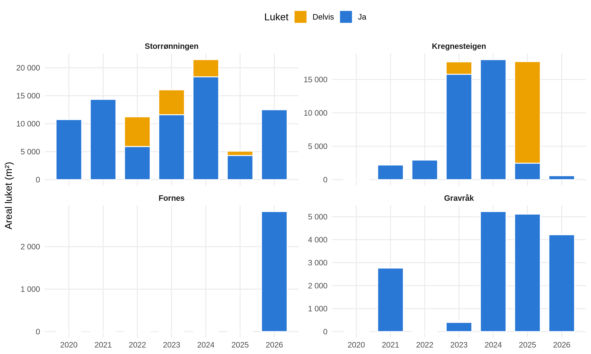

Figure 1: Areal luket per lokalitet og år (Ja = luket, Delvis = delvis
luket). Ulik skala på y-aksen.

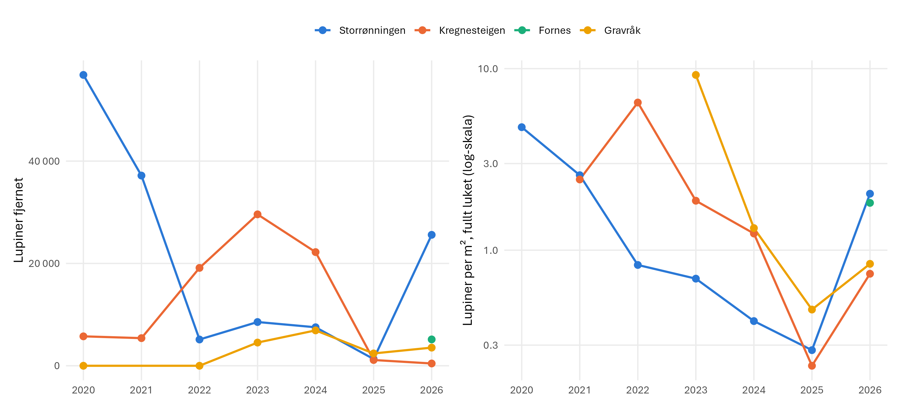

Figure 2: Antall lupiner fjernet (venstre) og lupiner fjernet per m²
luket areal (høyre), per lokalitet og år. Fornes har lukepolygoner først
fra 2026; Gravråk 2021 mangler antall.

Table 2: Lupinluking per lokalitet og år: areal luket (m², Ja + Delvis),
antall lupiner fjernet og lupiner per m² luket.

| Lokalitet | Mål | 2020 | 2021 | 2022 | 2023 | 2024 | 2025 | 2026 |
|:---|:---|---:|---:|---:|---:|---:|---:|---:|
| Storrønningen | Areal luket (m²) | 10751.00 | 14363.00 | 11238.00 | 16056.00 | 21465.00 | 5101.00 | 12507.00 |
| Storrønningen | Lupiner fjernet | 56846.00 | 37172.00 | 5134.00 | 8551.00 | 7526.00 | 1318.00 | 25592.00 |
| Storrønningen | Lupiner per m² | 5.29 | 2.59 | 0.46 | 0.53 | 0.35 | 0.26 | 2.05 |
| Kregnesteigen | Areal luket (m²) | 0.00 | 2203.00 | 2941.00 | 17643.00 | 17981.00 | 17684.00 | 604.00 |
| Kregnesteigen | Lupiner fjernet | 5750.00 | 5400.00 | 19130.00 | 29593.00 | 22217.00 | 1125.00 | 448.00 |
| Kregnesteigen | Lupiner per m² | NA | 2.45 | 6.50 | 1.68 | 1.24 | 0.06 | 0.74 |
| Fornes | Areal luket (m²) | 0.00 | 0.00 | 0.00 | 0.00 | 0.00 | 0.00 | 2827.00 |
| Fornes | Lupiner fjernet | NA | NA | NA | NA | NA | NA | 5150.00 |
| Fornes | Lupiner per m² | NA | NA | NA | NA | NA | NA | 1.82 |
| Gravråk | Areal luket (m²) | 0.00 | 2768.00 | 0.00 | 445.00 | 5226.00 | 5115.00 | 4216.00 |
| Gravråk | Lupiner fjernet | 0.00 | 0.00 | 0.00 | 4535.00 | 6915.00 | 2409.00 | 3545.00 |
| Gravråk | Lupiner per m² | NA | NA | NA | 10.19 | 1.32 | 0.47 | 0.84 |

## 4. Datainnsamling

Elvesandjeger overvåkes på fire lokaliteter langs Gaula: Storrønningen,
Kregnesteigen, Fornes og Gravråk. Larvehull (stadium 1–3) og voksne
telles ved opptil tre besøk per sommer (juni, juli og august); enkelte
besøk i mai og september er ikke med her. Fra 2015 til 2025 ble
observasjonene registrert som GPS-punkter med antall. Fra 2026 tegnet
observatørene i stedet et polygon rundt hver søkte flekk på et
dronebilde, og registrerte substrat, vegetasjonsdekke og slitasje (1–5)
per polygon. Antallene brukes som registrert, uavhengig av metode.

Alle observasjoner ligger i masterfila
[elvesandjeger_obs_2015-2026_master.csv](data/elvesandjeger_obs_2015-2026_master.csv),
som lages av skript 6 i [`code/`](code/). I masterfila er larvestadiene
for 2024 rettet (stadium 1 og 3 var byttet om i 2024-shapefilene). For
effektanalysen er hvert undersøkelsespolygon i 2026 koblet til
lukepolygonet det overlapper mest (skript 7,
elvesandjeger_2026_analysis_data.csv).

Klima- og vannføringsdata er satt sammen til én daglig tabell av skript
8 i [`code/`](code/):

- **Vannføring og vannstand ved Gaulfoss** (NVE, stasjon 122.9.0). NVEs
  referanseverdier: middelflom 1 008 m³/s, 5-årsflom 1 304 m³/s.
  Snøsmeltingen gir vårflommen, og flommene avgjør om – og hvor lenge –
  sandbankene står under vann.
- **Nedbør, snødekke og snødybde ved Leinstrand** (MET SN67150,
  nedstrøms lokalitetene).
- **Døgnmiddeltemperatur ved E6 Kvål** (MET SN67175), bare fra april
  2023 og med hull.

Table 3: Antall observasjonspunkter (til og med 2025) eller polygoner
(fra 2026) per besøksmåned og år. 0 = ikke undersøkt.

|   År | juni | juli | august |
|-----:|-----:|-----:|-------:|
| 2015 |   34 |    0 |      0 |
| 2016 |   39 |    0 |      0 |
| 2017 |    0 |    0 |    153 |
| 2018 |  125 |    0 |    205 |
| 2019 |  160 |  158 |    256 |
| 2020 |    0 |  130 |    131 |
| 2021 |  188 |    0 |    200 |
| 2022 |  191 |    0 |    214 |
| 2023 |  135 |  164 |    197 |
| 2024 |  136 |  194 |    192 |
| 2025 |  313 |  261 |     82 |
| 2026 |   47 |   37 |     49 |

## 5. Dataanalyser

<!-- Kort beskrivelse: hvilke analyser er gjennomført, for å undersøke endringer i indikatorer ift. påvirkningsfaktorer og tiltak, jf. forventninger (under formål). -->

Hovedmålet med analysene er å finne ut om lupinlukingen gir flere
elvesandjegere. Antallet larver påvirkes også av andre forhold:
habitatet i hver flekk (substrattype, vegetasjonsdekke og slitasje) og
klima, snø og vannføring. Disse variablene tas med i analysene for å
skille effekten av lupinlukingen fra andre faktorer som påvirker
bestanden.

**Utvikling over tid.** Tidsseriene viser summen av registrerte
individer per år, stadium og besøksmåned. Registreringene gjøres av en
erfaren feltarbeider med god kjennskap til artene og lokalitetene, med
samme innsats ved hvert besøk og på alle lokaliteter. Ikke alle
individer blir nødvendigvis oppdaget. Hvilke måneder som er undersøkt,
er ikke helt likt alle år
(<a href="#tbl-datainnsamling" class="quarto-xref">Table 3</a>), og
tidsseriene vises derfor per besøksmåned. I 2024 ble registreringene
gjort av den nye og den tidligere feltarbeideren sammen, og fra 2025 av
den nye alene, og i 2026 ble registreringsmetoden endret fra punkter til
polygoner. Summene er derfor en indeks for relativ forekomst som kan
sammenlignes mellom år og lokaliteter, og ikke et bestandsestimat.

**Effekt av luking på lupin.** Dersom lukingen virker, skal et polygon
som ble luket ha færre lupiner året etter. Dette testes med en negativ
binomial GLMM (`glmmTMB`, nbinom2) på antall lupiner fjernet i et
polygon de årene det ble luket (2021–2026), med polygonarealet som
offset, lukestatus året før (Nei / Delvis / Ja) som forklaringsvariabel,
år og lokalitet som faste effekter og et tilfeldig konstantledd per
polygon. En modell nummer to bruker antall tidligere år polygonet er
luket.

**Effekt av luking på elvesandjeger.** Effektanalysen bruker
**Kregnesteigen og Storrønningen**, de to lokalitetene som har både
lukepolygoner og observasjoner av elvesandjeger. Hvert
undersøkelsespolygon i 2026 får lukestatusen (Nei / Delvis / Ja) til
lukepolygonet det overlapper mest, **året før undersøkelsen** (2025). På
**Fornes** brukes undersøkelsespolygonene som ligger utenfor
lukepolygonene (19), som **kontroll** uten lupinluking, mens polygonene
som overlapper et lukepolygon (20), er holdt utenfor analysen. Gravråk
har for få observasjoner og er ikke med, og luking i undersøkelsesåret
brukes ikke.

Responsen er antall larver (stadium 1–3) i et undersøkelsespolygon.
Polygonene er tegnet rundt okkuperte flekker, så bare 3 av 133 har null
larver; dataene er sterkt overspredte (varians/gjennomsnitt = 45), men
ikke nullinflaterte. Modellen er derfor en **negativ binomial GLMM** med
søkt areal som offset, måned, substrat, vegetasjonsdekke og slitasje som
kovariater, lokalitet som fast effekt og et tilfeldig konstantledd per
lukepolygon (de samme flekkene besøkes i juni, juli og august).
Habitatvariablene substrat, vegetasjonsdekke og slitasje er med slik at
effekten av lukingen sammenlignes mellom flekker med likt habitat, og
måned fanger opp forskjeller mellom besøkene, blant annet i vannføring
og vær:

`larver ~ luket året før + måned + substrat + vegetasjonsdekke + slitasje + lokalitet + offset(log areal) + (1 | lukepolygon)`

Som sensitivitetsanalyse er log(areal) brukt som kovariat i stedet for
offset, og modellen er tilpasset hvert larvestadium for seg.

**Klima, snø og vannføring.** Vannføring, nedbør og snø er målt på én
stasjon og er derfor like for alle lokaliteter ved samme besøk. De er
derfor analysert for seg, for alle år. Vannføringen der de overvåkede
sandbankene oversvømmes er ikke kjent, så vannføringen brukes direkte
som eksponeringsindeks: høyeste vannføring og antall dager over 300 m³/s
siden forrige besøk (for junibesøket: siden 1. september året før), og
høyeste vannføring og nedbør de 14 dagene før besøket. Larver per
lokalitet og besøk (Storrønningen, Kregnesteigen og Fornes) er modellert
med én eksponeringsvariabel om gangen i en utforskende NB GLMM med måned
som fast effekt og lokalitet og år som tilfeldige effekter. Med én
målestasjon får alle lokaliteter samme eksponering, så testen hviler på
antall besøk. Analysen viser om endringer i antall kan skyldes flom og
vær snarere enn lukingen.

## 6. Resultater

I 2026 ble det registrert 2 304 larvehull (stadium 1–3) og 67 voksne
totalt for alle besøk og lokaliteter.

### 6.1 Utvikling over tid

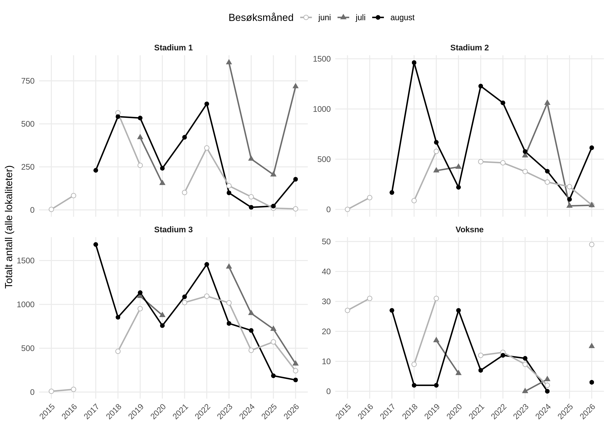

Figure 3: Totalt antall larvehull (stadium 1–3) og voksne per år,
fordelt på besøksmåned (alle lokaliteter). Manglende punkter = måneden
ble ikke undersøkt det året.

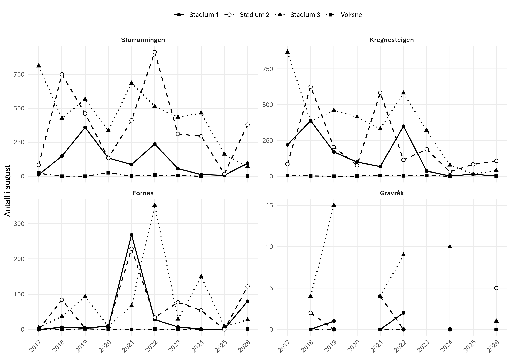

Figure 4: Antall i august per lokalitet og stadium (august er måneden
som er undersøkt mest konsekvent). Ulik skala på y-aksen.

I år der alle tre månedene er undersøkt, forventes stadium 3
(overvintrede larver) å dominere i juni, nye stadium 1-larver å komme i
juli etter egglegging, og at disse skifter til stadium 2 innen august.

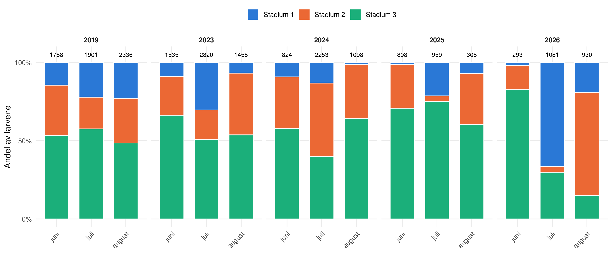

Figure 5: Andel av larvene (stadium 1–3) per besøksmåned i år med besøk
i juni, juli og august. Tallene over søylene er totalt antall larver.

### 6.2 Effekt av luking på lupin

Table 4: Lupintetthet (lupiner fjernet per m²) i lukede polygoner som
funksjon av luking året før. NB GLMM, n = polygon-år.

| Effekt                           |   RR | KI95      |       p |
|:---------------------------------|-----:|:----------|--------:|
| Delvis luket året før (mot ikke) | 1.90 | 0.97–3.71 | 6.0e-02 |
| Luket året før (mot ikke)        | 0.33 | 0.21–0.51 | 5.0e-07 |
| Per ekstra tidligere år luket    | 0.53 | 0.36–0.78 | 1.3e-03 |

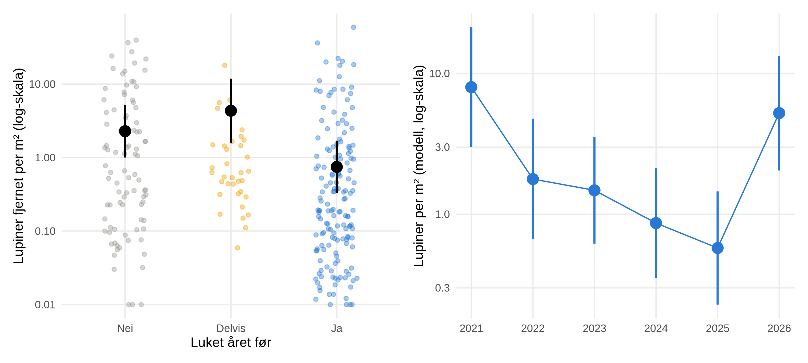

Figure 6: Venstre: lupintetthet i lukede polygoner etter lukestatus året
før (punkter = polygon-år, +0,01 for å vise nuller; svart = modellert
gjennomsnitt ± 95 % KI). Høyre: årseffekten fra samme modell
(gjennomsnitt ± 95 % KI).

### 6.3 Effekt av luking på elvesandjeger

Table 5: Antall undersøkelsespolygoner per gruppe og måned. Kontroll =
undersøkelsespolygoner på Fornes utenfor lukepolygonene; Nei/Delvis/Ja =
lukestatus året før på Kregnesteigen og Storrønningen.

| Gruppe   | juni | juli | august |
|:---------|-----:|-----:|-------:|
| Kontroll |    7 |    5 |      7 |
| Nei      |    1 |    2 |      8 |
| Delvis   |    5 |    7 |      5 |
| Ja       |   25 |   18 |     21 |

Table 6: NB GLMM for larver per undersøkelsespolygon på Kregnesteigen og
Storrønningen. RR = rateratio (multiplikativ effekt på larvetettheten).
Referansenivåer: ikke luket året før, juni, sand, Kregnesteigen.

| Effekt                            |   RR | KI95      |       p |
|:----------------------------------|-----:|:----------|--------:|
| Delvis luket året før (mot ikke)  | 2.15 | 0.67–6.89 | 0.20000 |
| Luket året før (mot ikke)         | 2.02 | 0.90–4.52 | 0.08600 |
| Juli (mot juni)                   | 0.48 | 0.25–0.91 | 0.02400 |
| August (mot juni)                 | 0.30 | 0.16–0.56 | 0.00021 |
| Substrat: blanding (mot sand)     | 1.26 | 0.70–2.27 | 0.43000 |
| Substrat: silt (mot sand)         | 1.43 | 0.56–3.68 | 0.45000 |
| Vegetasjonsdekke (0 → 100 %)      | 0.24 | 0.05–1.08 | 0.06200 |
| Slitasje (per klasse)             | 0.77 | 0.58–1.02 | 0.06600 |
| Storrønningen (mot Kregnesteigen) | 2.91 | 1.54–5.53 | 0.00110 |

Table 7: Likelihood-ratio-tester for hvert ledd i modellen.

| Ledd             | chisq |  df |      p |
|:-----------------|------:|----:|-------:|
| Luket året før   |  2.74 |   2 | 0.2500 |
| Luket × måned    |  5.92 |   4 | 0.2100 |
| Substrat         |  0.80 |   2 | 0.6700 |
| Vegetasjonsdekke |  3.22 |   1 | 0.0730 |
| Slitasje         |  3.33 |   1 | 0.0680 |
| Lokalitet        |  8.67 |   1 | 0.0032 |

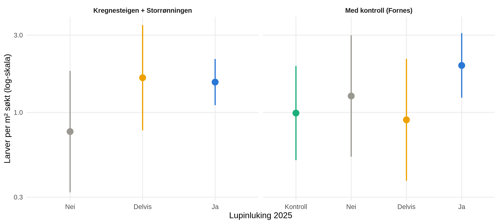

Figure 7: Predikert larvetetthet (larver per m² søkt, gjennomsnitt ± 95
% KI, midlet over måned, substrat og lokalitet, ved median
vegetasjonsdekke og slitasje). Venstre: Kregnesteigen + Storrønningen
etter lukestatus året før. Høyre: de samme gruppene sammenlignet med
kontrollen på Fornes (uten luking).

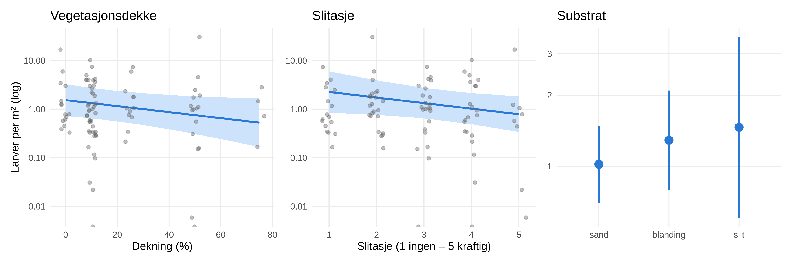

Figure 8: Kovariateffekter fra modellen: predikert larvetetthet mot
vegetasjonsdekke og slitasje (linje ± 95 % KI, for en luket flekk på
Storrønningen i august; punkter = undersøkelsespolygoner) og etter
substrat (gjennomsnitt ± 95 % KI).

**Sensitivitet: areal som kovariat i stedet for offset.** Hovedmodellen
antar at antallet er proporsjonalt med søkt areal. Med log(areal) som
estimert kovariat blir stigningen 0,53 på log-skala (1 = proporsjonalt),
fordi større polygoner tar med mer tom mark.

Table 8: Hovedmodellen tilpasset med log(polygonareal) som kovariat i
stedet for offset.

| Effekt                                              |   RR | KI95      |     p |
|:----------------------------------------------------|-----:|:----------|------:|
| Delvis luket året før (mot ikke)                    | 0.76 | 0.27–2.10 | 0.590 |
| Luket året før (mot ikke)                           | 1.39 | 0.70–2.74 | 0.350 |
| Vegetasjonsdekke (0 → 100 %)                        | 0.33 | 0.10–1.06 | 0.062 |
| Slitasje (per klasse)                               | 0.85 | 0.67–1.07 | 0.160 |
| log(areal), RR per e-dobling (2,72 = proporsjonalt) | 1.69 | 1.47–1.95 | 0.000 |

**Per larvestadium.** Voksne modelleres ikke (få individer). Den samme
modellen er tilpasset stadium 1, 2 og 3 hver for seg.

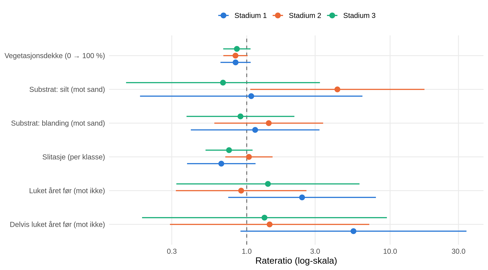

Figure 9: Effekter på tettheten av larver i stadium 1, 2 og 3 (NB GLMM,
rateratio ± 95 % KI, Kregnesteigen + Storrønningen). Verdier \> 1 =
høyere tetthet.

Table 9: Likelihood-ratio-test for lukestatus året før i modellene per
stadium, og rateratio for luket mot ikke luket.

| Stadium   | Nuller   | RR_luket | p_LRT |
|:----------|:---------|---------:|------:|
| Stadium 1 | 56 av 92 |     2.43 |  0.19 |
| Stadium 2 | 40 av 92 |     0.91 |  0.76 |
| Stadium 3 | 20 av 92 |     1.41 |  0.90 |

### 6.4 Klima, snø og vannføring

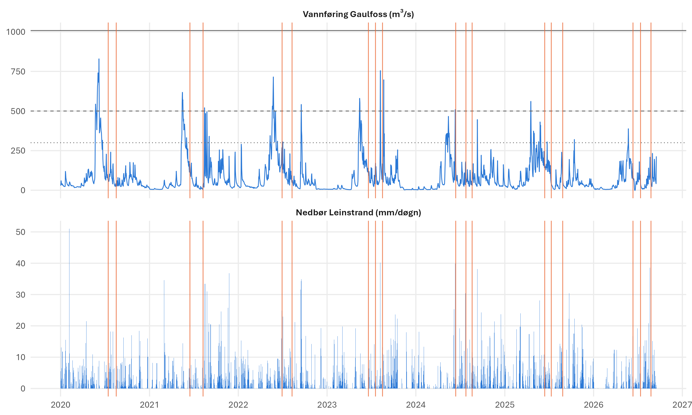

Figure 10: Daglig vannføring ved Gaulfoss, snødybde og nedbør ved
Leinstrand, med besøkene for elvesandjeger (oransje). Referanselinjer
for vannføring: 300 (prikket) og 500 m³/s (stiplet) og middelflom, 1 008
m³/s (heltrukket).

Table 10: Årlig oppsummering av vannføring, snø og klima. Vårflom =
høyeste vannføring april–juni; dager \> 300 / 500 m³/s; snødager = dager
med snø på bakken januar–mai; siste snø = siste dag med snø før august;
nedbør mai–august; temperatur ved Kvål der den finnes (vinter =
des–feb).

| År | Vårflom | Vårflom dato | Årsmaks | Årsmaks dato | \>300 apr–jun | \>300 jul–aug | \>500 | Snø maks (cm) | Snødager jan–mai | Siste snø | Nedbør mai–aug | Temp des–feb | Temp apr–mai | Temp juni |
|---:|---:|:---|---:|:---|---:|---:|---:|---:|---:|:---|---:|---:|---:|---:|
| 2020 | 829 | 07.06 | 829 | 07.06 | 28 | 0 | 11 | 24 | 57 | 13.05 | 256 | NA | NA | NA |
| 2021 | 618 | 16.05 | 618 | 16.05 | 18 | 4 | 5 | 28 | 84 | 14.04 | 266 | NA | NA | NA |
| 2022 | 715 | 25.05 | 715 | 25.05 | 20 | 1 | 8 | 40 | 79 | 03.05 | 366 | NA | NA | NA |
| 2023 | 580 | 15.05 | 755 | 08.08 | 13 | 4 | 4 | 42 | 98 | 04.05 | 261 | NA | 7.6 | 15.0 |
| 2024 | 509 | 11.06 | 509 | 11.06 | 14 | 0 | 1 | 24 | 51 | 26.03 | 368 | -2.5 | 9.9 | 13.8 |
| 2025 | 561 | 18.04 | 561 | 18.04 | 11 | 0 | 1 | 42 | 51 | 04.04 | 330 | 0.3 | 7.8 | 13.0 |
| 2026 | 388 | 24.05 | 388 | 24.05 | 1 | 0 | 0 | 18 | 69 | 26.04 | 387 | -2.8 | 8.8 | 14.6 |

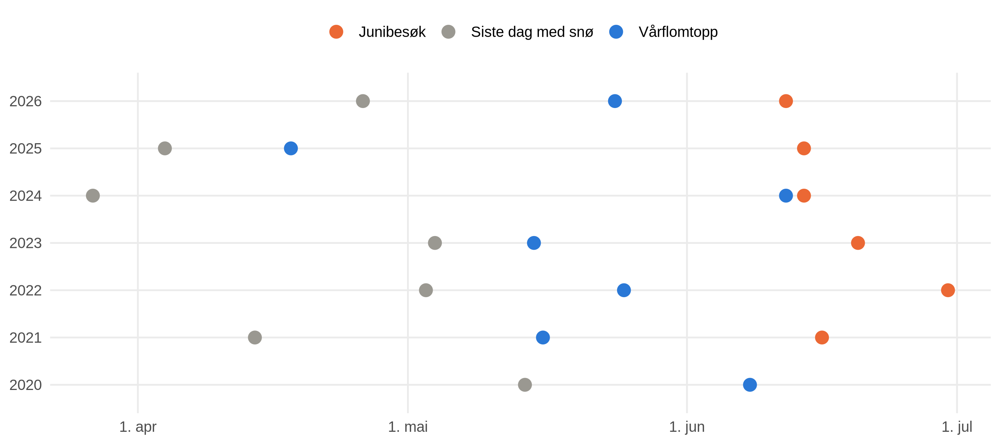

Figure 11: Tidspunkt for siste dag med snø, vårflomtoppen og
junibesøket, per år.

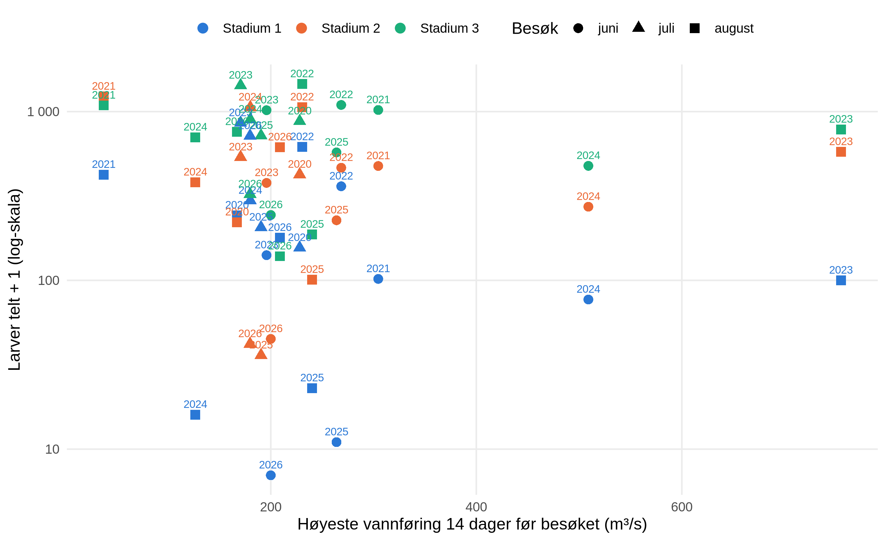

Figure 12: Larver per besøk og stadium (alle lokaliteter) mot høyeste
vannføring de 14 dagene før besøket. Tallene = år.

Table 11: Innsats og antall per besøk: antall GPS-punkter (til og med
2025) eller polygoner (fra 2026), larver totalt og per stadium, og
eksponering før besøket (høyeste vannføring og nedbør de 14 dagene før;
høyeste vannføring og dager \> 300 m³/s siden forrige besøk, eller
siden 1. september for junibesøket).

| År | Måned | Dato | Punkter | Larver | St. 1 | St. 2 | St. 3 | Q maks 14 d | Nedbør 14 d | Q maks siden forrige | Dager \>300 siden forrige |
|---:|:---|:---|---:|---:|---:|---:|---:|---:|---:|---:|---:|
| 2020 | juli | 15.07 | 130 | 1454 | 155 | 423 | 876 | 228 | 34 | 829 | 28 |
| 2020 | august | 17.08 | 131 | 1220 | 242 | 220 | 758 | 167 | 16 | 241 | 0 |
| 2021 | juni | 16.06 | 188 | 1597 | 101 | 475 | 1021 | 305 | 22 | 618 | 18 |
| 2021 | august | 09.08 | 200 | 2737 | 422 | 1228 | 1087 | 37 | 22 | 172 | 0 |
| 2022 | juni | 30.06 | 191 | 1918 | 360 | 464 | 1094 | 269 | 73 | 715 | 21 |
| 2022 | august | 10.08 | 214 | 3133 | 616 | 1061 | 1456 | 230 | 47 | 305 | 1 |
| 2023 | juni | 20.06 | 135 | 1535 | 140 | 377 | 1018 | 196 | 1 | 580 | 17 |
| 2023 | juli | 19.07 | 164 | 2820 | 856 | 536 | 1428 | 171 | 23 | 171 | 0 |
| 2023 | august | 17.08 | 197 | 1458 | 99 | 576 | 783 | 755 | 88 | 755 | 2 |
| 2024 | juni | 13.06 | 136 | 824 | 76 | 272 | 476 | 509 | 96 | 509 | 14 |
| 2024 | juli | 25.07 | 194 | 2253 | 296 | 1059 | 898 | 180 | 52 | 180 | 0 |
| 2024 | august | 19.08 | 192 | 1098 | 15 | 380 | 703 | 127 | 48 | 130 | 0 |
| 2025 | juni | 14.06 | 313 | 808 | 10 | 226 | 572 | 264 | 36 | 561 | 11 |
| 2025 | juli | 11.07 | 261 | 959 | 205 | 35 | 719 | 191 | 33 | 305 | 1 |
| 2025 | august | 27.08 | 81 | 308 | 22 | 100 | 186 | 240 | 88 | 240 | 0 |
| 2026 | juni | 12.06 | 47 | 293 | 6 | 44 | 243 | 200 | 40 | 388 | 2 |
| 2026 | juli | 13.07 | 37 | 1081 | 717 | 41 | 323 | 180 | 54 | 180 | 0 |
| 2026 | august | 25.08 | 49 | 930 | 178 | 614 | 138 | 209 | 85 | 209 | 0 |

Table 12: Utforskende NB GLMM for larver per lokalitet og besøk
(Storrønningen, Kregnesteigen, Fornes; måned som fast effekt, lokalitet
og år som tilfeldige effekter) med én eksponeringsvariabel om gangen.
Estimat på log-skala; p fra likelihood-ratio-test.

| Respons     | Variabel                               | Estimat |    SE |    p |
|:------------|:---------------------------------------|--------:|------:|-----:|
| Alle larver | log(høyeste vannføring 14 d før besøk) |  -0.221 | 0.182 | 0.23 |
| Alle larver | Dager \> 300 m³/s siden forrige besøk  |  -0.002 | 0.019 | 0.92 |
| Alle larver | Nedbør 14 d før besøk (mm)             |  -0.005 | 0.004 | 0.23 |
| Stadium 1   | log(høyeste vannføring 14 d før besøk) |  -0.474 | 0.365 | 0.21 |
| Stadium 1   | Dager \> 300 m³/s siden forrige besøk  |  -0.024 | 0.042 | 0.59 |
| Stadium 1   | Nedbør 14 d før besøk (mm)             |  -0.004 | 0.008 | 0.59 |

## 7. Oppsummering

### 7.1 Hva viser årets resultater

<!-- Tallene under oppdateres automatisk, men tolkningen er skrevet for dataene til og med 2026. Les gjennom og oppdater teksten hvert år. -->

**Virker lukingen på lupinen?** Ja: lukingen reduserer lupinbestanden
året etter. Et polygon som ble luket året før har i gjennomsnitt **0,75
lupiner/m²**, mot **2,28 lupiner/m²** der ingenting ble gjort året før
(RR 0,33, p \< 0,001), og hvert ekstra år med luking endrer tettheten
med en faktor 0,53 (p = 0,0013). Delvis luking gir ikke samme effekt,
delvis fordi det er de tetteste bestandene som bare blir delvis luket.
Årseffekten viser også risikoen: når innsatsen går ned, kommer lupinen
raskt tilbake. Invasjonen holdes i sjakk, men er ikke fjernet –
**fortsatt årlig luking er nødvendig.**

**Effekt på elvesandjeger.** Luking i 2025 hadde **ingen statistisk
signifikant effekt på antall larver i 2026** på Kregnesteigen og
Storrønningen. Flekker som ble luket hadde i gjennomsnitt 2,0 ganger
larvetettheten i ikke-lukede flekker (95 % KI 0,9–4,5;
likelihood-ratio-test p = 0,25). Retningen er positiv, men usikkerheten
er stor, hovedsakelig fordi nesten alle okkuperte flekker ble luket –
bare 11 undersøkelsespolygoner ligger i flekker som ikke ble luket.
Effekten varierer ikke signifikant mellom måneder (p = 0,21).

- Andre mål på luking gir samme bilde: antall år en flekk er luket (RR
  1,18 per år, p = 0,13) og antall lupiner fjernet per m² året før (p =
  0,082).
- **Sammenlignet med kontrollen på Fornes** har lukede flekker 2,0
  ganger larvetettheten (p = 0,23, Dunnett-justert) og ikke-lukede
  flekker 1,3 ganger (p = 0,91).
- **Habitat:** substrat har ingen effekt (p = 0,67). Vegetasjonsdekke og
  slitasje trekker begge ned – omtrent 13 % færre larver per 10 %
  vegetasjonsdekke (p = 0,073) og 23 % færre per slitasjeklasse (p =
  0,068). Larvetettheten er 2,9 ganger høyere på Storrønningen enn på
  Kregnesteigen (p = 0,0032).
- **Per stadium:** stadium 1 p = 0,19, stadium 2 p = 0,76, stadium 3 p =
  0,9 for luking året før.

**Klima og vannføring.**

- Årlig høyeste vannføring ved Gaulfoss var 388–829 m³/s i 2020–2026;
  ingen år nådde middelflom (1 008 m³/s), så serien inneholder ennå ikke
  et år der sandbankene sto lenge under vann.
- I de utforskende modellene har verken høyeste vannføring, dager over
  300 m³/s eller nedbør før besøket en påviselig effekt (p = 0,21–0,92)
  når variasjonen mellom år er tatt med.
- Den eneste sommerflommen i serien (8. august 2023, 755 m³/s) kom ni
  dager før augustbesøket og falt sammen med et kraftig fall i stadium
  1-larver fra juli til august. Stadium 1-larvene har de grunneste
  gangene og er mest utsatt for oversvømmelse og sandflytting.
- Innsatsen varierer mellom besøk og blander seg med signalet mellom år
  (f.eks. august 2025 med få punkter). Videre analyser av klima og
  bestand trenger et mål på innsats per besøk, oversvømmelsesterskler
  per sandbanke (drone-DEM + vannstand) og en lengre vannføringsserie
  som inkluderer år med store flommer.

### 7.2 Anbefaling for videreføring

<!-- Hva er kunnskapsbehovet, om tiltaket (hvordan gjennomføres) og om effekten (variasjon mellom år, mellom lokaliteter). Anbefalinger for videreføring av delprosjektet – endringer i metodikk? Utvidelse? Endret frekvens for datainnsamling? Avslutning? -->

Analysen har lav styrke for sammenligningen luket/ikke luket. Styrken
vil øke hvis feltpersonalet også registrerer noen *ikke-lukede* flekker
med elvesandjeger (eller søkte, men tomme flekker) på de to
effektlokalitetene, og hvis Fornes fortsatt undersøkes som kontroll nå
som lukingen også har startet der.

## 8. References

## 9. Author contributions

<!-- Fill in CRediT and MeRIT statements. See https://credit.niso.org/ and https://www.nature.com/articles/s41467-023-37039-1. Delete rows you don't use. -->

**CRediT statement**

- Formal analysis: MN
- Software: MN
- Visualization: MN
