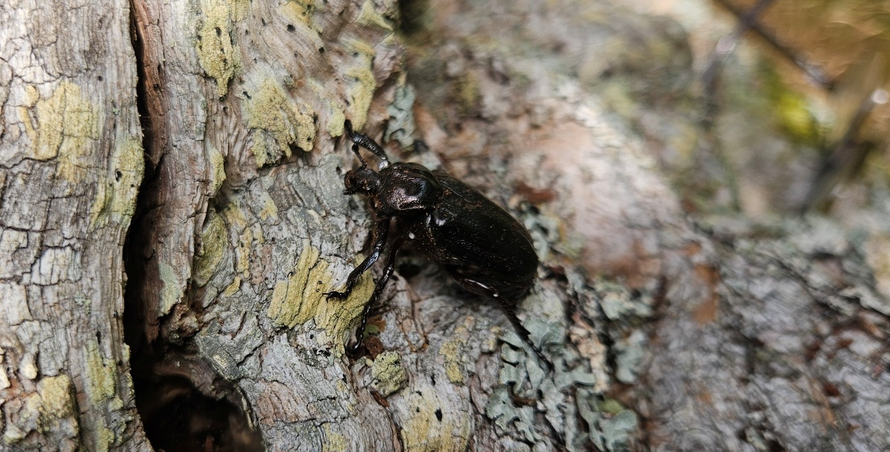
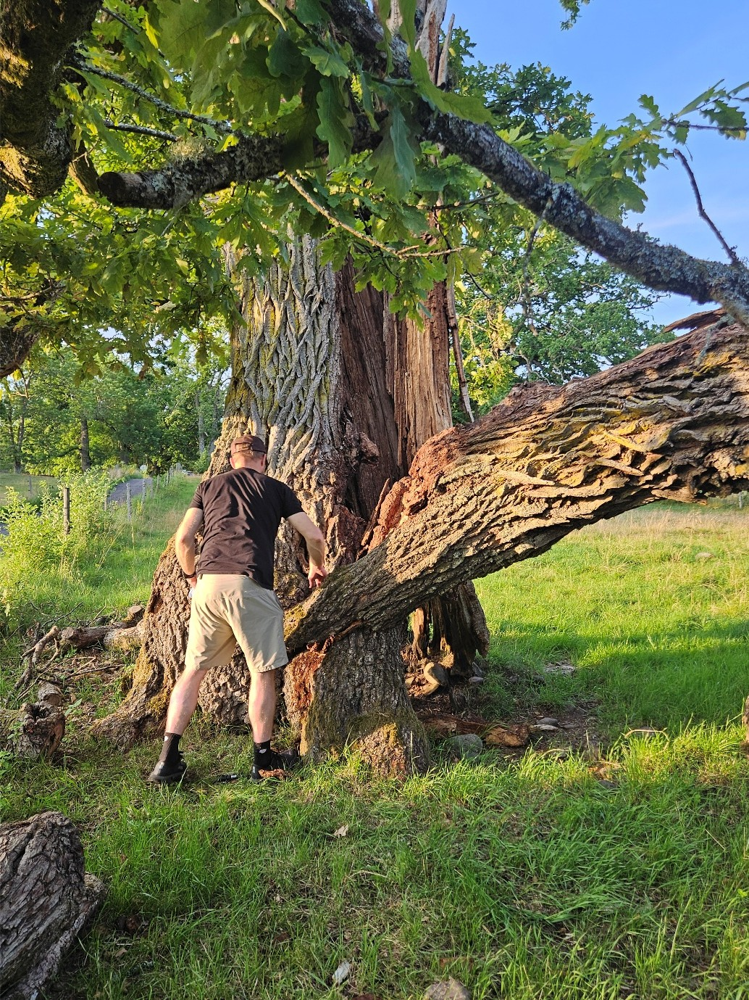
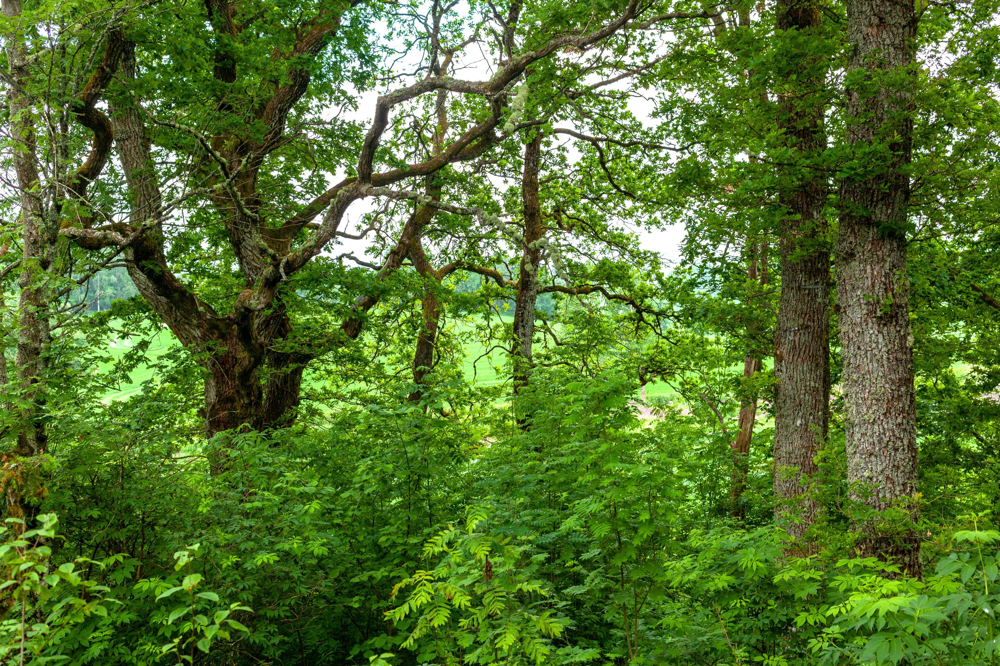

<!--# Rapporten leser kun filer i img/. Tekstgrunnlaget er «Eremitt_2026_github.docx» (P:/…/Rapporter_2026_github), et utkast. Kommentarene fra Word-dokumentet er tatt med som kommentarer i teksten. -->

```{r setup}
#| include: false
#| cache: false
library(knitr)
library(tidyverse)
library(kableExtra)
library(here)
library(anybadger)
library(yaml)
library(tibble)
library(conflicted)
library(readxl)
conflicts_prefer(dplyr::filter)
conflicts_prefer(dplyr::lag)
conflicts_prefer(dplyr::select)
pull <- dplyr::pull
```

<!--# The following parts are autogenerated. Do not edit. -->

```{r source}
#| echo: false
#| cache: false
source(here::here("_common.R"))

# Badges som markdown (for README.md på GitHub), med relativ sti til versjonsbadgen
md_badge <- function(tag) {
  src <- sub(paste0(here::here(), "/"), "", tag$children[[1]]$attribs$src, fixed = TRUE)
  sprintf("[](%s)", src, tag$attribs$href)
}
```

:::: {.content-visible when-format="gfm"}
::: callout-note
Denne siden er generert fra [`Eremitt.qmd`](Eremitt.qmd). Ikke rediger `README.md` direkte. For å oppdatere: kjør `pixi run render`. Rapporten har ingen egne analyser; bildene ligger i [`img/`](img/).
:::

`r paste(md_badge(status_badge(as.character(st))), md_badge(version_badge(as.character(version[[1]]))), md_badge(data_badge(as.character(badges[[1]]))), md_badge(code_badge(as.character(badges[[2]]))), md_badge(open_science_badge(as.character(badges[[3]]))), md_badge(license_badge()))`
::::

:::: {.content-visible when-format="html"}
```{r reviewers}
#| echo: false
#| results: asis

if (!is.null(yaml_data$codeReviewers)) {
  reviewers <- purrr::map_chr(yaml_data$codeReviewers, "name")

  htmltools::HTML(paste0(
    '<div id="title-block-header" class="quarto-title-block default">
       <div class="quarto-title-meta">
         <div>
           <div class="quarto-title-meta-heading">Reviewed by</div>
           <div class="quarto-title-meta-contents">',
    paste(reviewers, collapse = "; "),
    '</div>
         </div>
       </div>
     </div>',
    sep = ""
  ))
}
```

::: {layout-ncol="6"}
```{r statusBadge}
#| echo: false
status_badge(as.character(st))
```

```{r versionBadge}
#| echo: false
version_badge(my_version_number = as.character(version[[1]]))
```

```{r dataBadge}
#| echo: false
data_badge(as.character(badges[[1]]))
```

```{r codeBadge}
#| echo: false
code_badge(as.character(badges[[2]]))
```

```{r openScienceBadge}
#| echo: false
open_science_badge(as.character(badges[[3]]))
```

```{r licenseBadge}
#| echo: false
license_badge()
```
:::
::::

> **Recommended citation**: `r paste0(auth, " ", year, ". ", name, ". Digitalt vedlegg til Roos, R.E., Nowell, M. & Evju, M. (red.) ", year, ". Effektovervåking av trua arter og naturtyper 2026–2030. Årsrapport ", year, ". NINA Rapport 2851. Norsk institutt for naturforskning. <https://ninanor.github.io/effektovervaaking-2026-2030/Eremitt/Eremitt.html>")`

::: {.callout-tip collapse="true"}
## Metadata

```{r meta2}
#| tbl-cap: 'Indicator metadata'
#| echo: false
#| warning: false
meta |>
  dplyr::filter(Variable %in% c(
    "Indicator ID",
    "Indicator Name",
    "verbatimName",
    "Continent",
    "Country",
    "Realm",
    "Biome",
    "Ecosystem",
    "verbatimEcosystem",
    "Year added",
    "Last update",
    "Version",
    "Version comment",
    "Precision")) |>
  kable()
```
:::

::: {.callout-tip collapse="true"}
## Log

<!--# Legg til en kort linje for hver oppdatering -->

20\. nov. 2026 – Første versjon (utkast)
:::

<hr />

::: callout-warning
## Utkast

Dette er et utkast. Teksten er ikke ferdig og kan bli endret.
:::

## Oppsummering

Eremitt *Osmoderma eremita* er en stor bille som lever i gamle, hule løvtrær. Arten er vurdert som kritisk truet (CR) i Norge, og den eneste kjente naturlige forekomsten er på Tønsberg gamle kirkegård. Siden 2017 er det også satt ut individer ved Søndre Berg, der det de fleste år er sett voksne eremitt som stammer fra tidligere utsatte larver. Før bevaringsutsetting utvides til flere lokaliteter, trengs det kunnskap om den genetiske variasjonen i bestanden og om hvilke lokaliteter som egner seg for utsetting. I 2026 samlet vi inn 11 larver fra sju lokaliteter i Västra Götalands län og Östergötlands län i Sverige, og vi har i tillegg fått ett individ fra Italia og tre larver fra Danmark. Materialet skal brukes i populasjonsgenetiske analyser. Vi utviklet også et feltskjema for å vurdere potensielle utsettingslokaliteter, og fylte det ut for Danmark naturreservat i Frogn kommune. Lokaliteten har mange hule eiker og vurderes som godt egnet nå, og som svært godt egnet etter krattrydding og fristilling, forutsatt at klimaet er gunstig nok for eremitt. Det ble ikke gjennomført skjøtselstiltak eller dataanalyser i 2026. Vi anbefaler å fortsette innsamlingen av individer, helst gjennom internasjonalt samarbeid, med sikte på en populasjonsgenetisk analyse av så stor del av utbredelsesområdet som mulig.

## English summary

The hermit beetle (*Osmoderma eremita*) is a large beetle that lives in old, hollow deciduous trees. It is assessed as Critically Endangered (CR) in Norway, and its only known natural population is at Tønsberg old cemetery. Since 2017, individuals have also been released at Søndre Berg, where adults originating from previously released larvae have been seen in most years. Before conservation translocations are extended to more sites, knowledge is needed about the genetic variation in the population and about which sites are suitable for releases. In 2026, we collected 11 larvae from seven sites in Västra Götaland and Östergötland counties in Sweden, and we also received one individual from Italy and three larvae from Denmark. This material will be used for population genetic analyses. We also developed a field form for assessing potential release sites and completed it for Danmark nature reserve in Frogn municipality. The site has many hollow oaks and is assessed as suitable now, and as highly suitable after shrub clearing and the release of overgrown trees, provided that the climate is favourable enough for the hermit beetle. No management actions or data analyses were carried out in 2026. We recommend continuing to collect individuals, preferably through international collaboration, with the aim of a population genetic analysis covering as much of the species' range as possible.

## 1. Innledning

<!--# Kommentar (Ruben E. Roos): @Anders Endrestøl Har skrevet litt om på dette, så gjerne les gjennom. Jeg trenger referanser I kapittel 8. -->

Eremitt *Osmoderma eremita* (Scopoli, 1763) er en stor, brunsvart bille i skarabidefamilien (Scarabaeidae) og tilhører underfamilien gullbasser (Cetoniinae). Arten lever i gamle, hule løvtrær og er vurdert som truet i store deler av Europa [@ranius_2005, Nieto et al. 2010; @calix_2018].

<!--# Nieto et al. 2010 mangler i referanselisten. -->

I Norge ble eremitt regnet som utdødd fram til den ble gjenfunnet på Tønsberg gamle kirkegård i 2008 [@flaten_2008]. Kirkegården er fortsatt artens eneste kjente naturlige forekomst i Norge. Siden 2017 er det også satt ut individer ved Søndre Berg [@endrestol_2026]. Eremitt ble utpekt som prioritert art ved forskrift 20. mai 2011 med hjemmel i naturmangfoldloven og er vurdert som kritisk truet (CR) i Norsk rødliste for arter 2021 [@odegaard_2021]. Det er tidligere også gjort habitatforsterkende tiltak på lokalitetene [@endrestol_2021].

```{r fig-voksen-eremitt}
#| fig-cap: 'En voksen eremitt «läderbagga» fotografert i Kragenäs naturreservat i Tanums kommun i Västra Götalands län 29. Juli 2026. Foto: Anders Endrestøl/NINA.'
#| code-summary: 'Kode for figur.'

```

NINA har gjennomført overvåking av bestanden på Tønsberg kirkegård siden 2009 og bevaringsutsettingen ved Søndre Berg siden 2017. I perioden 2017–2025 er det satt ut til sammen 66 individer (25 voksne og 41 larver) i samme tre, litt ulikt antall hvert år med normalt to voksne (en hann og en hunn) og fire larver [@endrestol_2026]. På den måten har man fått fordelt ulike årsklasser på utsettingene hvert år slik at alle årsklassene blir representert på en forhåpentligvis lik stor andel. Man valgte å sette alle individene i samme tre fordi det ble ansett som viktig å få etablert en solid bestand i ett tre istedenfor å spre det utover. I 2020 begynte man å videoovervåke treet, og så da at voksne eremitt var til stede i treet før man hadde satt ut individer det året, altså stammet de fra tidligere utsatte larver [@endrestol_2021]. Siden har lokaliteten blitt overvåket årlig med video, og alle år (foruten 2025) har man sett voksne individer som stammer fra tidligere larver. I starten var hulheten tettet med netting, men de siste årene har det vært mer eller mindre åpent, og det er mulig at arten har begynt å spre seg på lokaliteten.

<!--# Kommentar (Ruben E. Roos) til «I perioden 2017–2025»: @Anders Endrestøl fyll på årstall og referanse, og litt om hva vi har lært på Søndre Berg -->
<!--# Kommentar (Ruben E. Roos) til «det er mulig at arten har begynt å spre seg»: Men ikke dokumentert? -->

Før bevaringsutsetting utvides til flere lokaliteter, er det viktig å undersøke den genetiske variasjonen i kildebestanden og vurdere hva den betyr for valg av individer til utsetting. Samtidig bør aktuelle lokaliteter kartlegges og vurderes etter felles kriterier, blant annet hvor mange egnede hule løvtrær som finnes i dag, og om nye trær kan overta som leveområder etter hvert. En slik vurdering vil gi grunnlag for å avgjøre hvilke lokaliteter som er egnet, hvilke skjøtselstiltak som bør gjennomføres før billene settes ut, og hvordan leveområdene kan ivaretas over tid. Dette er i tråd med Miljødirektoratets [-@miljodirektoratet_2023] anbefalinger om å vurdere genetisk risiko, dokumentere lokalitetenes egnethet og gjennomføre nødvendig skjøtsel før utsetting. Denne rapporten bidrar til kunnskapsgrunnlaget for å vurdere videre bevaringsutsetting av eremitt.

## 2. Formål med delprosjektet

### 2.1 Målsetning med tiltakene

Hovedformålet med tiltakene er å sikre eremitt langsiktig overlevelse i Norge. Siden arten bare har én naturlig forekomstlokalitet og en begrenset populasjonsstørrelse, har det lenge vært utalt et behov om å gjøre populasjonsgenetiske analyser av eremitt i Norge. Hensikten er å kunne vurdere artens genetiske «helse», altså graden av innavl, mulig bevaringsverdig genetikk, og den genetiske avstanden til andre populasjoner i Europa. Basert på dette igjen kan man vurdere om eremitt i Norge bør eller ikke bør suppleres med individer fra for eksempel Sverige.

### 2.2 Formål med overvåking

Basisovervåkingen har som formål å overvåke bestandsutviklingen av eremitt. Dette finansieres gjennom et eget prosjekt fra Statsforvalteren i Vestfold og Telemark. Effektovervåking vil ha som formål å kunne overvåke effektiviteten av eventuelle tiltak som gjennomføres på fremtidige utsettingslokalitetene, samt vurdere om bevaringsutsetting er vellykket.

### 2.3 Forventninger

Gitt at det bare er en naturlig forekomst av eremitt, og at dette er i relativ gamle asketrær, samt artens begrensede spredningsevne, er sannsynligheten stor for at arten ikke vil kunne etablere seg på nye lokaliteter på egen hånd. Hvis genetisk variasjon er lav, forventes det at dette påvirker artens overlevelse i Norge negativt. Vi antar at det er mulig å finne egnede utsettingslokaliteter, men at disse vil kreve skjøtsel i forkant av en eventuell utsetting for å bedre og opprettholde en bra tilstand for eremitt.

## 3. Overvåkingslokalitetene

### 3.1 Beskrivelse av lokalitetene

Forekomstlokaliteten ved Tønsberg kirkegård er beskrevet i detalj av @sverdrupthygeson_2011 og senere overvåkingsrapporter [se referanser i @endrestol_2026], og bevaringsutsettingslokaliteten ved Søndre Berg av @endrestol_2022.

<!--# Kommentar (Ruben E. Roos): @Anders Endrestøl Du har vel sikkert beskrevet dette noen steder, Anders? -->

### 3.2 Tiltak

Det beskrives ingen konkrete skjøtselstiltak i denne rapporten.

## 4. Datainnsamling

Allerede i 2024 ble det påbegynt en prosess for å samle inn individer av eremitt i Norge med tanke på fremtidige genetiske analyser. Samme år startet en prosess for å få tak i individer fra andre deler av artens utbredelseområde, blant annet Sverige og Italia. Det viste seg vanskelig å få samarbeidspartnere til å samle inn individer i Sverige, og siden søknadsprossene var såpass lang, ble det først i 2026 gitt tillatelse til NINA for å samle inn individer i Sverige. Det ble gitt dispensasjon til å samle inn maksimalt tre individer (larver) fra tre ulike trær per lokalitet på en rekke lokaliteter i Västra Götalands län og Östergötlands län. Vi ønsket å samle inn minst tre larver per lokalitet for å få et bedre grunnlag for å anslå den genetiske variasjonen innen hver lokalitet.

Vi har i 2026 dessuten fått et eremitt-individ fra Italia, og tre larver fra en populasjon i Danmark. Samtidig er vi i dialog med andre eksperter fra andre land for å komplettere dette datasettet med flere eremittindivider.

```{r fig-tunhems-eremitt}
#| fig-cap: 'Søk etter eremitt i Tunhems ekhagar i Vänersborg kommune i Västra Götaland i Sverige, 29. juli 2026. Foto: Anders Endrestøl/NINA.'
#| code-summary: 'Kode for figur.'
#| out-width: 60%

```

For å vurdere om en lokalitet kan egne seg for bevaringsutsetting av eremitt, utviklet vi et feltskjema som kombinerer kartdata og feltregistreringer. Skjemaet beskriver lokalitetens areal, naturtyper, årsmiddeltemperatur og eksposisjon, samt antall hule trær og rekrutteringstrær fordelt på treslag. Det omfatter også en vurdering av konnektivitet, skjøtselsbehov og negative påvirkningsfaktorer. Vernestatus, grunneierforhold og adkomst registreres for å vurdere de praktiske forutsetningene for utsetting og oppfølging. I denne rapporten har vi fyllt ut skjemaet for to lokaliteter, forekomstlokaliteten ved Tønsberg kirkegård, og Danmark naturreservat i Frogn kommune. Datagrunnlaget er hentet fra tidligere befaringer gjennomført i tilknytning til andre prosjekter (Hule eiker i Follo regionen, Roos et al. in prep.).

## 5. Dataanalyser

Det ble ikke samlet inn feltdata i rapporteringsperioden, og det er derfor ikke gjennomført dataanalyser.

## 6. Resultater

Det ble samlet inn totalt 11 larver av eremitt fra Sverige fra sju lokaliteter (@tbl-innsamlet-eremitt). Med andre ord, var det flere lokaliteter hvor vi fant færre enn tre eremittlarver. Lokalitetene var i varierende grad mulig å undersøke, og hulhetene var i ikke i alle tilfeller tilgjengelige for å undersøkes.

| Nr | Kommune | Lokalalitet | Antall innsamlet | Dato | Tid | Art |
|---:|---|---|---:|---|---|---|
| 1 | Götene kommun | Hjälmsäter | 1 | 30.07.2026 | 10:22 | Ask |
| 2 | Götene kommun | Hjälmsäter | 1 | 30.07.2026 | 10:46 | Ask |
| 3 | Götene kommun | Gammelriket | 1 | 30.07.2026 | 11:29 | Eik |
| 4 | Tanums kommun | Kragenäs | 1 | 29.07.2026 | 14:05 | Eik |
| 5 | Tanums kommun | Kragenäs | 1 | 29.07.2026 | 14:32 | Eik |
| 6 | Tanums kommun | Kragenäs | 1 | 29.07.2026 | 14:42 | Eik |
| 7 | Vänersborgs kommun | Tunhems ekhagar | 1 | 29.07.2026 | 18:21 | Eik |
| 8 | Vänersborgs kommun | Tunhems ekhagar | 1 | 29.07.2026 | 20:06 | Eik |
| 9 | Linköping kommun | Bjärka Säby | 1 | 31.07.2026 | 10:04 | Eik |
| 10 | Norrköping kommun | Händelö | 1 | 31.07.2026 | 14:48 | Ask |
| 11 | Ödeshög kommun | Omberg-Storpissan | 1 | 30.07.2026 | 17:31 | Eik |
|  | Vänersborgs kommun | Halle och Hunnebergs rasbranter | 0 | 29.07.2026 | Ikke funnet eremitt |  |
|  | Lerums kommun | Nääs ekhagar | 0 | - | Ikke undersøkt |  |
|  | Linköping kommun | Tinnerö eklandskap | 0 | 31.07.2026 | Ikke funnet eremitt |  |
|  | Åtvidaberg kommun | Åtvidabergs tätort | 0 | - | Ikke undersøkt |  |
|  | Linköping kommun | Brokinds skolhage | 0 | - | Ikke undersøkt |  |

: Innsamlede individer ev eremitt fra Sverige i 2026. {#tbl-innsamlet-eremitt}

<!--# Skjema for vurdering av utsettingslokaliteter kan gå inn her. -->
<!--# Kommentar (Ruben E. Roos): @Anders Endrestøl Skal vi fylle ut denne for en av lokalitetene vi har kjennskap til? Jeg gir et forslag for Danmark NR, så kan du fylle ut det samme for Tønsberg? -->
<!--# Kommentar (Anders Endrestøl): Ja - da kanskje for Søndre Berg? Men det er fryktelig å sitte på toget med det, siden jeg må inn på diverse kart og sider, og nettet er veldig ustabilt. -->
<!--# Kommentar (Ruben E. Roos) til årsmiddeltemperaturen: @Anders Endrestøl Jeg spurte KI gjøre dette så ta det med en klype salt. For Tønsberg ga den 7,3 °C for perioden 1991–2020 -->

| Habitatvariabler | Kvantitativ vurdering | Kvalitativ vurdering | Kommentar |
|---|---|---|---|
| Lokalitetesnavn: | | Danmark Naturreservat | |
| Dato: | | 2025 (Roos et al. in prep) | |
| Observatør: | | Ruben E. Roos | |
| Bilder: | | Se @fig-danmark-eremitt. | |
| Areal (fra kart) | 0 = svært liten, 1 = liten, 2 = middels, 3 = stor | Ca. 14000 m^2^ | Naturreservatet er omtrent 14 daa, men de fleste hule eiker befinner seg i sør(vestre) del. |
| Naturtype(r) | | NA-TK01 Semi-naturlig eng, semi-naturlig eng med åpent tresjikt, NO-XH hult lauvtre. | Området består av gjengrodd hagemark, og frisk gjengroings/edelløvskog i nordre del. I tillegg inngår hule eiker. |
| Naturbase ID | | BN00050187 | |
| Årsmiddeltemperatur (fra kart) | | 6,5 °C for perioden 1991–2020, basert på Meteorologisk institutts KlimGrid-data med 1 km romlig oppløsning | |
| Eksposisjon (fra kart) | | Hovedsakelig vest | |
| Antall hule trær per treslag | | Eik: 29 trær inngår utvalgt naturtype «hule eiker», av disse er 17 registrert med synlig hulrom. Ask: 0. Spisslønn: 0. Lind: 0. Hestekastanje: 0. Annet: 0. | |
| Antall rekruteringstrær per treslag\* | | Eik: 42 eiker med omkrets på 90 cm eller mer, mindre eiker finnes men er ikke kartlagt. Ask: 1-2. Spisslønn: 0. Lind: 0. Hestekastanje: 0. Annet: 0. | |
| Antall trær allerede vurdert som egnet | | 2-3 | Mange trær oppfyller allerede krav om hulrom, men mange av disse står veldig gjengrodd slik at bare noen få trær vurderes som egnet akkurat nå. |
| Metapopulasjonpotensial / konnektivitet | 0 = svært lite, 1 = liten, 2 = middels, 3 = stort | | Dette vurderes som stort der det finnes flere store, hule eiketrær i reservatet, innen rimelig avstand fra hverandre. I tillegg finnes det flere store (250 – 450 cm omkrets) eiker med hulrom på omkringliggende åkerholmer, innen 1 km fra lokaliteten. |
| Helhetlig inntrykk - egnethet nå | 0 = Dårlig; 1 = Mindre godt; 2 = Godt; 3 = Svært godt | | Helhetlig inntrykk vurderes som godt. Det store skjøtselsbehovet og opphørt beite trekker ned. Det er i tillegg usikker om årsmiddeltemperaturen er noe lavere enn optimalt for eremitt. |
| **Skjøtselsbehov og behov for andre forvaltningstiltak** | | | |
| Gjenvekst (kratt) - antall/andel av trærne med behov? | | Dekning av busker (<200 cm) rundt eikene er høyt, i gjennomsnitt 43,8 % for alle registrerte trær. | |
| Gjenvekst (gjengroingstrær) - antall/andel av trærne med behov? | | Dekning av gjenveksttrær (> 200 cm høyde) er relativt lav, i gjennomsnitt 2,8 % for alle registrerte trær. | |
| Behov for krattrydding | | De fleste eiker har behov for krattrydding. | |
| Behov for fristilling | | Gjengroingstrær er en mindre utfordring på lokaliteten, men enkelttrær kan ha behov for fristilling. Nordre del var tidligere beitemark, men er nå frisk edellauvskog uten forekomst av grove (eike)trær. Det er svært lite oppslag av gran på lokaliteten. | |
| Muligheter for veteransiering | | Det finnes mange trær av mindre størrelse som vil kunne egne seg for veteraniseringstiltak. | |
| Andre skjøtselsbehov (beskjæring, styving, bardunering, kronesikring) | | Det er ingen behov for beskjæring eller bardunering av eikene. Ingen av trærne bærer preg av tidligere styving. Det er lite ferdsel i området, så behovet for beskjæring pga. sikkerhet vurderes som liten. | |
| Andre tiltak | | Gjenoppretting av beite ville vært svært positivt. | |
| Helhetlig inntrykk - egnethet etter tiltak | 0 = Dårlig; 1 = Mindre godt; 2 = Godt; 3 = Svært godt | | Etter fristilling (og gjeninnført beite) vurderes lokaliteten som svært godt egnet, forutsatt at klimaet på lokaliteten tilfredsstiller eremittens habitatkrav. |
| **Logistikk, implementering** | | | |
| Vernestatus | | Lokaliteten er vernet som naturreservat. Hule eiker, også utenfor reservatet, inngår utvalgt naturtype hule eiker. Aktiviteter i reservatet vil kreve tillatelse fra forvaltningsmyndighetene. | |
| Grunneierforhold | | Privat | |
| Adgang | | Adgang over åker (på vinter) fra Froen gård/Frogn Kirke i nord, eller via traktorvei fra Nordre Horgen gård i sør. | |
| Forstyrrelser/negative påvirkningsfaktorer | | Utenom vanlig jordbruksaktivet er det lite forstyrrelse på lokaliteten. | |

: Feltskjema for vurdering av arealer som potensielle utsettingslokaliteter for eremitt *Osmoderma eremita*. \*Hvis mange individer, bruk kvantitativ estimat. {#tbl-feltskjema-eremitt tbl-colwidths="[22,18,35,25]"}

```{r fig-danmark-eremitt}
#| fig-cap: 'Hul eik i Danmark Naturreservat. Det er mye oppskudd av ask rundt trærne. Foto: Ruben E. Roos/NINA.'
#| code-summary: 'Kode for figur.'

```

## 7. Oppsummering

### 7.1 Hva viser årets resultater

<!--# Kommentar (Ruben E. Roos): @Anders Endrestøl Tenker at her må vi bare si at det ikke er noen resultater for det genetiske, og at vurdering av lokaliteter er mulig, men at det trengs å sammenligne flere lokaliteter (også I sverige?) -->

Resultatene fra årets prosjekt angående eremitt består først og fremst at vi har fått sikret et viktig materiale for populasjonsgenetiske analyser. Samtidig vil det være veldig verdifullt å få samlet inn enda mer materiale fra andre deler av utbredelsesområdet.

### 7.2 Anbefaling for videreføring

Vi anbefaler at man fortsetter å samle inn individer av eremitt for genetiske undersøkelser, ideelt sett gjennom internasjonale samarbeidspartnere, med sikte på en større populasjonsgenetisk analyse av så stor del av utbredelsesområdet som mulig.

I 2025 ble det levert inn et individ av eremitt fra Norge til Earth BioGenome (EBP-Nor) som forhåpentligvis vil få laget en genomsammenstilling av dette i løpet av 2027. Da vil grunnlaget være lagt for å gjøre en helgenomsekvensering av det innsamlede (og nytt) materiale for å få undersøkt artens genetiske variasjon lokalt, nasjonalt og internasjonalt.

## 8. Referanser

::: {#refs}
:::

## 9. Author contributions

**CRediT statement**

-   Software: Niccolò Cantu

<!--# <MeRIT attribution> -->

:::: {.content-visible when-format="html"}
::: {.callout-tip collapse="true"}
## Session Info

This information is mainly aimed at developers that need to recreate the R environment that produced the html.

```{r sessionInfo}
#| echo: false
sessionInfo()
```
:::
::::
