<!--# Rapporten leser kun filer i data/ og img/. Rådata ligger på P:, og koden som lager figurene og populasjonsestimatene ligger i code/ (skript 5 og 6). Rapporten lager ingen figurer selv. -->

```{r setup}
#| include: false
#| cache: false
library(knitr)
library(tidyverse)
library(kableExtra)
library(here)
library(anybadger)
library(yaml)
library(tibble)
library(conflicted)
conflicts_prefer(dplyr::filter)
conflicts_prefer(dplyr::lag)
conflicts_prefer(dplyr::select)
pull <- dplyr::pull
```

<!--# The following parts are autogenerated. Do not edit. -->

```{r source}
#| echo: false
#| cache: false
source(here::here("_common.R"))

# Badges som markdown (for README.md på GitHub), med relativ sti til versjonsbadgen
md_badge <- function(tag) {
  src <- sub(paste0(here::here(), "/"), "", tag$children[[1]]$attribs$src, fixed = TRUE)
  sprintf("[](%s)", src, tag$attribs$href)
}
```

:::: {.content-visible when-format="gfm"}
::: callout-note
Denne siden er generert fra [`Honningblom.qmd`](Honningblom.qmd). Ikke rediger `README.md` direkte. For å oppdatere: kjør skriptene i [`code/`](code/) slik at masterfila i [`data/`](data/) og figurene i [`img/`](img/) blir oppdatert, og kjør `pixi run render`. Se [`code/README.md`](code/README.md) for rekkefølgen.
:::

`r paste(md_badge(status_badge(as.character(st))), md_badge(version_badge(as.character(version[[1]]))), md_badge(data_badge(as.character(badges[[1]]))), md_badge(code_badge(as.character(badges[[2]]))), md_badge(open_science_badge(as.character(badges[[3]]))), md_badge(license_badge()))`
::::

:::: {.content-visible when-format="html"}
```{r reviewers}
#| echo: false
#| results: asis

if (!is.null(yaml_data$codeReviewers)) {
  reviewers <- purrr::map_chr(yaml_data$codeReviewers, "name")

  htmltools::HTML(paste0(
    '<div id="title-block-header" class="quarto-title-block default">
       <div class="quarto-title-meta">
         <div>
           <div class="quarto-title-meta-heading">Reviewed by</div>
           <div class="quarto-title-meta-contents">',
    paste(reviewers, collapse = "; "),
    '</div>
         </div>
       </div>
     </div>',
    sep = ""
  ))
}
```

::: {layout-ncol="6"}
```{r statusBadge}
#| echo: false
status_badge(as.character(st))
```

```{r versionBadge}
#| echo: false
version_badge(my_version_number = as.character(version[[1]]))
```

```{r dataBadge}
#| echo: false
data_badge(as.character(badges[[1]]))
```

```{r codeBadge}
#| echo: false
code_badge(as.character(badges[[2]]))
```

```{r openScienceBadge}
#| echo: false
open_science_badge(as.character(badges[[3]]))
```

```{r licenseBadge}
#| echo: false
license_badge()
```
:::
::::

> **Recommended citation**: `r paste(auth, " ", year, ". ", name, " (ID: ", folder_name, ") ", "v. ", version, ". ecRxiv: ", url, sep="")`

::: {.callout-tip collapse="true"}
## Metadata

```{r tbl-meta2}
#| tbl-cap: 'Indicator metadata'
#| echo: false
#| warning: false
meta |>
  dplyr::filter(Variable %in% c(
    "Indicator ID",
    "Indicator Name",
    "verbatimName",
    "Continent",
    "Country",
    "Realm",
    "Biome",
    "Ecosystem",
    "verbatimEcosystem",
    "Year added",
    "Last update",
    "Version",
    "Version comment",
    "Precision")) |>
  kable()
```
:::

::: {.callout-tip collapse="true"}
## Log

<!--# Legg til en kort linje for hver oppdatering -->

11. nov. 2026 – Første versjon, overvåkingsdata 2014–2026
:::

<hr />

## Oppsummering

Honningblom (*Herminium monorchis*) er en kritisk truet (CR) orkidé med fire kjente lokaliteter, alle på Hvaler i Østfold. Populasjonene på Skipstadsand, Skjellvik og Teneskjær har vært overvåket siden 2014, og populasjonen på Filletassen siden 2020. Tiltakene er i hovedsak slått, én eller flere ganger i året, for å holde vegetasjonen lav og åpen. Teneskjær slås ikke, men beites av storfe, og der settes det bur over en del av plantene for å beskytte dem mot beite.

Overvåkingen viser at populasjonene er stabile eller økende. Skjellvik, den største populasjonen, hadde i 2026 det høyeste estimatet i tidsserien, med om lag 57 000 individer, og også Filletassen økte til det høyeste nivået siden overvåkingen startet. På Skipstadsand og Teneskjær var estimatene noe lavere enn i 2025, men høyere enn gjennomsnittet for perioden 2019–2025. Usikkerheten i estimatene er stor, særlig for de små populasjonene. Resultatene tyder på at dagens tiltak opprettholder populasjonene, og både tiltakene og den årlige overvåkingen bør videreføres.

## English summary

The lesser musk orchid (*Herminium monorchis*) is a critically endangered (CR) orchid with four known sites in Norway, all in Hvaler, Østfold. The populations at Skipstadsand, Skjellvik and Teneskjær have been monitored since 2014, and the population at Filletassen since 2020. Management consists mainly of mowing, once or several times a year, to keep the vegetation short and open. Teneskjær is not mown but is grazed by cattle, and cages are placed over some of the plants to protect them from grazing.

The monitoring shows that the populations are stable or increasing. Skjellvik, the largest population, had the highest estimate in the time series in 2026, about 57,000 individuals, and Filletassen also increased to its highest level since monitoring started. At Skipstadsand and Teneskjær the estimates were somewhat lower than in 2025 but higher than the 2019–2025 average. The estimates are very uncertain, especially for the small populations. The results suggest that the current management maintains the populations, and both the management and the annual monitoring should continue.

## 1. Innledning

Orkideen honningblom (*Herminium monorchis*) vokser på fire kystnære lokaliteter på Hvaler, Østfold: tre på Asmaløy (Skipstadsand, Skjellvik og Teneskjær) og en på øya Filletassen utenfor Asmaløy [@hoitomt_2017]. Arten var tidligere spredt men sjelden på Sørøstlandet (@fig-historisk), men har hatt kraftig tilbakegang de siste hundre årene, på grunn av oppdyrking, drenering og annen omlegging av arealbruk. Honningblom er vurdert som kritisk truet (CR) på Rødlista for arter 2021 [@artsdatabanken_2021].

Honningblompopulasjonene på Skipstadsand, Skjellvik og Teneskjær har vært overvåket siden 2014 og populasjonen på Filletassen siden 2020 [@roos_2023a]. Fordi honningblom er flerårig og viser stor mellomårsvariasjon i andelen individer som har overjordiske skudd [@wells_1998; @kravdal_2016], er det viktig med årlige data over mange år for å kunne skille mellomårsvariasjon fra trender i populasjonsstørrelse. Det foregår skjøtsel på lokalitetene som overvåkes. NINA er i nær kontakt med Statsforvalteren i Østfold, Buskerud, Oslo og Akershus og med Nasjonalparkforvalteren i Ytre Hvaler nasjonalpark om tiltakene og overvåkingen.

```{r fig-honningblom}
#| fig-cap: 'Honningblom på Hvaler. Foto: Ruben E. Roos/NINA.'
#| code-summary: 'Kode for figur.'
#| out-width: 70%
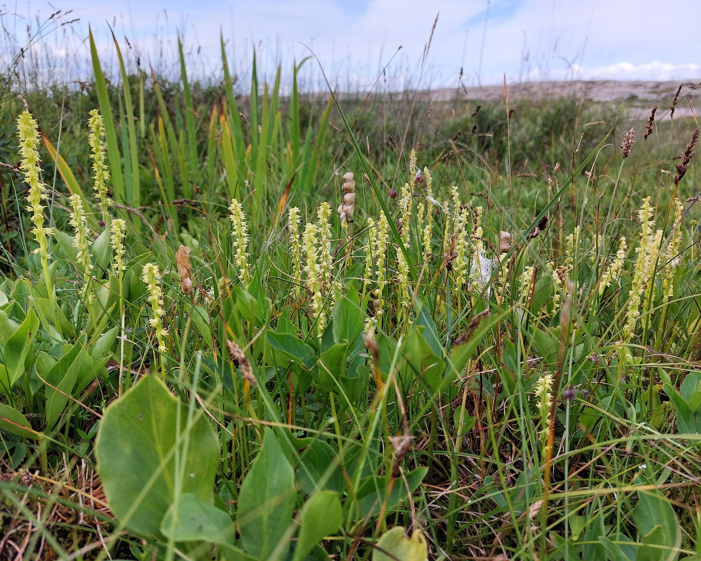
```

```{r fig-historisk}
#| fig-cap: 'Historiske lokaliteter for honningblom på Sørøstlandet, etter tidspunkt for siste registrering (før 1900, 1900–1950, 1951–1990 og etter 1990).'
#| code-summary: 'Kode for figur.'
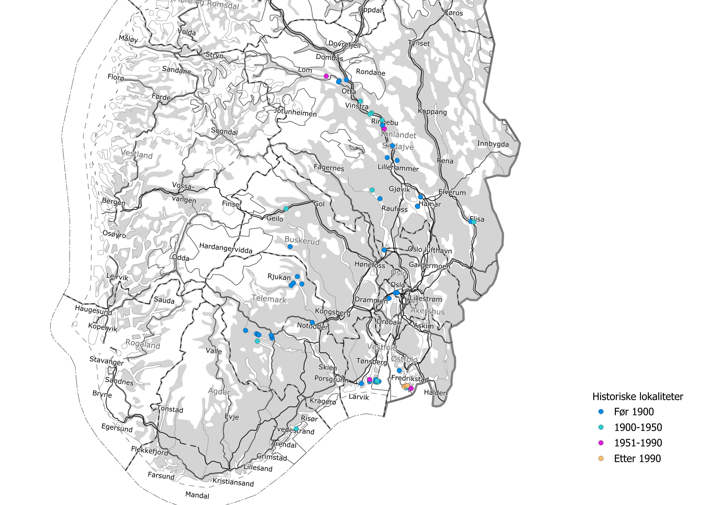
```

## 2. Formål med delprosjektet

### 2.1 Målsetning med tiltakene

Tiltakene som gjennomføres, varierer noe mellom de fire overvåkingslokalitetene, men omfatter i hovedsak fjerning av biomasse gjennom slått, én eller flere ganger årlig (se kap. 3.1). Målsetningen med tiltakene er å redusere vegetasjonshøyden og derigjennom øke habitatkvaliteten for og mengden/populasjonsstørrelsen av honningblom.

### 2.2 Formål med overvåking

Formålet med overvåking av honningblom er å få kunnskap om populasjonsstørrelse og -struktur, og hvordan dette endrer seg over tid. Denne kunnskapen gir grunnlag for å vurdere forvaltningstiltak, og bidrar med data til rødlistevurdering av arten.

Felles for de fire lokalitetene er at tiltakene gjennomføres på hele arealet. Det er per nå derfor ikke grunnlag for å undersøke effektene av skjøtsel mot kontrollområder uten skjøtsel.

### 2.3 Forventninger

Forventningen er at overjordisk populasjonsstørrelse av honningblom vil variere mellom år, avhengig av i hovedsak værforhold. Forventningen er også at skjøtselstiltakene skal bidra til å stabilisere og på sikt øke de lokale populasjonsstørrelsene.

## 3. Overvåkingslokalitetene

### 3.1 Beskrivelse av lokalitetene

Alle de gjenværende honningblomlokalitetene ligger på Hvaler i Østfold (@fig-hvaler).

```{r fig-hvaler}
#| fig-cap: 'De fire overvåkingslokalitetene for honningblom på Hvaler: Skipstadsand, Skjellvik og Teneskjær på Asmaløy og Filletassen.'
#| code-summary: 'Kode for figur.'
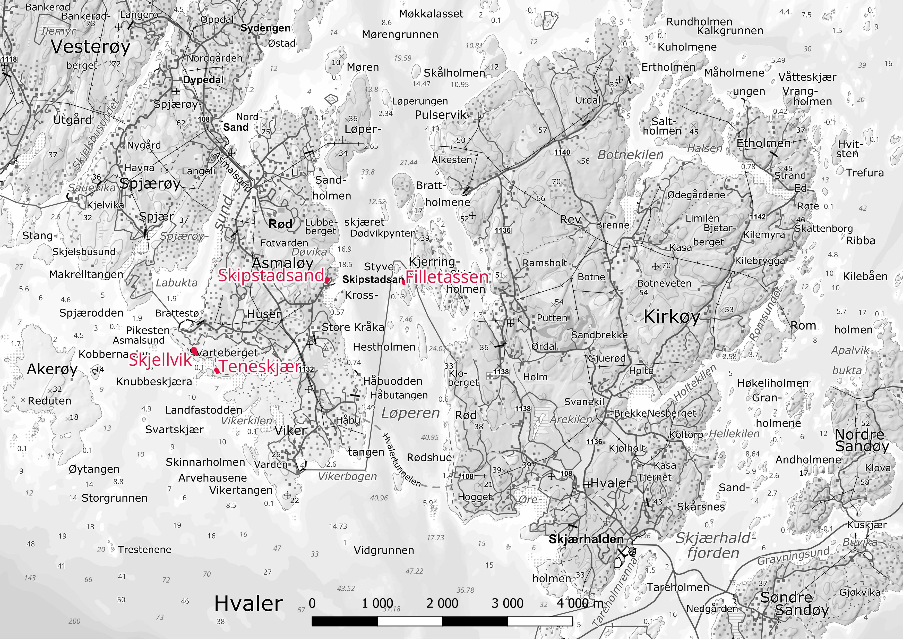
```

Alle forekomstene av honningblom er knyttet til semi-naturlige naturtyper. Slike naturtyper er åpne, men gror igjen med høyvokste arter ved opphør av drift som beite og slått. Arten kan også være utsatt for tråkkskader, både fra mennesker og beitedyr. Skjøtsel på de fire overvåkingslokalitetene er grundig beskrevet i @evju_2022a og i @ekelund_2019a [-@ekelund_2019b].

På Skipstadsand slås det to ganger per sesong: i juni, før honningblom er kommet opp, og etter frøsetting. Slått plantemateriale fjernes, og i tillegg lukes det rundt plantene. Forekomstene av honningblom er konsentrert i den nordøstlige delen av lokaliteten, med noen spredte individer utenfor kjerneområdet (@fig-kart-skipstadsand).

Skjellvik er den største lokaliteten, både i utstrekning og populasjonsstørrelse (@fig-kart-skjellvik). Honningblom forekommer spredt innenfor hele lokaliteten, men ikke langs transektrutene utenfor gjerdet nordover. Lokaliteten slås to ganger i året, og deler av lokaliteten en ekstra gang noen år.

Teneskjær inngår i beiteområdet til frittgående Herefordkyr i Ytre Hvaler nasjonalpark, og det forekommer en god del beite (@fig-kart-teneskjaer). For å beskytte plantene mot beite ble det i 2025 og 2026 satt opp små bur over en del planter. Det er ingen aktiv skjøtsel utover dette.

På Filletassen slås det på forsommeren samt på slutten av sommeren (@fig-kart-filletassen).

```{r fig-kart-skipstadsand}
#| fig-cap: 'Overvåkingslokaliteten på Skipstadsand (rød linje) med overvåkingsruter (oransje) og start- og sluttpunkt for transektene (lilla).'
#| code-summary: 'Kode for figur.'
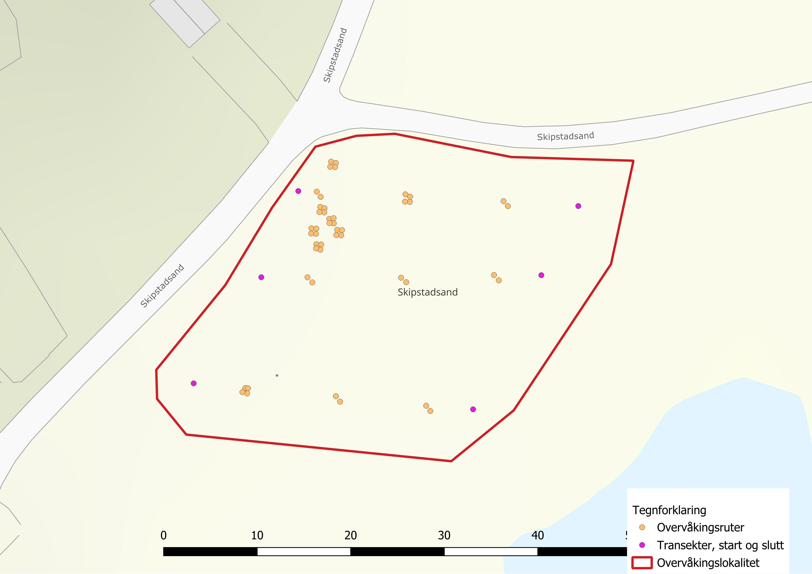
```

```{r fig-kart-skjellvik}
#| fig-cap: 'Overvåkingslokaliteten på Skjellvik (rød linje) med overvåkingsruter (oransje) og start- og sluttpunkt for transektene (lilla). Kartet viser også gjerdet slik det har vært fram til 2013, fram til 2018 og i dag, området med høyvokst vegetasjon som slås en ekstra gang, og området som er ryddet etter 2020.'
#| code-summary: 'Kode for figur.'
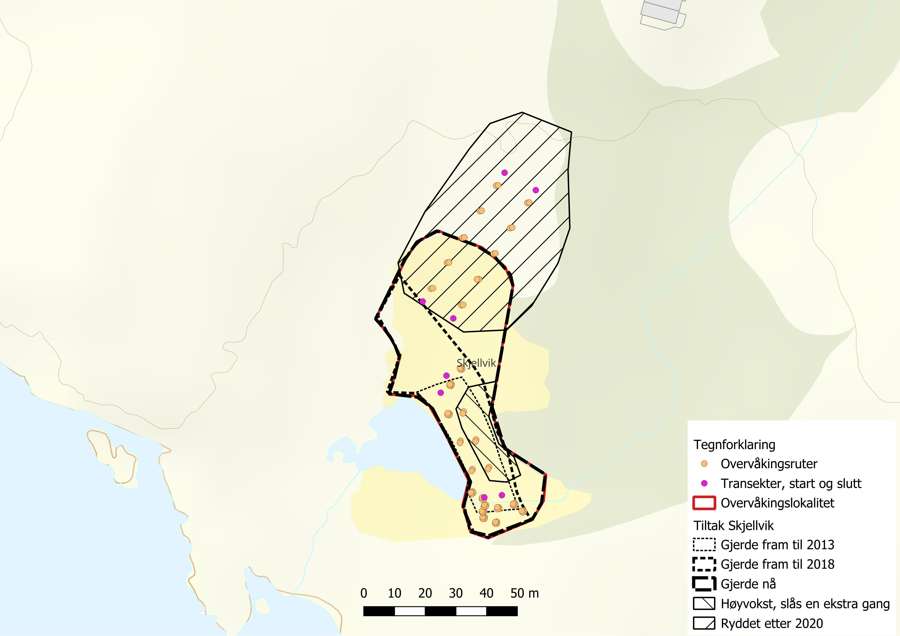
```

```{r fig-kart-teneskjaer}
#| fig-cap: 'Overvåkingslokaliteten på Teneskjær (rød linje) med overvåkingsruter (oransje) og start- og sluttpunkt for transektene (lilla).'
#| code-summary: 'Kode for figur.'
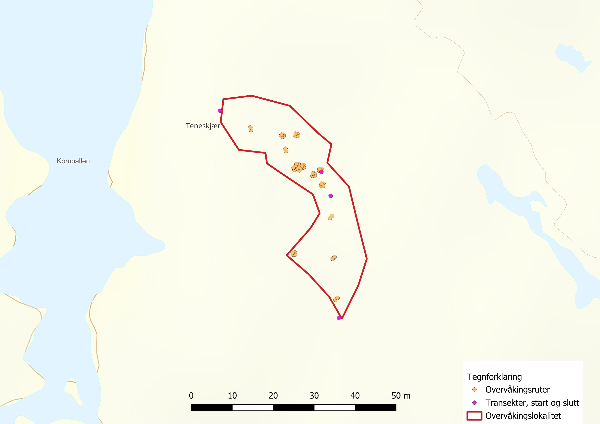
```

```{r fig-kart-filletassen}
#| fig-cap: 'Overvåkingslokaliteten på Filletassen (rød linje) med overvåkingsruter (oransje).'
#| code-summary: 'Kode for figur.'
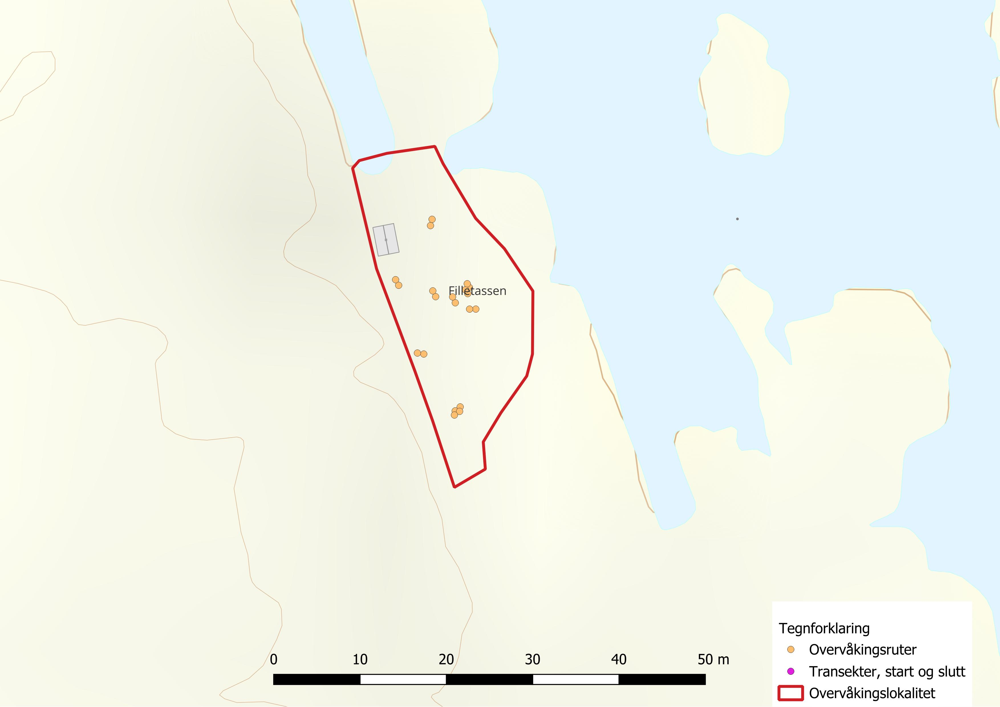
```

### 3.2 Tiltak

<!--# Bekreft tiltakene som ble gjennomført i 2026 (tidspunkt for slått, bur på Teneskjær, status for utsetting), og legg inn bilde av tiltakene. -->

Det er Statsforvalteren og Statens naturoppsyn (SNO) som gjennomfører tiltakene på honningblomlokalitetene. Tiltakene følger skjøtselsplanene for lokalitetene [@ekelund_2019b; @evju_2022a] og består i hovedsak av slått med fjerning av det slåtte materialet, slik at vegetasjonen holdes lav og åpen (se kap. 3.1 for slåtten på hver lokalitet). I tillegg gjøres det noen tiltak som er tilpasset den enkelte lokaliteten:

-   **Skjellvik:** Kjerneområdet er inngjerdet med strømgjerde, som beskytter plantene mot tråkk. Høsten 2023 ble små oretrær og -røtter fjernet, slik at det ble lettere å slå lokaliteten med maskin. Slåtten tilpasses veksten. I 2024 ble det for eksempel bare gjennomført svært lett sommerslått, fordi veksten var moderat [@roos_2024].
-   **Filletassen:** Slåtten på forsommeren er lett og gjøres over høyden til honningblomplantene, for å redusere dominansen til myrtistel (*Cirsium palustre*). Enga slås helt ned i slutten av august eller i september [@roos_2024].
-   **Teneskjær:** Lokaliteten slås ikke, men beites. Burene settes over grupper av fertile individer for å øke sannsynligheten for at de utvikler modne frø. I 2025 var blomstrende individer utenfor burene i stor grad beitet bort [@roos_2025].

I tillegg til skjøtselen arbeides det med bevaringsutsetting av honningblom. NIBIO dyrker fram planter som kan settes ut, og de første plantene kan være klare i 2026. I 2025 ble potensielle utsettingslokaliteter på Hvaler vurdert, og Vikerkilen og Herfølsalta ble anbefalt prioritert for skjøtsel fra 2026 [@ekelund_2025; @roos_2025].

## 4. Datainnsamling

Design for overvåking er beskrevet i @evju_2022a. Overvåkingen omfatter 67 permanente vegetasjonsruter på 0,5 × 0,5 m, fordelt på Skipstadsand (15; @fig-kart-skipstadsand), Skjellvik (27; @fig-kart-skjellvik), Teneskjær (15; @fig-kart-teneskjaer) og Filletassen (10; @fig-kart-filletassen). Alle rutene er merket med aluminiumsrør og med høypresisjons-GPS. I rutene registreres antall honningblomindivider og hvorvidt de er fertile eller vegetative. Andre variabler som registreres i rutene, er vist i @tbl-indikatorer. Forekomst/fravær av honningblom registreres i tillegg langs faste transekter på hver lokalitet, med totalt 416 meter transekt, fordelt på Skipstadsand (3 transekter, 90 m), Skjellvik (4 transekter, 180 m), Teneskjær (2 transekter, 60 m) og Filletassen (8 transekter, 86 m). Start- og sluttpunkt for transektene er merket med aluminiumsrør og høypresisjons-GPS.

Oversikt over indikatorer og datainnsamling i felt er gitt i @tbl-indikatorer.

<!--# Feltprotokoll (Vedlegg 1 i årsrapporten) – legg til lenke når den er tilgjengelig. -->

```{r tbl-indikatorer}
#| tbl-cap: 'Indikatorer for overvåking av honningblom.'
#| code-summary: 'Kode for tabell.'
tribble(
  ~Indikator, ~`Variabel registrert i felt`, ~Utvalgsenhet, ~`Utlegging av utvalgsenhet`, ~`Antall utvalgsenheter`, ~`Frekvens for datainnsamling`,
  "Populasjonsstørrelse honningblom", "Antall individer av honningblom", "0,5 × 0,5 m", "Tilfeldig/systematisk", "10–27", "Årlig",
  "Populasjonsstørrelse honningblom", "Forekomst/fravær av honningblom for hver meter langs transekt", "Transekt, 0,5 m bredt, varierende lengde", "Systematisk", "2–4", "Årlig",
  "Populasjonsstruktur honningblom", "Antall individer i to størrelsesklasser: vegetative og fertile", "0,5 × 0,5 m", "Tilfeldig/systematisk", "10–27", "Årlig",
  "Vegetasjonshøyde", "Vegetasjonshøyde (cm) i fire hjørner, målt til nærmeste 0,5 cm", "0,5 × 0,5 m", "Tilfeldig/systematisk", "10–27", "Årlig",
  "Vegetasjonsstruktur", "% dekning av feltsjikt, bunnsjikt, vedplanter i feltsjikt og dødt organisk materiale (strø)", "0,5 × 0,5 m", "Tilfeldig/systematisk", "10–27", "Årlig",
  "Jorddybde", "Jorddybde (cm) målt to steder per rute, til nærmeste 0,5 cm", "0,5 × 0,5 m", "Tilfeldig/systematisk", "5–27", "Én gang (2023)",
  "Artssammensetning karplanter", "Forekomst og mengde (forekomst/fravær i 16 småruter per rute) av alle karplanter", "0,5 × 0,5 m", "Tilfeldig/systematisk", "5–27", "Én gang (2024)",
  "Artssammensetning sopp", "DNA-metastrekkoding av jordprøver", "0,5 × 0,5 m", "Tilfeldig/systematisk", "10", "Én gang (2023)"
) |>
  kable()
```

## 5. Dataanalyser

Metodikk for å beregne populasjonsstørrelse og -struktur er beskrevet tidligere av @evju_2022a og @roos_2024. Basert på forekomst i overvåkingsrutene beregnes gjennomsnittlig antall individer, samt andel fertile individer, per overvåkingsrute.

For å estimere populasjonsstørrelse på hver lokalitet tar vi utgangspunkt i en oppdeling av lokaliteten (eller mer presist den undersøkte delen av lokaliteten, $ua$) i et forekomstareal ($fa$) med individer av honningblom og et fraværsareal uten individer, der antall individer med overjordiske skudd ($n$) estimeres for hvert år som produktet av forekomstarealet og den gjennomsnittlige tettheten ($d$) av planter innenfor forekomstarealet:

$$\hat{n} = \widehat{fa} \cdot \hat{d}$$

Forekomstarealet estimeres i utgangspunktet som andelen av transektrutene ($at$) med forekomst av honningblom multiplisert med arealet av det undersøkte området:

$$\widehat{fa} = ua \cdot \widehat{at}$$

Denne tilnærmingen forutsetter at noen av plantene i populasjonen vokser i transektene. Det er ikke alltid tilfelle, da plantene er svært klumpvis fordelt, særlig på Teneskjær, men også på Skipstadsand. For disse estimeres forekomstarealet som

$$\widehat{fa} = ua \cdot (1 - \hat{p}_0)$$

der $p_0$ er sannsynligheten for ikke å observere honningblom i en transektrute. Sannsynligheten estimeres ut fra en negativ binomisk fordeling tilpasset registreringene av honningblom i både transektruter og overvåkingsruter. Parameterne i fordelingen estimeres ved hjelp av sannsynlighetsmaksimeringsprinsippet, der transektrutene og overvåkingsrutene vektes i forhold til antall ruter av hver type som inngår i datagrunnlaget. Ved Skipstadsand, Skjellvik og Teneskjær ble overvåkingsrutene etablert i 2014, mens transektene ble etablert først i 2021. Populasjonsestimatene for årene 2014–2020 er basert på antagelsen at forekomsten av honningblom i transektrutene i 2021 reflekterer tilstanden i disse rutene i perioden fra 2014.

Usikkerheten i $\hat{n}$ estimeres som et 95 % konfidensintervall ved hjelp av ikke-parametrisk bootstrap, der hele tidsserier av honningblomregistreringer fra transektruter og overvåkingsruter velges med tilbakelegging slik at antall transektruter og antall overvåkingsruter er som i det observerte datagrunnlaget. Estimatene beregnes for overjordiske individer totalt og for fertile individer. Andelen fertile individer som presenteres i resultatene, er likevel basert på de faktiske tellingene i overvåkingsrutene (@fig-fertile), og ikke på populasjonsestimatene.

Skriptene for databehandling, figurer og populasjonsestimater ligger i [`code/`](https://github.com/NINAnor/effektovervaaking-2026-2030/tree/main/Honningblom/code) på GitHub (figurer: `5_Plot based counts.qmd`; populasjonsestimater: `6_Herminium_population_estimates.qmd`).

## 6. Resultater

### 6.1 Skipstadsand

På Skipstadsand viser antallet individer i overvåkingsrutene en kraftig nedgang etter 2018 (@fig-skipstadsand). I 2026 lå gjennomsnittlig antall individer i overvåkingsrutene rundt det som har vært normalt for perioden 2021–2025. Sammen med observasjonene langs transektene ga observasjonene i overvåkingsrutene grunnlag for et litt lavere estimat på populasjonsstørrelsen i 2026 enn i 2025 (783 vs. 1495 individer, @fig-populasjon), men dette var høyere enn gjennomsnittet for perioden 2019–2025 (759). Andelen fertile individer falt fra 2024 til 2025 og var stabil fra 2025 til 2026 (@fig-fertile).

```{r fig-skipstadsand}
#| fig-cap: 'Antall overjordiske honningblomindivider per rute fra 2014 til 2026, Skipstadsand, i de opprinnelige rutene (venstre) og i alle ruter (høyre). Gjennomsnitt ± standardfeil.'
#| code-summary: 'Kode for figur.'
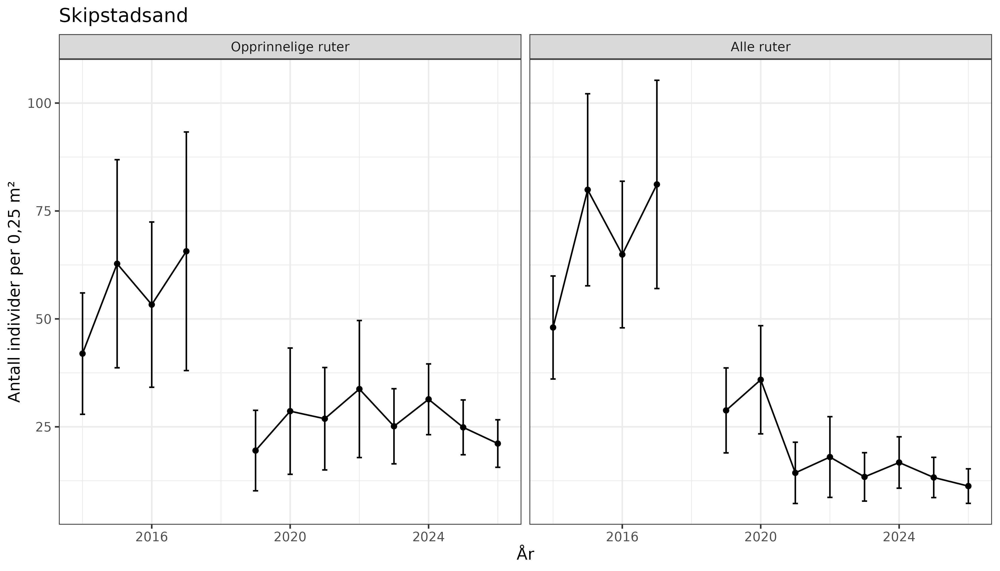
```

### 6.2 Skjellvik

Skjellvik har den største bestanden av honningblom, men antallet individer varierer kraftig fra år til år. De siste årene tyder likevel på at populasjonen er økende. Det gjennomsnittlige antallet individer per rute har økt i 2026, særlig i de opprinnelige overvåkingsrutene (@fig-skjellvik). Dette gir grunnlag for et bestandsestimat på 57 072, som er det høyeste estimatet i tidsserien (@fig-populasjon). Andelen fertile individer var som tidligere år på ca. 10 % (@fig-fertile).

```{r fig-skjellvik}
#| fig-cap: 'Antall overjordiske honningblomindivider per rute fra 2014 til 2026, Skjellvik, i de opprinnelige rutene (venstre) og i alle ruter (høyre). Gjennomsnitt ± standardfeil.'
#| code-summary: 'Kode for figur.'
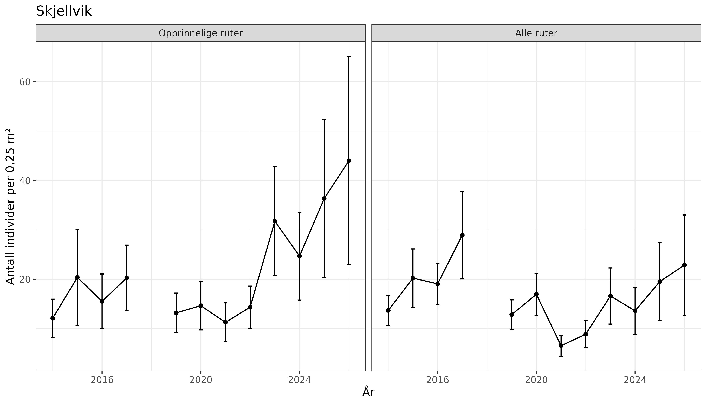
```

### 6.3 Teneskjær

Det gjennomsnittlige antallet individer i overvåkingsrutene på Teneskjær viser en kraftig nedgang i overvåkingsperioden, men har vært stabilt, med tendens til økning, siden 2019 (@fig-teneskjaer). Bestandsestimatet for 2026 er 706 individer, noe lavere enn i 2025 (805), men høyere enn gjennomsnittet for 2019–2025 (416) (@fig-populasjon). Det er en liten andel av individene på Teneskjær som er fertile (@fig-fertile).

```{r fig-teneskjaer}
#| fig-cap: 'Antall overjordiske honningblomindivider per rute fra 2014 til 2026, Teneskjær, i de opprinnelige rutene (venstre) og i alle ruter (høyre). Gjennomsnitt ± standardfeil.'
#| code-summary: 'Kode for figur.'
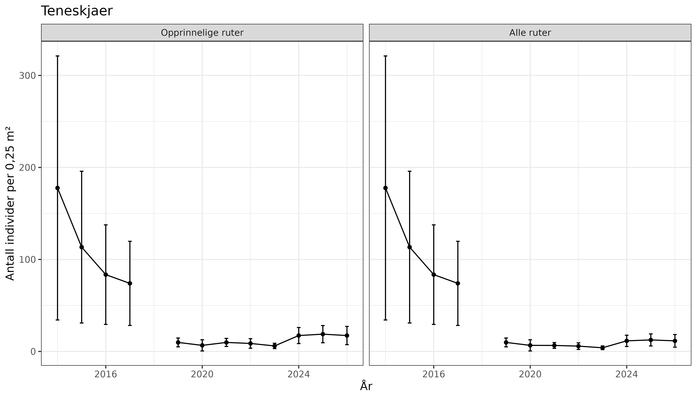
```

### 6.4 Filletassen

På Filletassen har gjennomsnittlig antall individer per overvåkingsrute økt jevnt siden overvåkingen startet i 2020 (@fig-filletassen). Estimatet på bestandsstørrelsen har dermed også økt, fra 1566 i 2020 til 3217 i 2026 (@fig-populasjon), og det lave estimatet i 2025 ser ut til å skyldes en høyere andel individer uten overjordisk biomasse enn i andre år. Andelen fertile individer på Filletassen var lav i 2026, men har økt noe de siste årene (@fig-fertile).

```{r fig-filletassen}
#| fig-cap: 'Antall overjordiske honningblomindivider per rute fra 2020 til 2026, Filletassen. Gjennomsnitt ± standardfeil.'
#| code-summary: 'Kode for figur.'
#| out-width: 50%
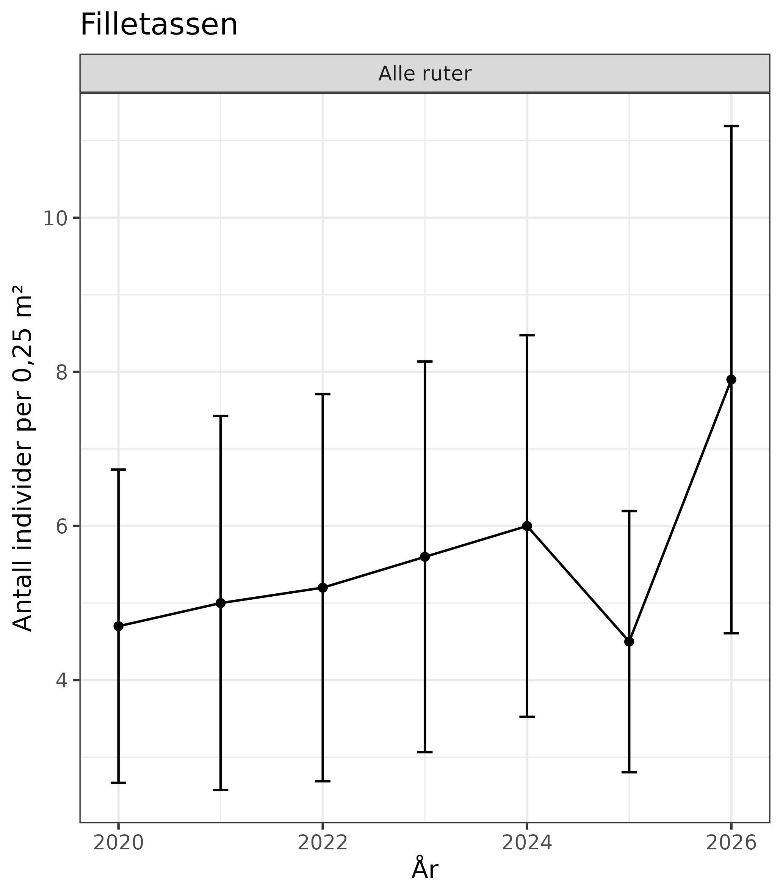
```

### 6.5 Populasjonsstørrelse og andel fertile

```{r fig-populasjon}
#| fig-cap: 'Estimert overjordisk populasjonsstørrelse (svart linje) og antall fertile individer (rød linje) på Filletassen, Skipstadsand, Teneskjær og Skjellvik i perioden 2014–2026. Skraverte områder viser 95 % konfidensintervall for henholdsvis overjordisk populasjonsstørrelse (grått) og antall fertile individer (rødt). Legg merke til at y-aksen er på log-skala.'
#| code-summary: 'Kode for figur.'
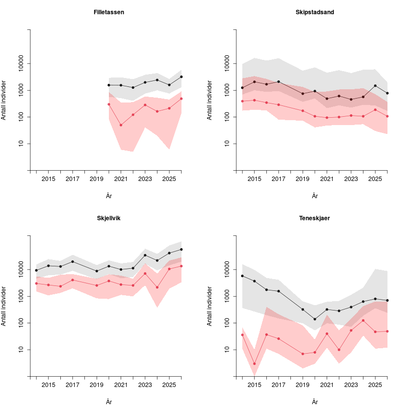
```

```{r tbl-estimater}
#| tbl-cap: 'Estimert overjordisk populasjonsstørrelse av honningblom per lokalitet og år, med 95 % konfidensintervall (bootstrap) i parentes. Filletassen ble overvåket første gang i 2020, og det mangler data for 2018.'
#| code-summary: 'Kode for tabell.'
lok <- c("Skipstadsand", "Skjellvik", "Teneskjaer", "Filletassen")
fmt <- function(x) format(round(x), big.mark = " ", scientific = FALSE, trim = TRUE)
read_csv(here("data", "Herminium_pop_2026.csv"), show_col_types = FALSE) |>
  filter(Pop.variable == "size") |>
  pivot_wider(names_from = Estimate, values_from = Value) |>
  mutate(
    verdi = paste0(fmt(est), " (", fmt(lower), "–", fmt(upper), ")"),
    Locality = factor(Locality, levels = lok)
  ) |>
  select(År = Year, Locality, verdi) |>
  arrange(Locality) |>
  pivot_wider(names_from = Locality, values_from = verdi, values_fill = "") |>
  arrange(År) |>
  rename(Teneskjær = Teneskjaer) |>
  kable(align = "lrrrr")
```

```{r fig-fertile}
#| fig-cap: 'Andelen fertile individer av honningblom for alle lokaliteter, gjennomsnitt ± standardfeil. Tallene er basert på observasjoner fra alle ruter med data for hvert år, og individer uten overjordisk biomasse er ikke tatt med.'
#| code-summary: 'Kode for figur.'
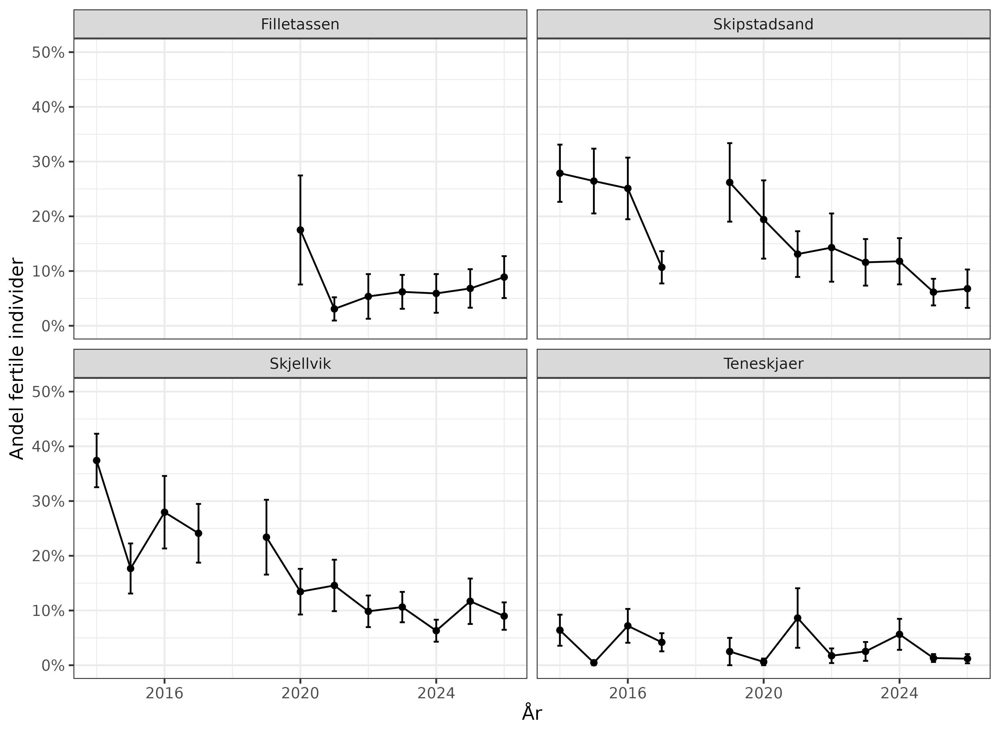
```

## 7. Oppsummering

### 7.1 Hva viser årets resultater

Årets resultater tyder på stabile eller økende populasjoner på de fire honningblomlokalitetene. Dette tyder på at nåværende tiltak fungerer for å opprettholde stabile populasjoner.

**Skjellvik og Filletassen.** Begge populasjonene hadde i 2026 det høyeste estimatet siden overvåkingen startet (@tbl-estimater). På Skjellvik har estimatet økt hvert år siden 2024, og forekomstarealet var like stort som i 2025.

**Skipstadsand og Teneskjær.** Disse populasjonene er små, og estimatene varierer mye fra år til år. Den høye verdien for Skipstadsand i 2025 skyldtes at det ble funnet honningblom i en transektrute der arten ikke var registrert tidligere [@roos_2025]. Nedgangen fra 2025 til 2026 er derfor ikke nødvendigvis en reell tilbakegang. På Teneskjær er andelen fertile individer fortsatt lav, og beite fjerner mange av blomsterstandene. Burene over fertile planter kan derfor være viktige for frøproduksjonen på lokaliteten.

**Usikkerhet.** Konfidensintervallene er brede (@tbl-estimater), særlig på Teneskjær og Skipstadsand. Der vokser honningblom i få av transektrutene, og forekomstarealet må estimeres med en modell. Enkeltår bør derfor tolkes med forsiktighet, og det er utviklingen over flere år som gir det sikreste bildet. Estimatene omfatter bare individer med overjordiske skudd. Andelen individer uten overjordiske skudd varierer mellom år [@wells_1998; @kravdal_2016], og noe av variasjonen i estimatene skyldes trolig dette.

**Vær.** I 2024 fant vi at populasjonsstørrelsen henger sammen med nedbør og tørke i juni og juli året før, men at sammenhengen går i motsatt retning på lokaliteter med dyp, torvrik jord (Filletassen og Skjellvik) og på lokaliteter med grunn jord over skjellsand (Skipstadsand og Teneskjær) [@roos_2024]. Været er ikke analysert i år.

### 7.2 Anbefaling for videreføring

Overvåkingen av honningblom gir svært viktig informasjon om populasjonsutviklingen til denne kritisk truede arten, og om hvordan utviklingen påvirkes av vær og forvaltningstiltak. Både tiltakene som forvaltningen gjennomfører, og overvåkingen, bør videreføres. Årlig overvåking er viktig for å unngå hull i tidsserien (som i 2018) og for å forstå effekten av variasjoner i temperatur og nedbør gjennom vekstsesongen.

## 8. Referanser

::: {#refs}
:::

## 9. Author contributions

<!-- Fill in CRediT and MeRIT statements. See https://credit.niso.org/ and https://www.nature.com/articles/s41467-023-37039-1. Delete rows you don't use. -->

**CRediT statement**

-   Writing – original draft: ME (Marianne Evju)
-   Data curation: RER (Ruben Erik Roos), IMM (Ida M. Mienna)
-   Formal analysis: RER
-   Software: RER, IMM, BP (Bård Pedersen, original functions for the population estimates)
-   Visualization: RER

:::: {.content-visible when-format="html"}
::: {.callout-tip collapse="true"}
## Session Info

This information is mainly aimed at developers that need to recreate the R environment that produced the html.

```{r sessionInfo}
#| echo: false
sessionInfo()
```
:::
::::
