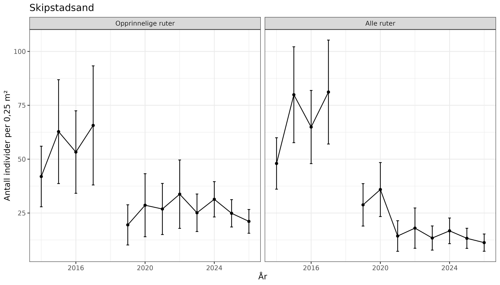
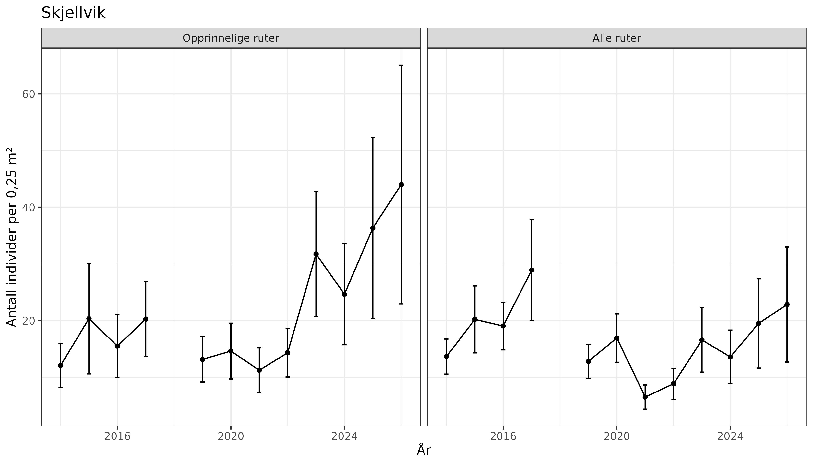
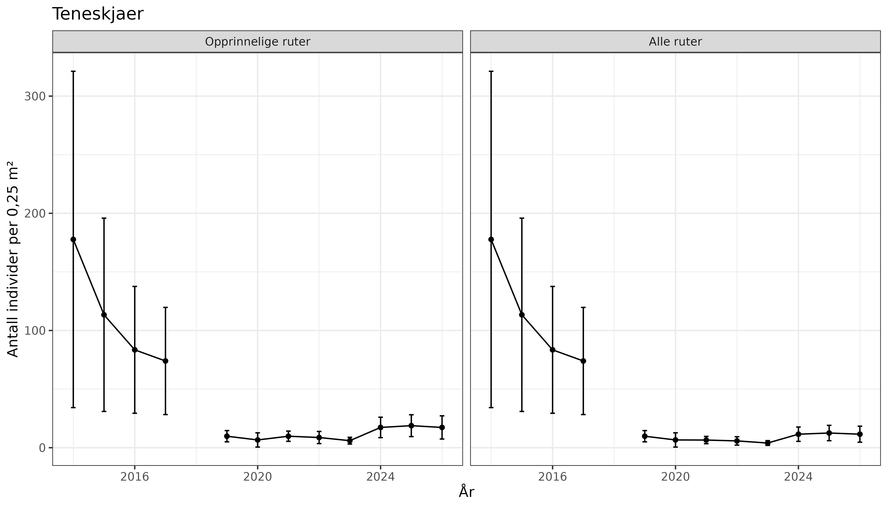
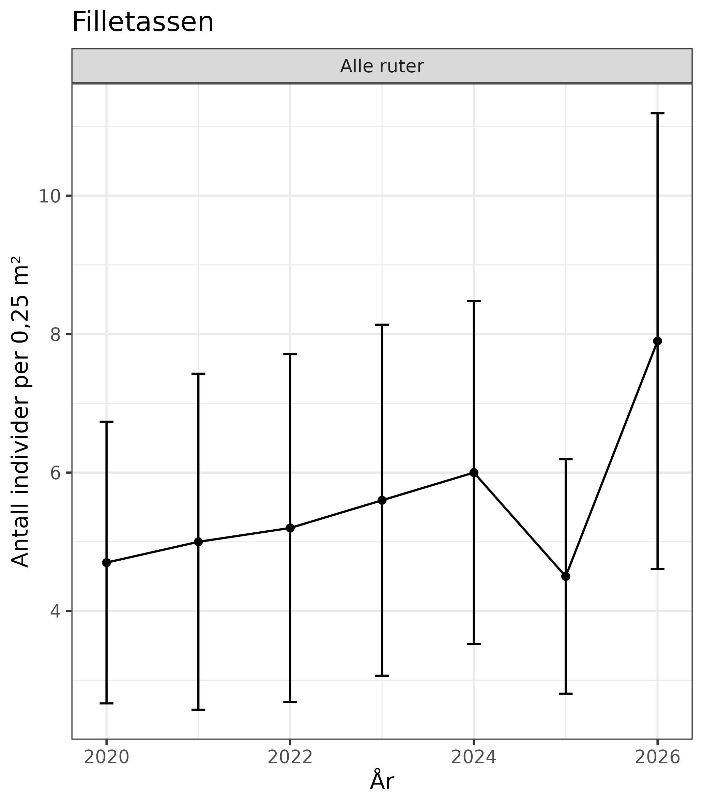
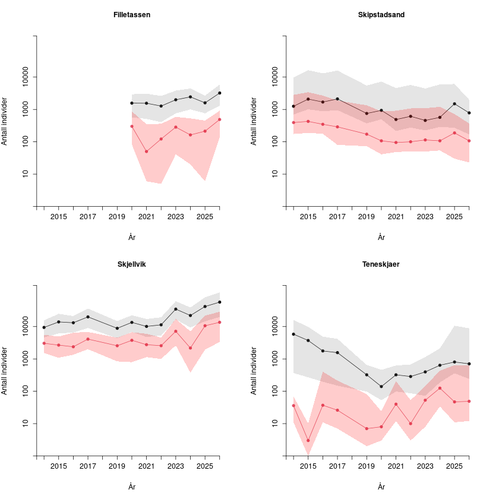
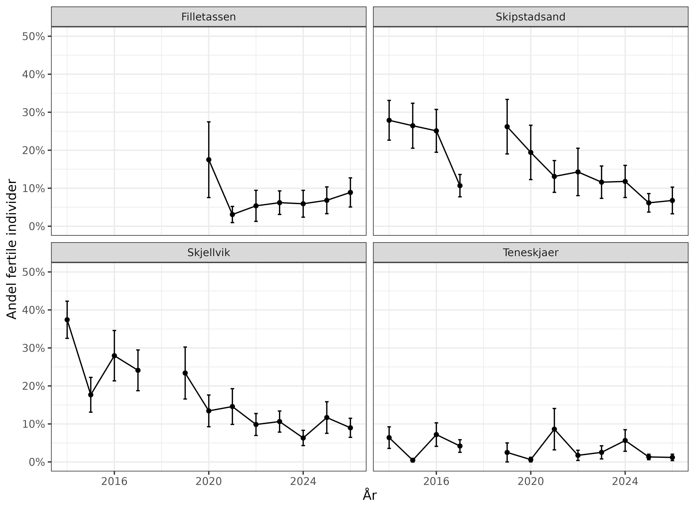

# Honningblom (*Herminium monorchis*)
Marianne Evju, Ruben Erik Roos
2026-11-11

- [Oppsummering](#oppsummering)
- [English summary](#english-summary)
- [1. Innledning](#1-innledning)
- [2. Formål med delprosjektet](#2-formål-med-delprosjektet)
- [3. Overvåkingslokalitetene](#3-overvåkingslokalitetene)
- [4. Datainnsamling](#4-datainnsamling)
- [5. Dataanalyser](#5-dataanalyser)
- [6. Resultater](#6-resultater)
- [7. Oppsummering](#7-oppsummering)
- [8. Referanser](#8-referanser)
- [9. Author contributions](#9-author-contributions)

<!--# Rapporten leser kun filer i data/ og img/. Rådata ligger på P:, og koden som lager figurene og populasjonsestimatene ligger i code/ (skript 5 og 6). Rapporten lager ingen figurer selv. -->

<!--# The following parts are autogenerated. Do not edit. -->

> [!NOTE]
>
> Denne siden er generert fra [`Honningblom.qmd`](Honningblom.qmd). Ikke
> rediger `README.md` direkte. For å oppdatere: kjør skriptene i
> [`code/`](code/) slik at masterfila i [`data/`](data/) og figurene i
> [`img/`](img/) blir oppdatert, og kjør `pixi run render`. Se
> [`code/README.md`](code/README.md) for rekkefølgen.

> **Recommended citation**: Evju, M. & Roos, R.E. 2026. Honningblom (ID:
> XX_YYYY_ZZZ) v. 0.1.0. ecRxiv:
> https://github.com/NINAnor/ecRxiv/tree/main/indicators/XX_YYYY_ZZZ

> [!TIP]
>
> ### Metadata
>
> 

>
> Tabell 1: Indicator metadata
>
> 

>
> | Variable | Value |
> |:---|:---|
> | Indicator ID | INDICATORID |
> | Indicator Name | Honningblom |
> | verbatimName | Honningblom |
> | Country | Norway |
> | Continent | Europe |
> | Realm | write realm here |
> | Biome | write biome here |
> | Ecosystem | write ecosystem here |
> | verbatimEcosystem | Semi-naturlig eng på fire kystnære lokaliteter på Hvaler, Østfold |
> | Year added | 2026 |
> | Last update | 2026 |
> | Version | 0.1.0 |
> | Version comment | Første versjon, med overvåkingsdata 2014–2026 |
> | Precision |  |
>
> 

>
> 

> [!TIP]
>
> ### Log
>
> <!--# Legg til en kort linje for hver oppdatering -->
>
> 11. nov. 2026 – Første versjon, overvåkingsdata 2014–2026

## Oppsummering

Honningblom (*Herminium monorchis*) er en kritisk truet (CR) orkidé med
fire kjente lokaliteter, alle på Hvaler i Østfold. Populasjonene på
Skipstadsand, Skjellvik og Teneskjær har vært overvåket siden 2014, og
populasjonen på Filletassen siden 2020. Tiltakene er i hovedsak slått,
én eller flere ganger i året, for å holde vegetasjonen lav og åpen.
Teneskjær slås ikke, men beites av storfe, og der settes det bur over en
del av plantene for å beskytte dem mot beite.

Overvåkingen viser at populasjonene er stabile eller økende. Skjellvik,
den største populasjonen, hadde i 2026 det høyeste estimatet i
tidsserien, med om lag 57 000 individer, og også Filletassen økte til
det høyeste nivået siden overvåkingen startet. På Skipstadsand og
Teneskjær var estimatene noe lavere enn i 2025, men høyere enn
gjennomsnittet for perioden 2019–2025. Usikkerheten i estimatene er
stor, særlig for de små populasjonene. Resultatene tyder på at dagens
tiltak opprettholder populasjonene, og både tiltakene og den årlige
overvåkingen bør videreføres.

## English summary

The lesser musk orchid (*Herminium monorchis*) is a critically
endangered (CR) orchid with four known sites in Norway, all in Hvaler,
Østfold. The populations at Skipstadsand, Skjellvik and Teneskjær have
been monitored since 2014, and the population at Filletassen since 2020.
Management consists mainly of mowing, once or several times a year, to
keep the vegetation short and open. Teneskjær is not mown but is grazed
by cattle, and cages are placed over some of the plants to protect them
from grazing.

The monitoring shows that the populations are stable or increasing.
Skjellvik, the largest population, had the highest estimate in the time
series in 2026, about 57,000 individuals, and Filletassen also increased
to its highest level since monitoring started. At Skipstadsand and
Teneskjær the estimates were somewhat lower than in 2025 but higher than
the 2019–2025 average. The estimates are very uncertain, especially for
the small populations. The results suggest that the current management
maintains the populations, and both the management and the annual
monitoring should continue.

## 1. Innledning

Orkideen honningblom (*Herminium monorchis*) vokser på fire kystnære
lokaliteter på Hvaler, Østfold: tre på Asmaløy (Skipstadsand, Skjellvik
og Teneskjær) og en på øya Filletassen utenfor Asmaløy (Høitomt og
Brynjulvsrud 2017). Arten var tidligere spredt men sjelden på
Sørøstlandet, men har hatt kraftig tilbakegang de siste hundre årene, på
grunn av oppdyrking, drenering og annen omlegging av arealbruk.
Honningblom er vurdert som kritisk truet (CR) på Rødlista for arter 2021
(Artsdatabanken 2021).

Honningblompopulasjonene på Skipstadsand, Skjellvik og Teneskjær har
vært overvåket siden 2014 og populasjonen på Filletassen siden 2020
(Roos mfl. 2023). Fordi honningblom er flerårig og viser stor
mellomårsvariasjon i andelen individer som har overjordiske skudd (Wells
mfl. 1998; Kravdal mfl. 2016), er det viktig med årlige data over mange
år for å kunne skille mellomårsvariasjon fra trender i
populasjonsstørrelse. Det foregår skjøtsel på lokalitetene som
overvåkes. NINA er i nær kontakt med Statsforvalteren i Østfold,
Buskerud, Oslo og Akershus og med Nasjonalparkforvalteren i Ytre Hvaler
nasjonalpark om tiltakene og overvåkingen.

<!--# Bilde: Figur 1. Honningblom på Skjellvik. Foto: Ruben E. Roos/NINA. Legg bildet i img/ og sett det inn her. -->

## 2. Formål med delprosjektet

### 2.1 Målsetning med tiltakene

Tiltakene som gjennomføres, varierer noe mellom de fire
overvåkingslokalitetene, men omfatter i hovedsak fjerning av biomasse
gjennom slått, én eller flere ganger årlig (se kap. 3.1). Målsetningen
med tiltakene er å redusere vegetasjonshøyden og derigjennom øke
habitatkvaliteten for og mengden/populasjonsstørrelsen av honningblom.

### 2.2 Formål med overvåking

Formålet med overvåking av honningblom er å få kunnskap om
populasjonsstørrelse og -struktur, og hvordan dette endrer seg over tid.
Denne kunnskapen gir grunnlag for å vurdere forvaltningstiltak, og
bidrar med data til rødlistevurdering av arten.

Felles for de fire lokalitetene er at tiltakene gjennomføres på hele
arealet. Det er per nå derfor ikke grunnlag for å undersøke effektene av
skjøtsel mot kontrollområder uten skjøtsel.

### 2.3 Forventninger

Forventningen er at overjordisk populasjonsstørrelse av honningblom vil
variere mellom år, avhengig av i hovedsak værforhold. Forventningen er
også at skjøtselstiltakene skal bidra til å stabilisere og på sikt øke
de lokale populasjonsstørrelsene.

## 3. Overvåkingslokalitetene

### 3.1 Beskrivelse av lokalitetene

Alle de gjenværende honningblomlokalitetene ligger på Hvaler i Østfold.

<!--# Kart over lokalitetene (plassering i Norge og på Hvaler) settes inn her. -->

Alle forekomstene av honningblom er knyttet til semi-naturlige
naturtyper. Slike naturtyper er åpne, men gror igjen med høyvokste arter
ved opphør av drift som beite og slått. Arten kan også være utsatt for
tråkkskader, både fra mennesker og beitedyr. Skjøtsel på de fire
overvåkingslokalitetene er grundig beskrevet i Evju mfl. (2022) og i
Ekelund (2019a, 2019b).

På Skipstadsand slås det to ganger per sesong: i juni, før honningblom
er kommet opp, og etter frøsetting. Slått plantemateriale fjernes, og i
tillegg lukes det rundt plantene. Forekomstene av honningblom er
konsentrert i den nordøstlige delen av lokaliteten, med noen spredte
individer utenfor kjerneområdet.

Skjellvik er den største lokaliteten, både i utstrekning og
populasjonsstørrelse. Honningblom forekommer spredt innenfor hele
lokaliteten, men ikke langs transektrutene utenfor gjerdet nordover.
Lokaliteten slås to ganger i året, og deler av lokaliteten en ekstra
gang noen år.

Teneskjær inngår i beiteområdet til frittgående Herefordkyr i Ytre
Hvaler nasjonalpark, og det forekommer en god del beite. For å beskytte
plantene mot beite ble det i 2025 og 2026 satt opp små bur over en del
planter. Det er ingen aktiv skjøtsel utover dette.

På Filletassen slås det på forsommeren samt på slutten av sommeren.

<!--# Oversiktskart for hver lokalitet (ruter og transekter) settes inn her. -->

### 3.2 Tiltak

<!--# Bekreft tiltakene som ble gjennomført i 2026 (tidspunkt for slått, bur på Teneskjær, status for utsetting), og legg inn bilde av tiltakene. -->

Det er Statsforvalteren og Statens naturoppsyn (SNO) som gjennomfører
tiltakene på honningblomlokalitetene. Tiltakene følger skjøtselsplanene
for lokalitetene (Ekelund 2019b; Evju mfl. 2022) og består i hovedsak av
slått med fjerning av det slåtte materialet, slik at vegetasjonen holdes
lav og åpen (se kap. 3.1 for slåtten på hver lokalitet). I tillegg
gjøres det noen tiltak som er tilpasset den enkelte lokaliteten:

- **Skjellvik:** Kjerneområdet er inngjerdet med strømgjerde, som
  beskytter plantene mot tråkk. Høsten 2023 ble små oretrær og -røtter
  fjernet, slik at det ble lettere å slå lokaliteten med maskin. Slåtten
  tilpasses veksten. I 2024 ble det for eksempel bare gjennomført svært
  lett sommerslått, fordi veksten var moderat (Roos mfl. 2024).
- **Filletassen:** Slåtten på forsommeren er lett og gjøres over høyden
  til honningblomplantene, for å redusere dominansen til myrtistel
  (*Cirsium palustre*). Enga slås helt ned i slutten av august eller i
  september (Roos mfl. 2024).
- **Teneskjær:** Lokaliteten slås ikke, men beites. Burene settes over
  grupper av fertile individer for å øke sannsynligheten for at de
  utvikler modne frø. I 2025 var blomstrende individer utenfor burene i
  stor grad beitet bort (Roos mfl. 2025).

I tillegg til skjøtselen arbeides det med bevaringsutsetting av
honningblom. NIBIO dyrker fram planter som kan settes ut, og de første
plantene kan være klare i 2026. I 2025 ble potensielle
utsettingslokaliteter på Hvaler vurdert, og Vikerkilen og Herfølsalta
ble anbefalt prioritert for skjøtsel fra 2026 (Ekelund mfl. 2025; Roos
mfl. 2025).

## 4. Datainnsamling

Design for overvåking er beskrevet i Evju mfl. (2022). Overvåkingen
omfatter 67 permanente vegetasjonsruter på 0,5 × 0,5 m, fordelt på
Skipstadsand (15), Skjellvik (27), Teneskjær (15) og Filletassen (10).
Alle rutene er merket med aluminiumsrør og med høypresisjons-GPS. I
rutene registreres antall honningblomindivider og hvorvidt de er fertile
eller vegetative. Andre variabler som registreres i rutene, er vist i
<a href="#tbl-indikatorer" class="quarto-xref">Tabell 2</a>.
Forekomst/fravær av honningblom registreres i tillegg langs faste
transekter på hver lokalitet, med totalt 416 meter transekt, fordelt på
Skipstadsand (3 transekter, 90 m), Skjellvik (4 transekter, 180 m),
Teneskjær (2 transekter, 60 m) og Filletassen (8 transekter, 86 m).
Start- og sluttpunkt for transektene er merket med aluminiumsrør og
høypresisjons-GPS.

Oversikt over indikatorer og datainnsamling i felt er gitt i
<a href="#tbl-indikatorer" class="quarto-xref">Tabell 2</a>.

<!--# Feltprotokoll (Vedlegg 1 i årsrapporten) – legg til lenke når den er tilgjengelig. -->

Tabell 2: Indikatorer for overvåking av honningblom.

| Indikator | Variabel registrert i felt | Utvalgsenhet | Utlegging av utvalgsenhet | Antall utvalgsenheter | Frekvens for datainnsamling |
|:---|:---|:---|:---|:---|:---|
| Populasjonsstørrelse honningblom | Antall individer av honningblom | 0,5 × 0,5 m | Tilfeldig/systematisk | 10–27 | Årlig |
| Populasjonsstørrelse honningblom | Forekomst/fravær av honningblom for hver meter langs transekt | Transekt, 0,5 m bredt, varierende lengde | Systematisk | 2–4 | Årlig |
| Populasjonsstruktur honningblom | Antall individer i to størrelsesklasser: vegetative og fertile | 0,5 × 0,5 m | Tilfeldig/systematisk | 10–27 | Årlig |
| Vegetasjonshøyde | Vegetasjonshøyde (cm) i fire hjørner, målt til nærmeste 0,5 cm | 0,5 × 0,5 m | Tilfeldig/systematisk | 10–27 | Årlig |
| Vegetasjonsstruktur | % dekning av feltsjikt, bunnsjikt, vedplanter i feltsjikt og dødt organisk materiale (strø) | 0,5 × 0,5 m | Tilfeldig/systematisk | 10–27 | Årlig |
| Jorddybde | Jorddybde (cm) målt to steder per rute, til nærmeste 0,5 cm | 0,5 × 0,5 m | Tilfeldig/systematisk | 5–27 | Én gang (2023) |
| Artssammensetning karplanter | Forekomst og mengde (forekomst/fravær i 16 småruter per rute) av alle karplanter | 0,5 × 0,5 m | Tilfeldig/systematisk | 5–27 | Én gang (2024) |
| Artssammensetning sopp | DNA-metastrekkoding av jordprøver | 0,5 × 0,5 m | Tilfeldig/systematisk | 10 | Én gang (2023) |

## 5. Dataanalyser

Metodikk for å beregne populasjonsstørrelse og -struktur er beskrevet
tidligere av Evju mfl. (2022) og Roos mfl. (2024). Basert på forekomst i
overvåkingsrutene beregnes gjennomsnittlig antall individer, samt andel
fertile individer, per overvåkingsrute.

For å estimere populasjonsstørrelse på hver lokalitet tar vi
utgangspunkt i en oppdeling av lokaliteten (eller mer presist den
undersøkte delen av lokaliteten, $ua$) i et forekomstareal ($fa$) med
individer av honningblom og et fraværsareal uten individer, der antall
individer med overjordiske skudd ($n$) estimeres for hvert år som
produktet av forekomstarealet og den gjennomsnittlige tettheten ($d$) av
planter innenfor forekomstarealet:

$$\hat{n} = \widehat{fa} \cdot \hat{d}$$

Forekomstarealet estimeres i utgangspunktet som andelen av
transektrutene ($at$) med forekomst av honningblom multiplisert med
arealet av det undersøkte området:

$$\widehat{fa} = ua \cdot \widehat{at}$$

Denne tilnærmingen forutsetter at noen av plantene i populasjonen vokser
i transektene. Det er ikke alltid tilfelle, da plantene er svært
klumpvis fordelt, særlig på Teneskjær, men også på Skipstadsand. For
disse estimeres forekomstarealet som

$$\widehat{fa} = ua \cdot (1 - \hat{p}_0)$$

der $p_0$ er sannsynligheten for ikke å observere honningblom i en
transektrute. Sannsynligheten estimeres ut fra en negativ binomisk
fordeling tilpasset registreringene av honningblom i både transektruter
og overvåkingsruter. Parameterne i fordelingen estimeres ved hjelp av
sannsynlighetsmaksimeringsprinsippet, der transektrutene og
overvåkingsrutene vektes i forhold til antall ruter av hver type som
inngår i datagrunnlaget. Ved Skipstadsand, Skjellvik og Teneskjær ble
overvåkingsrutene etablert i 2014, mens transektene ble etablert først i
2021. Populasjonsestimatene for årene 2014–2020 er basert på antagelsen
at forekomsten av honningblom i transektrutene i 2021 reflekterer
tilstanden i disse rutene i perioden fra 2014.

Usikkerheten i $\hat{n}$ estimeres som et 95 % konfidensintervall ved
hjelp av ikke-parametrisk bootstrap, der hele tidsserier av
honningblomregistreringer fra transektruter og overvåkingsruter velges
med tilbakelegging slik at antall transektruter og antall
overvåkingsruter er som i det observerte datagrunnlaget. Estimatene
beregnes for overjordiske individer totalt og for fertile individer.

Skriptene for databehandling, figurer og populasjonsestimater ligger i
[`code/`](https://github.com/NINAnor/effektovervaaking-2026-2030/tree/main/Honningblom/code)
på GitHub (figurer: `5_Plot based counts.qmd`; populasjonsestimater:
`6_Herminium_population_estimates.qmd`).

## 6. Resultater

### 6.1 Skipstadsand

På Skipstadsand viser antallet individer i overvåkingsrutene en kraftig
nedgang etter 2018
(<a href="#fig-skipstadsand" class="quarto-xref">Figur 1</a>). I 2026 lå
gjennomsnittlig antall individer i overvåkingsrutene rundt det som har
vært normalt for perioden 2021–2025. Sammen med observasjonene langs
transektene ga observasjonene i overvåkingsrutene grunnlag for et litt
lavere estimat på populasjonsstørrelsen i 2026 enn i 2025 (802 vs. 1495
individer, <a href="#fig-populasjon" class="quarto-xref">Figur 5</a>),
men dette var høyere enn gjennomsnittet for perioden 2019–2025 (690).
Andelen fertile individer falt fra 2024 til 2025 og var stabil fra 2025
til 2026 (<a href="#fig-populasjon" class="quarto-xref">Figur 5</a> og
<a href="#fig-fertile" class="quarto-xref">Figur 6</a>).

Figur 1: Antall overjordiske honningblomindivider per rute fra 2014 til
2026, Skipstadsand, i de opprinnelige rutene (venstre) og i alle ruter
(høyre). Gjennomsnitt ± standardfeil.

### 6.2 Skjellvik

Skjellvik har den største bestanden av honningblom, men antallet
individer varierer kraftig fra år til år. De siste årene tyder likevel
på at populasjonen er økende. Det gjennomsnittlige antallet individer
per rute har økt i 2026, særlig i de opprinnelige overvåkingsrutene
(<a href="#fig-skjellvik" class="quarto-xref">Figur 2</a>). Dette gir
grunnlag for et bestandsestimat på 57 072, som er det høyeste estimatet
i tidsserien
(<a href="#fig-populasjon" class="quarto-xref">Figur 5</a>). Andelen
fertile individer var som tidligere år på ca. 10 %
(<a href="#fig-fertile" class="quarto-xref">Figur 6</a>).

Figur 2: Antall overjordiske honningblomindivider per rute fra 2014 til
2026, Skjellvik, i de opprinnelige rutene (venstre) og i alle ruter
(høyre). Gjennomsnitt ± standardfeil.

### 6.3 Teneskjær

Det gjennomsnittlige antallet individer i overvåkingsrutene på Teneskjær
viser en kraftig nedgang i overvåkingsperioden, men har vært stabilt,
med tendens til økning, siden 2019
(<a href="#fig-teneskjaer" class="quarto-xref">Figur 3</a>).
Bestandsestimatet for 2026 er 706 individer, noe lavere enn i 2025
(805), men høyere enn gjennomsnittet for 2019–2025 (403)
(<a href="#fig-populasjon" class="quarto-xref">Figur 5</a>). Det er en
liten andel av individene på Teneskjær som er fertile
(<a href="#fig-fertile" class="quarto-xref">Figur 6</a>).

Figur 3: Antall overjordiske honningblomindivider per rute fra 2014 til
2026, Teneskjær, i de opprinnelige rutene (venstre) og i alle ruter
(høyre). Gjennomsnitt ± standardfeil.

### 6.4 Filletassen

På Filletassen har gjennomsnittlig antall individer per overvåkingsrute
økt jevnt siden overvåkingen startet i 2020
(<a href="#fig-filletassen" class="quarto-xref">Figur 4</a>). Estimatet
på bestandsstørrelsen har dermed også økt, fra 1566 i 2020 til 3217 i
2026 (<a href="#fig-populasjon" class="quarto-xref">Figur 5</a>), og det
lave estimatet i 2025 ser ut til å skyldes en høyere andel individer
uten overjordisk biomasse enn i andre år. Andelen fertile individer på
Filletassen var lav i 2026, men har økt noe de siste årene
(<a href="#fig-fertile" class="quarto-xref">Figur 6</a>).

Figur 4: Antall overjordiske honningblomindivider per rute fra 2020 til
2026, Filletassen. Gjennomsnitt ± standardfeil.

### 6.5 Populasjonsstørrelse og andel fertile

Figur 5: Estimert overjordisk populasjonsstørrelse (svart linje) og
antall fertile individer (rød linje) på Filletassen, Skipstadsand,
Teneskjær og Skjellvik i perioden 2014–2026. Skraverte områder viser 95
% konfidensintervall for henholdsvis overjordisk populasjonsstørrelse
(grått) og antall fertile individer (rødt). Legg merke til at y-aksen er
på log-skala.

Tabell 3: Estimert overjordisk populasjonsstørrelse av honningblom per
lokalitet og år, med 95 % konfidensintervall (bootstrap) i parentes.
Filletassen ble overvåket første gang i 2020, og det mangler data for
2018. Estimatene for antall fertile individer ligger i
data/Herminium_pop_2026.csv.

| År | Skipstadsand | Skjellvik | Teneskjær | Filletassen |
|:---|---:|---:|---:|---:|
| 2014 | 1 253 (681–9 726) | 9 427 (4 770–15 954) | 5 820 (363–15 278) |  |
| 2015 | 2 086 (1 026–16 223) | 13 951 (6 450–24 983) | 3 719 (263–9 090) |  |
| 2016 | 1 695 (865–13 071) | 13 146 (6 843–21 589) | 1 767 (195–4 417) |  |
| 2017 | 2 118 (946–16 411) | 19 965 (9 266–36 958) | 1 565 (139–3 832) |  |
| 2019 | 751 (371–5 140) | 8 848 (4 686–14 620) | 323 (98–633) |  |
| 2020 | 937 (502–7 042) | 13 482 (7 095–22 322) | 140 (53–449) | 1 566 (544–2 938) |
| 2021 | 488 (215–5 451) | 10 120 (5 219–16 835) | 323 (98–603) | 1 555 (507–3 132) |
| 2022 | 613 (270–6 626) | 11 352 (5 487–19 312) | 286 (87–613) | 1 271 (395–2 679) |
| 2023 | 457 (226–5 501) | 34 720 (17 513–58 610) | 397 (63–1 108) | 1 990 (708–3 733) |
| 2024 | 570 (285–6 328) | 22 020 (10 054–38 752) | 638 (173–2 374) | 2 443 (913–4 456) |
| 2025 | 1 495 (230–5 933) | 41 784 (16 787–78 041) | 805 (392–11 302) | 1 599 (787–2 649) |
| 2026 | 802 (164–2 273) | 57 072 (21 525–115 334) | 706 (240–8 268) | 3 217 (1 303–6 088) |

Figur 6: Andelen fertile individer av honningblom for alle lokaliteter,
gjennomsnitt ± standardfeil. Tallene er basert på observasjoner fra alle
ruter med data for hvert år, og individer uten overjordisk biomasse er
ikke tatt med.

## 7. Oppsummering

### 7.1 Hva viser årets resultater

Årets resultater tyder på stabile eller økende populasjoner på de fire
honningblomlokalitetene. Dette tyder på at nåværende tiltak fungerer for
å opprettholde stabile populasjoner.

**Skjellvik og Filletassen.** Begge populasjonene hadde i 2026 det
høyeste estimatet siden overvåkingen startet
(<a href="#tbl-estimater" class="quarto-xref">Tabell 3</a>). På
Skjellvik har estimatet økt hvert år siden 2024, og forekomstarealet var
like stort som i 2025.

**Skipstadsand og Teneskjær.** Disse populasjonene er små, og estimatene
varierer mye fra år til år. Den høye verdien for Skipstadsand i 2025
skyldtes at det ble funnet honningblom i en transektrute der arten ikke
var registrert tidligere (Roos mfl. 2025). Nedgangen fra 2025 til 2026
er derfor ikke nødvendigvis en reell tilbakegang. På Teneskjær er
andelen fertile individer fortsatt lav, og beite fjerner mange av
blomsterstandene. Burene over fertile planter kan derfor være viktige
for frøproduksjonen på lokaliteten.

**Usikkerhet.** Konfidensintervallene er brede
(<a href="#tbl-estimater" class="quarto-xref">Tabell 3</a>), særlig på
Teneskjær og Skipstadsand. Der vokser honningblom i få av
transektrutene, og forekomstarealet må estimeres med en modell. Enkeltår
bør derfor tolkes med forsiktighet, og det er utviklingen over flere år
som gir det sikreste bildet. Estimatene omfatter bare individer med
overjordiske skudd. Andelen individer uten overjordiske skudd varierer
mellom år (Wells mfl. 1998; Kravdal mfl. 2016), og noe av variasjonen i
estimatene skyldes trolig dette.

**Vær.** I 2024 fant vi at populasjonsstørrelsen henger sammen med
nedbør og tørke i juni og juli året før, men at sammenhengen går i
motsatt retning på lokaliteter med dyp, torvrik jord (Filletassen og
Skjellvik) og på lokaliteter med grunn jord over skjellsand
(Skipstadsand og Teneskjær) (Roos mfl. 2024). Været er ikke analysert i
år.

### 7.2 Anbefaling for videreføring

Overvåkingen av honningblom gir svært viktig informasjon om
populasjonsutviklingen til denne kritisk truede arten, og om hvordan
utviklingen påvirkes av vær og forvaltningstiltak. Både tiltakene som
forvaltningen gjennomfører, og overvåkingen, bør videreføres. Årlig
overvåking er viktig for å unngå hull i tidsserien (som i 2018) og for å
forstå effekten av variasjoner i temperatur og nedbør gjennom
vekstsesongen.

## 8. Referanser

Artsdatabanken. 2021. *Norsk rødliste for arter 2021*.
<https://www.artsdatabanken.no/lister/rodlisteforarter/2021/>.

Ekelund, K. 2019a. *Honningblom *Herminium monorchis*. Status i Norge*.
Ekelund Consult Rapport Nos. 2019-1. Ekelund Consult.

Ekelund, K. 2019b. *Skjøtselsplan for 3 lokaliteter med honningblom
(*Herminium monorchis*) i Ytre Hvaler nasjonalpark, Østfold fylke.
Skjellvik, Teneskjær og Filletassen*. Ekelund Consult Rapport Nos.
2019-2. Ekelund Consult.

Ekelund, K., R. E. Roos, og M. Evju. 2025. *Potensielle lokaliteter for
bevaringsutsetting av honningblom. Resultater fra feltundersøkelser*.
NINA Rapport No. 2696. Norsk institutt for naturforskning.

Evju, M., R. M. Jacobsen, A. Endrestøl, mfl. 2022. *Overvåking av
effekter av tiltak for truet natur. Feltmetodikk, analyser og resultater
for sju arter og en naturtype*. NINA Rapport No. 2106. Norsk institutt
for naturforskning.
<https://brage.nina.no/nina-xmlui/handle/11250/2979127>.

Høitomt, L. E., og J. G. Brynjulvsrud. 2017. «Ny lokalitet for
honningblom *Herminium monorchis* på Hvaler i Østfold». *Blyttia* 75:
65–67.

Kravdal, L. I., M. Evju, og K. Klanderud. 2016. «Honningblom *Herminium
monorchis* – overvåking av artens tre populasjoner på Hvaler». *Blyttia*
74: 19–26.

Roos, Ruben E., Mathias Andreasen, Fia Bengtsson, mfl. 2025. *Overvåking
av effekter av tiltak trua natur i 2025. Resultater for ti arter og én
naturtype*. NINA Rapport No. 2695. Norsk institutt for naturforskning.
<https://nva.sikt.no/registration/019ad9d2e908-b8b219d4-fb21-40f8-a34a-e1c577293c9a>.

Roos, Ruben Erik, Marianne Evju, Anders Endrestøl, mfl. 2024.
*Overvåking av effekter av tiltak for åtte trua arter og en naturtype i
2024*. NINA Rapport No. 2538. Norsk institutt for naturforskning.
<https://hdl.handle.net/11250/3169493>.

Roos, Ruben Erik, Marianne Evju, Anders Endrestøl, Oddvar Hanssen, og
Megan Nowell. 2023. *Overvåking av effekter av tiltak for seks trua
arter og en naturtype i 2023*. NINA Rapport No. 2377. Norsk institutt
for naturforskning. <https://hdl.handle.net/11250/3106536>.

Wells, T. C. E., P. Rothery, R. Cox, og S. Bamford. 1998. «Flowering
Dynamics of *Orchis Morio* L. And *Herminium Monorchis* (L.) R.Br. At
Two Sites in Eastern England». *Botanical Journal of the Linnean
Society* 126: 39–48.
<https://doi.org/10.1111/j.1095-8339.1998.tb02514.x>.

## 9. Author contributions

<!-- Fill in CRediT and MeRIT statements. See https://credit.niso.org/ and https://www.nature.com/articles/s41467-023-37039-1. Delete rows you don't use. -->

**CRediT statement**

- Writing – original draft: ME (Marianne Evju)
- Data curation: RER (Ruben Erik Roos), IMM (Ida M. Mienna)
- Formal analysis: RER
- Software: RER, IMM, BP (Bård Pedersen, original functions for the
  population estimates)
- Visualization: RER
