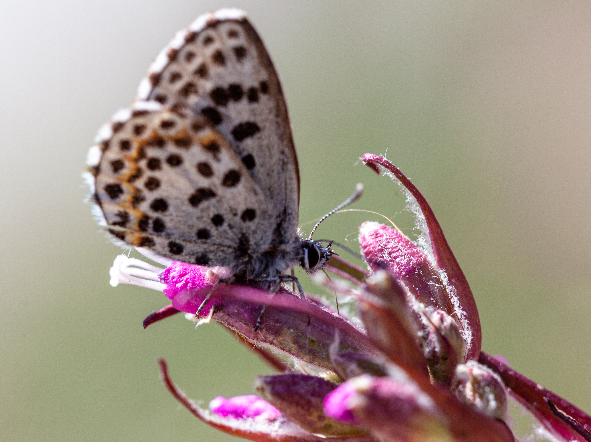
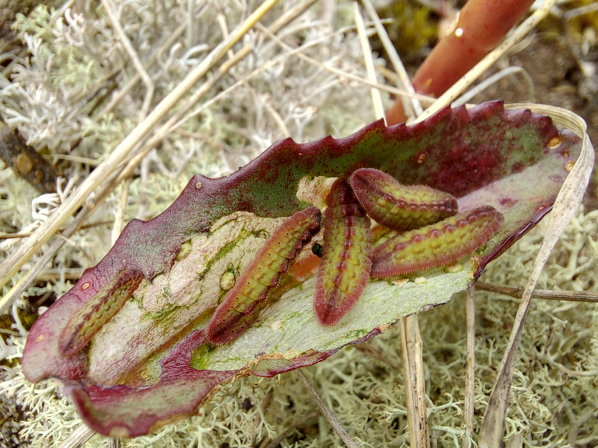
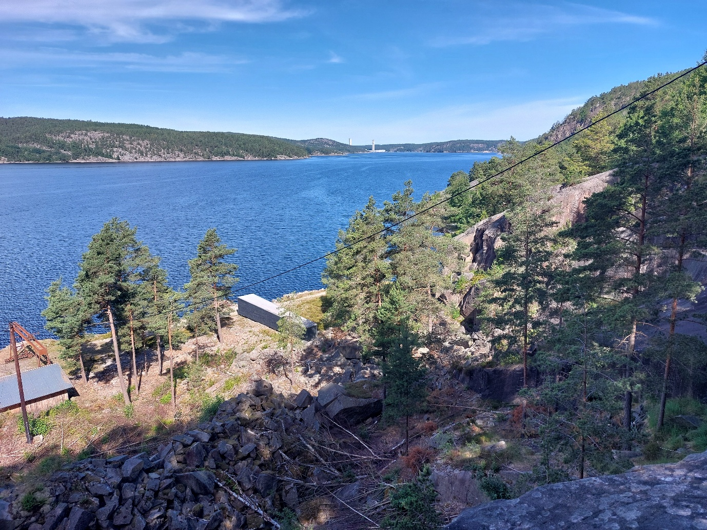
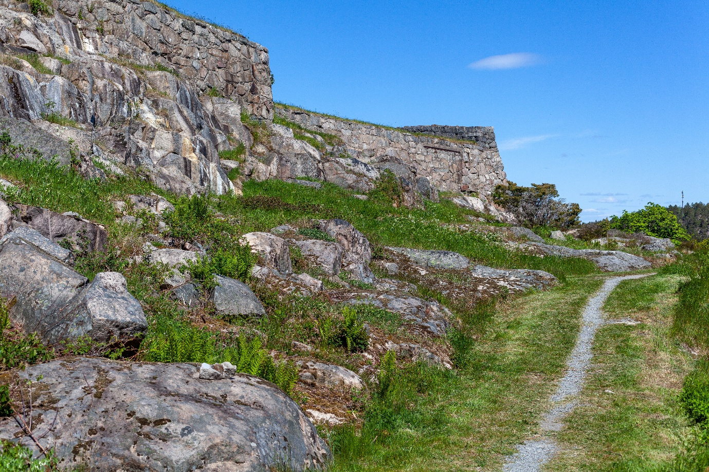
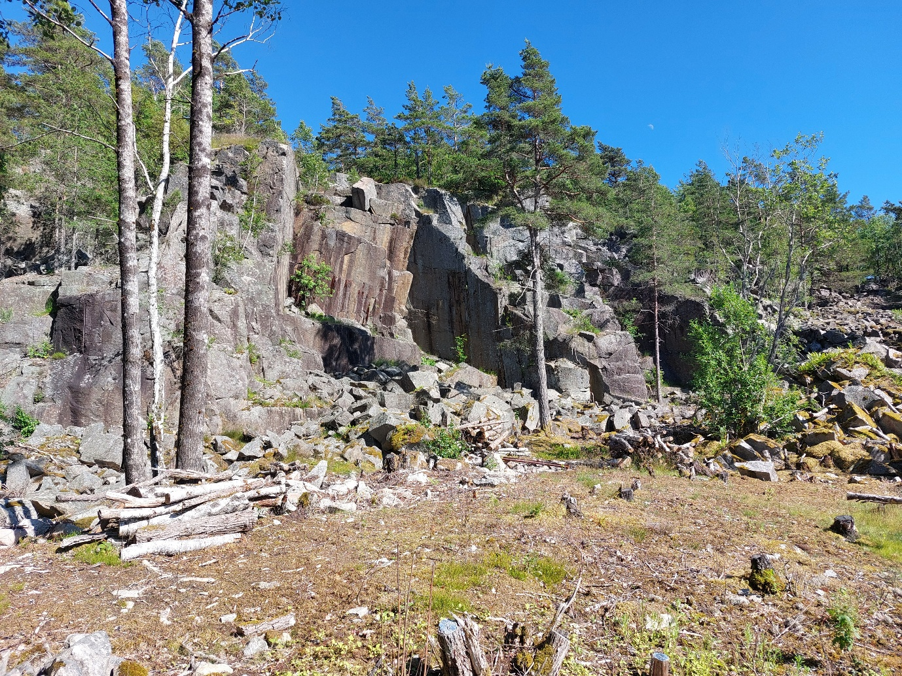
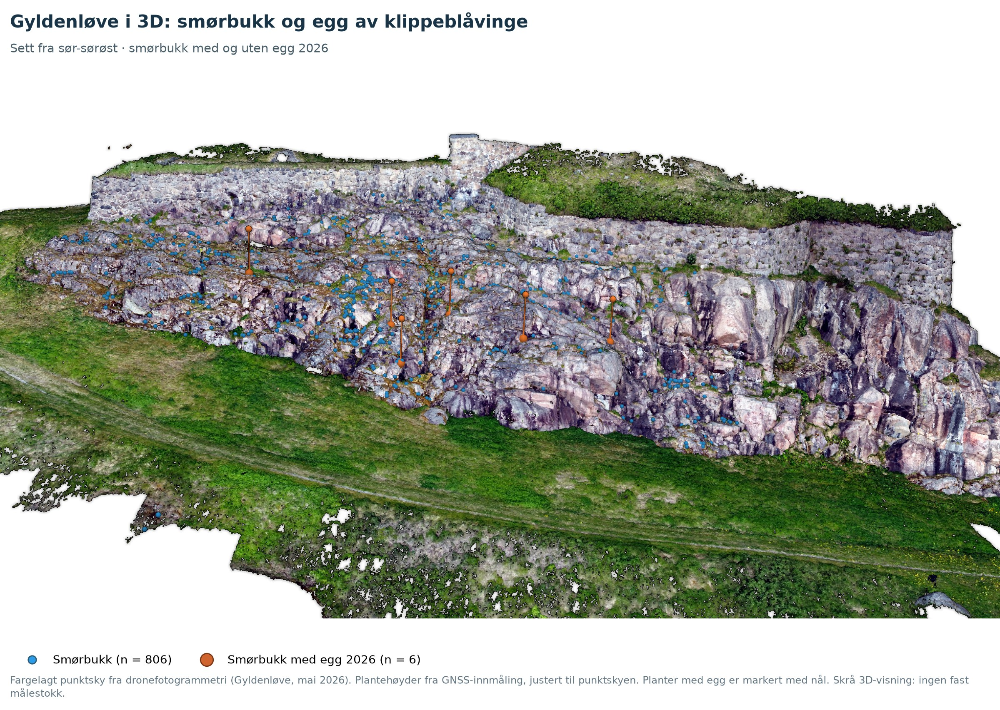
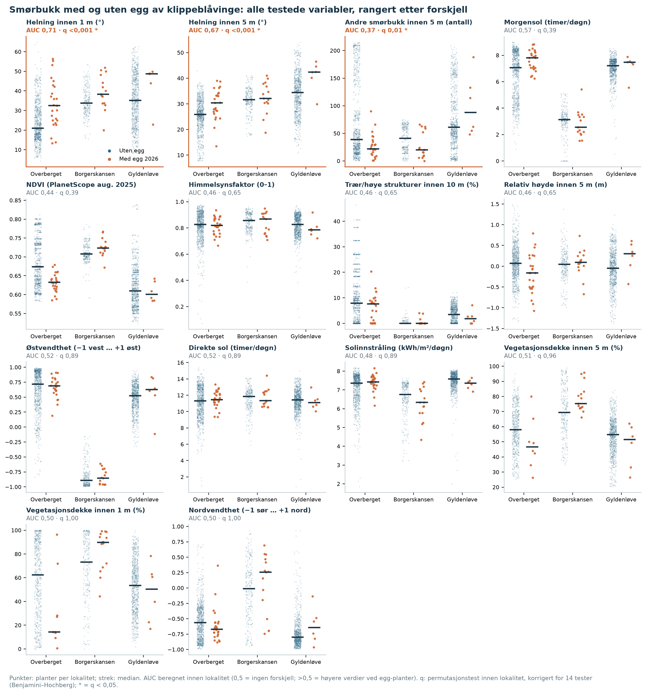
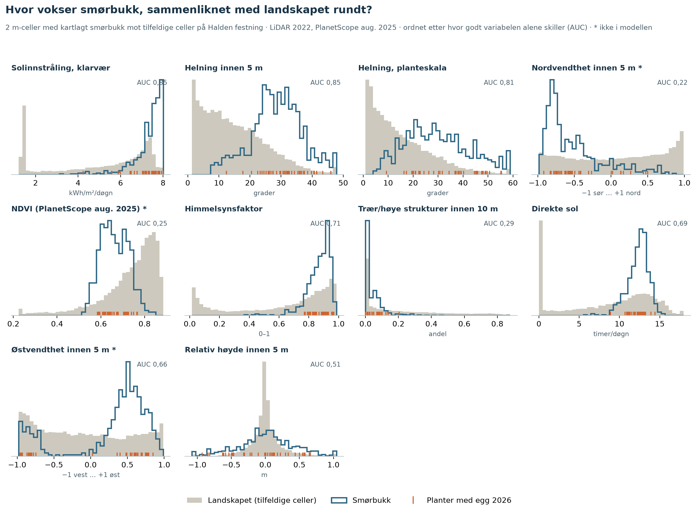
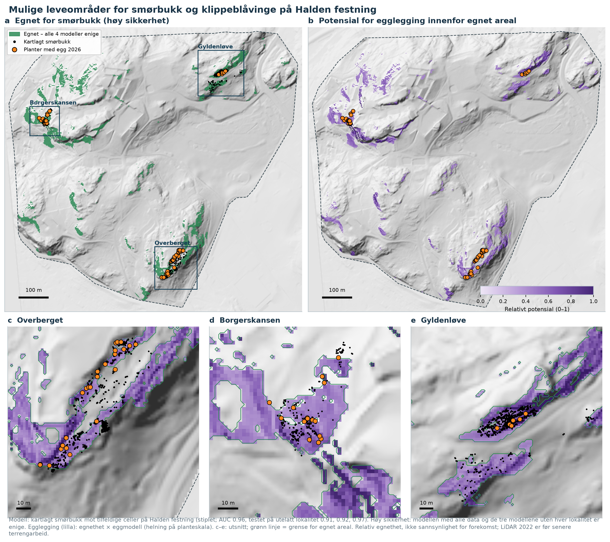
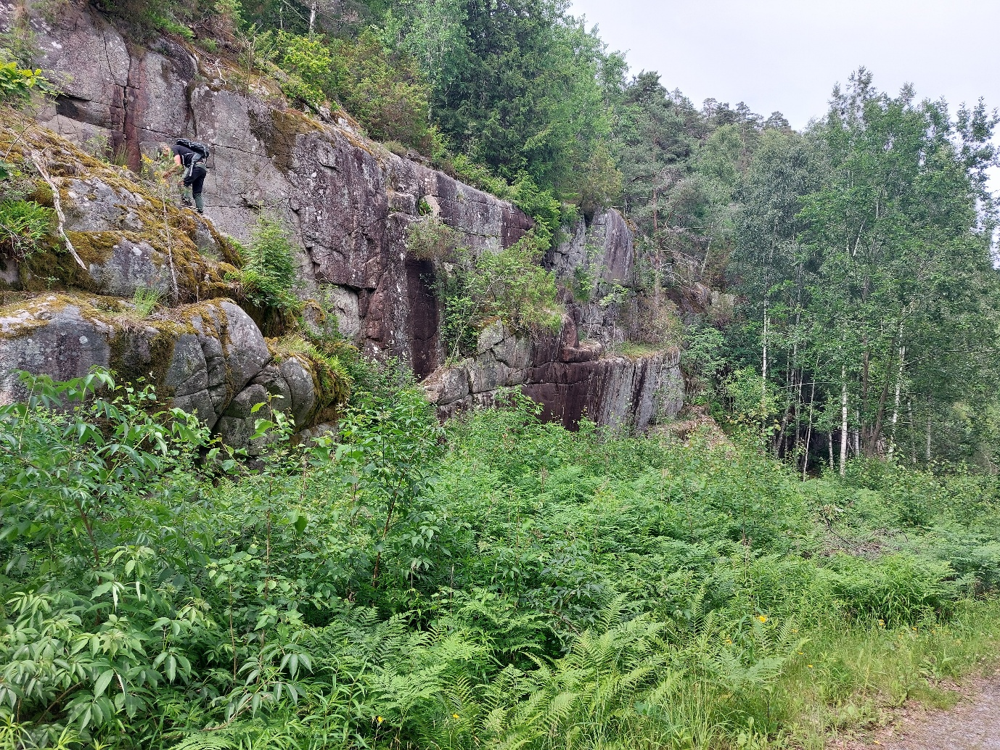

<!--# Rapporten leser kun filer i img/. Tekstgrunnlaget er «Klippeblåvinge_2026_github_final.docx» (P:/…/Rapporter_2026_github/Final). Figur 6–9 er laget av Python-skriptene i code/ (se code/README.md). Bildene i figur 3, 4, 5 og 10 er hentet fra Word-dokumentet; originalene ligger på Teams. Tabell 4 og 5 er skrevet av fra teksten. -->

```{r setup}
#| include: false
#| cache: false
library(knitr)
library(tidyverse)
library(kableExtra)
library(here)
library(anybadger)
library(yaml)
library(tibble)
library(conflicted)
library(readxl)
conflicts_prefer(dplyr::filter)
conflicts_prefer(dplyr::lag)
conflicts_prefer(dplyr::select)
pull <- dplyr::pull
```

<!--# The following parts are autogenerated. Do not edit. -->

```{r source}
#| echo: false
#| cache: false
source(here::here("_common.R"))

# Badges som markdown (for README.md på GitHub), med relativ sti til versjonsbadgen
md_badge <- function(tag) {
  src <- sub(paste0(here::here(), "/"), "", tag$children[[1]]$attribs$src, fixed = TRUE)
  sprintf("[](%s)", src, tag$attribs$href)
}
```

:::: {.content-visible when-format="gfm"}
::: callout-note
Denne siden er generert fra [`Klippeblaavinge.qmd`](Klippeblaavinge.qmd). Ikke rediger `README.md` direkte. For å oppdatere: kjør analysene i [`code/`](code/) (se [`code/README.md`](code/README.md)) og kjør `pixi run -e report render`. Rapporten har ingen egne analyser; figurene ligger i [`img/`](img/).
:::

`r paste(md_badge(status_badge(as.character(st))), md_badge(version_badge(as.character(version[[1]]))), md_badge(data_badge(as.character(badges[[1]]))), md_badge(code_badge(as.character(badges[[2]]))), md_badge(open_science_badge(as.character(badges[[3]]))), md_badge(license_badge()))`
::::

:::: {.content-visible when-format="html"}
```{r reviewers}
#| echo: false
#| results: asis

if (!is.null(yaml_data$codeReviewers)) {
  reviewers <- purrr::map_chr(yaml_data$codeReviewers, "name")

  htmltools::HTML(paste0(
    '<div id="title-block-header" class="quarto-title-block default">
       <div class="quarto-title-meta">
         <div>
           <div class="quarto-title-meta-heading">Reviewed by</div>
           <div class="quarto-title-meta-contents">',
    paste(reviewers, collapse = "; "),
    '</div>
         </div>
       </div>
     </div>',
    sep = ""
  ))
}
```

::: {layout-ncol="6"}
```{r statusBadge}
#| echo: false
status_badge(as.character(st))
```

```{r versionBadge}
#| echo: false
version_badge(my_version_number = as.character(version[[1]]))
```

```{r dataBadge}
#| echo: false
data_badge(as.character(badges[[1]]))
```

```{r codeBadge}
#| echo: false
code_badge(as.character(badges[[2]]))
```

```{r openScienceBadge}
#| echo: false
open_science_badge(as.character(badges[[3]]))
```

```{r licenseBadge}
#| echo: false
license_badge()
```
:::
::::

> **Recommended citation**: `r paste0(auth, " ", year, ". ", name, ". Digitalt vedlegg til Roos, R.E., Nowell, M. & Evju, M. (red.) ", year, ". Effektovervåking av trua arter og naturtyper 2026–2030. Årsrapport ", year, ". NINA Rapport 2851. Norsk institutt for naturforskning. <https://ninanor.github.io/effektovervaaking-2026-2030/Klippeblaavinge/Klippeblaavinge.html>")`

::: {.callout-tip collapse="true"}
## Metadata

```{r meta2}
#| tbl-cap: 'Indicator metadata'
#| echo: false
#| warning: false
meta |>
  dplyr::filter(Variable %in% c(
    "Indicator ID",
    "Indicator Name",
    "verbatimName",
    "Continent",
    "Country",
    "Realm",
    "Biome",
    "Ecosystem",
    "verbatimEcosystem",
    "Year added",
    "Last update",
    "Version",
    "Version comment",
    "Precision")) |>
  kable()
```
:::

::: {.callout-tip collapse="true"}
## Log

<!--# Legg til en kort linje for hver oppdatering -->

19\. nov. 2026 – Første versjon
:::

<hr />

## Oppsummering

Klippeblåvinge *Scolitantides orion* er vurdert som kritisk truet (CR) i Norge og finnes bare på noen få lokaliteter i Halden kommune. De viktigste truslene er gjengroing og utbygging av leveområdene. Larvene lever på smørbukk, og tiltakene omfatter gjenåpning av steinbrudd, krattrydding, utplanting av vertsplanter og bevaringsutsetting. NINA har overvåket bestanden siden 2008 ved å telle egg og larver på vertsplantene, og siden 2025 følges også bevaringsutsettingen på Fredriksten festning, der det ble satt ut 255 larver i 2024 og 600 i 2025. I 2026 ble det funnet 2168 egg og 128 larver på de faste overvåkingslokalitetene, det fjerde rekordåret på rad, men med nedgang ved Torpbukta og økning ved Hovsbruddet og Nokkedal. På Fredriksten festning ble det funnet ett voksent individ, 63 egg og 4 larver. Smørbukkplanter med egg vokste i brattere terreng enn planter uten egg, og en habitatmodell identifiserte om lag 3,4 hektar egnet habitat for smørbukk på festningen, blant annet flere områder som ikke er undersøkt i felt. Vi anbefaler å videreføre bestandsovervåkingen, å åpne flere områder langs Hovsveien rotasjonsvis og å prøve såing av smørbukkfrø i sprekker. Bevaringsutsettingen bør følges opp med systematisk overvåking over flere år for å vise om det etableres en selvopprettholdende bestand.

## English summary

The chequered blue (*Scolitantides orion*) is assessed as Critically Endangered (CR) in Norway and occurs only at a few sites in Halden municipality. The main threats are overgrowth and development of its habitats. The larvae feed on *Hylotelephium maximum*, and management includes reopening old quarries, shrub clearing, planting host plants and conservation releases. NINA has monitored the population since 2008 by counting eggs and larvae on the host plants, and since 2025 has also followed the conservation releases at Fredriksten fortress, where 255 larvae were released in 2024 and 600 in 2025. In 2026, 2168 eggs and 128 larvae were found at the permanent monitoring sites, the fourth record year in a row, although numbers fell at Torpbukta and rose at Hovsbruddet and Nokkedal. At Fredriksten fortress, one adult, 63 eggs and 4 larvae were found. Host plants with eggs grew on steeper terrain than plants without eggs, and a habitat model identified about 3.4 hectares of suitable habitat for the host plant at the fortress, including several areas not yet surveyed in the field. We recommend continuing the population monitoring, reopening more areas along Hovsveien in rotation, and trying to sow seeds of the host plant in rock crevices. The conservation releases should be followed by systematic monitoring over several years to show whether a self-sustaining population becomes established.

## 1. Innledning

Klippeblåvinge (*Scolitantides orion*) (@fig-klippeblaavinge) er en dagsommerfugl som finnes på noen få lokaliteter i Halden kommune [@endrestol_2022]. På grunn av bestandsnedgang de siste tiårene er klippeblåvinge vurdert som kritisk truet (CR) på Rødlista for arter [@elven_2021]. Hovedårsakene for tilbakegangen er gjengroing og utbygging av leveområdene. Klippeblåvinge i Norge legger egg på stenglene og bladene av smørbukk (*Hylotelephium maximum*), og larvene lever på vertsplanten før de forpupper seg og overvintrer i bakken (@fig-larver-klippeblaavinge). Voksne individer flyr tidlig, oftest i mai. NINA har gjennomført bestandsovervåking av klippeblåvinge siden 2008 [@endrestol_2009], og noen dellokaliteter ved Hov-Torpbukta, i Halden kommune, har blitt kartlagt metodisk og geografisk likt siden 2012 [@endrestol_2024].

```{r fig-klippeblaavinge}
#| fig-cap: 'Klippeblåvinge *Scolitantides orion*. Foto: Ruben E. Roos/NINA'
#| code-summary: 'Kode for figur.'
#| out-width: 70%

```

```{r fig-larver-klippeblaavinge}
#| fig-cap: 'Larver av klippeblåvinge på vertsplanten, på et blad av smørbukk *Hylotelephium maximum*. Foto: Ruben E. Roos/NINA'
#| code-summary: 'Kode for figur.'
#| out-width: 70%

```

## 2. Formål med delprosjektet

### 2.1 Målsetning med tiltakene

Målsetning med tiltakene for klippeblåvinge er å sikre artens langsiktige overlevelse i Norge ved å øke tilgjengelig habitat på forekomstlokalitetene, og å styrke eksisterende populasjoner og etablere nye populasjoner gjennom bevaringsutsetting.

### 2.2 Formål med overvåking

Formålet med bestandsovervåkingen er å få kunnskap om artens forekomster, utbredelse, populasjonsstørrelse og relative svingninger i populasjonene over år.

Formålet med effektovervåkingen på Fredriksten festning i Halden kommune, som startet i 2025, er å vurdere egnetheten av lokalitetene og bygge kunnskap om betydningen av ulike habitatkrav som bidrar til vellykket bevaringsutsetting av klippeblåvinge.

### 2.3 Forventninger

Bestandsovervåkingen er forventet å gi viktig kunnskap om utviklingen og variasjonen i tid og rom av klippeblåvingens delpopulasjoner.

Der hvor oppformerte individer av klippeblåvinge har blitt satt ut, forventes det at utsatte individer overlever og formerer seg gitt at habitatet er egnet. Det er imidlertid realistisk å forvente at utsetting må gjennomføres over flere år før en levedyktig bestand er etablert. Data fra effektovervåkingen vil kunne bidra til å identifisere hvilke deler av utsettingsområdene som blir brukt til egglegging, og hvor evt. skjøtsel bør gjennomføres for å opprettholde eller øke habitatkvalitet.

Fordi den genetiske variasjonen av oppformerte og utsatte individer ikke er undersøkt, vil det være vanskelig å fastslå om evt. manglende etablering og reproduksjon skyldes innavl, at habitatet er uegnet, eller andre ukjente faktorer.

## 3. Overvåkingslokalitetene

### 3.1 Beskrivelse av lokalitetene

Klippeblåvinge overvåkes på flere lokaliteter i Halden kommune (@tbl-lokaliteter-klippeblaavinge). Disse omfatter Sponvika og området rundt Torpbukta, sistnevnte med flere dellokaliteter blant annet områdene langs Hovsveien og ved Monolittbruddet (@fig-monolittbruddet-klippeblaavinge). Områdene omfatter kystnære, (halv)åpne bergflater og tidligere steinbrudd med sparsom vegetasjon og forekomst av smørbukk og nektarplanter (f.eks. engtjæreblom). Det er vanlig med innslag av furu, ask, osp, og einer.

```{r fig-monolittbruddet-klippeblaavinge}
#| fig-cap: 'Klippeblåvingehabitat ved Monolittbruddet ved Iddefjorden, Halden kommune. Foto: Ruben E. Roos/NINA.'
#| code-summary: 'Kode for figur.'

```

I tillegg overvåkes tre lokaliteter på Fredriksten festning der det er gjennomført bevaringsutsetting av arten. Områdene omfatter åpne bergknauser og historiske festningsverk med en mosaikk av nakent berg og grunnlendte partier med lyng- og engvegetasjon (@fig-overberget-klippeblaavinge).

```{r fig-overberget-klippeblaavinge}
#| fig-cap: 'Overberget ved Fredriksten festning, Halden kommune, i 2025. Foto: Ruben E. Roos/NINA.'
#| code-summary: 'Kode for figur.'

```

| Lokalitet | Utfordring | Tiltak | Datainnsamling |
|:---|:---|:---|:---|
| Torpbukta og omegn, samt Sponvika i Halden | Gjengroing, ukjent om det mangler vertsplanter. | Det er mange ulike skjøtselstiltak, men overvåkingen foregår uavhengig av disse. | 2012–2026: Bestandsovervåking; forekomst og antall egg og larver. |
| Fredriksten festning; Borgerskansen, Overberget, og Gyldenløve, i Halden | Gjengroing av både stedegne og fremmede busker (bl.a. syrin) etter krattrydding. Det er ukjent om områdene egner seg til klippeblåvinge. | Bevaringsutsetting av 255 individer i 2024, 600 individer i 2025. | 2025-2026: Kartlegging av voksne individer og innsamling av terrengdata med drone i mai. Kartlegging av egg og larver, samt totalkartlegging av vertsplanter i juni. |

: Oversikt over overvåkingslokalitetene for klippeblåvinge. {#tbl-lokaliteter-klippeblaavinge}

### 3.2 Tiltak

For å bedre klippeblåvingenes bestandsutvikling, har det blitt gjennomført ulike skjøtselstiltak, bl.a. gjenåpning av gjengrodde steinbrudd (@fig-steinbrudd-klippeblaavinge), rydding av kratt, plassering av bur mot beite over vertsplanter, og utplanting av vertsplanter [@roos_2024; @roos_2025].

I tillegg ble det i 2020 satt i gang et avlsprogram for arten, og det ble i 2022 satt ut 100 larver ved Hovsbruddet [@jakobsen_2022]. Utplantede vertsplanter ble ikke undersøkt i 2026, der de fleste hadde dødd. Fordi flere av tiltakene er blitt gjennomført på samme sted samtidig, har det ikke vært mulig å vurdere effekten av de individuelle tiltakene på klippeblåvingebestanden [@roos_2025].

```{r fig-steinbrudd-klippeblaavinge}
#| fig-cap: 'Gjenåpning av et tidligere gjengrodd steinbrudd på høyde med Hovsveien nr. 99. Bildet er tatt under kartlegging i 2026. Foto: Ruben E. Roos/NINA.'
#| code-summary: 'Kode for figur.'

```

NINA overvåker bevaringsutsetting av klippeblåvinge på Fredriksten festning, hvor det er blitt satt ut 255 larver i 2024, og 600 i 2025 (Jacobsen 2025, @tbl-utsetting-klippeblaavinge). I tillegg til bevaringsutsetting, blir det gjennomført skjøtsel for å holde lokalitetene åpent. I 2026 ble det ryddet for kratt på Overberget, i hovedsak den fremmede arten blåhegg (SE) [@bae_2026]. Disse tiltakene ble gjennomført etter årets overvåking.

| Lokalitet | Antall larver 2022 | Antall larver 2024 | Antall larver 2025 | Totalt |
|:---|---:|---:|---:|---:|
| Hovsbruddet | 100 | - | - | 100 |
| Borgerskansen | - | 185 | 200 | 385 |
| Overberget fort | - | 70 | 200 | 270 |
| Gyldenløve fort | - | - | 200 | 200 |
| Totalt | 100 | 255 | 600 | 955 |

: Antall larver satt ut på de tre lokalitetene ved Fredriksten festning, Halden [data fra @jakobsen_2022; @jakobsen_2025]. {#tbl-utsetting-klippeblaavinge}

## 4. Datainnsamling

Bestandsovervåking ved Hov, Torpbukta ble gjennomført 21. og 22. juni etter metodikk beskrevet i @endrestol_2024. I Sponvika ble det hovedsakelig kartlagt i perioden 15.-29. juni, men også 6. juli og 4. august. Kartleggingen gjennomføres alltid i slutten av juni fordi alle eggene normalt sett har blitt lagt på det tidspunktet, og eggeskallene av egg som klekket tidlig vil fortsatt være på planten.

Det ble gjennomført en befaring på lokalitetene på Fredriksten festning den 19. mai 2026, for å lete etter voksne individer. Det ble i tillegg gjennomført en droneflyvning ved Gyldenløve, etter samme metodikk som brukt på Borgerskansen og Overberget i 2025, beskrevet i @roos_2025. I 2026 ble totalt 806 smørbukkplanter ved Gyldenløve kartfestet med høypresisjons-gps. Indikatorene som samles inn for klippeblåvinge, er beskrevet i @tbl-indikatorer-klippeblaavinge.

| Indikator | Variabel registrert i felt | Utvalgsenhet | Utlegging av utvalgsenhet | Antall utvalgsenheter | Frekvens for datainnsamling |
|:---|:---|:---|:---|:---|:---|
| Populasjonsstørrelse og – struktur (klippeblåvinge) | Forekomst av egg, larver, voksne | Totalkartlegging | - | - | Årlig, i juni |
| Areal og mengde på habitat og pluggplanter | Areal i m^2^, antall naturlige forekommende smørbukkplanter | Totalkartlegging og kartfesting (av punkt og polygoner) | - | - | Hvert tredje år |
| Overlevelse og bruk av pluggplanter | Antall pluggplanter, antall pluggplanter med egg/larver | Totalkartlegging | | | Årlig de første årene etter utplanting |
| Habitatkvalitet: Vegetasjonsstruktur & mengde nakent berg | Dronebilder, % dekning | Totalkartlegging | | | Hvert tredje år |
| Areal med tiltak\* | Kartfesting av arealet og omfanget omfattet av type tiltak | Totalkartlegging og kartfesting (av punkt og polygoner) | | | Årlig |

: Indikatorer i overvåkingen av klippeblåvinge {#tbl-indikatorer-klippeblaavinge}

\*Kan hentes inn av andre aktører.

## 5. Dataanalyser

Forekomst av vertsplanter med larver og egg ble kartfestet. Ingen statistiske analyser ble gjennomført.

For å undersøke hvilke miljøforhold som kjennetegner smørbukkplanter der klippeblåvinge legger egg, sammenlignet vi 1 945 kartfestede smørbukkplanter på Overberget, Borgerskansen (registrert i 2025) og Gyldenløve (registrert i 2026). Av disse var totalt 46 planter brukt til egglegging. Miljøvariabler ble hentet fra LiDAR-kartleggingen i 2022, dronebaserte ortofoto og PlanetScope-bilder. Variablene omfattet helning, eksposisjon, solinnstråling og skygge, åpenhet, vegetasjonsdekning og tetthet av vertsplanter. På dette grunnlaget utviklet vi en modell og et kart over habitatets egnethet for smørbukk på Halden festning, med et eget kartlag som viste registrert egglegging.

Analysen var rettet mot å undersøke hvilke terreng-, lys- og vegetasjonsforhold som kjennetegner voksesteder for smørbukk, og bruke denne kunnskapen til å kartlegge relativt egnet habitat på Fredriksten festning. Vi undersøkte også om modellen kunne forutsi egnede voksesteder på tvers av lokaliteter.

Først delte vi arealet ved Halden festning inn i 2 m-celler. Studieområdet dekker totalt 0,74 km² med LiDAR-dekning. Hver celle ble beskrevet med variabler fra nasjonal LiDAR (april 2022).

-   Terrengvariabler: helning på planteskala og innen 5 m, eksposisjon og relativ høyde innen 5 m.
-   Solvariabler: solinnstråling i klarvær (clear-sky) og antall timer med direkte sol for 15. mai–30. juni, beregnet med pvlib. Skyggevirkning kommer fra horisonter beregnet over LiDAR-overflatemodellen i 36 retninger ut til 500 m.
-   Andre variabler: himmelsynsfaktor (sky-view factor) og andel trær eller høye strukturer innen 10 m.

Deretter sammenliknet vi de 544 cellene med kartlagt smørbukk med 20 000 tilfeldige bakgrunnsceller i en logistisk regresjon med lineære og kvadratiske ledd (presence-background-modell). Den endelige modellen bruker solinnstråling, helning (planteskala og 5 m), timer med direkte sol, himmelsynsfaktor, tredekning og relativ høyde. Bakgrunnscellene viser hva som er tilgjengelig i landskapet, ikke steder der smørbukk er bekreftet fraværende. Kartet viser derfor relativ egnethet, ikke sannsynlighet for forekomst.

For å teste om modellen kan overføres til nye steder tilpasset vi den til to lokaliteter og forutsa den tredje («leave-one-out»). AUC var 0,91 for Overberget, 0,92 for Borgerskansen og 0,97 for Gyldenløve, og 0,96 med alle data. Eksposisjon som eget ledd senket AUC for den vestvendte Borgerskansen til 0,68 og ble derfor utelatt. Solvariablene fanger den delen av eksposisjonen som gjelder på tvers av lokalitetene. NDVI fra PlanetScope (august 2025) ga ingen konsistent forbedring.

## 6. Resultater

For fjerde året på rad ble det rekord i antall funn av klippeblåvinge, med 2296 egg og larver (da er ikke Fredriksten festning regnet med) og på tredje året på rad ble det funnet over 2000 egg og larver fordelt på overvåkingslokalitetene (@tbl-funn-klippeblaavinge – totalen i tabellen er mindre for 2026 fordi enkelte delområder ikke er oppgitt i tabellen). Ser man på detaljene er det en reduksjon i delområde «Torpbukta», mens det er en økning i «Hovsbruddet» og «Nokkedal». Ellers er det relativt stabilt.

```{r tbl-funn-klippeblaavinge}
#| tbl-cap: 'Antall funn av egg og larver av klippeblåvinge for ulike dellokaliteter i Halden kommune fra 2010 til 2026. \* Ufullstendig data.'
#| code-summary: 'Kode for tabell.'
# Tabellen er skrevet av fra rapportteksten (ikke beregnet fra data i repoet)
omrader <- c("Torpbukta", "Hovsveien (inkl. Hov)", "Hovsbruddet", "Nokkedal", "Monolittbruddet", "Sveen", "Sponvika")
funn <- tribble(
  ~År, ~e1, ~l1, ~e2, ~l2, ~e3, ~l3, ~e4, ~l4, ~e5, ~l5, ~e6, ~l6, ~e7, ~l7, ~Totalt,
  "2010", "140", "N/A", "N/A", "N/A", "N/A", "N/A", "N/A", "N/A", "N/A", "N/A", "N/A", "N/A", "N/A", "N/A", "140",
  "2011", "ca. 200", "5", "N/A", "N/A", "N/A", "N/A", "15", "3", "N/A", "N/A", "N/A", "N/A", "N/A", "N/A", "223",
  "2012", "325", "8", "N/A", "N/A", "N/A", "N/A", "2", "0", "N/A", "N/A", "N/A", "N/A", "N/A", "N/A", "335",
  "2013", "335", "31", "N/A", "N/A", "N/A", "N/A", "N/A", "N/A", "N/A", "N/A", "N/A", "N/A", "N/A", "N/A", "366",
  "2014", "525", "46", "6", "0", "N/A", "N/A", "12", "0", "N/A", "N/A", "N/A", "N/A", "N/A", "N/A", "589",
  "2015", "123", "0", "43", "0", "N/A", "N/A", "18", "0", "N/A", "N/A", "N/A", "N/A", "N/A", "N/A", "184",
  "2016", "169", "11", "3", "3", "N/A", "N/A", "12", "2", "N/A", "N/A", "N/A", "N/A", "N/A", "N/A", "200",
  "2017", "171", "7", "24", "4", "N/A", "N/A", "39", "8", "13", "0", "N/A", "N/A", "8", "0", "274",
  "2018", "233", "22", "44", "6", "3", "1", "62", "4", "53", "5", "11", "5", "16", "3", "468",
  "2019", "245", "3", "36", "0", "6", "0", "16", "1", "48", "0", "12", "1", "43", "1", "412",
  "2020", "83", "13", "11", "7", "20", "3", "19", "11", "17", "6", "2", "1", "42", "15", "250",
  "2021", "65", "2", "38", "2", "24", "0", "130", "3", "37", "0", "7", "0", "101", "14", "423",
  "2022", "28*", "1*", "59", "0", "18", "0", "N/A*", "N/A*", "N/A*", "N/A*", "N/A*", "N/A*", "168", "28", "302",
  "2023", "351", "18", "82", "4", "120", "6", "102", "12", "37", "3", "5", "0", "252", "68", "1060",
  "2024", "692", "46", "94", "9", "82", "9", "282", "43", "215", "35", "17", "6", "495", "96", "2121",
  "2025", "503", "42", "188", "42", "403", "17", "191", "13", "241", "29", "18", "1", "372", "68", "2128",
  "2026", "242", "9", "167", "1", "661", "19", "290", "33", "327", "2", "15", "0", "351", "64", "2181",
  "Totalt", "3685", "213", "628", "77", "676", "36", "900", "100", "661", "78", "72", "14", "1497", "293", "9475"
)
if (knitr::is_html_output()) {
  kable(funn, col.names = c("År", rep(c("Egg", "Larver"), 7), "Totalt"), align = c("l", rep("r", 15))) |>
    add_header_above(c(" " = 1, setNames(rep(2, 7), omrader), " " = 1))
} else {
  funn |>
    mutate(across(everything(), \(x) gsub("*", "\\*", x, fixed = TRUE))) |>
    kable(col.names = c("År", paste(rep(omrader, each = 2), c("egg", "larver")), "Totalt"), align = c("l", rep("r", 15)))
}
```

Under befaring på Fredriksten festning 19. mai, ble det funnet et voksent individ av klippeblåvinge. Det ble funnet 63 egg og 4 larver på: Borgerskansen, Overberget, og Gyldenløve (@tbl-fredriksten-klippeblaavinge). På Gyldenløve ble 806 smørbukkplanter målt inn med GNSS, og 6 av dem hadde egg av klippeblåvinge (@fig-3d-klippeblaavinge).

```{r tbl-fredriksten-klippeblaavinge}
#| tbl-cap: 'Oversikt over utsatte larver, samt funn av egg og larver på de tre lokalitetene på Fredriksten festning.'
#| code-summary: 'Kode for tabell.'
lok <- c("Borgerskansen", "Overberget fort", "Gyldenløve fort")
fredriksten <- tribble(
  ~År, ~u1, ~e1, ~l1, ~u2, ~e2, ~l2, ~u3, ~e3, ~l3,
  "2024", "185", "0", "0", "70", "0", "0", "-", "0", "0",
  "2025", "200", "1", "0", "200", "18", "0", "200", "na", "na",
  "2026", "?", "31", "1", "?", "30", "0", "?", "3", "4",
  "Totalt", "385", "32", "1", "270", "48", "0", "200", "3", "4"
)
if (knitr::is_html_output()) {
  kable(fredriksten, col.names = c("", rep(c("Larver satt ut", "Egg", "Larver"), 3)), align = c("l", rep("r", 9))) |>
    add_header_above(c("Lokalitet" = 1, setNames(rep(3, 3), lok)))
} else {
  kable(fredriksten, col.names = c("Lokalitet", paste(rep(lok, each = 3), c("larver satt ut", "egg", "larver"))), align = c("l", rep("r", 9)))
}
```

```{r fig-3d-klippeblaavinge}
#| fig-cap: 'Kartfestede smørbukkplanter med og uten egg av klippeblåvinge på Gyldenløve fort i 2026.'
#| code-summary: 'Kode for figur.'

```

Smørbukkplanter som ble brukt til egglegging av klippeblåvinge, vokste på brattere terreng/berg enn planter som ikke ble brukt (median helning 37° mot 29°; @fig-egg-klippeblaavinge). Helning var den eneste habitatvariabelen som konsekvent skilte planter med og uten egg på alle tre lokalitetene. Det ble ikke funnet tilsvarende forskjeller i solinnstråling, eksposisjon, åpenhet eller vegetasjonsdekning innenfor de undersøkte områdene, som alle er åpne etter rydding.

```{r fig-egg-klippeblaavinge}
#| fig-cap: 'Oversikt over forskjeller i variabler mellom smørbukkplanter med og uten egg av klippeblåvinge for hver av de tre lokalitetene på Fredriksten festning.'
#| code-summary: 'Kode for figur.'

```

På landskapsnivå var forekomsten av smørbukk knyttet til bratte, solrike og i hovedsak sørvendte berg uten trær (@fig-landskap-klippeblaavinge).

```{r fig-landskap-klippeblaavinge}
#| fig-cap: 'Forekomst av smørbukk langs ulike miljøgradienter, sammenlignet med miljøgradientenes fordeling i landskapet rundt.'
#| code-summary: 'Kode for figur.'

```

Habitatmodellen hadde god prediksjonsevne på tvers av lokalitetene: når modellen ble tilpasset data fra to lokaliteter og evaluert på den tredje, var AUC mellom 0,91 og 0,97. Modellen identifiserte om lag 3,4 hektar egnet habitat for smørbukk med høy sikkerhet (der alle modellkjøringene er enige). Disse områdene inneholder 73 % av de kartlagte smørbukkplantene (@fig-habitatkart-klippeblaavinge). Dette omfattet flere åpne bergområder utenfor de kartlagte lokalitetene som kan være aktuelle for undersøkelser i felt.

Resultatene må tolkes i lys av at bare 46 planter hadde egg, og at LiDAR-dataene fra april 2022 kan være samlet inn før den siste ryddingen på lokalitetene. Egnetheten kan derfor være undervurdert der det er ryddet etter 2022.

```{r fig-habitatkart-klippeblaavinge}
#| fig-cap: 'Modellerte leveområder for (a) smørbukk og (b) klippeblåvinge på Halden festning, med detaljerte kart for de tre lokalitetene (c) Overberget, (d) Borgerskansen og (e) Gyldenløve.'
#| code-summary: 'Kode for figur.'

```

## 7. Oppsummering

### 7.1 Hva viser årets resultater

Det ble i 2026 funnet flere egg (2168) og larver (128) totalt i Halden en det er gjort noen år tidligere (2296), selv om det enkelte år er funnet flere larver. Det har vært relativt stabilt de siste fire årene, men med variasjon mellom dellokalitetene. Det er også funnet 63 egg av klippeblåvinge på utsettingslokalitetene på Fredriksten festning.

Under befaring i 2026 ble det bare funnet ett individ av klippeblåvinge på bevaringsutsettingslokalitetene på Fredriksten festning. Det er imidlertid mulig at voksne individer utnytter andre arealer enn der de er satt ut, og det er vanlig at voksne sommerfugl bruker større områder for å lete etter næring enn de som brukes til egglegging. Det er også en rekke tilfeldigheter som spiller inn i oppdagelsen av voksne individer, som gjør at man i de fleste tilfeller vil overse individer. Per dellokalitetet er det likevel ikke funnet flere egg enn at de i prinsippet kan være lagt av én hunn. Droneovervåkningen har kartlagt noen potensielle, egnede områder på Fredriksten festning som ikke ble grundig befart under årets kartlegging.

### 7.2 Anbefaling for videreføring

Vi anbefaler å videreføre basisovervåkingen for klippeblåvinge. Langsiktige data gir viktig kunnskap om populasjonens utvikling over tid. Selv om det ikke er mulig å fastslå effektene av enkelte tiltak der mange tiltak er gjennomført samtidig [@roos_2025], vil det være mulig å si noe på overordnet nivå om tiltakene påvirker bestanden positivt eller negativt. Det anbefales at flere områder langs Hovsveien åpnes opp, fortrinnsvis rotasjonsvis, slik at det til enhver tid er soleksponerte områder tilgjengelig for klippeblåvinge. Områder som er ryddet, vil relativt raskt gro igjen, og bli mindre egnet til klippeblåvinge over tid (@fig-gjengroing-klippeblaavinge).

Tidligere resultater viser at utplantede individer av smørbukk kan bli brukt som vertsplante [@roos_2024], men dødeligheten hos disse plantene vil øke over tid, særlig på steder som er utsatt for uttørking. Det anbefales å eksperimentere med å så ut smørbukkfrø i sprekker, der naturlig etablerte planter trolig tåler uttørking bedre.

```{r fig-gjengroing-klippeblaavinge}
#| fig-cap: 'Gjengroing av tidligere skjøttet areal langs Furuvarpveien i Halden kommune. Området til høyre i bildet ble ikke ryddet for trær. Langs fjellveggen ble det funnet egg av klippeblåvinge i 2025 og 2026. Foto: Ruben E. Roos/NINA.'
#| code-summary: 'Kode for figur.'

```

Det er svært viktig at bevaringsutsetting av klippeblåvinge følges opp med systematisk overvåking over flere år. Selve utsettingen kan sees som et delmål, der hovedmålet er å etablere en selvopprettholdende bestand som overlever og reproduserer uten gjentatte utsettinger. Funn av individer kort tid etter utsetting er et godt tegn, men ikke tilstrekkelig til å dokumentere at tiltaket har lykkes. Overvåkingen må også undersøke om arten gjennomfører livssyklusen på lokaliteten, i hvilken grad individer sprer seg til omkringliggende arealer, og om nye generasjoner bidrar til å opprettholde bestanden over tid. Det kan være nyttig å engasjere frivillige i dette arbeidet, for eksempel leting etter og kartfesting av voksne individer i flyveperioden.

Dersom en bestand ikke etablerer seg, kan det være vanskelig å identifisere årsakene. Uten genetiske undersøkelser er det blant annet vanskelig å vurdere hvilken betydning eventuell innavl og lav genetisk variasjon har sammenlignet med habitatforhold og andre miljøfaktorer. Kunnskapen om artens klimatiske krav er heller ikke fullstendig. Det er derfor vanskelig å fastslå hvorfor det finnes tilsynelatende egnede arealer hvor klippeblåvinge ikke forekommer. Ved å kombinere bestandsovervåking med registrering av habitatforhold, lokalklima og gjennomført skjøtsel kan vi få bedre grunnlag for å forstå hvorfor etableringen lykkes eller mislykkes. Denne kunnskapen er nødvendig for å justere tiltakene på den enkelte lokaliteten og forbedre valg av lokaliteter og metoder ved framtidige bevaringsutsettinger.

## 8. Referanser

::: {#refs}
:::

## 9. Author contributions

**CRediT statement**

-   Data collection: Andrew Møller Gray, Ruben E. Roos, Anders Endrestøl
-   Formal analysis: Andrew Møller Gray
-   Writing: Ruben E. Roos, Andrew Møller Gray
-   Software: Niccolò Cantu

<!--# <MeRIT attribution> -->

## 10. Acknowledgements

Vi takker Statsforvalteren i Østfold, Buskerud, Oslo og Akershus for god dialog om delprosjektet.

Takk til Amund Dahle for hjelp til kartlegging av klippeblåvinge i 2026. Forsvarsbygg takkes for tillatelse til overvåking av klippeblåvinge på Fredriksten festning.

:::: {.content-visible when-format="html"}
::: {.callout-tip collapse="true"}
## Session Info

This information is mainly aimed at developers that need to recreate the R environment that produced the html.

```{r sessionInfo}
#| echo: false
sessionInfo()
```
:::
::::
