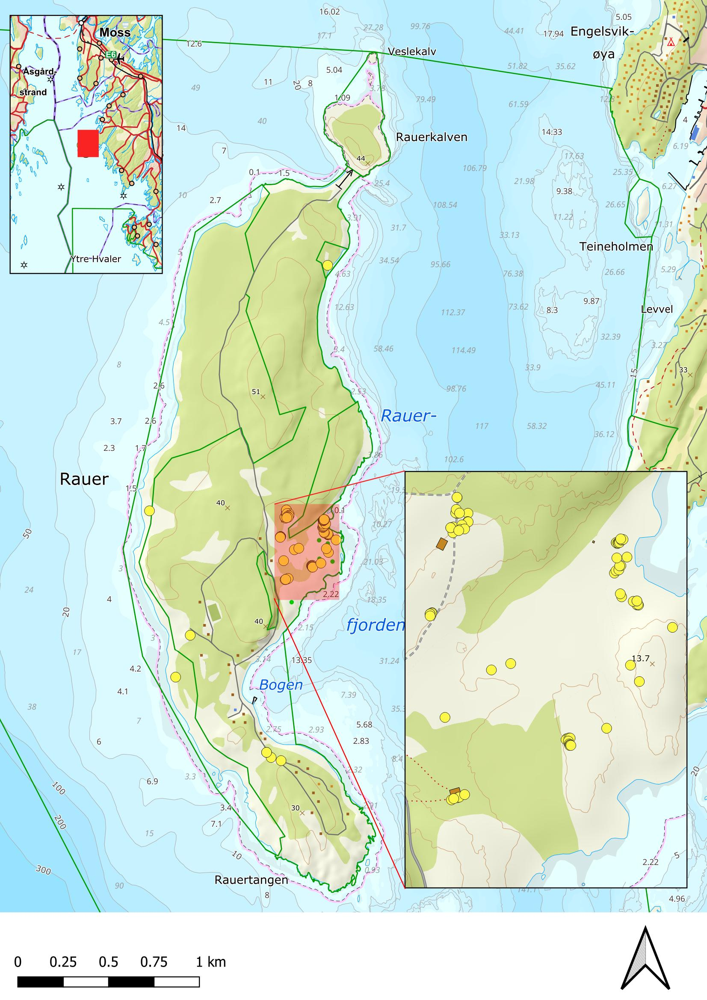
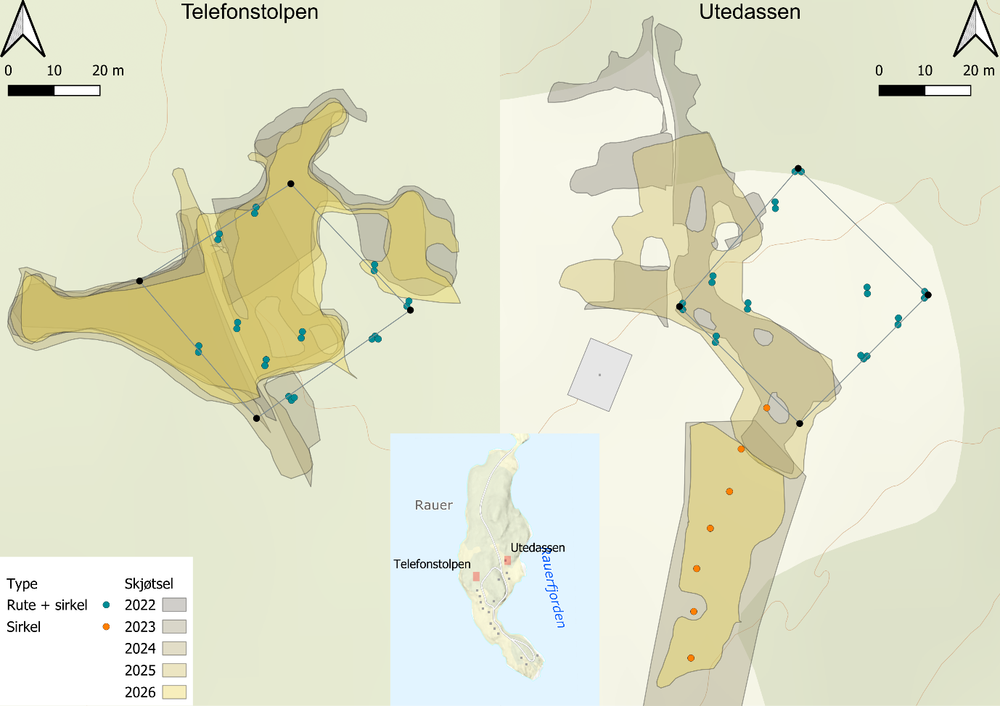
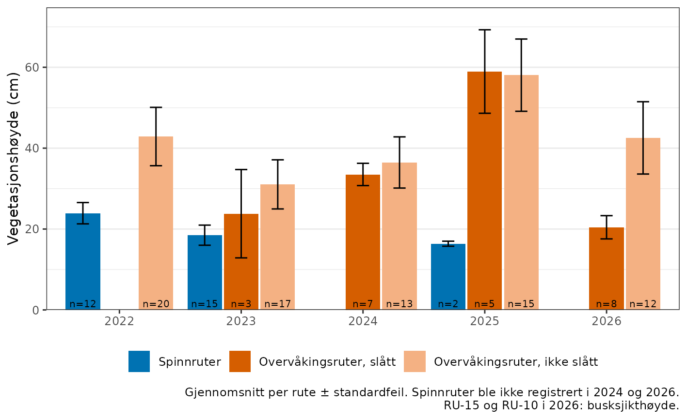
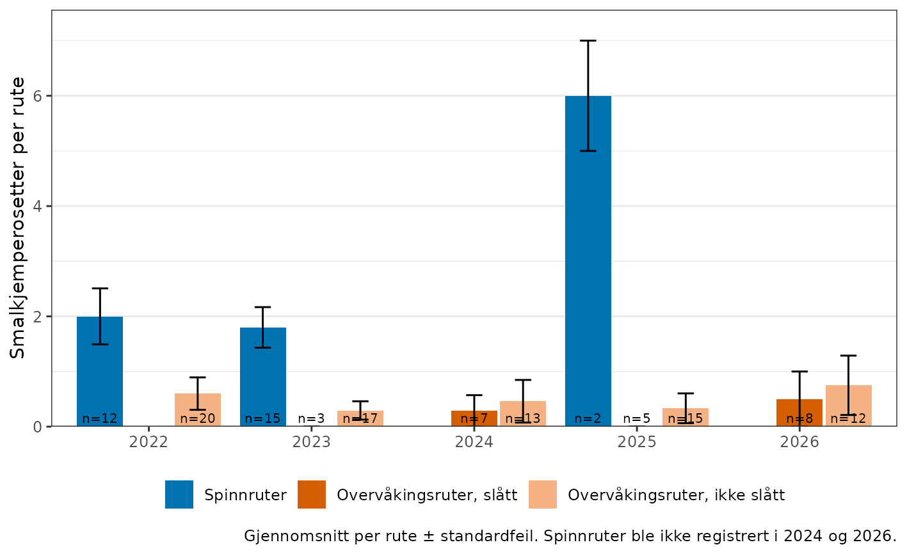
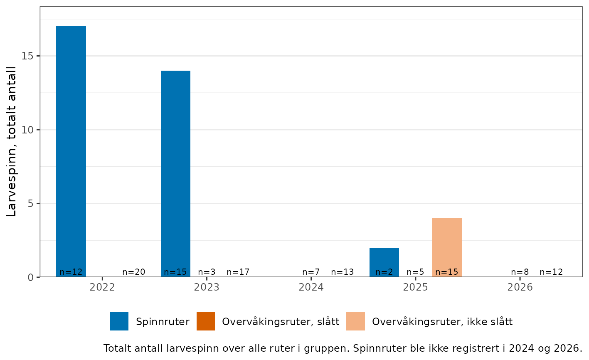
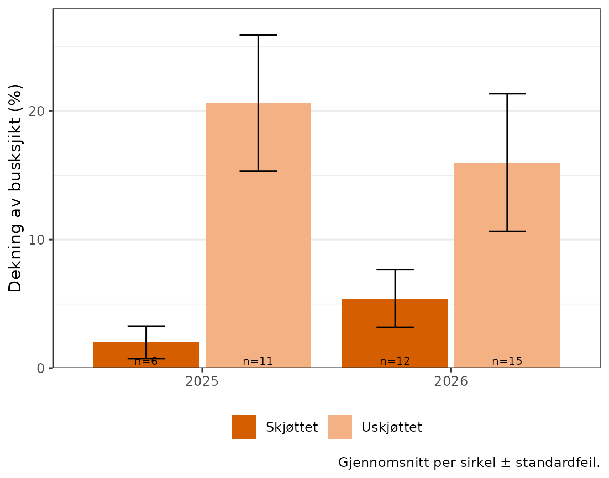
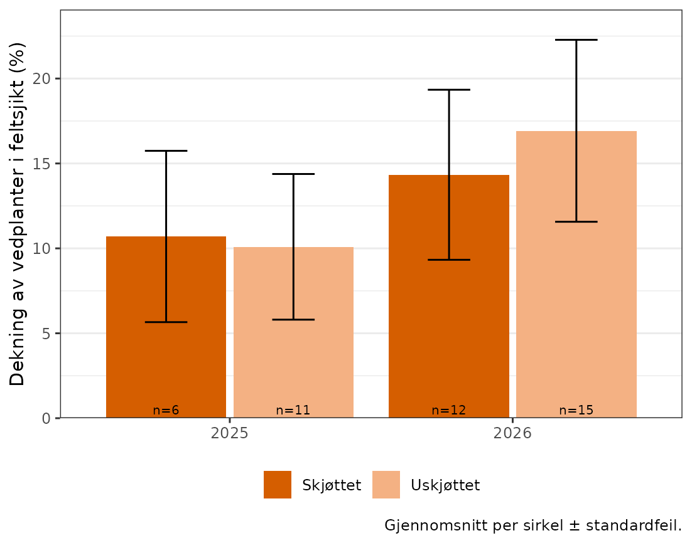

# Prikkrutevinge (*Melitaea cinxia*)
Ruben E. Roos, Anders Endrestøl
2026-11-20

- [Oppsummering](#oppsummering)
- [English summary](#english-summary)
- [1. Innledning](#1-innledning)
- [2. Formål med delprosjektet](#2-formål-med-delprosjektet)
- [3. Overvåkingslokalitetene](#3-overvåkingslokalitetene)
- [4. Datainnsamling](#4-datainnsamling)
- [5. Dataanalyser](#5-dataanalyser)
- [6. Resultater](#6-resultater)
- [7. Oppsummering](#7-oppsummering)
- [8. Referanser](#8-referanser)
- [9. Author contributions](#9-author-contributions)

<!--# Rapporten leser kun filer i img/. Tekstgrunnlaget er «Prikkrutevinge_2026_github_final.docx» (P:/…/Rapporter_2026_github/Final). Figur 7–11 er laget av code/10_rapportfigurer.qmd. Kartene (figur 3 og 4) er hentet fra Word-dokumentet; originalene ligger på Teams. -->

<!--# The following parts are autogenerated. Do not edit. -->

> [!NOTE]
>
> Denne siden er generert fra
> [`Prikkrutevinge.qmd`](Prikkrutevinge.qmd). Ikke rediger `README.md`
> direkte. For å oppdatere: kjør skriptene i [`code/`](code/) (se
> [`code/README.md`](code/README.md)) og kjør `pixi run render`.
> Rapporten har ingen egne analyser; figurene ligger i [`img/`](img/).

> **Recommended citation**: Roos, R. E. & Endrestøl, A. 2026.
> Prikkrutevinge. Digitalt vedlegg til Roos, R.E., Nowell, M. & Evju, M.
> (red.) 2026. Effektovervåking av trua arter og naturtyper 2026–2030.
> Årsrapport 2026. NINA Rapport 2851. Norsk institutt for
> naturforskning.
> <https://ninanor.github.io/effektovervaaking-2026-2030/Prikkrutevinge/Prikkrutevinge.html>

> [!TIP]
>
> ### Metadata
>
> | Variable          | Value                |
> |:------------------|:---------------------|
> | Indicator ID      | INDICATORID          |
> | Indicator Name    | Prikkrutevinge       |
> | verbatimName      | Prikkrutevinge       |
> | Country           | Norway               |
> | Continent         | Europe               |
> | Realm             | write realm here     |
> | Biome             | write biome here     |
> | Ecosystem         | write ecosystem here |
> | verbatimEcosystem |                      |
> | Year added        | 2026                 |
> | Last update       | 2026                 |
> | Version           | 0.1.0                |
> | Version comment   | Første versjon       |
> | Precision         |                      |
>
> Indicator metadata

> [!TIP]
>
> ### Log
>
> <!--# Legg til en kort linje for hver oppdatering -->
>
> 19\. nov. 2026 – Første versjon

## Oppsummering

Prikkrutevinge *Melitaea cinxia* er vurdert som kritisk truet (CR) i
Norge og har bare én kjent forekomst, på Rauer i Fredrikstad kommune.
Leveområdene gror igjen etter at gårdsbruket ble nedlagt og Forsvarets
aktiviteter på øya ble trappet ned. NINA har kartlagt larvespinn på hele
Rauer hvert år siden 2015, og siden 2022 er effekten av slått og
krattrydding i regi av Forsvarsbygg overvåket på to lokaliteter,
«Telefonstolpen» og «Utedassen», med 20 faste vegetasjonsruter og fra
2025 også sirkler med 5 m radius. I 2026 ble det funnet 80 larvespinn på
Rauer, det laveste antallet siden 2020, men larvespinnene var godt
spredt over øya. Det var en tendens til lavere vegetasjon i ruter som
har vært skjøttet, og i sirklene var dekningen av busker lavere og
antallet smalkjemperosetter høyere der det var slått. Det ble ikke
funnet larvespinn i overvåkingsrutene i 2026. Vegetasjonen der
larvespinnene finnes, er fortsatt lavere og har mer smalkjempe enn
vegetasjonen ellers på lokalitetene. Effektene av skjøtsel tar tid, og
både skjøtselen og overvåkingen bør videreføres. Vi anbefaler å vurdere
å utvide eller endre overvåkingen slik at den bedre fanger opp hvordan
prikkrutevinge bruker landskapet.

## English summary

The Glanville fritillary (*Melitaea cinxia*) is assessed as Critically
Endangered (CR) in Norway and has only one known population, on the
island of Rauer in Fredrikstad municipality. Its habitats are becoming
overgrown since farming ended and military activity on the island was
reduced. NINA has mapped larval nests across Rauer every year since
2015, and since 2022 the effects of mowing and shrub clearing carried
out by the Norwegian Defence Estates Agency have been monitored at two
sites, «Telefonstolpen» and «Utedassen», in 20 permanent vegetation
plots and, from 2025, also in circles with a 5 m radius. In 2026, 80
larval nests were found on Rauer, the lowest number since 2020, but the
nests were well spread across the island. Vegetation tended to be lower
in plots that had been managed, and in the circles shrub cover was lower
and the number of ribwort plantain rosettes higher where the vegetation
had been mown. No larval nests were found in the monitoring plots in
2026. The vegetation where larval nests occur is still lower and has
more ribwort plantain than the vegetation elsewhere at the sites.
Management effects take time, and both the management and the monitoring
should continue. We recommend considering an extension or change of the
monitoring so that it better captures how the Glanville fritillary uses
the landscape.

## 1. Innledning

Prikkrutevinge (*Melitaea cinxia*) er en sommerfugl i flikvingefamilien
(Nymphalidae) med bare én forekomstlokalitet i Norge, Rauer i
Fredrikstad kommune
(<a href="#fig-voksen-prikkrutevinge" class="quarto-xref">Figur 1</a>).
Arten er vurdert som kritisk truet (CR) på norsk Rødliste for arter
(Elven mfl. 2021). I tillegg til at arten er utsatt for fragmentering og
tilfeldige hendelser, utsettes prikkrutevingenes leveområder for
gjengroing etter at gårdsbruket ble nedlagt og Forsvarets aktiviteter på
Rauer er blitt trappet ned.

Prikkrutevinge legger 50–250 egg samlet i 1–10 egg-grupper på
vertsplanten
(<a href="#fig-larvespinn-prikkrutevinge" class="quarto-xref">Figur 2</a>),
som i Norge bare er smalkjempe (*Plantago lanceolata*). Larvene lever
sosialt i et spinn de utvikler utover høsten, og overvintrer samlet i
spinnet fra slutten av august til mars.

Siden 2015 har NINA overvåket prikkrutevingebestanden på Rauer gjennom
årlig totalkartlegging av larvespinn. I tillegg overvåkes effektene av
skjøtselstiltak, krattrydding og slått gjennomført i regi av
Forsvarsbygg, på to lokaliteter på øya.

Figur 1: Voksne prikkrutevinge i parring. Foto: Ruben E. Roos/NINA

Figur 2: Larver av prikkrutevinge. Foto: Anders Endrestøl/NINA

## 2. Formål med delprosjektet

### 2.1 Målsetning med tiltakene

Det gjennomføres slått og krattrydding i leveområdene til prikkrutevinge
på Rauer. Målsetning med tiltaket er å øke mengden egnet habitat for
prikkrutevinge ved å åpne opp gjengrodde arealer og ved å slå
engområder.

### 2.2 Formål med overvåking

Overvåking av larvespinn gir viktige data på årlige
populasjonssvingninger og lokal utbredelse av prikkrutevinge på Rauer.
Formålet med overvåkingen av vegetasjonen er å dokumentere om
krattrydding og slått fører til en vegetasjonssammensetning og -struktur
som gir økt forekomst av prikkrutevinge og dens vertsplante smalkjempe.

### 2.3 Forventninger

Det forventes at krattrydding og slått på sikt fører til mer engpreget
vegetasjon, med hyppigere forekomst av smalkjempe og økt andel
nektarplanter (her definert som arter som ikke er vindpollinert). Det
forventes dermed at flere larvespinn vil bli påvist i området hvor det
er skjøttet.

## 3. Overvåkingslokalitetene

### 3.1 Beskrivelse av lokalitetene

Øya Rauer ligger i Fredrikstad kommune i Østfold
(<a href="#fig-kart-rauer-prikkrutevinge" class="quarto-xref">Figur 3</a>).
Rauer har et variert kystlandskap med åpne tørrenger, bergknauser,
strandmiljøer og frodig edelløvskog (Løfall 2003). Landskapet er preget
av tidligere gårdsbruk og beite, samt langvarig militær aktivitet som
har bidratt til å holde deler av øya åpne. De artsrike engene er viktige
leveområder for sjeldne insekter, men gror igjen når bruken opphører.

Figur 3: Rauer i Fredrikstad kommune. De gule prikkene viser funn av
larvespinn i 2026.

Egnet areal for prikkrutevinge har blitt kartlagt og beskrevet av
Endrestøl (2021), og bare en liten del av de potensielt egnede områdene
på øya brukes til egglegging. De voksne sommerfuglene benytter
imidlertid mye større arealer, og det er generelt lite overlapp mellom
områder hvor man finner voksne individer og larvespinn (Endrestøl 2017).

I 2022 ble det etablert effektovervåking på to dellokaliteter avgrenset
av Endrestøl (2021): område 49/50/51 «Telefonstolpen» og område 19/20
«Utedassen»
(<a href="#fig-kart-prikkrutevinge" class="quarto-xref">Figur 4</a>). På
begge lokalitetene var det tidligere funnet larvespinn av
prikkrutevinge, og skjøtsel ble vurdert å kunne forbedre
habitatkvaliteten for arten der (Evju mfl. 2022). Overvåkingen av
effektene av skjøtsel skjer i et avgrenset område på 40 × 40
m2 på hver lokalitet.

Figur 4: Kart over de to overvåkingsområdene og gjennomført skjøtsel i
perioden 2022−2026 ved Telefonstolpen og Utedassen.

### 3.2 Tiltak

Forsvarsbygg har siden 2016 gjennomført slått og krattknusing for å åpne
opp gjengrodde leveområder for prikkrutevinge (Hoell 2021,
<a href="#fig-slatt-prikkrutevinge" class="quarto-xref">Figur 5</a>). De
siste årene har skjøtselen skjedd i dialog med NINA for å unngå skade på
bestanden. Tiltakene er gjennomført etter at kartleggingen av larvespinn
og vegetasjonsanalysene er ferdige, slik at områder med larvespinn kan
skjermes under skjøtselen (<a href="#fig-telefonstolpen-prikkrutevinge"
class="quarto-xref">Figur 6</a>).
<a href="#tbl-skjotsel-prikkrutevinge" class="quarto-xref">Tabell 1</a>
oppsummerer skjøtselen i de årene effektovervåkingen har pågått.

Tabell 1: Areal (i m2) med skjøtsel på de to
effektovervåkingslokalitetene. Oppgitt areal omfatter skjøtselspolygoner
som kan være større enn selve vegetasjonsovervåkingsområdet (40 × 40
m2).

| Område | Areal 2022 | Areal 2023 | Areal 2024 | Areal 2025 | Areal 2026 |
|:---|---:|---:|---:|---:|---:|
| 49/50/51 «Telefonstolpen» | 1 836 | 1 455 | 2 054 | 1 902 | 2 100\* |
| 19/20 «Utedassen» | 1 504 | 1 911 | \- | 1 556 | 791\* |
| Andre områder \*\* | \- | 22 671 | 3 506 | 2 102 | 3 261 |
| Totalt | 3 340 | 26 037 | 5 560 | 5 560 | 6 152 |

\* Det ble i 2026 gjennomført stedvis krattrydding med grensaks og
ryddesag, og felling av et grantre som ikke er inkludert i kartlagt
areal.

\*\* Kantslått langs veier er ikke inkludert i arealet

Figur 5: Slått med tohjuls slåmaskin. Foto: Ruben E. Roos/NINA

(a)

(b)

Figur 6: Vestre del av lokalitet «Telefonstolpen» før gjennomført
skjøtsel i 2022 (venstre) og 2026 (høyre). Foto: Ruben E. Roos/NINA

## 4. Datainnsamling

**Basisovervåking**

Metodikk for kartlegging av larvespinn av prikkrutevinge på Rauer er
beskrevet i Roos mfl. (2024). I 2026 ble forekomst av larvespinn på
Rauer kartlagt den 10.–12. august.

**Effektovervåking**

Overvåkingslokalitetene, tilstand før tiltak, tiltak gjennomført og
metode for overvåking er tidligere beskrevet i Roos mfl. (2024). Den 10.
og 11. august 2026 ble det gjennomført en forenklet overvåking med
registreringer av vegetasjonshøyde og -struktur, og forekomst av
smalkjempe i alle (20) faste overvåkingsturer. I tillegg ble det gjort
registreringer av vegetasjonsstruktur og fremmede arter i sirkler rundt
alle faste vegetasjonsovervåkingsruter, samt 7 faste
sirkelregistreringer (etablert i 2025) ved «Utedassen». Indikatorer for
effektovervåkingen er vist i <a href="#tbl-indikatorer-prikkrutevinge"
class="quarto-xref">Tabell 2</a>.

Tabell 2: Indikatorer og datainnsamling på en effektovervåkingslokalitet
for prikkrutevinge.

| Indikator | Variabel registrert i felt | Utvalgsenhet | Utlegging av utvalgsenhet | Antall utvalgsenheter | Frekvens for datainnsamling |
|:---|:---|:---|:---|:---|:---|
| Populasjonsstørrelse prikkrutevinge | Forekomst og antall larvespinn | 1 × 1 m2 | Stratifisert tilfeldig | 10 faste overvåkingsruter | Årlig |
| Vegetasjonssammensetning | % dekning for alle karplantearter, antall fertile skudd nektarplanter, vegetasjonshøyde (cm), antall smalkjemperosetter | 1 × 1 m2 | Stratifisert tilfeldig | 10 faste overvåkingsruter pluss inntil 10 ruter med forekomst av larvespinn | Annethvert år |
| Vegetasjonsstruktur og habitatkvalitet | Vegetasjonshøyde, dekning av ulike vegetasjonssjikt, antall og dekning av smalkjemperosetter | 1 × 1 m2 | Stratifisert tilfeldig | 10 faste overvåkingsruter | Årlig |
| Vegetasjonsstruktur, habitatkvalitet og fremmede arter | Dekning av busk- og tresjikt, fremmede arter (%), antall smalkjemperosetter | Sirkler (r = 5 m) | Stratifisert tilfeldig | 10 til 17 faste overvåkingspunkter | Årlig. |
| Areal med tiltak\* | Kartfesting av areal omfattet av skjøtsel og type tiltak | Totalkartlegging og kartfesting | \- | \- | Årlig |

\*Kan innhentes fra andre leverandører, men gjengis i
effektovervåkingsrapporten.

## 5. Dataanalyser

Det er 20 faste overvåkingsruter (1×1 m) som blir kartlagt og analysert
hvert år. Av de 10 rutene på lokalitet Telefonstolpen er tre aldri
skjøttet, en er skjøttet 1 gang, en er skjøttet 2 ganger og fem er
skjøttet 3 eller flere ganger. Av de 10 overvåkingsrutene på lokalitet
Utedassen er en skjøttet 1 gang, en er skjøttet 2 ganger, mens de øvrige
8 aldri er skjøttet. Dette gir et begrenset grunnlag for å teste
effekten av gjentatt skjøtsel. For å unngå å lage mange unike
behandlinger med (for) lave utvalgsstørrelser skilte vi ikke mellom
hvorvidt overvåkingsrutene har blitt slått eller ryddet for kratt med
traktor, dvs. at alle behandlingstyper ble oppsummert som «slått».

Det ble analysert 17 sirkler i 2025 (6 skjøttet, 11 uskjøttet) og 27
sirkler i 2026, hvorav 12 var skjøttet og 15 uskjøttet.

Vi testet forskjeller i variabler for vegetasjonsstruktur mellom år og
effekten av skjøtsel med lineære miksede modeller med bruk av R-pakken
lmerTest (Kuznetsova mfl. 2017) og emmeans (Lenth 2024). Vi testet også
forskjellene mellom overvåkingsrutene og spinnrutene.

<!--# <Skript inkluderes via github> – skriptene ligger i code/ (se code/README.md) -->

## 6. Resultater

### 6.1 Basisovervåkingen

Ved basisovervåking ble det funnet 80 larvespinn av prikkrutevinge
(<a href="#tbl-larvespinn-prikkrutevinge"
class="quarto-xref">Tabell 3</a>). Antallet larvespinn på Rauer er det
laveste siden 2020. Reduksjonen er kanskje ikke dramatisk sammenlignet
med de tre siste årene, der det har svingt rundt 100 larvespinn.
Positivt er det at spredningen av larvespinn geografisk er god
(<a href="#tbl-larvespinn-prikkrutevinge"
class="quarto-xref">Tabell 3</a>).

Tabell 3: Funn av larvespinn av prikkrutevinge på Rauer i Fredrikstad
kommune i perioden 2015-2026 fordelt på delområder. Delområdene er
oppdatert i forhold til slik det fremgår av Endrestøl (2021).

| Delområde | Areal | 2015 | 2016 | 2018 | 2019 | 2020 | 2021 | 2022 | 2023 | 2024 | 2025 | 2026 | Totalt |
|:----------|------:|-----:|-----:|-----:|-----:|-----:|-----:|-----:|-----:|-----:|-----:|-----:|-------:|
| 1         |  3550 |    0 |    0 |    0 |    0 |    0 |  n/a |    0 |    0 |    0 |    1 |    0 |      1 |
| 2         |  2680 |    1 |    0 |    0 |    0 |    0 |  n/a |    7 |    0 |    5 |    4 |    0 |     17 |
| 3         |  1000 |  n/a |    1 |    0 |    0 |    0 |  n/a |    9 |    1 |    0 |    0 |    0 |     11 |
| 5         |   710 |    0 |    2 |    0 |    1 |    0 |  n/a |    0 |    1 |    0 |    1 |    0 |      5 |
| 6         |  1260 |    0 |    0 |    0 |    0 |    0 |    1 |    1 |    1 |    0 |    0 |    0 |      3 |
| 8\*       |  3330 |    0 |    0 |    0 |    0 |    0 |  n/a |  n/a |  n/a |    0 |  n/a |    1 |      1 |
| 12/13     |  1500 |    0 |    6 |    4 |    0 |    3 |  n/a |   16 |    0 |    1 |    0 |    0 |     30 |
| 19        |  1330 |    3 |   59 |   15 |    7 |    0 |   16 |    6 |   19 |    8 |    6 |    4 |    143 |
| 20        |  3860 |    0 |   21 |    3 |    1 |    0 |    2 |   32 |   25 |    1 |   14 |   14 |    113 |
| 22        |    70 |    0 |    0 |    0 |    0 |    0 |    0 |    1 |    0 |    0 |    0 |    0 |      1 |
| 23        |   290 |    1 |    1 |    5 |    3 |    2 |    0 |    3 |    1 |    0 |    1 |    0 |     17 |
| 25A       | 10420 |  n/a |  n/a |    0 |    0 |    0 |    0 |   50 |    4 |    6 |    2 |    1 |     63 |
| 25B       |  2900 |  n/a |  n/a |    0 |    0 |   13 |   80 |  189 |   35 |   23 |   19 |    2 |    361 |
| 25C       |  5170 |  n/a |  n/a |    0 |    0 |    0 |    0 |    0 |    0 |    0 |    0 |    0 |      0 |
| 25D       |   460 |  n/a |  n/a |    0 |    0 |    0 |    1 |   16 |    1 |    9 |   37 |    5 |     69 |
| 26A       |  2050 |    0 |  n/a |  n/a |  n/a |  n/a |  n/a |  n/a |  n/a |    2 |   17 |   28 |     47 |
| 26B       | 14880 |    0 |  n/a |  n/a |  n/a |  n/a |    0 |    2 |    6 |    4 |   16 |    3 |     31 |
| 26C       |  8600 |    0 |  n/a |  n/a |  n/a |  n/a |  n/a |  n/a |  n/a |    8 |    0 |   11 |     19 |
| 27A       |  1163 |  n/a |  n/a |  n/a |  n/a |  n/a |  n/a |   22 |    0 |    9 |   16 |    5 |     52 |
| 28        |   400 |    1 |    0 |    0 |    0 |    0 |    0 |    0 |    0 |    0 |    0 |    0 |      1 |
| 31        |   400 |    0 |    0 |    0 |    1 |    0 |    0 |    0 |    1 |    1 |    1 |    0 |      4 |
| 39        |  1600 |  n/a |  n/a |  n/a |  n/a |  n/a |  n/a |  n/a |    0 |    6 |    1 |    1 |      8 |
| 50        |   470 |    9 |    1 |    0 |    2 |    2 |    0 |    3 |    2 |    1 |    0 |    0 |     20 |
| 52        |   350 |  n/a |    7 |    0 |    0 |    0 |    0 |    0 |    0 |    0 |    0 |    0 |      7 |
| 53        |  5400 |    0 |    0 |    0 |    0 |    0 |    0 |    0 |    0 |    1 |    0 |    0 |      1 |
| 58C       |  1090 |  n/a |  n/a |  n/a |  n/a |    1 |    0 |    0 |    0 |  n/a |    0 |    0 |      1 |
| 58D       |  2760 |  n/a |  n/a |  n/a |  n/a |  n/a |  n/a |  n/a |    1 |    1 |    0 |    0 |      2 |
| 58E       |  1475 |  n/a |  n/a |  n/a |  n/a |  n/a |  n/a |  n/a |    0 |    0 |    2 |    1 |      3 |
| 71A       |   500 |  n/a |    0 |  n/a |  n/a |  n/a |  n/a |  n/a |    1 |    1 |    1 |    1 |      4 |
| 72        |  1366 |    0 |  n/a |  n/a |  n/a |  n/a |    0 |  n/a |    0 |    2 |    2 |    2 |      6 |
| 73        |   260 |    0 |  n/a |  n/a |  n/a |  n/a |    0 |  n/a |    0 |    1 |    0 |    1 |      2 |
| 95B       |   840 |  n/a |    0 |    0 |  n/a |  n/a |    0 |  n/a |    1 |    0 |    0 |    0 |      1 |
| TOTALT    | 82134 |   15 |   98 |   27 |   15 |   21 |  100 |  357 |  100 |   90 |  141 |   80 |    964 |

### 6.2 Effektovervåkingen

Det er ulike årsaker til at ruter blir eller ikke blir skjøttet –
forekomster av larvespinn blir unngått, i tillegg kan det være knauser
med lav vegetasjon, kabler i bakken, eller at det ikke var tid dette
året. Ruter som ikke er skjøttet, kan dermed være egnet habitat, men
også helt uegnet habitat.

Vegetasjonshøyden var nesten signifikant lavere i 2026 i ruter som har
vært skjøttet tidligere år (p = 0,064,
<a href="#fig-vegetasjonshoyde-prikkrutevinge"
class="quarto-xref">Figur 7</a>), og det var tendens til at gjentatt
skjøtsel ga lavere vegetasjon (p = 0,099). Det er få smalkjemperosetter
i overvåkingsrutene (0,65 ± 1,66 i 2026), og stor variasjon mellom
rutene, og det var ingen signifikant effekt av skjøtsel (forekomst,
eller antall ganger) på antall smalkjemperosetter i 2026
(<a href="#fig-rosetter-prikkrutevinge" class="quarto-xref">Figur 8</a>).
Det ble ikke funnet larvespinn i overvåkingsrutene i 2026
(<a href="#fig-larvespinn-ruter-prikkrutevinge"
class="quarto-xref">Figur 9</a>).

Figur 7: Gjennomsnittlig vegetasjonshøyde per rute per år, fordelt på
spinnruter og overvåkingsruter (slått vs. ikke slått). Vertikale stolper
viser standardfeil.

Figur 8: Gjennomsnittlig antall smalkjemperosetter per rute per år,
fordelt på spinnruter og overvåkingsruter (slått vs. ikke slått).
Vertikale stolper viser standardfeil.

Figur 9: Totalt antall larvespinn per år, summert for spinnruter og
overvåkingsruter (slått vs. ikke slått).

Analyser fra tidligere år viser at spinnrutene skiller seg fra
overvåkingsrutene ved å ha større andel kort vegetasjon (\< 5 cm),
lavere vegetasjonshøyde og betydelig flere smalkjemperosetter, i tillegg
til flere blomstrende skudd av pollinatorplanter (se Roos mfl. 2026).

Dekningen av busksjikt var betydelig høyere i sirkler som ikke var slått
(<a href="#fig-busksjikt-prikkrutevinge" class="quarto-xref">Figur 10</a>),
mens dekningen av vedplanter i feltsjikt varierte mindre mellom
slåtte/ikke slåtte sirkler (<a href="#fig-vedplanter-prikkrutevinge"
class="quarto-xref">Figur 11</a>). Antallet smalkjemperosetter ble ikke
registrert i 2025. I 2026 var det i gjennomsnitt 4,2 (± 2,0) rosetter i
sirkler som var slått, mens det var 1,7 (± 1,1) i sirkler som ikke var
slått. Kun ett larvespinn ble registrert i én sirkel i 2026.

Figur 10: Gjennomsnittlig dekning av busker per sirkel per år, fordelt
på slått vs. ikke slått. Vertikale stolper viser standardfeil.

Figur 11: Gjennomsnittlig dekning av vedplanter i feltsjikt per sirkel
per år, fordelt på slått vs. ikke slått. Vertikale stolper viser
standardfeil.

## 7. Oppsummering

### 7.1 Hva viser årets resultater

<!--# <Tiltakenes effekt per nå, endringer siden i fjor, usikkerhet> -->

I 2026 ble det registrert det laveste antallet larvespinn på Rauer siden
2020, men antallet har vært ganske stabilt de tre siste årene.
Spredningen av larvespinn geografisk innad på Rauer er god, noe som er
et positivt tegn.

Det er gjort omfattende skjøtselstiltak på Rauer de siste årene, med
engslått og krattknusing. De to lokalitetene som inngår i
effektovervåkingen, har ganske stor intern variasjon i
vegetasjonsstruktur og artssammensetning, og fordi det er ulike grunner
til at arealer blir eller ikke blir slått, er det vanskelig å fange opp
en entydig effekt av skjøtselen som har foregått. Resultatene fra
sirklene tyder på at dekningen av busker er lavere og mengden
smalkjemperosetter høyere i sirkler som har blitt skjøttet, noe som er
positivt. Det er tendens til lavere vegetasjonshøyde i 2026 i områder
som er slått, men det er fortsatt store forskjeller mellom generell
vegetasjonsstruktur og vegetasjonsstrukturen i de rutene der larvespinn
forekommer. Egnet habitat for larvene er lavere, med mer smalkjempe og
med større menger pollinatorplanter enn vegetasjonen for øvrig i
overvåkingslokalitetene. Samtidig kan vi forvente at effekter av
skjøtsel på vegetasjonsstruktur og artssammensetning tar tid, og det er
viktig å videreføre skjøtselsarbeidet for å øke habitatkvalitet for
prikkrutevinge.

### 7.2 Anbefaling for videreføring

<!--# < Hva er kunnskapsbehovet, om tiltaket (hvordan gjennomføres) og om effekten (variasjon mellom år, mellom lokaliteter> -->

<!--# < Anbefalinger for videreføring av delprosjektet – endringer i metodikk? Utvidelse? Endret frekvens for datainnsamling? Avslutning?> -->

Basisovervåkingen av prikkrutevinge på Rauer bør videreføres for å sikre
kunnskap om variasjon i bestandenes utbredelse og størrelse i tid og
rom. Langsiktige dataserier gir også grunnlag for å undersøke blant
annet hvordan værforhold påvirker bestanden. Oppdatert kunnskap om
bestandsstatus er viktig med tanke på planlegging av eventuell
bevaringsutsetting av arten, blant annet for å vurdere når og i hvilket
omfang individer kan samles inn uten å svekke bestanden på Rauer.
Innsamling bør fortrinnsvis skje i år med høy bestand og unngås når
bestanden er liten. Metodikken kan også brukes til å følge med på
hvordan bestanden utvikler seg på eventuelle utsettingslokaliteter.

Effektovervåking av skjøtselstiltakene er komplisert, fordi det er stor
variasjon i overvåkingsområdene og fordi mange overvåkingsrutene har
fått ulike behandlinger de siste årene. I 2025 la vi til sirkler med 5 m
radius som overvåkingsenheter, noe som kan fange opp endringer i
variablene på en litt større romlig skala. Samtidig foregår
prikkrutevingens bruk av arealene på en enda større romlig skala. Vi
anbefaler for 2027 å vurdere å utvide eller endre overvåkingen slik at
vi bedre klarer å fange opp hvordan prikkrutevinge bruker landskapet, og
hva de viktigste områdene er. Tidsseriene fra bestandsovervåkingen kan
brukes til å identifisere kjerneområder og hvordan disse endrer seg over
tid og kanskje beregne et metapopulasjonsnettverk som viser
konnektivitet mellom ulike delområder. Dette kan så brukes til å
identifisere de områdene som bør prioriteres for skjøtsel, som viktige
korridorer. Selv om skjøtsel av engene er positivt for habitatkvaliteten
på enkeltområder, kan områder med uegnet habitat på øya likevel øke
(gjengroing osv.). For å unngå denne trenden bør tiltak settes i gang på
større skala, og overvåkingsmetodikken må i så fall videreutvikles for å
kunne fange opp disse endringene.

## 8. Referanser

Elven, H., K. Berggren, og L. Aarvik. 2021. *Sommerfugler: Vurdering av
prikkrutevinge *Melitaea cinxia* for Norge. Rødlista for arter 2021*.
Artsdatabanken.
<https://lister.artsdatabanken.no/rodlisteforarter/2021/9339>.

Endrestøl, A. 2017. *Kartlegging av larvespinn av prikkrutevinge
*Melitaea cinxia* på Rauer i Fredrikstad kommune i 2015–2016*. NINA
Rapport 1287. Norsk institutt for naturforskning.
<https://hdl.handle.net/11250/2430382>.

Endrestøl, A. 2021. *Kartlegging av larvespinn av prikkrutevinge
*Melitaea cinxia* på Rauer i Fredrikstad kommune i 2015–2020*. NINA
Rapport 2005. Norsk institutt for naturforskning.
<https://hdl.handle.net/11250/2763115>.

Evju, M., R. E. Roos, A. Endrestøl, M. Nowell, O. Hanssen, og E. E.
Ombler. 2022. *Effektovervåking av trua arter og naturtyper 2022*. NINA
Rapport 2196. Norsk institutt for naturforskning.
<https://hdl.handle.net/11250/3035335>.

Hoell, G. S. 2021. *Tiltak for prikkrutevinge – Vurdering av effekten av
skjøtselstiltakene på Rauer, Fredrikstad*. Forsvarsbygg rapport
0566/2021/Miljø. Forsvarsbygg.

Kuznetsova, A., P. B. Brockhoff, og R. H. B. Christensen. 2017.
«lmerTest package: tests in linear mixed effects models». *Journal of
statistical software* 82 (13).

Lenth, R. V. 2024. *Estimated Marginal Means, aka Least-Squares Means*.
Versjon 1.10.5. <https://CRAN.R-project.org/package=emmeans>.

Løfall, B. P. 2003. *Rauer i Onsøy – verneverdier og forvaltning*.
Rapport nr.: 2, 2003. Fylkesmannen i Østfold, miljøvernavd.

Roos, R., M. Evju, A. Endrestøl, mfl. 2024. *Overvåking av effekter av
tiltak for åtte trua arter og en naturtype i 2024*. NINA Rapport 2538.
Norsk institutt for naturforskning.
<https://hdl.handle.net/11250/3169493>.

## 9. Author contributions

**CRediT statement**

- Data collection: Ruben E. Roos, Victoria De Bruyn Trzebinski
- Data curation: Ruben E. Roos, Ida Marielle Mienna, Marianne Evju
- Formal analysis: Ida Marielle Mienna, Ruben E. Roos
- Writing: Ruben E. Roos, Marianne Evju
- Software: Niccolò Cantu

<!--# <MeRIT attribution> -->
