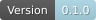
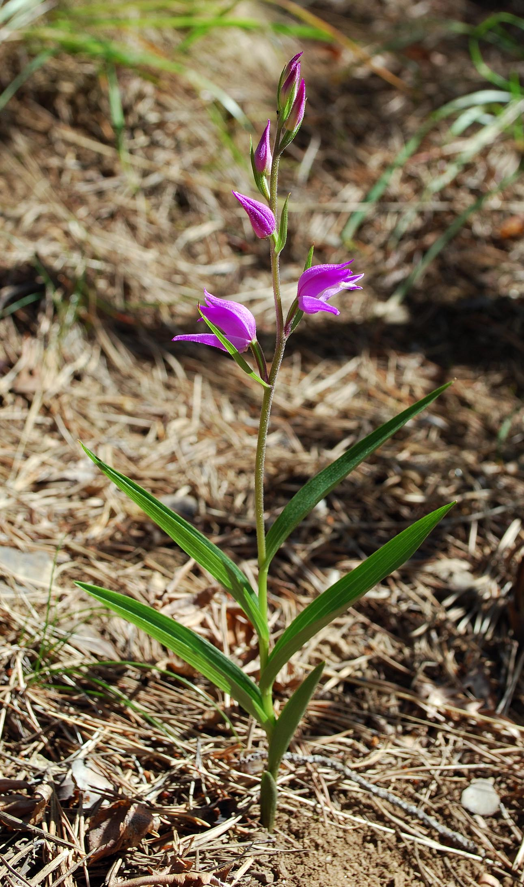
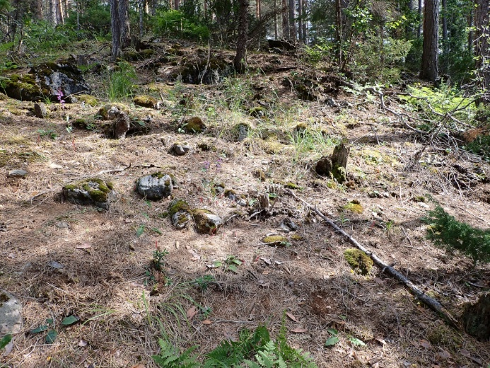
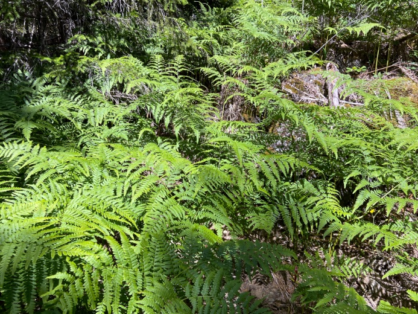
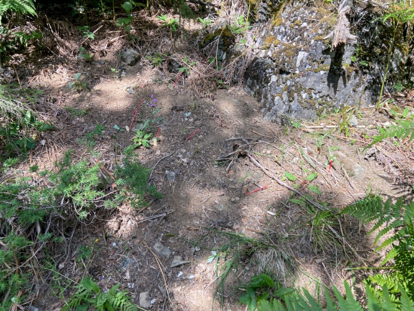
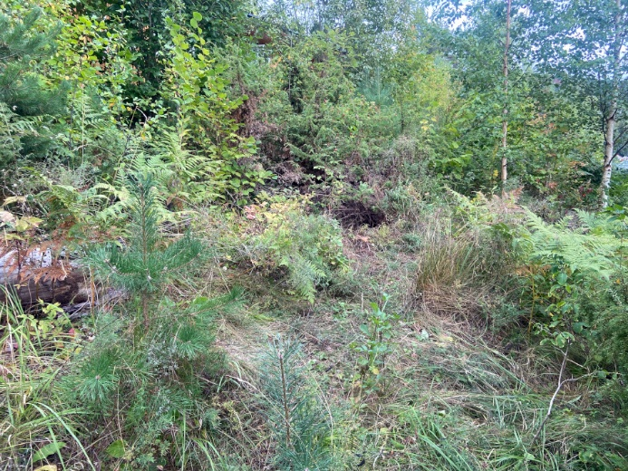
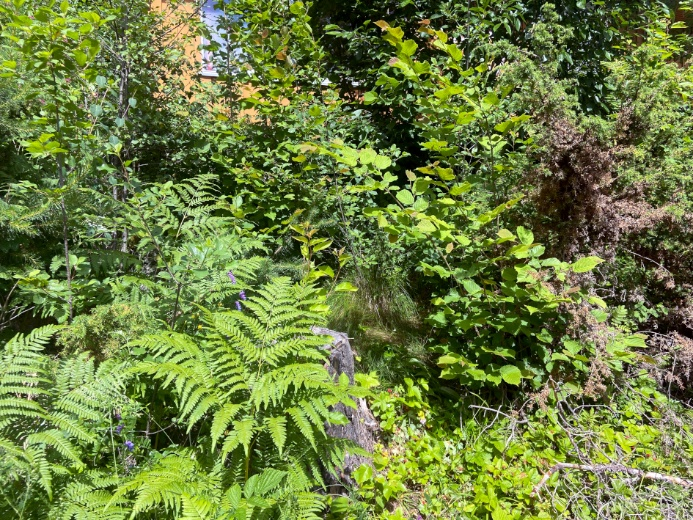
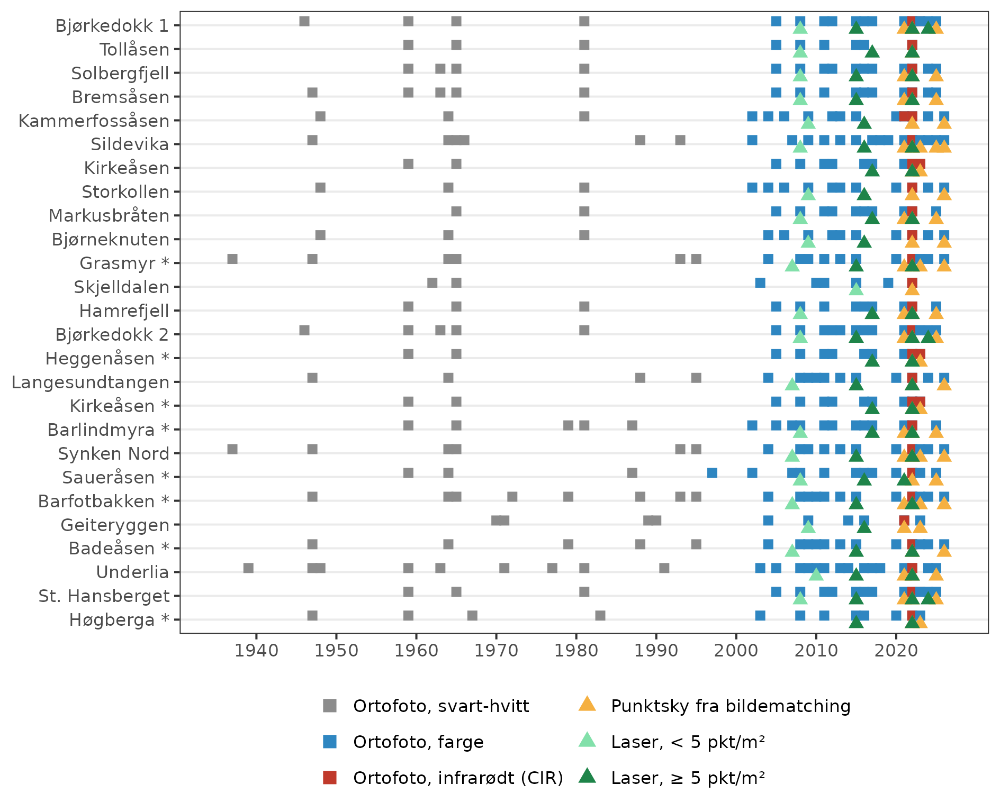
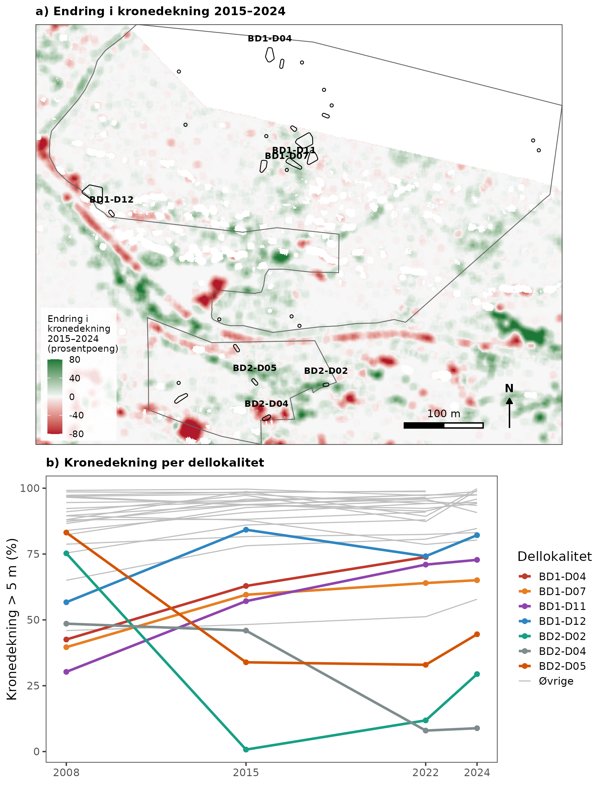

# Rød skogfrue (*Cephalanthera rubra*)
Harald Bratli, Ida M. Mienna
2026-11-11

- [Oppsummering](#oppsummering)
- [English summary](#english-summary)
- [1. Innledning](#1-innledning)
- [2. Formål med delprosjektet](#2-formål-med-delprosjektet)
- [3. Overvåkingslokalitetene](#3-overvåkingslokalitetene)
- [4. Datainnsamling](#4-datainnsamling)
- [5. Dataanalyser](#5-dataanalyser)
- [6. Resultater](#6-resultater)
- [7. Oppsummering](#7-oppsummering)
- [8. Referanser](#8-referanser)
- [9. Author contributions](#9-author-contributions)

<!--# Rapporten leser kun filer i img/. Tekstgrunnlaget er «Vedlegg årsrapport 2026_rød skogfrue_HB.docx» (P:/2026_subprojects/Skogfrue). Fjernmålingsfigurene er fra Ida M. Mienna sitt notat «rod_skogfrue_fjernmaling_notat.docx» i samme mappe. -->

<!--# The following parts are autogenerated. Do not edit. -->

> [!NOTE]
>
> Denne siden er generert fra [`Rod-skogfrue.qmd`](Rod-skogfrue.qmd).
> Ikke rediger `README.md` direkte. For å oppdatere: kjør skriptene i
> [`code/`](code/) og kjør `pixi run render`. Rapporten har ingen egne
> analyser; figurene ligger i [`img/`](img/).

> **Recommended citation**: Bratli, H. & Mienna, I.M. 2026. Rød skogfrue
> (ID: XX_YYYY_ZZZ) v. 0.1.0. ecRxiv:
> https://github.com/NINAnor/ecRxiv/tree/main/indicators/XX_YYYY_ZZZ

> [!TIP]
>
> ### Metadata
>
> 

>
> Tabell 1: Indicator metadata
>
> 

>
> | Variable | Value |
> |:---|:---|
> | Indicator ID | INDICATORID |
> | Indicator Name | Rød skogfrue |
> | verbatimName | Rød skogfrue |
> | Country | Norway |
> | Continent | Europe |
> | Realm | write realm here |
> | Biome | write biome here |
> | Ecosystem | write ecosystem here |
> | verbatimEcosystem | Kalkrik, lysåpen furuskog (kalk-bærlyngskog, bærlyng-lågurtskog, kalklyngskog) på Sørøstlandet |
> | Year added | 2026 |
> | Last update | 2026 |
> | Version | 0.1.0 |
> | Version comment | Første versjon, med oversikt over lokaliteter og tiltak og forslag til overvåkingsmetodikk |
> | Precision |  |
>
> 

>
> 

> [!TIP]
>
> ### Log
>
> <!--# Legg til en kort linje for hver oppdatering -->
>
> 11. nov. 2026 – Første versjon

## Oppsummering

Rød skogfrue (*Cephalanthera rubra*) er en sterkt truet (EN) orkidé som
vokser i kalkrik, relativt lysåpen skog på Sørøstlandet. Med to nye funn
i 2026 er det kjent 58 sikre forekomster. Trusler er blant annet hogst,
utbygging, slitasje, gjengroing med busker, trær og einstape, og beiting
av hjortevilt. I flere lokaliteter er det gjennomført skjøtsel, som
rydding av einstape, einer og busker, tynning og ringbarking av trær, og
nettingbur mot beiting. Effekten av tiltakene er foreløpig ikke
undersøkt.

Overvåkingen av effekter av tiltak er i planleggingsfasen. I 2026 ble
det samlet informasjon om tiltak fra Statsforvalteren, floravoktere og
årsrapporter fra handlingsplanen, og det ble gjennomført en feltbefaring
på Bjørkedokk. Basisovervåkingen i seks lokaliteter omfattet 526 merkede
skudd i 2026, hvorav 173 var overjordiske (56 fertile) og 353 i dvale.
Feltbefaringen viste stor variasjon i skogstruktur og lys innen og
mellom lokalitetene. Overvåkingen bør derfor knyttes til enkeltskudd,
med registrering av vegetasjon og tiltak i faste ruter rundt tilfeldig
valgte skudd. En gjennomgang av fjernmålingsdata viser at tresjiktet kan
følges over tid med laserdata, mens busk- og feltsjikt og einstape må
registreres i felt. Skuddene må stedfestes med høypresisjons-GPS for å
kunne knyttes til fjernmålingsdata.

Vi anbefaler at de foreslåtte indikatorene testes i 2027 i lokaliteter
med og uten tiltak, blant annet Bjørkedokk, Eikfjellet og Ødegård, og at
en endelig overvåkingsmetodikk settes i gang fra 2028.

## English summary

<!--# Utkast. Skal kontrolleres av prosjektledergruppa mot den endelige norske oppsummeringen. -->

The red helleborine (*Cephalanthera rubra*) is an endangered (EN) orchid
that grows in calcareous, fairly open forest in south-eastern Norway.
With two new finds in 2026, 58 confirmed occurrences are known. Threats
include logging, development, trampling, encroachment by shrubs, trees
and bracken, and browsing by deer. Management has been carried out at
several sites, such as clearing bracken, juniper and shrubs, thinning
and ring-barking trees, and wire cages against browsing. The effects of
these measures have not yet been studied.

Monitoring of the effects of management is still being planned. In 2026,
information on measures was collected from the County Governors,
volunteer plant guardians and the annual reports of the action plan, and
a field visit was made to Bjørkedokk. The basic monitoring at six sites
covered 526 marked shoots in 2026, of which 173 were above ground (56
flowering) and 353 dormant. The field visit showed large variation in
forest structure and light within and between sites. Monitoring should
therefore be based on individual shoots, with vegetation and measures
recorded in fixed plots around randomly selected shoots. A review of
remote-sensing data shows that the tree layer can be followed over time
with lidar, whereas the shrub and field layers and bracken must be
recorded in the field. The shoots must be positioned with high-precision
GPS to be linked to remote-sensing data.

We recommend testing the proposed indicators in 2027 at sites with and
without management, including Bjørkedokk, Eikfjellet and Ødegård, and
starting a final monitoring method from 2028.

## 1. Innledning

Rød skogfrue (*Cephalanthera rubra*) er en orkidé som er vurdert som
sterkt truet (EN) på rødlista for arter 2021 (Solstad mfl. 2021). Arten
ble utpekt som prioritert art med funksjonsområde i 2011, og det er
utarbeidet handlingsplan for arten (Direktoratet for naturforvaltning
2006). Den har en sørøstlig utbredelse i Norge, der den forekommer i
lavlandet i kalkrik, oftest relativt lysåpen skogsmark (kap. 3.1).

Trusler mot rød skogfrue er blant annet beskrevet i handlingsplanen for
arten (Direktoratet for naturforvaltning 2006). De omfatter tap av
habitat på grunn av utbygging og økt ferdsel, slitasje og plukking i
tillegg til selve habitattapet. Hogst, især åpne hogstformer som
flatehogst, anses som en trussel, med slitasje, kjørespor og
markberedning og i tillegg negativ påvirkning på mykorrhiza-relasjoner
som arten skal ha med skogstrær. Rød skogfrue foretrekker relativt
lysåpne voksesteder, og fortetting av busk- og tresjikt og tette
einstapebestand er negativt. Dette er satt i sammenheng med redusert
utmarksbeite. Beite av blomstrende skudd fra hjortevilt er et problem i
enkelte forekomster.

Figur 1: Blomstrende skudd av rød skogfrue i Bjørkedokk.

<!--# Fotograf mangler i figurteksten. -->

Arten opptrer klumpvis i små bestander eller som enkeltindivider i
lokalitetene. Disse bestandene dekker oftest små arealer, bare noen få
m², og selv innen disse arealene kan dekningen av tre-, busk- og
feltsjikt variere. Arten har variabel blomstring mellom år og kan også
ha flere års underjordisk dvaleperiode. I små lokaliteter kan den derfor
tilsynelatende være borte i flere år på rad, for så å sette
overjordsskudd. Arten spres vegetativt med jordstengel, og det reelle
genetiske individantallet per lokalitet er trolig lavere enn antallet
skudd.

## 2. Formål med delprosjektet

### 2.1 Målsetning med tiltakene

Det foretas ulike skjøtselstiltak i lokaliteter med rød skogfrue.
Hensikten er å bedre voksestedsforholdene for arten slik at
populasjonsstørrelsen øker. Tiltakene skal redusere utskygging av rød
skogfrue ved å redusere dekningen av einstape, einer og andre busker. I
noen lokaliteter fjernes også tresjikt. Beiting fra hjortevilt på rød
skogfrue reduseres ved å plassere nettingbur over planter.

### 2.2 Formål med overvåking

Overordnet mål for overvåkingen er å undersøke om tiltakene har effekt
på artens populasjonsstørrelse og romlige utstrekning på
tiltakslokalitetene. Videre er målet å gi økt blomstring og
fruktsetting. Konkret innebærer det å undersøke om fjerning av tett
vegetasjon på voksestedet øker antallet skudd, og om antallet
blomstrende skudd og kapselproduksjonen øker.

### 2.3 Forventninger

Rød skogfrue er en langlevd art. Den har også variabel opptreden i
lokalitetene mellom år, noen ganger fertil, andre ganger bare vegetativ
eller i underjordisk dvale. På kort sikt antar vi derfor at det vil være
relativt små endringer i populasjonsstørrelse, og at disse vil være
vanskelige å isolere fra artens naturlige dynamikk. På lengre sikt
forventer vi at det vil være mulig å observere endringer i antall
overjordsskudd, og at flere av disse vil være fertile.

## 3. Overvåkingslokalitetene

### 3.1 Beskrivelse av lokalitetene

Rød skogfrue var kjent fra 69 lokaliteter i 2025 (Hanssen 2026). I løpet
av sommeren 2026 ble det funnet to nye lokaliteter, Storøya i Hole
kommune og Lårdalstigen i Tokke kommune. Sistnevnte lokalitet ligger
isolert fra de øvrige, er den eneste som er kjent fra indre Telemark, og
utvider artens utbredelse langt mot vest. Artens kjerneområde ligger i
Eiker-Drammen-området i Buskerud. Den eneste intakte forekomsten på
østsiden av Oslofjorden er på en skjellsandbanke i Aremark. Utbredelsen
strekker seg fra Gjerstad kommune i sør til Jevnaker kommune i nord.
Høyeste forekomst er på ca. 400 m o.h. i Modum. Hanssen (2026) oppgir 56
sikre forekomster, tre som er usikre og ti som trolig er utgått. Med de
to som ble funnet i 2026, er det totale antallet sikre forekomster 58.
De fleste av de sikre forekomstene har funksjonsområder, som i
[forskrift om rød skogfrue (*Cephalanthera rubra*) som prioritert
art](https://lovdata.no/dokument/SF/forskrift/2011-05-20-523) er
definert som artens leveområder.

De fleste lokalitetene ligger på kalkrike bergarter i Oslofeltet.
Vanligste naturtyper er TB01-M005-06 kalk-bærlyngskog, TB01-M005-05
bærlyng-lågurtskog og TB01-M005-09 kalklyngskog etter Natur i Norge 3.0
(Halvorsen mfl. 2023). Tresjiktet domineres vanligvis av furu, men det
er ofte innslag av gran, eik og andre løvtrær. Busksjikt med einer,
rose-arter og enkelte andre busker og små løvtrær kan forekomme.
Feltsjiktet er oftest glissent, men er tett i enkelte forekomster.
Bunnsjiktet er oftest sparsomt eller manglende, og det kan være en del
naken jord, særlig i skråninger med ustabilt substrat. Både tre-, busk-
og feltsjikt varierer lokalt i og mellom lokalitetene fra temmelig tett
til glissent eller nesten fraværende i noen tilfeller.

I 23 av de sikre lokalitetene er det registrert maksimum seks skudd, og
færre enn det er heller ikke uvanlig
(<a href="#tbl-lokaliteter" class="quarto-xref">Tabell 4</a>). Den mest
individrike forekomsten er Bjørkedokk, der 106 skudd har blitt
registrert ett år, men oftest er det færre, og skuddene er spredt i
mange delpopulasjoner over et stort område. Ellers har lokalitetene
Frognøya, Solbergfjell, Hamrefjell, Kirkeåsen, Heggenåsen N og Tollåsen
relativt mange skudd.

Det foregår detaljert basisovervåking på individnivå i seks av
lokalitetene. Overvåkingen på disse lokalitetene ble startet i 2008
(2010 for Solbergfjell), og data samles inn og rapporteres årlig (Bratli
2026). Basisovervåkingen omfatter alle kjente skudd av arten i
lokalitetene (totalkartlegging). Skuddene er merket, og nye skudd som
observeres, merkes, måles og innlemmes i overvåkingen. For alle skudd
med overjordisk biomasse måles skuddhøyde, antall blader og bredde og
lengde på største blad. For fertile planter måles i tillegg høyden på
blomsterstanden og antall blomster. Basisovervåkingen gir relevante data
på variasjoner i populasjonsstørrelse og -struktur i tid og rom. Nærmere
beskrivelse av overvåkingen og resultater finnes i Bratli (2016) og i
årsrapporter (Bratli 2026). En oversikt over antall merkede skudd i de
seks lokalitetene fra basisovervåkingen i 2026 finnes i
<a href="#tbl-basis" class="quarto-xref">Tabell 2</a>. Disse
lokalitetene omfatter en stor andel av alle kjente skudd i landet
(<a href="#tbl-lokaliteter" class="quarto-xref">Tabell 4</a>).

I forbindelse med basisovervåkingen er det også enkelte år gjennomført
spredt rydding av einstape, busker og greiner fra trær som skygger ut
planter.

Tabell 2: Fordeling av antall skudd med rød skogfrue *Cephalanthera
rubra* på livsstadier i 2026 i alle undersøkte lokaliteter i
basisovervåkingen.

| Lokalitet      | Fertile | Vegetative | Beitet | Overjordsskudd | Dvale | Sum |
|:---------------|--------:|-----------:|-------:|---------------:|------:|----:|
| Bjørkedokk     |      26 |         48 |      8 |             82 |   219 | 301 |
| Bjørneknuten   |         |          1 |        |              1 |    25 |  26 |
| Hamrefjell     |      10 |         20 |      1 |             31 |    35 |  66 |
| Kammerfossåsen |       2 |          1 |        |              3 |     5 |   8 |
| Solbergfjell   |      14 |         27 |      9 |             50 |    53 | 103 |
| St. Hansberget |       4 |          2 |        |              6 |    16 |  22 |
| Sum            |      56 |         99 |     18 |            173 |   353 | 526 |

I tillegg følges flere lokaliteter opp av floravoktere fra Norsk
Botanisk Forening (se Hanssen 2026). I denne ekstensive overvåkingen
telles antall planter på lokalitetene, oftest antall blomstrende skudd,
noen ganger også vegetative, men individer merkes ikke og følges derfor
ikke over år. I tillegg er det foretatt spredt skjøtsel i en del
lokaliteter enkelte år
(<a href="#tbl-lokaliteter" class="quarto-xref">Tabell 4</a>). Detaljer
om skjøtselstiltakene, og om de omfatter hele eller deler av
lokaliteten, er ikke oppgitt.

### 3.2 Tiltak

Det er innhentet informasjon om utførte og planlagte tiltak i
lokalitetene fra Karoline Bredland, Statsforvalteren i Østfold,
Buskerud, Oslo og Akershus, og Trond Eirik Silsand hos Statsforvalteren
i Vestfold og Telemark. Informasjon er også innhentet fra floravoktere i
Kragerø, Kongsberg, Modum, Jevnaker og flere lokaliteter i
Eiker-Drammen-området. Videre er årsrapporter fra handlingsplanen for
rød skogfrue (bl.a. Hanssen 2026) gjennomgått. Sammen med egne
observasjoner i lokalitetene fra basisovervåkingen er dette oppsummert i
<a href="#tbl-lokaliteter" class="quarto-xref">Tabell 4</a>. Nedenfor er
tiltak i noen lokaliteter kommentert etter gjennomgang av
skjøtselsnotater og innspill fra Statsforvalteren i Østfold, Buskerud,
Oslo og Akershus og i Vestfold og Telemark.

Det er utarbeidet skjøtselsplan for lokalitetene Bjørkedokk i Drammen
kommune (Hanssen 2023) og Eikfjellet i Bamble kommune (Reiso og Thylén
2024). På Bjørkedokk ble det gjennomført rydding av busker og trolig
også noen små trær i to konkrete områder i 2023. I ett av disse (ovenfor
en liten rasskrent langs turveien vest for parkeringsplassen på
Bjørkedokk) er det også foretatt ringbarking av flere grantrær. I lia
mot Inntaksdammen («baklia») ble det fjernet en del busker, mest einer,
og einstape (<a href="#fig-baklia" class="quarto-xref">Figur 2</a>). I
2024 ble det også fjernet en del einstape i «baklia». Ovenfor den gamle
hoppbakken ble det fjernet noe einstape og ringbarket en hegg. Disse
tiltakene er gjennomført på oppdrag fra Statsforvalteren i Østfold,
Buskerud, Oslo og Akershus.

I 2026 ble det i forbindelse med basisovervåkingen av rød skogfrue
fjernet einstape i en dellokalitet øst for hoppbakken
(<a href="#fig-hoppbakken" class="quarto-xref">Figur 3</a>). Det ble
også fjernet einstapeskudd og klippet vekk greiner av gran i noen flere
dellokaliteter rundt hoppbakken og i «baklia». Drammen kommune har
ryddet løvoppslag nedenfor Røyskattlia 10 høsten 2026
(<a href="#fig-royskattlia" class="quarto-xref">Figur 4</a>). Ut over
dette er det også tidligere år i forbindelse med basisovervåkingen
gjennomført spredt rydding av einstape og busker på lokalitetene.

Figur 2: Dellokalitet «baklia» i Bjørkedokk der einer, småtrær og
einstape er fjernet.

(a) Før

(b) Etter

Figur 3: Dellokalitet øst for hoppbakken i Bjørkedokk før og etter
fjerning av einstape i 2026.

(a)

(b)

Figur 4: Gjengrodd forekomst med rød skogfrue mellom Røyskattlia 10 og
13 i Bjørkedokk før fjerning av løvoppslag.

Eikfjellet i Bamble kommune omfatter tre ulike delforekomster: Synken N,
Synken S og Eikfjellet
(<a href="#tbl-lokaliteter" class="quarto-xref">Tabell 4</a>). Her ble
det fjernet seks store graner mot sør og sørvest i desember 2025 på det
nordligste voksestedet (T.E. Silsand, pers. medd.). På det midtre kjente
voksestedet ble det fjernet seks store graner mot sør og sørvest i
januar 2026. Trærne ble vinsjet ut på snø, og begge tiltakene er i tråd
med skjøtselsplanen for funksjonsområdet. På Eikfjellet-Synkene, midtre
kjente voksested, er det planlagt å fjerne mispler og berberis i
september 2026. Plantene dras opp med rot. I resterende del av
funksjonsområdet skal det videreføres tynning av gran vinteren 2026, og
ringbarking av trær, spesielt omkring søndre kjente voksested. I
tilgrensende areal mot øst skal det utredes mulighet for å etablere
forekomst av fagerklokke i forbindelse med bygging av et nytt
kommunalteknisk anlegg. Dette antas å kunne bidra til bedre pollinering.

Ved Ødegård (Barfodkollen) i Røsskleiva naturreservat i Bamble kommune
ble det i mars 2025 tynnet i tresjiktet vest og sør for det faktiske
voksestedet. All gran, bøk og bjørk ble fjernet. Ung furu med tverrsnitt
mot rota under 15 cm ble også fjernet. Tiltaket skal gi kortvarig
solinnstråling til voksestedet deler av dagen (T.E. Silsand, pers.
medd.). Etter at det ble observert beiting av rådyr (blomst spist), ble
det utplassert nettingbur over forekomsten i juni 2024. Liljekonvall
lukes innenfor nettingburet i mai 2026. Det var også mistanke om beiting
av brunsnegler i mai 2026, og forekomsten overvåkes med tanke på
bekjempelse av snegler i mai–juli 2026. I Barfodkollen er det planer om
å etablere en større forekomst av fagerklokke utenfor funksjonsområdet,
på arealet omkring hoppbakken/skianlegget.

I Badeåsen i Bamble kommune ble det utplassert nettingbur over
forekomsten i juni 2024 for å forhindre beiting fra rådyr (T.E. Silsand,
pers. medd.). Også her foregår overvåking og bekjempelse av eventuelle
brunsnegler i mai–juli 2026 (blomst ble ødelagt av snegler i juni 2024).

På Langesundstangen i Bamble kommune er forekomsten gjerdet inn, og det
har medført en del gjengroing av busker og høy vegetasjon innenfor
gjerdet. Busker og småtrær er fjernet om vinteren, og ett tre er fjernet
mot sørvest i 2022 for å slippe inn noe mer lys. I april 2023, november
2024 og august 2025 er det utført slått og raking for å redusere veksten
av annen høyvokst vegetasjon (bringebær mm.). Ifølge T.E. Silsand (pers.
medd.) er det ikke mulig å se respons av tiltaket ennå.

På Bergan NØ, Saueråsen i Holmestrand kommune er det ikke utarbeidet
skjøtselsplan, men det skal vurderes om det er behov for å øke
lystilgangen og fjerne bøkeløv og strø, for å forbedre mulighetene for
blomstring, frøsetting og spiring av nye planter.

## 4. Datainnsamling

Metodikken for overvåkingen av rød skogfrue er foreløpig i
planleggingsfasen. Indikatorene i
<a href="#tbl-indikatorer" class="quarto-xref">Tabell 3</a> er derfor
kun et foreløpig forslag basert på egne erfaringer og feltbefaring på
Bjørkedokk i august 2026.

Rød skogfrue har jordstengel som kan produsere flere skudd. Overvåkingen
knyttes derfor til enkeltskudd, mens egenskaper ved voksestedet
registreres i faste ruter. Populasjonsutviklingen knyttes til målte
egenskaper i omgivelsene med antatt betydning for artens levevilkår, og
tiltak som foretas i disse.

Enkeltskudd trekkes tilfeldig. Regler for plassering i dellokaliteter
med mange nærstående skudd må utarbeides. I flere dellokaliteter er det
trolig bare plass til én, eventuelt to ruter dersom de ikke skal
overlappe.

Antall lokaliteter og antall skudd må bestemmes etter befaring i felt i
2027. Evju, Pedersen, mfl. (2021) foreslår alle intakte lokaliteter og
minimum 200 skudd. Rutestørrelse og frekvens på registreringene bør også
vurderes i forbindelse med feltbefaring på lokalitetene i 2027.

Tabell 3: Foreløpig forslag til indikatorer.

| Indikator | Variabel registrert i felt | Utvalgsenhet | Utlegging av utvalgsenhet | Antall lokaliteter | Frekvens for datainnsamling |
|:---|:---|:---|:---|:---|:---|
| Populasjonsstørrelse | Antall skudd av rød skogfrue | Enkeltskudd | Stratifisert tilfeldig | Intakte | Årlig |
| Populasjonsstruktur | Antall skudd i livsstadium fertil, frukter, vegetativ, dvale. Måling av størrelse | Enkeltskudd | Stratifisert tilfeldig | Intakte | 2 ganger årlig med frukter |
| Vegetasjonsrute 1 | Dekning felt- og bunnsjikt og naken mark | 1 × 1 m | Stratifisert tilfeldig | Intakte | Årlig |
| Vegetasjonsrute 2 | Dekning busk- og tresjikt | 2 × 2 m | Stratifisert tilfeldig | Intakte | Årlig |
| Artsrikdom – alle karplantearter | Forekomst av alle karplanter | 1 × 1 m | Stratifisert tilfeldig | Intakte | Årlig første to år, deretter annethvert år |
| Artssammensetning | Forekomst og mengde (% dekning) av alle karplanter | 1 × 1 m | Stratifisert tilfeldig | Intakte | Årlig første to år, deretter annethvert år |
| Artsrikdom og dekning av pollinatorplanter | Forekomst og mengde (% dekning) av fagerklokke | 10 × 10 m | Stratifisert tilfeldig | Intakte | Årlig første to år, deretter annethvert år |
| Vegetasjonshøyde feltsjikt | Vegetasjonshøyde (cm) registrert i fire hjørner i hver rute | 1 × 1 m | Stratifisert tilfeldig | Intakte | Årlig første to år, deretter annethvert år |
| Vegetasjonshøyde busksjikt | Vegetasjonshøyde (cm) registrert i fire hjørner i hver rute | 2 × 2 m | Stratifisert tilfeldig | Intakte | Årlig første to år, deretter annethvert år |
| Tresjikt-tetthet | Densiometer i fire himmelretninger | 1 × 1 m | Stratifisert tilfeldig | Intakte | Årlig |
| Tiltak i vegetasjonsrute | Luking feltsjikt: ja/nei | 1 × 1 m | Stratifisert tilfeldig | Intakte | Årlig |
| Tiltak i vegetasjonsrute | Fjerning einstape: ja/nei | 2 × 2 m | Stratifisert tilfeldig | Intakte | Årlig |
| Tiltak i vegetasjonsrute | Rydding busker: ja/nei | 2 × 2 m | Stratifisert tilfeldig | Intakte | Årlig |
| Tiltak i vegetasjonsrute | Rydding tresjikt: ja/nei | 2 × 2 m | Stratifisert tilfeldig | Intakte | Årlig |
| Areal med tiltak | Areal med tiltak | Polygon | Heldekkende | Intakte | Annethvert år |

## 5. Dataanalyser

Siden overvåkingen av rød skogfrue foreløpig er i planleggingsfasen, er
det ikke foretatt analyser av overvåkingsdata. Det er foretatt en
gjennomgang av potensielle lokaliteter basert på oversikter i
årsrapporter fra oppfølgingen av handlingsplanen (bl.a. Hanssen 2026),
vist i <a href="#tbl-lokaliteter" class="quarto-xref">Tabell 4</a>. I
tabellen inngår også høyeste antall skudd observert i løpet av ett år i
lokaliteten, og tiltak som eventuelt er utført.

Det ble gjennomført en analyse av potensialet for bruk av
fjernmålingsdata i overvåkingen (Mienna 2026). Lidar, ortofoto,
satellittdata og nasjonale skogkart ble vurdert i 46 lokaliteter med
funn av arten etter 2015. Hensikten var å finne ut hvilke
fjernmålingsdatasett som finnes i lokalitetene, hvor lange tidsserier de
har, hva som kan avledes om skogstruktur og lys, og på hvilken romlig
skala. Dette danner utgangspunkt for forslag til uttesting i 2027.

## 6. Resultater

### 6.1 Lokaliteter og tiltak

<a href="#tbl-lokaliteter" class="quarto-xref">Tabell 4</a> oppsummerer
opplysningene fra Statsforvalteren, floravokterne og årsrapportene fra
handlingsplanen for årene 2006–2025 (se kap. 3.2), sammen med egne
observasjoner fra basisovervåkingen.

Tabell 4: Et utvalg sikre forekomster med rød skogfrue basert på Hanssen
(2026). Første år viser året arten først ble funnet på lokaliteten. Maks
antall er høyeste antall skudd observert i løpet av ett år. Skjøtsel
viser ulike tiltak som er kjent på lokalitetene. Fylke: Øs = Østfold, Ak
= Akershus, Bu = Buskerud, Ve = Vestfold, Te = Telemark, Ag = Agder.

| Fylke | Kommune | Lokalitet | Første år | Maks antall | Skjøtsel |
|:---|:---|:---|:---|---:|:---|
| Øs | Aremark | Skjelldalen | 1996 | 12 | Fjerning einstape enkelte år |
| Ak | Jevnaker | Bergermarka | 2003 | 3 |  |
| Bu | Drammen | Bringebærkollen | 2010 | 6 | Drammen kommune har ringbarka og fjernet noe oppslag i 2024 og 2025 |
| Bu | Drammen | Spiraltoppen | 2011 | 1 | Drammen kommune har hogget og fjernet noe vegetasjon i 2024–2025 |
| Bu | Drammen | Bjørkedokk | 1943 | 106 | Skjøtselsplan utarbeidet. Ringbarking, fjerning av einer, busker, greiner, løvtrær, einstape |
| Bu | Drammen | Solbergfjell | 1962 | 53 | Spredt rydding |
| Bu | Drammen | Solbergfjell, NV mot Svarttjern | 2024 | 2 |  |
| Bu | Drammen | Bremsåsen 1 | 1976 | 3 | Trolig noe skjøtsel. Ukjent omfang |
| Bu | Drammen | St. Hansberget | 1990 | 14 | Fjerning einstape |
| Bu | Hole | Frognøya | 1967 | 60 |  |
| Bu | Hole | Storøya | 2026 | 4 |  |
| Bu | Kongsberg | Ullebergåsen | 1890 | 5 | Noe einstape lukes, og det er fjernet einer og småfuru i mange år |
| Bu | Kongsberg | Haugene | 2001 | 2 | Fjerning av einer og småfuru i mange år i området rundt rød skogfrue, men ikke der rød skogfrue er. Nettingbur |
| Bu | Modum | Glaneberget | 2009 | 6 | Spredt rydding |
| Bu | Modum | Kirkeåsen | 2011 | 30 | Spredt rydding |
| Bu | Modum | Hovland | 2012 | 11 | Noe gjengrodd og beiting |
| Bu | Modum | Hvalsbekken | 2017 | 2 |  |
| Bu | Modum | Heggenåsen N | 2017 | 24 | Nettingbur, behov for å rydde einstape og busker |
| Bu | Øvre Eiker | Hamrefjell | 1810 | 36 | Spredt rydding |
| Bu | Øvre Eiker | Tollåsen | 2007 | 23 | Noe spredt rydding av einstape. Behov for å felle noen større trær? |
| Bu | Øvre Eiker | Bryllupsmyr øst | 2009 | 1 |  |
| Bu | Øvre Eiker | Tryterud Ø | 2021 | 3 | To bur, helt siden funnet ble gjort |
| Ve | Holmestrand | Bergan NØ, Saueråsen | 2022 | 6 |  |
| Te | Bamble | Langesundstangen | 1996 | 1 | Fjerning av kratt og vegetasjon noen år |
| Te | Bamble | Synken N | 1990 | 6 | Skjøtselsplan. Fjerning einstape |
| Te | Bamble | Synken S | 1993 | 0 | Skjøtselsplan |
| Te | Bamble | Eikfjellet | 2022 | 2 | Skjøtselsplan |
| Te | Bamble | Ødegård | 2024 | 3 | Tynnet tresjikt mot vest og sør i 2025 |
| Te | Bamble | Badeåsen ved Langesund | 2024 | 2 | Bur rundt den ene planten |
| Te | Porsgrunn | Sildevika, Bjønnes | 2011 | 16 |  |
| Te | Kragerø | Kammerfossåsen | 1989 | 3 |  |
| Te | Kragerø | Bjørneknuten | 2001 | 16 |  |
| Te | Kragerø | Storkollen | 1920 | 6 |  |
| Te | Tokke | Lårdal | 2026 | 3 |  |
| Ag | Gjerstad | Geiteryggen | 1951 | 6 | Fjerning einstape, busker, vegetasjon enkelte år |

### 6.2 Fjernmålingsdata

Analysene av fjernmålingsdata viser at alle 46 lokaliteter med funn
etter 2015 er skannet med laser minst én gang, og de fleste to til fire
ganger mellom 2007 og 2024
(<a href="#fig-tidsserier" class="quarto-xref">Figur 5</a>). I tillegg
finnes ortofoto fra 8–24 år per lokalitet, de eldste fra 1937–1970.
Satellittdata og nasjonale skogkart (Sentinel-2, SR16) har for grov
oppløsning (10–16 m) til å beskrive forholdene rundt enkeltplanter
(Mienna 2026).

Fra laserdata kan det beregnes trehøyde, kronedekning, helling,
eksposisjon og et anslag på lys ved bakken med 1 m oppløsning. Når
punktskyen fra hver skanning behandles for seg, får vi en tidsserie for
tresjiktet. På Bjørkedokk fanger den opp både hogst og gjengroing på
enkelte dellokaliteter fra 2008 til 2024
(<a href="#fig-kronedekning" class="quarto-xref">Figur 6</a>). Ortofoto
kan brukes til å følge store endringer i tresjiktet lenger tilbake i
tid. De viktigste begrensningene er:

- Busksjiktet fanges bare delvis opp, og målene påvirkes av om trærne
  har løv. De bør bare sammenlignes mellom skanninger fra samme del av
  sesongen.
- Felt- og bunnsjiktet og einstape kan ikke skilles ut med fjernmåling
  og må registreres i felt.
- Lyset varierer over få meter, mens funnene i Artskart har 5–25 m
  usikkerhet. Uten nøyaktig innmåling av plantene kan fjernmålingsdata
  bare brukes på lokalitets- og dellokalitetsnivå.

Figur 5: Flybårne data som dekker lokalitetene med minst seks funn fra
2015–2026. Firkanter (øverst på hver linje) er ortofoto, trekanter
(nederst) er laserskanning og punktsky fra bildematching. \* =
lokaliteten er ikke avgrenset med økologisk funksjonsområde (ØFA). Fra
Mienna (2026).

Figur 6: Endringer i tresjiktet på Bjørkedokk fra punktskyene. a)
Endring i kronedekning fra 2015 til 2024 (grønt = tettere, rødt = mer
åpent); hvite felt mangler data i 2024. Svarte omriss er dellokaliteter,
grå linjer avgrensede ØFA. b) Kronedekning per dellokalitet og år;
dellokaliteter som har endret seg med minst 25 prosentpoeng, er farget.
Fra Mienna (2026).

## 7. Oppsummering

### 7.1 Hva viser årets resultater

Årets befaring på Bjørkedokk bekrefter utfordringer som tidligere er
beskrevet ved utforming av metodikk for tiltaksovervåking av rød
skogfrue (Evju, Brandrud, mfl. 2021). Foreslåtte indikatorer bør derfor
sjekkes ut i felt og vurderes i 2027. Det er stor variasjon i dekning av
tresjikt, busksjikt, feltsjikt og bunnsjikt i lokalitetene. I tillegg er
det en del variasjon i helningsgrad, eksposisjon og særlig
lysinnstråling. Plantene står spredt, dels enkeltvis eller et fåtall
planter sammen, dels i mindre grupper. Dellokaliteter kan defineres som
grupper av individer med mindre enn 10 m mellom seg. Skal disse knyttes
til fjernmålingsdata, er koordinatfesting med høypresisjons-GPS
nødvendig.

Overvåkingen må knyttes til enkeltskudd. Aktuelle indikatorer er antall
individer av rød skogfrue og populasjonsstruktur basert på livsstadium
(fertil, vegetativ, beitet, dvale, fruktifiserende). Vegetasjonsstruktur
og egenskaper ved voksestedet, inkludert effekter av tiltak, registreres
i faste ruter etablert rundt tilfeldig valgte individer av rød skogfrue.
Dekning i prosent av tre-, busk-, felt- og bunnsjikt og naken mark må
registreres.

### 7.2 Anbefaling for videreføring

I 2027 bør forslaget til indikatorer testes ut i flere lokaliteter som
omfatter forskjeller i populasjonsstørrelse og skogstruktur, inkludert
variasjon i tre-, busk- og feltsjikt og dekning av einstape. Forekomster
med og uten tiltak i Bjørkedokk, Eikfjellet og Ødegård inkluderes for å
vurdere om tiltakene fanges opp med fjernmålingsdata. Der det foreligger
tidsserier av fjernmålingsdata, kan det sjekkes ut om tiltakene fanges
opp. Tresjiktet registreres med densiometer og fotograferes med
«fisheye» nedenfra fra standardisert posisjon og høyde over bakken.
Dataene sammenlignes med fjernmålingsdata.

I lokaliteter med detaljert overvåking der det allerede er foretatt
tiltak, bør det vurderes om effekten av tiltakene kan undersøkes ved
bruk av eksisterende data fra den detaljerte basisovervåkingen.

Alle skudd med rød skogfrue som inngår i overvåkingen, koordinatfestes
med høypresisjons-GPS. Skuddene bør også merkes med små merkepinner for
å ha kontroll på at samme skudd måles hvert år. Skudd fra
basisovervåkingen er merket, men er ikke koordinatfestet med
høypresisjons-GPS. Dette må prioriteres slik at dataserien sikres.
Nøyaktigheten og gjenfunn av planter bør testes i 2027 ved innmåling av
skudd flere ganger med høypresisjons-GPS.

Full registrering av foreslåtte overvåkingsdata i en lokalitet
gjennomføres for å estimere tidsbruk. Basert på erfaringer fra tester i
2027 utarbeides en endelig overvåkingsmetodikk som kan settes i gang fra
2028.

Observasjoner i felt indikerer at rød skogfrue kan vokse under ulike
økologiske forhold, både med hensyn til grunnleggende egenskaper som
markas kalkinnhold og jordfuktighet, og struktur i omgivende vegetasjon
og lysforhold. Å forstå variasjonen i artens økologi og hvilken
betydning den har for artens opptreden, har betydning for hvilke tiltak
som bør settes inn og hvordan disse tiltakene påvirker arten. I
tilknytning til overvåkingen bør det derfor foretas basisundersøkelser
av variasjonen i økologiske forhold i artens levesteder.

## 8. Referanser

Bratli, H. 2016. *Overvåking av rød skogfrue *Cephalanthera rubra*.
Resultater fra perioden 2012–2015*. NINA Kortrapport No. 20. Norsk
institutt for naturforskning.

Bratli, H. 2026. *Rapport fra overvåking av rød skogfrue i 2026.
Upublisert rapport til Statsforvalteren i Østfold, Buskerud, Oslo og
Akershus*.

Direktoratet for naturforvaltning. 2006. *Handlingsplan for rød skogfrue
*Cephalanthera rubra**. DN-rapport Nos. 2006-1. Direktoratet for
naturforvaltning.

Evju, M., T. E. Brandrud, H. Bratli, mfl. 2021. *Overvåking av effekter
av tiltak for prioriterte arter og utvalgte naturtyper.
Bakgrunnsdokumenter*. NINA Rapport No. 1974. Norsk institutt for
naturforskning.

Evju, M., B. Pedersen, M. A. K. Sydenham, og E. Framstad. 2021.
*Overvåking av effekter av tiltak for truet natur. Strategier, kostnader
og prioriteringer*. NINA Rapport No. 1975. Norsk institutt for
naturforskning.

Halvorsen, R., H. Bratli, A. Bryn, L. Erikstad, O. Skarpaas, og A. K.
Wollan. 2023. *NiN versjon 3.0 systemkjerne: teori, generelle prinsipper
og systemarkitektur (Foreløpig utgave)*.

Hanssen, E. W. 2023. *Skjøtselsplan for prioritert art rød skogfrue, på
Bjørkedokkåsen, Drammen kommune*. Sabima/Norsk Botanisk Forening, Oslo.

Hanssen, E. W. 2026. *Handlingsplan for rød skogfrue *Cephalanthera
rubra* i Norge. Arbeid og status i 2025*. Rapport Nos. 2026-1.
Statsforvalteren i Østfold, Buskerud, Oslo og Akershus, klima- og
miljøvernavdelingen.

Mienna, I. M. 2026. *Fjernmåling for overvåking av rød skogfrue. Hva
finnes, hva er mulig, og hva kan testes i 2027. Notat, NINA
(upublisert)*.

Reiso, S., og A. Thylén. 2024. *Skjøtselsplan for funksjonsområde for
rød skogfrue ved Eikfjellet i Bamble kommune*. BioFokus-rapport Nos.
2024-056. Stiftelsen BioFokus.

Solstad, H., R. Elven, G. Arnesen, mfl. 2021. *Karplanter: Vurdering av
rød skogfrue *Cephalanthera rubra* for Norge. Rødlista for arter 2021*.
Artsdatabanken.

## 9. Author contributions

<!--# Kontroller rollene. Se https://credit.niso.org/ og https://www.nature.com/articles/s41467-023-37039-1. -->

**CRediT statement**

- Harald Bratli: Investigation (basisovervåking og feltbefaring);
  Writing – original draft
- Ida M. Mienna: Formal analysis (fjernmålingsdata); Visualization
  (fjernmålingsfigurer); Writing – original draft (fjernmåling)
