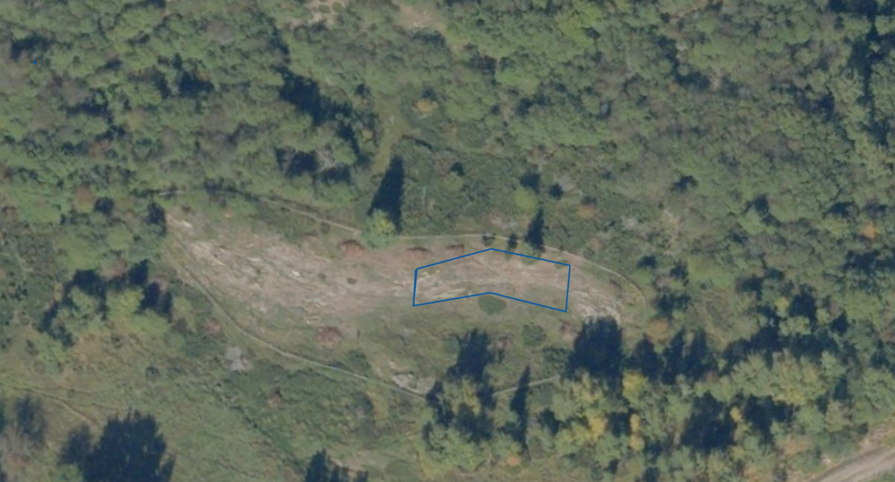
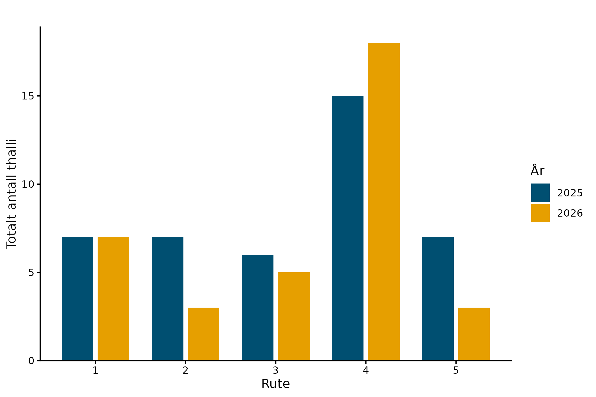
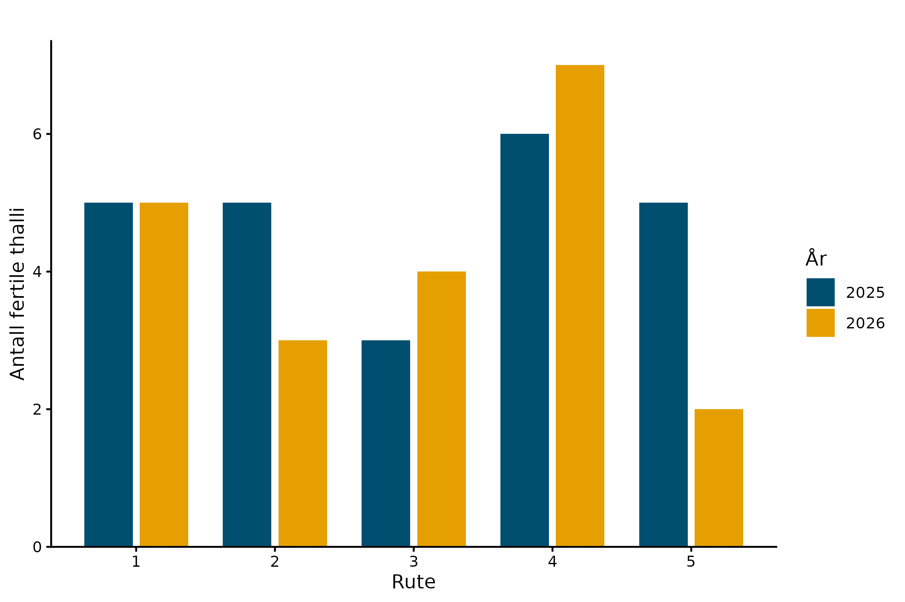
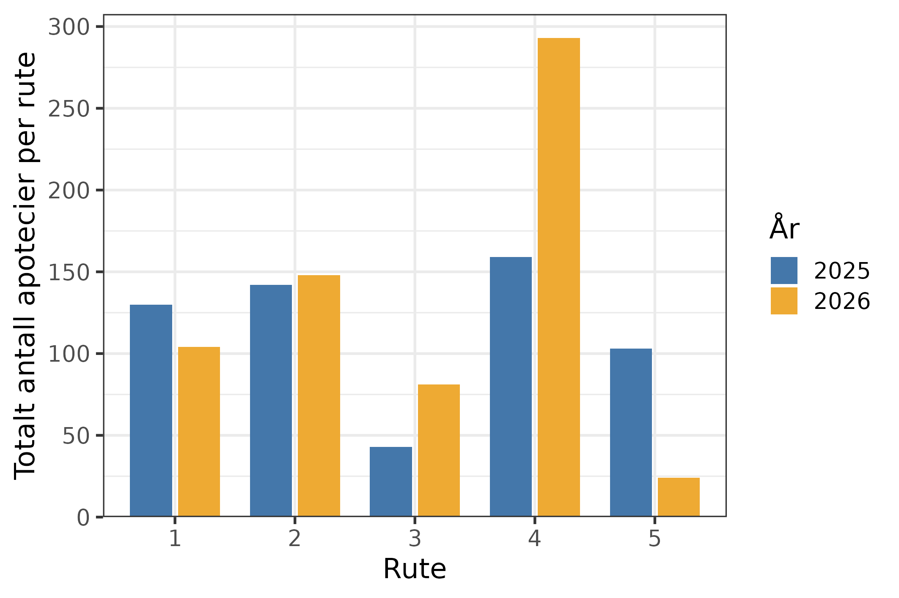
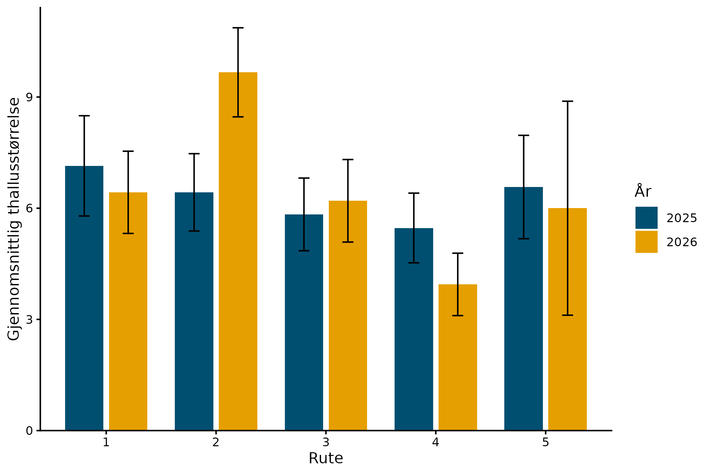

# Stjernebønnelav (*Buellia asterella*)
Alexander Nilsson, Ruben E. Roos, Marianne Evju
2026-11-19

- [Oppsummering](#oppsummering)
- [English summary](#english-summary)
- [1. Innledning](#1-innledning)
- [2. Formål med delprosjektet](#2-formål-med-delprosjektet)
- [3. Overvåkingslokalitetene](#3-overvåkingslokalitetene)
- [4. Datainnsamling](#4-datainnsamling)
- [5. Dataanalyser](#5-dataanalyser)
- [6. Resultater](#6-resultater)
- [7. Oppsummering](#7-oppsummering)
- [8. Referanser](#8-referanser)
- [9. Author contributions](#9-author-contributions)

<!--# Rapporten leser kun filer i img/. Tekstgrunnlaget er «Stjernebonnelav_2026_github_final.docx» (P:/…/Rapporter_2026_github/Final). Figur 4–7 er laget av code/01_figures_analyses.qmd. Kartet (figur 2) er hentet fra Word-dokumentet (større enn img/Kart_nordherad.png). -->

<!--# The following parts are autogenerated. Do not edit. -->

> [!NOTE]
>
> Denne siden er generert fra
> [`Stjernebonnelav.qmd`](Stjernebonnelav.qmd). Ikke rediger `README.md`
> direkte. For å oppdatere: kjør skriptene i [`code/`](code/) og kjør
> `pixi run render`. Rapporten har ingen egne analyser; figurene ligger
> i [`img/`](img/).

> **Recommended citation**: Nilsson, A., Roos, R. E. & Evju, M. 2026.
> Stjernebønnelav (ID: XX_YYYY_ZZZ) v. 0.1.0. ecRxiv:
> https://github.com/NINAnor/ecRxiv/tree/main/indicators/XX_YYYY_ZZZ

> [!TIP]
>
> ### Metadata
>
> | Variable          | Value                |
> |:------------------|:---------------------|
> | Indicator ID      | INDICATORID          |
> | Indicator Name    | Stjernebønnelav      |
> | verbatimName      | Stjernebønnelav      |
> | Country           | Norway               |
> | Continent         | Europe               |
> | Realm             | write realm here     |
> | Biome             | write biome here     |
> | Ecosystem         | write ecosystem here |
> | verbatimEcosystem |                      |
> | Year added        | 2026                 |
> | Last update       | 2026                 |
> | Version           | 0.1.0                |
> | Version comment   | Første versjon       |
> | Precision         |                      |
>
> Indicator metadata

> [!TIP]
>
> ### Log
>
> <!--# Legg til en kort linje for hver oppdatering -->
>
> 19\. nov. 2026 – Første versjon

## Oppsummering

Stjernebønnelav *Buellia asterella* er vurdert som kritisk truet (CR) og
finnes i dag bare på fire lokaliteter i Nordherad i Vågå, med en samlet
bestand på 200–250 individer. Effektovervåkingen foregår på lokaliteten
i Vistehorten naturreservat, som har over 90 % av bestanden og var i
ferd med å gro igjen med einer. I 2023–2025 ble om lag halvparten av
eineren fjernet, og beitende kviger ble gjerdet ute. I 2025 ble det
etablert fem faste ruter med stjernebønnelav, fem transekter for å følge
nitrogenkrevende karplanter og to ruter der jorda ble blottlagt for å
teste om arten kan etablere seg etter forstyrrelse. I de faste rutene
gikk antallet thalli ned fra 42 i 2025 til 36 i 2026, og antallet
fertile thalli fra 24 til 21. Enkelte thalli hadde flyttet seg eller
sklidd ut av rutene, noe som viser at substratet er ustabilt. Det ble
ikke funnet stjernebønnelav i rutene som ble forstyrret. Ryddingen ser
så langt ikke ut til å ha gitt oppslag av nitrofile arter, men
datagrunnlaget omfatter bare to år, og transektene ble ikke registrert i
2026 på grunn av tørke. Samlet viser resultatene en svak negativ
utvikling for bestanden. Overvåkingen bør gjentas årlig, og forsøket med
forstyrrelse bør trolig utvides til flere ruter.

## English summary

*Buellia asterella* is assessed as Critically Endangered (CR) and is now
found at only four sites in Nordherad in Vågå municipality, with a total
population of 200–250 individuals. The effect monitoring takes place at
the site in Vistehorten nature reserve, which holds more than 90 % of
the population and was becoming overgrown with juniper. In 2023–2025
about half of the juniper was removed, and grazing heifers were fenced
out. In 2025, five permanent plots with *B. asterella*, five transects
to follow nitrogen-demanding vascular plants, and two plots where the
soil was exposed to test whether the species can establish after
disturbance were set up. In the permanent plots the number of thalli
fell from 42 in 2025 to 36 in 2026, and the number of fertile thalli
from 24 to 21. Some thalli had moved or slid out of the plots, showing
that the substrate is unstable. No *B. asterella* was found in the
disturbed plots. So far, the clearing does not appear to have led to an
increase in nitrophilous species, but the data cover only two years, and
the transects were not recorded in 2026 because of drought. Overall, the
results show a slight negative trend for the population. Monitoring
should be repeated annually, and the disturbance experiment should
probably be extended to more plots.

## 1. Innledning

Stjernebønnelav *Buellia asterella* er en kritisk truet (CR) lav som
tilhører det xerofile steppe-elementet som i hovedsak forekommer nordre
deler av Gudbrandsdalen. Arten var tidligere utbredt i Europa, men
finnes i dag kun på fire lokaliteter i Nordherad i Vågå (Spribille mfl.
2015). Det er etter forholdsvis stor kartleggingsinnsats slått fast at
populasjonen i dag omfatter mellom 200-250 individer fordelt på fire
nærstående lokaliteter. Den største av disse følges opp gjennom
effektovervåkningen. Lokalitetene trues av gjengroing, tilfeldige
hendelser og trolig eutrofiering. Det ble i 2023 slått fast at
lokaliteten med over 90% av populasjonen var i ferd med å gå tapt som
følge av gjengroing av einer (Nilsson mfl. 2022). Det har derfor i
2023-2025 blitt gjennomført restaurering og skjøtselstiltak for å bedre
situasjonen. Effekten av tiltakene er foreløpig anslått å ha virket
positivt. Lokaliteten har blitt ryddet for 40-50% biomasse, hovedsakelig
einer. Effektovervåkingen omfatter faste overvåkingsruter på lokaliteten
for å overvåke utvikling og effekt av iverksatte tiltak. Det anbefales
jevnlige analyser av disse prøveflatene slik at populasjonsutvikling,
eventuell eutrofiering og gjengroing kan følges nøye.

Figur 1: Stjernebønnelav *Buellia asterella*. Foto: Sigve Reiso.

## 2. Formål med delprosjektet

### 2.1 Målsetning med tiltakene

Målsetningen med tiltakene er å skape nytt habitat for arten, slik at
utbredelsen og populasjonsstørrelsen på sikt kan øke.

### 2.2 Formål med overvåking

Målsetningen med overvåkingen er å bedre forstå stjernebønnelavens
interne populasjonsdynamikk, forstå hvordan den responderer på ulike
skjøtsels- og restaureringstiltak og å bygge kunnskap om hvilke tiltak
som bør benyttes for å lykkes med ivaretakelsen av artens leveområder.

### 2.3 Forventninger

På kort sikt forventes mindre einerdekning og mer åpent habitat etter
rydding. Over tid er forventningen at tørrbakkearter skal øke og
nitrogenkrevende arter avta langs transektene. Forsøksrutene skal vise
om mekaniske forstyrrelser og blottlegging av jord kan gi nye
etableringer av stjernebønnelav, og innsikt i suksesjonsstadiene i disse
såkalte jordskorpemiljøene.

## 3. Overvåkingslokalitetene

### 3.1 Beskrivelse av lokalitetene

Overvåkingen foregår på én av lokalitetene i Nordherad i Vågå
(<a href="#fig-kart-stjernebonnelav" class="quarto-xref">Figur 2</a>),
som har over 90 % av den kjente bestanden. Lokaliteten har blitt utsatt
for sterk gjødsling de siste årene ettersom husdyrgjødsel (talle) ble
deponert i nedkant av lokaliteten. Lokaliteten ligger i Vistehorten
naturreservat.

Figur 2: Kart over overvåkingslokaliteten. Alle sju rutene ligger
innenfor den blå avgrensningen.

### 3.2 Tiltak

I 2023–2025 ble det gjennomført skjøtsel og restaurering, primært ved å
fjerne og brenne einer
(<a href="#fig-rydding-stjernebonnelav" class="quarto-xref">Figur 3</a>).
Beitende kviger ble gjerdet ute fra lokaliteten i 2023.

Det ble også iverksatt to forsøksruter á 25 x 25 cm, rett ved en
forekomst av stjernebønnelav. Her antok vi suksesjonen har gått så langt
at stjernebønnelaven ikke lengre kan utnytte habitatet som nå var
overgrodd av større lav og moser. Vi blottla derfor jorda gjennom
mekanisk forstyrrelse, og etablerte deretter en rute på det arealet.
Gjennom dette eksperimentet får vi undersøkt om vi klarer å skape
habitat for stjernebønnelaven, samt at vi får innsikt i
suksesjonsutviklingen i habitatet. Vi får også testet hypotesen om at
stjernebønnelaven er en R-selektert pionerart, dvs en art som tilpasser
seg miljøet ved å reprodusere raskt, i dette spesifikke miljøet.

Figur 3: Rydding av einer på overvåkingslokaliteten i 2025. Foto:
Alexander Nilsson/Biofokus.

## 4. Datainnsamling

For å fange opp endringer i dominansen av nitrogenkrevende karplanter
ble det i 2025 lagt ut fem transekter på 20 m i representative deler av
lokaliteten. Langs hvert transekt ble det lagt ut ruter på 1 × 1 m ved
0, 2, 6, 10 og 20 m fra en forekomst av stjernebønnelav. I hver rute ble
prosentdekningen av alle karplantearter registrert. Ekstremt tørr sesong
gjorde den samme kartleggingen i 2026 for krevende, og den ble derfor
ikke gjennomført i år.

I 2025 ble det etablert fem fastmerkede ruter på 25 × 25 cm, hver med
ett eller flere thalli av stjernebønnelav. Forekomst og mengde av alle
arter av lav, moser og karplanter ble registrert i 2025 og 2026 for å
følge endringer i artssammensetning og dominans over tid. Mengde ble
registrert som dekning i hver av 25 småruter per rute, der dekning er
gitt på en kategorisk skala (0-3 %, 3-6 %, 6-12 %, 12-25 %, 25-50 %,
50-75 %, 75-90 %, 90-100 %).

For å følge bestands- og individutviklingen i de fem rutene ble alle
thalli av stjernebønnelav talt og målt i 2025 og 2026. Antall apothecier
ble registrert, og hvert individ ble klassifisert som fertilt eller
sterilt.

To ruter (25 x 25 cm) ble utsatt for forstyrrelse manuelt i 2025. Disse
ble analysert i 2026, med smårutefrekvens av alle lav, moser og
karplanter.

Feltarbeidet i 2026 ble gjennomført 27. august.

Tabell 1: Tabell med beskrivelse av indikatorer

| Indikator | Variabel registrert i felt | Utvalgsenhet | Utlegging av utvalgsenhet | Antall utvalgsenheter | Frekvens for datainnsamling |
|:---|:---|:---|:---|:---|:---|
| Stjernebønnelav | Antall og størrelse på thalli, antall apothecier og fertilitet | Rute, 25 × 25 cm | Fastmerket, med forekomst av stjernebønnelav | 5 | Årlig. |
| Artsfordeling i smårutene | Artsvis prosentdekning av lav, moser og karplanter | Rute, 25 × 25 cm | Samme ruter som for stjernebønnelav | 5 | Årlig. |
| Karplanteflora langs transekter | Artsvis prosentdekning av karplanter | Rute, 1 × 1 m | 0, 2, 6, 10 og 20 m fra forekomst av stjernebønnelav | 25 (5 per transekt) | Årlig. |

## 5. Dataanalyser

Resultatene nedenfor er basert på registreringene fra 2025 og første
gjentak i 2026. Det trengs målinger over flere år for å gjennomføre
statistiske analyser på utviklingen over tid.

## 6. Resultater

I transekt-analysen i 2025 ble totalt 44 karplanter registrert.
Vegetasjonen hadde en tydelig gradient, fra tørrbakke arter i rutene nær
stjernebønnelaven, til mer næringskrevende nitrofile arter som
hundegras, kveke, dunhavre, løvetann, sølvbunke og ertevikke i ruten 20
meter unna stjernebønnelaven.

De 5 rutene med stjernebønnelav hadde alle en direkte sørlig
eksposisjon, og en gjennomsnittlig helningsgrad på 50 grader. Rutene var
i hovedsak lavdominerte, men de inneholdt også en del moser. Karplanter
var mindre dominerende i rutene. Alle rutene hadde mellom 50-75%
vegetasjonsdekke, blottlagt jord og nakent berg stod for de resterende
25-50% av dekningsgraden i rutene

Det ble registrert 27 arter lav, 12 moser og 7 karplanter i 2025, mot
hhv. 27, 13 og 7 i 2026. Det ble totalt i de fem rutene registrert 42
thalli stjernebønnelav i 2025, mot 36 i 2026
(<a href="#fig-thalli-stjernebonnelav" class="quarto-xref">Figur 4</a>).
Av disse var 24 fertile i 2025 mot 21 i 2026
(<a href="#fig-fertile-stjernebonnelav" class="quarto-xref">Figur 5</a>).

Figur 4: Totalt antall thalli av stjernebønnelav per overvåkingsrute i
2025 og 2026.

Figur 5: Totalt antall fertile thalli av stjernebønnelav per
overvåkingsrute i 2025 og 2026.

Det totale antallet apotecier økte i to av rutene
(<a href="#fig-apotecier-stjernebonnelav" class="quarto-xref">Figur 6</a>),
mens gjennomsnittlig thallusstørrelse økte i én av rutene fra 2025 til
2026 (<a href="#fig-thallusstorrelse-stjernebonnelav"
class="quarto-xref">Figur 7</a>).

Figur 6: Totalt antall apotecier av stjernebønnelav per overvåkingsrute
i 2025 og 2026.

Figur 7: Gjennomsnittlig thallusstørrelse i mm per overvåkingsrute i
2025 og 2026. Feilstolpene viser gjennomsnittet ± standardfeil (SE)

Det ble observert at enkelte stjernebønnelavthalli hadde flyttet på seg
fra 2025 til 2026, noe som indikerer at substratet er ustabilt også uten
tråkk/slitasje. Nedgangen i antall thalli i tre av fem ruter kan delvis
forklares ved at individer hadde sklidd ut av rute-analysen, men enkelte
store individer var også helt forsvunnet fra lokaliteten. De relativ
store endringene i rutene fra 2025 til 2026 tyder på at dette er
dynamiske miljøer og artssamfunn. Veksthastigheten og reproduksjonsevnen
hos stjernebønnelav må være høy for å kunne opprettholde populasjonen på
det som viser seg å være svært ustabilt og dynamisk substrat.

I de to rutene som ble forstyrra manuelt i 2025, ble det i 2026
registrert 12 lavarter, 4 mosearter, og 6 karplantearter. Det ble ikke
observert stjernebønnelav i disse rutene.

## 7. Oppsummering

### 7.1 Hva viser årets resultater

Det første steget i restaureringen av lokaliteten er gjennomført, og ser
ut til å ha hatt ønsket effekt: forekomsten av einer anslås basert på
observasjoner i felt å ha blitt redusert med omtrent 50%, uten at dette
foreløpig har medført negative konsekvenser gjennom oppslag av nitrofile
arter i rotsonene.

Det er ikke registrert nye tråkkskader etter at kvigene ble gjerdet ute,
men det er usikker hvordan dette vil påvirke stjernebønnelav på sikt. I
2025 ble det registrert nyetablering av stjernebønnelav på jord som
kvigene hadde tråkket opp. Dette tyder på at tråkk kan blottlegge jord
der arten kan etablere seg. Kvigenes tråkk kan samtidig skade thalli som
allerede finnes på lokaliteten. Noe forstyrrelse virker dermed å være en
forutsetning for nyetablering, men dette må veies opp mot risikoen for
overdreven slitasje.

Samlet sett viser resultatene en svak negativ utvikling for populasjonen
på lokaliteten, noe som bør overvåkes. Det er viktig å kunne følge
artens utvikling på lokaliteten ettersom det er iverksatt
skjøtselstiltak med målsettning om å bedre forholdene for arten. Første
gjentak viser at arten muligens kan ha utfordringer med å opprettholde
populasjonen på lokaliteten, men det må vektlegges at datagrunnlaget,
som inkludere bare ett gjentak, er nokså begrenset. Det anbefales å
gjenta årlig overvåking videreføres slik at det genereres viktige og
forvaltningsrelevante data.

### 7.2 Anbefaling for videreføring

Etablering av overvåkningsopplegg som dette betinger at lokaliteten
følges opp over tid. Dette vil gi data på populasjonsutvikling, samt en
bedre forståelse for artens økologi og habitatkrav. Lokaliteten har
gjennom omfattende skjøtsel og restaurering gjennomgått store
forandringer de siste årene, og det er viktig å forstå hvordan disse
endringene vil påvirke lokaliteten og stjernebønnelaven, slik at man i
størst mulig grad kan lykkes med forvaltningen. Artens fremtidsutsikter
er høyst usikre, gitt at man har mislyktes med forvaltningen i
Storbritannia, Frankrike, Italia, Sveits og Tyskland, der arten har
forsvunnet (Spribille mfl. 2015). Det vil være verdifullt å kartlegge
hvilke forvaltningstiltak som ble gjennomført i disse landene, og
hvorfor de ikke var vellykket.

Etter etablering av overvåkingsopplegg i 2025, bør effektovervåkningen
videreføres med årlige gjentak over flere år, slik at eventuell
utvikling kan fanges opp. Årlig overvåking er nødvendig der arten vokser
på ustabilt substrat, og for langt tidsintervall mellom observasjonene
vil vanskeliggjøre oppfølging av individuelle thalli. Dataene vil være
nyttige i fremtidig forvaltning av naturreservatet forekomsten er en del
av.

Det foreligger nå planer om å redusere ytterligere 40% av opprinnelig
einerdekning på lokaliteten. De 10 resterende prosentene er planlagt
spart for å skape noe heterogenitet og bevare mikronisjer for andre
rødlistede arter i området (Nilsson & Reiso, (*in prep*.)).

Det største usikkerhetsmomentet er nå videre utvikling. Hvordan vil
lokaliteten respondere på forstyrrelsen og åpningen av lokaliteten som
følge av fjerningen av einer? Vil vi se en økning i nitrofile
gjengroingsarter de kommende årene, eller vil disse reduseres i takt med
at uttørkingseksponeringen økes?

Hvor mye forstyrrelse stjernebønnelaven er avhengig av er et av flere
sentrale spørsmål overvåkningen som nå er iverksatt forhåpentligvis vil
besvare. I hvilken grad lokaliteten er utsatt for eutrofiering er et
annet sentralt spørsmål. Om dataene fremover viser en økning i nitrofile
gjengroingsarter, må ytterligere tiltak iverksettes om stjernebønnelaven
skal overleve. Tiltak som innebærer fjerning av mer biomasse med
påfølgende utmagring kan være aktuelt på deler av lokaliteten.

Biofokus undersøker om manuell forstyrrelse kan erstatte tråkk fra
beitedyr. Disse rutene ble etablert 2025 og analysert for første gang i
2026. Forsøket bør trolig utvides til flere ruter, slik at
datagrunnlaget blir bedre, men vil bidra med kunnskap om etablering og
populasjonsdynamikk hos stjernebønnelav i relasjon til vegetasjonens
utvikling etter forstyrrelse.

## 8. Referanser

Nilsson, A., S. Reiso, og T. H. Hofton. 2022. *Kartlegging og
tilstandsvurdering av stjernebønnelav (CR) 2022*. Biofokus-rapport
2022-116. Stiftelsen Biofokus.

Spribille, T., P. Bilovitz, C. Printzen, R. Haugan, og E. Timdal. 2015.
**Buellia asterella*. The IUCN Red List of Threatened Species 2015:
e.T70385861A70385867*.
<https://doi.org/10.2305/IUCN.UK.2015-4.RLTS.T70385861A70385867.en>.

## 9. Author contributions

Feltarbeid og datainnsamling ble gjort av Alexander Nilsson og Torbjørn
Høitomt. Databearbeiding ble gjort av Marianne Evju, Ruben E. Roos, og
Alexander Nilsson. Rapporten ble skrevet av Alexander Nilsson, Ruben E.
Roos og Marianne Evju.
