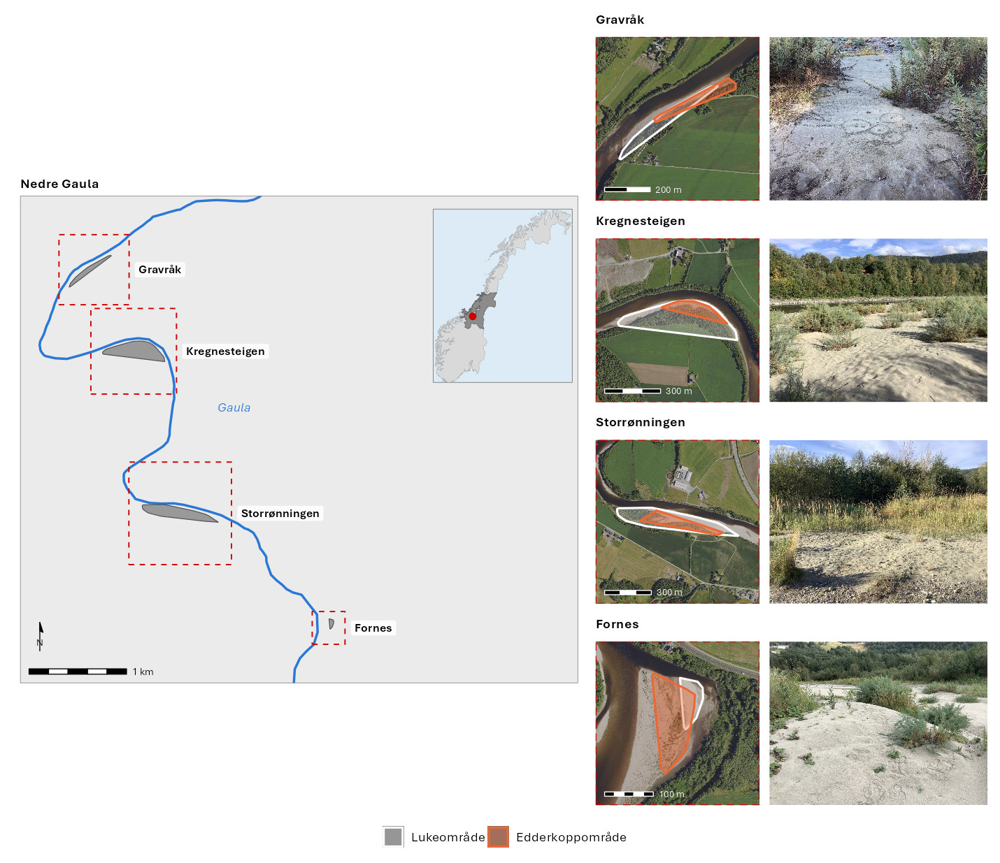
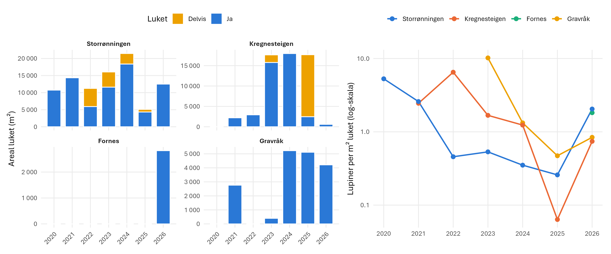
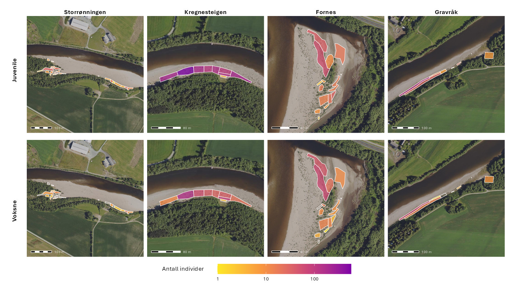
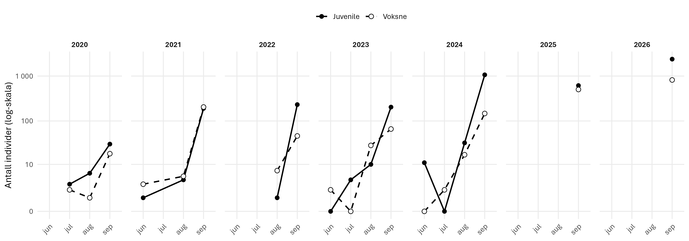
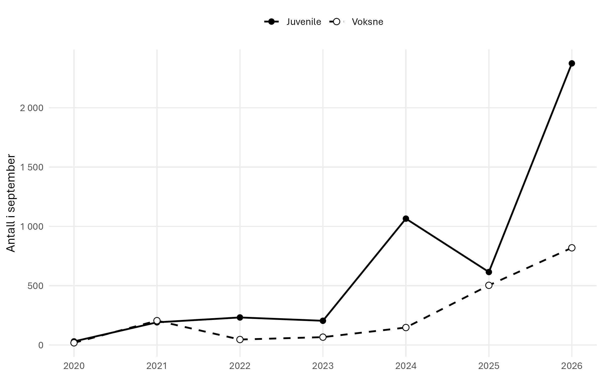
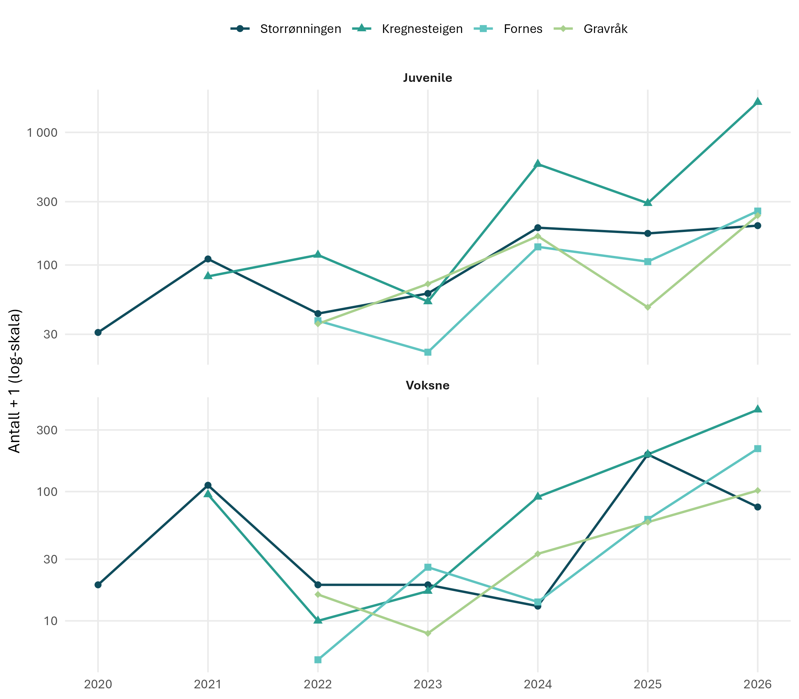
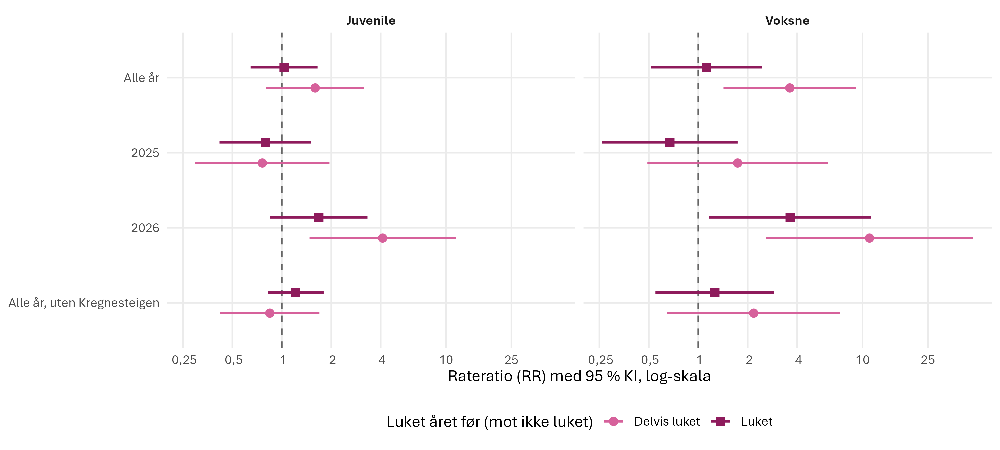
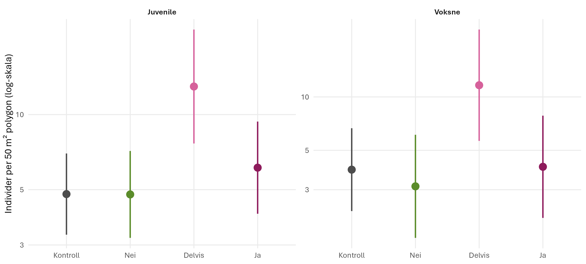
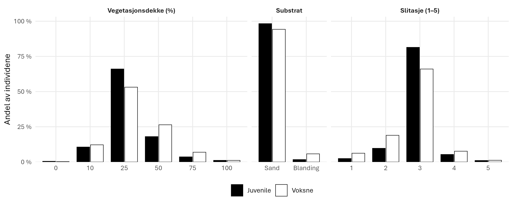
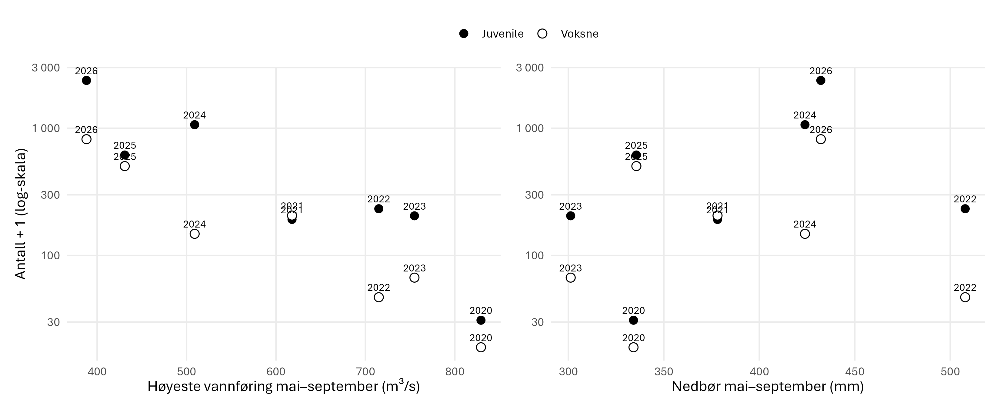

# Stor elvebreddedderkopp (*Arctosa cinerea*)
Megan Nowell
2026-10-29

- [Oppsummering](#oppsummering)
- [English summary](#english-summary)
- [1. Innledning](#1-innledning)
- [2. Formål med delprosjektet](#2-formål-med-delprosjektet)
- [3. Overvåkingslokalitetene](#3-overvåkingslokalitetene)
- [4. Datainnsamling](#4-datainnsamling)
- [5. Dataanalyser](#5-dataanalyser)
- [6. Resultater](#6-resultater)
- [7. Oppsummering](#7-oppsummering)
- [8. Referanser](#8-referanser)
- [9. Author contributions](#9-author-contributions)

<!--# Rapporten leser kun filer i data/ og img/. Rådata ligger på P:, og koden som lager masterfila ligger i code/. -->

<!--# The following parts are autogenerated. Do not edit. -->

> [!NOTE]
>
> Denne siden er generert fra
> [`Stor-elvebreddedderkopp.qmd`](Stor-elvebreddedderkopp.qmd). Ikke
> rediger `README.md` direkte. For å oppdatere: legg ny masterfil
> (`*_master.csv`) i [`data/`](data/), fjern den gamle, og kjør
> `quarto render Stor-elvebreddedderkopp.qmd`. Se
> [`code/README.md`](code/README.md) for hvordan masterfila lages.

> **Recommended citation**: Nowell, M. 2026. Stor elvebreddedderkopp
> (ID: XX_YYYY_ZZZ) v. 0.1.0. ecRxiv:
> https://github.com/NINAnor/ecRxiv/tree/main/indicators/XX_YYYY_ZZZ

> [!TIP]
>
> ### Metadata
>
> 

>
> Tabell 1: Indicator metadata
>
> 

>
> | Variable | Value |
> |:---|:---|
> | Indicator ID | INDICATORID |
> | Indicator Name | Stor elvebreddedderkopp |
> | verbatimName | Stor elvebreddedderkopp |
> | Country | Norway |
> | Continent | Europe |
> | Realm | write realm here |
> | Biome | write biome here |
> | Ecosystem | write ecosystem here |
> | verbatimEcosystem | Elvebredder med sand og grus langs Gaula |
> | Year added | 2026 |
> | Last update | 2026 |
> | Version | 0.1.0 |
> | Version comment | Første versjon, med data 2020–2026, effekt av lupinluking og klima/vannføring |
> | Precision |  |
>
> 

>
> 

> [!TIP]
>
> ### Log
>
> <!--# Legg til en kort linje for hver oppdatering -->
>
> - 16. okt. 2026 – Første versjon, data 2020–2026

## Oppsummering

<!-- <standardisert oppsummering, lik den som leveres i hovedrapport> -->

## English summary

## 1. Innledning

<!-- Om arten/naturtypen: Organismegruppe, Status rødlista, Utbredelse, Trusler. Kort om dette delprosjektet (hvilke tiltak ser det på effekten av, hvor). -->

## 2. Formål med delprosjektet

### 2.1 Målsetning med tiltakene

<!-- Hva er målsetningen med tiltakene som gjennomføres. Hvilke indikatorer skal tiltakene endre. -->

### 2.2 Formål med overvåking

<!-- Hva skal overvåkingen avdekke. -->

### 2.3 Forventninger

<!-- Hva forventer vi å observere av endringer i indikatorene – på kort og lang sikt. -->

## 3. Overvåkingslokalitetene

### 3.1 Beskrivelse av lokalitetene

<!-- Hvor, kart, plassering av lokalitetene i Norge. Status og utfordringer/påvirkninger. -->

Overvåkingen foregår på fire lokaliteter langs nedre del av Gaula i
Melhus kommune i Trøndelag: Gravråk, Kregnesteigen, Storrønningen og
Fornes (<a href="#fig-kart" class="quarto-xref">Figur 1</a>).
Lokalitetene består av sand- og grusflater (elveører) langs elva. Stor
elvebreddedderkopp forekommer til sammen på om lag 15 lokaliteter langs
Gaula (Hanssen 2023; Roos mfl. 2024).

Elveørene ligger stort sett på samme sted fra år til år, men systemet er
likevel svært dynamisk. De årlige flommene endrer den finskala
topografien, ved at sand avsettes og eroderes lokalt, og de påvirker
vegetasjonsdekket på sandflatene. Stedegne arter, som gråor og klåved,
vokser inn på elvebreddene. De større plantene tåler de årlige flommene,
men de fanger opp sediment og endrer den lokale topografien ved å bygge
opp forhøyede banker, og de endrer kornstørrelsesfordelingen i
substratet. Både topografien og substratet er viktige for stor
elvebreddedderkopp, som graver røret sitt i løs sand. Langs Gaula gror
elvebreddene i tillegg generelt igjen fordi elva er senket av omfattende
masseuttak fra elvebunnen (Roos mfl. 2024). Tråkk fra mennesker og
hunder er registrert på flere av lokalitetene (Roos mfl. 2025).

Hagelupin er en svært invasiv fremmedart. Frø føres med elva fra
forekomster lenger opp i vassdraget, og frø fra lupinene på selve
lokalitetene spirer, slik at lupinen raskt etablerer seg på nytt. Tette
lupinbestander gror igjen de åpne sandflatene som stor
elvebreddedderkopp og andre arter knyttet til åpne elveører er avhengige
av.

Flom og vær varierer mye fra år til år (avsnitt 6.3). I 2026 toppet
vårflommen ved Gaulfoss, den nærmeste vannføringsstasjonen (NVE), seg på
388 m³/s 24. mai, den minste vårflommen i perioden 2020–2026, og
vannføringen var over 300 m³/s i 1 dag i mai–august, mot 6–28 dager i de
andre årene. Det kom ingen sommerflom; høyeste vannføring i
juli–september var 233 m³/s. Snødybden ved Leinstrand, den nærmeste
værstasjonen med målinger av nedbør og snø (Meteorologisk institutt),
var høyst 18 cm i januar–mai (18–42 cm i de andre årene), og nedbøren i
mai–august var 387 mm, den høyeste i perioden.

**Gravråk** ligger på østsiden av Gaula, vest for Gravråk-gårdene.
Lokaliteten er en 600 m lang grusør med litt sand og silt inn mot
vegetasjonen (Hanssen 2023; Roos mfl. 2024).

**Kregnesteigen** ligger på vestsiden av Gaula, sør for Gravråk og vest
for Skjerdingstad. Lokaliteten er en langsmal elveør i en innersving, om
lag 1 km lang og 20–50 m bred ved normal vannstand. Gjengroing med gråor
og flommene i august 2023 har endret lokaliteten, og flommene la
samtidig igjen mye ny sand på store deler av elveøra (Hanssen 2023; Roos
mfl. 2024). Området er mye brukt til laksefiske, og nær elvekanten og en
gapahuk er det svært stor slitasje fra ferdsel (Roos mfl. 2025).

**Storrønningen** ligger på vestsiden av Gaula ved Kvål. Elveøra er 1,3
km lang, og de nederste 500 m er et om lag 50 m bredt overløp der det
jevnlig avsettes sand og silt. Gjengroing og styrtregnflommer har
forringet leveområdene de senere årene (Hanssen 2023; Roos mfl. 2024).
Det ligger en hundeskole like ved lokaliteten, og dronebilder viser
tydelige spor etter hunder i sandområdene der det er registrert flest
voksne edderkopper (Roos mfl. 2025).

**Fornes** ligger én kilometer oppstrøms Kvålsbrua, ved utløpet av
Gammelelva naturreservat på østsiden av Gaula. Lokaliteten er en elveør
på 28 daa som i hovedsak ble dannet mellom 2005 og 2009. Den har store
sandflater med silt i og rundt et frodig klåvedkratt på østsiden mot
Gammelelva, og store flater med grus og stein og lite vegetasjon på
vestsiden (Hanssen 2023; Roos mfl. 2024). Edderkoppene på Fornes holder
i hovedsak til på sandflatene utenfor lukeområdet
(<a href="#fig-kart" class="quarto-xref">Figur 1</a>), og Fornes brukes
derfor som kontroll i effektanalysen.

Figur 1: Lokalitetene for overvåking av stor elvebreddedderkopp langs
nedre Gaula i Trøndelag. Til venstre: oversikt over lukeområdene (grå)
og utsnittene for hver lokalitet (rød stiplet ramme); det innfelte
kartet viser plasseringen i Norge (Trøndelag i mørk grå). Til høyre, fra
nord til sør: lukeområdet (hvitt) og edderkoppområdet (oransje) på hver
lokalitet, og et bilde fra lokaliteten. Lukeområdet er minste konvekse
polygon rundt lukepolygonene 2025–2026, og edderkoppområdet minste
konvekse polygon rundt undersøkelsespolygonene for edderkopp 2025–2026.
Ortofoto: © Norge i bilder (Kartverket, Geovekst). Elvelinje: NVE. Foto:
Arne Endre Laugsand (Gravråk september 2024, øvrige september 2025).

### 3.2 Tiltak

<!-- Beskrivelse av tiltak, hva, når, hvem utfører. Legg inn bilde. -->

Tiltaket er luking av hagelupin (*Lupinus polyphyllus*) på lokalitetene.
Lukingen utføres av Midtnorsk Naturundersøkelse AS (MidNat), som har
kartlagt og luket lupiner langs Gaula hvert år siden 2020 (Solberg 2020;
Solberg og Vullum 2022b, 2022a, 2023, 2024; Solberg mfl. 2025). Gaula er
ett av fem vassdrag som Statsforvalteren i Trøndelag har prioritert i
sin satsing på å redusere utbredelsen av fremmede planter, og MidNat har
hatt rammeavtale med Statsforvalteren i Trøndelag om kartlegging og
bekjempelse i Gaulavassdraget i 2023–2025, i tillegg til tilskuddsmidler
til tiltak for natur. NINA har gitt MidNat i oppdrag å kartlegge
lupinene på overvåkingslokalitetene (Solberg mfl. 2025).

Lupinene lukes i hovedsak manuelt med håndredskap, som hagegreip,
potetgrev, sigd og løvetannstikker, slik at sandflatene forstyrres minst
mulig, og noen steder slås de med ryddesag. Plantene tas opp med roten,
og alt plantemateriale samles i tette sekker og leveres til godkjent
mottak for fremmede arter (Roos mfl. 2024; Solberg mfl. 2025). Ved
delvis luking fjernes bare de større lupinene som kan sette frø i løpet
av sesongen, og flere steder fjernes blomsterstander og frøbelger for å
hindre frøspredning (Solberg mfl. 2025). Hver lokalitet er delt inn i
kartfestede lukepolygoner, og MidNat registrerer for hvert polygon og år
om det er luket (Ja), delvis luket (Delvis) eller ikke luket (Nei), hvor
mange lupiner som ble fjernet, og når og hvordan det ble luket (Roos
mfl. 2024).

To steder er det i tillegg fjernet vegetasjon med gravemaskin for å
restaurere åpne sandflater. På Kregnesteigen ble en eng med gras, urter
og lupiner restaurert i november 2022 (Roos mfl. 2023). På Gravråk, som
over tid har grodd igjen med både stedegne arter og lupiner, ble nesten
all vegetasjon fjernet fra et større område med anleggsmaskiner i
oktober 2025, etter at det var luket og fjernet frøbelger i og rundt
området gjennom sommeren (Solberg mfl. 2025). På Fornes fjernet MidNat
blomsterstander og frøbelger fra 29. juni til 15. juli 2025, og Øya
videregående skole luket lupiner der 2. oktober 2025 med midler fra
Melhus kommune (Solberg mfl. 2025).

I 2026 ble det luket 20 154 m² på lokalitetene (Storrønningen 12 507 m²,
Gravråk 4 216 m², Fornes 2 827 m² og Kregnesteigen 604 m²), og 34 735
lupiner ble fjernet. Alle lukede polygoner ble fullstendig luket; delvis
luking ble ikke registrert. Utviklingen i lukingen per lokalitet er vist
i <a href="#fig-luking" class="quarto-xref">Figur 2</a>, og effekten av
lukingen på selve lupinbestanden er analysert i [rapporten for
elvesandjeger](../Elvesandjeger/).

Figur 2: Areal luket (Ja = fullstendig luket, Delvis = delvis luket) per
lokalitet og år (venstre), og lupiner fjernet per m² luket areal
(høyre). Kilde: lukedata fra Midtnorsk Naturundersøkelse AS. Lukingen på
Fornes i 2025 (Øya videregående skole) og restaureringen med gravemaskin
på Gravråk i oktober 2025 er ikke med i lukedataene.

## 4. Datainnsamling

Stor elvebreddedderkopp registreres ved å telle hull med juvenile og
voksne individer. Edderkoppen graver et silkeforet rør ned i løs sand og
er godt kamuflert, så hullene er lettere å oppdage enn selve dyret (Roos
mfl. 2024). Antallet edderkopper på sandflatene øker kraftig i løpet av
september, når de graver dype overvintringshull som de til slutt tetter
med en liten haug av sand eller småstein. Hull som er dekket på denne
måten regnes som bebodd, mens hull som ikke er vedlikeholdt eller har
falt sammen, ikke telles (Roos mfl. 2024). Hver lokalitet undersøkes én
gang i året, i september. Fram til og med 2024 ble edderkopper også
registrert under tellingene av elvesandjeger i juni–august
(<a href="#tbl-datainnsamling" class="quarto-xref">Tabell 3</a>), men
for å unngå dobbelttelling av individer brukes bare registreringene fra
september i analysene. I 2026 ble lokalitetene undersøkt på
Storrønningen 11. september, på Fornes 12. september, på Kregnesteigen
13. september og på Gravråk 14. september.

Registreringene gjøres i felt i ArcGIS Field Maps. Feltteknikeren
digitaliserer et polygon rundt hver flekk med hull, med et høyoppløselig
dronebilde tatt i juni 2026 som bakgrunnskart, slik at avgrensningen
blir presis (<a href="#fig-obskart" class="quarto-xref">Figur 3</a>).
Innenfor polygonet telles juvenile og voksne individer, og det
registreres vegetasjonsdekke (%), substrattype og slitasje (klasse 1–5).
Disse variablene gjør det mulig å skille effekten av lupinlukingen fra
andre faktorer som påvirker forekomsten av edderkopper. Fram til og med
2024 ble hvert funn i stedet registrert som et GPS-punkt med antall per
stadium. Indikatorene er beskrevet i
<a href="#tbl-indikatorer" class="quarto-xref">Tabell 2</a>.

Figur 3: Registreringspolygoner for stor elvebreddedderkopp i 2026 per
lokalitet, farget etter antall juvenile (øverst) og voksne (nederst)
individer registrert i polygonet (logaritmisk fargeskala). Polygoner
uten individer av stadiet er vist med hvit omriss. Polygonene er
gjennomsiktige fordi de kan overlappe. Ortofoto: © Norge i bilder
(Kartverket, Geovekst).

Tabell 2: Indikatorer for overvåking av stor elvebreddedderkopp.

| Indikator | Variabel registrert i felt | Utvalgsenhet | Utlegging av utvalgsenhet | Antall utvalgsenheter | Frekvens for datainnsamling |
|:---|:---|:---|:---|:---|:---|
| Populasjonsstørrelse voksne | Antall voksne individer (bebodde hull) | Polygon rundt hver flekk med funn (GPS-punkt 2020–2024) | Heldekkende søk på sandflatene | 4 lokaliteter | Årlig (september) |
| Populasjonsstørrelse juvenile | Antall juvenile individer (bebodde hull) | Som over | Som over | 4 lokaliteter | Årlig (september) |
| Habitat | Vegetasjonsdekke (%), substrattype, slitasje (klasse 1–5) | Som over | Som over | 4 lokaliteter | Årlig (september), fra 2025 |

Tabell 3: Antall individer av stor elvebreddedderkopp registrert per år
og måned, fordelt på juvenile og voksne (alle fire lokaliteter). – =
ingen registreringer. Registreringene i juni–august ble gjort under
tellingene av elvesandjeger; bare septemberregistreringene brukes i
analysene.

| Stadium  | År   | juni | juli | august | september |
|:---------|:-----|-----:|-----:|-------:|----------:|
| Juvenile | 2020 |    – |    3 |      6 |        30 |
| Juvenile | 2021 |    1 |    – |      4 |       191 |
| Juvenile | 2022 |    – |    – |      1 |       232 |
| Juvenile | 2023 |    0 |    4 |     10 |       204 |
| Juvenile | 2024 |   11 |    0 |     32 |     1 065 |
| Juvenile | 2025 |    – |    – |      – |       615 |
| Juvenile | 2026 |    – |    – |      – |     2 374 |
| Voksne   | 2020 |    – |    2 |      1 |        18 |
| Voksne   | 2021 |    3 |    – |      5 |       205 |
| Voksne   | 2022 |    – |    – |      7 |        46 |
| Voksne   | 2023 |    2 |    0 |     28 |        66 |
| Voksne   | 2024 |    0 |    2 |     17 |       147 |
| Voksne   | 2025 |    – |    – |      – |       503 |
| Voksne   | 2026 |    – |    – |      – |       819 |

## 5. Dataanalyser

<!-- Kort beskrivelse: hvilke analyser er gjennomført, for å undersøke endringer i indikatorer ift. påvirkningsfaktorer og tiltak, jf. forventninger (under formål). -->

Hovedmålet med analysene er å finne ut om lupinlukingen gir flere
edderkopper. Antallet edderkopper påvirkes også av andre forhold:
habitatet i hver flekk (substrattype, vegetasjonsdekke og slitasje) og
klima, snø og vannføring, som varierer fra år til år. Disse variablene
tas med i analysene for å skille effekten av lupinlukingen fra andre
faktorer som påvirker bestanden.

**Data og skript.** Alle observasjoner ligger i masterfila
[elvebreddedderkopp_obs_2020-2026_master.csv](data/elvebreddedderkopp_obs_2020-2026_master.csv),
som lages av skript 9 i [`code/`](code/). Polygonene inngår der som
sentroider med areal. For effektanalysen er hvert undersøkelsespolygon
(2025 og 2026) koblet til lukepolygonet det overlapper mest (skript 10,
elvebreddedderkopp_2025-2026_analysis_data.csv). Klimatabellen lages av
skript 8 i [`Elvesandjeger/code/`](../Elvesandjeger/code/).

**Utvikling over tid.** Tidsseriene viser summen av registrerte
individer i september per år og stadium. Registreringene gjøres av en
erfaren feltarbeider med god kjennskap til artene og lokalitetene, med
samme innsats hvert år og på alle lokaliteter. Ikke alle individer blir
nødvendigvis oppdaget. I 2024 ble registreringene gjort av den nye og
den tidligere feltarbeideren sammen, og fra 2025 av den nye alene. Samme
år ble registreringsmetoden endret fra punkter til polygoner (avsnitt
4). Nedgangen i antall juvenile fra 2024 til 2025 kan derfor delvis
skyldes bytte av feltarbeider og metode. Summene er derfor en indeks for
relativ forekomst som kan sammenlignes mellom år og lokaliteter, og ikke
et bestandsestimat.

**Effekt av luking.** Undersøkelsespolygonene fra september (2025 og
2026) er koblet til lukepolygonet de overlapper mest, og får
lukestatusen til polygonet **året før undersøkelsen** (Nei / Delvis /
Ja). Effektlokalitetene er **Kregnesteigen, Storrønningen og Gravråk**,
som alle har lukepolygoner med både lukede og ikke-lukede flekker og
observasjoner av edderkoppen. På **Fornes** lever de fleste edderkoppene
utenfor lukepolygonene. Undersøkelsespolygonene som ligger utenfor
lukepolygonene, utgjør en **kontroll** uten lupinluking, mens polygonene
som overlapper et lukepolygon (2 i 2025 og 2 i 2026), er holdt utenfor
analysen. Luking i undersøkelsesåret brukes ikke.

Antallene er sterkt overspredte, men ikke nullinflaterte. Modellen er en
**negativ binomial GLMM** (`glmmTMB`, nbinom2) per stadium med luking
året før, år, substrat og lokalitet som faste effekter og et tilfeldig
konstantledd per lukepolygon. Årseffekten fanger opp forskjeller mellom
år som er felles for alle lokaliteter, som flom og vær, og
lokalitetseffekten faste forskjeller mellom lokalitetene. Polygonarealet
inngår som **kovariat, ikke som offset**: antallet øker langsommere enn
arealet fordi store polygoner tar med mer tom mark, og polygonene var
mye større i 2026 enn i 2025. Prediksjoner vises for et standard polygon
på 50 m².

`antall ~ luket året før + år + substrat + lokalitet + log(areal) + (1 | lukepolygon)`

**Slik leses resultatene.** Effektene er oppgitt som **rateratio (RR)**:
hvor mange ganger høyere eller lavere antallet er enn i en
referansegruppe når de andre variablene i modellen holdes like. RR = 1
betyr ingen forskjell, RR = 2 dobbelt så mange og RR = 0,5 halvparten så
mange. **KI95** er 95 % konfidensintervallet, som viser usikkerheten i
anslaget: intervallet omfatter de effektene som er forenlige med
dataene. Når intervallet inneholder 1, kan effekten ikke skilles fra
ingen effekt. p-verdien angir hvor sannsynlig et like stort utslag er
hvis det i virkeligheten ikke er noen effekt, og p \< 0,05 regnes som
statistisk signifikant.

**Habitatvariabler.** Substrattype (sand eller blanding) inngår i
modellen. Finsand og silt ble ikke registrert. Vegetasjonsdekke og
slitasje mangler for 61 av undersøkelsespolygonene (alle fra 2025) og er
derfor testet hver for seg ved å legge dem til i modellen for polygonene
der de er registrert. I 2026 ble slitasje registrert direkte i felt i
ArcGIS Field Maps.

**Klima, snø og vannføring.** Vannføring, nedbør og snø er målt på én
stasjon og er derfor like for alle lokaliteter i et gitt år. Med bare 2
år i effektanalysen kan de ikke skilles fra årseffekten i
effektmodellen, og de er i stedet analysert for hele tidsserien.
Antallet i september er sammenholdt med vannføring, nedbør og snø i fire
vinduer: sommersesongen (1. mai til besøket), de 30 dagene før besøket
og vinteren før (1. oktober – 30. april). Antall per lokalitet og år er
modellert med én eksponeringsvariabel om gangen i en utforskende NB GLMM
med lokalitet og år som tilfeldige effekter. For høyeste vannføring i
sesongen er det i tillegg tatt hensyn til en lineær årstrend og til
metodeskiftet til polygoner i 2025. Analysen viser om endringer i antall
kan skyldes flom og vær snarere enn lukingen.

## 6. Resultater

I september 2026 ble det registrert 2 374 juvenile og 819 voksne totalt
for alle lokaliteter.

### 6.1 Utvikling over tid

**Hvorfor bare september.** Fra 2020 til 2024 ble lokalitetene undersøkt
flere ganger gjennom sommeren, sammen med tellingene av elvesandjeger.
Tellingene viste at antallet individer når en topp i september: 80–97 %
av årets registrerte individer ble funnet i september
(<a href="#fig-sesong" class="quarto-xref">Figur 4</a>). De samme
individene kan registreres ved flere besøk, så å summere over sommeren
gir dobbelttelling. De siste to årene er arten derfor bare registrert i
september. Det gir tilstrekkelige data til å overvåke bestanden og
reduserer samtidig kostnadene ved overvåkingen. Tidsseriene under bygger
bare på septembertellingene.

**Utvikling i bestanden.** Alle fire lokaliteter er undersøkt hvert år
siden 2022; tallene før det omfatter færre lokaliteter. Siden 2023 har
antallet økt for både juvenile og voksne
(<a href="#fig-trend-total" class="quarto-xref">Figur 5</a>), noe som er
positivt for bestanden. Antall voksne økte fra 66 i 2023 til 819 i 2026,
og antall juvenile fra 204 til 2 374. Tellingene i 2026 er de høyeste
som er registrert for begge stadier. Antall juvenile gikk ned fra 1 065
i 2024 til 615 i 2025, samme år som det ble byttet feltarbeider og
registreringsmetode (avsnitt 5), før det økte kraftig igjen i 2026.

**Lokalitetene.** Tellingene startet i 2020 på Storrønningen, 2021 på
Kregnesteigen og 2022 på Fornes og Gravråk. Økningen ses på alle
lokalitetene
(<a href="#fig-trend-lokalitet" class="quarto-xref">Figur 6</a>), men
Kregnesteigen har klart flest individer: i 2026 ble 71 % av de juvenile
og 52 % av de voksne registrert der. På Kregnesteigen, Fornes og Gravråk
var antallet i 2026 det høyeste som er registrert for begge stadier. På
Storrønningen var antallet juvenile det høyeste som er registrert (197,
mot 190 i 2024), men ikke antallet voksne, som gikk ned fra 193 i 2025
til 75 i 2026.

Figur 4: Antall juvenile og voksne stor elvebreddedderkopp registrert
per måned og år (alle fire lokaliteter, logaritmisk skala).
Hovedtellingen er i september; fra 2025 telles det bare i september.

Figur 5: Antall juvenile og voksne registrert i september per år, alle
lokaliteter. Registreringsmetoden ble endret fra punkter til polygoner i
2025.

Figur 6: Antall juvenile og voksne i september per lokalitet (antall +
1, logaritmisk skala).

### 6.2 Effekt av luking på stor elvebreddedderkopp

Effekten av lupinluking er analysert for undersøkelsespolygonene på de
tre effektlokalitetene Gravråk, Kregnesteigen og Storrønningen i 2025 og
2026. <a href="#tbl-effekt-n" class="quarto-xref">Tabell 4</a> viser
hvor mange polygoner som inngår i hver gruppe. I 2025 var det 87
polygoner på effektlokalitetene og 51 kontrollpolygoner på Fornes, i
2026 40 og 15. Polygonene var større i 2026, så de var færre.
Datagrunnlaget for 2026 er derfor mindre, og særlig gruppen delvis luket
(6 polygoner) er liten.
<a href="#tbl-effekt-koeff" class="quarto-xref">Tabell 5</a> viser
resultatene fra hovedmodellen for begge år samlet: hvor mange ganger
høyere eller lavere antallet er for hver variabel enn i referansegruppen
(RR), med 95 % konfidensintervall (KI95) og p-verdi.
<a href="#tbl-effekt-lrt" class="quarto-xref">Tabell 6</a> viser om hver
variabel samlet bidrar til å forklare antallet (likelihood-ratio-test),
om effekten av luking var forskjellig mellom årene (luking × år), og om
vegetasjonsdekke og slitasje har betydning.

**Full luking.** Når begge årene ses samlet, hadde flekker som ble luket
året før, ikke flere edderkopper enn flekker som ikke ble luket
(<a href="#tbl-effekt-koeff" class="quarto-xref">Tabell 5</a>).
Rateratioen var 1,03 for juvenile (KI95 0,65–1,65) og 1,12 for voksne
(KI95 0,51–2,44), og begge intervallene omfatter 1.

**Delvis luking.** Delvis lukede flekker hadde flest edderkopper: 3,6
ganger så mange voksne som ikke-lukede flekker (KI95 1,42–9,13, p =
0,0068) og 1,6 ganger så mange juvenile (KI95 0,80–3,17, p = 0,18).

**Forskjell mellom år.** Testen av samspill mellom luking og år viser at
effekten av luking ikke var den samme i 2025 og 2026 (juvenile p =
0,011, voksne p = 0,0049;
<a href="#tbl-effekt-lrt" class="quarto-xref">Tabell 6</a>). Effekten er
derfor også beregnet for hvert år for seg
(<a href="#fig-effekt" class="quarto-xref">Figur 7</a>).

**Andre faktorer.** Vegetasjonsdekke reduserte antallet for begge
stadier (juvenile p \< 0,001, voksne p = 0,0093), mens slitasje ikke
hadde noen effekt (juvenile p = 0,60, voksne p = 0,48). Juvenile var
færre på blandet substrat enn på sand (RR 0,50, KI95 0,25–0,99, p =
0,048); for voksne betydde substratet ikke noe. Kregnesteigen hadde 2,8
ganger så mange juvenile per polygon som Gravråk (p = 0,0032), og
Storrønningen hadde færre voksne (RR 0,32, p = 0,013).

**Polygonareal.** Polygonene varierer fra under 5 m² til over 500 m², og
store polygoner har naturlig flere individer. Arealet er derfor med i
modellen slik at gruppene sammenlignes ved samme polygonstørrelse. Hvis
antallet økte i takt med arealet (samme tetthet overalt), ville en
dobling av arealet gi dobbelt så mange individer. I stedet ga en dobling
bare 1,42 ganger så mange juvenile (KI95 1,30–1,55) og 1,48 ganger så
mange voksne (KI95 1,32–1,66). Store polygoner omfatter altså mye tom,
ofte vegetert, mark. Dette er viktig av to grunner. For det første vil
tetthet per m² (antall ÷ areal) være misvisende: store polygoner ser ut
til å ha lav tetthet, og fordi polygonene var mye større i 2026 enn i
2025, ville 2026 se dårligere ut enn det var. Derfor er arealet tatt med
i modellen i stedet for å regne om til tetthet. For det andre påvirker
måten polygonene tegnes på antallet per polygon, så polygonene bør
avgrenses på samme måte fra år til år.

Tabell 4: Undersøkelsespolygoner per gruppe og år. Kontroll = Fornes
(polygoner utenfor lukepolygonene); Nei / Delvis / Ja = lukestatus året
før på effektlokalitetene.

| Gruppe   | 2025 | 2026 |
|:---------|-----:|-----:|
| Kontroll |   51 |   15 |
| Nei      |   31 |   17 |
| Delvis   |   13 |    6 |
| Ja       |   43 |   17 |

Tabell 5: NB GLMM for juvenile og voksne per undersøkelsespolygon på
effektlokalitetene. RR = rateratio (hvor mange ganger høyere eller
lavere antallet er enn i referansegruppen); KI95 = 95 %
konfidensintervall. Referansenivåer: ikke luket året før, første år,
sand, Gravråk. Polygonareal er gitt per dobling av arealet.
Signifikansnivå: \* p \< 0,05; \*\* p \< 0,01; \*\*\* p \< 0,001.

| Effekt | RR_Juvenile | KI95_Juvenile | p_Juvenile | RR_Voksne | KI95_Voksne | p_Voksne |
|:---|---:|:---|:---|---:|:---|:---|
| Delvis luket året før (mot ikke) | 1.60 | 0.80–3.17 | 0.18 | 3.61 | 1.42–9.13 | 0.0068\*\* |
| Luket året før (mot ikke) | 1.03 | 0.65–1.65 | 0.89 | 1.12 | 0.51–2.44 | 0.77 |
| 2026 (mot 2025) | 1.55 | 1.01–2.40 | 0.046\* | 0.52 | 0.30–0.90 | 0.019\* |
| Blanding (mot sand) | 0.50 | 0.25–0.99 | 0.048\* | 1.04 | 0.48–2.24 | 0.92 |
| Kregnesteigen (mot Gravråk) | 2.79 | 1.41–5.53 | 0.0032\*\* | 1.28 | 0.40–4.09 | 0.68 |
| Storrønningen (mot Gravråk) | 0.80 | 0.49–1.32 | 0.39 | 0.32 | 0.13–0.78 | 0.013\* |
| Polygonareal, per dobling (2 = proporsjonalt) | 1.42 | 1.30–1.55 | \<0.001\*\*\* | 1.48 | 1.32–1.66 | \<0.001\*\*\* |

Tabell 6: Likelihood-ratio-tester per ledd (p-verdier). Vegetasjonsdekke
og slitasje er testet hver for seg på polygonene der de er registrert.
Signifikansnivå: \* p \< 0,05; \*\* p \< 0,01; \*\*\* p \< 0,001.

| Ledd             | Juvenile      | Voksne     |
|:-----------------|:--------------|:-----------|
| Luket året før   | 0.41          | 0.0063\*\* |
| Luket × år       | 0.011\*       | 0.0049\*\* |
| Substrat         | 0.049\*       | 0.92       |
| Lokalitet        | 0.0073\*\*    | 0.0068\*\* |
| År               | 0.0497\*      | 0.019\*    |
| Vegetasjonsdekke | \<0.001\*\*\* | 0.0093\*\* |
| Slitasje         | 0.6           | 0.48       |

**Effekt per år og betydningen av Kregnesteigen.**
<a href="#fig-effekt" class="quarto-xref">Figur 7</a> og
<a href="#tbl-effekt-aar" class="quarto-xref">Tabell 7</a> viser
effekten av luking for begge år samlet, for hvert år for seg og uten
Kregnesteigen. Rateratioen sammenligner delvis luket og luket med ikke
luket. En verdi over 1 betyr flere edderkopper enn i ikke-lukede
flekker, og der konfidensintervallet krysser den stiplede linjen ved 1,
er forskjellen ikke sikker.

Kregnesteigen krever særlig oppmerksomhet. Alle undersøkelsespolygonene
der var luket eller delvis luket, så lokaliteten har ingen ikke-lukede
flekker å sammenligne med. I 2026 lå i tillegg alle de delvis lukede
flekkene på Kregnesteigen (i 2025 lå de bare på Storrønningen), og
Kregnesteigen hadde den kraftigste økningen fra 2025 til 2026. Modellen
tar hensyn til forskjeller mellom lokalitetene, men antar at forskjellen
er den samme hvert år. Når én lokalitet øker mer enn de andre et år, kan
modellen derfor tilskrive økningen til den lukegruppen som bare finnes
der. For å teste dette er analysen gjentatt uten Kregnesteigen (nederste
rad i <a href="#fig-effekt" class="quarto-xref">Figur 7</a>).

I 2025 skilte verken delvis lukede eller lukede flekker seg fra
ikke-lukede. I 2026 hadde delvis lukede flekker 4,1 ganger så mange
juvenile (KI95 1,48–11,5, p = 0,0043) og 11 ganger så mange voksne (KI95
2,58–47,1, p \< 0,001). Uten Kregnesteigen forsvinner denne effekten (RR
0,85 for juvenile, p = 0,64, og 2,17 for voksne, p = 0,21). Effekten av
delvis luking skyldes derfor trolig lokaliteten mer enn lukingen.

Lukede flekker hadde i 2026 3,6 ganger så mange voksne som ikke-lukede
(KI95 1,16–11,3, p = 0,023) og 1,7 ganger så mange juvenile (KI95
0,85–3,32, p = 0,17). Effekten for voksne holder også uten Kregnesteigen
(RR 3,1, KI95 1,03–9,2, p = 0,044; ikke vist i figuren), og den ses både
på Gravråk (observert 4,0 mot 0,8 voksne per 50 m² i lukede og
ikke-lukede flekker) og på Storrønningen (1,7 mot 0,1). Noe av
forskjellen skyldes at det var svært få voksne i de ikke-lukede flekkene
i 2026. Det er som forventet: stor elvebreddedderkopp er knyttet til
åpen sandmark og kan ikke grave seg ned der vegetasjonen er tett. Det er
nettopp derfor lupinene lukes, for å åpne opp arealer slik at stor
elvebreddedderkopp og elvesandjeger får tilgang til den habitaten de
trenger. Resultatet bygger likevel på få polygoner (bare 2 lukede
polygoner på Gravråk), og det er et resultat fra ett år som må bekreftes
i de kommende årene. For juvenile var det ingen tydelig effekt, og
lokalitetene pekte i ulike retninger. Vi vet ikke nok om hvordan voksne
velger hvor de legger eggene, eller hvor mye juvenile flytter på seg,
til å si hvorfor lukingen ser ut til å ha større betydning for voksne
enn for juvenile.

Tabell 7: Effekt av luking året før per år, sammenlignet med ikke-lukede
flekker (modell med samspill luking × år). RR = rateratio; KI95 = 95 %
konfidensintervall. Intervaller og p-verdier er justert for to
sammenligninger per år (Dunnett). Signifikansnivå: \* p \< 0,05; \*\* p
\< 0,01; \*\*\* p \< 0,001.

| År | Sammenligning | RR_Juvenile | KI95_Juvenile | p_Juvenile | RR_Voksne | KI95_Voksne | p_Voksne |
|:---|:---|---:|:---|:---|---:|:---|:---|
| 2025 | Delvis luket mot ikke luket | 0.76 | 0.30–1.95 | 0.73 | 1.74 | 0.49–6.15 | 0.52 |
| 2025 | Luket mot ikke luket | 0.79 | 0.42–1.51 | 0.64 | 0.67 | 0.26–1.74 | 0.55 |
| 2026 | Delvis luket mot ikke luket | 4.11 | 1.48–11.45 | 0.0043\*\* | 11.02 | 2.58–47.14 | \<0.001\*\*\* |
| 2026 | Luket mot ikke luket | 1.68 | 0.85–3.32 | 0.17 | 3.63 | 1.16–11.31 | 0.023\* |

Figur 7: Effekt av lupinluking året før på antall juvenile og voksne per
undersøkelsespolygon, sammenlignet med ikke-lukede flekker (rateratio,
RR, med 95 % KI, log-skala). RR = 1 (stiplet linje) betyr ingen
forskjell. Alle år: hovedmodellen; 2025 og 2026: modell med samspill
luking × år (KI justert for to sammenligninger); uten Kregnesteigen:
hovedmodellen uten Kregnesteigen.

**Sammenligning med kontrollen på Fornes.** Sammenligningen mellom
lukede og ikke-lukede flekker på effektlokalitetene sier ikke alene om
lukingen gir flere edderkopper enn om ingenting ble gjort. De
ikke-lukede flekkene ligger på de samme lokalitetene som de lukede og
kan være påvirket av lukingen rundt dem, og hvilke flekker som blir
luket, er ikke tilfeldig. Fornes brukes derfor som kontroll. Lokaliteten
ligger i samme område, undersøkes på samme måte og samme tid, og de
fleste edderkoppene lever utenfor lukepolygonene. Kontrollen fanger
dermed opp variasjon mellom år, for eksempel på grunn av flom og vær,
uten påvirkning fra lupinlukingen. Kontrollen består av
undersøkelsespolygonene på Fornes som ikke overlapper et lukepolygon (51
i 2025 og 15 i 2026). Fordi kontrollen bare finnes på én lokalitet, kan
modellen ikke samtidig ta hensyn til forskjeller mellom lokalitetene.
Forskjeller mellom kontrollen og gruppene på effektlokalitetene kan
derfor også skyldes lokaliteten.

<a href="#fig-kontroll" class="quarto-xref">Figur 8</a> viser predikert
antall i et polygon på 50 m² for begge år samlet. Ikke-lukede og lukede
flekker hadde omtrent like mange edderkopper som kontrollen: 4,8 og 6,1
juvenile mot 4,8 i kontrollen (p ≥ 0,51), og 3,1 og 4,0 voksne mot 3,9
(p ≥ 0,82). Delvis lukede flekker hadde 2,7 ganger så mange juvenile som
kontrollen (13,0 mot 4,8, p \< 0,001) og 3,0 ganger så mange voksne
(11,6 mot 3,9, p = 0,012), men som vist over henger dette sammen med
Kregnesteigen i 2026. Samlet tyder sammenligningen på at antallet
edderkopper i lukede flekker er på samme nivå som på en lokalitet uten
luking.

Figur 8: Kontrollen på Fornes (undersøkelsespolygoner utenfor
lukepolygonene, uten lupinluking) sammenlignet med gruppene på
effektlokalitetene (NB GLMM, alle år, polygon på 50 m², gjennomsnitt ±
95 % KI).

**Habitat.** <a href="#fig-habitat" class="quarto-xref">Figur 9</a>
viser hvor individene ble funnet, uavhengig av lukehistorikk. Figuren
bygger på 2025 og 2026 samlet: 136 polygoner med registrert
vegetasjonsdekke og slitasje og 196 med registrert substrat. De fleste
individene lever i åpne flekker. 77 % av de juvenile og 66 % av de
voksne ble funnet i polygoner med høyst 25 % vegetasjonsdekke, og flest
i polygoner med 25 % (66 % av de juvenile og 53 % av de voksne).
Polygoner helt uten vegetasjon var sjeldne (7 av 136), så klassen 0 %
har få individer. Bare 5 % av de juvenile og 8 % av de voksne ble funnet
i polygoner med 75 % vegetasjonsdekke eller mer, og de voksne er altså
noe mer spredt mot vegeterte flekker enn de juvenile. Dette stemmer med
effektmodellen, der antallet gikk ned med økende vegetasjonsdekke
(<a href="#tbl-effekt-lrt" class="quarto-xref">Tabell 6</a>). Nesten
alle individene ble funnet på sand (98 % av de juvenile og 94 % av de
voksne). De fleste ble funnet i polygoner med slitasje i klasse 3 (81 %
av de juvenile og 66 % av de voksne), men slitasje kan bare ses på sand
og sier lite om hvilket habitat edderkoppene foretrekker. Figuren viser
hvor individene er innenfor flekkene der edderkoppene finnes, og sier
ikke hvor mye av lokalitetene som har de ulike habitatene.

Figur 9: Andel av alle registrerte juvenile og voksne per klasse av
vegetasjonsdekke, substrattype og slitasje, 2025 og 2026 samlet. Hver
variabel bruker polygonene der den er registrert (alle lokaliteter).

### 6.3 Klima, snø og vannføring

Tabell 8: Septemberbesøket per år: antall og eksponering. Høyeste
vannføring og dager \> 300 m³/s i sommersesongen (1. mai – besøket),
høyeste vannføring de 30 dagene før besøket, nedbør i sesongen og
snødager vinteren før.

| År | Dato | Enheter | Juvenile | Voksne | Q maks sesong | Dager \>300 sesong | Q maks 30 d | Nedbør sesong | Snødager vinter |
|---:|:---|---:|---:|---:|---:|---:|---:|---:|---:|
| 2020 | 28.09 | 29 | 30 | 18 | 829 | 28 | 155 | 334 | 54 |
| 2021 | 27.09 | 202 | 191 | 205 | 618 | 23 | 341 | 378 | 96 |
| 2022 | 28.09 | 134 | 232 | 46 | 715 | 25 | 541 | 508 | 111 |
| 2023 | 15.09 | 164 | 204 | 66 | 755 | 17 | 697 | 301 | 128 |
| 2024 | 19.09 | 427 | 1065 | 147 | 509 | 15 | 446 | 424 | 94 |
| 2025 | 11.09 | 140 | 615 | 503 | 431 | 6 | 240 | 336 | 85 |
| 2026 | 12.09 | 57 | 2374 | 819 | 388 | 1 | 233 | 432 | 92 |

Figur 10: Antall i september mot høyeste vannføring i sommersesongen
(venstre) og nedbør i sommersesongen (høyre). Tallene = år.

Tabell 9: Utforskende NB GLMM for antall i september per lokalitet og år
(lokalitet og år som tilfeldige effekter) med én eksponeringsvariabel om
gangen, og effekten av høyeste vannføring når det er tatt hensyn til en
lineær årstrend og metodeskiftet til polygoner i 2025. Estimat på
log-skala; p fra likelihood-ratio-test. Signifikansnivå: \* p \< 0,05;
\*\* p \< 0,01; \*\*\* p \< 0,001.

| Respons | Variabel | Estimat | SE | p |
|:---|:---|---:|---:|:---|
| Juvenile | log(høyeste vannføring mai–sep) | -2.975 | 0.531 | \<0.001\*\*\* |
| Juvenile | Dager \> 300 m³/s mai–sep | -0.079 | 0.021 | 0.0046\*\* |
| Juvenile | log(høyeste vannføring 30 d før besøk) | -0.439 | 0.693 | 0.54 |
| Juvenile | Nedbør mai–sep (mm) | 0.004 | 0.005 | 0.38 |
| Juvenile | Nedbør 30 d før besøk (mm) | 0.005 | 0.011 | 0.65 |
| Juvenile | Snødager vinteren før | -0.003 | 0.017 | 0.86 |
| Juvenile | log(høyeste vannføring), gitt årstrend | -2.445 | 1.084 | 0.0501 |
| Juvenile | log(høyeste vannføring), gitt årstrend + polygonmetode | -3.421 | 0.924 | 0.0042\*\* |
| Voksne | log(høyeste vannføring mai–sep) | -3.439 | 0.736 | 0.0023\*\* |
| Voksne | Dager \> 300 m³/s mai–sep | -0.088 | 0.028 | 0.015\* |
| Voksne | log(høyeste vannføring 30 d før besøk) | -2.151 | 0.374 | 0.015\* |
| Voksne | Nedbør mai–sep (mm) | 0.000 | 0.006 | 0.98 |
| Voksne | Nedbør 30 d før besøk (mm) | -0.001 | 0.014 | 0.96 |
| Voksne | Snødager vinteren før | -0.018 | 0.020 | 0.38 |
| Voksne | log(høyeste vannføring), gitt årstrend | -5.328 | 1.261 | 0.0031\*\* |
| Voksne | log(høyeste vannføring), gitt årstrend + polygonmetode | -4.178 | 1.247 | 0.0084\*\* |

## 7. Oppsummering

### 7.1 Hva viser årets resultater

<!-- Tallene under oppdateres automatisk, men tolkningen er skrevet for dataene til og med 2026. Les gjennom og oppdater teksten hvert år. -->

- **Full luking året før endrer ikke antallet edderkopper.** Juvenile:
  RR 1,03 (95 % KI 0,65–1,65), voksne 1,12 (0,51–2,44) sammenlignet med
  flekker som ikke ble luket; ingen av dem skiller seg fra kontrollen på
  Fornes (juvenile p = 0,51, voksne p = 0,99).

- **Delvis lukede flekker har flest edderkopper** – voksne 3,6 ganger
  nivået i ikke-lukede flekker (p = 0,0068), juvenile 1,6 ganger (p =
  0,18). **Dette er en Kregnesteigen-effekt, ikke en lukeeffekt:** i
  2026 ligger alle «Delvis»-flekkene på Kregnesteigen (lokaliteten med
  kraftig økning i 2026), og i 2025 fantes «Delvis» bare på
  Storrønningen, der det ikke gjorde noen forskjell. Uten Kregnesteigen
  blir RR for delvis luking 0,85 (juvenile, p = 0,64) og 2,17 (voksne, p
  = 0,21).

- **Lukehistorikk:** antall tidligere år en flekk er luket har ingen
  effekt på juvenile (RR 1,01 per år, p = 0,85), men henger sammen med
  flere voksne (1,66 per år, p \< 0,001). Det tyder på en gevinst av
  langvarig luking, men med samme forbehold om Kregnesteigen.

- **Habitat:** vegetasjonsdekke reduserer antallet for begge stadier
  (juvenile p \< 0,001, voksne p = 0,0093), og kontrollen viser at dette
  ikke skyldes tetthetsmetoden: effekten finnes også med areal som
  kovariat og innen ett enkelt år. Juvenile er færre på blandet substrat
  (RR 0,50, p = 0,048); substrat betyr ikke noe for voksne. Slitasje har
  ingen effekt (juvenile p = 0,6, voksne p = 0,48).

- Stigningen for log(areal) (0,51 for juvenile, 0,57 for voksne, mot 1
  hvis antallet var proporsjonalt med arealet) bekrefter at antallet
  øker mye langsommere enn polygonarealet. Tetthet per m² avhenger
  derfor av hvordan polygonet er tegnet, og sammenligninger mellom år
  med ulik polygonstørrelse bør gjøres med areal i modellen, som her.

- **Vannføring:** det sterkeste mønsteret i datasettet er sammenhengen
  mellom **høyeste vannføring i sommersesongen og antallet i
  september**: årene med de største vår- og sommerflommene hadde færrest
  edderkopper, og årene med de minste flommene flest. Effekten holder
  også når det er tatt hensyn til en lineær årstrend (voksne p = 0,0031,
  juvenile p = 0,0501) og metodeskiftet i 2025 (voksne p = 0,0084,
  juvenile p = 0,0042). Det er biologisk rimelig – edderkoppene lever i
  ganger på den laveste, mest flomutsatte sanden, og flommen kommer når
  juvenilene er små. Men serien er kort, og høyeste vannføring har gått
  ned gjennom perioden (r = -0,87 med år), så trend og flom kan ikke
  skilles sikkert. Nedbør og snø vinteren før viser ingen sammenheng (p
  = 0,38 eller høyere). Høyeste vannføring de 30 dagene før besøket
  henger sammen med antall voksne (p = 0,015), men ikke juvenile (p =
  0,54). Hypotesen – **lave sommerflommer lar bestanden bygge seg opp på
  sandbankene** – bør testes på en lengre serie og med
  oversvømmelsesterskler per sandbanke.

### 7.2 Anbefaling for videreføring

<!-- Hva er kunnskapsbehovet, om tiltaket (hvordan gjennomføres) og om effekten (variasjon mellom år, mellom lokaliteter). Anbefalinger for videreføring av delprosjektet – endringer i metodikk? Utvidelse? Endret frekvens for datainnsamling? Avslutning? -->

## 8. Referanser

Hanssen, Oddvar. 2023. *Oppfølging av handlingsplan for elvesandjeger
*Cicindela maritima*, og registreringer av stor elvebreddedderkopp
*Arctosa cinerea*. Rapportering for perioden 2015–2020*. NINA Rapport
No. 1815. Norsk institutt for naturforskning.
<https://hdl.handle.net/11250/3049395>.

Roos, Ruben E., Mathias Andreasen, Fia Bengtsson, mfl. 2025. *Overvåking
av effekter av tiltak trua natur i 2025. Resultater for ti arter og én
naturtype*. NINA Rapport No. 2695. Norsk institutt for naturforskning.
<https://nva.sikt.no/registration/019ad9d2e908-b8b219d4-fb21-40f8-a34a-e1c577293c9a>.

Roos, Ruben E., Marianne Evju, Anders Endrestøl, mfl. 2024. *Overvåking
av effekter av tiltak for åtte trua arter og en naturtype i 2024*. NINA
Rapport No. 2538. Norsk institutt for naturforskning.
<https://hdl.handle.net/11250/3169493>.

Roos, Ruben E., Marianne Evju, Anders Endrestøl, Oddvar Hanssen, og
Megan Nowell. 2023. *Overvåking av effekter av tiltak for seks trua
arter og en naturtype i 2023*. NINA Rapport No. 2377. Norsk institutt
for naturforskning. <https://hdl.handle.net/11250/3106536>.

Solberg, K. A. 2020. *Kartlegging av fremmede arter, og bekjempelse av
lupiner, langs Gaula i 2020*. MidNat Rapport Nos. 4-2020. Midtnorsk
Naturundersøkelse AS.

Solberg, K. A., S. Daaland, og J. Vullum. 2025. *Fremmede planter langs
Gaula 2025 – kartlegging, bekjempelse og tiltak for elvesandjeger*.
MidNat Rapport Nos. 7-2025. Midtnorsk Naturundersøkelse AS.
<https://www.midnat.no/gauldalen/>.

Solberg, K. A., og J. Vullum. 2022a. *Bekjempelse av hagelupin og
rynkerose på to elveører med elvesandjeger-bestander, i Melhus kommune,
2022*. MidNat Rapport Nos. 10-2022. Midtnorsk Naturundersøkelse AS.

Solberg, K. A., og J. Vullum. 2022b. *Bekjempelse og kartlegging av
lupiner langs Gaula i 2021*. MidNat Rapport Nos. 2-2022. Midtnorsk
Naturundersøkelse AS.

Solberg, K. A., og J. Vullum. 2023. *Fremmede planter langs Gaula 2023 –
kartlegging, bekjempelse og tiltak for elvesandjeger*. MidNat Rapport
Nos. 5-2023. Midtnorsk Naturundersøkelse AS.

Solberg, K. A., og J. Vullum. 2024. *Fremmede planter langs Gaula 2024 –
kartlegging og bekjempelse*. MidNat Rapport Nos. 6-2024. Midtnorsk
Naturundersøkelse AS.

## 9. Author contributions

<!-- Fill in CRediT and MeRIT statements. See https://credit.niso.org/ and https://www.nature.com/articles/s41467-023-37039-1. Delete rows you don't use. -->

**CRediT statement**

- Formal analysis: MN
- Software: MN
- Visualization: MN
