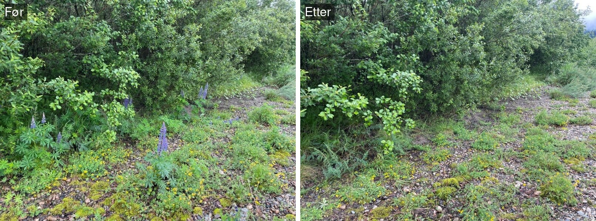
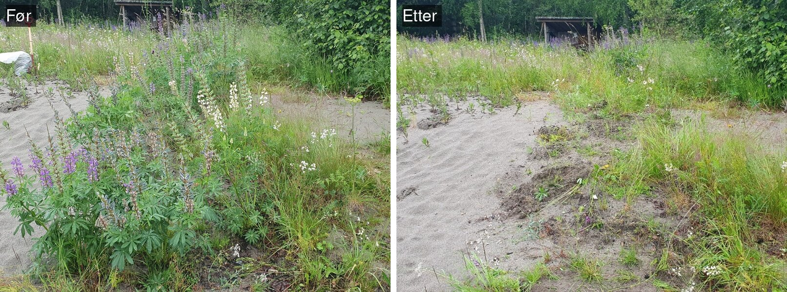
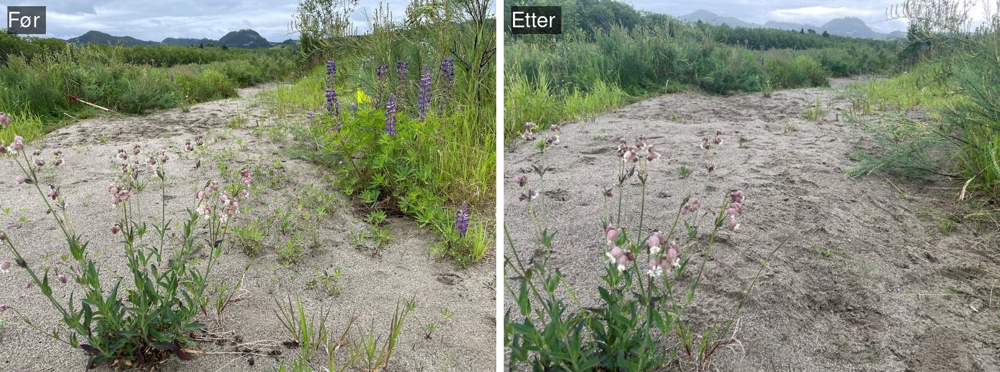

<!--# Rapporten leser kun filer i data/ og img/. Rådata ligger på P:, og koden som lager masterfila ligger i code/. -->

```{r setup}
#| include: false
#| cache: false
library(knitr)
library(tidyverse)
library(kableExtra)
library(here)
library(anybadger)
library(yaml)
library(tibble)
library(conflicted)
library(glmmTMB)
library(emmeans)
library(patchwork)
library(sf)
library(ggspatial)
conflicts_prefer(dplyr::filter)
conflicts_prefer(dplyr::lag)
conflicts_prefer(dplyr::select)
pull <- dplyr::pull

# Skrift: Aptos hvis den er installert (følger med Microsoft 365), ellers standard sans-serif
fonts <- systemfonts::system_fonts()
aptos <- fonts$path[match(c("Aptos.ttf", "Aptos-Bold.ttf", "Aptos-Italic.ttf", "Aptos-Bold-Italic.ttf"), basename(fonts$path))]
fig_font <- "sans"
if (!anyNA(aptos)) {
  systemfonts::register_font("Aptos Rapport", aptos[1], aptos[2], aptos[3], aptos[4])
  fig_font <- "Aptos Rapport"
}
update_geom_defaults("text", list(family = fig_font))
update_geom_defaults("label", list(family = fig_font))

# JPEG via ragg (for figurer med flyfoto og bilder), slik at skriften også brukes der
ragg_jpeg <- function(filename, width, height, ...) ragg::agg_jpeg(filename, width = width, height = height, ...)

# Figurer lagres i img/ slik at de vises både i README.md (GitHub) og i ecRxiv
# (echo styres per format i YAML: koden vises i html, men ikke i README.md)
knitr::opts_chunk$set(fig.path = "img/", dev = "ragg_png", dpi = 150)
```

<!--# The following parts are autogenerated. Do not edit. -->

```{r source}
#| echo: false
#| cache: false
source(here::here("_common.R"))

# Badges som markdown (for README.md på GitHub), med relativ sti til versjonsbadgen
md_badge <- function(tag) {
  src <- sub(paste0(here::here(), "/"), "", tag$children[[1]]$attribs$src, fixed = TRUE)
  sprintf("[](%s)", src, tag$attribs$href)
}
```

::: {.content-visible when-format="gfm"}
::: {.callout-note}
Denne siden er generert fra [`Stor-elvebreddedderkopp.qmd`](Stor-elvebreddedderkopp.qmd). Ikke rediger `README.md` direkte.
For å oppdatere: legg ny masterfil (`*_master.csv`) i [`data/`](data/), fjern den gamle, og kjør `quarto render Stor-elvebreddedderkopp.qmd`.
Se [`code/README.md`](code/README.md) for hvordan masterfila lages.
:::

`r paste(md_badge(status_badge(as.character(st))), md_badge(version_badge(as.character(version[[1]]))), md_badge(data_badge(as.character(badges[[1]]))), md_badge(code_badge(as.character(badges[[2]]))), md_badge(open_science_badge(as.character(badges[[3]]))), md_badge(license_badge()))`
:::

::: {.content-visible when-format="html"}
```{r reviewers}
#| echo: false
#| results: asis

if (!is.null(yaml_data$codeReviewers)) {
  reviewers <- purrr::map_chr(yaml_data$codeReviewers, "name")

  htmltools::HTML(paste0(
    '<div id="title-block-header" class="quarto-title-block default">
       <div class="quarto-title-meta">
         <div>
           <div class="quarto-title-meta-heading">Reviewed by</div>
           <div class="quarto-title-meta-contents">',
    paste(reviewers, collapse = "; "),
    '</div>
         </div>
       </div>
     </div>',
    sep = ""
  ))
}
```

::: {layout-ncol="6"}

```{r statusBadge}
#| echo: false
status_badge(as.character(st))
```

```{r versionBadge}
#| echo: false
version_badge(my_version_number = as.character(version[[1]]))
```

```{r dataBadge}
#| echo: false
data_badge(as.character(badges[[1]]))
```

```{r codeBadge}
#| echo: false
code_badge(as.character(badges[[2]]))
```

```{r openScienceBadge}
#| echo: false
open_science_badge(as.character(badges[[3]]))
```

```{r licenseBadge}
#| echo: false
license_badge()
```

:::
:::

> **Recommended citation**: `r paste(auth, " ", year, ". ", name, " (ID: ", folder_name, ") ", "v. ", version, ". ecRxiv: ", url, sep="")`

::: {.callout-tip collapse="true"}
## Metadata
```{r tbl-meta2}
#| tbl-cap: 'Indicator metadata'
#| echo: false
#| warning: false
meta |>
  dplyr::filter(Variable %in% c(
    "Indicator ID",
    "Indicator Name",
    "verbatimName",
    "Continent",
    "Country",
    "Realm",
    "Biome",
    "Ecosystem",
    "verbatimEcosystem",
    "Year added",
    "Last update",
    "Version",
    "Version comment",
    "Precision")) |>
  kable()
```
:::

::: {.callout-tip collapse="true"}
## Log

<!--# Legg til en kort linje for hver oppdatering -->
- 16. okt. 2026 – Første versjon, data 2020–2026
:::

<hr />

```{r data}
#| code-summary: 'Kode for å lese data.'
# Hver fil i data/ finnes ved et mønster, slik at årstallene i filnavnet kan endre seg fra år til år
read_one <- function(pattern, reader = read.csv) {
  f <- list.files(here("data"), pattern = pattern, full.names = TRUE)
  if (length(f) != 1) stop("Forventet nøyaktig én fil som passer '", pattern, "' i data/, fant ", length(f))
  structure(reader(f), file = basename(f))
}

# stadier i svart (linjetype/symbol), lokaliteter i farger, lukestatus i magenta
stage_lev <- c("Juvenile", "Voksne")
stage_lty <- c(Juvenile = "solid", Voksne = "dashed")
stage_shp <- c(Juvenile = 16, Voksne = 21)
site_cols <- c("Storrønningen" = "#2a78d6", "Kregnesteigen" = "#eb6834", "Fornes" = "#1baf7a", "Gravråk" = "#eda100")
luket_cols <- c(Kontroll = "#4d4d4d", Nei = "#5b8c2a", Delvis = "#d6619b", Ja = "#8e1b5c") # lukestatus: ikke luket grønn, luket magenta (delvis lys, ja mørk), kontroll grå

# ---- Observasjoner (masterfil, langt format: én rad per punkt/polygon og stadium). Hovedtellingen er i september ----
master <- read_one("_master\\.csv$", read.csv2)
master_file <- attr(master, "file")
sept <- master |>
  filter(month == "september", site %in% names(site_cols)) |>
  mutate(stage = factor(stage, levels = c("juvenile", "adult"), labels = stage_lev),
         site = factor(site, levels = names(site_cols)))
aar <- max(sept$year)
first_year <- min(sept$year)

# Antall punkter (2020–2024) eller polygoner (fra 2025) med funn per lokalitet (bare funn er registrert)
effort <- sept |>
  group_by(year, site) |>
  summarise(n_units = n_distinct(paste(N, E, date)), .groups = "drop")

# ---- Lupinluking per lokalitet og år (samme data som for elvesandjeger) ----
clear_site <- read_one("^lupin_clearing_by_site_.*\\.csv$") |>
  filter(site_name %in% names(site_cols)) |>
  mutate(site_name = factor(site_name, levels = names(site_cols)),
         lupins_per_m2 = if_else(antall > 0, lupins_per_m2, NA_real_))
clear_years <- range(clear_site$year)

# ---- Analysedata: undersøkelsespolygoner i september koblet til lukepolygonet de overlapper mest ----
dat <- read_one("_analysis_data\\.csv$") |>
  mutate(Luket_prev = factor(Luket_prev, levels = c("Nei", "Delvis", "Ja")), yearf = factor(year),
         substrat = factor(substrat, levels = c("sand", "finsand_silt", "blanding")), site = factor(site),
         group = factor(recode(group, Control = "Kontroll"), levels = c("Kontroll", "Nei", "Delvis", "Ja")))
eff_years <- sort(unique(dat$year))
dm <- dat |> filter(site %in% c("Kregnesteigen", "Storrønningen", "Gravråk")) |> droplevels() # effektlokaliteter
dc <- dat |> filter(!is.na(group)) |> droplevels() # med Fornes som kontroll
# Fornes-polygoner som overlapper et lukepolygon er holdt utenfor kontrollen
fornes_ov <- dat |> filter(site == "Fornes", is.na(group)) |> count(year)

fp <- function(p) ifelse(p < 0.001, "< 0,001", paste("=", format(signif(p, ifelse(signif(p, 2) == 0.05, 3, 2)), decimal.mark = ",")))
num <- function(x, d = 2) formatC(x, format = "f", digits = d, decimal.mark = ",", big.mark = " ")
# p-verdier i tabeller, med signifikansstjerner: * p < 0,05; ** p < 0,01; *** p < 0,001
p_sig <- function(p) {
  stars <- ifelse(is.na(p), "", ifelse(p < 0.001, "***", ifelse(p < 0.01, "**", ifelse(p < 0.05, "*", ""))))
  # tre siffer når avrundingen ellers ville gitt 0.05 (p like under eller over grensen)
  sifre <- ifelse(!is.na(p) & signif(p, 2) == 0.05, 3, 2)
  verdi <- ifelse(is.na(p), "", ifelse(p < 0.001, "<0.001", mapply(function(x, d) formatC(signif(x, d), format = "fg", digits = d), p, sifre)))
  paste0(verdi, stars)
}

theme_set(theme_minimal(base_size = 12, base_family = fig_font) +
  theme(panel.grid.minor = element_blank(), legend.position = "top",
        strip.text = element_text(face = "bold")))
```

## Oppsummering

Stor elvebreddedderkopp overvåkes på fire lokaliteter langs Gaula, de samme som for elvesandjeger. Bestanden har økt siden 2023, og i 2026 ble det registrert flest individer i hele overvåkingsperioden. Edderkoppene lever i åpne flekker på sand med lite vegetasjon, og antallet går ned med økende vegetasjonsdekke. Fullstendig luking av hagelupin ga flere voksne i 2026, mens delvis luking ikke har gitt noen sikker effekt. År med store flommer hadde færre edderkopper, noe som viser at arten er avhengig av dynamikken i elva. Fullstendig luking bør videreføres, sammen med overvåking hver september.

## English summary

The northern bear spider (*Arctosa cinerea*) is monitored at four sites along the river Gaula, the same sites as *Cicindela maritima*. The population has increased since 2023, and 2026 had the highest numbers recorded during the monitoring period. The spiders live in open, sandy patches with little vegetation, and numbers decline as vegetation cover increases. Full removal of garden lupin gave more adults in 2026, while partial removal has had no consistent effect. Years with large floods had fewer spiders, showing that the species depends on natural river dynamics. Full lupin removal should be continued, together with monitoring every September.

## 1. Innledning
Stor elvebreddedderkopp *Arctosa cinerea* er en edderkopp i familien ulveedderkopper (Lycosidae). I Norge finnes arten bare på sand- og grusdominerte elveavsetninger i seks vassdrag i Trøndelag [@oberg_2013; @astrom_2017]. Den er vurdert som sterkt truet (EN) på Norsk rødliste for arter 2021 fordi bestandene er fragmenterte og egnede leveområder fortsatt blir færre [@astrom_2017; @artsdatabanken_2021].

Edderkoppen graver et silkeforet rør ned i løs sand og jakter derfra på byttedyr som biller, fluer og andre virvelløse dyr [@aakra_2010]. Den er godt kamuflert, så hullene er vanligvis lettere å oppdage enn selve dyret. Arten har en toårig livssyklus, og voksne individer kan derfor treffes det meste av året [@roos_2023]. Den trenger åpne sandflater med lite vegetasjon der den kan grave seg ned [@roos_2025].

Stor elvebreddedderkopp er avhengig av den naturlige dynamikken i elva. Flom flytter sand og grus, slik at det dannes nye, åpne flater mens de gamle gror igjen. Arten kan ta i bruk nye områder raskt: etter de kraftige flommene i august 2023 ble det lagt opp nye sandflater på flere av lokalitetene langs Gaula, og i slutten av september var mange av dem allerede tatt i bruk [@roos_2023]. Edderkoppen virket da mer robust mot flommene enn elvesandjeger, trolig fordi den raskt utnytter nye områder og fordi levehullene er forsterket med silke. Områdene med høyest tetthet ser ut til å fungere som kildebestander for rekolonisering etter slike forstyrrelser [@roos_2023].

Arten trues av fragmentering og forringelse av leveområdene som følge av landbruk langs vassdragene, flomforbygninger, vassdragsregulering og gjengroing, blant annet med den fremmede arten hagelupin *Lupinus polyphyllus*. Ved Gaula har omfattende masseuttak fra elvebunnen senket elva og bidratt til at elvebreddene gror igjen [@roos_2023].

Dette delprosjektet overvåker effekten av luking av hagelupin på stor elvebreddedderkopp på fire lokaliteter langs Gaula i Trøndelag: Storrønningen, Kregnesteigen, Gravråk og Fornes. Lupinene lukes for å åpne opp gjengrodde arealer, slik at sanda igjen blir tilgjengelig som leveområde for arten. Fornes, der de fleste edderkoppene holder til utenfor lukeområdet, brukes som kontroll. Elvesandjeger *Cicindela maritima* overvåkes på de samme lokalitetene og rapporteres i et eget delprosjekt.

## 2. Formål med delprosjektet

### 2.1 Målsetning med tiltakene

Formålet med tiltaket, luking av hagelupin *Lupinus polyphyllus*, er å åpne opp gjengrodde arealer slik at elveavsetningene igjen blir tilgjengelige som leveområde for stor elvebreddedderkopp [@roos_2024; @roos_2025]. Tiltaket skal redusere vegetasjonsdekket på sandflatene og dermed øke antallet juvenile og voksne individer, som er indikatorene i overvåkingen (@tbl-indikatorer).

### 2.2 Formål med overvåking

Formålet med overvåkingen er å følge bestanden av stor elvebreddedderkopp på fire lokaliteter langs Gaula og fastslå effekten av lupinlukingen på bestanden [@roos_2024; @roos_2025]. Overvåkingen skal også vise hvordan habitatet (vegetasjonsdekke, substrattype og slitasje), flom og vær påvirker antallet, slik at effekten av lukingen kan skilles fra andre forhold.

### 2.3 Forventninger

Det forventes at arealer der lupinene er luket, blir tatt i bruk av stor elvebreddedderkopp [@roos_2024; @roos_2025]. På kort sikt forventer vi flere individer i lukede enn i ikke-lukede flekker, fordi arten raskt kan ta i bruk nye, åpne sandflater [@roos_2023]. På lang sikt forventer vi at bestanden på lokalitetene øker eller holder seg stabil, men antallet vil fortsatt variere mye fra år til år på grunn av flom og vær.

## 3. Overvåkingslokalitetene

### 3.1 Beskrivelse av lokalitetene

<!-- Hvor, kart, plassering av lokalitetene i Norge. Status og utfordringer/påvirkninger. -->

```{r intro-klima}
#| include: false
# Flom og vær i rapporteringsåret, sammenlignet med de andre årene i den daglige klimatabellen
daily_intro <- read_one("^daily_climate_hydrology_.*\\.csv$") |>
  mutate(date = as.Date(date), mon = as.integer(format(date, "%m")))
klima_aar <- daily_intro |>
  group_by(year) |>
  summarise(
    spring_peak = max(q[mon %in% 4:6], na.rm = TRUE),
    spring_date = date[mon %in% 4:6][which.max(q[mon %in% 4:6])],
    summer_peak = max(q[mon %in% 7:9], na.rm = TRUE),
    d300 = sum(q[mon %in% 5:8] > 300, na.rm = TRUE),
    snow_max = max(snow_depth[mon %in% 1:5], na.rm = TRUE),
    precip = sum(precip[mon %in% 5:8], na.rm = TRUE),
    .groups = "drop"
  )
k <- filter(klima_aar, year == aar)
k_andre <- filter(klima_aar, year != aar)
kl_years <- range(klima_aar$year)
# "den minste"/"den største" osv. regnes ut fra dataene
rang <- function(x, alle, liten, stor) {
  if (x <= min(alle)) paste("den", liten) else if (x >= max(alle)) paste("den", stor) else NA_character_
}
vaarflom_rang <- rang(k$spring_peak, klima_aar$spring_peak, "minste", "største")
nedbor_rang <- rang(k$precip, klima_aar$precip, "laveste", "høyeste")
dato_nb <- function(d) paste0(as.integer(format(d, "%d")), ". ",
                              c("januar", "februar", "mars", "april", "mai", "juni", "juli", "august",
                                "september", "oktober", "november", "desember")[as.integer(format(d, "%m"))])
```

Overvåkingen foregår på fire lokaliteter langs nedre del av Gaula i Melhus kommune i Trøndelag: Gravråk, Kregnesteigen, Storrønningen og Fornes (@fig-kart). Lokalitetene består av sand- og grusflater (elveører) langs elva. Stor elvebreddedderkopp forekommer til sammen på om lag 15 lokaliteter langs Gaula [@hanssen_2023; @roos_2024].

Elveørene ligger stort sett på samme sted fra år til år, men systemet er likevel svært dynamisk. De årlige flommene endrer den finskala topografien, ved at sand avsettes og eroderes lokalt, og de påvirker vegetasjonsdekket på sandflatene. Stedegne arter, som gråor og klåved, vokser inn på elvebreddene. De større plantene tåler de årlige flommene, men de fanger opp sediment og endrer den lokale topografien ved å bygge opp forhøyede banker, og de endrer kornstørrelsesfordelingen i substratet. Både topografien og substratet er viktige for stor elvebreddedderkopp, som graver røret sitt i løs sand. Langs Gaula gror elvebreddene i tillegg generelt igjen fordi elva er senket av omfattende masseuttak fra elvebunnen [@roos_2024]. Tråkk fra mennesker og hunder er registrert på flere av lokalitetene [@roos_2025].

Hagelupin er en svært invasiv fremmedart. Frø føres med elva fra forekomster lenger opp i vassdraget, og frø fra lupinene på selve lokalitetene spirer, slik at lupinen raskt etablerer seg på nytt. Tette lupinbestander gror igjen de åpne sandflatene som stor elvebreddedderkopp og andre arter knyttet til åpne elveører er avhengige av.

Flom og vær varierer mye fra år til år (avsnitt 6.3). I `r aar` toppet vårflommen ved Gaulfoss, den nærmeste vannføringsstasjonen (NVE), seg på `r num(k$spring_peak, 0)` m³/s `r dato_nb(k$spring_date)``r if (!is.na(vaarflom_rang)) paste0(", ", vaarflom_rang, " vårflommen i perioden ", kl_years[1], "–", kl_years[2])`, og vannføringen var over 300 m³/s i `r k$d300` `r ifelse(k$d300 == 1, "dag", "dager")` i mai–august, mot `r min(k_andre$d300)`–`r max(k_andre$d300)` dager i de andre årene. `r if (k$summer_peak < 300) paste0("Det kom ingen sommerflom; høyeste vannføring i juli–september var ", num(k$summer_peak, 0), " m³/s.") else paste0("Høyeste vannføring i juli–september var ", num(k$summer_peak, 0), " m³/s.")` Snødybden ved Leinstrand, den nærmeste værstasjonen med målinger av nedbør og snø (Meteorologisk institutt), var høyst `r num(k$snow_max, 0)` cm i januar–mai (`r num(min(k_andre$snow_max), 0)`–`r num(max(k_andre$snow_max), 0)` cm i de andre årene), og nedbøren i mai–august var `r num(k$precip, 0)` mm`r if (!is.na(nedbor_rang)) paste0(", ", nedbor_rang, " i perioden")`.

**Gravråk** ligger på østsiden av Gaula, vest for Gravråk-gårdene. Lokaliteten er en 600 m lang grusør med litt sand og silt inn mot vegetasjonen [@hanssen_2023; @roos_2024].

**Kregnesteigen** ligger på vestsiden av Gaula, sør for Gravråk og vest for Skjerdingstad. Lokaliteten er en langsmal elveør i en innersving, om lag 1 km lang og 20–50 m bred ved normal vannstand. Gjengroing med gråor og flommene i august 2023 har endret lokaliteten, og flommene la samtidig igjen mye ny sand på store deler av elveøra [@hanssen_2023; @roos_2024]. Området er mye brukt til laksefiske, og nær elvekanten og en gapahuk er det svært stor slitasje fra ferdsel [@roos_2025].

**Storrønningen** ligger på vestsiden av Gaula ved Kvål. Elveøra er 1,3 km lang, og de nederste 500 m er et om lag 50 m bredt overløp der det jevnlig avsettes sand og silt. Gjengroing og styrtregnflommer har forringet leveområdene de senere årene [@hanssen_2023; @roos_2024]. Det ligger en hundeskole like ved lokaliteten, og dronebilder viser tydelige spor etter hunder i sandområdene der det er registrert flest voksne edderkopper [@roos_2025].

**Fornes** ligger én kilometer oppstrøms Kvålsbrua, ved utløpet av Gammelelva naturreservat på østsiden av Gaula. Lokaliteten er en elveør på 28 daa som i hovedsak ble dannet mellom 2005 og 2009. Den har store sandflater med silt i og rundt et frodig klåvedkratt på østsiden mot Gammelelva, og store flater med grus og stein og lite vegetasjon på vestsiden [@hanssen_2023; @roos_2024]. Edderkoppene på Fornes holder i hovedsak til på sandflatene utenfor lukeområdet (@fig-kart), og Fornes brukes derfor som kontroll i effektanalysen.

```{r fig-kart}
#| fig-cap: 'Lokalitetene for overvåking av stor elvebreddedderkopp langs nedre Gaula i Trøndelag. Til venstre: oversikt over lukeområdene (grå) og utsnittene for hver lokalitet (rød stiplet ramme); det innfelte kartet viser plasseringen i Norge (Trøndelag i mørk grå). Til høyre, fra nord til sør: lukeområdet (hvitt) og edderkoppområdet (oransje) på hver lokalitet, og et bilde fra lokaliteten. Lukeområdet er minste konvekse polygon rundt lukepolygonene 2025–2026, og edderkoppområdet minste konvekse polygon rundt undersøkelsespolygonene for edderkopp 2025–2026. Ortofoto: © Norge i bilder (Kartverket, Geovekst). Elvelinje: NVE. Foto: Arne Endre Laugsand (Gravråk september 2024, øvrige september 2025).'
#| fig-height: 9.5
#| fig-width: 11
#| dev: 'ragg_jpeg'
#| fig-ext: 'jpeg'
#| dpi: 130
#| dev.args: !expr list(quality = 88, units = 'in', res = 130)
#| code-summary: 'Kode for kart. Kartdata, ortofoto og bilder lages av code/make_map_data.R.'
# ---- Kart over lokalitetene (leser kun data/ og img/; kartdataene lages av code/make_map_data.R) ----
kart <- here("data", "kart_elvedyr.gpkg")
norge <- st_read(kart, "norge", quiet = TRUE)
trondelag <- st_read(kart, "trondelag", quiet = TRUE)
gaula <- st_read(kart, "gaula", quiet = TRUE)
luke <- st_read(kart, "lukeomrade", quiet = TRUE) |> mutate(site = factor(site, levels = names(site_cols)))
edderkopp <- st_read(kart, "edderkoppomrade", quiet = TRUE) |> mutate(site = factor(site, levels = names(site_cols)))
utsnitt <- st_read(kart, "utsnitt", quiet = TRUE) |> mutate(site = factor(site, levels = names(site_cols)))
site_file <- c("Storrønningen" = "Storronningen", "Kregnesteigen" = "Kregnesteigen", "Fornes" = "Fornes", "Gravråk" = "Gravrak")
land32 <- st_transform(norge, 25832)

col_land <- "grey92"; col_sea <- "#dcebf5"; col_river <- "#2a78d6"; col_edd <- "#eb6834"
map_theme <- theme_void(base_size = 11, base_family = fig_font) +
  theme(plot.title = element_text(face = "bold", size = 11, hjust = 0, margin = margin(b = 3)),
        plot.margin = margin(4, 4, 4, 4))

# Oversikt over nedre Gaula med lukeområdene og utsnittene, uten flyfoto
bb_ov <- st_bbox(st_buffer(st_as_sfc(st_bbox(utsnitt)), 400))
bb_ov["xmax"] <- bb_ov["xmax"] + 2000 # plass til navnene og det innfelte kartet
ut_lab <- utsnitt |>
  mutate(x = sapply(seq_len(n()), function(i) st_bbox(utsnitt[i, ])["xmax"]) + 60,
         y = sapply(seq_len(n()), function(i) mean(st_bbox(utsnitt[i, ])[c("ymin", "ymax")])))
p_overview <- ggplot() +
  geom_sf(data = land32, fill = col_land, colour = NA) +
  geom_sf(data = gaula, colour = col_river, linewidth = 0.9) +
  geom_sf(data = luke, fill = "grey60", colour = "grey30", linewidth = 0.3) +
  geom_sf(data = utsnitt, fill = NA, colour = "red3", linewidth = 0.5, linetype = "dashed") +
  geom_label(data = ut_lab, aes(x, y, label = site), hjust = 0, size = 3.4, fontface = "bold",
             linewidth = 0, fill = alpha("white", 0.85)) +
  annotate("text", x = 564100, y = 7013000, label = "Gaula", colour = col_river, fontface = "italic", size = 3.6) +
  annotation_scale(location = "bl", width_hint = 0.3, height = unit(0.15, "cm"), text_cex = 0.7, text_family = fig_font) +
  annotation_north_arrow(location = "bl", height = unit(0.8, "cm"), width = unit(0.6, "cm"),
                         pad_y = unit(0.9, "cm"), style = north_arrow_minimal(text_size = 8, text_family = fig_font)) +
  coord_sf(xlim = bb_ov[c("xmin", "xmax")], ylim = bb_ov[c("ymin", "ymax")], datum = NA, expand = FALSE) +
  labs(title = "Nedre Gaula") +
  map_theme + theme(panel.border = element_rect(fill = NA, colour = "grey50", linewidth = 0.4))

# Innfelt kart: Norge med Trøndelag og plasseringen av lokalitetene
pos33 <- st_transform(st_centroid(st_as_sfc(st_bbox(utsnitt))), 25833)
p_norge <- ggplot() +
  geom_sf(data = norge, fill = "grey85", colour = "grey60", linewidth = 0.1) +
  geom_sf(data = trondelag, fill = "grey55", colour = "grey40", linewidth = 0.2) +
  geom_sf(data = pos33, colour = "red3", size = 2.2) +
  coord_sf(datum = NA, expand = FALSE) +
  theme_void(base_family = fig_font) +
  theme(panel.background = element_rect(fill = col_sea, colour = "grey40", linewidth = 0.4))
overview <- p_overview + inset_element(p_norge, left = 0.74, bottom = 0.60, right = 0.99, top = 0.99, align_to = "panel")

# Utsnitt per lokalitet: lukeområde og edderkoppområde på ortofoto (Norge i bilder)
site_panel <- function(s) {
  bb <- st_bbox(filter(utsnitt, site == s))
  foto <- as.raster(magick::image_read(here("data", paste0("ortofoto_", site_file[s], ".jpg"))))
  ggplot() +
    annotation_raster(foto, xmin = bb["xmin"], xmax = bb["xmax"], ymin = bb["ymin"], ymax = bb["ymax"]) +
    geom_sf(data = filter(luke, site == s), aes(fill = "Lukeområde", colour = "Lukeområde"), linewidth = 0.8) +
    geom_sf(data = filter(edderkopp, site == s), aes(fill = "Edderkoppområde", colour = "Edderkoppområde"), linewidth = 0.8) +
    scale_fill_manual(values = c("Lukeområde" = alpha("white", 0.25), "Edderkoppområde" = alpha(col_edd, 0.4)),
                      breaks = c("Lukeområde", "Edderkoppområde"), name = NULL) +
    scale_colour_manual(values = c("Lukeområde" = "white", "Edderkoppområde" = col_edd),
                        breaks = c("Lukeområde", "Edderkoppområde"), name = NULL) +
    annotation_scale(location = "bl", width_hint = 0.35, height = unit(0.12, "cm"), text_cex = 0.65, text_family = fig_font,
                     text_col = "white", line_col = "white", bar_cols = c("black", "white")) +
    coord_sf(xlim = bb[c("xmin", "xmax")], ylim = bb[c("ymin", "ymax")], datum = NA, expand = FALSE) +
    labs(title = s) +
    map_theme + theme(panel.border = element_rect(fill = NA, colour = "red3", linetype = "dashed", linewidth = 0.6),
                      legend.key = element_rect(fill = "grey45", colour = NA))
}
photo_panel <- function(s) {
  img <- magick::image_read(here("img", paste0("foto_", site_file[s], ".jpg")))
  info <- magick::image_info(img)
  h <- min(info$height, round(info$width * 3 / 4)) # samme format (4:3) på alle bildene
  img <- magick::image_crop(img, paste0(round(h * 4 / 3), "x", h), gravity = "center")
  # Bildet tegnes som et panel med fast format (4:3), slik at alle bildene får samme størrelse
  ggplot() +
    annotation_raster(as.raster(img), xmin = 0, xmax = 4, ymin = 0, ymax = 3, interpolate = TRUE) +
    coord_fixed(xlim = c(0, 4), ylim = c(0, 3), expand = FALSE) +
    labs(title = " ") +
    map_theme
}
# Lokalitetene fra nord til sør, som i oversiktskartet
s_ns <- as.character(utsnitt$site[order(-sapply(seq_len(nrow(utsnitt)), function(i) st_bbox(utsnitt[i, ])["ymax"]))])
rows <- lapply(s_ns, function(x) site_panel(x) + photo_panel(x) + plot_layout(widths = c(1, 1.33)))
right <- wrap_plots(rows, ncol = 1)
(wrap_elements(full = overview) | right) +
  plot_layout(widths = c(1.45, 1), guides = "collect") &
  theme(legend.position = "bottom", legend.text = element_text(size = 11))
```

### 3.2 Tiltak

```{r tiltak-aar}
#| include: false
# Lukingen i rapporteringsåret, fra lukedataene i data/
luk_aar <- filter(clear_site, year == aar)
eng_liste <- function(x) if (length(x) <= 1) x else paste(paste(x[-length(x)], collapse = ", "), "og", x[length(x)])
luk_lok <- luk_aar |> filter(area_cleared > 0) |> arrange(desc(area_cleared))
```

Tiltaket er luking av hagelupin (*Lupinus polyphyllus*) på lokalitetene. Lukingen utføres av Midtnorsk Naturundersøkelse AS (MidNat), som har kartlagt og luket lupiner langs Gaula hvert år siden 2020 [@solberg_2020; @solberg_2022a; @solberg_2022b; @solberg_2023; @solberg_2024; @solberg_2025]. Gaula er ett av fem vassdrag som Statsforvalteren i Trøndelag har prioritert i sin satsing på å redusere utbredelsen av fremmede planter, og MidNat har hatt rammeavtale med Statsforvalteren i Trøndelag om kartlegging og bekjempelse i Gaulavassdraget i 2023–2025, i tillegg til tilskuddsmidler til tiltak for natur. NINA har gitt MidNat i oppdrag å kartlegge lupinene på overvåkingslokalitetene [@solberg_2025].

Lupinene lukes i hovedsak manuelt med håndredskap, som hagegreip, potetgrev, sigd og løvetannstikker, slik at sandflatene forstyrres minst mulig, og noen steder slås de med ryddesag. Plantene tas opp med roten, og alt plantemateriale samles i tette sekker og leveres til godkjent mottak for fremmede arter [@roos_2024; @solberg_2025]. Ved delvis luking fjernes bare de større lupinene som kan sette frø i løpet av sesongen, og flere steder fjernes blomsterstander og frøbelger for å hindre frøspredning [@solberg_2025]. Hver lokalitet er delt inn i kartfestede lukepolygoner, og MidNat registrerer for hvert polygon og år om det er luket (Ja), delvis luket (Delvis) eller ikke luket (Nei), hvor mange lupiner som ble fjernet, og når og hvordan det ble luket [@roos_2024].

@fig-foto-luking viser eksempler på flekker før og etter luking i 2026.

::: {#fig-foto-luking layout-nrow="3"}
{#fig-foto-luking-stor}

{#fig-foto-luking-kreg}

{#fig-foto-luking-forn}

Lupinluking i 2026, før og etter luking. Foto: Midtnorsk Naturundersøkelse AS (MidNat).
:::

To steder er det i tillegg fjernet vegetasjon med gravemaskin for å restaurere åpne sandflater. På Kregnesteigen ble en eng med gras, urter og lupiner restaurert i november 2022 [@roos_2023]. På Gravråk, som over tid har grodd igjen med både stedegne arter og lupiner, ble nesten all vegetasjon fjernet fra et større område med anleggsmaskiner i oktober 2025, etter at det var luket og fjernet frøbelger i og rundt området gjennom sommeren [@solberg_2025]. På Fornes fjernet MidNat blomsterstander og frøbelger fra 29. juni til 15. juli 2025, og Øya videregående skole luket lupiner der 2. oktober 2025 med midler fra Melhus kommune [@solberg_2025].

I `r aar` ble det luket `r num(sum(luk_aar$area_cleared), 0)` m² på lokalitetene (`r eng_liste(paste0(luk_lok$site_name, " ", num(luk_lok$area_cleared, 0), " m²"))`), og `r num(sum(luk_aar$antall, na.rm = TRUE), 0)` lupiner ble fjernet. `r if (sum(luk_aar$area_delvis) == 0) "Alle lukede polygoner ble fullstendig luket; delvis luking ble ikke registrert. " else ""`Utviklingen i lukingen per lokalitet er vist i @fig-luking, og effekten av lukingen på selve lupinbestanden er analysert i [rapporten for elvesandjeger](../Elvesandjeger/).

```{r fig-luking}
#| fig-cap: 'Areal luket (Ja = fullstendig luket, Delvis = delvis luket) per lokalitet og år (venstre), og lupiner fjernet per m² luket areal (høyre). Kilde: lukedata fra Midtnorsk Naturundersøkelse AS. Lukingen på Fornes i 2025 (Øya videregående skole) og restaureringen med gravemaskin på Gravråk i oktober 2025 er ikke med i lukedataene.'
#| fig-height: 5
#| fig-width: 12
#| code-summary: 'Kode for figur.'
pa <- clear_site |>
  select(site_name, year, Ja = area_ja, Delvis = area_delvis) |>
  pivot_longer(c(Ja, Delvis), names_to = "Luket", values_to = "area") |>
  mutate(Luket = factor(Luket, levels = c("Delvis", "Ja"))) |>
  ggplot(aes(year, area, fill = Luket)) +
  geom_col(width = 0.75, colour = "white") +
  facet_wrap(~site_name, scales = "free_y") +
  scale_fill_manual(values = luket_cols[c("Delvis", "Ja")], name = "Luket") +
  scale_x_continuous(breaks = clear_years[1]:clear_years[2]) +
  scale_y_continuous(labels = scales::label_number(big.mark = " ")) +
  labs(x = NULL, y = "Areal luket (m²)") +
  theme(axis.text.x = element_text(angle = 45, hjust = 1))
pb <- ggplot(filter(clear_site, !is.na(lupins_per_m2)), aes(year, lupins_per_m2, colour = site_name)) +
  geom_line(linewidth = 0.9) + geom_point(size = 2.5) +
  scale_colour_manual(values = site_cols, name = NULL) +
  scale_x_continuous(breaks = clear_years[1]:clear_years[2]) +
  scale_y_log10() +
  labs(x = NULL, y = "Lupiner per m² luket (log-skala)")
pa + pb + plot_layout(widths = c(1.3, 1))
```

## 4. Datainnsamling

```{r datainnsamling-aar}
#| include: false
datoer_aar <- sort(unique(as.Date(substr(sept$date[sept$year == aar], 1, 10))))
dato_txt <- if (length(datoer_aar) == 1) dato_nb(datoer_aar) else paste0(as.integer(format(min(datoer_aar), "%d")), ".–", dato_nb(max(datoer_aar)))
# Antall individer per år, måned og stadium (alle besøk)
mnd_lev <- c("juni", "juli", "august", "september")
ind_mnd <- master |>
  filter(month %in% mnd_lev, site %in% names(site_cols)) |>
  mutate(stage = factor(stage, levels = c("juvenile", "adult"), labels = stage_lev),
         month = factor(month, levels = mnd_lev)) |>
  group_by(year, month, stage) |>
  summarise(n = sum(obs, na.rm = TRUE), .groups = "drop")
```

```{r obs-polygoner}
#| include: false
# Registreringspolygoner (fra 2025) og besøksdatoene i rapporteringsåret
obs_poly <- st_read(list.files(here("data"), pattern = "_polygoner_.*\\.gpkg$", full.names = TRUE), quiet = TRUE) |>
  filter(site %in% names(site_cols)) |>
  mutate(date = as.Date(substr(as.character(date), 1, 10)))
besok <- obs_poly |>
  st_drop_geometry() |>
  filter(year == aar) |>
  group_by(site) |>
  summarise(datoer = paste(sapply(sort(unique(date)), dato_nb), collapse = ", "), first = min(date), .groups = "drop") |>
  arrange(first)
besok_txt <- eng_liste(paste0("på ", besok$site, " ", besok$datoer))
```

Stor elvebreddedderkopp registreres ved å telle edderkopper og bebodde hull, fordelt på juvenile og voksne. Edderkoppen graver et silkeforet rør ned i løs sand og er godt kamuflert, og ofte sitter den nede i hullet og er ikke synlig. Hullene er derfor lettere å oppdage enn selve dyret [@roos_2024]. Antallet edderkopper på sandflatene øker kraftig i løpet av september, når de graver dype overvintringshull som de til slutt tetter med en liten haug av sand eller småstein. Hull som er dekket på denne måten regnes som bebodd, mens hull som ikke er vedlikeholdt eller har falt sammen, ikke telles [@roos_2024]. Hver lokalitet undersøkes én gang i året, i september. Fram til og med 2024 ble edderkopper også registrert under tellingene av elvesandjeger i juni–august (@tbl-datainnsamling), men for å unngå dobbelttelling av individer brukes bare registreringene fra september i analysene. I `r aar` ble lokalitetene undersøkt `r besok_txt`.

Registreringene gjøres i felt i ArcGIS Field Maps. Feltteknikeren digitaliserer et polygon rundt hver flekk med hull, med et høyoppløselig dronebilde tatt i juni `r aar` som bakgrunnskart, slik at avgrensningen blir presis (@fig-obskart). Innenfor polygonet telles juvenile og voksne individer, og det registreres vegetasjonsdekke (%), substrattype og slitasje (klasse 1–5). Disse variablene gjør det mulig å skille effekten av lupinlukingen fra andre faktorer som påvirker forekomsten av edderkopper. Fram til og med 2024 ble hvert funn i stedet registrert som et GPS-punkt med antall per stadium. Indikatorene er beskrevet i @tbl-indikatorer.

```{r fig-obskart}
#| fig-cap: !expr 'paste0("Registreringspolygoner for stor elvebreddedderkopp i ", aar, " per lokalitet, farget etter antall juvenile (øverst) og voksne (nederst) individer registrert i polygonet (logaritmisk fargeskala). Polygoner uten individer av stadiet er vist med hvit omriss. Polygonene er gjennomsiktige fordi de kan overlappe. Ortofoto: © Norge i bilder (Kartverket, Geovekst).")'
#| fig-height: 6.8
#| fig-width: 12
#| dev: 'ragg_jpeg'
#| fig-ext: 'jpeg'
#| dpi: 130
#| dev.args: !expr list(quality = 88, units = 'in', res = 130)
#| code-summary: 'Kode for kart.'
utsnitt_obs <- st_read(here("data", "kart_elvedyr.gpkg"), "utsnitt", quiet = TRUE)
site_file_obs <- c("Storrønningen" = "Storronningen", "Kregnesteigen" = "Kregnesteigen", "Fornes" = "Fornes", "Gravråk" = "Gravrak")
# Ett polygon per rad og stadium (juvenile, voksne), bare rapporteringsåret
obs_aar <- obs_poly |>
  filter(year == aar) |>
  select(site, juvenile, voksne) |>
  tidyr::pivot_longer(c(juvenile, voksne), names_to = "stadium", values_to = "n") |>
  mutate(stadium = factor(stadium, levels = c("juvenile", "voksne"), labels = c("Juvenile", "Voksne")),
         n = ifelse(is.na(n) | n == 0, NA_real_, n))
n_max <- max(obs_aar$n, na.rm = TRUE)
# Kvadratisk utsnitt rundt årets polygoner på hver lokalitet (innenfor ortofotoets utsnitt)
zoom_bb <- function(s) {
  ob <- st_bbox(filter(obs_aar, site == s))
  fb <- st_bbox(filter(utsnitt_obs, site == s))
  half <- max(diff(ob[c("xmin", "xmax")]), diff(ob[c("ymin", "ymax")])) / 2 * 1.15 + 15
  cx <- min(max(mean(ob[c("xmin", "xmax")]), fb["xmin"] + half), fb["xmax"] - half)
  cy <- min(max(mean(ob[c("ymin", "ymax")]), fb["ymin"] + half), fb["ymax"] - half)
  c(xmin = cx - half, xmax = cx + half, ymin = cy - half, ymax = cy + half)
}
obs_panel <- function(s, st) {
  fb <- st_bbox(filter(utsnitt_obs, site == s))
  bb <- zoom_bb(s)
  foto <- as.raster(magick::image_read(here("data", paste0("ortofoto_", site_file_obs[s], ".jpg"))))
  ggplot() +
    annotation_raster(foto, xmin = fb["xmin"], xmax = fb["xmax"], ymin = fb["ymin"], ymax = fb["ymax"], interpolate = TRUE) +
    geom_sf(data = filter(obs_aar, site == s, stadium == st), aes(fill = n), colour = "white", linewidth = 0.3, alpha = 0.75) +
    scale_fill_gradientn(colours = c("#fde725", "#f89540", "#cc4778", "#7e03a8"), trans = "log10", limits = c(1, n_max),
                         na.value = NA, name = "Antall individer", breaks = c(1, 10, 100, 1000)[c(1, 10, 100, 1000) <= n_max]) +
    annotation_scale(location = "bl", width_hint = 0.3, height = unit(0.1, "cm"), text_cex = 0.55, text_family = fig_font,
                     text_col = "white", line_col = "white", bar_cols = c("black", "white")) +
    coord_sf(xlim = bb[c("xmin", "xmax")], ylim = bb[c("ymin", "ymax")], datum = NA, expand = FALSE) +
    labs(title = if (st == "Juvenile") s else NULL) +
    theme_void(base_size = 11, base_family = fig_font) +
    theme(plot.title = element_text(face = "bold", size = 11, hjust = 0.5))
}
rad_tekst <- function(t) wrap_elements(full = grid::textGrob(t, rot = 90, gp = grid::gpar(fontfamily = fig_font, fontface = "bold", fontsize = 11)))
paneler <- list(rad_tekst("Juvenile"))
paneler <- c(paneler, lapply(names(site_cols), obs_panel, st = "Juvenile"), list(rad_tekst("Voksne")), lapply(names(site_cols), obs_panel, st = "Voksne"))
wrap_plots(paneler, ncol = 5, widths = c(0.12, 1, 1, 1, 1)) +
  plot_layout(guides = "collect") &
  theme(legend.position = "bottom", legend.key.width = unit(1.6, "cm"), legend.title = element_text(vjust = 0.8))
```

```{r tbl-indikatorer}
#| tbl-cap: 'Indikatorer for overvåking av stor elvebreddedderkopp.'
#| code-summary: 'Kode for tabell.'
tibble::tribble(
  ~Indikator, ~`Variabel registrert i felt`, ~Utvalgsenhet, ~`Utlegging av utvalgsenhet`, ~`Antall utvalgsenheter`, ~`Frekvens for datainnsamling`,
  "Populasjonsstørrelse voksne", "Antall voksne: synlige individer og bebodde hull", "GPS-punkt (2020–2024), polygon rundt hver flekk med funn (fra 2025)", "Heldekkende søk på sandflatene", "4 lokaliteter", "2020–2026: årlig, én telling i september",
  "Populasjonsstørrelse juvenile", "Antall juvenile: synlige individer og bebodde hull", "Som over", "Som over", "4 lokaliteter", "2020–2026: årlig, én telling i september",
  "Habitat i flekkene", "Vegetasjonsdekke (%), substrattype og slitasje (klasse 1–5)", "Polygon rundt hver flekk med funn", "Som over", "4 lokaliteter", "2025–2026: årlig, i september",
  "Habitat på lokalitetene", "Dronebilder (ortofoto og høydemodell), brukt som bakgrunnskart ved registreringen", "Hele lokaliteten", "Dronefotografering", "4 lokaliteter", "2024–2026: årlig, i juni før feltarbeidet"
) |>
  kable()
```

```{r tbl-datainnsamling}
#| tbl-cap: 'Antall individer av stor elvebreddedderkopp registrert per år og måned, fordelt på juvenile og voksne (alle fire lokaliteter). – = ingen registreringer. Registreringene i juni–august ble gjort under tellingene av elvesandjeger; bare septemberregistreringene brukes i analysene.'
#| code-summary: 'Kode for tabell.'
ind_mnd |>
  pivot_wider(names_from = month, values_from = n) |>
  arrange(stage, year) |>
  mutate(across(any_of(mnd_lev), ~ ifelse(is.na(.x), "–", format(.x, big.mark = " ")))) |>
  select(Stadium = stage, År = year, any_of(mnd_lev)) |>
  kable(align = c("l", "l", rep("r", 4)))
```

## 5. Dataanalyser

<!-- Kort beskrivelse: hvilke analyser er gjennomført, for å undersøke endringer i indikatorer ift. påvirkningsfaktorer og tiltak, jf. forventninger (under formål). -->

Hovedmålet med analysene er å finne ut om lupinlukingen gir flere edderkopper. Antallet edderkopper påvirkes også av andre forhold: habitatet i hver flekk (substrattype, vegetasjonsdekke og slitasje) og vannføring og nedbør, som varierer fra år til år. Disse variablene tas med i analysene for å skille effekten av lupinlukingen fra andre faktorer som påvirker bestanden.

**Data og skript.** Alle observasjoner ligger i masterfila `r paste0("[", master_file, "](data/", master_file, ")")`, som lages av skript 9 i [`code/`](code/). Polygonene inngår der som sentroider med areal. For effektanalysen er hvert undersøkelsespolygon (`r paste(eff_years, collapse = " og ")`) koblet til lukepolygonet det overlapper mest (skript 10, `r attr(dat, "file")`). Klimatabellen lages av skript 8 i [`Elvesandjeger/code/`](../Elvesandjeger/code/).

**Utvikling over tid.** Tidsseriene viser summen av registrerte individer i september per år og stadium. Registreringene gjøres av en erfaren feltarbeider med god kjennskap til artene og lokalitetene, med samme innsats hvert år og på alle lokaliteter. Ikke alle individer blir nødvendigvis oppdaget. I 2024 ble registreringene gjort av den nye og den tidligere feltarbeideren sammen, og fra 2025 av den nye alene. Samme år ble registreringsmetoden endret fra punkter til polygoner (avsnitt 4). Nedgangen i antall juvenile fra 2024 til 2025 kan derfor delvis skyldes bytte av feltarbeider og metode. Summene er derfor en indeks for relativ forekomst som kan sammenlignes mellom år og lokaliteter, og ikke et bestandsestimat.

**Effekt av luking.** Undersøkelsespolygonene fra september (`r paste(eff_years, collapse = " og ")`) er koblet til lukepolygonet de overlapper mest, og får lukestatusen til polygonet **året før undersøkelsen** (Nei / Delvis / Ja). Effektlokalitetene er **Kregnesteigen, Storrønningen og Gravråk**, som alle har lukepolygoner med både lukede og ikke-lukede flekker og observasjoner av edderkoppen. På **Fornes** lever de fleste edderkoppene utenfor lukepolygonene. Undersøkelsespolygonene som ligger utenfor lukepolygonene, utgjør en **kontroll** uten lupinluking, mens polygonene som overlapper et lukepolygon (`r paste(fornes_ov$n, "i", fornes_ov$year, collapse = " og ")`), er holdt utenfor analysen. Luking i undersøkelsesåret brukes ikke.

Antallene er sterkt overspredte, men ikke nullinflaterte. Modellen er en **negativ binomial GLMM** (`glmmTMB`, nbinom2) per stadium med luking året før, år, substrat og lokalitet som faste effekter og et tilfeldig konstantledd per lukepolygon. Årseffekten fanger opp forskjeller mellom år som er felles for alle lokaliteter, som flom og vær, og lokalitetseffekten faste forskjeller mellom lokalitetene. Polygonarealet inngår som **kovariat, ikke som offset**: antallet øker langsommere enn arealet fordi store polygoner tar med mer tom mark, og polygonene var mye større i 2026 enn i 2025. Prediksjoner vises for et standard polygon på 50 m².

`antall ~ luket året før + år + substrat + lokalitet + log(areal) + (1 | lukepolygon)`

**Slik leses resultatene.** Effektene er oppgitt som **rateratio (RR)**: hvor mange ganger høyere eller lavere antallet er enn i en referansegruppe når de andre variablene i modellen holdes like. RR = 1 betyr ingen forskjell, RR = 2 dobbelt så mange og RR = 0,5 halvparten så mange. **KI95** er 95 % konfidensintervallet, som viser usikkerheten i anslaget: intervallet omfatter de effektene som er forenlige med dataene. Når intervallet inneholder 1, kan effekten ikke skilles fra ingen effekt. p-verdien angir hvor sannsynlig et like stort utslag er hvis det i virkeligheten ikke er noen effekt, og p < 0,05 regnes som statistisk signifikant.

**Habitatvariabler.** Substrattype (sand eller blanding) inngår i modellen. Finsand og silt ble ikke registrert. Vegetasjonsdekke og slitasje mangler for `r sum(is.na(dat$veg_frac) | is.na(dat$slitasje))` av undersøkelsespolygonene (alle fra `r paste(sort(unique(dat$year[is.na(dat$veg_frac) | is.na(dat$slitasje)])), collapse = " og ")`) og er derfor testet hver for seg ved å legge dem til i modellen for polygonene der de er registrert. I `r aar` ble slitasje registrert direkte i felt i ArcGIS Field Maps.

**Vannføring og nedbør.** Vannføring og nedbør er målt på én stasjon og er derfor like for alle lokaliteter i et gitt år. Med bare `r length(eff_years)` år i effektanalysen kan de ikke skilles fra årseffekten i effektmodellen, og de er i stedet analysert for hele tidsserien. Antallet i september er sammenholdt med vannføring og nedbør i to perioder: sommersesongen (1. mai til besøket) og de 30 dagene før besøket. Snødybde ble vurdert som et mål på snøsmeltingen, men er ikke tatt med fordi vannføringen fanger opp både snøsmelting og regnflom. Antall per lokalitet og år er modellert med én eksponeringsvariabel om gangen i en utforskende NB GLMM med lokalitet og år som tilfeldige effekter. For høyeste vannføring i sesongen er det i tillegg tatt hensyn til en lineær årstrend og til metodeskiftet til polygoner i 2025. Analysen viser om endringer i antall kan skyldes flom og vær snarere enn lukingen.

```{r models}
#| code-summary: 'Kode for modellene.'
fit <- function(resp) {
  d <- dm |> filter(!is.na(.data[[resp]]))
  f <- as.formula(paste(resp, "~ Luket_prev + yearf + substrat + site + log_area + (1 | patch_id)"))
  m <- glmmTMB(f, family = nbinom2, data = d)
  lrt <- function(m0, m1) anova(m0, m1)[["Pr(>Chisq)"]][2]
  m_int <- update(m, . ~ . + Luket_prev:yearf)
  m_hist <- update(m, . ~ . - Luket_prev + years_cleared_before)
  dv <- d |> filter(!is.na(veg_frac), !is.na(slitasje))
  m_veg <- glmmTMB(update(f, . ~ . + veg_frac), family = nbinom2, data = dv)
  m_veg0 <- glmmTMB(f, family = nbinom2, data = dv)
  m_slit <- glmmTMB(update(f, . ~ . + slitasje), family = nbinom2, data = dv)
  dk <- d |> filter(site != "Kregnesteigen") |> droplevels()
  m_k <- glmmTMB(f, family = nbinom2, data = dk)
  dcc <- dc |> filter(!is.na(.data[[resp]]))
  m_c <- glmmTMB(as.formula(paste(resp, "~ group + yearf + substrat + log_area + (1 | patch_id)")), family = nbinom2, data = dcc)
  at50 <- list(log_area = log(50))
  list(
    m = m, m_hist = m_hist, m_k = m_k,
    lrt = c("Luket året før" = lrt(update(m, . ~ . - Luket_prev), m), "Luket × år" = lrt(m, m_int),
            "Substrat" = lrt(update(m, . ~ . - substrat), m), "Lokalitet" = lrt(update(m, . ~ . - site), m),
            "År" = lrt(update(m, . ~ . - yearf), m), "Vegetasjonsdekke" = lrt(m_veg0, m_veg), "Slitasje" = lrt(m_veg0, m_slit)),
    em_c = as.data.frame(emmeans(m_c, ~group, type = "response", at = at50)),
    contr_c = as.data.frame(contrast(emmeans(m_c, ~group, type = "response", at = at50), "trt.vs.ctrl", ref = "Kontroll")),
    contr_year = as.data.frame(summary(contrast(emmeans(m_int, ~ Luket_prev | yearf, type = "response", at = at50),
                                                "trt.vs.ctrl", ref = "Nei"), infer = TRUE))
  )
}
res <- list(Juvenile = fit("juvenile"), Voksne = fit("adult"))

rr_tab <- function(model) {
  ss <- summary(model)$coefficients$cond
  k <- ifelse(rownames(ss) == "log_area", log(2), 1) # areal: effekt per dobling av polygonarealet
  data.frame(term = rownames(ss), RR = round(exp(k * ss[, 1]), 2),
             KI95 = sprintf("%.2f–%.2f", exp(k * (ss[, 1] - 1.96 * ss[, 2])), exp(k * (ss[, 1] + 1.96 * ss[, 2]))),
             p = p_sig(ss[, 4]), row.names = NULL) |>
    filter(term != "(Intercept)")
}
term_lab <- c(Luket_prevDelvis = "Delvis luket året før (mot ikke)", Luket_prevJa = "Luket året før (mot ikke)",
              substratfinsand_silt = "Finsand/silt (mot sand)", substratblanding = "Blanding (mot sand)",
              siteKregnesteigen = "Kregnesteigen (mot Gravråk)", siteStorrønningen = "Storrønningen (mot Gravråk)",
              log_area = "Polygonareal, per dobling (2 = proporsjonalt)")
```

## 6. Resultater

```{r totals}
#| include: false
tot <- sept |> group_by(year, stage) |> summarise(obs = sum(obs, na.rm = TRUE), .groups = "drop")
```

I september 2026 ble det registrert 2 374 juvenile og 819 voksne totalt for alle lokaliteter.

### 6.1 Utvikling over tid

**Hvorfor bare september.** Fra 2020 til 2024 ble lokalitetene undersøkt flere ganger gjennom sommeren, sammen med tellingene av elvesandjeger. Tellingene viste at antallet individer når en topp i september: 80–97 % av årets registrerte individer ble funnet i september (@fig-sesong). De samme individene kan registreres ved flere besøk, så å summere over sommeren gir dobbelttelling. De siste to årene er arten derfor bare registrert i september. Det gir tilstrekkelige data til å overvåke bestanden og reduserer samtidig kostnadene ved overvåkingen. Tidsseriene under bygger bare på septembertellingene.

**Utvikling i bestanden.** Alle fire lokaliteter er undersøkt hvert år siden 2022; tallene før det omfatter færre lokaliteter. Siden 2023 har antallet økt for både juvenile og voksne (@fig-trend-total), noe som er positivt for bestanden. Antall voksne økte fra 66 i 2023 til 819 i 2026, og antall juvenile fra 204 til 2 374. Tellingene i 2026 er de høyeste som er registrert for begge stadier. Antall juvenile gikk ned fra 1 065 i 2024 til 615 i 2025, samme år som det ble byttet feltarbeider og registreringsmetode (avsnitt 5), før det økte kraftig igjen i 2026.

**Lokalitetene.** Tellingene startet i 2020 på Storrønningen, 2021 på Kregnesteigen og 2022 på Fornes og Gravråk. Økningen ses på alle lokalitetene (@fig-trend-lokalitet), men Kregnesteigen har klart flest individer: i 2026 ble 71 % av de juvenile og 52 % av de voksne registrert der. På Kregnesteigen, Fornes og Gravråk var antallet i 2026 det høyeste som er registrert for begge stadier. På Storrønningen var antallet juvenile det høyeste som er registrert (197, mot 190 i 2024), men ikke antallet voksne, som gikk ned fra 193 i 2025 til 75 i 2026.

```{r fig-sesong}
#| fig-cap: 'Antall juvenile og voksne stor elvebreddedderkopp registrert per måned og år (alle fire lokaliteter, logaritmisk skala). Hovedtellingen er i september; fra 2025 telles det bare i september.'
#| fig-height: 4.2
#| fig-width: 12
#| code-summary: 'Kode for figur.'
ggplot(ind_mnd, aes(month, n + 1, linetype = stage, shape = stage, group = stage)) +
  geom_line(linewidth = 0.8) +
  geom_point(size = 2.4, fill = "white") +
  facet_wrap(~year, nrow = 1) +
  scale_linetype_manual(values = stage_lty, name = NULL) +
  scale_shape_manual(values = stage_shp, name = NULL) +
  scale_x_discrete(labels = c(juni = "jun", juli = "jul", august = "aug", september = "sep"), drop = FALSE) +
  scale_y_log10(breaks = c(1, 11, 101, 1001), labels = c("0", "10", "100", "1 000")) +
  labs(x = NULL, y = "Antall individer (log-skala)") +
  theme(axis.text.x = element_text(angle = 45, hjust = 1), panel.spacing.x = unit(0.8, "lines"))
```

```{r fig-trend-total}
#| fig-cap: 'Antall juvenile og voksne registrert i september per år, alle lokaliteter. Registreringsmetoden ble endret fra punkter til polygoner i 2025.'
#| fig-height: 5
#| fig-width: 8
#| code-summary: 'Kode for figur.'
ggplot(tot, aes(year, obs, linetype = stage, shape = stage)) +
  geom_line(linewidth = 0.8) +
  geom_point(size = 2.5, fill = "white") +
  scale_linetype_manual(values = stage_lty, name = NULL) +
  scale_shape_manual(values = stage_shp, name = NULL) +
  scale_x_continuous(breaks = first_year:aar) +
  scale_y_continuous(labels = scales::label_number(big.mark = " ")) +
  labs(x = NULL, y = "Antall i september")
```

```{r fig-trend-lokalitet}
#| fig-cap: 'Antall juvenile og voksne i september per lokalitet (antall + 1, logaritmisk skala).'
#| fig-height: 7
#| fig-width: 8
#| code-summary: 'Kode for figur.'
bysite <- sept |>
  group_by(year, site, stage) |>
  summarise(obs = sum(obs, na.rm = TRUE), .groups = "drop")

ggplot(bysite, aes(year, obs + 1, colour = site)) +
  geom_line(linewidth = 0.8) +
  geom_point(size = 2) +
  facet_wrap(~stage, ncol = 1, scales = "free_y") +
  scale_colour_manual(values = site_cols, name = NULL) +
  scale_x_continuous(breaks = first_year:aar) +
  scale_y_log10(labels = scales::label_number(big.mark = " ")) +
  labs(x = NULL, y = "Antall + 1 (log-skala)")
```

### 6.2 Effekt av luking på stor elvebreddedderkopp

Effekten av lupinluking er analysert for undersøkelsespolygonene på de tre effektlokalitetene Gravråk, Kregnesteigen og Storrønningen i 2025 og 2026. @tbl-effekt-n viser hvor mange polygoner som inngår i hver gruppe. I 2025 var det 87 polygoner på effektlokalitetene og 51 kontrollpolygoner på Fornes, i 2026 40 og 15. Polygonene var større i 2026, så de var færre. Datagrunnlaget for 2026 er derfor mindre, og særlig gruppen delvis luket (6 polygoner) er liten. @tbl-effekt-koeff viser resultatene fra hovedmodellen for begge år samlet: hvor mange ganger høyere eller lavere antallet er for hver variabel enn i referansegruppen (RR), med 95 % konfidensintervall (KI95) og p-verdi. @tbl-effekt-lrt viser om hver variabel samlet bidrar til å forklare antallet (likelihood-ratio-test), om effekten av luking var forskjellig mellom årene (luking × år), og om vegetasjonsdekke og slitasje har betydning.

**Full luking.** Når begge årene ses samlet, hadde flekker som ble luket året før, ikke flere edderkopper enn flekker som ikke ble luket (@tbl-effekt-koeff). Rateratioen var 1,03 for juvenile (KI95 0,65–1,65) og 1,12 for voksne (KI95 0,51–2,44), og begge intervallene omfatter 1.

**Delvis luking.** Delvis lukede flekker hadde flest edderkopper: 3,6 ganger så mange voksne som ikke-lukede flekker (KI95 1,42–9,13, p = 0,0068) og 1,6 ganger så mange juvenile (KI95 0,80–3,17, p = 0,18).

**Forskjell mellom år.** Testen av samspill mellom luking og år viser at effekten av luking ikke var den samme i 2025 og 2026 (juvenile p = 0,011, voksne p = 0,0049; @tbl-effekt-lrt). Effekten er derfor også beregnet for hvert år for seg (@fig-effekt).

**Andre faktorer.** Vegetasjonsdekke reduserte antallet for begge stadier (juvenile p < 0,001, voksne p = 0,0093), mens slitasje ikke hadde noen effekt (juvenile p = 0,60, voksne p = 0,48). Juvenile var færre på blandet substrat enn på sand (RR 0,50, KI95 0,25–0,99, p = 0,048); for voksne betydde substratet ikke noe. Kregnesteigen hadde 2,8 ganger så mange juvenile per polygon som Gravråk (p = 0,0032), og Storrønningen hadde færre voksne (RR 0,32, p = 0,013).

**Polygonareal.** Polygonene varierer fra under 5 m² til over 500 m², og store polygoner har naturlig flere individer. Arealet er derfor med i modellen slik at gruppene sammenlignes ved samme polygonstørrelse. Hvis antallet økte i takt med arealet (samme tetthet overalt), ville en dobling av arealet gi dobbelt så mange individer. I stedet ga en dobling bare 1,42 ganger så mange juvenile (KI95 1,30–1,55) og 1,48 ganger så mange voksne (KI95 1,32–1,66). Store polygoner omfatter altså mye tom, ofte vegetert, mark. Dette er viktig av to grunner. For det første vil tetthet per m² (antall ÷ areal) være misvisende: store polygoner ser ut til å ha lav tetthet, og fordi polygonene var mye større i 2026 enn i 2025, ville 2026 se dårligere ut enn det var. Derfor er arealet tatt med i modellen i stedet for å regne om til tetthet. For det andre påvirker måten polygonene tegnes på antallet per polygon, så polygonene bør avgrenses på samme måte fra år til år.

```{r tbl-effekt-n}
#| tbl-cap: 'Undersøkelsespolygoner per gruppe og år. Kontroll = Fornes (polygoner utenfor lukepolygonene); Nei / Delvis / Ja = lukestatus året før på effektlokalitetene.'
#| code-summary: 'Kode for tabell.'
dc |>
  count(group, year) |>
  pivot_wider(names_from = year, values_from = n, values_fill = 0) |>
  rename(Gruppe = group) |>
  kable()
```

```{r tbl-effekt-koeff}
#| tbl-cap: 'NB GLMM for juvenile og voksne per undersøkelsespolygon på effektlokalitetene. RR = rateratio (hvor mange ganger høyere eller lavere antallet er enn i referansegruppen); KI95 = 95 % konfidensintervall. Referansenivåer: ikke luket året før, første år, sand, Gravråk. Polygonareal er gitt per dobling av arealet. Signifikansnivå: \* p < 0,05; \*\* p < 0,01; \*\*\* p < 0,001.'
#| code-summary: 'Kode for tabell.'
bind_rows(lapply(names(res), function(n) mutate(rr_tab(res[[n]]$m), stage = n))) |>
  mutate(term = recode(term, !!!term_lab, !!!setNames(paste0(eff_years[-1], " (mot ", eff_years[1], ")"), paste0("yearf", eff_years[-1])))) |>
  pivot_wider(names_from = stage, values_from = c(RR, KI95, p)) |>
  select(Effekt = term, RR_Juvenile, KI95_Juvenile, p_Juvenile, RR_Voksne, KI95_Voksne, p_Voksne) |>
  kable()
```

```{r tbl-effekt-lrt}
#| tbl-cap: 'Likelihood-ratio-tester per ledd (p-verdier). Vegetasjonsdekke og slitasje er testet hver for seg på polygonene der de er registrert. Signifikansnivå: \* p < 0,05; \*\* p < 0,01; \*\*\* p < 0,001.'
#| code-summary: 'Kode for tabell.'
bind_rows(lapply(names(res), function(n) data.frame(Ledd = names(res[[n]]$lrt), p = p_sig(res[[n]]$lrt), stage = n))) |>
  pivot_wider(names_from = stage, values_from = p) |>
  kable()
```

**Effekt per år og betydningen av Kregnesteigen.** @fig-effekt og @tbl-effekt-aar viser effekten av luking for begge år samlet, for hvert år for seg og uten Kregnesteigen. Rateratioen sammenligner delvis luket og luket med ikke luket. En verdi over 1 betyr flere edderkopper enn i ikke-lukede flekker, og der konfidensintervallet krysser den stiplede linjen ved 1, er forskjellen ikke sikker.

Kregnesteigen krever særlig oppmerksomhet. Alle undersøkelsespolygonene der var luket eller delvis luket, så lokaliteten har ingen ikke-lukede flekker å sammenligne med. I 2026 lå i tillegg alle de delvis lukede flekkene på Kregnesteigen (i 2025 lå de bare på Storrønningen), og Kregnesteigen hadde den kraftigste økningen fra 2025 til 2026. Modellen tar hensyn til forskjeller mellom lokalitetene, men antar at forskjellen er den samme hvert år. Når én lokalitet øker mer enn de andre et år, kan modellen derfor tilskrive økningen til den lukegruppen som bare finnes der. For å teste dette er analysen gjentatt uten Kregnesteigen (nederste rad i @fig-effekt).

I 2025 skilte verken delvis lukede eller lukede flekker seg fra ikke-lukede. I 2026 hadde delvis lukede flekker 4,1 ganger så mange juvenile (KI95 1,48–11,5, p = 0,0043) og 11 ganger så mange voksne (KI95 2,58–47,1, p < 0,001). Uten Kregnesteigen forsvinner denne effekten (RR 0,85 for juvenile, p = 0,64, og 2,17 for voksne, p = 0,21). Effekten av delvis luking skyldes derfor trolig lokaliteten mer enn lukingen.

Lukede flekker hadde i 2026 3,6 ganger så mange voksne som ikke-lukede (KI95 1,16–11,3, p = 0,023) og 1,7 ganger så mange juvenile (KI95 0,85–3,32, p = 0,17). Effekten for voksne holder også uten Kregnesteigen (RR 3,1, KI95 1,03–9,2, p = 0,044; ikke vist i figuren), og den ses både på Gravråk (observert 4,0 mot 0,8 voksne per 50 m² i lukede og ikke-lukede flekker) og på Storrønningen (1,7 mot 0,1). Noe av forskjellen skyldes at det var svært få voksne i de ikke-lukede flekkene i 2026. Det er som forventet: stor elvebreddedderkopp er knyttet til åpen sandmark og kan ikke grave seg ned der vegetasjonen er tett. Det er nettopp derfor lupinene lukes, for å åpne opp arealer slik at stor elvebreddedderkopp og elvesandjeger får tilgang til den habitaten de trenger. Resultatet bygger likevel på få polygoner (bare 2 lukede polygoner på Gravråk), og det er et resultat fra ett år som må bekreftes i de kommende årene. For juvenile var det ingen tydelig effekt, og lokalitetene pekte i ulike retninger. Vi vet ikke nok om hvordan voksne velger hvor de legger eggene, eller hvor mye juvenile flytter på seg, til å si hvorfor lukingen ser ut til å ha større betydning for voksne enn for juvenile.

```{r tbl-effekt-aar}
#| tbl-cap: 'Effekt av luking året før per år, sammenlignet med ikke-lukede flekker (modell med samspill luking × år). RR = rateratio; KI95 = 95 % konfidensintervall. Intervaller og p-verdier er justert for to sammenligninger per år (Dunnett). Signifikansnivå: \* p < 0,05; \*\* p < 0,01; \*\*\* p < 0,001.'
#| code-summary: 'Kode for tabell.'
bind_rows(lapply(names(res), function(n) mutate(res[[n]]$contr_year, stage = n))) |>
  mutate(Sammenligning = ifelse(grepl("Delvis", contrast), "Delvis luket mot ikke luket", "Luket mot ikke luket"),
         RR = round(ratio, 2), KI95 = sprintf("%.2f–%.2f", asymp.LCL, asymp.UCL), p = p_sig(p.value)) |>
  select(År = yearf, Sammenligning, stage, RR, KI95, p) |>
  pivot_wider(names_from = stage, values_from = c(RR, KI95, p)) |>
  select(År, Sammenligning, RR_Juvenile, KI95_Juvenile, p_Juvenile, RR_Voksne, KI95_Voksne, p_Voksne) |>
  kable()
```

```{r fig-effekt}
#| fig-cap: 'Effekt av lupinluking året før på antall juvenile og voksne per undersøkelsespolygon, sammenlignet med ikke-lukede flekker (rateratio, RR, med 95 % KI, log-skala). RR = 1 (stiplet linje) betyr ingen forskjell. Alle år: hovedmodellen; 2025 og 2026: modell med samspill luking × år (KI justert for to sammenligninger); uten Kregnesteigen: hovedmodellen uten Kregnesteigen.'
#| fig-height: 4.5
#| fig-width: 10
#| code-summary: 'Kode for figur.'
rr_coef <- function(model, period) {
  ss <- summary(model)$coefficients$cond[c("Luket_prevDelvis", "Luket_prevJa"), ]
  data.frame(contrast = c("Delvis", "Ja"), period = period, RR = exp(ss[, 1]),
             lo = exp(ss[, 1] - 1.96 * ss[, 2]), hi = exp(ss[, 1] + 1.96 * ss[, 2]))
}
period_lev <- c("Alle år", as.character(eff_years), "Alle år, uten Kregnesteigen")
rr_df <- bind_rows(lapply(names(res), function(n) {
  cy <- res[[n]]$contr_year
  bind_rows(rr_coef(res[[n]]$m, "Alle år"),
            data.frame(contrast = ifelse(grepl("Delvis", cy$contrast), "Delvis", "Ja"), period = as.character(cy$yearf),
                       RR = cy$ratio, lo = cy$asymp.LCL, hi = cy$asymp.UCL),
            rr_coef(res[[n]]$m_k, "Alle år, uten Kregnesteigen")) |>
    mutate(stage = n)
})) |>
  mutate(stage = factor(stage, levels = stage_lev), period = factor(period, levels = rev(period_lev)),
         contrast = factor(contrast, levels = c("Delvis", "Ja")))
ggplot(rr_df, aes(RR, period, colour = contrast, shape = contrast)) +
  geom_vline(xintercept = 1, linetype = "dashed", colour = "grey40") +
  geom_pointrange(aes(xmin = lo, xmax = hi), position = position_dodge(width = 0.55), size = 0.6, linewidth = 0.8) +
  facet_wrap(~stage) +
  scale_x_log10(breaks = c(0.25, 0.5, 1, 2, 4, 10, 25), labels = function(x) format(x, decimal.mark = ",", drop0trailing = TRUE)) +
  scale_colour_manual(values = luket_cols[c("Delvis", "Ja")], labels = c("Delvis luket", "Luket"), name = "Luket året før (mot ikke luket)") +
  scale_shape_manual(values = c(Delvis = 16, Ja = 15), labels = c("Delvis luket", "Luket"), name = "Luket året før (mot ikke luket)") +
  labs(x = "Rateratio (RR) med 95 % KI, log-skala", y = NULL) +
  theme(legend.position = "bottom")
```

**Sammenligning med kontrollen på Fornes.** Sammenligningen mellom lukede og ikke-lukede flekker på effektlokalitetene sier ikke alene om lukingen gir flere edderkopper enn om ingenting ble gjort. De ikke-lukede flekkene ligger på de samme lokalitetene som de lukede og kan være påvirket av lukingen rundt dem, og hvilke flekker som blir luket, er ikke tilfeldig. Fornes brukes derfor som kontroll. Lokaliteten ligger i samme område, undersøkes på samme måte og samme tid, og de fleste edderkoppene lever utenfor lukepolygonene. Kontrollen fanger dermed opp variasjon mellom år, for eksempel på grunn av flom og vær, uten påvirkning fra lupinlukingen. Kontrollen består av undersøkelsespolygonene på Fornes som ikke overlapper et lukepolygon (51 i 2025 og 15 i 2026). Fordi kontrollen bare finnes på én lokalitet, kan modellen ikke samtidig ta hensyn til forskjeller mellom lokalitetene. Forskjeller mellom kontrollen og gruppene på effektlokalitetene kan derfor også skyldes lokaliteten.

@fig-kontroll viser predikert antall i et polygon på 50 m² for begge år samlet. Ikke-lukede og lukede flekker hadde omtrent like mange edderkopper som kontrollen: 4,8 og 6,1 juvenile mot 4,8 i kontrollen (p ≥ 0,51), og 3,1 og 4,0 voksne mot 3,9 (p ≥ 0,82). Delvis lukede flekker hadde 2,7 ganger så mange juvenile som kontrollen (13,0 mot 4,8, p < 0,001) og 3,0 ganger så mange voksne (11,6 mot 3,9, p = 0,012), men som vist over henger dette sammen med Kregnesteigen i 2026. Samlet tyder sammenligningen på at antallet edderkopper i lukede flekker er på samme nivå som på en lokalitet uten luking.

```{r fig-kontroll}
#| fig-cap: 'Kontrollen på Fornes (undersøkelsespolygoner utenfor lukepolygonene, uten lupinluking) sammenlignet med gruppene på effektlokalitetene (NB GLMM, alle år, polygon på 50 m², gjennomsnitt ± 95 % KI).'
#| fig-height: 4.5
#| fig-width: 10
#| code-summary: 'Kode for figur.'
bind_rows(lapply(names(res), function(n) mutate(res[[n]]$em_c, stage = n))) |>
  mutate(stage = factor(stage, levels = stage_lev)) |>
  ggplot(aes(group, response, colour = group)) +
  geom_pointrange(aes(ymin = asymp.LCL, ymax = asymp.UCL), linewidth = 0.8, size = 0.8) +
  facet_wrap(~stage, scales = "free_y") +
  scale_colour_manual(values = luket_cols, guide = "none") +
  scale_y_log10() +
  labs(x = NULL, y = "Individer per 50 m² polygon (log-skala)")
```

**Habitat.** @fig-habitat viser hvor individene ble funnet, uavhengig av lukehistorikk. Figuren bygger på 2025 og 2026 samlet: 136 polygoner med registrert vegetasjonsdekke og slitasje og 196 med registrert substrat. De fleste individene lever i åpne flekker. 77 % av de juvenile og 66 % av de voksne ble funnet i polygoner med høyst 25 % vegetasjonsdekke, og flest i polygoner med 25 % (66 % av de juvenile og 53 % av de voksne). Polygoner helt uten vegetasjon var sjeldne (7 av 136), så klassen 0 % har få individer. Bare 5 % av de juvenile og 8 % av de voksne ble funnet i polygoner med 75 % vegetasjonsdekke eller mer, og de voksne er altså noe mer spredt mot vegeterte flekker enn de juvenile. Dette stemmer med effektmodellen, der antallet gikk ned med økende vegetasjonsdekke (@tbl-effekt-lrt). Nesten alle individene ble funnet på sand (98 % av de juvenile og 94 % av de voksne). De fleste ble funnet i polygoner med slitasje i klasse 3 (81 % av de juvenile og 66 % av de voksne), men slitasje kan bare ses på sand og sier lite om hvilket habitat edderkoppene foretrekker. Figuren viser hvor individene er innenfor flekkene der edderkoppene finnes, og sier ikke hvor mye av lokalitetene som har de ulike habitatene.

```{r fig-habitat}
#| fig-cap: 'Andel av alle registrerte juvenile og voksne per klasse av vegetasjonsdekke, substrattype og slitasje, 2025 og 2026 samlet. Hver variabel bruker polygonene der den er registrert (alle lokaliteter).'
#| fig-height: 4
#| fig-width: 10
#| code-summary: 'Kode for figur.'
hab_lev <- c("Vegetasjonsdekke (%)", "Substrat", "Slitasje (1–5)")
sub_lab <- c(sand = "Sand", finsand_silt = "Finsand/silt", blanding = "Blanding")
hab_long <- dat |>
  select(year, vegetasjon, substrat, slitasje, Juvenile = juvenile, Voksne = adult) |>
  mutate(vegetasjon = as.character(vegetasjon), substrat = unname(sub_lab[as.character(substrat)]), slitasje = as.character(slitasje)) |>
  pivot_longer(c(vegetasjon, substrat, slitasje), names_to = "var", values_to = "klasse") |>
  filter(!is.na(klasse)) |>
  mutate(var = factor(recode(var, vegetasjon = hab_lev[1], substrat = hab_lev[2], slitasje = hab_lev[3]), levels = hab_lev),
         klasse = factor(klasse, levels = c(sort(unique(as.numeric(dat$vegetasjon))), sub_lab, sort(unique(dat$slitasje)))))
# andel av individene per klasse
hab <- hab_long |>
  pivot_longer(c(Juvenile, Voksne), names_to = "stage", values_to = "n") |>
  filter(!is.na(n)) |>
  group_by(var, stage, klasse) |>
  summarise(n = sum(n), .groups = "drop_last") |>
  mutate(andel = 100 * n / sum(n)) |>
  ungroup() |>
  mutate(stage = factor(stage, levels = stage_lev))
ggplot(hab, aes(klasse, andel)) +
  geom_col(aes(fill = stage), position = position_dodge(width = 0.8), width = 0.75, colour = "black", linewidth = 0.3) +
  facet_grid(~var, scales = "free_x", space = "free_x") +
  scale_fill_manual(values = c(Juvenile = "black", Voksne = "white"), name = NULL) +
  scale_y_continuous(labels = function(x) paste0(x, " %"), expand = expansion(mult = c(0, 0.05))) +
  labs(x = NULL, y = "Andel av individene") +
  theme(legend.position = "bottom")
```

### 6.3 Vannføring og nedbør

Stor elvebreddedderkopp er tilpasset dynamiske elvesystemer der flom stadig flytter sand og grus. Flommen skaper nye, åpne sandflater og holder vegetasjonen nede, men kan også vaske bort eller oversvømme leveområdene i perioder. Vannføring og nedbør er derfor tatt med fordi de også påvirker bestandsutviklingen, og fordi de må tas hensyn til når effekten av lupinlukingen skal vurderes.

Høyeste vannføring i sommersesongen varierte fra 388 m³/s i 2026 til 829 m³/s i 2020 (@tbl-klima). I seks av sju år kom den høyeste vannføringen i mai eller juni, under vårflommen. Bare i 2023 kom den i august, etter kraftig regn. Årene med de største flommene hadde færrest edderkopper i september, og årene med de minste flommene flest (@fig-klima, @tbl-klima-modeller). Sammenhengen gjelder både juvenile (p < 0,001) og voksne (p = 0,0023), og den holder også når det er tatt hensyn til en lineær årstrend og metodeskiftet i 2025 (juvenile p = 0,0042, voksne p = 0,0084). Nedbør i sesongen og de 30 dagene før besøket hadde ingen sammenheng med antallet (p ≥ 0,38). Serien er likevel kort, og den høyeste vannføringen har gått ned gjennom perioden samtidig som antallet edderkopper har økt. Det er derfor vanskelig å skille effekten av flom fra en generell økning i bestanden.

Snødybde ble først tatt med for å se om snøsmeltingen påvirket flommene. Snødybden ved målestasjonen hang ikke sammen med størrelsen på vårflommen, og heller ikke med antallet edderkopper. Vannføringen fanger opp både snøsmelting og regnflom, så snø er ikke tatt med i analysen.

Resultatene tyder på at bestanden av stor elvebreddedderkopp henger sammen med flomregimet i elva. Bevaring av arten bør derfor ikke bare handle om å luke lupiner, men også om å ta vare på den naturlige dynamikken i elva som skaper og fornyer sandflatene.

```{r climate-data}
#| code-summary: 'Kode for klimadata og eksponering før septemberbesøket.'
daily <- read_one("^daily_climate_hydrology_.*\\.csv$") |> mutate(date = as.Date(date))

# Eksponering: sommersesongen (1. mai – besøket) og 30 dager før besøket
exposure <- function(d) {
  y <- as.integer(format(d, "%Y"))
  season <- daily[daily$date >= as.Date(paste0(y, "-05-01")) & daily$date <= d, ]
  w30 <- daily[daily$date > d - 30 & daily$date <= d, ]
  c(q_max_season = max(season$q, na.rm = TRUE), d_over300_season = sum(season$q > 300, na.rm = TRUE),
    q_max_30d = max(w30$q, na.rm = TRUE), precip_season = sum(season$precip, na.rm = TRUE),
    precip_30d = sum(w30$precip, na.rm = TRUE))
}
sept_cl <- master |>
  filter(month == "september", year >= min(daily$year)) |>
  mutate(date = as.Date(date), point_id = paste(N, E, date))
vis <- sept_cl |>
  group_by(year) |>
  summarise(date = median(date), n_units = n_distinct(point_id),
            juveniles = sum(obs[stage == "juvenile"], na.rm = TRUE), adults = sum(obs[stage == "adult"], na.rm = TRUE), .groups = "drop")
vis <- cbind(vis, t(sapply(vis$date, exposure)))
sv <- sept_cl |>
  group_by(year, site) |>
  summarise(date = median(date), juveniles = sum(obs[stage == "juvenile"], na.rm = TRUE),
            adults = sum(obs[stage == "adult"], na.rm = TRUE), .groups = "drop")
sv <- cbind(sv, t(sapply(sv$date, exposure))) |>
  mutate(yearf = factor(year), site = factor(site), log_qmax_season = log(q_max_season), log_qmax_30d = log(q_max_30d),
         yr_c = year - round(mean(range(year))))

# Utforskende modeller: antall per lokalitet og år mot én eksponeringsvariabel om gangen,
# og effekten av høyeste vannføring når det er tatt hensyn til en lineær trend og metodeskiftet i 2025
climate_res <- bind_rows(lapply(c("juveniles", "adults"), function(resp) {
  m0 <- glmmTMB(as.formula(paste(resp, "~ 1 + (1 | site) + (1 | yearf)")), family = nbinom2, data = sv)
  one <- bind_rows(lapply(c("log_qmax_season", "d_over300_season", "log_qmax_30d", "precip_season", "precip_30d"), function(v) {
    m1 <- glmmTMB(as.formula(paste(resp, "~", v, "+ (1 | site) + (1 | yearf)")), family = nbinom2, data = sv)
    ss <- summary(m1)$coefficients$cond[v, ]
    data.frame(response = resp, predictor = v, estimate = ss[1], se = ss[2], p_LRT = anova(m0, m1)[["Pr(>Chisq)"]][2], row.names = NULL)
  }))
  m_t <- glmmTMB(as.formula(paste(resp, "~ yr_c + (1 | site) + (1 | yearf)")), family = nbinom2, data = sv)
  m_tq <- update(m_t, . ~ . + log_qmax_season)
  m_tqp <- update(m_tq, . ~ . + I(year >= 2025))
  trend <- data.frame(
    response = resp,
    predictor = c("log_qmax_trend", "log_qmax_trend_method"),
    estimate = c(fixef(m_tq)$cond["log_qmax_season"], fixef(m_tqp)$cond["log_qmax_season"]),
    se = c(summary(m_tq)$coefficients$cond["log_qmax_season", 2], summary(m_tqp)$coefficients$cond["log_qmax_season", 2]),
    p_LRT = c(anova(m_t, m_tq)[["Pr(>Chisq)"]][2], anova(update(m_tqp, . ~ . - log_qmax_season), m_tqp)[["Pr(>Chisq)"]][2])
  )
  bind_rows(one, trend)
}))
```

```{r tbl-klima}
#| tbl-cap: 'Septemberbesøket per år: antall og eksponering. Høyeste vannføring og dager > 300 m³/s i sommersesongen (1. mai – besøket), høyeste vannføring de 30 dagene før besøket, og nedbør i sesongen.'
#| code-summary: 'Kode for tabell.'
vis |>
  transmute(År = year, Dato = format(as.Date(date), "%d.%m"), Enheter = n_units, Juvenile = juveniles, Voksne = adults,
            `Q maks sesong` = round(q_max_season), `Dager >300 sesong` = d_over300_season, `Q maks 30 d` = round(q_max_30d),
            `Nedbør sesong` = round(precip_season)) |>
  kable()
```

```{r fig-klima}
#| fig-cap: 'Antall i september mot høyeste vannføring i sommersesongen (venstre) og nedbør i sommersesongen (høyre). Tallene = år.'
#| fig-height: 4.5
#| fig-width: 11
#| code-summary: 'Kode for figur.'
vl <- vis |>
  pivot_longer(c(juveniles, adults), names_to = "stage", values_to = "n") |>
  mutate(stage = factor(stage, levels = c("juveniles", "adults"), labels = stage_lev))
pq <- ggplot(vl, aes(q_max_season, n + 1, shape = stage)) +
  geom_point(size = 3, fill = "white") + geom_text(aes(label = year), vjust = -0.9, size = 3, show.legend = FALSE) +
  scale_shape_manual(values = stage_shp, name = NULL) +
  scale_y_log10(labels = scales::label_number(big.mark = " ")) +
  labs(x = "Høyeste vannføring mai–september (m³/s)", y = "Antall + 1 (log-skala)")
pp <- ggplot(vl, aes(precip_season, n + 1, shape = stage)) +
  geom_point(size = 3, fill = "white") + geom_text(aes(label = year), vjust = -0.9, size = 3, show.legend = FALSE) +
  scale_shape_manual(values = stage_shp, name = NULL) +
  scale_y_log10(labels = scales::label_number(big.mark = " ")) +
  labs(x = "Nedbør mai–september (mm)", y = NULL)
pq + pp + plot_layout(guides = "collect") & theme(legend.position = "top")
```

```{r tbl-klima-modeller}
#| tbl-cap: 'Utforskende NB GLMM for antall i september per lokalitet og år (lokalitet og år som tilfeldige effekter) med én eksponeringsvariabel om gangen, og effekten av høyeste vannføring når det er tatt hensyn til en lineær årstrend og metodeskiftet til polygoner i 2025. Estimat på log-skala; p fra likelihood-ratio-test. Signifikansnivå: \* p < 0,05; \*\* p < 0,01; \*\*\* p < 0,001.'
#| code-summary: 'Kode for tabell.'
climate_res |>
  mutate(Respons = recode(response, juveniles = "Juvenile", adults = "Voksne"),
         Variabel = recode(predictor,
                           log_qmax_season = "log(høyeste vannføring mai–sep)", d_over300_season = "Dager > 300 m³/s mai–sep",
                           log_qmax_30d = "log(høyeste vannføring 30 d før besøk)", precip_season = "Nedbør mai–sep (mm)",
                           precip_30d = "Nedbør 30 d før besøk (mm)",
                           log_qmax_trend = "log(høyeste vannføring), gitt årstrend",
                           log_qmax_trend_method = "log(høyeste vannføring), gitt årstrend + polygonmetode"),
         Estimat = round(estimate, 3), SE = round(se, 3), p = p_sig(p_LRT)) |>
  select(Respons, Variabel, Estimat, SE, p) |>
  kable()
```


## 7. Oppsummering

### 7.1 Hva viser årets resultater

<!-- Teksten er skrevet for dataene til og med 2026. Oppdater tallene og tolkningen manuelt hvert år. -->

**Bestanden øker.** Antallet i september har økt siden 2023, og i 2026 ble det registrert flest individer i hele overvåkingsperioden: 2 374 juvenile og 819 voksne. Alle lokaliteter hadde sitt høyeste antall i 2026, bortsett fra voksne på Storrønningen, som hadde flest i 2025.

**Edderkoppene foretrekker åpne flekker på sand.** 77 % av de juvenile og 66 % av de voksne ble funnet i polygoner med høyst 25 % vegetasjonsdekke, og antallet gikk ned med økende vegetasjonsdekke for begge stadier. Nesten alle individene ble funnet på sand. Dette stemmer med det vi fant i 2025, da de juvenile i liten grad fantes der vegetasjonsdekket var over 25 %, mens de voksne tålte noe mer, og de juvenile var tydeligere knyttet til sand enn de voksne [@roos_2025]. Også i år var de voksne noe mer spredt mot vegeterte flekker og blandet substrat enn de juvenile. Resultatene passer med artens levevis: den graver seg ned i løs sand, og der vegetasjonen er tett, er det lite åpen sand å grave i.

**Full luking ga flere voksne i 2026.** Over begge år samlet hadde lukede flekker ikke flere edderkopper enn ikke-lukede, og de lå på samme nivå som kontrollen på Fornes. I 2026 hadde lukede flekker likevel 3,6 ganger så mange voksne som ikke-lukede, og effekten holder også når Kregnesteigen tas ut. Forskjellen skyldes i stor grad at det var svært få voksne i de ikke-lukede flekkene i 2026. Det er som forventet ut fra habitatresultatene: når edderkoppene foretrekker åpne flekker og ikke kan grave seg ned der vegetasjonen er tett, gir flekker der lupinene står igjen, dårligere leveområder. Det er nettopp derfor lupinene lukes.

**Det som er vanskeligere å forklare.** Effekten av luking ses bare for voksne og bare i 2026. De juvenile er enda tydeligere knyttet til åpne flekker enn de voksne, så vi hadde ventet at også de skulle få flere individer i lukede flekker. I 2025 fant vi et annet mønster: en positiv effekt av luking på juvenile, som forsvant når habitatvariablene ble tatt med, og ingen effekt på voksne [@roos_2025]. Årets analyse bygger på begge år og tar hensyn til polygonareal og lokalitet, så resultatene for 2025 er ikke helt de samme som i fjorårets rapport. Vi vet ikke nok om hvordan de voksne velger hvor de legger eggene, eller hvor mye de juvenile flytter på seg, til å forklare forskjellen mellom stadiene. Effekten i 2026 må derfor bekreftes i de kommende årene.

**Delvis luking har ingen sikker effekt.** Delvis lukede flekker hadde flest edderkopper, men i 2026 lå alle på Kregnesteigen, som hadde den kraftigste økningen, og effekten forsvinner når lokaliteten tas ut. I 2025 fant vi tvert imot en negativ effekt av delvis luking på juvenile [@roos_2025]. At resultatene for delvis luking spriker mellom år, tyder på at de styres av hvor de delvis lukede flekkene ligger, ikke av lukingen. Fjorårets anbefaling om fullstendig luking står derfor fast.

**Slitasje.** Vi fant ingen signifikant effekt av slitasje i år, mens vi i 2025 fant en signifikant positiv sammenheng mellom slitasje og antallet både juvenile og voksne [@roos_2025]. Slitasje følges ikke gjennom sesongen, men registreres som et øyeblikksbilde på registreringsdagen. Hvis det har regnet natten før, kan fotsporene ha blitt vasket bort. I 2026 var det mange regndager, selv om den samlede nedbøren ikke var ekstrem: det kom nedbør på 73 av 139 dager fra 1. mai til midten av september, den høyeste andelen i hele perioden. De mange regndagene kan også ha gitt mindre ferdsel på lokalitetene i år. Vi kan derfor ennå ikke si om tråkk påvirker arten.

**Flom.** Årene med de største flommene hadde færrest edderkopper i september, også når det er tatt hensyn til en årstrend og metodeskiftet i 2025. Det passer med at arten er avhengig av dynamikken i elva: flom skaper nye sandflater, men store flommer kan også vaske bort eller oversvømme leveområdene. Serien er likevel kort, og høyeste vannføring har gått ned samtidig som bestanden har økt, så effekten av flom kan ikke skilles sikkert fra en generell økning i bestanden. Bevaring av arten bør derfor også ta vare på den naturlige dynamikken i elva, ikke bare luke lupiner.

### 7.2 Anbefaling for videreføring

**Tiltak.** Vi anbefaler å videreføre fullstendig luking av hagelupin på lokalitetene. Edderkoppene lever i åpne flekker med lite vegetasjon, og i 2026 var det svært få voksne i flekker der lupinene ikke var luket. Arten tar raskt i bruk nye, åpne sandflater, så luking i kanten av flekker der den allerede finnes, gir trolig raskest effekt. Delvis luking har ikke gitt noen sikker effekt i noen av årene, og fjorårets anbefaling om fullstendig luking står derfor fast. Lukingen bør gjentas hvert år og omfatte frøplanter, ellers vil flekkene gro igjen.

Lukingen holder eksisterende leveområder åpne, men nye leveområder skapes bare av elva selv. Arten er avhengig av at flom flytter sand og grus og danner nye sandflater, og forvaltningen bør derfor også ta hensyn til inngrep som reduserer den naturlige dynamikken i elva, som masseuttak, flomforbygninger og regulering. Restaureringen med gravemaskin på Kregnesteigen i 2022 og på Gravråk i 2025 har skapt store åpne arealer. Kregnesteigen hadde den kraftigste økningen i 2026. Vi kan ikke si at økningen skyldes restaureringen, men utviklingen på Gravråk bør følges de kommende årene.

Skilt ved de mest besøkte stedene, som fiskeplassene og gapahuken på Kregnesteigen og områdene som brukes til hundetrening på Storrønningen, er et enkelt tiltak for å redusere tråkk på de løse sandflatene. Vi vet ennå ikke om tråkk skader arten, så informasjonen bør handle om å ta hensyn til sårbare sandflater, ikke om en dokumentert skade.

**Overvåking.** Registreringen i ArcGIS Field Maps, som ble tatt i bruk i 2025, gir nyttig informasjon om vegetasjonsdekke, substrattype og slitasje i hver flekk, i tillegg til antall juvenile og voksne. Vi anbefaler å følge denne protokollen hvert år i september, når antallet edderkopper er på sitt høyeste. Polygonene bør holdes små og avgrenses slik at hvert polygon gjenspeiler én kombinasjon av vegetasjonsdekke og substrattype. Store polygoner tar med mye tom, ofte vegetert, mark, og gjør det vanskeligere å knytte antallet edderkopper til habitatet. Overvåkingen bør fortsette slik at effekten av lukingen i 2026 kan bekreftes, og slik at effekten av flom kan skilles fra den generelle utviklingen i bestanden.

## 8. Referanser

::: {#refs}
:::

## 9. Author contributions

<!-- Fill in CRediT and MeRIT statements. See https://credit.niso.org/ and https://www.nature.com/articles/s41467-023-37039-1. Delete rows you don't use. -->

**CRediT statement**

* Formal analysis: MN
* Software: MN
* Visualization: MN

::: {.content-visible when-format="html"}
::: {.callout-tip collapse="true"}
## Session Info

This information is mainly aimed at developers that need to recreate the R environment that produced the html.

```{r sessionInfo}
#| echo: false
sessionInfo()
```
:::
:::
