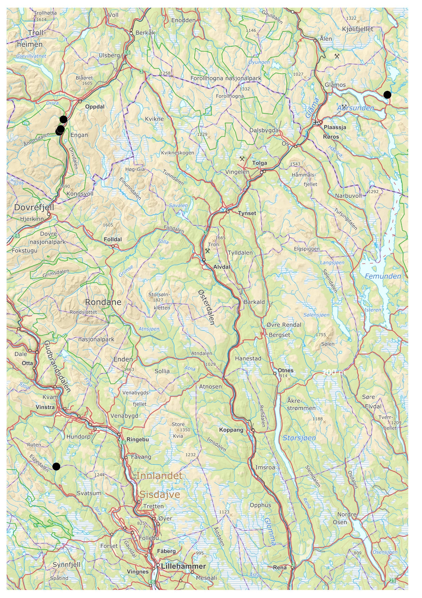
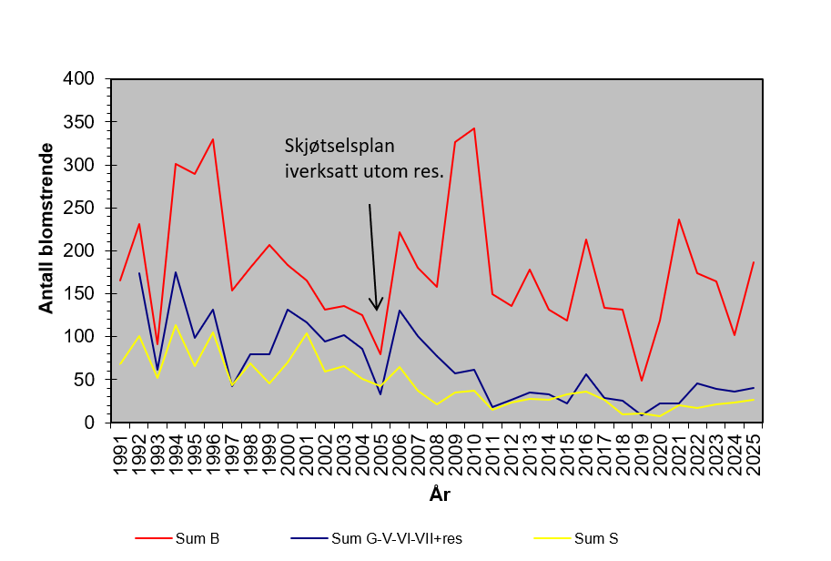
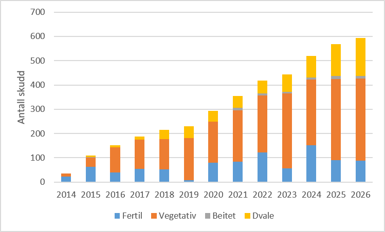

<!--# Rapporten leser kun filer i img/. Tekstgrunnlaget er «Vedlegg årsrapport 2026_svartkurle_DIØ_HB_AL_D.docx» (P:/2026_subprojects/Svartkurle). -->

```{r setup}
#| include: false
#| cache: false
library(knitr)
library(tidyverse)
library(kableExtra)
library(here)
library(anybadger)
library(yaml)
library(tibble)
library(conflicted)
library(readxl)
conflicts_prefer(dplyr::filter)
conflicts_prefer(dplyr::lag)
conflicts_prefer(dplyr::select)
pull <- dplyr::pull
```

<!--# The following parts are autogenerated. Do not edit. -->

```{r source}
#| echo: false
#| cache: false
source(here::here("_common.R"))

# Badges som markdown (for README.md på GitHub), med relativ sti til versjonsbadgen
md_badge <- function(tag) {
  src <- sub(paste0(here::here(), "/"), "", tag$children[[1]]$attribs$src, fixed = TRUE)
  sprintf("[](%s)", src, tag$attribs$href)
}
```

:::: {.content-visible when-format="gfm"}
::: callout-note
Denne siden er generert fra [`Svartkurle.qmd`](Svartkurle.qmd). Ikke rediger `README.md` direkte. For å oppdatere: kjør skriptene i [`code/`](code/) og kjør `pixi run render`. Rapporten har ingen egne analyser; figurene ligger i [`img/`](img/).
:::

`r paste(md_badge(status_badge(as.character(st))), md_badge(version_badge(as.character(version[[1]]))), md_badge(data_badge(as.character(badges[[1]]))), md_badge(code_badge(as.character(badges[[2]]))), md_badge(open_science_badge(as.character(badges[[3]]))), md_badge(license_badge()))`
::::

:::: {.content-visible when-format="html"}
```{r reviewers}
#| echo: false
#| results: asis

if (!is.null(yaml_data$codeReviewers)) {
  reviewers <- purrr::map_chr(yaml_data$codeReviewers, "name")

  htmltools::HTML(paste0(
    '<div id="title-block-header" class="quarto-title-block default">
       <div class="quarto-title-meta">
         <div>
           <div class="quarto-title-meta-heading">Reviewed by</div>
           <div class="quarto-title-meta-contents">',
    paste(reviewers, collapse = "; "),
    '</div>
         </div>
       </div>
     </div>',
    sep = ""
  ))
}
```

::: {layout-ncol="6"}
```{r statusBadge}
#| echo: false
status_badge(as.character(st))
```

```{r versionBadge}
#| echo: false
version_badge(my_version_number = as.character(version[[1]]))
```

```{r dataBadge}
#| echo: false
data_badge(as.character(badges[[1]]))
```

```{r codeBadge}
#| echo: false
code_badge(as.character(badges[[2]]))
```

```{r openScienceBadge}
#| echo: false
open_science_badge(as.character(badges[[3]]))
```

```{r licenseBadge}
#| echo: false
license_badge()
```
:::
::::

> **Recommended citation**: `r paste(auth, " ", year, ". ", name, " (ID: ", folder_name, ") ", "v. ", version, ". ecRxiv: ", url, sep="")`

::: {.callout-tip collapse="true"}
## Metadata

```{r tbl-meta2}
#| tbl-cap: 'Indicator metadata'
#| echo: false
#| warning: false
meta |>
  dplyr::filter(Variable %in% c(
    "Indicator ID",
    "Indicator Name",
    "verbatimName",
    "Continent",
    "Country",
    "Realm",
    "Biome",
    "Ecosystem",
    "verbatimEcosystem",
    "Year added",
    "Last update",
    "Version",
    "Version comment",
    "Precision")) |>
  kable()
```
:::

::: {.callout-tip collapse="true"}
## Log

<!--# Legg til en kort linje for hver oppdatering -->

11. nov. 2026 – Første versjon
:::

<hr />

## Oppsummering

Orkideen svartkurle er knyttet til det tradisjonelle kulturlandskapet. Arten finnes bare i Norge og Sverige, og er oppført som sterkt truet (EN). Prosjektet har som mål å stanse tilbakegangen og fremme forekomstene av arten på noen lokaliteter gjennom skjøtselstiltak. Effektene av tiltak (slått og beite) på populasjonsstørrelse og populasjonsstruktur vil bli dokumentert. Uten skjøtselstiltak forventer vi lokal utdøing i skjøtselsavhengige lokaliteter, og kun overlevelse i isolerte populasjoner i fjellet. På grunn av stor variasjon over år i antall skudd med arten og antall blomstrende skudd må en overvåking ha et langsiktig perspektiv for å gi gode svar på utviklingen.

I prosjektet utgjør lokalitetene Svanvollen og Sølendet grunnlaget. I tillegg foreslår vi å følge opp svartkurle i faste prøveflater i Kvikne-fjella (Tynset kommune, referanse), samt flere skjøtselsavhengige lokaliteter i Oppdal. Som skjøtselstiltak foreslår vi slått og/eller beite, hovedsakelig seint i sesongen, etter blomstring.

Datainnsamlingen vil gjøres ved telling av blomstrende skudd og oppfølging (status (fertil/vegetativ), størrelse) av individer av svartkurle i faste prøveflater på 1 × 1 m. Individene stedfestes ned til nærmeste cm og merkes. Foreløpig er det kun foretatt oppsummering og deskriptive analyser av dataene. I tillegg er det gjennomført en masteroppgave fra Sølendet (2026). Resultatene så langt tyder på at beite er viktigst. Tiltakene så langt har gitt en økning i forekomsten av svartkurle i Oppdal-lokalitetene, men ikke på Svanvollen eller Sølendet.

## English summary

<!--# Utkast. Skal kontrolleres av prosjektledergruppa mot den endelige norske oppsummeringen. -->

The black vanilla orchid (*Nigritella nigra*) is associated with the traditional cultural landscape. It is found only in Norway and Sweden, and is listed as endangered (EN). The project aims to halt its decline and to strengthen populations at selected sites through management. The effects of management (mowing and grazing) on population size and population structure will be documented. Without management we expect local extinction at sites that depend on it, with the species surviving only in isolated populations in the mountains. Because the number of shoots and flowering shoots varies greatly between years, monitoring must take a long-term perspective to give reliable answers about population trends.

The project is based on the sites Svanvollen and Sølendet. In addition, we propose following the species in permanent plots in the Kvikne mountains (Tynset municipality) as a reference, and at several management-dependent sites in Oppdal. As management, we propose mowing and/or grazing, mainly late in the season after flowering.

Data will be collected by counting flowering shoots and by following individual plants (status (flowering/vegetative) and size) in permanent 1 × 1 m plots. The plants are mapped to the nearest centimetre and marked. So far, the data have only been summarised and analysed descriptively, and a master's thesis from Sølendet was completed in 2026. The results so far suggest that grazing is the most important measure. Management has so far increased the number of black vanilla orchids at the Oppdal sites, but not at Svanvollen or Sølendet.

## 1. Innledning

Orkideen svartkurle er knyttet til det tradisjonelle kulturlandskapet, og har hoveddelen av sine leveområder på åpne arealer som er brukt til slått og beite. Svartkurle finnes bare i Norge og Sverige, og er oppført som sterkt truet (EN) både i den norske og den svenske rødlista. Arten har gått drastisk tilbake i begge land. I Sverige kom tilbakegangen tidligere og har vært mer omfattende enn i Norge. Forskjellene henger sammen med at det tradisjonelle utmarksbruket (utmarksslått, seterbruk og lignende) ble avsluttet vesentlig tidligere i Sverige enn i Norge. Dessuten lå veldig mange av lokalitetene av svartkurle i Sverige i lavlandet (sørboreal vegetasjonssone), der gjengroingen går raskere enn i høyereliggende områder, der de fleste norske forekomstene ligger.

Arten vokser hovedsakelig i baserike og ugjødsla, relativt fuktige (eller sesongfuktige) slåttemarker og beitemarker med artsrik vegetasjon i høyereliggende strøk (mellomboreal–lavalpin). Det var per 2023 111 kjente lokaliteter av svartkurle [@kyrkjeeide_2023], men nesten halvparten av dem er trolig utgått. Arten finnes i hovedsak i et kjerneområde nord i Innlandet og sør i Trøndelag.

Svartkurle tilhører orkidéfamilien og slekta *Nigritella*. Denne slekta er kompleks og består av arter med ulike antall kromosomsett eller ploidinivå [@hedren_1999]. Artsavgrensingene er uklare, og antallet arter varierer i litteraturen, men mange regner om lag 14 arter til slekta [bl.a. @brutsch_2000], og disse er hjemmehørende i fjellområder i Europa. Det er nært slektskap mellom *Nigritella* og *Gymnadenia* (brudespore m.fl.), og nyere forskning tyder på at slektene bør slås sammen til *Gymnadenia*. Det er bl.a. brukt hos @kuhn_2019 og i den svenske rødlista. I Norge brukes navnene svartkurle og *Nigritella nigra* [@elven_2022].

Blomstrende svartkurle er vanligvis 10–23 cm høy [@moen_2003], men det er målt opptil 29 cm høye individer i Sølendet naturreservat og på Svanvollen i Håkåsæter naturreservat i Sør-Fron (upubl. data). De mørkt rødbrune blomstene sitter i tette aks eller hoder og har en svak vaniljelukt. Antallet blomster er høyt, vanligvis mellom 20 og 40. Kronbladene spriker slik at blomsten får form av en sekskantet stjerne, og i motsetning til hos de fleste norske orkideer vender leppa oppover. Svartkurle blomstrer på de lavestliggende lokalitetene fra slutten av juni. På Sølendet er blomstringen vanligvis i første halvdel av juli, og på fjellokalitetene enda senere, ofte fram til begynnelsen av august. Bladene er linjeformet, sitter i rosett og er grågrønne til blågrønne. Sterile eksemplarer kan være vanskelige å oppdage. De kan minne om små grasplanter, men bladene mangler en tydelig kjøl og har avrundet bladspiss. For en mer detaljert beskrivelse av arten, se @moen_2003 [-@moen_2009].

## 2. Formål med delprosjektet

### 2.1 Målsetning med tiltakene og overvåkingen

-   Stanse tilbakegangen av svartkurle i Norge, og på noen lokaliteter fremme forekomstene av arten gjennom å innføre skjøtselstiltak.
-   Øke kunnskapen om, og dokumentere effektene av, tiltak (slått og beite) på populasjonsstørrelse og populasjonsstruktur hos svartkurle.

### 2.2 Forventninger

Uten målrettede skjøtselstiltak forventer vi en langsom tilbakegang i alle skjøtselsavhengige lokaliteter, som vil ende i lokal utdøing. Arten kan muligens overleve i isolerte populasjoner i fjellet, men vil der være utsatt for tilfeldige hendelser og klimaendringer. Aktuelle skjøtselstiltak er rydding av kratt og trær (der det er gjengrodd) og gjenopptakelse av slått eller beite for å redusere konkurransen i feltsjiktet.

Vi forventer at slike skjøtselstiltak på lang sikt vil gi en vegetasjonssammensetning og -struktur som er gunstig for svartkurle, og bidra til større lokale populasjoner. Vi forventer stor variasjon over år i antall skudd med arten og antall blomstrende skudd, og en overvåking må derfor ha et langsiktig perspektiv for å gi gode svar på utviklingen.

## 3. Overvåkingslokalitetene

### 3.1 Beskrivelse av lokalitetene

I prosjektet utgjør lokalitetene Svanvollen og Sølendet grunnlaget (@fig-kart). Her finnes det gode, lange dataserier. På Sølendet i Røros kommune er det aktuelt å innlemme nye prøveflater som ble etablert i forbindelse med masteroppgaven til Frida Nes Bjerva [@bjerva_2026]. I tillegg foreslår vi å følge opp svartkurle i faste prøveflater i Kvikne-fjella (Tynset kommune), etablert av Dag-Inge Øien [@oien_2015], samt flere lokaliteter i Oppdal som følges av Miljøfaglig Utredning (se under).

```{r fig-kart}
#| fig-cap: 'Kart over de fem eksisterende overvåkingslokalitetene som foreslås inkludert.'
#| code-summary: 'Kode for figur.'
#| out-width: 70%

```

Populasjonene i Kvikne ligger over skoggrensa og representerer voksesteder som trolig ikke er avhengige av skjøtsel. Disse kan tjene som en referanse som viser om utviklingen i populasjonene i kulturlandskapet skyldes lokale (f.eks. hevd) eller regionale (f.eks. klima) påvirkninger. Denne aktiviteten vil i tillegg sikre overføring av feltkompetanse. Vi foreslår i utgangspunktet å oppsøke Kvikne-lokalitetene én gang i perioden, og dette gjenspeiles i et større feltbudsjett for 2027.

Det foregår skjøtsel på en rekke lokaliteter med svartkurle i Oppdal, og det er også overvåking her, men begrenset til registrering av blomstrende skudd [@lorentzen_2022]. Vi foreslår å innlemme minst tre av lokalitetene i Drivdalen i overvåkingen. To av lokalitetene som følges i Oppdal, er fjellokaliteter som er paralleller til Kvikne-lokalitetene.

Dagens skjøtselsregime på Sølendet ser ut til å ha begrenset effekt på vegetasjonsstrukturen, noe som tyder på at hyppigere eller mer målrettede tiltak kan være nødvendig for å opprettholde gunstige habitatforhold for svartkurle [@bjerva_2026]. Så langt framstår beite som den mest gunstige skjøtselsmetoden for artens vitalitet (@fig-solendet). Videre oppfølging av svartkurle på Sølendet bør inkludere kontinuerlig overvåking av tetthet, vitalitet og antall blomstrende individer for å følge bestandsutviklingen og evaluere hvordan orkideen responderer på skjøtsel over tid.

```{r fig-solendet}
#| fig-cap: 'Foreløpige resultater fra telling av blomstrende individer på Sølendet 1991–2025. Forløpet for delpopulasjoner med ulik behandling er vist: rød linje = beiting (+ slått); gul = slått; blå = uten skjøtsel. Delpopulasjonene som slås, er i utgangspunktet mindre enn de som beites.'
#| code-summary: 'Kode for figur.'

```

Svanvollen ligger sør i Håkåsæter naturreservat i Sør-Fron kommune, Innlandet fylke. Svartkurle ble her oppdaget på en beitevoll sør i reservatet i 1998 [@bratli_1999]. Lokaliteten ligger 710 moh. og består av semi-naturlig eng omgitt av grandominert barskog. Selve vollen dekker ca. 23 daa. Det er flere setre i området, og besetninger fra nærliggende setre har tidligere beitet på vollen. Setringen opphørte på slutten av 1950-tallet eller først på 1960-tallet. Siden har det vært beiting av storfe og sau som går fritt i området. Svanvollen består av to delområder skilt med et bekkedrag, litt fuktmarksvegetasjon og litt tredekt areal, tidligere trolig åpen eng. Hovedforekomsten med svartkurle (505 merkede skudd) står på delområdet lengst vest, langs Håkåsætervegen, mens resten av populasjonen (94 merkede skudd) står på dellokaliteten lengst øst.

I Oppdal følges svartkurle årlig på i alt 15 lokaliteter. 13 av disse er under skoggrensa og to er i fjellet. I 2025 ble det registrert 615 blomstrende skudd fordelt på 12 lokaliteter [@bolstadheien_2025]. Lokalitetene under skoggrensa regnes som skjøtselsbetinga, og de fleste har skjøtselsplaner. Tyngdepunktet er i Drivdalen, og her ligger de største lokalitetene (Høgvamran, Vammervoll og Skorem) i nokså tett samling. Utviklingen har vært positiv på de fleste lokalitetene, men én lokalitet med skjøtsel (Drivstua) anses som i beste fall usikker. Årsrapporter fra denne overvåkingen finnes på nettsidene til jbjordal.no eller Miljøfaglig Utredning.

### 3.2 Tiltak

På Sølendet blir en del av populasjonene inne i reservatet slått med tohjulstraktor etter blomstring hvert tredje til femte år. Noen populasjoner vokser i uskjøttet (gjengroende) areal og brukes som referanse. Utenfor reservatet ble noen delpopulasjoner ryddet i 2005 og årlig beitet av storfe i perioden 2005–2013, og deretter slått med tohjulstraktor i 2016 og 2018 [@oien_2005; @oien_2026]. Resten av delpopulasjonene har ikke blitt skjøttet, men er noe påvirket av beite fra ville dyr i området og vandrende tamrein. I reservatet organiseres skjøtselen av SNO, men det praktiseres innleie av mannskap. Over tid har det vært en betydelig utskifting av personell. Utenfor reservatet ble beitingen gjennomført av grunneier, men da melkedrifta ble lagt ned i 2013, tok dette slutt. Skjøtsel og overvåking rapporteres årlig, og det er publisert rapporter tilbake til 1980-tallet. Disse er tilgjengelige via nettsidene til NTNU Vitenskapsmuseet.

Skjøtselsplan for Svanvollen ble utarbeidet i 2003 [@bratli_2003], men årlige observasjoner viste gradvis nedgang i antall blomstrende individer. Skjøtselsplanen ble derfor revidert i samråd med Statsforvalteren i 2013 [@bratli_2013]. I 2014 ble hovedforekomsten lengst vest langs Håkåsætervegen inngjerdet for å holde dyr på utmarksbeite unna forekomsten under blomstring og fruktsetting. Grindene står åpne tidlig på forsommeren og om høsten for beiting utenom blomstringen (ca. 15.06–15.08). Den østre delen av vollen ligger utenfor inngjerdet område, og denne delen blir beitet av sau og storfe som går i utmarka. Sommeren 2014 ble det etablert fire storruter på 20 × 20 m, to innenfor gjerdet og to utenfor. To av rutene, henholdsvis utenfor og innenfor gjerdet, slås årlig, mens de to andre ikke blir slått. Dette gir følgende skjøtsel i de fire rutene (@fig-svanvollen):

1.  **Slått, ikke sommerbeite:** slått og inngjerdet – ikke beite i perioden 20.06–15.08, og slått seint i sesongen.
2.  **Ikke slått, ikke sommerbeite:** inngjerdet – ikke beite i perioden 20.06–15.08, men uten slått.
3.  **Slått og sommerbeite:** utenfor inngjerdet areal og beite hele sommeren. Slått seint i sesongen.
4.  **Ikke slått og sommerbeite:** utenfor inngjerdet areal og beite hele sommeren. Ingen slått.

I praksis har et større areal enn det planlagte inne i innhegningen blitt slått flere år. Grove skisser av slått areal finnes i årlige rapporter om skjøtselen.

```{r fig-svanvollen}
#| fig-cap: 'Svanvollen i 2016. Foto: NINA.'
#| fig-subcap:
#|   - 'Slått i felt 1.'
#|   - 'Felt 3 uten slått.'
#| code-summary: 'Kode for figur.'
#| layout-ncol: 2
include_graphics(c("img/svanvollen_felt1_slatt.jpg", "img/svanvollen_felt3_uslatt.jpg"))
```

<!--# Fotograf er ukjent for bildene fra Svanvollen 2016, derfor «Foto: NINA». Figurteksten «Felt 3 uten slått» er fra utkastet, men ifølge lista over er felt 3 slått og felt 4 uten slått – kontroller. -->

## 4. Datainnsamling

På Sølendet er populasjonen av svartkurle delt inn i 30 delpopulasjoner/delområder, 13 inne i reservatet og 17 utenfor. Antall blomstrende individer telles i hvert av delområdene hvert år. I tillegg er det etablert 13 faste prøveflater, de fleste 1 × 1 m, der individer av svartkurle stedfestes ned til nærmeste cm, merkes og følges (status (fertil/vegetativ), størrelse). Åtte av prøveflatene ligger innenfor skjøttet areal (slått eller beite/slått), og fem er referanse. I tillegg etablerte Frida Nes Bjerva ti prøveflater i 2025 i forbindelse med sitt masterarbeid [@bjerva_2026], der vegetasjon og forekomst av svartkurle (antall, høyde, antall blomster) ble registrert.

På Svanvollen registreres alle observerte svartkurleskudd. Hvert skudd merkes og måles, og har blitt fulgt årlig fra 2014 til 2026. Alle nye skudd som påtreffes, merkes og måles årlig på samme måte. Merkingen består av små merkepinner satt ned ved hvert skudd og større plastpinner som letter gjenfinning. Skuddene er plottet på kart, og i en del tilfeller er det også målt avstander mellom skudd eller mellom faste punkter. Registreringene planlegges videreført etter samme metode. Livsstadium blir notert som fertil, vegetativ eller beitet. For fertile skudd blir skuddhøyde og høyde og bredde på blomsterstanden målt. For hvert skudd blir antall blad i bladrosetten og bredde og lengde på lengste blad målt.

Sommeren 2014 ble det lagt ut 40 småruter på 0,5 × 0,5 m. De 40 smårutene ble plassert i de fire storrutene med ti småruter i hver, og har følgelig ulike tiltak (se over). Vegetasjonen i smårutene er registrert etter standard vegetasjonsanalytisk metode hvert år fra 2014 til 2022. Alle karplanter er registrert med forekomst/fravær i 16 småruter, pluss prosent dekning. Vegetasjonshøyde er målt i hver smårute. Sjiktdekning (tre-, busk-, felt- og bunnsjikt pluss bar mark) og noen økologiske målinger er foretatt i rutene.

Datainnsamlingen som tenkes gjort på nye overvåkingslokaliteter, bør gi data som er kompatible med dem som samles inn på Sølendet og Svanvollen. Telling av blomstrende skudd og innmåling av skudd for å følge utviklingen av disse over år er aktuelt. Demografiske målinger av skuddene inkluderer de parameterne som brukes på Sølendet og Svanvollen. Vegetasjonsanalyser i ruter (0,5 × 0,5 m eller 1 × 1 m) anbefales inkludert, men trolig ikke oftere enn hvert femte år på grunn av ressursbruk. På grunn av slåtte- og beiteaktivitet kan vegetasjonsruter trolig ikke merkes med fastmerker som hovedregel, men koordinaten i sørvestre hjørne bør registreres med høyoppløselig GPS. Indikatorene er oppsummert i @tbl-indikatorer.

```{r tbl-indikatorer}
#| tbl-cap: 'Indikatorer for overvåking av svartkurle.'
#| code-summary: 'Kode for tabell.'
tribble(
  ~Indikator, ~`Variabel registrert i felt`, ~Utvalgsenhet, ~`Utlegging av utvalgsenhet`, ~`Antall utvalgsenheter`, ~`Frekvens for datainnsamling`,
  "Populasjonsstørrelse svartkurle", "Antall individer av svartkurle", "1 × 1 m", "Stratifisert tilfeldig", "10 er sannsynlig, 20 er ønskelig", "Årlig",
  "Populasjonsstruktur svartkurle", "Antall individer i to klasser: vegetative, fertile. Registrer høyde på de fertile", "1 × 1 m", "Stratifisert tilfeldig", "10 er sannsynlig, 20 er ønskelig", "Årlig",
  "Artsrikdom – alle karplantearter", "Forekomst og mengde (% dekning) av alle karplanter", "1 × 1 m", "Stratifisert tilfeldig", "10 er sannsynlig, 20 er ønskelig", "Første år, deretter hvert femte år",
  "Artssammensetning", "Forekomst og mengde (% dekning) av alle karplanter", "1 × 1 m", "Stratifisert tilfeldig", "10 er sannsynlig, 20 er ønskelig", "Første år, deretter hvert femte år",
  "Artsrikdom og dekning av pollinatorplanter", "Forekomst og mengde (% dekning) av alle urter (ikke-vedaktige blomstrende planter)", "1 × 1 m", "Stratifisert tilfeldig", "10 er sannsynlig, 20 er ønskelig", "Første år, deretter hvert femte år",
  "Busksjikt og forvedete arter i feltsjiktet over 30 cm", "Forekomst og mengde (% dekning)", "1 × 1 m", "Stratifisert tilfeldig", "10 er sannsynlig, 20 er ønskelig", "Årlig",
  "Vegetasjonshøyde", "Vegetasjonshøyde (cm) i feltsjiktet registrert i fire hjørner i hver rute. Busksjikt: avstand fra midtpunkt i ruta, registrer høyde", "1 × 1 m", "Stratifisert tilfeldig", "10 er sannsynlig, 20 er ønskelig", "Årlig",
  "Tiltak i vegetasjonsrute", "Slått: ja/nei. Beite: ja/nei", "1 × 1 m", "Stratifisert tilfeldig", "10 er sannsynlig, 20 er ønskelig", "Slått f.eks. hvert år til hvert tredje år, beiting hvert år. Dette varierer mellom lokaliteter",
  "Areal med tiltak", "Areal med tiltak", "Polygon", "Heldekkende", "–", "Hvert år"
) |>
  kable()
```

## 5. Dataanalyser

Foreløpig er det kun foretatt oppsummering og deskriptive analyser av dataene. I tillegg er det gjennomført en masteroppgave fra Sølendet [@bjerva_2026].

## 6. Resultater

### 6.1 Svanvollen

I alt er det merket 593 skudd på Svanvollen. En stor andel av disse er vegetative (@fig-livsstadier). Mange har heller ikke dannet overjordsskudd på flere år og er trolig døde. Det er foreløpig ikke gjennomført analyser som viser utviklingen innen de ulike skjøtselstiltakene. Oppsummeringen viser at antallet merkede skudd øker over tid, men et ukjent antall av disse er døde. Omfanget og lengden av underjordisk dvale er ukjent. Antallet overjordsskudd har også økt jevnt, men har flatet ut de siste tre årene. Videre registreringer i kommende år vil vise om antallet stagnerer eller øker. Dataene gir også grunnlag for mer detaljerte undersøkelser av populasjonsutviklingen på Svanvollen, som også kan gi indikasjoner på artens overlevelsesmuligheter på lokaliteten.

```{r fig-livsstadier}
#| fig-cap: 'Fordeling av svartkurleskudd på Svanvollen etter livsstadium i årene 2014–2026.'
#| code-summary: 'Kode for figur.'
#| out-width: 70%

```

Vegetasjonsrutene fanger opp et begrenset antall svartkurleplanter, mens storrutene fanger opp en større andel av forekomsten. Av de 40 analyserutene er det kun svartkurleplanter i 13 ruter, til sammen 29 skudd. I storrute 1 og 2 er det fem ruter med skudd i hver. I storrute 3 er det ingen ruter med skudd, mens det i storrute 4 er to ruter med skudd. Antallet skudd per rute varierer mellom ett og seks. Fem av de 13 rutene har ett skudd. Ikke alle skudd er framme årlig, og noen er trolig døde.

I alt finnes 504 skudd innenfor innhegningen, mens 89 skudd er utenfor. Det er også skjev fordeling av antall skudd mellom de fire storrutene. Rute 1 (innhegning, uten sommerbeite, med slått) har 105 skudd. Rute 2 (innhegning, uten sommerbeite og uten slått) har 104 skudd. Rute 3 (utenfor innhegning, med sommerbeite og slått) har 20 skudd. Rute 4 (utenfor innhegning, uten slått og med sommerbeite) har 38 skudd. Det er ikke foretatt oppsummering eller analyser av endringer over tid for svartkurleskudd innen hver av storrutene med tiltak.

### 6.2 Oppdal

Under ledelse av John Bjarne Jordal (jbjordal.no og Miljøfaglig Utredning) har svartkurle i Oppdal kommune blitt kartlagt og overvåket siden 2007 [se f.eks. @lorentzen_2022]. I denne perioden har det blitt satt inn tiltak for å ta vare på svartkurle på en rekke lokaliteter, og med godt resultat. Antall blomstrende skudd varierer mye mellom år, men viser en oppadgående trend det siste tiåret, kommunen sett under ett [@bolstadheien_2025]. Bestanden anslås nå til flere tusen individer. Det har vært gjort et stort arbeid med rydding av kratt og åpning av areal i gjengroing på mange av Oppdal-lokalitetene.

## 7. Oppsummering

### 7.1 Hva viser årets resultater

På Sølendet har det vært en nedadgående trend i blomstrende skudd av svartkurle siden slutten av 1970-tallet. Det kan tenkes at antallet blomstrende skudd var særlig høyt da tellingene startet, siden det er kjent at mange arter responderer på opphørt bruk med en midlertidig økning i blomstring. Datamaterialet tyder på at beite er bedre enn slått for å opprettholde bestanden, og at en kombinasjon er gunstig. @bjerva_2026 viser at høyden på svartkurle øker med vegetasjonens høyde inntil noe over 30 cm, og dette er trolig en grense der arten ikke lenger klarer å konkurrere. Det vil si at feltsjiktet bør holdes under ca. 30 cm for at svartkurle skal ha mulighet til langsiktig overlevelse.

Data fra Svanvollen er ikke ferdig analysert med sikte på effekten av de ulike tiltakene. Det er derfor for tidlig å peke på noen sikker effekt av tiltakene, men observasjonene gir indikasjoner på at populasjonen på Svanvollen under ett er stabil og kanskje øker noe. Det er imidlertid også stor mellomårsvariasjon, der blant annet værforholdene foregående år, eller våren eller forsommeren samme år, kan spille inn.

Den viktigste erfaringen fra skjøtselen i Oppdal er at et hevdregime med slått og beite er gunstig, og at beiting trolig er viktigst for å opprettholde gode bestander av svartkurle [@bolstadheien_2025]. Her er imidlertid måten beitingen gjøres på essensiell, og John Bjarne Jordal (pers. medd.) har følgende anbefaling:

-   Vårbeiting fram til 1. juni.
-   Unngå beite i perioden ca. 1. juni – ca. 15. august.
-   Høstbeiting i perioden etter frøsetting og frømodning.
-   Eventuell slått gjennomføres seint i vekstsesongen, etter frømodning.

Erfaringer viser at ei enkelt søye kan spise alle blomstrende svartkurler på ei eng i løpet av ei natt, og det er derfor avgjørende å unngå beite i blomstringsperioden. Inngjerding eller bruk av bur for å skjerme populasjoner og enkeltskudd er et enkelt og effektivt tiltak. En suksessfaktor som trekkes fram i Oppdal, har vært godt samarbeid med grunneiere over tid.

### 7.2 Anbefaling for videreføring

Det bør i forkant av feltsesongen 2027 gjøres en vurdering av hvordan data fra Svanvollen kan brukes i den videre overvåkingen. Det bør undersøkes om det er forskjeller i utviklingen av svartkurleskudd innen hver av storrutene med tiltak. Det bør også gjennomføres en vegetasjonsanalyse av de 40 rutene for å se hvordan artssammensetning og vegetasjonsstruktur (høyde og sjiktning) endrer seg over tid i de ulike tiltakene. Dette kan bidra til å tolke endringene for svartkurleplanter over tid i de ulike tiltakene. På bakgrunn av dette bør det blant annet vurderes om antall ruter innen de ulike tiltakene bør økes. Det kan også være aktuelt å inkludere et tiltak med slått hvert annet eller tredje år.

Egne observasjoner fra Svanvollen indikerer at blomstrende svartkurleplanter utenfor innhegningen er utsatt for beite. Dersom analysene indikerer sterkere nedgang utenfor innhegningen, bør det også vurderes å tilpasse tiltakene, for eksempel ved at også planter utenfor innhegningen unntas fra sommerbeite. Samtidig er det nødvendig å ha kontroll på vegetasjonshøyde og tetthet.

På Sølendet og i Kvikne brukes rutestørrelse 1 m², mens rutestørrelsen på Svanvollen er 0,25 m². Det bør vurderes i hvilken grad dette kompliserer sammenligningen mellom lokalitetene, og hvilken rutestørrelse som anbefales ved etablering av eventuelle nye ruter.

Undersøkelsene fra Sølendet og Svanvollen representerer langtidsdata fra to viktige lokaliteter og bør derfor videreføres. Samtidig finnes arten med små populasjoner på flere lokaliteter. Trolig er artens langsiktige overlevelse forskjellig i små og store populasjoner. Det bør vurderes om det er mulig å innlemme små populasjoner, for eksempel i Nord-Østerdalen. Det bør inkluderes lokaliteter i dårlig tilstand, enten som referanse for utvikling uten tiltak, eller for å overvåke effekten av tiltak som i dag er lite brukt, som reetablering av populasjoner via innsåing av frø eller utplanting/transplantasjon. Samtidig er det utfordrende å lage et opplegg med ulike tiltak i forekomster med bare et fåtall planter. Viktige lokaliteter i Oppdal bør uansett inkluderes i overvåkingen, og arbeidet med skjøtsel i Oppdal kan tjene som et godt eksempel på hvordan grunneiere kan engasjeres for å ta vare på arten. Nord-Østerdalen peker seg ut som et område der en systematisk innsats etter mønster fra Oppdal kan prøves ut. Før dette skjer, må det utarbeides standardisert metodikk for nye lokaliteter som inkluderes.

## 8. Referanser

::: {#refs}
:::

## 9. Author contributions

-   Harald Bratli: forfatter
-   Dag-Inge Øien: forfatter
-   Anders Lyngstad: tilrettelegging, forfatter
-   Marianne Evju: tilrettelegging
-   Ruben Erik Roos: tilrettelegging
-   John Bjarne Jordal: diskusjonspartner, overvåkingsdata
-   Frida Nes Bjerva: analyser, dataleveranse

:::: {.content-visible when-format="html"}
::: {.callout-tip collapse="true"}
## Session Info

This information is mainly aimed at developers that need to recreate the R environment that produced the html.

```{r sessionInfo}
#| echo: false
sessionInfo()
```
:::
::::
