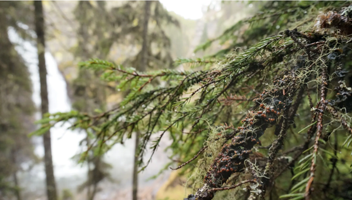
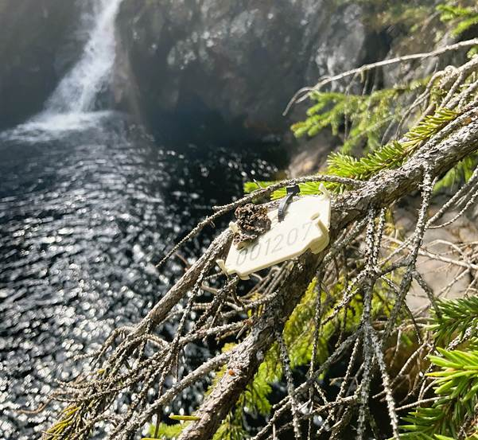
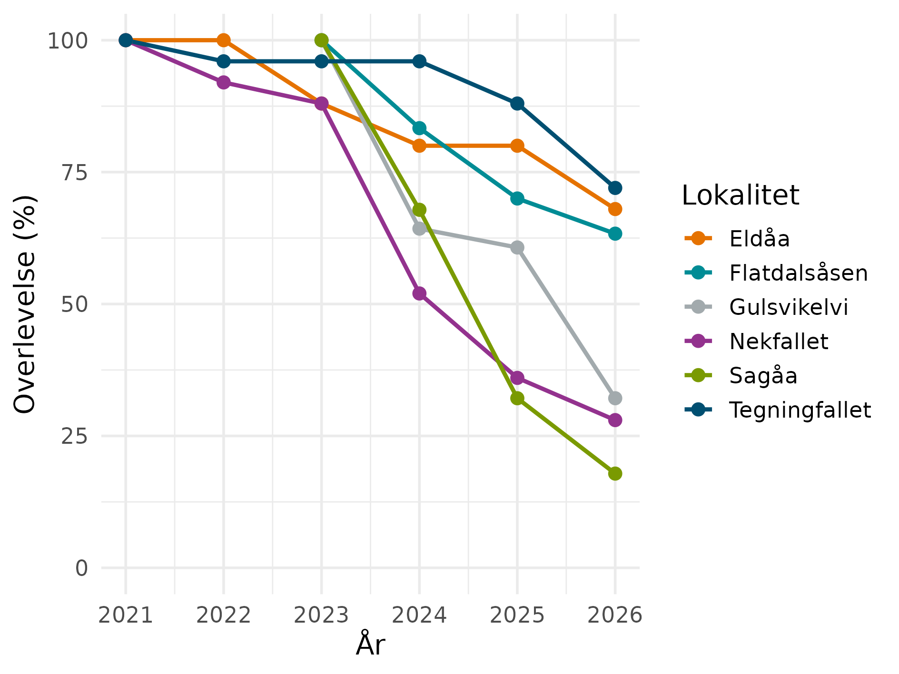
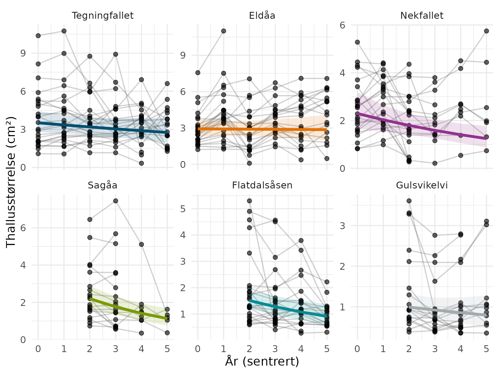
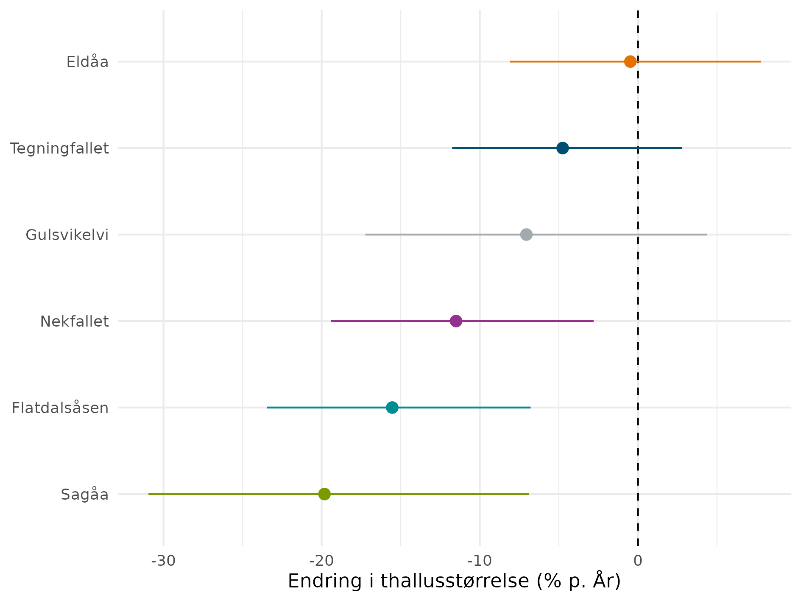
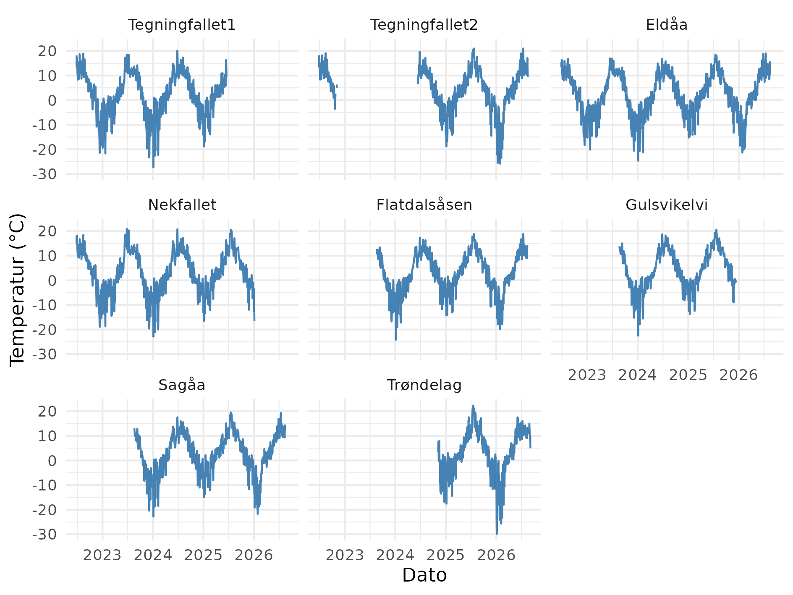
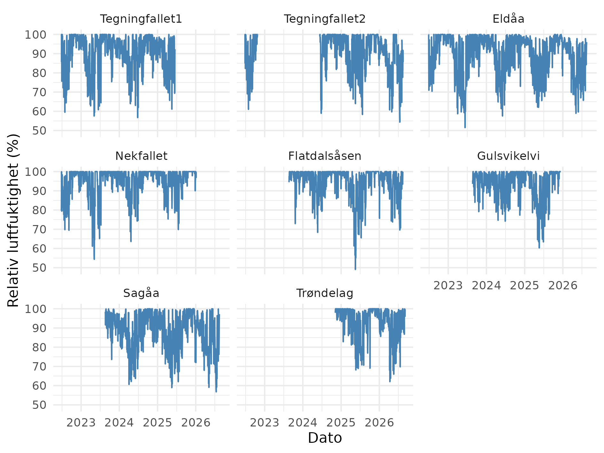
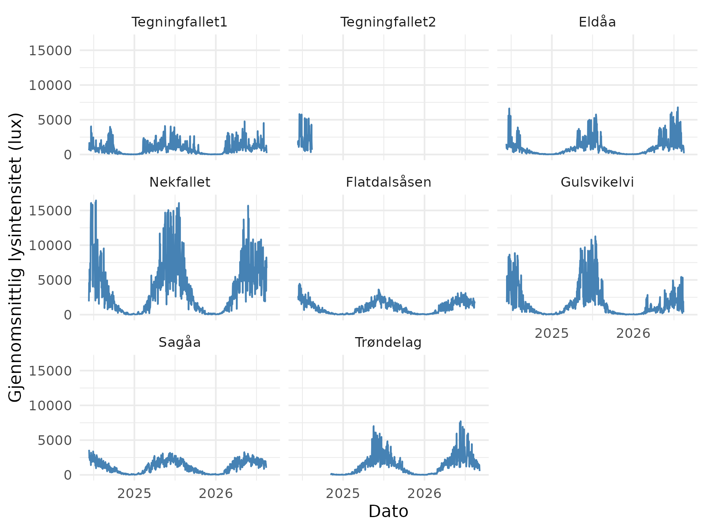
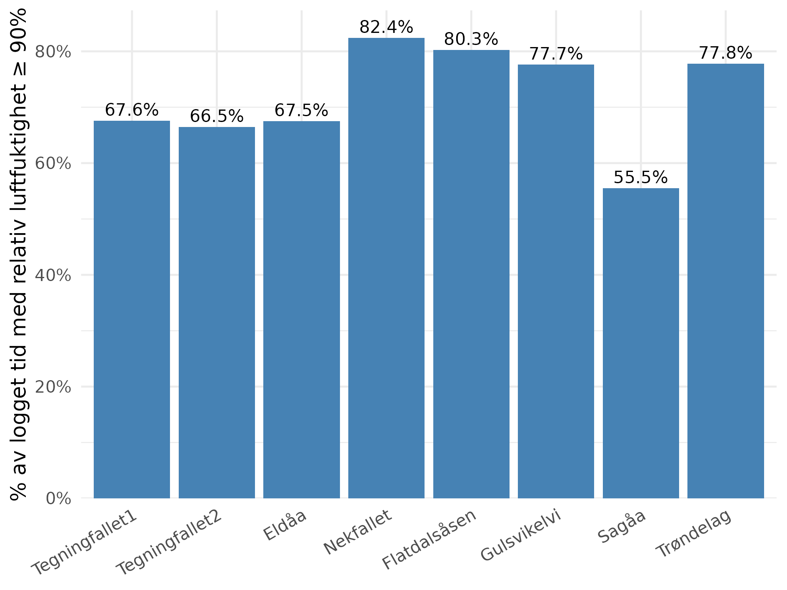
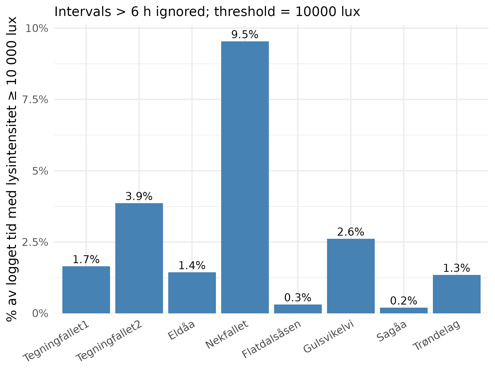

<!--# Rapporten leser kun filer i data/ og img/. Figurene lages av skriptene i code/ (02 og 03); rapporten lager ingen figurer selv, men regner ut tabellene for overlevelse, arealendring, vannkjemi og mikroklima fra filene i data/. Tekstgrunnlaget er Mathias Andreasens utkast «Trønderlav årsrapport 2026.docx» (P:/08 Trønderlav/2026). -->

```{r setup}
#| include: false
#| cache: false
library(knitr)
library(tidyverse)
library(kableExtra)
library(here)
library(anybadger)
library(yaml)
library(tibble)
library(conflicted)
library(readxl)
conflicts_prefer(dplyr::filter)
conflicts_prefer(dplyr::lag)
conflicts_prefer(dplyr::select)
pull <- dplyr::pull
```

<!--# The following parts are autogenerated. Do not edit. -->

```{r source}
#| echo: false
#| cache: false
source(here::here("_common.R"))

# Badges som markdown (for README.md på GitHub), med relativ sti til versjonsbadgen
md_badge <- function(tag) {
  src <- sub(paste0(here::here(), "/"), "", tag$children[[1]]$attribs$src, fixed = TRUE)
  sprintf("[](%s)", src, tag$attribs$href)
}
```

:::: {.content-visible when-format="gfm"}
::: callout-note
Denne siden er generert fra [`Tronderlav.qmd`](Tronderlav.qmd). Ikke rediger `README.md` direkte. For å oppdatere: kjør skriptene i [`code/`](code/) slik at dataene i [`data/`](data/) og figurene i [`img/`](img/) blir oppdatert, og kjør `pixi run render`. Se [`code/README.md`](code/README.md) for rekkefølgen.
:::

`r paste(md_badge(status_badge(as.character(st))), md_badge(version_badge(as.character(version[[1]]))), md_badge(data_badge(as.character(badges[[1]]))), md_badge(code_badge(as.character(badges[[2]]))), md_badge(open_science_badge(as.character(badges[[3]]))), md_badge(license_badge()))`
::::

:::: {.content-visible when-format="html"}
```{r reviewers}
#| echo: false
#| results: asis

if (!is.null(yaml_data$codeReviewers)) {
  reviewers <- purrr::map_chr(yaml_data$codeReviewers, "name")

  htmltools::HTML(paste0(
    '<div id="title-block-header" class="quarto-title-block default">
       <div class="quarto-title-meta">
         <div>
           <div class="quarto-title-meta-heading">Reviewed by</div>
           <div class="quarto-title-meta-contents">',
    paste(reviewers, collapse = "; "),
    '</div>
         </div>
       </div>
     </div>',
    sep = ""
  ))
}
```

::: {layout-ncol="6"}
```{r statusBadge}
#| echo: false
status_badge(as.character(st))
```

```{r versionBadge}
#| echo: false
version_badge(my_version_number = as.character(version[[1]]))
```

```{r dataBadge}
#| echo: false
data_badge(as.character(badges[[1]]))
```

```{r codeBadge}
#| echo: false
code_badge(as.character(badges[[2]]))
```

```{r openScienceBadge}
#| echo: false
open_science_badge(as.character(badges[[3]]))
```

```{r licenseBadge}
#| echo: false
license_badge()
```
:::
::::

> **Recommended citation**: `r paste(auth, " ", year, ". ", name, " (ID: ", folder_name, ") ", "v. ", version, ". ecRxiv: ", url, sep="")`

::: {.callout-tip collapse="true"}
## Metadata

```{r tbl-meta2}
#| tbl-cap: 'Indicator metadata'
#| echo: false
#| warning: false
meta |>
  dplyr::filter(Variable %in% c(
    "Indicator ID",
    "Indicator Name",
    "verbatimName",
    "Continent",
    "Country",
    "Realm",
    "Biome",
    "Ecosystem",
    "verbatimEcosystem",
    "Year added",
    "Last update",
    "Version",
    "Version comment",
    "Precision")) |>
  kable()
```
:::

::: {.callout-tip collapse="true"}
## Log

<!--# Legg til en kort linje for hver oppdatering -->

11. nov. 2026 – Første versjon, basert på Mathias Andreasens tekst for 2026
:::

<hr />

```{r data}
#| code-summary: 'Kode for å lese data.'
# Arealet til hvert nettranslokerte thallus per år (tom celle = thallus borte)
thalli <- read_excel(here("data", "Area_lichens_2021_2022_2023_2024_2025_2026.xlsx")) |>
  select(Lokalitet, Nb, starts_with("Areal")) |>
  mutate(Lokalitet = recode(Lokalitet, "Nekkfallet" = "Nekfallet")) |>
  filter(!is.na(Lokalitet)) |>
  pivot_longer(starts_with("Areal"), names_to = "år", values_to = "areal") |>
  mutate(år = as.integer(str_extract(år, "[0-9]{4}")), areal = suppressWarnings(as.numeric(areal))) |>
  filter(!is.na(areal), areal > 0)

siste_år <- max(thalli$år)
lok_rekkefolge <- c("Tegningfallet", "Nekfallet", "Eldåa", "Sagåa", "Flatdalsåsen", "Gulsvikelvi")

# pH og konduktivitet i elvevann (2024 og 2026) og på greiner (2024)
kjemi <- read_excel(here("data", "ph data.xlsx"))

# Døgnverdier fra klimaloggerne (code/01_Data cleaning.qmd)
dogn <- read_csv(here("data", "daily_data.csv"), show_col_types = FALSE)
dogn_lux <- read_csv(here("data", "daily_data_lux.csv"), show_col_types = FALSE)

# Desimalkomma i tabeller
komma <- function(x, d = 1) formatC(x, format = "f", digits = d, decimal.mark = ",")
```

## Oppsummering

Trønderlav (*Erioderma pedicellatum*) er kritisk truet (CR) og har sin eneste kjente gjenværende europeiske forekomst ved Tegningfallet i Rendalen. NINA har siden 2021 overvåket denne bestanden og gjennomført translokasjonsforsøk på fem andre lokaliteter. I 2026 ble tre eldre nettforsøk avsluttet, og nye forsøk med epoksylim ble etablert ved Nekfallet og Gulsvikelvi.

Bestanden ved Tegningfallet ble anslått til om lag 4 580 thalli i 2026, mot en korrigert trevis sum på 4 610 i 2025. Av totalt 161 nettranslokerte thalli var 77 (47,8 %) fortsatt til stede i 2026. Overlevelsen varierte fra 17,9 % ved Sagåa til 72,0 % ved kontrollen ved Tegningfallet. Analysene viste negativ arealutvikling med 95 % konfidensintervall under null ved Nekfallet, Sagåa og Flatdalsåsen. Ingen nye thalli ble påvist ved søk på forsøkslokalitetene.

Mikroklimaet varierte mellom lokalitetene, men tilgjengelige data viste ingen enkel sammenheng mellom høy luftfuktighet og overlevelse. Ufullstendige loggerdata og ulike etableringsår begrenser tolkningen. Sammenligningen med den historiske forekomsten ved Solem i Trøndelag gir ytterligere perspektiv, men årsaken til at trønderlav ikke lenger er gjenfunnet der, er ukjent.

I 2026 ble det samlet inn materiale til dyrkningsforsøk og ti thalli til planlagt helgenomsekvensering. Foreløpige soppkulturer er etablert, mens identifisering og isolering av cyanobionten pågår. Videre arbeid bør prioritere genomiske analyser i samarbeid med UiO/NHM, søk etter cyanobionten med miljø-DNA, statistiske analyser av miljøvariabler og fortsatt overvåking av bestanden og limforsøkene.

## English summary

<!--# Utkast. Skal kontrolleres av prosjektledergruppa mot den endelige norske oppsummeringen. -->

*Erioderma pedicellatum* is critically endangered (CR), and its only known remaining European population is at Tegningfallet in Rendalen, Norway. Since 2021, NINA has monitored this population and carried out translocation experiments at five other sites. In 2026, three of the older net experiments were ended, and new experiments with thalli attached with epoxy glue were set up at Nekfallet and Gulsvikelvi.

The population at Tegningfallet was estimated at about 4,580 thalli in 2026, compared with a corrected tree-by-tree sum of 4,610 in 2025. Of the 161 thalli translocated on nets, 77 (47.8%) were still present in 2026. Survival ranged from 17.9% at Sagåa to 72.0% at the control at Tegningfallet. Thallus area declined, with 95% confidence intervals below zero, at Nekfallet, Sagåa and Flatdalsåsen. No new thalli were found at the experimental sites.

The microclimate varied between sites, but the available data showed no simple relationship between high air humidity and survival. Incomplete logger data and different start years limit the interpretation. The comparison with the historical site at Solem in Trøndelag adds perspective, but why the species has not been refound there is unknown.

In 2026, material was collected for cultivation experiments, and ten thalli were collected for planned whole-genome sequencing. Preliminary fungal cultures have been established, and identification and isolation of the cyanobiont are ongoing. Further work should prioritise genomic analyses in collaboration with the University of Oslo and the Natural History Museum, searches for the cyanobiont with environmental DNA, statistical analyses of environmental variables, and continued monitoring of the population and the glue experiments.

## 1. Innledning

Trønderlav (*Erioderma pedicellatum*) er vurdert som kritisk truet (CR) i Norge [@haugan_2021]. Arten forekom tidligere i Trøndelag og i Värmland i Sverige, men er i dag bare kjent fra én gjenværende europeisk lokalitet, Tegningfallet i Rendalen. Utenfor Europa forekommer den spredt i Nord-Amerika og på Kamtsjatka [@scheidegger_2003; @anderson_2022].

Arten vokser på tynne grangreiner i et snevert samspill mellom høy luftfuktighet, lys og egnede substratforhold, blant annet i skog påvirket av fossesprøyt. Endringer i skogstruktur og hydrologi, samt tilfeldige hendelser ved den eneste gjenværende europeiske forekomsten, representerer viktige trusler [@haugan_2021; @nilsson_2022; @roos_2025].

Siden 2021 har NINA overvåket bestanden ved Tegningfallet og undersøkt overlevelse, arealutvikling og eventuell nyetablering hos thalli som er overført til fem andre lokaliteter. Tidligere undersøkelser viste store forskjeller mellom lokalitetene, men ingen bekreftet nyetablering på translokasjonslokalitetene [@roos_2025]. Det sentrale spørsmålet er derfor hvilke miljøforhold og biologiske begrensninger som avgjør om translokerte thalli både overlever og kan danne nye, selvopprettholdende bestander.

```{r fig-tronderlav}
#| fig-cap: 'Trønderlav (*Erioderma pedicellatum*). Foto: Mathias Andreasen/NINA.'
#| code-summary: 'Kode for figur.'

```

## 2. Formål med delprosjektet

### 2.1 Målsetning med tiltakene

Det overordnede målet er å utvikle og dokumentere metoder for bevaringsutsetting av trønderlav, slik at arten på sikt kan etablere levedyktige forekomster utenfor Tegningfallet og risikoen for utdøing i Europa reduseres. Tiltakene skal gi kunnskap om overlevelse, vekst og naturlig rekruttering. I 2026 inngår også direkte festing med epoksylim som et mulig alternativ til nett.

### 2.2 Formål med overvåking

Bestandsovervåkingen ved Tegningfallet skal dokumentere antall og størrelsesfordeling av thalli, vertstrærnes tilstand og eventuell nyetablering. Translokasjonsforsøkene skal vise overlevelse, arealutvikling og mulig rekruttering, mens miljøregistreringene skal bidra til å forklare variasjonen mellom lokalitetene. Dyrkning, miljø-DNA og planlagte genomiske undersøkelser skal belyse cyanobiontens tilgjengelighet, mykobiontens genetiske variasjon og dens paringssystem. Disse spørsmålene er formulert som hypoteser nedenfor.

### 2.3 Forventninger

På kort sikt forventes forskjeller i overlevelse og vekst mellom lokalitetene som følge av variasjoner i mikroklima, greinkjemi og mekanisk belastning. Direkte liming kan redusere tap av thalli sammenlignet med nett, men dette må undersøkes nærmere. På lengre sikt er nyetablering avgjørende for å dokumentere at selvopprettholdende bestander kan etableres. Genomiske undersøkelser og studier av cyanobionten forventes å bidra med viktig kunnskap om genetisk variasjon, reproduksjon og mulige begrensninger for nyetablering.

**Hypoteser.** På bakgrunn av tidligere undersøkelser og resultatene fra overvåkingen er følgende hypoteser formulert for det videre arbeidet:

-   **H1. Mikroklima:** Thalli overlever og vokser best der kombinasjonen av temperatur, luftfuktighet og lys ligner forholdene ved Tegningfallet. Lengre perioder med uttørking forventes å redusere veksten.
-   **H2. Greinkjemi:** Gunstig pH og høyere tilgjengelighet av basekationer på greinene gir bedre thallusvekst.
-   **H3. Mekanisk tap:** Vind og bevegelser i greinene bidrar til tap og fragmentering av thalli. Direkte festing med epoksylim forventes å redusere tap sammenlignet med nett under ellers like forhold.
-   **H4. Cyanobiont:** Nyetablering fra ascosporer er mer sannsynlig der en kompatibel cyanobiont er tilgjengelig på eller nær vertsgreinene.
-   **H5. Paringssystem:** Mykobionten kan være homothallisk. Dersom den er heterothallisk, kan begrenset tilgang på kompatible paringstyper hemme kjønnet formering.
-   **H6. Genetisk variasjon:** Den gjenværende norske bestanden har lav genetisk variasjon, mens historisk isolerte populasjoner kan ha vært genetisk forskjellige.
-   **H7. Fylogeografi (utforskende):** Mykobionten kan være genetisk nærmere beslektet mellom Europa og Newfoundland enn mellom Europa og de pacifiske forekomstene. Dette er foreløpig ikke dokumentert og må undersøkes uavhengig av tidligere studier av cyanobionten [@cornejo_2016].

## 3. Overvåkingslokalitetene

### 3.1 Beskrivelse av lokalitetene

Forsøket omfatter seks lokaliteter. Tegningfallet er naturlig referanse- og donorforekomst med et eget nettforsøk som kontroll. Nekfallet og Eldåa inngår fra 2021, mens Sagåa, Flatdalsåsen og Gulsvikelvi inngår fra 2023. Kvernbekken ved Solem i Trøndelag er en historisk forekomst der trønderlav ikke er gjenfunnet i senere år. Lokaliteten inngår i sammenligningen av mikroklima, men ikke blant de 161 nettranslokerte thalliene. Lokalitetsbeskrivelser og tidligere tiltak er dokumentert i @roos_2024 [-@roos_2025].

```{r tbl-lokaliteter}
#| tbl-cap: 'Lokaliteter, opprinnelige nettforsøk og status ved avslutningen av feltsesongen 2026.'
#| code-summary: 'Kode for tabell.'
tribble(
  ~Lokalitet, ~`Rolle / kjente forhold`, ~`Start nett`, ~`Antall thalli ved start`, ~`Status i 2026`,
  "Tegningfallet", "Naturlig forekomst og donor for nedfalne thalli", "2021", "25", "Bestandsovervåking 17. august; ca. 4 580 thalli",
  "Nekfallet", "Fossepreget lokalitet; nytt epoksylimforsøk", "2021", "25", "15 thalli limt på ID-tagger på greiner i august; overvåkingen videreføres",
  "Eldåa", "Tidligere nettforsøk; relativt lav lysintensitet", "2021", "25", "Nett og øvrig utstyr fjernet; forsøket avsluttet 2026",
  "Sagåa", "Tidligere nettforsøk; lav overlevelse", "2023", "28", "Nett og øvrig utstyr fjernet; forsøket avsluttet 2026",
  "Flatdalsåsen", "Tidligere nettforsøk; høy relativ luftfuktighet", "2023", "30", "Nett og øvrig utstyr fjernet; forsøket avsluttet 2026",
  "Gulsvikelvi", "Fossepreget lokalitet; nytt epoksylimforsøk", "2023", "28", "15 thalli limt på ID-tagger på greiner i august; overvåkingen videreføres"
) |>
  kable()
```

Tidligere registreringer viste relativt høy luftfuktighet ved Nekfallet, Flatdalsåsen og Gulsvikelvi, samt høy lysintensitet, særlig ved Nekfallet og Gulsvikelvi [@roos_2025]. Oppdaterte måledata og datadekning presenteres i kap. 6.6.

<!--# Koordinattabellen for lokalitetene (Tabell 2 i Word-utkastet) er ikke tatt med, siden rapporten blir offentlig. Avklar om koordinater for en kritisk truet art skal publiseres. -->

### 3.2 Tiltak

I 2026 ble nettforsøkene kontrollert og fotografert, bestandsovervåkingen ved Tegningfallet videreført og nye målinger av vannkjemi og mikroklima innhentet. Nett og forsøksutstyr ved Eldåa, Flatdalsåsen og Sagåa ble fjernet etter siste registrering og nedlasting av loggerdata. Et nytt forsøk med thalli festet med epoksylim ble etablert 14.–18. august ved Nekfallet og Gulsvikelvi, med Tegningfallet som kontroll (@fig-epoksylim).

Det ble i tillegg gjennomført dyrkningsforsøk med mykobionten ved NINA Oslo og isoleringsforsøk med cyanobionten ved NIVA i samarbeid med NINA. Innsamling til genomiske undersøkelser og forespørsler om lån av herbariemateriale ble påbegynt. Feltarbeidet inngår i oppdraget for Statsforvalteren i Innlandet, mens analyser og forberedende genetikkarbeid inngår i aktivitetene finansiert av Miljødirektoratet. Survey123 ble ikke tatt i bruk i 2026.

```{r fig-epoksylim}
#| fig-cap: 'Eksempel på liming av thalli med epoksylim på ID-tagg i 2026. Foto: Mathias Andreasen/NINA.'
#| code-summary: 'Kode for figur.'
#| out-width: 70%

```

## 4. Datainnsamling

Feltmetodikken ble i hovedsak videreført fra @roos_2024 [-@roos_2025]. Bestandsovervåkingen ved Tegningfallet ble gjennomført 17. august 2026 på tidligere kjente vertstrær. Thalli ble registrert i to størrelsesklasser, sammen med vertstrærnes tilstand. Antall på høytliggende greiner er anslått med tilhørende usikkerhet. Indikatorer, utvalgsenheter og registreringsfrekvens framgår av @tbl-indikatorer.

```{r tbl-indikatorer}
#| tbl-cap: 'Indikatorer og datainnsamling i delprosjektet. Antall gjelder opprinnelige utvalgsenheter der ikke annet er angitt.'
#| code-summary: 'Kode for tabell.'
tribble(
  ~Indikator, ~`Variabel registrert i felt`, ~Utvalgsenhet, ~`Utlegging av utvalgsenhet`, ~`Antall utvalgsenheter`, ~`Frekvens for datainnsamling`,
  "Populasjonsstørrelse", "Thalli i to størrelsesklasser; vertstrestatus", "Vertstre", "Alle kjente trær ved Tegningfallet", "19 per 2025", "Årlig",
  "Overlevelse ved nett", "Levende, dødt eller tapt thallus", "Merket thallus / nett", "Faste translokasjonsnett", "161 thalli ved oppstart", "Årlig fram til avslutning",
  "Thallusareal", "Areal fra kalibrerte fotografier", "Individuelt thallus", "Gjenfotograferte thalli", "Inntil 161", "Årlig",
  "Nyetablering", "Nye, ikke-translokerte thalli", "Tre / greiner", "Forsøkstre og trær innen 5 m", "Seks lokaliteter", "2026: > 1 time per lokalitet; uten funn",
  "Vannkjemi", "pH og konduktivitet i elvevann", "Vannprøve", "Ved hver lokalitet", "Seks lokaliteter", "2024 og 2026",
  "Greinkjemi", "pH og konduktivitet på grein", "Merket grein / nett", "Prøver på vertsgreiner", "30 (5 per lokalitet)", "2024; ikke målt i 2026",
  "Mikroklima", "Lufttemperatur, relativ luftfuktighet, lysintensitet", "Logger / lokalitet", "Faste målepunkter", "Seks, samt historisk lokalitet i Trøndelag", "Kontinuerlig; nedlasting årlig",
  "Epoksylim", "Festemetode, overlevelse og areal", "Merket thallus / grein", "Epoksy på ID-tagger på greiner i fossesprutsonen; festepunkt merket og fotografert", "30 thalli (15 Nekfallet, 15 Gulsvikelvi)", "Oppstart 14.–18. aug. 2026; videre oppfølging"
) |>
  kable()
```

De 161 opprinnelig nettranslokerte thalliene ble fulgt individuelt ved feltregistrering og fotografering. Overlevelse er basert på korrigert individstatus. Arealendringer er beregnet for thalli med sammenlignbare og positive arealverdier på begge tidspunkter; tapte individer er ikke gitt areal lik null. Mekanisk tap og biologisk dødelighet er skilt bare der dokumentasjonen tillater det. Fotografier og arealavgrensninger er kontrollert.

Ved hver av de seks lokalitetene ble det søkt systematisk etter nyetablerte thalli i mer enn én time. Søket omfattet forsøksgreinene og nærliggende greiner og trær, i samsvar med tidligere metodikk [@roos_2025]. Svært tidlige stadier er vanskelige å oppdage i felt, noe som begrenser metodens påvisningsevne.

pH og konduktivitet ble målt i elvevann på alle seks lokaliteter i både 2024 og 2026. pH- og konduktivitetsmålinger på greiner foreligger bare fra 2024. Elvevann og greiner behandles som ulike prøvematrikser og rapporteres hver for seg. I kjemiregnearket er samme lokalitetsverdi for vann gjentatt ved fem nettnumre; radene representerer ikke fem uavhengige vannprøver. Loggerdata er sammenstilt som døgnaggregater for temperatur, relativ og absolutt luftfuktighet, duggpunkt og lys. For 2026 benyttes en felles periode 1. januar–14. august for lokaliteter og variabler med tilfredsstillende datadekning.

Det ble samlet inn ti naturlig nedfalne thalli ved Tegningfallet for framtidige undersøkelser av mykobiontens genetiske variasjon og paringssystem. Det ble også samlet inn fem naturlig nedfalne thalli ved Tegningfallet for forsøk med isolering av lavens mykobiont og cyanobiont. Dyrkings- og isoleringsforsøkene ble gjennomført ved henholdsvis NINA Oslo og NIVA i samarbeid med NINA, med følgende protokoller:

**Mykobiont – sporulering og enkeltsporeisolasjon.** Fra friskt apothecium ble det forsøkt å isolere mykobionten gjennom sporulering. Materiale med apothecium ble festet til innsiden av lokket på petriskåler slik at ascosporer kunne avsettes på malt-ekstraktagar (MEA; 3 % maltekstrakt og 1,5 % agar i destillert vann) eller potet-dekstroseagar (PDA; 0,4 % potetekstrakt og 2 % dekstrose i destillert vann). Mediene var tilsatt streptomycin (0,25 %), terramycin (0,1 %) og ampicillin (0,5 %). Skålene ble inkubert ved 20 °C i dagslys og undersøkt daglig med stereomikroskop for spiring av ascosporer. Spirte enkeltsporer eller filamentøse kulturer ble overført til MEA uten antibiotika for etablering av separate kulturer. Videre vekst og mulig kontaminering ble fulgt opp, og kolonimorfologien ble fotografert [@yoshimura_2002].

**Cyanobiont – knusningspreparat og manuell celleplukking.** Thallusfragmenter ble skylt flere ganger under rennende vann for å fjerne løstsittende overflatemateriale og mulige kontaminanter, deretter to ganger i destillert vann. Fragmentene ble overført til sterilt papir og undersøkt under stereomikroskop. Sopplaget på over- og undersiden ble skrapt bort så langt mulig, særlig det øvre laget av soppfilamenter. Cyanobakterieholdige fragmenter ble deretter lagt i en dråpe Z9-medium på objektglass og dekket med dekkglass. Ved kortvarig trykk og sideveis bevegelse ble materialet fragmentert («squash technique»). Suspensjonen ble undersøkt i mikroskop, og utvalgte cyanobakterielle cellestrukturer ble samlet opp enkeltvis med en tynn plastmikropipette og overført til Eppendorf-rør med 1 mL flytende Z9-medium. Materialet ble inkubert ved 4 °C og kontrollert daglig for vekst.

**Prøvebehandling og planlagte analyser.** Eventuelle soppkulturer skal artsverifiseres ved sekvensering av ITS (ITS1, 5,8S rDNA og ITS2) og LSU (del av 28S rDNA). For cyanobionten planlegges sekvensering av blant annet 16S rRNA, 16S–23S ITS og rbcLX. Dette er planlagte analyser; ingen sekvensresultater foreligger per oktober 2026. Videre isolering av cyanobionten er planlagt på fast Z9-medium og fast eller flytende Detmer-medium (MDM). Dyrkningsopplegget videreutvikles i samarbeid med NIVA. Genomiske undersøkelser og eventuelle analyser av historisk herbariemateriale inngår i planleggingen for 2027, men er ikke gjennomført i 2026.

Feltdata ble registrert i det eksisterende skjemaet. En framtidig overgang til Survey123 krever kvalitetssikring av løsning og historiske data.

## 5. Dataanalyser

**Overlevelse og arealendring.** Kumulativ overlevelse er beregnet som antall thalli som var til stede i 2026, dividert på antall opprinnelig utlagte thalli. Median arealendring rapporteres både fra 2025 til 2026 og fra utsettingsåret til 2026. Bare individer med sammenlignbare målinger inngår i arealberegningene. De ulike utsettingsårene (2021 og 2023) må tas hensyn til ved sammenligning av kumulativ overlevelse.

**Modellert arealendring.** Utviklingen i thallusareal gjennom hele tidsserien ble analysert med en lineær blandet modell for log(areal), med år, lokalitet og samspillet mellom dem som faste effekter, og thallus (med egen helning over tid) og nett som tilfeldige effekter. Bare thalli med minst to målinger inngår. Den årlige endringen for hver lokalitet er beregnet med `emtrends` og tilbake-transformert til prosent endring per år med 95 % konfidensintervall.

**Miljøvariabler og arealendring.** For å undersøke hvilke miljøvariabler som henger sammen med arealendringen, ble det tilpasset en modell med samspill mellom år og seks miljøvariabler: gjennomsnittlig temperatur og relativ luftfuktighet i 2024 (det eneste året med data fra alle lokalitetene), pH og konduktivitet i elvevann (2024) og gjennomsnittlig pH og konduktivitet på greinene per lokalitet (2024). Alle kombinasjoner av variablene ble rangert etter AICc, med år alltid med, og den beste modellen ble tilpasset på nytt med REML. Miljøvariablene har bare én verdi per lokalitet, og forsøket har bare seks lokaliteter. Effektene av enkeltvariabler kan derfor ikke skilles sikkert fra hverandre eller fra andre forskjeller mellom lokalitetene.

**Mikroklima.** Døgnmidler for temperatur, relativ luftfuktighet og lys er sammenstilt for 1. januar–14. august 2026 der datadekningen tillater det. Sammenligninger med 2025 er gjort for samme kalenderdager. Andelen av logget tid med relativ luftfuktighet ≥ 90 % og lysintensitet ≥ 10 000 lux er beregnet for hele den tilgjengelige loggperioden for hver logger; intervaller over 6 timer (loggerbrudd) er utelatt.

**Vannkjemi.** Vannkjemi for 2024 og 2026 er sammenlignet deskriptivt. Gjentatte lokalitetsverdier i regnearket er ikke behandlet som uavhengige vannprøver. Greinkjemi fra 2024 er holdt atskilt fra elvevann. Statistiske tester av kjemiforskjellene er ikke gjennomført.

Analyseskriptene ligger i [`code/`](https://github.com/NINAnor/effektovervaaking-2026-2030/tree/main/Tronderlav/code) på GitHub (`01_Data cleaning.qmd`, `02_Climate data and figures.qmd` og `03_Thallus growth analyses.qmd`).

## 6. Resultater

### 6.1 Bestandsovervåking ved Tegningfallet

Ved Tegningfallet ble trønderlav registrert på 19 vertstrær i 2025. Summen av den trevise registreringen var 4 610 thalli, mens den publiserte totalsummen var 4 622 [@roos_2025]. Ved overvåkingen 17. august 2026 var det samlede trevise anslaget 4 580 thalli (@tbl-bestand). Forskjellen er liten sammenlignet med usikkerheten ved opptelling på høytliggende greiner.

```{r tbl-bestand}
#| tbl-cap: 'Anslått antall thalli på de 19 registrerte vertstrærne ved Tegningfallet i 2025 og 2026. Den publiserte totalsummen for 2025 var 4 622 [@roos_2025]; avviket mot den trevise summen er ikke avklart. Tallene må tolkes med usikkerhet knyttet til opptelling.'
#| code-summary: 'Kode for tabell.'
bestand <- tribble(
  ~Tre, ~`2025`, ~`2026`,
  "1201", 125, 123, "1202", 630, 626, "1203", 285, 287, "1204", 940, 935,
  "1215", 1565, 1559, "1216", 100, 101, "1217", 210, 208, "1218", 135, 132,
  "1219", 16, 16, "1220", 52, 51, "1221", 33, 34, "1222", 26, 25,
  "1223", 42, 43, "1224", 4, 4, "1225", 35, 34, "1226", 42, 41,
  "1227", 360, 352, "1228", 3, 3, "1229", 7, 6
)
bind_rows(
  bestand |> mutate(across(-Tre, as.character)),
  tibble(Tre = "Sum", `2025` = as.character(sum(bestand$`2025`)), `2026` = as.character(sum(bestand$`2026`)))
) |>
  kable(col.names = c("Tre-ID", "2025", "2026"), align = "lrr")
```

### 6.2 Overlevelse av nettranslokerte thalli

I nettforsøkene var 100 av de opprinnelige 161 thalliene registrert i 2025 (62,1 %) og 77 i 2026 (47,8 %; @tbl-overlevelse, @fig-overlevelse). I 2026 var 18 av 25 thalli til stede ved Tegningfallet (72,0 %), 17 av 25 ved Eldåa (68,0 %), 7 av 25 ved Nekfallet (28,0 %), 19 av 30 ved Flatdalsåsen (63,3 %), 11 av 28 ved Gulsvikelvi (39,3 %) og 5 av 28 ved Sagåa (17,9 %). Forsøkene fra 2023 har kortere oppfølgingstid enn forsøkene fra 2021.

```{r tbl-overlevelse}
#| tbl-cap: !expr paste0("Overlevelse av nettranslokerte thalli i ", siste_år - 1, " og ", siste_år, ", beregnet fra individdataene. Tallene for 2025 avviker noe fra tallene i Roos mfl. (2025) (totalt 95 thalli), og forskjellene er ikke ferdig avklart. På Gulsvikelvi mangler bildet av ett nett fra 2023, så bare 22 av de 28 thalliene ble målt det året.")
#| code-summary: 'Kode for tabell.'
start <- thalli |>
  group_by(Lokalitet) |>
  summarise(startår = min(år), n_start = n_distinct(Nb[år == min(år)])) |>
  # alle 28 thalli var til stede da de ble satt ut på Gulsvikelvi i 2023
  mutate(n_start = if_else(Lokalitet == "Gulsvikelvi", 28L, n_start))
til_stede <- thalli |>
  filter(år %in% c(siste_år - 1, siste_år)) |>
  count(Lokalitet, år) |>
  pivot_wider(names_from = år, values_from = n, values_fill = 0, names_prefix = "n_")
tab <- start |>
  left_join(til_stede, by = "Lokalitet") |>
  mutate(Lokalitet = factor(Lokalitet, levels = lok_rekkefolge)) |>
  arrange(Lokalitet) |>
  mutate(Lokalitet = as.character(Lokalitet), startår = as.character(startår))
tab <- bind_rows(tab, tibble(Lokalitet = "Totalt", startår = "–", summarise(tab, across(where(is.numeric), sum))))
n1 <- paste0("n_", siste_år - 1); n2 <- paste0("n_", siste_år)
tab |>
  mutate(p1 = paste(komma(100 * .data[[n1]] / n_start), "%"),
         p2 = paste(komma(100 * .data[[n2]] / n_start), "%")) |>
  select(Lokalitet, startår, n_start, all_of(c(n1, n2)), p1, p2) |>
  kable(col.names = c("Lokalitet", "Startår", "Utlagt (n)", paste("Til stede", siste_år - 1), paste("Til stede", siste_år),
                      paste("Overlevelse", siste_år - 1), paste("Overlevelse", siste_år)),
        align = "llrrrrr")
```

```{r fig-overlevelse}
#| fig-cap: 'Andel nettranslokerte thalli som var til stede hvert år, per lokalitet. For Gulsvikelvi er to thalli på nettet som ikke ble fotografert i 2023, ikke med, så overlevelsen der er noe lavere i figuren enn i @tbl-overlevelse.'
#| code-summary: 'Kode for figur.'
#| out-width: 70%

```

### 6.3 Endringer i thallusareal

Endringen i thallusareal varierte mellom lokalitetene og mellom individer (@tbl-areal, @fig-storrelse). Median endring fra 2025 til 2026 var positiv ved Eldåa (+15,3 %) og Gulsvikelvi (+13,4 %), men negativ ved Tegningfallet (−14,5 %), Nekfallet (−1,4 %), Sagåa (−45,0 %) og Flatdalsåsen (−21,1 %). Fra utsettingsåret til 2026 var medianen positiv bare ved Eldåa (+45,2 %). Resultatene gjelder thalli som fortsatt kunne måles.

```{r tbl-areal}
#| tbl-cap: !expr paste0("Median relativ endring i areal (%) hos thalli med målinger i begge år. Startår er 2021 ved Tegningfallet, Nekfallet og Eldåa, ellers 2023. n er antall thalli som inngår i sammenligningen.")
#| code-summary: 'Kode for tabell.'
endring <- function(fra, til) {
  thalli |>
    group_by(Lokalitet) |>
    mutate(fra_år = if (fra == "start") min(år) else fra) |>
    group_by(Lokalitet, Nb) |>
    summarise(a0 = areal[år == fra_år[1]][1], a1 = areal[år == til][1], .groups = "drop") |>
    filter(!is.na(a0), !is.na(a1)) |>
    group_by(Lokalitet) |>
    summarise(median = 100 * median(a1 / a0 - 1), n = n())
}
pst <- function(x) paste0(ifelse(x > 0, "+", ""), komma(x), " %")
left_join(endring(siste_år - 1, siste_år), endring("start", siste_år), by = "Lokalitet", suffix = c("_1", "_2")) |>
  mutate(Lokalitet = factor(Lokalitet, levels = lok_rekkefolge), median_1 = pst(median_1), median_2 = pst(median_2)) |>
  arrange(Lokalitet) |>
  kable(col.names = c("Lokalitet", paste0("Median ", siste_år - 1, "–", siste_år), "n", paste0("Median start–", siste_år), "n"),
        align = "lrrrr")
```

Arealendringer for overlevende individer kan ikke uten videre sammenlignes med samlet bestandstilvekst, fordi tapte thalli ikke inngår med areal lik null. Medianendringene må dessuten skilles fra modellert årlig utvikling for hele tidsserien (@tbl-modell).

```{r fig-storrelse}
#| fig-cap: 'Observert utvikling i thallusareal (cm²) fra start til og med 2026. Grå linjer og punkter viser enkeltindivider; fargede linjer viser modellert utvikling med 95 % konfidensintervall, bare for årene med data på lokaliteten. År 0 = 2021, år 2 = 2023 og år 5 = 2026. Merk at skalaen på y-aksen er ulik mellom lokalitetene.'
#| code-summary: 'Kode for figur.'

```

De modellberegnede årlige endringene i thallusareal var negative ved alle lokalitetene. Konfidensintervallene lå helt under null ved Nekfallet (−11,5 % per år), Sagåa (−19,8 %) og Flatdalsåsen (−15,5 %), mens endringen ved de andre lokalitetene var mer usikker (@tbl-modell, @fig-vekstrate). Dette gjelder vurderinger mot nullendring innen hver lokalitet og er ikke en test av forskjellene mellom lokalitetene. Ved parvise sammenligninger var ingen av forskjellene mellom lokalitetene statistisk signifikante.

```{r tbl-modell}
#| tbl-cap: 'Modellert prosentvis endring i thallusareal per år gjennom 2026 med 95 % konfidensintervall (KI). Verdiene er tilbake-transformert fra logaritmisk skala og gjelder hele observasjonsperioden (code/03_Thallus growth analyses.qmd).'
#| code-summary: 'Kode for tabell.'
tribble(
  ~Lokalitet, ~endring, ~nedre, ~ovre,
  "Tegningfallet", -4.8, -11.7, 2.8,
  "Nekfallet", -11.5, -19.4, -2.8,
  "Eldåa", -0.5, -8.1, 7.8,
  "Sagåa", -19.8, -31.0, -6.9,
  "Flatdalsåsen", -15.5, -23.5, -6.8,
  "Gulsvikelvi", -7.1, -17.2, 4.4
) |>
  mutate(across(-Lokalitet, ~ paste0(ifelse(.x > 0, "+", ""), komma(.x)))) |>
  kable(col.names = c("Lokalitet", "Årlig endring (%)", "95 % KI, nedre", "95 % KI, øvre"), align = "lrrr")
```

```{r fig-vekstrate}
#| fig-cap: 'Modellert prosentvis arealendring per år gjennom 2026 med 95 % konfidensintervall. Den stiplede linjen angir nullendring. Konfidensintervallene ved Flatdalsåsen, Nekfallet og Sagåa ligger under null.'
#| code-summary: 'Kode for figur.'
#| out-width: 70%

```

### 6.4 Nyetablering av thalli

Ved søk fram til 2025 ble det ikke funnet nyetablerte thalli på translokasjonslokalitetene eller ved det tidligere forsøket ved Andfallet. Ved stereolupeundersøkelser av greinmateriale fra lokalitetene i 2024 ble tidlige utviklingsstadier bare observert i materiale fra Tegningfallet [@roos_2025]. Heller ikke ved feltsøk i 2026 ble det påvist nyetablerte thalli på de seks undersøkte lokalitetene. Resultatet utelukker ikke forekomst av svært små, vanskelig påvisbare stadier.

### 6.5 pH og konduktivitet i elvevann og på greiner

pH og konduktivitet ble undersøkt i elvevann ved alle seks lokaliteter i 2026 (@tbl-elvevann). Sammenlignet med 2024 var pH høyere ved alle lokaliteter, med de største økningene ved Eldåa (+0,81) og Nekfallet (+0,79). Konduktiviteten økte ved fem lokaliteter, men var lavere ved Nekfallet (58,0 mot 10,0 µS/cm). Årsaken til disse årsforskjellene er ikke undersøkt. pH og konduktivitet på greinene ble bare målt i 2024 (@tbl-grein).

```{r tbl-elvevann}
#| tbl-cap: 'pH og konduktivitet (µS/cm) i elvevann i 2024 og 2026. Tallene er lokalitetsverdier uten estimert usikkerhet. Konduktiviteten ved Eldåa i 2024 er omtrentlig (oppgitt som 15–16 µS/cm).'
#| code-summary: 'Kode for tabell.'
kjemi |>
  group_by(locality, year) |>
  summarise(ph = mean(ph_river), kond = mean(conductivity_river), .groups = "drop") |>
  pivot_wider(names_from = year, values_from = c(ph, kond)) |>
  mutate(d_ph = ph_2026 - ph_2024, d_kond = kond_2026 - kond_2024,
         locality = factor(locality, levels = lok_rekkefolge)) |>
  arrange(locality) |>
  transmute(locality, komma(ph_2024, 2), komma(ph_2026, 2), pst = paste0(ifelse(d_ph > 0, "+", ""), komma(d_ph, 2)),
            komma(kond_2024, 1), komma(kond_2026, 1), paste0(ifelse(d_kond > 0, "+", ""), komma(d_kond, 1))) |>
  kable(col.names = c("Lokalitet", "pH 2024", "pH 2026", "Δ pH", "Kond. 2024", "Kond. 2026", "Δ kond."), align = "lrrrrrr")
```

```{r tbl-grein}
#| tbl-cap: 'pH og konduktivitet på greiner i 2024, gjennomsnitt av fem merkede målepunkter per lokalitet. Grein- og elvevannsdata er separate prøvematrikser.'
#| code-summary: 'Kode for tabell.'
kjemi |>
  filter(year == 2024) |>
  group_by(locality) |>
  summarise(n = n(), ph = mean(ph_branch), kond = mean(conductivity_branch)) |>
  mutate(locality = factor(locality, levels = lok_rekkefolge)) |>
  arrange(locality) |>
  transmute(locality, n, komma(ph, 2), komma(kond, 1)) |>
  kable(col.names = c("Lokalitet", "Greiner (n)", "Gj.sn. pH grein", "Gj.sn. konduktivitet (µS/cm)"), align = "lrrr")
```

### 6.6 Mikroklima og miljøvariabler

Loggerdataene viser sesongvariasjon i temperatur, luftfuktighet og lys (@fig-temperatur, @fig-luftfuktighet, @fig-lysintensitet). Den felles sammenligningsperioden i 2026 er 1. januar–14. august (226 døgn). Sammenhengende temperatur- og fuktighetsdata foreligger for Eldåa, Sagåa, Flatdalsåsen, Tegningfallet2 og Solem i Trøndelag. Ved Nekfallet foreligger bare fem døgn i denne perioden og ved Gulsvikelvi ingen. Lysdata foreligger for alle 226 døgn ved Tegningfallet1, de fem translokasjonslokalitetene og Solem. Tegningfallet1 og Tegningfallet2 er separate loggere, og loggerplasseringene er ikke endret mellom årene. Registreringsavbrudd forekommer ved flere loggere, særlig ved Nekfallet, Gulsvikelvi og Tegningfallet.

<!--# Tidspunkt og årsak til loggerbrudd bør kontrolleres mot feltprotokollene. -->

I den felles perioden i 2026 var gjennomsnittlig relativ luftfuktighet høyest ved Flatdalsåsen (93,5 %), fulgt av Solem (90,9 %), Tegningfallet2 (86,1 %), Eldåa (85,2 %) og Sagåa (84,5 %) (@tbl-logger). Lysintensiteten var høyest ved Nekfallet (4 290 lux i døgnmiddel), mens Tegningfallet1, Gulsvikelvi og Flatdalsåsen lå på 1 058–1 227 lux. Sammenlignet med de samme kalenderdagene i 2025 var gjennomsnittstemperaturen i 2026 lavere ved Eldåa (−1,31 °C), Flatdalsåsen (−1,93 °C), Sagåa (−1,99 °C) og Tegningfallet2 (−1,71 °C).

```{r tbl-logger}
#| tbl-cap: 'Loggerverdier for 1. januar–14. august 2026, gjennomsnitt av døgnmiddelverdier. n er antall døgn med data. «–» betyr manglende eller utilstrekkelig dekning (under 30 døgn). Trøndelag er Kvernbekken i Solem naturreservat.'
#| code-summary: 'Kode for tabell.'
periode <- c(as.Date("2026-01-01"), as.Date("2026-08-14"))
t_rh <- dogn |>
  filter(date >= periode[1], date <= periode[2]) |>
  group_by(locality) |>
  summarise(T = mean(mean_temp_C, na.rm = TRUE), RH = mean(mean_rh, na.rm = TRUE), n = sum(!is.na(mean_rh)))
lys <- dogn_lux |>
  filter(date >= periode[1], date <= periode[2]) |>
  group_by(locality) |>
  summarise(lux = mean(mean_lux, na.rm = TRUE), n_lux = sum(!is.na(mean_lux)))
logger_rekkefolge <- c("Tegningfallet1", "Tegningfallet2", "Nekfallet", "Eldåa", "Sagåa", "Flatdalsåsen", "Gulsvikelvi", "Trøndelag")
tibble(locality = logger_rekkefolge) |>
  left_join(t_rh, by = "locality") |>
  left_join(lys, by = "locality") |>
  mutate(ok = !is.na(n) & n >= 30, ok_lux = !is.na(n_lux) & n_lux >= 30,
         T = if_else(ok, komma(T, 2), "–"), RH = if_else(ok, komma(RH, 1), "–"),
         n = if_else(is.na(n), "–", as.character(n)),
         lux = if_else(ok_lux, format(round(lux), big.mark = " "), "–"),
         n_lux = if_else(is.na(n_lux), "–", as.character(n_lux))) |>
  select(locality, T, RH, n, lux, n_lux) |>
  kable(col.names = c("Lokalitet / logger", "T (°C)", "RH (%)", "n T/RH", "Lys (lux)", "n lys"), align = "lrrrrr")
```

Tidligere måleperioder viste høy relativ luftfuktighet ved Nekfallet, Flatdalsåsen og Gulsvikelvi og lavere fuktighet ved Sagåa [@roos_2025]. For hele den tilgjengelige loggperioden var relativ luftfuktighet ≥ 90 % i 82,4 % av logget tid ved Nekfallet, 80,3 % ved Flatdalsåsen, 77,7 % ved Gulsvikelvi og 55,5 % ved Sagåa (@fig-rh90). Andelen av registrert tid med lysintensitet ≥ 10 000 lux var høyest ved Nekfallet (9,5 %) og lavest ved Sagåa (0,2 %; @fig-lys). De ulike loggperiodene begrenser sammenlignbarheten.

```{r fig-temperatur}
#| fig-cap: 'Døgnmiddeltemperatur (°C) på lokalitetene med loggerdata. Måleseriene har ulik start, slutt og fullstendighet; særlig mangler data fra Nekfallet og Gulsvikelvi i store deler av 2026.'
#| code-summary: 'Kode for figur.'

```

```{r fig-luftfuktighet}
#| fig-cap: 'Døgnmiddel for relativ luftfuktighet (%) gjennom loggerperiodene. Serien ved Tegningfallet1 slutter i 2025, mens Tegningfallet2 dekker 2026.'
#| code-summary: 'Kode for figur.'

```

```{r fig-lysintensitet}
#| fig-cap: 'Daglig gjennomsnittlig lysintensitet (lux). Lysregistreringene i 2026 foreligger for alle fem translokasjonslokalitetene og Tegningfallet1; ved Tegningfallet2 er lysserien kort.'
#| code-summary: 'Kode for figur.'

```

```{r fig-rh90}
#| fig-cap: 'Andel av logget tid med relativ luftfuktighet ≥ 90 % for hele den tilgjengelige loggperioden. Intervaller over 6 timer (loggerbrudd) er utelatt.'
#| code-summary: 'Kode for figur.'
#| out-width: 70%

```

```{r fig-lys}
#| fig-cap: 'Andel av logget tid med lysintensitet ≥ 10 000 lux for hele den tilgjengelige loggperioden. Intervaller over 6 timer (loggerbrudd) er utelatt.'
#| code-summary: 'Kode for figur.'
#| out-width: 70%

```

**Mikroklima og overlevelse.** Andelen av registrert tid med relativ luftfuktighet ≥ 90 % var høy ved både Nekfallet (82,4 %) og Flatdalsåsen (80,3 %), mens den kumulative overlevelsen til de nettranslokerte thalliene var henholdsvis 28,0 % og 63,3 %. Sagåa hadde både lavere fuktighetsandel (55,5 %) og lavere overlevelse (17,9 %). Ved Nekfallet var lyseksponeringen høyest, men overlevelsen lav. Dette er deskriptive lokalitetsforskjeller, ikke statistisk dokumenterte miljøeffekter.

Ved den historiske lokaliteten ved Kvernbekken i Solem naturreservat i Trøndelag var gjennomsnittlig relativ luftfuktighet 90,9 % og temperaturen 1,98 °C fra 1. januar til 14. august 2026, mot henholdsvis 86,1 % og 2,24 °C ved Tegningfallet2. Trønderlav er ikke gjenfunnet ved Solem i senere år. Årsaken til tilbakegangen kan ikke fastslås ut fra dagens klimamålinger.

**Miljøvariabler og arealendring.** Den beste modellen for thallusareal inkluderte år, konduktivitet og pH i elvevann, gjennomsnittstemperatur og konduktivitet på greinene. Thalliene ble i gjennomsnitt mindre over tid (p < 0,001), og nedgangen var raskere ved lokaliteter med høyere konduktivitet på greinene (p = 0,003). Samspillet mellom temperatur og tid var ikke statistisk signifikant (p = 0,11). Mange modeller var nesten like gode som den beste (den beste modellen hadde en AICc-vekt på bare 0,02), så det er stor usikkerhet om hvilke miljøvariabler som betyr mest. Luftfuktighet og lys var ikke med i den beste modellen. Modellen omfatter ikke overlevelse.

Tolkningen er begrenset av at klimaperiodene ikke er fullstendig sammenfallende, at datatap trolig ikke er tilfeldig, og at overlevelsen er akkumulert fra ulike utsettingsår (2021 og 2023). Målinger på ulike loggere kan ikke uten videre sidestilles, og forsøket omfatter bare seks lokaliteter med flere thalli innen samme lokalitet og nett. Substratforhold, vannføring, mekanisk belastning, opprinnelig thallustilstand og andre ukjente faktorer kan også påvirke resultatene. En statistisk undersøkelse av miljøvariablenes betydning for både overlevelse og arealendring bør prioriteres ved videreføring, med felles måleperioder, dokumentert datakvalitet og modeller som ivaretar gjentatte målinger og avhengighet innen lokalitet.

### 6.7 Direkte liming og avslutning av forsøk

I perioden 14.–18. august 2026 ble 30 thalli translokert med epoksylim, fordelt med 15 ved Nekfallet og 15 ved Gulsvikelvi, samt 15 ved Tegningfallet som kontroll. Materialet bestod av naturlig nedfalne thalli innsamlet ved Tegningfallet. Thalliene ble festet på merkede ID-punkter ved greiner i fossesprutsonen og fotografert. Det var opprinnelig ønskelig med flere individer, men tilgangen på nedfalt materiale var begrenset. Ingen oppfølgingsdata for limforsøkene foreligger ennå.

Bare epoksylim ble benyttet i feltforsøkene. Karboksymetylcellulose (CMC), som ble anbefalt av @bjelland_2023, ble utelukket etter laboratorieforsøk med thalli av andre, vanlige lavarter. Disse viste svak heft, ved at thalliene forholdsvis lett kunne trekkes løs fra limet. Laboratorieforsøkene dokumenterer ikke hvordan trønderlav vil respondere på epoksylim, og effekten av metoden må derfor vurderes gjennom oppfølgende overvåking.

Nettforsøkene ved Eldåa, Sagåa og Flatdalsåsen ble avsluttet i 2026. Gjenlevende thalli ble fotografert før nett og øvrig forsøksutstyr ble fjernet; innsamlet materiale ble tatt vare på for mulig videre bruk. Loggerdata ble lastet ned før utstyret ble fjernet.

### 6.8 Genetikk, kultivering og herbariemateriale

Ved NINA Oslo ble det etablert vekst av foreløpige soppkulturer etter forsøk med sporulering av mykobionten. Kulturene er ikke sekvensverifisert som trønderlavens mykobiont og kan være kontaminanter. DNA-sekvensering for artskontroll er planlagt, med forventede resultater tidligst i 2027.

<!--# Word-utkastet oppgir både tre og to foreløpige soppkulturer. Avklar riktig antall og sett det inn her og i Oppsummering/7.2. -->

Ved NIVA er cyanobionten undersøkt gjennom knusningspreparater og manuell celleplukking. Det første isoleringsforsøket lyktes ikke, og nye forsøk pågår. Det foreligger ennå ingen genetisk verifisert ren kultur av cyanobionten.

De foreløpige soppkulturene omdyrkes med noen måneders mellomrom. Dersom artsbekreftede, stabile kulturer oppnås, planlegges deponering i relevante samlinger. Ingen kulturer er foreløpig deponert.

Planlagte sekvensanalyser omfatter ITS og LSU for soppkulturene og 16S rRNA, 16S–23S ITS, rbcLX og trnL for cyanobionten. Det foreligger per oktober 2026 verken verifiserte sekvensresultater, genomdata eller populasjonsgenetiske analyser fra dette arbeidet.

Ti thalli ble i 2026 samlet inn til framtidige genomiske undersøkelser. Det er etablert kontakt med forskningsmiljøet for systematikk og evolusjon ved Universitetet i Oslo (UiO), ved Inger Skrede, og med Naturhistorisk museum (NHM). Skrede undersøker muligheten for å knytte en masterstudent til prosjektet; alternativt vurderes et avgrenset arbeid med helgenomsekvensering i samarbeid med UiO. Målet er oppstart i 2027.

Det er etablert kontakt med kurator ved Oslo fungarium (O), og forespørsler om utlån av historiske og geografisk spredte belegg er sendt til aktuelle utenlandske fungarier. Eventuelt mottatt materiale må dokumenteres i en prøveliste før analyser.

<!--# FYLL INN: liste over kontaktede fungarier, etterspurte belegg og faktisk mottatt materiale når denne er tilgjengelig. -->

Miljø-DNA-analyser av tidligere innsamlet greinmateriale er foreslått for å undersøke om potensielt kompatible cyanobionter finnes på translokasjonslokalitetene. Tiltaket er ikke finansiert eller gjennomført. Morfologiske observasjoner av *Rhizonema*-lignende filamenter [jf. @masumoto_2022] er ikke genetisk bekreftelse på at trønderlavens cyanobiont er til stede.

### 6.9 Survey123 og standardisert datainnsamling

Survey123 ble ikke etablert eller tatt i bruk som registreringsløsning i 2026. Alle feltdata ble fortsatt samlet i skjemaet som tidligere var utviklet for overvåkingen. Utvikling og kvalitetssikring av en framtidig digital løsning gjenstår. Det foreligger ingen dokumentert import av eldre overvåkingsdata til Survey123. Den planlagte leveransen om standardisert digital datainnsamling er dermed ikke gjennomført i 2026.

## 7. Oppsummering

### 7.1 Hva viser årets resultater

Overvåkingen viser at bestanden ved Tegningfallet fortsatt framstår som forholdsvis stabil (om lag 4 580 thalli), mens 77 av de 161 opprinnelig nettranslokerte thalliene var til stede i 2026. Overlevelse og arealutvikling varierer mellom lokalitetene. Ingen nyetablerte thalli ble påvist, og de nye epoksylimforsøkene har ennå ikke oppfølgingsresultater.

**Miljøforhold (H1–H2).** Høy luftfuktighet alene forklarer ikke forskjellene: Nekfallet og Flatdalsåsen har begge hatt fuktige forhold, men svært ulik overlevelse. Eldåa har relativt gode overlevelsestall, men det er ikke testet om lokalitetens samlede mikroklima ligger nærmest Tegningfallet. I 2025 viste analysene en negativ sammenheng mellom årstemperatur og vekstrate [p = 0,030; @roos_2025]. Med data fra 2026 var denne sammenhengen ikke lenger statistisk signifikant, mens nedgangen i areal var raskere ved lokaliteter med høyere konduktivitet på greinene. Modellstøtten er svak, og med bare seks lokaliteter kan dette like gjerne skyldes andre forskjeller mellom lokalitetene. Greinkjemi ble ikke målt i 2026, og resultatene for elvevann kan ikke brukes som direkte mål på kjemiske forhold på greinene.

**Mekanisk tap og festemetode (H3).** Nekfallet har lav overlevelse til tross for høy luftfuktighet, og mekanisk belastning fra vind eller fossesprøyt er en mulig forklaring. Årsaken er ikke testet direkte. Fragmentering kan dessuten påvirke målt thallusareal. De nye limforsøkene ble først etablert i august 2026 og kan ennå ikke brukes til å vurdere om epoksylim gir lavere tap enn nett.

**Nyetablering (H4).** Ingen nyetablerte thalli ble påvist på translokasjonslokalitetene, men svært tidlige stadier kan være oversett. Det er uavklart om en kompatibel cyanobiont er tilgjengelig på lokalitetene; morfologiske observasjoner er ikke tilstrekkelige for artsbekreftelse. Ved Solem i Trøndelag er trønderlav heller ikke gjenfunnet i senere år, til tross for relativt høy målt luftfuktighet i 2026. Dette viser ikke hvorfor arten gikk tilbake der, og dagens målinger kan ikke brukes til å rekonstruere tidligere miljøforhold.

**Genetikk og reproduksjon (H5–H7).** Det er foreløpig ikke kjent om mykobionten er homothallisk eller heterothallisk, hvor stor genetisk variasjon den gjenværende bestanden har, eller hvordan historiske populasjoner er beslektet. Disse hypotesene kan derfor verken støttes eller avvises med årets data. Innsamlingen av ti thalli og samarbeidet som er etablert med UiO og NHM, gir et grunnlag for analyser fra 2027.

**Foreløpig konklusjon.** Translokasjon kan opprettholde levende thalli i flere år, men ingen av de nye forsøkslokalitetene har foreløpig dokumentert etablering av en selvopprettholdende bestand. Resultatene viser behov for å undersøke miljøfaktorer samlet, skille mellom mekanisk tap og biologisk tilbakegang og avklare cyanobiontens tilgjengelighet, mykobiontens paringssystem og genetiske variasjon. Forsøkslokalitetene har ulik oppfølgingstid, og mangelfulle loggerdata samt få uavhengige lokaliteter begrenser sikre årsakskonklusjoner.

### 7.2 Anbefaling for videreføring

Videre arbeid bør teste hypotesene H1–H7 og samtidig sikre kontinuitet i bestandsovervåkingen. Genomikk og avklaring av cyanobiontens identitet er viktige nye kunnskapsoppgaver; oppfølging av limforsøkene og en statistisk analyse av miljøvariablene er nødvendige for å vurdere hvilke tiltak som faktisk virker.

**Bestandsovervåking og translokasjon (H3–H4).** Den årlige overvåkingen ved Tegningfallet bør videreføres med vertstrær, størrelsesfordeling, vitalitet og nyetablering. De 15 epoksylimfestede thalliene ved hver av Nekfallet og Gulsvikelvi bør følges individuelt med foto, areal, overlevelse og registrering av løsnet eller fragmentert materiale. De avsluttede lokalitetene Eldåa, Flatdalsåsen og Sagåa bør besøkes igjen etter noen år for søk etter mulig nyetablering. En direkte sammenligning mellom lim og nett vil kreve sammenlignbare betingelser og et tydelig definert forsøksdesign.

**Helgenomsekvensering og reproduksjonsbiologi – hovedprioritet 2027 (H5–H7).** De ti thalliene som ble samlet inn i 2026, og kontakten med UiO ved Inger Skrede danner grunnlaget for å starte genetiske undersøkelser i 2027. Muligheten for en masterstudent undersøkes, alternativt et mer avgrenset laboratoriearbeid. Det er behov for å avklare prøveomfang, institusjonelle roller og finansiering.

Det anbefales helgenomsekvensering (*whole-genome sequencing*, WGS) med korte DNA-lesninger (*short-read sequencing*), tilpasset ferskere materiale og fragmentert DNA fra eldre herbarieprøver. Materialet bør omfatte Tegningfallet og, om mulig, historiske belegg fra Trøndelag, Sverige og øvrige deler av artens utbredelse. Målet er genomomfattende data om genetisk variasjon, populasjonsstruktur og genområder knyttet til paringssystemet. Det er ikke nødvendig å forutsette komplette genomsammenstillinger fra alle prøver. Resultatene vil kunne teste H5–H7 og belyse mulige reproduktive begrensninger. Prøvelån, DNA-ekstraksjon, laboratoriemetode og finansiering bør avklares slik at analyser kan igangsettes i samarbeid med UiO og NHM i 2027. Muligheten for genomsekvensering fra historisk materiale er avhengig av prøvemengde, DNA-kvalitet og samlingenes tillatelser.

**Cyanobiont – isolering, artsidentitet og dyrkning (H4).** Arbeidet ved NIVA bør videreføres med avsatte timer til isolering, dyrkning, DNA-sekvensering og morfologisk karakterisering av cyanobionten. Det er foreløpig ikke avklart om cyanobionten representerer en kjent eller hittil ubeskrevet art av *Rhizonema*. Relevante markører er blant annet 16S rRNA, 16S–23S ITS og rbcLX. Dersom artsavklaringen tilsier en ubeskrevet art, bør en taksonomisk beskrivelse prioriteres. Bekreftede kulturer bør oppbevares i en egnet samling. Artsverifisering av de foreløpige soppkulturene ved ITS og LSU bør også fullføres.

**Miljø-DNA og forsøk med dyrket cyanobiont (H4).** Det anbefales eDNA-undersøkelser av allerede innsamlet greinmateriale for å teste om en genetisk kompatibel cyanobiont kan påvises ved translokasjonslokalitetene. Prøvetaking og tolkning bør skille mellom påvist DNA og dokumentert forekomst av levende, tilgjengelige cyanobakterier. Dersom cyanobionten kan artsverifiseres og dyrkes, kan kontrollerte forsøk med tilførsel av cyanobakteriesuspensjon til egnet greinmateriale vurderes. Eventuelle feltforsøk forutsetter dokumentert egnethet og nødvendige tillatelser.

**Mikroklima, greinkjemi og statistiske analyser (H1–H3).** Loggerfunksjon, batterier, kalibrering, nedlastingsdatoer og datatap bør dokumenteres systematisk. Målingene må sammenstilles over felles perioder, og manglende data skal rapporteres eksplisitt. Målinger av greinkjemi, herunder pH og om mulig basekationer, bør gjenopptas og holdes atskilt fra elvevannsmålinger. En videreutviklet statistisk analyse av miljøvariablenes betydning for overlevelse og arealendring bør prioriteres i 2027. Den bør undersøke temperatur, relativ luftfuktighet, lys og perioder med uttørking, med dokumentert datakvalitet og modeller som tar hensyn til gjentatte individmålinger og avhengighet innen nett og lokalitet. Antall uavhengige lokaliteter er lavt; resultatene må derfor rapporteres med effektstørrelser og usikkerhet, uten å tolke deskriptive sammenhenger som årsaksbevis. pH og konduktivitet i elvevann bør måles ved dokumenterte hydrologiske forhold. Den store konduktivitetsforskjellen ved Nekfallet mellom 2024 og 2026 bør følges opp. Mulig vind- og fossesprøytbelastning bør undersøkes som en hypotese, ikke omtales som dokumentert årsak til tap.

**Datakvalitet og dokumentasjon.** Registreringer, fotomateriale og måledata bør samles i et etterprøvbart datagrunnlag. Avvik mellom publiserte 2025-tall og individdata må avklares. Survey123 bør først tas i bruk når skjemaet og overføringen av historiske data er kvalitetssikret.

Prioriteringene i @tbl-prioritet følger hypotesene og kombinerer ny kunnskapsinnhenting med nødvendig årlig oppfølging. Samlet skal dette gi et bedre grunnlag for framtidig bevaringsutsetting i tråd med Miljødirektoratets anbefalinger [@miljodirektoratet_2023; @tingstad_2021].

```{r tbl-prioritet}
#| tbl-cap: 'Prioriterte arbeidsoppgaver for 2027 og videre. Prioriteringen gjelder særlig nye kunnskapsoppgaver; årlig bestandsovervåking og oppfølging av translokasjonsforsøk forutsettes videreført uavhengig av rangeringen.'
#| code-summary: 'Kode for tabell.'
tribble(
  ~Prioritet, ~Arbeidsområde, ~`Anbefalt oppfølging`,
  "1", "Genomikk og reproduksjonsbiologi (H5–H7)", "Starte helgenomsekvensering (WGS) i samarbeid med UiO/NHM; avklare masterstudent, prøvelån, metoder og finansiering.",
  "2", "Cyanobiont – isolering og identifisering (H4)", "Avsette ressurser ved NIVA til dyrkning, sekvensering, artsavklaring og eventuell formell beskrivelse.",
  "3", "Bestandsovervåking og translokasjon (H3–H4)", "Årlig oppfølging ved Tegningfallet og av epoksylimforsøkene ved Nekfallet og Gulsvikelvi; registrere nyetablering.",
  "4", "Statistiske analyser av miljøvariabler (H1–H3)", "Teste mikroklima, overlevelse og arealutvikling med kvalitetssikrede loggerdata og modeller for gjentatte målinger.",
  "5", "Miljø-DNA og kontrollerte cyanobiontforsøk (H4)", "Undersøke innsamlet greinmateriale for cyanobiont-DNA og vurdere tilførselsforsøk etter artsverifisering.",
  "6", "Mikroklima og grein-/vannkjemi (H1–H2)", "Sikre sammenhengende logging, videreføre vannmålinger og gjenoppta direkte kjemimålinger på greiner.",
  "7", "Datakvalitet og digital registrering", "Avklare historiske dataavvik, dokumentere analyseskript og forberede eventuell innføring av Survey123."
) |>
  kable()
```

## 8. Referanser

::: {#refs}
:::

## 9. Author contributions

<!-- Fill in CRediT and MeRIT statements. See https://credit.niso.org/ and https://www.nature.com/articles/s41467-023-37039-1. -->

**CRediT statement**

-   Mathias Andreasen: Methodology; Investigation (feltarbeid, laboratoriearbeid og forberedende genetiske undersøkelser); Project administration; Writing – original draft
-   Björn Nordén: Methodology; Validation (faglig kvalitetssikring)
-   Ruben Erik Roos: Formal analysis; Software; Visualization

**MeRIT attribution.** Mathias Andreasen gjennomførte feltmetodikk, laboratoriearbeid og planlegging av genetiske metoder, og var med på å utvikle opplegget for translokasjon og dyrking. Björn Nordén bidro til metodeutvikling og faglig kvalitetssikring. Ruben Erik Roos gjennomførte analysene av overvåkingsdata.

<!--# Kontroller eventuell særskilt MeRIT-kategorisering i hovedrapporten. -->

:::: {.content-visible when-format="html"}
::: {.callout-tip collapse="true"}
## Session Info

This information is mainly aimed at developers that need to recreate the R environment that produced the html.

```{r sessionInfo}
#| echo: false
sessionInfo()
```
:::
::::
