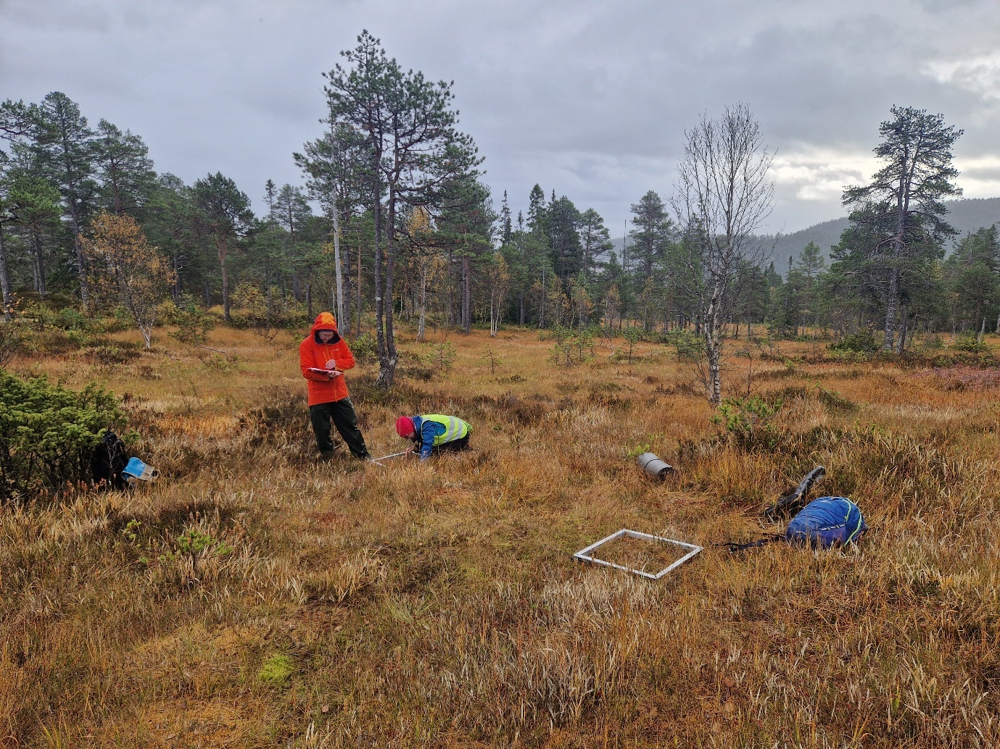

# Trøndertorvmose (*Sphagnum troendelagicum*)
Magni Olsen Kyrkjeeide, Fia Bengtsson, Kristian Hassel
2026-11-11

- [Oppsummering](#oppsummering)
- [English summary](#english-summary)
- [1. Innledning](#1-innledning)
- [2. Formål med delprosjektet](#2-formål-med-delprosjektet)
- [3. Overvåkingslokalitetene](#3-overvåkingslokalitetene)
- [4. Datainnsamling](#4-datainnsamling)
- [5. Dataanalyser](#5-dataanalyser)
- [6. Resultater](#6-resultater)
- [7. Oppsummering](#7-oppsummering)
- [8. Referanser](#8-referanser)
- [9. Author contributions](#9-author-contributions)

<!--# Rapporten leser kun filer i img/. Tekstgrunnlaget er «Vedlegg årsrapport 2026_mal_trøndertorvmose.docx» (P:/09 Trøndertorvmose/2026). -->

<!--# The following parts are autogenerated. Do not edit. -->

> [!NOTE]
>
> Denne siden er generert fra
> [`Trondertorvmose.qmd`](Trondertorvmose.qmd). Ikke rediger `README.md`
> direkte. For å oppdatere: kjør skriptene i [`code/`](code/) og kjør
> `pixi run render`. Rapporten har ingen egne analyser; figurene ligger
> i [`img/`](img/).

> **Recommended citation**: Kyrkjeeide, M.O., Bengtsson, F. & Hassel, K.
> 2026. Trøndertorvmose (ID: XX_YYYY_ZZZ) v. 0.1.0. ecRxiv:
> https://github.com/NINAnor/ecRxiv/tree/main/indicators/XX_YYYY_ZZZ

> [!TIP]
>
> ### Metadata
>
> 

>
> Tabell 1: Indicator metadata
>
> 

>
> | Variable | Value |
> |:---|:---|
> | Indicator ID | INDICATORID |
> | Indicator Name | Trøndertorvmose |
> | verbatimName | Trøndertorvmose |
> | Country | Norway |
> | Continent | Europe |
> | Realm | write realm here |
> | Biome | write biome here |
> | Ecosystem | write ecosystem here |
> | verbatimEcosystem | Myr i nordlige deler av Trøndelag |
> | Year added | 2026 |
> | Last update | 2026 |
> | Version | 0.1.0 |
> | Version comment | Første versjon, med utvidet overvåking og vekstforsøk i 2026 |
> | Precision |  |
>
> 

>
> 

> [!TIP]
>
> ### Log
>
> <!--# Legg til en kort linje for hver oppdatering -->
>
> 11. nov. 2026 – Første versjon

## Oppsummering

Trøndertorvmose er en endemisk og prioritert art for Norge. Den finnes
kun i nordlige deler av Trøndelag og er kjent fra omtrent 30
lokaliteter. Det er ingen pågående tiltak for arten, men
bevaringsutsetting kan være aktuelt på lokaliteter hvor arten går tapt.
Vi tester derfor hvordan arten kan oppformeres i veksthus. I tillegg har
vi i 2026 utvidet eksisterende overvåking av arten til å inkludere den
sørvestlige delen av utbredelsen, som først ble kjent fra 2019, etter at
eksisterende overvåking ble etablert.

## English summary

<!--# Skrives av prosjektledergruppa. Teksten under er fra utkastet. -->

*Sphagnum troendelagicum* is endemic to and a priority species in
Norway. It is only found in northern parts of Trøndelag county, at about
30 sites. There are no ongoing actions, but translocation may be
necessary at sites where the species goes extinct. Thus, we are
currently testing how the species can be propagated vegetatively in the
greenhouse. In addition, we have extended monitoring of the species into
the southwestern part of its distribution, as it was unknown from this
area when the monitoring of the species was established.

## 1. Innledning

Trøndertorvmose (*Sphagnum troendelagicum*) er en endemisk og prioritert
art for Norge, og vurdert som sterkt truet (EN) på Norsk rødliste for
arter (Høitomt mfl. 2021). Den finnes bare nord i Trøndelag, i kommunene
Steinkjer, Snåsa, Grong, Høylandet, Overhalla og Namsos. Så langt er den
kjent fra omtrent 30 lokaliteter. Trusler mot arten er nedbygging og
klimaendringer, men det er ukjent hvordan klimaendringer vil påvirke
bestanden.

Det er ingen pågående tiltak for trøndertorvmose, men det kan være
aktuelt å styrke enkeltbestander gjennom bevaringsutsetting. I dette
prosjektet har vi utvidet pågående overvåking av arten (Hassel mfl.
2020) til den sørvestlige delen av utbredelsen
(<a href="#fig-kaldal" class="quarto-xref">Figur 1</a>), hvor arten ikke
var kjent da overvåkingen ble etablert i 2016. I tillegg har vi forsøkt
å oppformere individer av trøndertorvmose i veksthus, og vi har nå
utvidet forsøket til å oppformere individer i bioreaktorer i veksthus
for å teste om det er mer effektivt. Bioreaktorene står i veksthuset på
Ringve botaniske hage i Trondheim.

Figur 1: Lokaliteten Kaldal i Namsos kommune er et av de nyoppdagede
funnstedene for trøndertorvmose. På lokaliteten ble det etablert fire
fastruter for overvåking av arten.

<!--# Fotograf mangler i figurteksten. -->

## 2. Formål med delprosjektet

### 2.1 Målsetning med tiltakene

Målsetningen med overvåkingen er å øke kunnskapen om bestandsvariasjon
hos trøndertorvmose og følge med på om arten er i tilbakegang.

Målsetningen med vekstforsøket er å undersøke om vi kan oppformere arten
på en effektiv måte i veksthus, slik at vi ikke trenger å samle
individer *in situ* ved bevaringsutsetting.

Det er ingen etablerte indikatorer for overvåkingen eller vekstforsøket.
For vekstforsøket vil en økning i biomasse av trøndertorvmose indikere
at det fungerer. Det er først når det eventuelt gjennomføres
bevaringsutsetting for trøndertorvmose, at det er aktuelt å identifisere
indikatorer som kan brukes til å evaluere effekten av tiltaket.

### 2.2 Formål med overvåking

Vi vil måle tilvekst i bioreaktorene gjennom vekstforsøket for å se om
vi kan øke biomassen av trøndertorvmose med denne metoden.

### 2.3 Forventninger

Vi forventer at trøndertorvmose formerer seg vegetativt og vokser i
bioreaktorene.

## 3. Overvåkingslokalitetene

### 3.1 Beskrivelse av lokalitetene

Utvidet overvåking ble etablert på Henningslettet i Steinkjer og på
Korsmyra og Kaldal i Namsos. Til sammen ble det etablert ti fastruter
for overvåking av trøndertorvmose. Disse kommer i tillegg til de
eksisterende 14 fastrutene, som ble analysert med finansiering fra
Statsforvalteren i Trøndelag. De 24 rutene ble analysert fra 28.
september til 1. oktober.

Vekstforsøket gjennomføres i veksthuset på Ringve botaniske hage fra
november 2026. Ferskt materiale til forsøket ble samlet i Kaldal 29.
september med innsamlingstillatelse fra Statsforvalteren i Trøndelag.

### 3.2 Tiltak

Det gjennomføres ikke tiltak for trøndertorvmose.

## 4. Datainnsamling

Datainnsamlingen er gjennomført på tre lokaliteter: Henningslettet
(Steinkjer) og Korsmyra og Kaldal (Namsos). Fastrutene ble etablert på
steder med trøndertorvmose. Fastrutene er 0,5 × 0,5 m og delt inn i 16
småruter. De nyetablerte rutene ble plassert i retning sør–nord, med en
bambuspinne i nordvestre hjørne og metallrør i de øvrige hjørnene. De
ble deretter analysert med småruta i nordvestre hjørne som nummer 1.
Hver rute ble fotografert fra sør for å gjøre det enklere å finne dem
igjen ved neste rekartlegging. Ved hver fastrute ble det målt torvdybde
i fire punkter, ett i hver himmelretning, omtrent 1 meter fra kanten av
analyseruta. En sammenstilling av datainnsamlingen er inkludert i NINA
Prosjektnotat 788, som er levert til Statsforvalteren i Trøndelag.

<!--# Indikatortabellen i Word-utkastet var kopiert fra dragehode. Tabellen under er satt opp ut fra teksten over og variablene i datafila (Vegetasjonsanalyser_overvåking_data.xlsx), og må kontrolleres av forfatterne. Fyll inn hvor ofte tilveksten i vekstforsøket måles. -->

Tabell 2: Indikatorer og datainnsamling for trøndertorvmose.

| Indikator | Variabel registrert i felt | Utvalgsenhet | Utlegging av utvalgsenhet | Antall utvalgsenheter | Frekvens for datainnsamling |
|:---|:---|:---|:---|:---|:---|
| Forekomst av trøndertorvmose | Forekomst i 16 småruter per fastrute | Fastrute 0,5 × 0,5 m | Subjektivt, på forekomster av trøndertorvmose | 24 fastruter (14 eksisterende og 10 nye) | Hvert femte år (2016, 2021, 2026) |
| Dekning av trøndertorvmose | Dekning (%) i fastruta | Fastrute 0,5 × 0,5 m | Subjektivt, på forekomster av trøndertorvmose | 24 fastruter | Hvert femte år |
| Artssammensetning | Forekomst av alle moser og karplanter i 16 småruter | Fastrute 0,5 × 0,5 m | Subjektivt, på forekomster av trøndertorvmose | 24 fastruter | Hvert femte år |
| Torvdybde | Torvdybde (cm) i fire punkter, ett i hver himmelretning, ca. 1 m fra ruta | Fastrute | Ved hver fastrute | 24 fastruter | 2026 |
| Tilvekst i vekstforsøk | Biomasse av trøndertorvmose | Bioreaktor | Veksthus, Ringve botaniske hage | – | Gjennom vinteren 2026/27 |

## 5. Dataanalyser

Det er ikke gjennomført dataanalyser for trøndertorvmose i 2026. Det er
første gang det samles overvåkingsdata fra den sørvestlige delen av
utbredelsesområdet til arten. Overvåkingsdata er samlet fra øvrige deler
av utbredelsesområdet i 2016, 2021 og 2026 på oppdrag fra
Statsforvalteren i Trøndelag.

## 6. Resultater

Dataene samlet i overvåkingen av trøndertorvmose fra 2016 til 2026 skal
analyseres vinteren 2027. Ambisjonen er å publisere resultatene i en
vitenskapelig artikkel. Resultatene vil bidra til å vurdere
bestandsutviklingen for trøndertorvmose. Det er særlig lokaliteten i
Snåsa som tidligere er beskrevet som aktuell for bevaringsutsetting,
fordi det er observert tilbakegang av arten her. I 2026 ble det
observert kun et fåtall individer på lokaliteten.

Vekstforsøket er igangsatt, og eventuell tilvekst måles gjennom vinteren
2026/27.

<!--# Fyll inn hvor ofte tilveksten måles (utkastet: «hver .. måned»). -->

## 7. Oppsummering

### 7.1 Hva viser årets resultater

Overvåkingen av arten viser at det er svært få individer av
trøndertorvmose i Snåsa.

### 7.2 Anbefaling for videreføring

Overvåkingen av arten bør fortsette hvert femte år. Neste datainnsamling
bør skje i 2031.

Det var svært få individer av trøndertorvmose på lokaliteten i Snåsa i
2026. Bevaringsutsetting bør testes på lokaliteten fra 2027. Materialet
fra vekstforsøket kan benyttes om forsøket er vellykket. Hvis ikke, bør
det vurderes om det skal brukes ferskt innsamlet materiale fra en
nærliggende lokalitet. Bevaringsutsettingen bør overvåkes i 2027, 2029
og 2031 for å evaluere effekten.

## 8. Referanser

Hassel, K., M. O. Kyrkjeeide, M. F. Israelsen, O. Meleshko, H. K.
Stenøien, og K. I. Flatberg. 2020. *Populasjonsstruktur, vekst og
økologi hos den prioriterte arten trøndertorvmose *Sphagnum
troendelagicum**. NTNU Vitenskapsmuseet naturhistorisk rapport Nos.
2020-1. NTNU Vitenskapsmuseet.

Høitomt, T., H. H. Blom, J. G. Brynjulvsrud, K. Hassel, og M. O.
Kyrkjeeide. 2021. *Moser: Vurdering av trøndertorvmose *Sphagnum*
(Cuspidata) *troendelagicum* for Norge. Rødlista for arter 2021*.
Artsdatabanken.
<https://lister.artsdatabanken.no/rodlisteforarter/2021/19432>.

## 9. Author contributions

Kristian Hassel har bidratt med feltarbeid. Fia Bengtsson har bidratt
med feltarbeid og rapportering, samt etablert vekstforsøket. Magni Olsen
Kyrkjeeide har bidratt med feltarbeid og skrevet rapporten.

Dataene samlet fra de nyetablerte fastrutene for trøndertorvmose
(Henningslettet, Korsmyra og Kaldal) er delt på Living Norway.

<!--# Fyll inn adresse (DOI/lenke) til datasettet på Living Norway. -->
